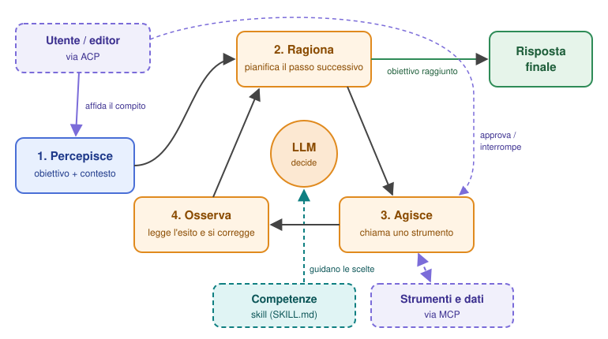
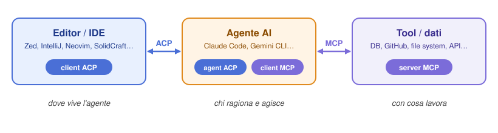
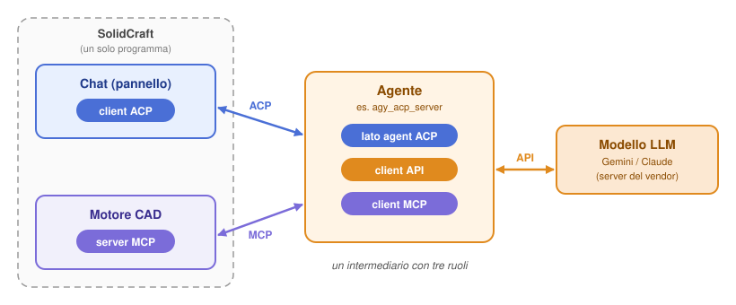
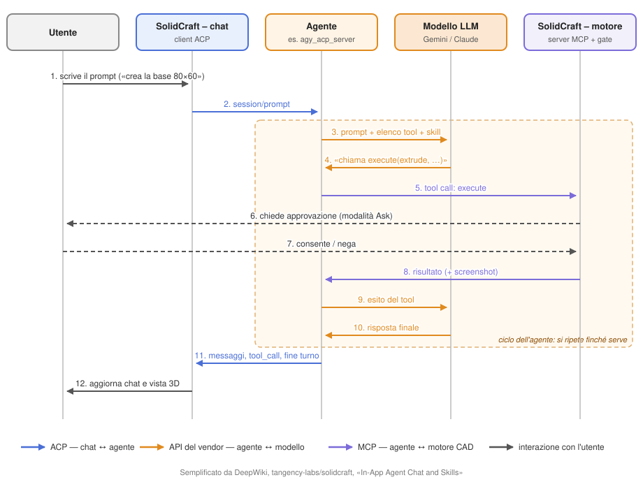
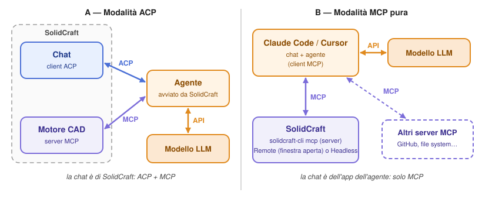
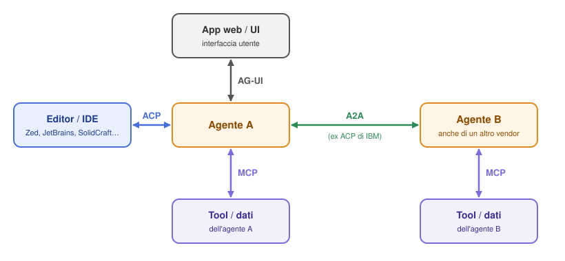
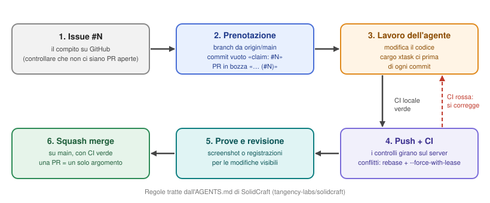

# MCP vs ACP nella gestione degli agenti AI
*Dispensa — aggiornata a novembre 2026*

---

## 0. Attenzione alla sigla: quale "ACP"?

Prima di confrontare, va chiarito un equivoco frequente. **"ACP" indica due protocolli diversi:**

| Sigla | Nome completo | Origine | Livello | Stato oggi |
|---|---|---|---|---|
| ACP | **Agent Client Protocol** | Zed Industries (+ JetBrains), 2025 | Editor/IDE ↔ agente | **Attivo**, in forte crescita [1][7] |
| ACP | **Agent Communication Protocol** | IBM Research (BeeAI), marzo 2025 | Agente ↔ agente | **Confluito in A2A** (ago 2025), archiviato [8][11] |

Oggi, quando si parla di "ACP" nel contesto degli agenti di coding, si intende quasi sempre **l'Agent Client Protocol di Zed** [7][8]. La dispensa si concentra su questo, ma la sezione 5 tratta anche l'ACP di IBM per completezza.

> Esiste anche un terzo "ACP", l'*Agentic Commerce Protocol* (pagamenti/e-commerce agentico), che non c'entra con questo confronto [9].

---

## Prima di tutto: agente, skill, contesto e programmazione agentica

### Che cos'è un agente?

> Un **agente AI** è un sistema software in cui un **modello linguistico (LLM)** riceve un **obiettivo** e lo persegue **in autonomia**, decidendo da sé, passo dopo passo, quali **azioni** compiere (usando **strumenti**), osservandone i **risultati** e continuando finché l'obiettivo non è raggiunto o serve l'intervento di un umano.

In una formula: **agente = modello + strumenti + ciclo decisionale + obiettivo**.

### Il ciclo dell'agente

<p align="center">
  
</p>

<p align="center"><em>Figura 1 — Il ciclo dell'agente. Il ciclo ragiona → agisce → osserva si ripete finché l'obiettivo è raggiunto; l'utente affida il compito e supervisiona (ACP), gli strumenti sono raggiunti tramite MCP; le skill forniscono al modello le competenze per scegliere come agire.</em></p>

### I componenti

| Componente | Cosa fa | Esempio |
|---|---|---|
| **Modello (LLM)** | Il "cervello": interpreta, ragiona, decide | Claude, Gemini, GPT |
| **Obiettivo** | Il compito da portare a termine | "Correggi il test che fallisce" |
| **Strumenti (tool)** | Le "mani": permettono di agire sul mondo | leggere file, eseguire comandi, interrogare un DB |
| **Contesto** | Ciò che il modello vede a ogni chiamata (vedi "E il contesto?") | cronologia, file aperti, risultati precedenti |
| **Ciclo (loop)** | Ripete ragiona → agisce → osserva | più passi senza nuovi input dell'utente |
| **Supervisione umana** | Permessi, approvazioni, interruzioni | "Posso eseguire `rm`?" → l'utente approva |

### Agente vs chatbot vs workflow

| | **Chatbot** | **Workflow automatizzato** | **Agente** |
|---|---|---|---|
| Chi decide i passi | Nessuno: una domanda, una risposta | Il programmatore, in anticipo | **Il modello**, durante l'esecuzione |
| Usa strumenti | No (o al massimo uno) | Sì, in sequenza fissa | Sì, scelti dinamicamente |
| Gestisce imprevisti | No | Solo quelli previsti | Sì, si adatta agli esiti |
| Esempio | Risponde "come si scrive un for in Python?" | Pipeline fissa: riassumi → traduci → invia | Trova il bug, lo corregge, lancia i test, riprova se falliscono |

### Perché serve per capire MCP e ACP

Con questa definizione i due protocolli si collocano subito:

- **MCP** standardizza le **mani** dell'agente: come accede agli *strumenti* e al *contesto*.
- **ACP** standardizza la **postazione** dell'agente: come l'utente gli affida l'*obiettivo*, vede le sue azioni ed esercita la *supervisione* (permessi, diff, interruzioni) dall'editor.
- **A2A** (sezione 5) standardizza i **colleghi**: come un agente delega compiti a *un altro agente*.

### E le skill?

Accanto agli strumenti, un agente ha bisogno di **sapere come usarli bene**. A questo servono le skill.

> Una **skill** (*Agent Skill*) è un **pacchetto di istruzioni e conoscenze riutilizzabili** che insegna a un agente a svolgere un certo tipo di compito: procedure, convenzioni, esempi e, se servono, script e file di supporto. L'agente la **carica solo quando il compito la richiede** [15].

È un **concetto generico**, non legato a un solo prodotto. Nata in Claude, è stata pubblicata da Anthropic come **standard aperto** il 18 dicembre 2025 (specifica su agentskills.io) ed è adottata da molti agenti: Claude Code, Codex CLI, Gemini CLI, GitHub Copilot, Cursor, VS Code e altri [15][16].

#### Com'è fatta

Una skill è semplicemente una **cartella** [15][16]:

```
nome-skill/
├── SKILL.md        ← obbligatorio: intestazione YAML (name, description) + istruzioni in Markdown
├── scripts/        ← facoltativo: script eseguibili (Python, Bash, JS)
├── references/     ← facoltativo: documentazione di approfondimento
└── assets/         ← facoltativo: modelli, schemi, dati
```

Esempio minimo di `SKILL.md`:

```markdown
---
name: modellazione-contenitori
description: Usala quando l'utente chiede di modellare un contenitore stampabile in 3D (base + coperchio).
---
# Modellare un contenitore
1. Crea la base come corpo separato chiamato "Base".
2. Usa uno spessore di parete di almeno 2 mm.
3. Dopo ogni blocco di lavorazioni, fai uno screenshot e verifica le misure.
```

#### Caricamento progressivo (*progressive disclosure*)

Il punto chiave delle skill è che **non riempiono il contesto del modello** [15]:

1. **All'avvio** l'agente legge solo `name` e `description` di ogni skill (poche decine di token ciascuna).
2. **Quando un compito corrisponde** alla descrizione, carica il testo completo di `SKILL.md`.
3. **Solo se servono**, apre i file in `references/` o esegue gli `scripts/`.

Per questo la `description` è la parte più importante: è ciò che l'agente usa per decidere se attivare la skill.

#### Skill vs tool MCP

| | **Tool MCP** | **Skill** |
|---|---|---|
| Cos'è | Una **capacità**: una funzione che l'agente può invocare | Una **competenza**: istruzioni su *come* e *quando* fare le cose |
| Dove gira | In un server esterno (processo separato) | Dentro il contesto dell'agente (testo + eventuali script locali) |
| Formato | Server che parla JSON-RPC | Cartella con `SKILL.md` |
| Metafora | Le **mani** (gli attrezzi) | Il **manuale di mestiere** (come usare gli attrezzi) |
| Esempio | `execute("extrude", …)` | "Per un contenitore: prima la base, poi il coperchio, controlla con uno screenshot" |

Le due cose si **combinano**: la skill dice all'agente *quale sequenza di tool* usare e con quali convenzioni; il tool MCP esegue materialmente l'azione.

> **Esempio concreto — SolidCraft.** Il CAD SolidCraft espone i suoi comandi tramite un server MCP (`execute`, `batch`, `screenshot`, `export`...) e affianca una skill, `skills/solidcraft-modeling/reference.md`, che documenta parametri, convenzioni di nome ed espressioni: l'MCP dà all'agente la *possibilità* di modellare, la skill gli insegna a *farlo correttamente* [17].

In sintesi, completando la formula di prima: **agente = modello + strumenti (MCP) + competenze (skill) + ciclo decisionale + obiettivo**, ospitato in un'interfaccia (ACP).

### E il contesto?

Agente e skill funzionano solo grazie a un terzo elemento: il **contesto**.

> Il **contesto** è **tutto il testo (e le immagini) che il modello riceve in una singola chiamata**: è l'unica cosa che il modello "vede" e "sa" in quel momento. Comprende le istruzioni di sistema, le definizioni dei tool, le skill caricate, la cronologia della conversazione, i file allegati e i risultati dei tool.

| Parte del contesto | Esempio |
|---|---|
| **Istruzioni di sistema** | Regole dell'applicazione o dell'agente ("sei un assistente di modellazione CAD...") |
| **Definizioni dei tool** | Gli schemi dei tool MCP disponibili (`execute`, `screenshot`...) |
| **Skill** | `name` e `description` di tutte; il testo completo di quelle attivate |
| **Cronologia** | Messaggi dell'utente e risposte del modello |
| **Allegati** | File, immagini, viste del modello 3D |
| **Risultati dei tool** | Output di comandi, screenshot, dati letti da un database |

Il contesto ha un limite, la **finestra di contesto**, misurata in **token** (frammenti di parola: in italiano, in media poco meno di una parola ciascuno). Quando una conversazione si avvicina al limite, l'agente deve riassumere o scartare le parti vecchie.

#### Il modello è senza stato

Il punto chiave è che **il modello non ricorda nulla tra una chiamata e l'altra**: le API dei modelli sono *stateless*. La "memoria" di una conversazione esiste solo perché **qualcuno conserva il contesto e lo rimanda per intero a ogni chiamata**. Quel qualcuno è il **client dell'API del modello**, e **dove gira lui, lì vive il contesto**.

#### Dove vive il contesto?

| Scenario | Chi chiama il modello | Dove vive il contesto |
|---|---|---|
| **Agente locale**: Claude Code, Cursor, Antigravity, SolidCraft (ACP o MCP pura) | Il programma agente sul PC | **Sul PC**, nella memoria del programma agente (ed eventualmente nei suoi file di sessione) |
| **Claude da browser** (claude.ai), app desktop e mobile | Il backend di Anthropic | **Sui server di Anthropic**: la conversazione è salvata nell'account |
| **Programma proprio** che usa l'API | Il programma stesso | Dove lo memorizza il programmatore |

**Il caso del browser.** Quando si usa Claude da claude.ai, il browser **non** conserva né rimanda il contesto: invia solo il nuovo messaggio e mostra la risposta. È il backend di Anthropic a ricostruire il contesto a ogni chiamata (cronologia, file caricati, istruzioni del progetto, eventuale memoria, definizioni dei tool) e a passarlo al modello, che resta comunque senza stato. Lo si capisce da un fatto semplice: la stessa chat si può riaprire da un altro dispositivo. Anche gli strumenti lavorano lato server: la ricerca web, l'esecuzione di codice in una sandbox e i connettori MCP remoti sono chiamati dai server di Anthropic, non dal PC. Fa eccezione l'app desktop, che può usare anche server MCP installati sul computer: la conversazione però resta comunque sui server.

| | Agente locale (es. Claude Code, SolidCraft) | Claude da browser |
|---|---|---|
| Dove sta la conversazione | Sul PC | Sui server di Anthropic, nell'account |
| Chi rimanda il contesto al modello | Il programma sul PC, via Internet | Il backend di Anthropic, internamente |
| Dove girano i tool | Sul PC (file, terminale, server MCP locali) | Sui server (ricerca, sandbox, connettori remoti) |
| Si riprende da un altro dispositivo? | No, salvo funzioni apposite | Sì |

In entrambi i casi il **principio è lo stesso**: a ogni chiamata il modello rilegge tutto il contesto. Cambia solo **chi lo conserva** e **da dove parte**.

> **Tre equivoci frequenti**
> - **Prompt caching**: il fornitore conserva *per pochi minuti* la parte iniziale del contesto già inviata, che alla chiamata successiva costa meno. Il contesto viene comunque rimandato: è una cache, non una memoria della conversazione.
> - **Cronologia dell'account e log**: alcuni servizi conservano le conversazioni (per la cronologia o secondo la loro politica sui dati), ma non le usano come contesto delle chiamate successive.
> - **API con stato lato server**: alcune API permettono di lasciare la conversazione al fornitore e inviare solo il messaggio nuovo; anche così, di norma, i token del contesto si pagano a ogni chiamata. Se Antigravity usi questo meccanismo, la documentazione consultata non lo dice.

#### Quanto costa il contesto

Un'osservazione che si sente spesso: *"con Cursor e MCP il contesto vive sul PC e viene rimandato all'AI a ogni richiesta, quindi costa di più"*. È **vero a metà**.

**Cosa è vero.** Le API dei modelli sono **senza stato**: il modello non ricorda nulla tra una chiamata e l'altra. A ogni chiamata il programma agente, che gira sul PC, rimanda **tutto il contesto**: istruzioni di sistema, definizioni dei tool, skill caricate, cronologia della conversazione e risultati dei tool. E siccome l'agente lavora in ciclo, **un solo turno può contenere molte chiamate**: un turno con 5 tool call richiede circa 6 chiamate al modello, ognuna con un contesto un po' più grande della precedente.

> *Esempio puramente illustrativo:* se il contesto iniziale è di 10.000 token e ogni risultato di un tool aggiunge 2.000 token, le chiamate successive inviano 10k, 12k, 14k, 16k... token: il totale cresce molto più in fretta della singola conversazione.

**Cosa non è vero.** Non è una caratteristica di Cursor né di MCP: **vale per qualsiasi agente** (Claude Code, Antigravity, Cursor, Claude da browser...), qualunque sia il protocollo usato per collegarlo. Il protocollo non decide il costo: lo decide **quanto materiale finisce nel contesto**.

**Dove MCP pesa davvero**

- **Definizioni dei tool**: ogni server MCP abilitato aggiunge i suoi schemi a *ogni* richiesta, anche quando non si usano.
- **Risultati dei tool**: uno `screenshot` di SolidCraft è un'immagine, quindi molti token, e resta nella cronologia per le chiamate successive. Lo stesso vale per un'immagine allegata in chat.

**Come si contiene il costo**

| Tecnica | Come aiuta |
|---|---|
| **Prompt caching** | La parte iniziale del contesto, che non cambia, viene letta dalla cache del fornitore a una frazione del prezzo normale |
| **Compattazione** | L'agente riassume la cronologia lunga invece di rimandarla per intero |
| **Pochi server MCP attivi** | Meno definizioni di tool in ogni richiesta |
| **Caricamento progressivo** | Skill e tool caricati solo quando servono (vedi le skill) |
| **Chat nuove per compiti nuovi** | Si riparte da un contesto piccolo |
| **Screenshot solo quando servono** | Le immagini sono tra gli elementi più costosi |

**Chi paga e come.** Con le **API a consumo** si pagano direttamente i token in ingresso e in uscita. Con gli **abbonamenti** (Cursor, Claude Pro/Max, account Google per Antigravity) di solito non si paga a token, ma si consumano **quote o limiti d'uso**: un contesto grande li esaurisce prima.

#### Dove vivono le skill?

**Le skill vivono dove le cerca l'agente: di solito su disco, come cartelle.** Una skill è una cartella con `SKILL.md` (vedi sopra), quindi "vive" in un file system:

| Dove | Esempio | Note |
|---|---|---|
| **Sul PC, a livello utente** | Claude Code: `~/.claude/skills/` | Disponibili in tutti i progetti |
| **Sul PC, nel progetto** | Claude Code: `.claude/skills/` nella cartella del progetto | Condivisibili via repository con chi lavora al progetto |
| **Dentro un prodotto o plugin** | SolidCraft: `skills/solidcraft-modeling/` nel suo repository [17] | Le distribuisce chi fa il prodotto |
| **Nel cloud del fornitore** | Skill caricate nell'account Claude o tramite API | Vivono sui server del fornitore e i loro script girano nella sua sandbox |

Indipendentemente da dove sono salvate, il percorso verso il modello è sempre lo stesso:

1. **All'avvio** l'agente legge dal disco solo `name` e `description` e li mette nel contesto (poche decine di token per skill).
2. **Quando serve**, legge il testo completo di `SKILL.md` e lo aggiunge al contesto: da quel momento **viaggia verso il modello a ogni chiamata**, come il resto della cronologia.
3. Gli **script** della skill (`scripts/`) li esegue l'agente **sul PC** (per un agente locale): al modello arriva solo il loro output.

#### La formula completa

**agente = modello + contesto + strumenti (MCP) + competenze (skill) + ciclo decisionale + obiettivo**, ospitato in un'interfaccia (ACP o chat web).

### E la programmazione agentica?

> La **programmazione agentica** (*agentic coding*) è lo **sviluppo di software delegato a un agente**: invece di chiedere al modello un frammento di codice da copiare, gli si affida un **obiettivo** e l'agente lo porta a termine da solo con il suo ciclo (ragiona → agisce → osserva). Legge i file del progetto, li modifica, esegue comandi e test, osserva gli errori, si corregge e ripete finché il compito è fatto; l'umano supervisiona.

È la definizione di agente applicata alla programmazione:

| Elemento dell'agente | Nella programmazione agentica |
|---|---|
| **Modello** | Ragiona sul codice e decide le modifiche |
| **Contesto** | I file del progetto, la cronologia, gli errori dei test |
| **Strumenti** | File system, terminale, test, git, server MCP (database, GitHub...) |
| **Skill** | Convenzioni e procedure del progetto |
| **Interfaccia** | L'editor (via ACP) o il terminale |

**Confronto con i modi precedenti di usare l'AI per programmare**

| | Completamento automatico | Chat assistita | Programmazione agentica |
|---|---|---|---|
| Cosa si chiede | Niente: suggerisce la riga successiva | "Scrivimi una funzione che…" | "Aggiungi il login e fai passare i test" |
| Chi agisce sui file | L'utente, accettando il suggerimento | L'utente, copiando e incollando | **L'agente** |
| Chi verifica | L'utente | L'utente | L'agente (esegue i test), poi l'utente |
| Passi per richiesta | Uno | Uno | **Molti**, in ciclo |
| Ruolo di chi programma | Scrive il codice | Scrive e integra | **Definisce, supervisiona, revisiona** |

Il lavoro di chi programma si sposta: meno scrittura riga per riga, più **specificare bene l'obiettivo**, **approvare le azioni** (i permessi), **rileggere le modifiche** (i diff mostrati dall'editor) e **curare il contesto** (buone skill, istruzioni di progetto, pochi tool inutili).

> **Due sensi del termine.** Si parla di programmazione agentica anche per indicare il **costruire agenti**: scrivere il ciclo, i server MCP, le skill, le integrazioni ACP. È il lato di chi sviluppa SolidCraft (che espone un server MCP e scrive una skill) o di chi sviluppa un agente come `agy_acp_server`. Chi *usa* gli agenti per programmare si appoggia a ciò che altri hanno *costruito*.
>
> Lo stesso schema vale fuori dal codice: nel caso SolidCraft le feature 3D non si disegnano a mano, si descrivono e l'agente le costruisce con i tool del CAD, mentre l'utente approva e controlla. Si potrebbe parlare di **modellazione agentica**.

---

## 1. L'idea in una frase

- **MCP (Model Context Protocol)** → collega un **agente ai suoi strumenti e dati** (database, file, API, servizi).
- **ACP (Agent Client Protocol)** → collega un **editor/IDE a un agente**, così l'utente può usare qualsiasi agente dentro qualsiasi editor.

Non sono concorrenti: **lavorano a livelli diversi e si usano insieme** [5][13].

<p align="center">
  
</p>

<p align="center"><em>Figura 2 — ACP e MCP lavorano su due confini diversi.</em></p>

---

## 2. MCP — Model Context Protocol

### Cos'è
Standard aperto introdotto da **Anthropic a fine 2024** per dare ai modelli/agenti un modo uniforme di accedere a contesto esterno [4][5]. Oggi è governato in modo neutrale (Agentic AI Foundation, Linux Foundation) [9].

### Problema che risolve
Il problema **N×M** delle integrazioni: senza standard, ogni applicazione AI doveva scrivere un connettore ad hoc per ogni servizio. Con MCP, un servizio espone **un server MCP** e qualsiasi client compatibile lo può usare.

### Ruoli
| Ruolo | Chi è |
|---|---|
| **Host / Client MCP** | L'applicazione AI o l'agente (Claude, Claude Code, un IDE con AI...) |
| **Server MCP** | Il "wrapper" di uno strumento o di una sorgente dati |

### Primitive principali
- **Tools** — funzioni che l'agente può invocare (es. `query_db`, `create_issue`).
- **Resources** — dati leggibili (file, record, documenti).
- **Prompts** — template di prompt riutilizzabili esposti dal server.
- Lato client: *sampling*, *elicitation* (richiesta di input all'utente), *roots*.

### Trasporto
JSON-RPC 2.0 su **stdio** (server locali) o **Streamable HTTP** (server remoti), con autenticazione OAuth 2.1 per i server HTTP [4][9].

### Ruolo nella gestione degli agenti
MCP definisce **cosa l'agente può fare e vedere**: è il livello delle *capacità*. Gestire un agente via MCP significa decidere quali server/tool abilitare, con quali permessi e su quali dati.

---

## 3. ACP — Agent Client Protocol

### Cos'è
Standard aperto creato da **Zed Industries (agosto 2025)**, licenza Apache 2.0, sviluppato poi insieme a **JetBrains** [1][3][12]. È esplicitamente modellato sul **LSP (Language Server Protocol)**: come LSP ha separato l'"intelligenza del linguaggio" dall'editor, ACP separa l'**agente AI** dall'**interfaccia dell'editor** [6][7].

### Problema che risolve
Anche qui un problema N×M: ogni agente (Claude Code, Gemini CLI, Codex, Copilot CLI...) doveva costruire un'integrazione dedicata per ogni editor, e ogni editor doveva sviluppare un pannello per ogni agente. Con ACP: **l'agente implementa ACP una volta e gira in tutti gli editor compatibili** [1][7].

### Ruoli (attenzione: invertiti rispetto a MCP!)
| Ruolo | Chi è |
|---|---|
| **Client ACP** | L'editor/IDE (Zed, IDE JetBrains, Neovim, Emacs...) |
| **Agente ACP** | L'agente di coding, spesso avviato come sottoprocesso |

### Cosa standardizza [3][5]
- **Inizializzazione** e negoziazione delle *capabilities*.
- **Sessioni** di lavoro e invio dei prompt dell'utente.
- **Streaming** degli aggiornamenti (messaggi, piani, tool call in corso).
- **Richieste di permesso** all'utente (es. "posso eseguire questo comando?").
- Lettura/scrittura file tramite l'editor, **visualizzazione dei diff**, terminali.
- **Cancellazione** di un'operazione in corso.

### Trasporto
JSON-RPC 2.0, tipicamente su **stdio** (agente come processo figlio dell'editor); supporto per agenti remoti via HTTP [6][9].

### Ecosistema (2025–2026)
- Ago 2025: lancio con **Gemini CLI** come prima integrazione esterna [1][13].
- Ott–dic 2025: partnership e supporto nativo negli **IDE JetBrains** [1][7].
- 28 gen 2026: **ACP Registry**, directory di agenti installabili con un clic da Zed e JetBrains [2][7].
- Gen 2026: **GitHub Copilot CLI** aggiunge ACP (public preview) [13]; in seguito anche Cursor, Goose, OpenHands, Codex e molti altri [1][13].
- Apr 2026: ACP è la funzionalità di punta di **Zed 1.0** [7].

### Ruolo nella gestione degli agenti
ACP definisce **come l'utente interagisce con l'agente e lo supervisiona**: è il livello dell'*interfaccia e del controllo umano* (approvazioni, diff, sessioni, interruzioni).

---

## 4. Confronto diretto MCP vs ACP (Agent Client Protocol)

*Fonti della tabella: [3][4][5][6].*

| Dimensione | **MCP** | **ACP** (Agent Client Protocol) |
|---|---|---|
| Domanda a cui risponde | *Con quali strumenti/dati lavora l'agente?* | *In quale interfaccia vive l'agente?* |
| Confine che standardizza | Agente ↔ tool/dati | Editor ↔ agente |
| Chi è il client | L'agente / app AI | L'editor / IDE |
| Chi è il server | Il wrapper del tool | L'agente |
| Origine | Anthropic, fine 2024 | Zed Industries, ago 2025 (+ JetBrains) |
| Ispirazione | "USB-C per l'AI" | LSP per gli agenti |
| Formato messaggi | JSON-RPC 2.0 | JSON-RPC 2.0 |
| Trasporto tipico | stdio / Streamable HTTP | stdio (sottoprocesso) / HTTP |
| Concetti chiave | tools, resources, prompts | sessioni, prompt turn, permessi, diff, piani |
| Dominio | Generale (chat, agenti, automazioni) | Soprattutto coding agent e IDE |
| Human-in-the-loop | Indiretto (elicitation, decide l'host) | Centrale (permessi e approvazioni in UI) |
| Distribuzione | Directory/registry di server MCP | ACP Registry (agenti) |

### Il punto chiave
Sono **complementari e componibili**. Esempio tipico:

1. **Zed** (client ACP) avvia **Claude Code** (agente ACP).
2. Claude Code si collega a un **server MCP** per accedere al database o a GitHub.
3. L'utente vede in Zed i diff e approva le modifiche (ACP); l'agente interroga il DB (MCP) [6].

Anzi, ACP prevede che l'editor possa **passare all'agente la configurazione dei server MCP** dell'utente: i due protocolli sono pensati per incastrarsi [3].

### Caso di studio: SolidCraft (chat, prodotto software e agente)

**SolidCraft** è un CAD 3D open source con una chat in cui si può collegare un agente esterno (Claude Code, Antigravity, Codex...). È un ottimo esempio perché **lo stesso programma ricopre due ruoli** [17][18]:

- **client ACP**: la chat avvia l'agente come sottoprocesso e gli parla via ACP;
- **server MCP**: il motore CAD espone i suoi comandi (`list_commands`, `execute`, `batch`, `inspect_design`, `screenshot`, `export`...) tramite il server `solidcraft-cli mcp --connect`, che SolidCraft passa all'agente all'apertura della sessione (`session/new`).

L'agente, dunque, non "sa disegnare": riceve il prompt dalla chat (ACP), chiede al modello cosa fare (API del vendor) e **richiama SolidCraft** per eseguire le operazioni (MCP). Il cerchio si chiude sullo stesso prodotto.

**I ruoli di ciascuno**

L'agente è un **intermediario con tre ruoli**: riceve il lavoro (ACP), lo fa ragionare al modello (API) e lo fa eseguire (MCP).

<p align="center">
  
</p>

<p align="center"><em>Figura 3 — Chi è client e chi è server: SolidCraft compare ai due capi, con ruoli opposti.</em></p>

| Collegamento | Ruolo dell'agente | Controparte |
|---|---|---|
| **ACP** | lato **agent** (in pratica fa da "server": viene avviato dal client e risponde alle sue richieste) | la chat di SolidCraft, **client ACP** |
| **MCP** | **client** | il motore di SolidCraft, **server MCP** |
| **API del vendor** | **client** | i server di Google o Anthropic che eseguono il modello |

> **Precisazione terminologica.** La specifica ACP non usa la parola "server": le due parti si chiamano **client** e **agent** [3]. Il motivo è che in ACP le richieste JSON-RPC viaggiano **in entrambe le direzioni**: la chat invia `session/prompt` all'agente, ma anche l'agente può fare richieste alla chat, per esempio `session/request_permission` o la lettura di un file tramite l'editor. "Server ACP" va bene come intuizione, "lato agent" è il termine corretto.

Nel caso di Antigravity: `agy_acp_server.exe` è il lato agent per SolidCraft, è client MCP verso `solidcraft-cli mcp --connect` ed è client dell'API Gemini.

**Un turno di conversazione nel tempo**

La Figura 3 mostra *chi* sono gli attori; la Figura 4 mostra *in che ordine* si parlano.

<p align="center">
  
</p>

<p align="center"><em>Figura 4 — Un turno di conversazione in SolidCraft (semplificato da [17]). Blu: ACP; arancio: API del modello; viola: MCP; grigio: utente.</em></p>

**Lettura passo per passo**

| Passi | Chi parla con chi | Protocollo | Cosa succede |
|---|---|---|---|
| 1 | Utente → chat | — | L'utente scrive la richiesta nel pannello di SolidCraft |
| 2 | Chat → agente | **ACP** | La chat inoltra il prompt (`session/prompt`) |
| 3–4 | Agente ↔ modello | **API del vendor** | L'agente manda prompt, elenco dei tool e skill; il modello decide quale tool chiamare |
| 5 | Agente → motore CAD | **MCP** | L'agente invoca il tool (es. `execute` con un'estrusione) |
| 6–7 | Motore (gate) ↔ utente | — | Il controllo permessi (`gate.rs`) chiede conferma se la modalità è *Ask* (le altre sono *Edits* e *All*) |
| 8 | Motore → agente | **MCP** | Il risultato torna all'agente, eventualmente con uno screenshot |
| 9–10 | Agente ↔ modello | **API del vendor** | Il modello valuta l'esito: nuovo tool (si ripete il ciclo) o risposta finale |
| 11–12 | Agente → chat → utente | **ACP** | Messaggi, `tool_call` e fine turno arrivano in streaming; la chat aggiorna conversazione e vista 3D |

**Cosa notare**

- I passi 3–10 della Figura 4 sono il **ciclo dell'agente** della Figura 1: ragiona (3–4), agisce (5), osserva (8–9).
- Nell'inizializzazione ACP SolidCraft **non concede all'agente accesso diretto a file system e terminale**: ogni modifica al modello passa per MCP, quindi per il gate dei permessi [17].
- La **skill** `solidcraft-modeling` insegna all'agente parametri e convenzioni dei comandi: senza, l'agente avrebbe i tool ma non saprebbe usarli bene [17].
- Il **modello** (Gemini, Claude...) non parla mai direttamente con SolidCraft: tutto passa per il programma agente.

> **Nota — dove nasce la richiesta di permesso.** Nella figura, come nel diagramma originale di SolidCraft [17], la richiesta di approvazione (passi 6–7) parte dal **gate del motore CAD**, cioè dal lato MCP: è SolidCraft a controllare ogni tool call prima di eseguirla. Nella **specifica ACP generica**, invece, è l'**agente** a chiedere il permesso al client prima di un'azione delicata, con il metodo `session/request_permission`: la chat mostra la richiesta e restituisce la scelta dell'utente (consenti una volta, consenti sempre, rifiuta) [3].
>
> | | Permesso via ACP (generico) | Permesso via gate MCP (SolidCraft) |
> |---|---|---|
> | Chi decide di chiedere | L'agente | Il prodotto che esegue il tool |
> | Messaggio | `session/request_permission` (agente → client) | Controllo interno (`gate.rs`) prima dell'esecuzione |
> | Vantaggio | Funziona con qualsiasi editor ACP | Il controllo non dipende dalla "buona volontà" dell'agente |
>
> I due meccanismi non si escludono: un prodotto può usarli entrambi. Il gate lato esecuzione è però la difesa più robusta, perché si applica anche a un agente che non chiede il permesso.

### Due modalità di collegamento: ACP oppure MCP puro

SolidCraft si può collegare all'AI in **due modi**. Il server MCP del motore è lo stesso; cambia **dove sta la chat**, cioè chi gestisce la conversazione [17][18][19].

<p align="center">
  
</p>

<p align="center"><em>Figura 5 — Modalità ACP (chat dentro SolidCraft) e modalità MCP pura (chat nell'app dell'agente).</em></p>

- **A — Modalità ACP.** È quella descritta finora: scrivi nel pannello di SolidCraft, che avvia l'agente e gli passa il proprio server MCP. Sono in gioco **ACP + MCP**.
- **B — Modalità MCP pura.** La chat è in un'altra applicazione (Claude Code nel terminale, Claude Desktop, Cursor...). Nella sua configurazione si registra `solidcraft-cli mcp` come server MCP (stdio, JSON-RPC). **ACP sparisce**: SolidCraft è solo uno dei tool dell'agente. Il server ha due backend [19]:
  - **Remote**: si collega via TCP locale (127.0.0.1, porta predefinita 27878, con un token salvato su disco) alla **finestra di SolidCraft già aperta** e lavora sul progetto che hai davanti;
  - **Headless**: avvia una sessione SolidCraft interna, senza finestra, utile per automazioni.

| | A — Modalità ACP | B — Modalità MCP pura |
|---|---|---|
| Dove scrivi | Pannello di SolidCraft | Terminale o app dell'agente |
| Chi gestisce la conversazione | SolidCraft (client ACP) | L'app dell'agente |
| Protocolli | ACP + MCP | Solo MCP |
| Contesto visivo | Viste e selezioni allegabili dalla chat ("Allega vista/selezione") | Solo tramite i tool (`inspect_design`, `screenshot`) |
| Permessi | Modalità *Ask / Edits / All* della chat di SolidCraft | Conferme dell'app dell'agente + limiti del server MCP |
| Altri strumenti | Solo quelli passati da SolidCraft | Si combina con altri server MCP (GitHub, file system...) |
| Uso tipico | Modellazione interattiva dentro il CAD | Flussi più ampi o automazione headless |

Anche in modalità MCP pura il server ha protezioni proprie: ogni tool è classificato per effetto (*Edits* annullabile, *Replaces* che sostituisce il progetto in memoria, *ReadOnly*, *Files*) e l'accesso ai file è limitato alla cartella del progetto, a quella temporanea e ai percorsi autorizzati con `--allow-path` [19]. La documentazione non dice se il gate della chat (`gate.rs`) valga anche qui.

**Si possono usare entrambe?** Sì, come alternative da scegliere di volta in volta: condividono la stessa infrastruttura di controllo. L'uso **contemporaneo** sullo stesso progetto non è documentato ed è meglio evitarlo: due agenti che modificano lo stesso modello possono interferire, soprattutto con i tool di tipo *Replaces*.

> **Attenzione.** Le pagine di documentazione consultate non coincidono del tutto sul comando del ponte MCP (`--connect` in [17], `--control PORT` in [19]): prima di scrivere istruzioni operative conviene verificare il file `docs/mcp.md` del repository.

### Contesto, costi e skill in SolidCraft

Dove vive il contesto, quanto costa in token e dove vivono le skill sono temi generali, trattati nella sezione **"E il contesto?"** all'inizio della dispensa. Per SolidCraft vale quanto segue:

- in **entrambe** le modalità (ACP e MCP pura) il contesto vive **sul PC**, nella memoria del programma agente: ACP è un collegamento locale (stdin/stdout) e **decide dove sta la chat, non dove sta il contesto**;
- gli elementi più costosi sono i **risultati dei tool** come `screenshot` e le viste allegate con "Allega vista", perché sono immagini e restano nella cronologia.

> **Nel caso SolidCraft + ACP**, la skill deve trovarsi dove l'agente collegato la cerca (per esempio nelle cartelle delle skill di Claude Code). La documentazione consultata non dice se SolidCraft la passi automaticamente all'agente all'apertura della sessione [17]: se l'agente non la trova, avrà i tool MCP ma non il "manuale" per usarli bene.

---

## 5. E l'ACP di IBM (Agent Communication Protocol)?

### Cos'era
Protocollo lanciato da **IBM Research a marzo 2025** per la piattaforma open source **BeeAI**, con l'ambizione di diventare "l'HTTP della comunicazione tra agenti". Basato su **REST**, messaggi multimodali, supporto sincrono/asincrono/streaming [8][9][10].

### Che fine ha fatto
Poche settimane dopo, Google ha lanciato **A2A (Agent2Agent)**, che risolveva lo stesso problema [10]. Ad **agosto 2025** IBM ha **fuso ACP dentro A2A** sotto la Linux Foundation: il repository ACP è archiviato, BeeAI ora usa A2A e IBM ha pubblicato una guida di migrazione [8][9][11][14]. A2A ha rilasciato la v1.0 stabile nel 2026 [9].

### Confronto con MCP
| | MCP | ACP IBM → oggi A2A |
|---|---|---|
| Livello | Agente ↔ strumento | Agente ↔ agente |
| Controparte | Un tool "passivo", che esegue | Un altro agente autonomo, con modello e obiettivi propri |
| Uso | Dare capacità a un agente | Delegare compiti e far collaborare agenti (multi-agent) |

**Indicazione pratica:** per progetti nuovi di comunicazione agente-agente, usa **A2A**, non l'ACP di IBM.

---

## 6. La mappa completa dello "stack" agentico (2026)

Ogni protocollo possiede **un confine** [5][9]:

| Confine | Protocollo |
|---|---|
| Agente ↔ strumenti e dati | **MCP** |
| Editor/IDE ↔ agente | **ACP** (Agent Client Protocol) |
| Agente ↔ agente | **A2A** (che ha assorbito l'ACP di IBM) |
| Agente ↔ interfaccia utente (app web) | **AG-UI** |

<p align="center">
  
</p>

<p align="center"><em>Figura 6 — Ogni protocollo possiede un confine.</em></p>

---

## 7. Programmazione agentica in pratica: gli strumenti

La sezione iniziale ha definito la programmazione agentica; qui si guarda **con quali strumenti** la si fa e **come si collegano ai protocolli** visti nella dispensa.

### Quattro famiglie di strumenti

Gli strumenti si distinguono per **dove gira l'agente** e **come si interagisce con lui** [25]:

| Famiglia | Come funziona | Esempi |
|---|---|---|
| **IDE "agent-first"** | L'agente è integrato nell'editor grafico | Cursor, Devin Desktop (ex Windsurf) |
| **Agenti da terminale (CLI)** | L'agente gira da riga di comando sul PC, sui file locali | Claude Code, Codex CLI, Antigravity CLI |
| **Agenti cloud asincroni** | Si affida un compito; l'agente lavora in una sandbox remota e avvisa a lavoro finito | Devin, Replit Agent, GitHub Copilot (agente cloud) |
| **Open source "porta la tua chiave" (BYOK)** | Software libero che si collega al modello scelto con la propria chiave API, o a un modello locale | Aider, Cline, Roo Code, OpenCode, Goose |

> Le famiglie si sovrappongono: molti strumenti esistono sia come CLI sia come estensione dell'editor, e grazie ad **ACP** una CLI può comparire *dentro* un editor (sezione 3).

### Tabella di sintesi

| Strumento | Interfaccia | Dove gira | Licenza | MCP | ACP | Ideale per… |
|---|---|---|---|---|---|---|
| **Cursor** | IDE grafico (+ CLI `agent`) | Locale / cloud | Proprietaria | ✓ | ✓ la CLI come agente (`agent acp`) [24] | Chi vuole un VS Code con un agente integrato |
| **Devin Desktop** (ex Windsurf) | IDE grafico | Locale / cloud | Proprietaria | ✓ | ✓ come **client**: ospita Codex, Claude, OpenCode… [23] | Gestire più agenti dallo stesso editor |
| **Claude Code** | Terminale (CLI) | Locale | Proprietaria | ✓ | ✓ tramite adattatore (`claude-agent-acp`) | Ragionamento multi-file su progetti complessi |
| **Antigravity CLI** (`agy`) | Terminale (CLI) | Locale | Proprietaria | ✓ [22] | ✓ (`agy_acp_server`) | Ecosistema Google; ha sostituito Gemini CLI [22] |
| **Replit Agent** | Browser | Sandbox cloud | Proprietaria | — | — | Prototipi rapidi senza configurare nulla |
| **Devin** | Dashboard web | Sandbox cloud | Proprietaria | ✓ | — | Compiti lunghi in background |
| **Aider** | Terminale (CLI) | Locale | **Libera** | ✗ non nativo [21] | — | Pair programming da terminale integrato con Git |
| **Cline** | Estensione VS Code + CLI | Locale | **Libera** | ✓ [21] | ✓ (`cline --acp`) [20] | Agente libero dentro VS Code o in qualsiasi editor ACP |
| **OpenCode** | Terminale (CLI) | Locale | **Libera** | ✓ [21] | ✓ [23] | Alternativa libera a Claude Code |

*Legenda: ✓ supportato; ✗ non supportato; — non documentato nelle fonti consultate. Strumenti e supporto ai protocolli cambiano in fretta: verificare sempre la documentazione aggiornata.*

### Focus: il software libero

| Strumento | Tipo | Licenza* | MCP | ACP | Modelli utilizzabili |
|---|---|---|---|---|---|
| **Aider** | CLI | Apache 2.0 | ✗ non nativo [21] | — | Qualsiasi via API, anche locali |
| **Cline** | Estensione VS Code + CLI | Apache 2.0 | ✓ [21] | ✓ `cline --acp` [20] | Qualsiasi via API, anche locali |
| **Roo Code** | Estensione VS Code | Apache 2.0 | ✓ | — | Qualsiasi via API, anche locali |
| **OpenCode** | CLI | MIT | ✓ [21] | ✓ [23] | Qualsiasi via API, anche locali |
| **Goose** (Block) | CLI + app desktop | Apache 2.0 | ✓ (le estensioni sono server MCP) | ✓ nativo [13] | Qualsiasi via API, anche locali |
| **OpenHands** | CLI + interfaccia web | MIT | ✓ | ✓ nativo [13] | Qualsiasi via API, anche locali |
| **Codex CLI** (OpenAI) | CLI | Apache 2.0 | ✓ [21] | ✓ tramite adattatore | Soprattutto modelli OpenAI |

*\*Licenze dei repository principali; verificarle nei repository prima di un uso didattico o aziendale.*

> **Libero non significa gratuito.** Con il modello *BYOK* il software è libero, ma i token si pagano al fornitore del modello con la propria chiave API (con tutto quanto detto su contesto e costi). Per un ambiente **completamente libero e senza costi a consumo** si può collegare l'agente a un **modello locale** (per esempio tramite Ollama): in quel caso anche il contesto non lascia mai il PC, al prezzo di modelli in genere meno capaci e di un hardware adeguato.

### Come si collegano ai protocolli

- **MCP** è ormai la norma: quasi tutti gli agenti possono usare server MCP (database, GitHub, SolidCraft...). Fa eccezione Aider, che non lo supporta nativamente [21].
- **ACP** divide gli strumenti in due ruoli: la maggior parte delle CLI (Cline, OpenCode, Goose, OpenHands, Antigravity, Cursor CLI) fa da **agente**; editor come Zed, JetBrains, Devin Desktop e SolidCraft fanno da **client** e possono ospitarle.
- Ne segue una conseguenza pratica: **scegliere un agente non obbliga a scegliere un editor**. Lo stesso agente libero (per esempio Cline o OpenCode) può lavorare in Zed, in un IDE JetBrains o in SolidCraft.

### Un flusso di lavoro tipo

1. **Obiettivo chiaro**: descrivere *cosa* ottenere e *come verificarlo* ("aggiungi X; i test Y devono passare").
2. **Piano**: chiedere all'agente di proporre un piano prima di modificare (molti strumenti hanno una modalità *plan*).
3. **Esecuzione supervisionata**: approvare le azioni delicate (permessi), lasciando libere quelle sicure.
4. **Verifica**: l'agente esegue test e controlli; l'umano rilegge i diff.
5. **Consegna**: commit o pull request, con una revisione umana prima dell'unione.

### Come rivedere il codice generato

Rivedere non significa per forza leggere tutto riga per riga: conviene una **revisione proporzionata al rischio**, attenta dove un errore costa caro e più rapida dove il codice è ripetitivo.

1. **Rivedere il piano prima del codice.** Chiedere all'agente un piano e correggerlo lì: un approccio sbagliato costa molto più di una riga sbagliata, e un piano si legge in pochi minuti.
2. **Leggere il diff, non i file.** Guardare solo ciò che è cambiato (nell'editor via ACP o nella pull request), verificando prima di tutto che le modifiche **restino nel perimetro** del compito.
3. **Usare i test come primo revisore, ma rivedere i test.** I test controllano il comportamento meglio dell'occhio umano; ma l'errore tipico di un agente è **modificare o indebolire un test pur di farlo passare**, quindi le modifiche ai test vanno lette con più attenzione del resto.
4. **Riga per riga solo dove serve** (tabella sotto).
5. **Valutare la forma, non solo la correttezza.** La soluzione è proporzionata al problema? Duplica codice esistente? Segue le convenzioni del progetto? Lasciato solo, un agente tende a produrre codice gonfio e fragile [28].
6. **Farsi aiutare senza delegare la responsabilità.** Chiedere all'agente un riassunto delle modifiche e confrontarlo con il diff; usare un **secondo agente o modello come revisore**, partendo da un contesto pulito; **provare di persona** il risultato.
7. **Rendere possibile la revisione.** Diff piccoli si leggono davvero: per questo SolidCraft impone **una PR = un solo argomento** [27].

| Livello di attenzione | Dove |
|---|---|
| **Riga per riga** | Sicurezza e permessi, cancellazione o migrazione di dati, concorrenza, calcoli critici (in un CAD: geometria, unità di misura), interfacce pubbliche |
| **Lettura attenta** | Logica applicativa nuova, gestione degli errori |
| **Scorsa veloce** | Codice ripetitivo, formattazione, documentazione, codice che segue uno schema già presente |

**Errori tipici degli agenti da cercare nel diff**

- test modificati o indeboliti per farli passare;
- errori "silenziati" (eccezioni catturate e ignorate);
- funzioni o librerie inventate, dipendenze aggiunte senza motivo;
- valori scritti a mano dove serviva un parametro;
- codice morto o duplicato;
- modifiche fuori dal compito richiesto.

> **La regola di fondo:** la responsabilità del codice resta di **chi lo approva**. La revisione non deve essere più lunga, deve essere **mirata**.

### Un esempio reale: il workflow Git di SolidCraft

Il flusso appena descritto è una **pratica consolidata**, non uno standard formale: è il classico ciclo *branch → commit → pull request → CI → revisione* già usato tra persone, con l'agente al posto di chi scrive il codice [26]. Gli elementi standardizzati stanno *intorno* al flusso: il file **AGENTS.md** (una convenzione aperta letta da molti agenti, che spiega all'agente comandi di build, test e regole del progetto), le skill e MCP.

SolidCraft ne è un esempio concreto e rigoroso: il suo `AGENTS.md` si rivolge esplicitamente ai *coding agent* e prescrive un flusso preciso [27].

<p align="center">
  
</p>

<p align="center"><em>Figura 7 — Il workflow Git per agenti prescritto dall'AGENTS.md di SolidCraft.</em></p>

| Fase | Regola in SolidCraft [27] |
|---|---|
| **Inizio sessione** | Leggere lo stato del progetto, il compito e la parte rilevante dell'architettura (cartella `plan/`, locale e mai committata) |
| **Prenotare il lavoro** | Verificare che non ci siano già PR aperte sulla issue; branch dall'ultimo `origin/main`, commit vuoto `claim: #N`, PR in bozza `<sintesi> (#N)`. Se due PR insistono sulla stessa issue, **vince quella col numero più basso** |
| **Qualità** | `cargo xtask ci` (formattazione, clippy, test, controlli sui livelli) **prima di ogni commit** |
| **Pull request** | **Un solo argomento per PR**; *squash merge* quando la CI è verde |
| **Allineamento** | Niente push solo per aggiornarsi; in caso di conflitto rebase su `main` e `--force-with-lease`; **mai** force-push su `main` |
| **Prove** | Le modifiche visibili richiedono screenshot o brevi registrazioni |
| **Mai committare** | `plan/`, cartelle di build, dati di riferimento generati |

**Cosa notare**

- Alcune regole sono pensate per **più agenti in parallelo**: il commit `claim: #N` e la regola "vince la PR col numero più basso" evitano che due agenti risolvano la stessa issue.
- Per verificare il lavoro sull'interfaccia, gli agenti avviano SolidCraft con `--control PORT`, lo pilotano via JSON sulla porta locale e usano `ui.screenshot`: la **stessa infrastruttura di controllo** usata dal server MCP per gli agenti che *usano* SolidCraft. Lo stesso programma è **costruito** da agenti e **usato** da agenti: i due sensi di "programmazione agentica" nello stesso progetto.
- `AGENTS.md` contiene anche **regole clean-room**: niente codice, icone o testi copiati da altri CAD, nessuna lettura di codice GPL (OpenCASCADE, FreeCAD); FreeCAD si può usare solo come programma esterno per calcolare valori di riferimento [27].

### Rischi da tenere presenti

| Rischio | Come mitigarlo |
|---|---|
| Codice accettato senza rileggerlo | Revisione proporzionata al rischio (vedi "Come rivedere il codice generato"); test automatici obbligatori |
| Azioni distruttive (cancellazioni, comandi pericolosi) | Modalità a permessi; lavorare su un branch o in una sandbox |
| Costi in token che crescono | Vedi "Quanto costa il contesto": contesto snello, caching, chat brevi |
| Dati riservati inviati al fornitore del modello | Sapere dove vive il contesto; modelli locali per i dati sensibili |
| Dipendenza da un solo fornitore | Preferire strumenti liberi e standard aperti (MCP, ACP, skill) |

### Il punto di vista di un programmatore esperto: antirez

**Salvatore Sanfilippo** (*antirez*), il creatore di Redis, ha raccontato in due articoli molto letti come è cambiato il suo modo di programmare con l'AI. Sono utili perché mostrano un'**evoluzione**, non una posizione fissa.

**Estate 2025 — "Coding with LLMs in the summer of 2025"** [28][30]

- L'AI può scrivere parti di codice, ma **sotto stretta supervisione**: lasciata sola su obiettivi complessi produce codice gonfio, fragile e mal progettato.
- Evitare il *vibe coding* puro su compiti non banali; usare l'AI per **revisione del codice, prototipi esplorativi, progettazione a due e parti di codice con specifiche chiare**.
- **Dare molto contesto**: articoli di riferimento, ampie parti del codice, una descrizione dettagliata di come si è capito il problema, senza però saturare la finestra di contesto.
- Diffidare degli strumenti che **gestiscono il contesto in modo nascosto** (compresi gli editor con agenti integrati): preferiva incollare in una chat esattamente ciò che serve.

**Gennaio 2026 — "Don't fall into the anti-AI hype"** [29]

- Racconta di aver completato in una settimana, soprattutto con **Claude Code**, lavori che a mano avrebbero richiesto settimane: per esempio la correzione di un deadlock intermittente nei test di Redis e la riscrittura del nucleo di Redis Streams a partire da un documento di progetto.
- Gran parte del suo tempo è passata a **rivedere e approvare** le modifiche generate.
- Consigli: non giudicare l'AI da qualche prova banale; usarla **per settimane su progetti reali**; diventare bravi a **rivedere il codice generato**; investire nei **test automatici**; spostarsi verso la **definizione dei problemi e la progettazione**.

> **La lezione per la dispensa.** Le due posizioni non si contraddicono: in pochi mesi gli agenti sono diventati abbastanza capaci da reggere compiti medi, ma i principi restano gli stessi. **Supervisione umana, contesto curato, test e revisione**: esattamente ciò che il workflow di SolidCraft trasforma in regole scritte.

### Per approfondire: corsi, guide e letture

**Corsi (gratuiti)**

- DeepLearning.AI — [*Claude Code: A Highly Agentic Coding Assistant*](https://learn.deeplearning.ai/courses/claude-code-a-highly-agentic-coding-assistant/information): corso breve (circa 2 ore) sulla programmazione agentica con Claude Code.
- Anthropic Academy — [corsi gratuiti su Claude Code, API, MCP e Agent Skills](https://anthropic.skilljar.com) (panoramica in italiano: [articolo di P. Pillitteri](https://pasqualepillitteri.it/en/news/371/anthropic-academy-free-courses-claude)).
- Hugging Face — [*AI Agents Course*](https://huggingface.co/learn/agents-course): corso aperto sugli agenti, dai fondamenti ai framework.

**Guide dei produttori**

- Anthropic — [*Claude Code: Best practices for agentic coding*](https://www.anthropic.com/engineering/claude-code-best-practices).
- Anthropic — [*Building effective agents*](https://www.anthropic.com/research/building-effective-agents): quando serve davvero un agente e quali schemi usare.
- OpenAI — [*A practical guide to building agents*](https://cdn.openai.com/business-guides-and-resources/a-practical-guide-to-building-agents.pdf).
- [AGENTS.md](https://agents.md): la convenzione per scrivere le istruzioni di progetto per gli agenti.

**Libri e blog**

- Addy Osmani — [*Beyond Vibe Coding*](https://www.oreilly.com/library/view/beyond-vibe-coding/9798341634749) (O'Reilly): dal "vibe coding" a un uso professionale dell'AI nello sviluppo.
- antirez — [*Coding with LLMs in the summer of 2025*](https://antirez.com/news/154) e [*Don't fall into the anti-AI hype*](https://antirez.com/news/158).
- Simon Willison — [weblog](https://simonwillison.net): uno dei diari più seguiti sull'uso pratico degli LLM per programmare.
- Ultralytics — [*Agentic coding* (glossario, in italiano)](https://www.ultralytics.com/it/glossary/agentic-coding): definizione sintetica e flusso generale.

**Un esempio reale da studiare**

- [L'AGENTS.md di SolidCraft](https://raw.githubusercontent.com/tangency-labs/solidcraft/master/AGENTS.md): regole complete per agenti che sviluppano un progetto open source.

---

## 8. Quale usare? Guida decisionale

- **Vuoi dare al tuo agente accesso a un servizio (DB, CRM, filesystem, API)?** → scrivi/usa un **server MCP**.
- **Hai costruito un agente di coding e vuoi che giri in Zed, JetBrains, Neovim...?** → implementa **ACP** (Agent Client Protocol).
- **Stai costruendo un editor e vuoi supportare tanti agenti senza integrazioni custom?** → diventa **client ACP**.
- **Vuoi che più agenti autonomi (anche di vendor diversi) si scambino compiti?** → **A2A** (non l'ACP di IBM, ormai archiviato).
- **Vuoi programmare con un agente senza legarti a un fornitore?** → un agente **libero** (Cline, OpenCode, Goose...) con MCP per gli strumenti e ACP per usarlo nell'editor che preferisci (sezione 7).

---

## 9. Riepilogo da ricordare

1. **MCP = mani e occhi dell'agente** (strumenti e contesto).
2. **ACP (Zed) = la "scrivania" dell'agente** (l'editor dove lavora sotto la supervisione dell'utente).
3. Ruoli **invertiti**: in MCP l'agente è *client*; in ACP l'agente è *server/agent* e l'editor è *client*.
4. Entrambi usano **JSON-RPC 2.0**, ma risolvono problemi diversi e **si usano insieme**.
5. **ACP di IBM ≠ ACP di Zed**: quello di IBM era agente-agente ed è confluito in **A2A**.
6. **Skill = manuale di mestiere dell'agente**: istruzioni riutilizzabili (standard aperto `SKILL.md`), caricate solo quando servono; non sono un protocollo ma si combinano con i tool MCP.

---

## Riferimenti

I numeri tra parentesi quadre nel testo rimandano a questo elenco.

| # | Fonte | Tipo |
|---|---|---|
| [1] | Zed Industries — [*Agent Client Protocol*](https://zed.dev/acp) (pagina ufficiale, annunci e timeline) | Ufficiale |
| [2] | Zed Industries — [*The ACP Registry is Live*](https://zed.dev/blog/acp-registry) (28 gen 2026) | Ufficiale |
| [3] | [*Agent Client Protocol* — specifica e documentazione](https://agentclientprotocol.com) (Apache 2.0) | Specifica |
| [4] | [*Model Context Protocol* — specifica e documentazione](https://modelcontextprotocol.io) | Specifica |
| [5] | mcp.directory — [*Agent Client Protocol vs MCP (2026)*](https://mcp.directory/blog/agent-client-protocol-vs-mcp-2026) | Analisi |
| [6] | M. Danilchenko — [*ACP: Connect Any AI Agent to Any Editor*](https://dev.to/dmaxdev/agent-client-protocol-acp-connect-any-ai-agent-to-any-editor-2p0m), DEV Community | Articolo |
| [7] | R. Walker — [*Zed Agent Client Protocol*](https://rywalker.com/research/zed-agent-client-protocol) (scheda di ricerca) | Analisi |
| [8] | R. Walker — [*ACP (Agent Communication Protocol)*](https://rywalker.com/research/acp-agent-communication-protocol) (ACP di IBM) | Analisi |
| [9] | Maxim AI — [*Agent Communication Protocols Compared: A2A, MCP and ACP*](https://www.getmaxim.ai/articles/agent-communication-protocols/) | Analisi |
| [10] | IBM Research — [*The simplest protocol for AI agents to work together*](https://research.ibm.com/blog/agent-communication-protocol-ai) | Ufficiale |
| [11] | LF AI & Data Foundation — [confluenza di ACP (IBM) in A2A](https://lfaidata.foundation/?p=7689) | Ufficiale |
| [12] | Tessl — [*Zed debuts Agent Client Protocol*](https://tessl.io/blog/zed-debuts-agent-client-protocol-to-connect-ai-coding-agents-to-any-editor/) (set 2025) | Articolo |
| [13] | Morph — [*What Is the Agent Client Protocol?*](https://www.morphllm.com/agent-client-protocol) (adozione per agente/editor) | Analisi |
| [14] | Olostep — [*A2A Protocol (Agent2Agent)*](https://www.olostep.com/blog/a2a-protocol-agent2agent) (timeline A2A) | Articolo |
| [15] | Firecrawl — [*Agent Skills Explained: How SKILL.md Files Work*](https://www.firecrawl.dev/blog/agent-skills) | Articolo |
| [16] | [*Agent Skills* — specifica aperta](https://agentskills.io) | Specifica |
| [17] | DeepWiki — [*SolidCraft: In-App Agent Chat and Skills*](https://deepwiki.com/tangency-labs/solidcraft/7.3-in-app-agent-chat-and-skills) | Documentazione |
| [18] | DeepWiki — [*SolidCraft: Automation and Agent Integration*](https://deepwiki.com/tangency-labs/solidcraft/7-automation-and-agent-integration) | Documentazione |
| [19] | DeepWiki — [*SolidCraft: MCP Server and CLI*](https://deepwiki.com/tangency-labs/solidcraft/7.2-mcp-server-and-cli) | Documentazione |
| [20] | Cline — [*ACP (Agent Client Protocol)*](https://docs.cline.bot/usage/acp) | Documentazione |
| [21] | Agents Compare — [*MCP Server Support*](https://agents-compare-three.vercel.app/feature/mcp-support) | Analisi |
| [22] | Nowledge Mem — [*Gemini CLI Is Being Retired / Antigravity CLI*](https://mem.nowledge.co/integrations/antigravity-cli) | Documentazione |
| [23] | DEV Community — [*Devin vs Cursor in 2026: Windsurf is now Devin Desktop*](https://dev.to/hassann/devin-vs-cursor-in-2026-windsurf-is-now-devin-desktop-ajo) | Articolo |
| [24] | Cursor docs — [*CLI: ACP*](https://techdevnotes.com/releases/cursor-docs/20260626-202020Z-6c7064724f5e/content/pages/cli/acp.txt) (copia di giugno 2026) | Documentazione |
| [25] | Google AI Mode — [sintesi sugli strumenti di programmazione agentica](https://share.google/aimode/Np6ulCXesw6kNicB6) (classificazione in quattro famiglie) | Sintesi AI |
| [26] | Ultralytics — [*Agentic coding* (glossario)](https://www.ultralytics.com/it/glossary/agentic-coding) (21 mag 2026) | Glossario |
| [27] | SolidCraft — [*AGENTS.md*](https://raw.githubusercontent.com/tangency-labs/solidcraft/master/AGENTS.md) | Documentazione |
| [28] | antirez — [*Coding with LLMs in the summer of 2025*](https://antirez.com/news/154) | Blog |
| [29] | antirez — [*Don't fall into the anti-AI hype*](https://antirez.com/news/158) (12 gen 2026) | Blog |
| [30] | S. Willison — [sintesi del post di antirez](https://simonwillison.net/2025/Jul/21/coding-with-llms/) (21 lug 2025) | Blog |

*Ultima consultazione delle fonti: 7 novembre 2026.*
