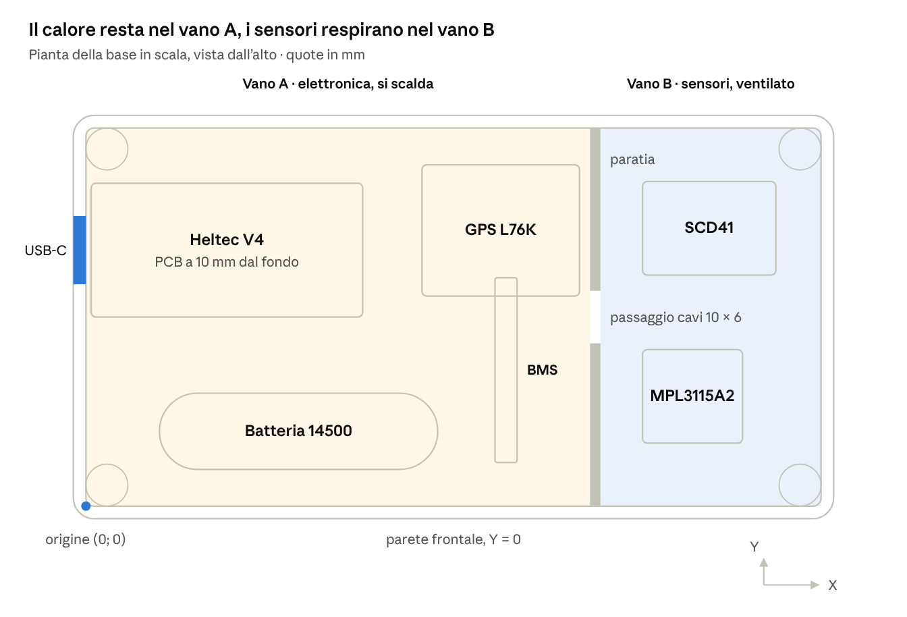
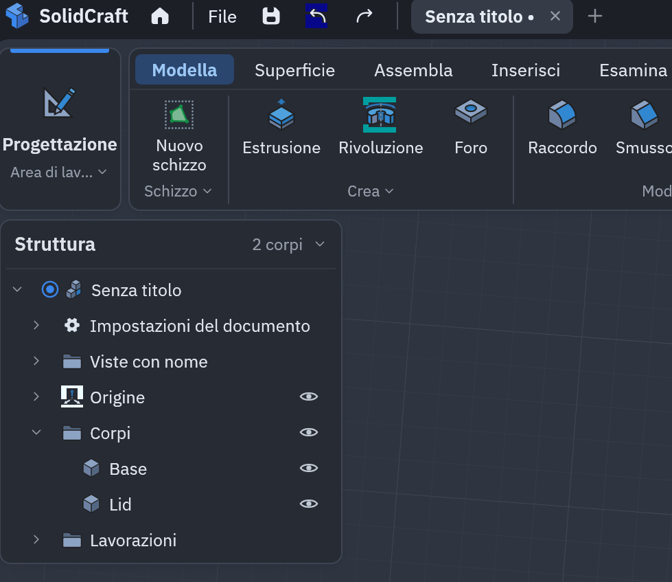
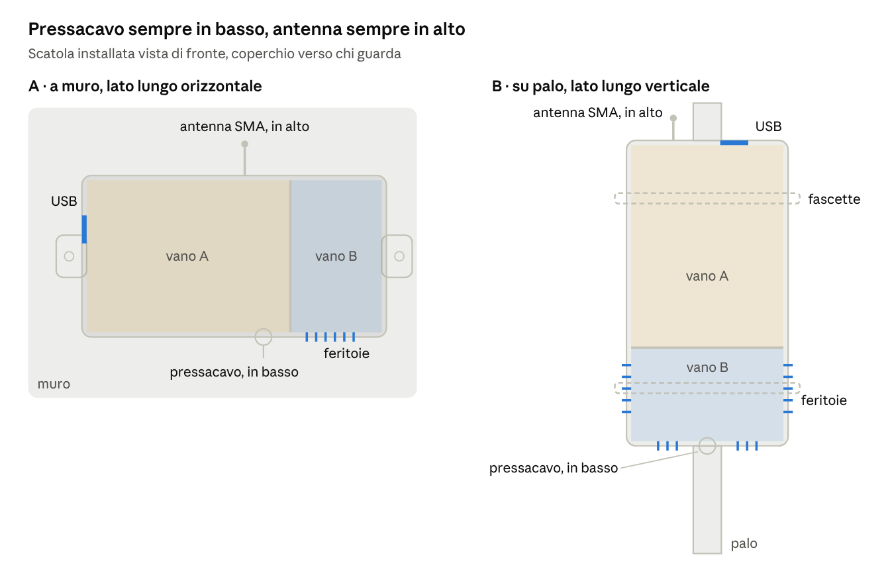
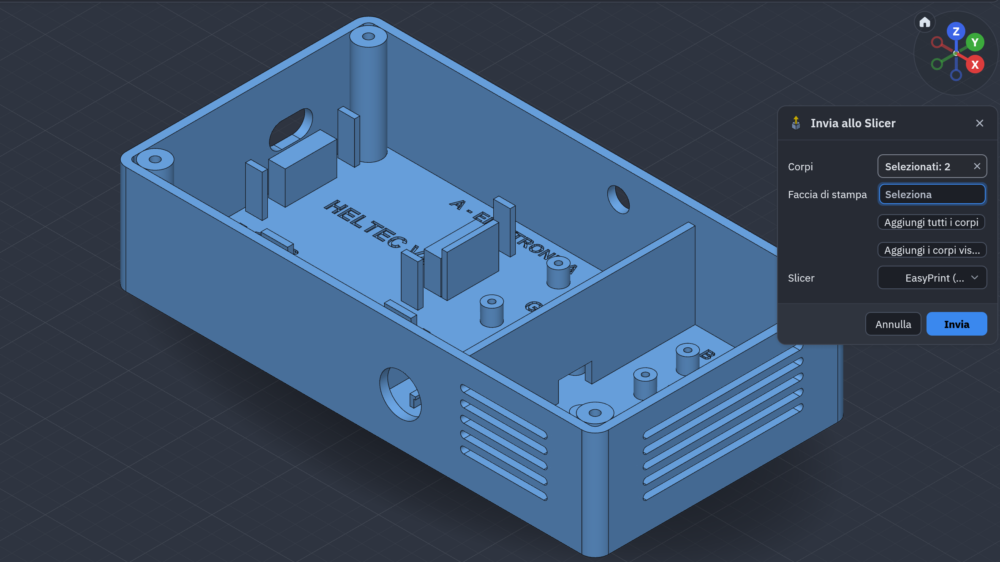
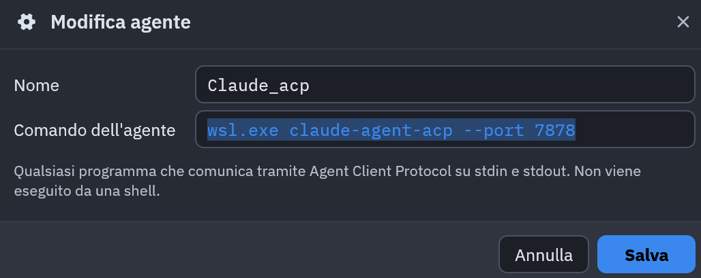
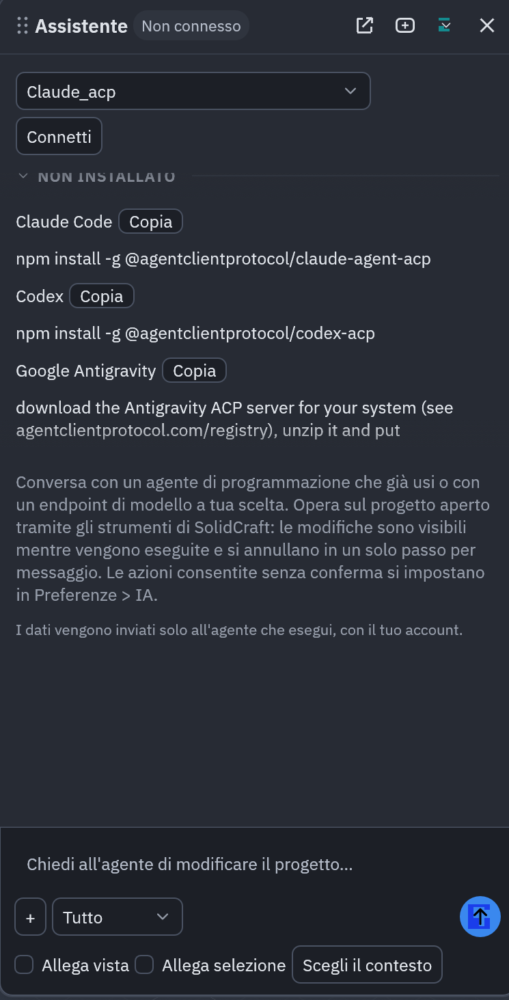

# Contenitore per nodo LoRaWAN – foglio di lavorazione

*Dispensa didattica · versione del 6 novembre 2026*

## Indice

1. [A cosa serve](#1-a-cosa-serve)
2. [Criteri generali e ordine delle fasi](#2-criteri-generali-e-ordine-delle-fasi)
3. [Dati di partenza](#3-dati-di-partenza)
4. [Ciclo di lavorazione comune](#4-ciclo-di-lavorazione-comune)
5. [Variante A – montaggio a muro](#5-variante-a--montaggio-a-muro)
6. [Variante B – montaggio su palo](#6-variante-b--montaggio-su-palo)
7. [Verifiche e stampa 3D](#7-verifiche-e-stampa-3d)
8. [Glossario minimo](#8-glossario-minimo)
9. [Configurazione dell'assistente (ACP)](#9-configurazione-dellassistente-acp)
10. [Appendice – Prompt per SolidCraft, variante A](#10-appendice--prompt-per-solidcraft-variante-a)

**Documenti collegati:**

- [Lessico tecnico per contenitori elettronici](lessico-tecnico-contenitori.md) – comandi CAD, nomi delle parti, quote e istruzioni tecniche.
- [Esercitazioni – Comporre un foglio di lavorazione per scatole](esercitazioni-fogli-di-lavorazione.md) – 6 esercizi risolti, di difficoltà crescente.

---

## 1. A cosa serve

Questa dispensa descrive come costruire, passo per passo, il contenitore stampato in 3D per il nodo LoRaWAN low-power: Heltec V4, SCD41, MPL3115A2, DS18B20, GPS, batteria 14500 e BMS. Ha due varianti finali, che differiscono solo per il fissaggio: **A, a muro** e **B, su palo**.

Lo stesso modello esiste come file OpenSCAD, `nodo_lorawan_case.scad`, allegato alla dispensa: il parametro `mount = "wall"` o `mount = "pole"` sceglie la variante. In SolidCraft lo stesso ciclo si esegue con schizzi ed estrusioni, una lavorazione alla volta.

Come leggerla:

- **Criteri e ordine delle fasi**: il *perché* dell'ordine. Da rileggere ogni volta che si progetta un oggetto nuovo.
- **Dati di partenza**: misure dei componenti e sistema di riferimento. Tutte le quote sono in millimetri.
- **Ciclo comune**: le lavorazioni uguali per le due varianti.
- **Varianti A e B**: solo ciò che cambia.
- **Verifiche e stampa**, un **glossario** dei termini e la **configurazione dell'assistente**.
- **Appendice**: il prompt completo da incollare nell'assistente di SolidCraft per costruire la variante A.

---

## 2. Criteri generali e ordine delle fasi

La regola di fondo è **dal generale al particolare**: prima si decide cosa deve fare l'oggetto e dove sta ogni componente, poi si costruisce il guscio, poi gli interni, i tagli e infine i dettagli. Un dettaglio fatto troppo presto, come un raccordo o una scritta, si rompe quando si cambia una misura principale.

| Criterio | Perché | In questo progetto |
| --- | --- | --- |
| Dall'interno all'esterno | La scatola serve ai componenti, non il contrario | Prima le misure delle schede, poi la cavità 140 × 72 × 30 |
| Funzione prima della forma | Ogni elemento deve avere un motivo | Paratia = calore; feritoie in basso = pioggia; antenna in alto = portata radio |
| Un'origine sola, quote riferite a lei | Le quote "in catena" (una dopo l'altra) sommano gli errori | Tutte le X, Y, Z partono dall'angolo interno del fondo |
| Prima aggiungere, poi togliere | Un pezzo aggiunto dopo un foro può richiuderlo | Colonnine prima dei fori pilota; pareti prima delle feritoie |
| Gioco tra parti che si incastrano | Stampa e schede non sono mai esatte | 0,3 mm per labbro, guide e battute |
| Progettare per il processo | La stampante ha limiti propri | Pareti da 2,4 = 6 passate da 0,4; feritoie orizzontali stampabili a ponte |
| Parametri con un nome | Una misura cambiata si propaga da sola | `inner_l`, `wall`, `mount` nel file OpenSCAD |
| Finiture per ultime | Sono le prime a rompersi | Etichette dopo tutti i tagli |

L'ordine delle fasi che ne deriva:

1. **Requisiti**: dove sta il nodo, acqua, calore, radio, cosa deve restare accessibile (USB, RST, PRG).
2. **Componenti e misure reali**, prese con il calibro: le misure nominali sono solo un punto di partenza.
3. **Disposizione in pianta**: zona calda separata dai sensori, cavi corti, passanti sul lato giusto.
4. **Origine e quote principali** della cavità.
5. **Involucro**: il guscio pieno, poi svuotato.
6. **Elementi interni**: colonnine, culle, guide, paratia.
7. **Aperture**: USB, feritoie, pressacavo, antenna.
8. **Coperchio**, ricavato dalle misure della base.
9. **Fissaggio esterno**: qui le varianti A e B si separano.
10. **Finiture**: etichette, raccordi.
11. **Verifica** e stampa di prova. Se qualcosa non torna si risale alla fase da cui nasce l'errore, invece di "rattoppare" in fondo.

---

## 3. Dati di partenza

La cavità interna misura **140 × 72 × 30 mm**, con pareti, fondo e coperchio da 2,4 mm. Fuori, la scatola chiusa misura 144,8 × 76,8 × 34,8 mm, senza contare alette o ponticelli.

**Sistema di riferimento.** L'origine (0; 0; 0) è l'angolo interno sinistro-anteriore, sul piano del fondo. X corre lungo il lato lungo (0…140), Y lungo il lato corto (0…72, con la parete frontale a Y = 0), Z verso l'alto. Le pareti stanno quindi a coordinate negative oppure oltre 140 e 72; il fondo va da Z = −2,4 a 0.

| Componente | Misura (mm) | Vano | Posizione | Fissaggio | Da verificare |
| --- | --- | --- | --- | --- | --- |
| Heltec WiFi LoRa 32 V4 | 51,7 × 25,5 × 1,6 | A | angolo in (1; 36), PCB a Z = 10 | appoggi + battute | lunghezza (la V3 è 50,2), posizione di RST/PRG e USB |
| Batteria 14500 | Ø 14,5 × 53 | A | asse a Y = 14,25, Z = 8,25; X 12…69 | due selle + fascette | — |
| BMS 1S 5A (HX-3450) | 35,2 × 4,2 × 2 | A | guida centrata in X = 80, Y 8…43,8 | guide con dentini | esistono versioni 25 × 17 |
| GPS L76K | 30 × 25 | A | angolo in (64; 40) | 4 colonnine M2 | misure e fori |
| SCD41 | 25,4 × 17,8 | B | angolo in (106; 44) | 4 colonnine M2 | misure e fori |
| MPL3115A2 | 19,05 × 17,8 | B | angolo in (106; 12) | 4 colonnine M2 | misure e fori |
| Sonda DS18B20 | cavo esterno | fuori | pressacavo PG7 Ø 12,5 | pressacavo | — |
| Antenna 868 MHz | SMA da pannello Ø 6,6 | parete | lato in alto | dado SMA | — |

Il **vano A** (X 0…96) contiene ciò che scalda; il **vano B** (X 98…140) i sensori d'aria. La paratia in mezzo, con un passaggio cavi di 10 × 6 mm alla base, impedisce che il calore della Heltec falsi CO₂ e temperatura.

<p align="center">
  
</p>

*Figura 1 – Pianta della base in scala.* La guida della BMS passa per 3,8 mm sotto la scheda GPS: non si toccano perché stanno a quote diverse (la guida è alta 3,2 mm, il GPS sta a 5 mm dal fondo).

---

## 4. Ciclo di lavorazione comune

Queste lavorazioni sono identiche nelle due varianti. Le operazioni sono numerate di 10 in 10, come nei cicli di lavorazione d'officina: così un passo dimenticato si inserisce (per esempio con il numero 45) senza dover rinumerare tutto.

<p align="center">
  
</p>

*Figura 2 – Il pannello Struttura è l'albero del modello.* **Corpi** contiene i due solidi separati, Base e Lid: ogni lavorazione va applicata al corpo giusto. **Lavorazioni** elenca le operazioni nell'ordine in cui sono state fatte (estrusioni, fori, raccordi): è il ciclo di lavorazione di questa pagina, e cliccandone una si può correggere una quota senza rifare il resto. L'**occhio** accanto a ogni voce mostra o nasconde l'elemento, senza cancellare nulla.

### Base

| N° | Lavorazione | Quote (mm) | Perché |
| --- | --- | --- | --- |
| 10 | Guscio pieno | rettangolo (−2,4; −2,4)–(142,4; 74,4), spigoli R4, estruso da Z −2,4 a 30 | è l'ingombro esterno |
| 20 | Svuotamento | tasca (0; 0)–(140; 72), raggio 1,6, da Z 0 in su | raggio interno = 4 − 2,4: lo spessore della parete resta costante anche negli spigoli |
| 30 | Colonnine angolari | Ø 8, Z 0…30, centri (4; 4) (136; 4) (4; 68) (136; 68); foro pilota Ø 2,6 profondo 14 | reggono le viti M3 del coperchio; il foro si fa dopo la colonnina |
| 40 | Paratia | X 96…98, Z 0…25,7; passaggio cavi Y 31…41, alto 6 | si ferma 4,3 sotto il bordo: lì entra il labbro del coperchio |
| 50 | Supporto Heltec | appoggi X 1…6 e 47,7…52,7, Y 41…56,5, alti 10; battute laterali spesse 1,6 in Y 34,1…35,7 e 61,8…63,4, alte 12,6; battuta di fondo X 53…54,6 | appoggia solo alle estremità, perché sotto ci sono i pin |
| 60 | Culla batteria | selle X 18…26 e 55…63, Y 5…23,5, alte 9,25, scavo Ø 15,1; fessura per fascetta 4 × 1,8; fermi X 12…14 e 67…69, alti 8,7 | Ø 15,1 = 14,5 + 0,6 di gioco |
| 70 | Guida BMS | due guide spesse 1,2, alte 3,2, Y 8…43,8, facce interne a X 77,6 e 82,4; dentini da 0,5 in cima | la scheda si infila e resta trattenuta; estremità aperte per i fili |
| 80 | Colonnine schedine | Ø 5, alte 5, foro Ø 1,8 per viti M2. GPS: (66,5; 42,5) (91,5; 42,5) (66,5; 62,5) (91,5; 62,5). SCD41: (108,54; 46,54) (128,86; 46,54) (108,54; 59,26) (128,86; 59,26). MPL3115A2: (108,54; 14,54) (122,51; 14,54) (108,54; 27,26) (122,51; 27,26) | 5 mm sotto la scheda lasciano spazio alle saldature |
| 90 | Finestra USB-C | parete sinistra, asola 13 × 7,5 con estremità tonde, centro Y 48,75, Z 13,3 | larga per lo spinotto del cavo, non solo per la presa |
| 100 | Feritoie, pressacavo, antenna | vedi variante A o B | dipendono da quale lato guarda in basso |
| 110 | Etichette sul fondo | incise 0,6, testo centrato (elenco sotto) | servono al montaggio, quindi vanno dentro |

Etichette dell'operazione 110, con altezza del testo e centro (X – Y): HELTEC V4 (4; 26,85 – 48,75), 14500 (4; 40,5 – 14,25), GPS L76K (3,5; 79 – 52,5), SCD41 (4; 118,7 – 52,9), MPL3115A2 (2,5; 115,5 – 20,9), BMS ruotata di 90° (3; 80 – 25,6), A - ELETTRONICA (3; 48 – 68), B - SENSORI (3; 119 – 66), < USB (3; 14 – 30), I2C (3; 88 – 36).

### Coperchio

| N° | Lavorazione | Quote (mm) | Perché |
| --- | --- | --- | --- |
| 120 | Piastra | stesso profilo esterno del guscio, Z 30…32,4 | il coperchio deriva dalla base, non si ridisegna |
| 130 | Labbro a incastro | anello Z 26…30, esterno (0,3; 0,3)–(139,7; 71,7), R 1,3, spesso 1,6; scarichi Ø 9 attorno alle colonnine | 0,3 di gioco per lato: entra senza forzare |
| 140 | Nervatura | X 96…98, Y 0,3…71,7, Z 26…30 | prosegue la paratia: i due vani restano separati fino in cima |
| 150 | Fori viti | Ø 3,4 passanti ai 4 centri, svasatura Ø 6,2 profonda 1,6 | la testa della vite non sporge |
| 160 | Fori RST e PRG | Ø 3 passanti in (5; 39,5) e (5; 58); etichette RST e PRG accanto | si premono con una graffetta a scatola chiusa |

---

## 5. Variante A – montaggio a muro

La scatola si appoggia al muro con il fondo e il **lato lungo orizzontale**: la parete frontale (Y = 0) guarda in basso, la posteriore in alto. Nel file OpenSCAD: `mount = "wall"`.

| N° | Lavorazione | Quote (mm) | Perché |
| --- | --- | --- | --- |
| 101 | Feritoie | asole alte 2, con bordo inferiore a Z 6, 10, 14, 18, 22. Parete destra (X 140…142,4): Y 12…60. Parete frontale (Y −2,4…0): X 102…128 | aria ai sensori dal lato e dal basso; nessuna feritoia sul lato in alto, dove cade la pioggia |
| 102 | Pressacavo PG7 | foro Ø 12,5 sulla parete frontale, X 84, Z 12 (vano A) | rivolto in basso, l'acqua non scorre lungo il cavo verso l'interno; vicino alla Heltec, a cui si collega la sonda |
| 103 | Antenna SMA | foro Ø 6,6 sulla parete posteriore, X 75, Z 21 | antenna in alto = portata radio migliore |
| 104 | Etichette | DS18B20 (3; 84 – 4), ANT (3; 75 – 68,5) | indicano dove arrivano i cavi |
| 170 | Alette di fissaggio | spesse 4 (Z −2,4…1,6), centrate in Y 36, una oltre X −2,4 e una oltre X 142,4; larghe 20 alla parete, sporgono di 12 restringendosi verso una punta arrotondata R5; foro Ø 4,5 a 6 dalla parete | viti o tasselli nel muro |

Per costruirla con l'assistente di SolidCraft c'è un prompt unico, già completo di tutte le quote di questa variante: vedi l'[Appendice](#10-appendice--prompt-per-solidcraft-variante-a). Non contiene i ponticelli per il palo.

Ingombro sul piatto di stampa: circa 169 × 77 mm. La base si stampa con il fondo sul piatto, senza supporti. La finestra USB resta sul fianco sinistro: all'aperto va chiusa con un tappo in gomma.

---

## 6. Variante B – montaggio su palo

La scatola si fissa con il **lato lungo verticale, parallelo al palo**: due fascette distanti 9 cm le impediscono di ruotare. La parete destra (vano sensori) guarda in basso, la sinistra (USB) in alto. Nel file OpenSCAD: `mount = "pole"`.

| N° | Lavorazione | Quote (mm) | Perché |
| --- | --- | --- | --- |
| 101 | Feritoie | asole alte 2, bordo inferiore a Z 6, 10, 14, 18, 22. Parete destra: Y 12…26,75 e 45,25…60 (attorno al pressacavo). Pareti frontale e posteriore: X 102…128 | qui frontale e posteriore sono i fianchi; la parete in alto resta chiusa |
| 102 | Pressacavo PG7 | foro Ø 12,5 sulla parete destra, Y 36, Z 12 | rivolto in basso, al centro tra le feritoie |
| 103 | Antenna SMA | foro Ø 6,6 sulla parete sinistra, Y 20, Z 21 | sul lato in alto; Y 20 la tiene lontana dalla finestra USB (centro Y 48,75) |
| 104 | Etichette | ANT (3; 6 – 20) e DS18B20 (2,5; 129 – 36), entrambe ruotate di 90° | come nella variante A |
| 170 | Ponticelli per fascette | sotto il fondo, centrati in X 25 e X 115, larghi 18 lungo X, lunghi 30 lungo Y (Y 21…51), da Z −2,4 a −6,9; passante lungo Y largo 14 e alto 2,5 (faccia inferiore a Z −4,9) | fascette metalliche da 12 mm che girano attorno al palo |

Il vano sensori in basso è voluto: il calore della Heltec e della batteria sale e si allontana dal SCD41. In cambio la **USB guarda in alto**, e il tappo in gomma diventa indispensabile.

Attenzione alla stampa: i ponticelli sporgono sotto il fondo, quindi la base non appoggia in piano sul piatto. Servono supporti, che rovinano il fondo esterno, oppure, meglio, ponticelli stampati su una piastra separata da avvitare sotto la scatola.

<p align="center">
  
</p>

*Figura 3 – Le due varianti installate, viste di fronte.* In entrambe valgono le stesse regole (pressacavo e feritoie in basso, antenna in alto, nessuna apertura sul lato esposto alla pioggia); cambia solo quale parete svolge ciascun ruolo.

---

## 7. Verifiche e stampa 3D

Si verifica prima sul modello, poi con una stampa di prova piccola, e solo alla fine si stampa tutto. Un errore trovato a schermo costa un clic; trovato dopo 6 ore di stampa costa filamento e tempo.

### Prima di stampare

- [ ] Misure reali di GPS, SCD41, MPL3115A2 e BMS riportate nelle quote (operazioni 70 e 80).
- [ ] Lunghezza della Heltec V4 e posizione di RST, PRG e USB controllate sulla scheda.
- [ ] Base e coperchio sovrapposti senza compenetrazioni: labbro libero dalle colonnine, nervatura allineata alla paratia.
- [ ] La guida BMS finisce a Y 43,8, cioè 3,8 mm sotto la scheda GPS (che parte da Y 40, a Z 5): i fili saldati sui pad non devono toccarla.
- [ ] Il dado del pressacavo non urta la guida BMS (variante A) o le feritoie (variante B).
- [ ] Stampa di prova di un anello alto 6 mm con un tratto di labbro: se l'incastro è duro, portare il gioco da 0,3 a 0,4.

### Impostazioni di stampa

| Voce | Valore | Perché |
| --- | --- | --- |
| Materiale | PETG o ASA, chiaro | il PLA si deforma al sole; un colore scuro scalda l'interno |
| Strato / ugello | 0,2 / 0,4 mm | buon compromesso tra tempo e dettaglio delle scritte |
| Perimetri | 6 | pareti da 2,4 mm piene e a tenuta |
| Supporti | nessuno (variante B: vedi ponticelli) | feritoie e fori si stampano a ponte |
| Orientamento base | fondo sul piatto | etichette e colonnine verso l'alto |
| Orientamento coperchio | capovolto, piastra sul piatto | labbro e nervatura crescono verso l'alto |
| Viti coperchio | M3 autofilettanti, o inserti a caldo con foro Ø 4,0 | gli inserti reggono aperture ripetute |

### Dal CAD alla stampante

Uno **slicer** è il programma che "affetta" il modello in strati e genera il **G-code**, cioè le istruzioni che la stampante esegue. Il flusso è sempre **CAD → slicer → stampante**. Da SolidCraft ci sono due strade.

**1. Invia allo Slicer.** Il pulsante manda il modello direttamente a uno slicer (per esempio EasyPrint, lo slicer in cloud di Prusa). Si invia un corpo alla volta, scegliendo come *Faccia di stampa* il fondo esterno per la base e la faccia superiore della piastra per il coperchio.

<p align="center">
  
</p>

*Figura 4 – La base completa (variante A) pronta per la stampa.* Si riconoscono il pressacavo e le feritoie sulla parete frontale, le feritoie sulla destra, la paratia, le colonnine e le etichette sul fondo. Nella finestra: **Corpi** = cosa mandare allo slicer; **Faccia di stampa** = la faccia che andrà appoggiata sul piatto (qui il fondo esterno, che in questa vista sta sotto); **Slicer** = il programma che riceve il modello. Con due corpi selezionati serve una faccia diversa per ciascuno: meglio inviarli uno alla volta.

**2. Esportare gli STL.** Da *Save as mesh* si salva ogni corpo in un file separato: `down.stl` per la base e `up.stl` per il coperchio. I due file si aprono poi in uno slicer installato sul PC, per esempio **OrcaSlicer**, che offre più regolazioni di EasyPrint e funziona anche senza connessione. Nello slicer si orienta ogni pezzo con *Posiziona sulla faccia*, scegliendo la stessa faccia di stampa indicata sopra; poi si generano il G-code e la stampa.

---

## 8. Glossario minimo

Qui ci sono solo i termini usati in questa dispensa. L'elenco completo, diviso per categorie e con esempi di istruzioni, è nel [Lessico tecnico per contenitori elettronici](lessico-tecnico-contenitori.md).

| Termine | Significato |
| --- | --- |
| Quota | Una misura scritta sul disegno, sempre riferita a un punto preciso |
| Quotatura in parallelo / in serie | In parallelo ogni quota parte dalla stessa origine; in serie ogni quota parte dalla precedente, e gli errori si sommano |
| Viste | Pianta = dall'alto; prospetto = di fronte; fianco = di lato. Tre viste descrivono un oggetto senza ambiguità |
| Schizzo | Disegno 2D su un piano, da cui nasce una lavorazione 3D |
| Vincolo | Regola imposta allo schizzo (parallelo, uguale, a 5 mm da…) che lo tiene fermo quando si cambia una misura |
| Estrusione | Spinge uno schizzo in altezza per creare un solido (aggiungi) o per scavarlo (taglia, tasca) |
| Svuotamento (shell) | Rende cavo un solido lasciando pareti di spessore dato |
| Raccordo / smusso | Arrotondamento / taglio inclinato di uno spigolo |
| Corpo | Un solido separato nel progetto (qui Base e Lid) |
| Lavorazione (feature) | Un'operazione registrata nell'albero del modello, modificabile in seguito |
| Modello parametrico | Modello le cui misure sono parametri con un nome: cambiandone una, tutto si aggiorna |
| Gioco | Spazio voluto tra due parti che devono entrare una nell'altra |
| Tolleranza | Quanto una misura può scostarsi dal valore nominale ed essere ancora accettabile |
| Colonnina (boss) | Cilindretto che regge una vite o una scheda |
| Labbro | Bordo del coperchio che entra nella base e lo centra |
| Nervatura | Parete sottile che irrigidisce o separa |
| Pressacavo (PG7) | Raccordo filettato che fa passare un cavo tenendo fuori l'acqua; PG7 = cavi da circa 3 a 6,5 mm |
| Sbalzo / ponte | Parte stampata nel vuoto: sbalzo se sporge da un lato (va bene fino a circa 45°), ponte se è appoggiata ai due estremi |
| Perimetri | Passate attorno al contorno di ogni strato; con ugello da 0,4, 6 perimetri = parete di 2,4 mm |
| Slicer / G-code | Il programma che affetta il modello in strati / il file di istruzioni per la stampante |
| STL / STEP | STL = mesh di triangoli, buona per stampare ma non modificabile; STEP = solido vero, modificabile in un altro CAD |

---

## 9. Configurazione dell'assistente (ACP)

SolidCraft si avvia da Windows; il suo assistente lancia Claude Code dentro Ubuntu (WSL) e gli parla con l'**Agent Client Protocol** (ACP), scambiando messaggi JSON su stdin e stdout: niente rete, niente porte. Configurazione rilevata il 6 novembre 2026:

| Elemento | Valore |
| --- | --- |
| Nome agente in SolidCraft | `Claude_acp` |
| Comando dell'agente | `wsl.exe claude-agent-acp --port 7878` (funziona; `--port` non serve) |
| Distribuzione WSL | Ubuntu su WSL 2 (predefinita, con l'asterisco; c'è anche docker-desktop, non usata), utente `seb` |
| Node.js | v26.13.0 in `/usr/local/bin`, installato nel sistema (non con nvm) |
| Adattatore ACP | `@agentclientprotocol/claude-agent-acp` 0.100.0 in `/usr/local/bin` |
| Claude Code | 2.1.318 in `~/.local/bin` (installer nativo, non npm) |
| Autenticazione | nessuna chiave API: login con l'account Claude (verifica con `claude` e poi `/status`) |

Funziona senza `bash -lc` perché `/usr/local/bin` è già nel PATH di base: `wsl.exe` trova l'adattatore anche senza caricare `~/.bashrc`.

<p align="center">
  
</p>

*Figura 5 – Dove si imposta l'agente.* **Nome** è solo un'etichetta; **Comando dell'agente** è il programma che SolidCraft avvia. La nota sotto il campo è la chiave: il programma parla su stdin e stdout e non passa da una shell, quindi niente porte e niente virgolette. L'opzione `--port 7878` è superflua.

<p align="center">
  
</p>

*Figura 6 – Il pannello Assistente.* In alto lo stato (**Non connesso** finché non si preme Connetti) e la scelta dell'agente. L'elenco "Non installato" mostra i comandi npm per gli adattatori ACP di tre agenti alternativi (Claude Code, Codex, Google Antigravity): ne serve uno solo, quello dell'agente che si usa, e il comando va eseguito nel terminale di Ubuntu, non in Windows. In basso la casella per i messaggi e le opzioni **Allega vista** e **Allega selezione**, che mandano all'agente l'immagine o gli elementi selezionati insieme alla richiesta.

### Rifare la configurazione su un altro PC

Serve Node 18 o superiore già installato in Ubuntu.

1. `curl -fsSL https://claude.ai/install.sh | bash` installa Claude Code; poi si lancia `claude` e si fa il login con l'account.
2. `sudo npm install -g @agentclientprotocol/claude-agent-acp` installa l'adattatore.
3. In PowerShell, `wsl -l -v`: Ubuntu deve avere l'asterisco.
4. In SolidCraft, Assistente ▸ Modifica agente: comando `wsl.exe claude-agent-acp`, poi Connetti.

Le azioni che l'agente può eseguire senza chiedere conferma si impostano in **Preferenze ▸ IA**. All'inizio conviene lasciarle tutte con conferma.

### Usare Google Gemini come agente

Il meccanismo è lo stesso di Claude: SolidCraft avvia un programma dentro Ubuntu e gli parla in ACP su stdin e stdout. Cambia solo il programma. A differenza di Claude, **Gemini CLI parla ACP da solo**, senza bisogno di un adattatore separato.

| | Claude | Gemini |
| --- | --- | --- |
| Programma da installare in Ubuntu | Claude Code + `@agentclientprotocol/claude-agent-acp` | `@google/gemini-cli` |
| Installazione | vedi sopra | `sudo npm install -g @google/gemini-cli` |
| Primo accesso | `claude`, poi login | `gemini`, poi "Login with Google" oppure chiave `GEMINI_API_KEY` |
| Comando in SolidCraft | `wsl.exe claude-agent-acp` | `wsl.exe gemini --acp` |

Note:

- Nelle versioni più vecchie di Gemini CLI l'opzione si chiama `--experimental-acp`, oggi deprecata. Con `gemini --help` si vede quale accetta la versione installata.
- Con Node installato nel sistema, come in questa configurazione, `gemini` finisce in `/usr/local/bin` e `wsl.exe` lo trova senza altri accorgimenti, come succede per Claude.
- In SolidCraft si possono configurare più agenti (per esempio `Claude_acp` e `Gemini_acp`) e scegliere quello da usare dal menu a tendina del pannello Assistente.

**Attenzione all'account.** Dal 18 giugno 2026 Google ha sostituito Gemini CLI con **Antigravity CLI** per gli utenti gratuiti e per gli abbonati Google AI Pro e Ultra. Gemini CLI continua a funzionare con una chiave API a pagamento o con le licenze Gemini Code Assist Standard ed Enterprise. In tutti gli altri casi l'opzione di Google è **Google Antigravity**: vedi il paragrafo seguente.

Fonti: [Gemini CLI in modalità ACP (DEV Community)](https://dev.to/gabrielanhaia/agent-client-protocol-by-hand-drive-gemini-acp-over-json-rpc-on-stdio-1jdj) · [Gemini CLI, opzioni da riga di comando](https://www.developersdigest.tech/reference/gemini-cli/cli-flags) · [Gemini CLI dismesso, passaggio ad Antigravity CLI](https://inventivehq.com/blog/gemini-cli-deprecated-antigravity-cli-migration)

### Usare Google Antigravity come agente

Per SolidCraft serve il **server ACP di Antigravity**, un piccolo programma pubblicato da Google nel registro ufficiale ACP (versione 1.4.5 a novembre 2026). Esiste per Windows e per Linux. A differenza di Claude **non serve WSL**: c'è un `.exe` nativo per Windows, ed è la strada consigliata, perché il login con l'account Google apre direttamente il browser.

**Su Windows (consigliato)**

1. Scaricare lo zip per Windows: `https://dl.google.com/agy-extensions/releases/windows/agy-acp-server-1.4.5-windows-x86_64.zip`
2. Estrarlo in una cartella **senza spazi nel percorso**, per esempio `C:\Users\sebas\agy-acp\`. SolidCraft divide il comando sugli spazi, quindi un percorso come `C:\Program Files\...` non funzionerebbe.
3. In SolidCraft, Assistente ▸ Modifica agente, creare un nuovo agente:
    - **Nome:** `Antigravity`
    - **Comando dell'agente:** `C:\Users\sebas\agy-acp\agy_acp_server.exe`
4. Salvare, premere **Connetti** e, quando richiesto, accedere con l'account Google.

**In alternativa, dentro Ubuntu (WSL)**

```bash
sudo apt install -y unzip
mkdir -p ~/agy-acp && cd ~/agy-acp
curl -LO https://dl.google.com/agy-extensions/releases/linux/agy-acp-server-1.4.5-linux-x86_64.zip
unzip agy-acp-server-1.4.5-linux-x86_64.zip
chmod +x agy_acp_server.par
```

In SolidCraft il comando diventa `wsl.exe /home/seb/agy-acp/agy_acp_server.par --uid=` (il registro indica `--uid=`, vuoto, come argomento per Linux). Da WSL il browser potrebbe non aprirsi da solo: in quel caso il programma stampa un indirizzo da aprire a mano.

**Se il login non va a buon fine.** Dalla documentazione non risulta chiaro se il server ACP basti da solo o se serva anche **Antigravity CLI** (`agy`) installato e con il login già fatto. Se la connessione fallisce, installarla e lanciare `agy` una volta per accedere:

- su Windows, con l'installer per PowerShell indicato su antigravity.google;
- su Ubuntu: `curl -fsSL https://antigravity.google/cli/install.sh | bash`, poi `agy --version` per verificare e `agy` per il login.

Quando esce una versione nuova, nei link cambia solo il numero. Gli indirizzi vengono dal registro ACP, ma questa installazione non è stata ancora provata su questa configurazione.

Fonti: [Registro ACP – dati di Google Antigravity (JSON)](https://cdn.agentclientprotocol.com/registry/v1/latest/registry.json) · [Google Antigravity tra gli agenti ACP (Zed)](https://zed.dev/acp/agent/antigravity-acp) · [Installare Antigravity CLI (Arm Learning Paths)](https://learn.arm.com/install-guides/antigravity/) · [Antigravity CLI cheat sheet](https://computingforgeeks.com/antigravity-cli-cheat-sheet/)

---

## 10. Appendice – Prompt per SolidCraft, variante A

Da incollare nella chat dell'assistente di SolidCraft, partendo da un progetto nuovo con i corpi Base e Lid vuoti. Le lavorazioni hanno la stessa numerazione del ciclo (sezioni 4 e 5) e sono divise in 6 blocchi: alla fine di ogni blocco l'assistente si ferma per il controllo. Lo stesso testo è nel file `prompt_solidcraft_variante_A.txt`.

```text
Costruisci in SolidCraft il contenitore del nodo LoRaWAN, VARIANTE A (montaggio
a muro), usando i corpi "Base" e "Lid". Nessun aggancio per palo.
Ogni lavorazione deve essere una feature separata e modificabile. Lavora a
blocchi: dopo ogni blocco fermati e mostrami il risultato. Unità: mm.

RIFERIMENTO: origine = angolo interno della cavità sul piano del fondo.
X = lato lungo (0..140), Y = lato corto (0..72, parete frontale a Y=0),
Z = altezza. Cavità 140 x 72 x 30; pareti, fondo e coperchio 2.4.
Installata, la parete frontale (Y=0) guarda in basso, la posteriore in alto.

=== BLOCCO 1 · GUSCIO ===
10. Guscio: rettangolo (-2.4,-2.4)-(142.4,74.4), raggio 4 sugli spigoli
    verticali, estruso da Z=-2.4 a Z=30.
20. Svuotamento: tasca (0,0)-(140,72), raggio 1.6, da Z=0 verso l'alto.
30. Colonnine angolari Ø8 da Z=0 a Z=30, centri (4,4) (136,4) (4,68)
    (136,68); in ognuna un foro pilota Ø2.6 profondo 14 dall'alto.
40. Paratia: X 96..98, Y 0..72, Z 0..25.7, con un passaggio cavi in basso
    Y 31..41, alto 6.

=== BLOCCO 2 · SUPPORTI INTERNI ===
50. Heltec V4 (PCB 51.7 x 25.5 x 1.6 posato a X 1..52.7, Y 36..61.5,
    faccia inferiore a Z=10):
    - appoggi X 1..6 e X 47.7..52.7, Y 41..56.5, alti 10;
    - battute laterali spesse 1.6 in Y 34.1..35.7 e Y 61.8..63.4, sugli
      stessi intervalli di X, alte 12.6;
    - battuta di fondo X 53..54.6, Y 41..56.5, alta 12.6.
60. Batteria 14500 (asse lungo X, a Y=14.25, Z=8.25):
    - selle X 18..26 e X 55..63, Y 5..23.5, alte 9.25, ciascuna con scavo
      cilindrico Ø15.1 coassiale alla batteria e una fessura per fascetta
      larga 4 (centrata nella sella) e alta 1.8 (Z 0..1.8), passante lungo Y;
    - fermi X 12..14 e X 67..69, Y 7..21.5, alti 8.7.
70. Guida BMS (scheda 35.2 x 4.2 x 2, lunga lungo Y): due guide spesse 1.2,
    alte 3.2, da Y=8 a Y=43.8, con le facce interne a X=77.6 e X=82.4; in
    cima a ciascuna (Z 2.4..3.2) un dentino che sporge 0.5 verso l'interno.
    Estremità aperte.
80. Colonnine Ø5 alte 5, foro Ø1.8 profondo 4 dall'alto:
    - GPS: (66.5,42.5) (91.5,42.5) (66.5,62.5) (91.5,62.5)
    - SCD41: (108.54,46.54) (128.86,46.54) (108.54,59.26) (128.86,59.26)
    - MPL3115A2: (108.54,14.54) (122.51,14.54) (108.54,27.26) (122.51,27.26)

=== BLOCCO 3 · APERTURE (VARIANTE A) ===
90.  USB-C, parete sinistra (X -2.4..0): asola 13 x 7.5 a estremità
     arrotondate, centrata in Y=48.75, Z=13.3.
101. Feritoie: asole alte 2, con bordo inferiore a Z = 6, 10, 14, 18, 22.
     - parete destra (X 140..142.4): Y 12..60;
     - parete frontale (Y -2.4..0): X 102..128.
     Nessuna feritoia sulla parete posteriore.
102. Pressacavo PG7: foro Ø12.5 sulla parete frontale, X=84, Z=12.
103. Antenna SMA: foro Ø6.6 sulla parete posteriore, X=75, Z=21.

=== BLOCCO 4 · ALETTE A MURO ===
170. Due alette spesse 4, da Z=-2.4 a Z=1.6, centrate in Y=36, una oltre
     la parete sinistra (X=-2.4) e una oltre la destra (X=142.4).
     Ognuna è larga 20 alla parete, sporge 12 e si restringe verso una
     punta arrotondata R5; foro Ø4.5 a 6 dalla parete.

=== BLOCCO 5 · ETICHETTE SUL FONDO ===
110. Incise 0.6 da Z=0 verso il basso, font bold sans-serif, testo
     centrato (altezza testo; centro X,Y):
     "HELTEC V4" (4; 26.85,48.75)   "14500" (4; 40.5,14.25)
     "GPS L76K" (3.5; 79,52.5)      "SCD41" (4; 118.7,52.9)
     "MPL3115A2" (2.5; 115.5,20.9)  "BMS" (3; 80,25.6) ruotata 90°
     "A - ELETTRONICA" (3; 48,68)   "B - SENSORI" (3; 119,66)
     "< USB" (3; 14,30)             "I2C" (3; 88,36)
     "DS18B20" (3; 84,4)            "ANT" (3; 75,68.5)
     Nessuna scritta sulle pareti esterne.

=== BLOCCO 6 · COPERCHIO (corpo Lid) ===
120. Piastra: stesso profilo esterno del guscio, da Z=30 a Z=32.4.
130. Labbro sotto la piastra, Z 26..30: anello con profilo esterno
     (0.3,0.3)-(139.7,71.7), raggio 1.3, spesso 1.6. Scava il labbro con
     cilindri Ø9 attorno ai 4 centri delle colonnine.
140. Nervatura: X 96..98, Y 0.3..71.7, Z 26..30.
150. Fori viti: Ø3.4 passanti ai 4 centri delle colonnine, svasatura Ø6.2
     profonda 1.6 dall'alto.
160. Fori RST e PRG: Ø3 passanti in (5,39.5) e (5,58); accanto, incise 0.6
     sulla faccia superiore, "RST" h3.5 in (11.5,39.5) e "PRG" h3.5 in
     (11.5,58).

=== VERIFICA FINALE ===
Controlla che Base e Lid non si compenetrino, che il labbro sia libero dalle
colonnine, che nervatura e paratia siano allineate e che non ci siano corpi
in più oltre a Base e Lid.
```

---

*File allegati: `nodo_lorawan_case.scad` (modello OpenSCAD parametrico; `mount = "wall"` = variante A), `prompt_solidcraft_variante_A.txt` e la cartella `img/` con le figure.*
