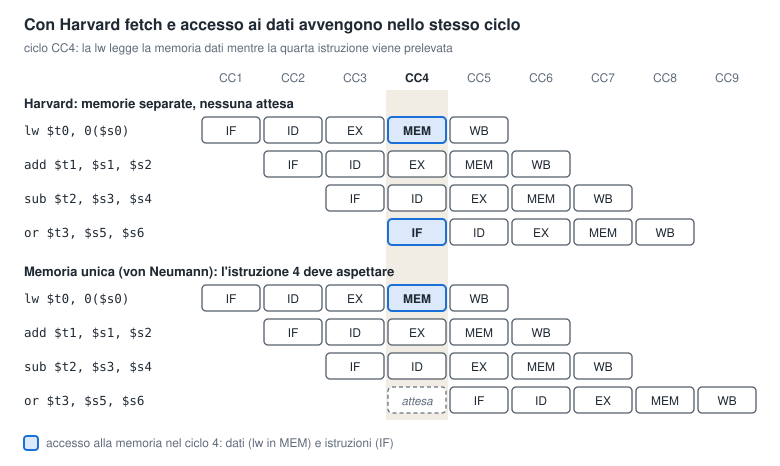
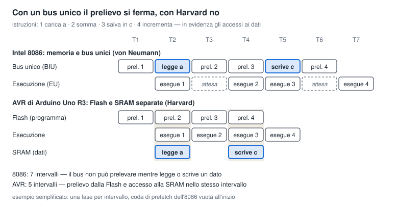
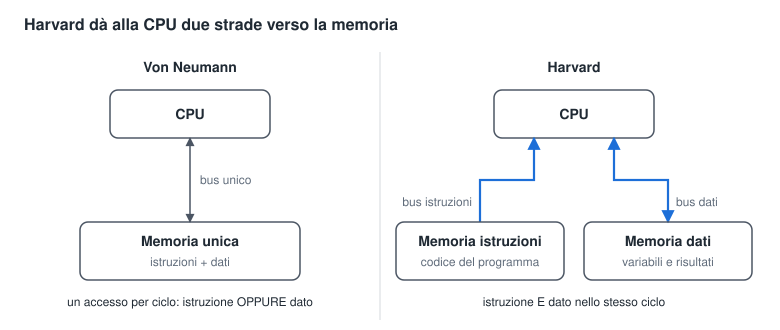
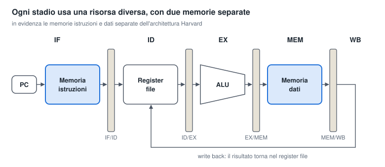
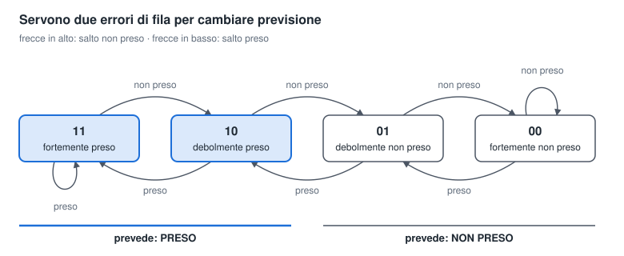

# Dalla CPU sequenziale alla CPU parallela

Dispensa per la classe terza ITI Informatica · ottobre 2026

## Introduzione: una storia di colli di bottiglia

Una CPU moderna non esegue le istruzioni una alla volta: ne lavora molte contemporaneamente, ognuna in una fase diversa. Questa dispensa racconta come ci si è arrivati, in tre tappe: **architettura Harvard**, **pipeline**, **branch prediction**.

Il filo conduttore è semplice: ogni tecnica nasce per risolvere un problema, e ogni soluzione fa emergere il problema successivo.

| Tappa | Problema da risolvere | Idea chiave |
| --- | --- | --- |
| 1. Architettura Harvard | Istruzioni e dati si contendono un'unica strada verso la memoria | Due memorie, due strade separate |
| 2. Pipeline | L'hardware resta in gran parte fermo mentre una sola istruzione viene eseguita | Lavorare su più istruzioni insieme, ognuna in una fase diversa |
| 3. Branch prediction | I salti costringono la pipeline a fermarsi o a buttare lavoro | Indovinare in anticipo dove andrà il programma |

**Prerequisiti:** sistemi di numerazione, concetto di registro e di memoria RAM, idea di base del ciclo macchina (fetch, decode, execute). Gli esempi usano istruzioni in stile **MIPS**, un processore didattico molto usato perché semplice e regolare.

**Al termine saprai:** spiegare perché una CPU pipeline è più veloce di una sequenziale, calcolare il guadagno di prestazioni, riconoscere i tre tipi di criticità (hazard) e descrivere come un predittore di salto prende le sue decisioni.

## 1. Il punto di partenza: la CPU sequenziale di von Neumann

Nell'architettura di **von Neumann** (1945) istruzioni e dati stanno nella **stessa memoria** e viaggiano sullo **stesso bus**. La CPU esegue ogni istruzione dall'inizio alla fine prima di passare alla successiva.

### Il ciclo macchina

Ogni istruzione attraversa sempre le stesse fasi:

1. **Fetch** – preleva l'istruzione dalla memoria all'indirizzo contenuto nel Program Counter (PC), poi PC ← PC + 4.
2. **Decode** – capisce che istruzione è e legge i registri che le servono.
3. **Execute** – la ALU esegue il calcolo (somma, confronto, calcolo di un indirizzo).
4. **Memory** – se serve, legge o scrive un dato in memoria (istruzioni `lw` e `sw`).
5. **Write back** – scrive il risultato nel registro di destinazione.

### Il collo di bottiglia di von Neumann

Il problema è che c'è **una sola strada** verso la memoria. Nello stesso istante la CPU può prelevare un'istruzione **oppure** leggere un dato, mai entrambe le cose.

> **Metafora – il cuoco con una sola porta.** Un cuoco lavora in una cucina collegata alla dispensa da un'unica porta stretta. Per ogni piatto deve andare a prendere la ricetta (l'istruzione) e poi gli ingredienti (i dati), sempre dalla stessa porta. Anche se il cuoco è velocissimo, passa gran parte del tempo in fila davanti alla porta.

Questo limite si chiama **collo di bottiglia di von Neumann** (*von Neumann bottleneck*): la velocità della CPU è frenata dalla velocità con cui riesce a comunicare con la memoria.

### Perché è un problema serio

In una CPU puramente sequenziale le unità funzionali lavorano a turno. Mentre la ALU calcola, la memoria è inattiva; mentre la memoria risponde, la ALU aspetta. In ogni istante **la maggior parte dell'hardware è ferma**. Le prossime tecniche servono a eliminare proprio questi tempi morti.

## 2. Prima ottimizzazione: l'architettura Harvard

L'architettura **Harvard** separa fisicamente la **memoria delle istruzioni** dalla **memoria dei dati**, ognuna con il proprio bus. Così la CPU può prelevare un'istruzione e leggere o scrivere un dato **nello stesso istante**.

> **Metafora – la cucina con due porte.** Il cuoco fa aprire una seconda porta: da una arriva il ricettario, dall'altra gli ingredienti. Un aiutante può portargli la prossima ricetta mentre lui sta ancora prendendo la farina. Nessuna fila.

### Definizione

**L'architettura Harvard** è un'organizzazione del calcolatore in cui la **memoria delle istruzioni** e la **memoria dei dati** sono **fisicamente distinte**, ciascuna con il proprio **spazio di indirizzamento** e il proprio **bus** (indirizzi, dati, controllo) verso la CPU.

Di conseguenza, **nello stesso ciclo di clock** la CPU può eseguire contemporaneamente:

1. una **lettura dalla memoria istruzioni**: il prelievo (fetch) di un'istruzione;
2. una **lettura o scrittura nella memoria dati**: l'accesso a un operando, come in `lw` o `sw`.

Nell'architettura di von Neumann, invece, la memoria e il bus sono unici: in ogni ciclo è possibile **un solo accesso**, a un'istruzione oppure a un dato.

### Le due operazioni contemporanee nel diagramma temporale

Il diagramma mostra quattro istruzioni in una pipeline a 5 stadi. Nel ciclo **CC4** la `lw` è nello stadio MEM e legge un dato, mentre la quarta istruzione è nello stadio IF e viene prelevata.



- **Con Harvard** (in alto) i due accessi vanno su memorie diverse e avvengono nello stesso ciclo: la pipeline non si ferma.
- **Con una memoria unica** (in basso) i due accessi si contendono la stessa memoria. La `lw` ha la precedenza e il prelievo della quarta istruzione slitta di un ciclo: si forma una bolla.

### Lo stesso confronto con due processori reali: 8086 e Arduino

Anche processori molto più semplici del MIPS sovrappongono il prelievo all'esecuzione, con **due soli stadi**: mentre eseguono un'istruzione, prelevano la successiva.

- **Intel 8086 (1978), von Neumann.** Ha due unità: la **BIU** (*Bus Interface Unit*) preleva le istruzioni e le mette in una coda di 6 byte, la **EU** (*Execution Unit*) le esegue. Il bus verso la memoria però è **uno solo**: quando un'istruzione deve leggere o scrivere un dato, la BIU usa il bus per quell'accesso e il prelievo si interrompe.
- **AVR di Arduino Uno R3, Harvard.** Preleva le istruzioni dalla **Flash** mentre esegue la precedente, che può leggere o scrivere nella **SRAM** senza disturbare il prelievo.

Il programma è lo stesso per entrambi:

| | Operazione | 8086 | AVR |
| --- | --- | --- | --- |
| 1 | Carica la variabile `a` | `MOV AX, [a]` | `LDS r16, a` |
| 2 | Somma due registri | `ADD AX, BX` | `ADD r16, r17` |
| 3 | Salva il risultato in `c` | `MOV [c], AX` | `STS c, r16` |
| 4 | Incrementa un registro | `INC CX` | `INC r18` |



- **8086:** negli intervalli T2 e T5 il bus è occupato dagli accessi ai dati delle istruzioni 1 e 3, quindi l'istruzione successiva non può essere prelevata e l'unità di esecuzione resta in **attesa**. Servono 7 intervalli.
- **AVR:** negli intervalli T2 e T4 (colonne evidenziate) la Flash fornisce l'istruzione successiva **mentre** la SRAM fornisce o riceve il dato. Nessuna attesa: bastano 5 intervalli.

Il diagramma è semplificato: nella realtà l'8086 impiega più cicli di clock per ogni accesso al bus e la sua coda può contenere istruzioni già prelevate in anticipo, mentre sull'AVR le istruzioni che accedono alla SRAM durano 2 cicli. Il principio però è quello mostrato: con un bus unico prelievo e accesso ai dati **si alternano**, con Harvard **avvengono insieme**.

**Succede sempre?** Il fetch avviene in ogni ciclo, ma l'accesso ai dati solo quando un'istruzione di trasferimento (`lw`, `sw`) attraversa lo stadio MEM. Le due operazioni si sovrappongono quindi **ogni volta che nel programma c'è un load o uno store**, cioè molto spesso. Con istruzioni puramente aritmetiche la memoria dati resta inutilizzata e il conflitto non si presenta.



A sinistra istruzioni e dati si contendono un solo bus; a destra viaggiano su due strade indipendenti, quindi fetch e accesso ai dati avvengono insieme.

### Perché serve

Senza memorie separate, la pipeline che vedremo nel prossimo capitolo sarebbe impossibile. In una pipeline, nello stesso ciclo di clock, un'istruzione si trova in fase di **fetch** (deve leggere la memoria istruzioni) mentre un'altra, più avanti, si trova in fase **memory** (deve leggere o scrivere la memoria dati). Con una sola memoria le due si scontrerebbero: è una **criticità strutturale**, che vedremo nel capitolo 4.

Harvard, quindi, è la **condizione abilitante** del parallelismo: prima di far lavorare più istruzioni insieme bisogna dare a ciascuna fase le proprie risorse.

### Attenzione a due equivoci

**Equivoco 1: "Harvard permette di prelevare un'istruzione mentre si decodifica o si esegue la precedente".** Detto così non è preciso. Decodificare o fare un calcolo nella ALU non usa la memoria, quindi questa sovrapposizione è possibile anche con una sola memoria. Harvard serve quando nello stesso ciclo un'istruzione viene **prelevata** e un'altra deve **leggere o scrivere un dato**: è questo che una memoria unica non permette.

La frase nasce dai microcontrollori come AVR (Arduino) e PIC, che hanno una pipeline a 2 stadi in cui "esecuzione" comprende anche l'accesso ai dati in memoria. Lì "prelevo la prossima mentre eseguo questa" significa davvero usare le due memorie insieme.

> **Metafora:** il cuoco può leggere la prossima ricetta mentre mescola anche con una sola porta, perché mescolare non richiede di uscire. Le due porte servono quando qualcuno deve portare una ricetta proprio mentre un altro va a prendere la farina.

**Equivoco 2: "Harvard e pipeline sono la stessa cosa".** No, sono due scelte indipendenti. Harvard riguarda **come è organizzata la memoria**; la pipeline riguarda **come si sovrappone l'esecuzione delle istruzioni**. Esistono tutte e quattro le combinazioni:

| | Senza pipeline | Con pipeline |
| --- | --- | --- |
| **von Neumann** (memoria unica) | MIPS multiciclo dei libri di testo | Arm Cortex-M0+: pipeline a 2 stadi su un unico bus ([Arm](https://community.arm.com/docs/DOC-7413)) |
| **Harvard** (memorie separate) | MIPS a ciclo singolo dei libri di testo: due memorie perché istruzione e dato si usano nello stesso ciclo | AVR, PIC, MIPS a 5 stadi; Harvard modificata in PC e smartphone |

Una pipeline senza Harvard funziona, ma deve fermarsi ogni volta che fetch e accesso ai dati si scontrano. Harvard toglie questo ostacolo: per questo è la base naturale della pipeline, pur non essendo la stessa cosa.

### Confronto

| Caratteristica | von Neumann | Harvard |
| --- | --- | --- |
| Memorie | Una sola, per istruzioni e dati | Due separate |
| Bus verso la memoria | Uno, condiviso | Due, indipendenti |
| Fetch e accesso a un dato nello stesso ciclo | No | Sì |
| Flessibilità | Alta: lo spazio si divide liberamente tra codice e dati | Minore: le due memorie hanno dimensioni fisse |
| Dove si trova oggi | Memoria principale (RAM) dei PC | Microcontrollori (es. AVR di Arduino, PIC), DSP |

### L'architettura Harvard modificata: il compromesso moderno

I processori dei PC e degli smartphone usano una **Harvard modificata**. La RAM è unica, come in von Neumann, ma dentro la CPU ci sono due **cache di primo livello (L1)** separate: la **L1-I** per le istruzioni e la **L1-D** per i dati.

In questo modo il programmatore vede una memoria unica e flessibile, mentre il cuore del processore gode delle due strade indipendenti. Si prende il meglio dei due mondi.

## 3. Seconda ottimizzazione: la pipeline

La **pipeline** divide l'esecuzione di un'istruzione in fasi e fa lavorare ogni fase su un'istruzione diversa nello stesso momento. Non rende più veloce la singola istruzione, ma aumenta il numero di istruzioni completate per unità di tempo: il **throughput**.

### La metafora della lavanderia

Anna, Bruno, Carla e Dario devono fare il bucato. Ogni carico richiede quattro fasi da 30 minuti: **lavare**, **asciugare**, **stirare**, **mettere via**.

**Lavanderia sequenziale.** Bruno aspetta che Anna abbia finito tutto, anche di mettere via. Ogni carico occupa 2 ore e quattro carichi richiedono **8 ore**. Intanto la lavatrice resta ferma per 1 ora e mezza ogni 2 ore.

**Lavanderia pipeline.** Appena Anna sposta i panni nell'asciugatrice, Bruno usa la lavatrice. Dopo 30 minuti Anna stira, Bruno asciuga, Carla lava. Quattro carichi richiedono **3,5 ore** e ogni carico in più costa solo **30 minuti**.

| Ora | Lavatrice | Asciugatrice | Ferro da stiro | Armadio |
| --- | --- | --- | --- | --- |
| 18:00 | Anna | | | |
| 18:30 | Bruno | Anna | | |
| 19:00 | Carla | Bruno | Anna | |
| 19:30 | Dario | Carla | Bruno | Anna |
| 20:00 | | Dario | Carla | Bruno |
| 20:30 | | | Dario | Carla |
| 21:00 | | | | Dario |

Tre osservazioni fondamentali:

- **Ogni lavaggio dura sempre 30 minuti:** la singola operazione non è stata accelerata.
- **Le fasi lavorano insieme perché usano macchine diverse.** Se ci fosse un solo elettrodomestico per lavare e asciugare, la pipeline non funzionerebbe: ecco perché serviva Harvard.
- **Il guadagno arriva dal non lasciare mai ferma una macchina.**

### I 5 stadi della pipeline MIPS

| Stadio | Nome | Cosa fa | Risorsa usata |
| --- | --- | --- | --- |
| IF | Instruction Fetch | Preleva l'istruzione, PC ← PC + 4 | Memoria istruzioni |
| ID | Instruction Decode | Decodifica e legge i registri | Register file (lettura) |
| EX | Execute | Calcolo o calcolo dell'indirizzo | ALU |
| MEM | Memory access | Legge o scrive un dato (`lw`, `sw`) | Memoria dati |
| WB | Write Back | Scrive il risultato nel registro | Register file (scrittura) |

Tra uno stadio e l'altro ci sono i **registri di pipeline** (IF/ID, ID/EX, EX/MEM, MEM/WB). A ogni colpo di clock ciascuno stadio deposita il proprio lavoro nel registro successivo, come il nastro trasportatore che porta il cesto dalla lavatrice all'asciugatrice. Senza questi registri un'istruzione nuova cancellerebbe i dati di quella precedente.



Ogni stadio usa una risorsa diversa, quindi tutti lavorano nello stesso ciclo su istruzioni diverse. Le due memorie evidenziate sono l'architettura Harvard: senza di esse IF e MEM si contenderebbero l'unica memoria.

### Attenzione: quando si legge un operando in memoria?

Molti libri presentano un ciclo macchina **classico** con fasi come *fetch, decode, prelievo operandi, execute, scrittura del risultato*. In quel modello l'operando si legge dalla memoria **subito dopo il decode**. Nel MIPS, invece, l'accesso alla memoria avviene **dopo EX**. Non c'è contraddizione: i due modelli descrivono CPU diverse.

| | Modello classico | MIPS (questa dispensa) |
| --- | --- | --- |
| Indirizzo dell'operando in memoria | Scritto direttamente nell'istruzione (indirizzamento diretto) | Va **calcolato**: registro base + spostamento |
| Lettura dell'operando dalla memoria | Subito dopo il decode | In MEM, dopo che la ALU ha calcolato l'indirizzo in EX |
| Scrittura in memoria | Dopo l'execute | In MEM (istruzione `sw`) |
| Operandi nei registri | Letti dopo il decode | Letti in ID, dal register file |
| Scrittura del risultato in un registro | Dopo l'execute | In WB |

Il motivo è l'**indirizzamento**. In `lw $t0, 8($s0)` l'indirizzo è il contenuto di `$s0` più 8: finché la ALU non ha fatto questa somma, la CPU non sa dove leggere.

| Fase | `lw $t0, 8($s0)` | `sw $t0, 8($s0)` |
| --- | --- | --- |
| ID | Legge `$s0` dal register file | Legge `$s0` e `$t0` dal register file |
| EX | Calcola l'indirizzo `$s0` + 8 | Calcola l'indirizzo `$s0` + 8 |
| MEM | **Legge** il dato dalla memoria | **Scrive** `$t0` in memoria |
| WB | Scrive il dato in `$t0` | — |

**Regola da ricordare:** nel MIPS i registri si leggono in ID, la memoria si usa solo in MEM, sia in lettura sia in scrittura.

**E Arduino?** Il microcontrollore AVR di Arduino Uno R3 è anch'esso di tipo **load/store** come il MIPS: i calcoli si fanno solo sui registri e la memoria dati si usa solo con istruzioni dedicate di caricamento e salvataggio. Alcune di queste contengono l'indirizzo direttamente nell'istruzione, altre lo ricavano da un registro puntatore: l'AVR usa entrambi i modelli di indirizzamento. Il confronto completo con il MIPS è nel capitolo 6.

### Il diagramma temporale

Il tempo scorre verso destra, le istruzioni verso il basso. Ogni colonna è un ciclo di clock (CC).

| Istruzione | CC1 | CC2 | CC3 | CC4 | CC5 | CC6 | CC7 | CC8 | CC9 |
| --- | --- | --- | --- | --- | --- | --- | --- | --- | --- |
| `lw $t0, 4($s0)` | IF | ID | EX | MEM | WB | | | | |
| `lw $t1, 8($s0)` | | IF | ID | EX | MEM | WB | | | |
| `add $t2, $s1, $s2` | | | IF | ID | EX | MEM | WB | | |
| `sub $t3, $s3, $s4` | | | | IF | ID | EX | MEM | WB | |
| `or $t4, $s5, $s6` | | | | | IF | ID | EX | MEM | WB |

Nel ciclo CC5 la pipeline è **piena**: cinque istruzioni lavorano insieme e da lì in poi ne termina **una per ciclo**.

### Quanto si guadagna

Con k stadi, n istruzioni e t durata di uno stadio:

$$T_{sequenziale} = k \cdot n \cdot t$$

$$T_{pipeline} = (k + n - 1) \cdot t$$

Il termine (k − 1) è il tempo per **riempire** la pipeline; poi esce un'istruzione per ciclo. Lo speedup è il rapporto tra i due tempi:

$$Speedup = \frac{k \cdot n}{k + n - 1} \;\longrightarrow\; k \quad \text{per } n \to \infty$$

**Esempio.** k = 5 stadi, t = 1 ns, n = 100 istruzioni.

- Sequenziale: 5 × 100 × 1 ns = **500 ns**
- Pipeline: (5 + 100 − 1) × 1 ns = **104 ns**
- Speedup: 500 / 104 ≈ **4,8**, molto vicino al massimo teorico di 5.

**Regola da ricordare:** il miglioramento massimo è pari al **numero di stadi** della pipeline.

### Latenza e throughput

- **Latenza:** tempo impiegato da una singola istruzione per attraversare la pipeline. Resta 5 cicli, anzi cresce leggermente per il tempo dei registri di pipeline.
- **Throughput:** istruzioni completate per unità di tempo. A regime passa da 1 ogni 5 cicli a **1 per ciclo**.

### Attenzione: lo stadio più lento comanda

Il clock deve essere abbastanza lungo per lo stadio **più lento**. Se lavare richiedesse 30 minuti ma asciugare 60, l'intera lavanderia avanzerebbe di un carico ogni 60 minuti. Per questo i progettisti cercano stadi **bilanciati**, di durata il più possibile uguale.

## 4. Il prezzo della pipeline: le criticità (hazard)

Una **criticità** (*hazard*) è una situazione in cui l'istruzione successiva non può entrare nello stadio previsto al ciclo di clock previsto. La soluzione più semplice è sempre la stessa: **aspettare**. La pipeline va in **stallo** e al suo interno si formano dei **buchi** o **bolle** (*bubbles*): cicli in cui uno stadio non fa nulla di utile.

Ogni bolla riduce il guadagno calcolato nel capitolo 3. Esistono tre tipi di criticità.

### 4.1 Criticità strutturali

**Cosa sono:** due istruzioni, in fasi diverse, vogliono usare **la stessa unità funzionale nello stesso ciclo**.

> **Metafora:** in lavanderia c'è un'unica presa di corrente e lavatrice e asciugatrice non possono funzionare insieme.

**Esempio:** con una sola memoria, al ciclo CC4 la prima `lw` è in MEM (legge un dato) mentre la quarta istruzione è in IF (legge un'istruzione). Conflitto.

**Soluzione: duplicare le risorse.**

- **Due memorie** (istruzioni e dati): è l'architettura Harvard del capitolo 2.
- **Tre ALU** con compiti diversi: una per calcolare PC + 4, una per l'indirizzo di salto, una per le operazioni vere e proprie.
- **Register file:** si scrive nella prima metà del ciclo e si legge nella seconda, quindi WB e ID possono convivere senza duplicarlo.

### 4.2 Criticità di dato

**Cosa sono:** un'istruzione ha bisogno di un risultato che l'istruzione precedente **non ha ancora scritto** nel registro.

```
lw  $t0, 16($s1)     # $t0 sarà pronto solo in WB (CC5)
add $t1, $t0, $s0    # ...ma add vorrebbe leggerlo in ID (CC3)
```

> **Metafora:** Bruno vuole stirare la camicia di Anna, ma la camicia è ancora nell'asciugatrice.

**Soluzione 1 – Stallo.** Si fermano le istruzioni successive finché il dato non è scritto nel register file.

| Istruzione | CC1 | CC2 | CC3 | CC4 | CC5 | CC6 | CC7 | CC8 |
| --- | --- | --- | --- | --- | --- | --- | --- | --- |
| `lw $t0, 16($s1)` | IF | ID | EX | MEM | WB | | | |
| `add $t1, $t0, $s0` | | IF | bolla | bolla | ID | EX | MEM | WB |

Costo: **2 cicli persi**.

**Soluzione 2 – Forwarding (o bypassing).** Il dato è già disponibile dentro la CPU, nei registri di pipeline, prima di essere scritto nel register file. Con dei collegamenti in più lo si passa **direttamente** alla ALU dell'istruzione che ne ha bisogno.

> **Metafora:** invece di rimettere la camicia nell'armadio e poi riprenderla, Anna la passa direttamente in mano a Bruno.

| Istruzione | CC1 | CC2 | CC3 | CC4 | CC5 | CC6 | CC7 |
| --- | --- | --- | --- | --- | --- | --- | --- |
| `lw $t0, 16($s1)` | IF | ID | EX | MEM | WB | | |
| `add $t1, $t0, $s0` | | IF | ID | bolla | EX | MEM | WB |

Con `lw` resta **1 ciclo** di stallo, perché il dato arriva dalla memoria solo alla fine di MEM. Se invece la prima istruzione fosse una `add`, il risultato sarebbe pronto alla fine di EX e il forwarding eliminerebbe **ogni** stallo.

**Soluzione 3 – Riordino del codice.** Il compilatore può inserire tra `lw` e `add` un'istruzione indipendente, così il ciclo di attesa viene usato per lavoro utile.

### 4.3 Criticità di controllo

**Cosa sono:** dopo un'istruzione di **salto condizionato** (es. `beq`) la CPU deve decidere quale istruzione prelevare **prima** di sapere se il salto verrà fatto. Il risultato del confronto si conosce solo in EX, e il nuovo indirizzo viene caricato nel PC ancora più tardi.

```
      beq $t0, $t1, ETICHETTA   # salto se $t0 == $t1
      add $s0, $s0, 1           # già prelevata... ma serve?
      sub $s1, $s1, 1           # già prelevata... ma serve?
ETICHETTA:
      or  $s2, $s3, $s4
```

> **Metafora:** sei in auto e arrivi a un bivio, ma il cartello con la direzione è visibile solo 300 metri dopo l'incrocio. O ti fermi e aspetti, o tiri a indovinare e, se sbagli, torni indietro.

Nella pipeline MIPS di base il salto è deciso in MEM: nel frattempo sono già entrate **3 istruzioni**. Se il salto viene preso vanno **eliminate** (*flush*): sono 3 cicli persi, la **branch penalty**. Anticipando il confronto in ID con hardware dedicato la penalità scende a 1 ciclo, ma non sparisce.

Perché è grave: nei programmi reali circa **un'istruzione su 5-7 è un salto**. Ogni `if`, `while`, `for` del tuo codice C diventa un salto. Aspettare ogni volta significherebbe perdere gran parte del vantaggio della pipeline. Da qui nasce il capitolo 5.

## 5. Terza ottimizzazione: il branch prediction

Il **branch prediction** (previsione dei salti) risolve le criticità di controllo **indovinando** l'esito di un salto prima di conoscerlo. La CPU continua a prelevare istruzioni lungo la strada prevista: se la previsione è giusta non perde nessun ciclo, se è sbagliata svuota la pipeline e riparte dalla strada corretta.

> **Metafora – il bivio.** Torniamo all'auto senza cartello. Invece di fermarti a ogni bivio, scegli la strada che ti sembra più probabile e continui a guidare. Se avevi ragione hai risparmiato tempo; se avevi torto fai inversione. Conviene se indovini quasi sempre.

### Terminologia

| Termine | Significato |
| --- | --- |
| Branch target | Indirizzo di destinazione del salto |
| Taken | Il salto viene eseguito: si va al target |
| Not taken | Il salto non viene eseguito: si prosegue con l'istruzione successiva |
| Branch penalty | Cicli persi a causa del salto |
| Misprediction penalty | Cicli persi quando la previsione è sbagliata (svuotamento della pipeline) |

### Perché proprio indovinare?

Le alternative esistono ma costano di più:

- **Stallo a ogni salto:** semplice, ma perde la penalità piena su ogni salto, anche quando non serviva.
- **Prelevare entrambe le strade:** richiede di duplicare gran parte della pipeline; troppo lento e dispendioso.
- **Salto ritardato (*delayed branch*):** l'istruzione subito dopo il salto (il *branch delay slot*) viene **sempre** eseguita, e il compilatore ci mette un'istruzione utile. Funziona con pipeline corte come quella MIPS, ma con pipeline lunghe servirebbero troppi slot da riempire.

Indovinare costa poco hardware e, se la previsione è buona, elimina quasi tutte le penalità. Il segreto è che **i salti sono prevedibili**: un ciclo `for` da 100 iterazioni salta indietro 99 volte su 100.

### 5.1 Previsione statica

Nella previsione **statica** la regola è fissata a priori e **non cambia** durante l'esecuzione.

- **Always not taken:** si suppone che il salto non venga mai fatto e si continua in sequenza. È la scelta più semplice: la CPU fa già così.
- **Always taken:** si suppone che il salto venga sempre fatto. Più spesso corretta, ma richiede di conoscere subito l'indirizzo di destinazione.
- **BTFN (*Backward Taken, Forward Not taken*):** i salti **all'indietro** si prevedono presi, quelli **in avanti** non presi. Funziona bene perché un salto all'indietro è quasi sempre la chiusura di un ciclo.
- **Suggerimento del compilatore:** in alcune architetture l'istruzione di salto contiene un bit che indica l'esito più probabile.

**Limite:** la regola è uguale per tutti i salti e non impara dal comportamento reale del programma.

### 5.2 Previsione dinamica

Nella previsione **dinamica** la CPU **ricorda** come si sono comportati i salti in passato e usa la storia per prevedere il futuro. La storia si conserva in una piccola tabella, la **Branch History Table (BHT)**, indicizzata con alcuni bit dell'indirizzo dell'istruzione di salto.

> **Metafora – il barista.** Un buon barista non chiede a ogni cliente cosa vuole: si ricorda che tu prendi sempre il cappuccino e lo prepara appena entri. Se un giorno chiedi un caffè, lo corregge.

**Predittore a 1 bit.** Per ogni salto si memorizza un solo bit: com'è andato **l'ultima volta**. Si prevede che vada di nuovo così.

Il problema emerge con i cicli annidati. Un ciclo interno da 10 iterazioni, eseguito più volte:

- all'ultima iterazione il salto non viene preso, ma il bit dice "preso": **errore**, e il bit passa a "non preso";
- alla prima iterazione dell'esecuzione successiva il bit dice "non preso", ma il salto viene preso: **secondo errore**.

Risultato: 2 errori ogni 10 salti, accuratezza dell'**80%**, anche se il ciclo si comporta in modo regolarissimo.

**Predittore a 2 bit (contatore saturante).** Si usano 2 bit e quindi 4 stati. Per cambiare previsione servono **due errori consecutivi**: una singola eccezione non fa cambiare idea.

| Stato | Bit | Previsione | Se il salto è preso | Se il salto non è preso |
| --- | --- | --- | --- | --- |
| Fortemente preso | 11 | Taken | resta 11 | passa a 10 |
| Debolmente preso | 10 | Taken | passa a 11 | passa a 01 |
| Debolmente non preso | 01 | Not taken | passa a 10 | passa a 00 |
| Fortemente non preso | 00 | Not taken | passa a 01 | resta 00 |



Da uno stato "forte" un solo errore porta allo stato "debole" dello stesso lato: la previsione cambia solo al secondo errore consecutivo.

Nello stesso ciclo da 10 iterazioni l'uscita sposta il contatore da 11 a 10, ma la previsione resta "preso". Si sbaglia **una sola volta** ogni 10: accuratezza del **90%**.

> **Metafora:** il barista non smette di prepararti il cappuccino solo perché una volta hai preso il tè. Cambia abitudine solo se lo fai due volte di seguito.

### 5.3 Branch Target Buffer (BTB)

Sapere **se** si salta non basta: bisogna sapere anche **dove**, e saperlo già durante il fetch. Il **Branch Target Buffer** è una piccola cache che associa all'indirizzo di un salto il suo **indirizzo di destinazione** e la sua previsione.

Durante IF la CPU cerca il PC corrente nel BTB:

1. **Non c'è:** l'istruzione non è un salto conosciuto, si preleva PC + 4.
2. **C'è, con previsione "preso":** si preleva subito dal target memorizzato, senza aspettare la decodifica.
3. **C'è, con previsione "non preso":** si preleva PC + 4.

Quando il salto viene risolto, BTB e contatori si aggiornano con l'esito reale.

> **Metafora:** il navigatore dell'auto. Non solo ricorda che a quell'incrocio giri sempre, ma sa già in che via arriverai.

### 5.4 Quanto si guadagna

L'effetto dei salti si misura sul **CPI** (cicli per istruzione), che in una pipeline ideale vale 1:

$$CPI_{reale} = 1 + f_{salti} \cdot p_{errore} \cdot penalit\grave{a}$$

**Esempio:** il 20% delle istruzioni sono salti e la penalità è 3 cicli.

| Strategia | Salti con penalità | CPI | Prestazioni rispetto all'ideale |
| --- | --- | --- | --- |
| Stallo a ogni salto | 100% | 1 + 0,2 × 1 × 3 = 1,60 | 62% |
| Predittore a 1 bit (80%) | 20% | 1 + 0,2 × 0,2 × 3 = 1,12 | 89% |
| Predittore a 2 bit (90%) | 10% | 1 + 0,2 × 0,1 × 3 = 1,06 | 94% |

### E oggi?

I processori moderni hanno pipeline da 15-20 stadi, quindi un errore può costare 15 cicli o più. Per questo usano predittori molto più sofisticati, che combinano la storia del singolo salto con quella degli ultimi salti eseguiti, e raggiungono accuratezze **superiori al 95%**. Il principio però è lo stesso del contatore a 2 bit: **imparare dal passato per indovinare il futuro**.

## 6. Queste tecniche oggi: PC e smartphone

Tutte e tre le tecniche sono presenti in **ogni** CPU di PC e smartphone attuale, ma in forma molto più spinta. Le pipeline effettive sono lunghe circa **15-17 stadi sui PC** e **10-14 sugli smartphone**, contro i 5 del MIPS didattico, e i predittori di salto sono diventati una delle parti più grandi e curate del processore.

### Quanti stadi? Il dato che i produttori pubblicano

I produttori ormai non dichiarano quasi mai il numero di stadi: pubblicano la **penalità di misprediction**, cioè quanti cicli si perdono quando il predittore sbaglia. È il numero che conta davvero e corrisponde, in pratica, alla profondità della pipeline tra il prelievo di un salto e la sua risoluzione.

| Core | Dove si trova | Anno | Penalità di errore (cicli) | Fonte |
| --- | --- | --- | --- | --- |
| MIPS didattico | Libri di testo | — | 3 (1 se il salto si decide in ID) | Capitolo 4 |
| Intel Golden Cove | PC: Intel Core 12ª generazione (P-core) | 2021 | 17 nel caso migliore | [AnandTech](https://at-web1.www.anandtech.com/show/16881/a-deep-dive-into-intels-alder-lake-microarchitectures/3) |
| AMD Zen 4 | PC: Ryzen 7000 | 2022 | 13 tipica (da 11 a 18) | [Guida AMD, citata qui](https://forums.anandtech.com/threads/zen-5-architecture-technical-discussion.2619688/post-41283341) |
| AMD Zen 5 | PC: Ryzen 9000 | 2024 | 15 tipica (da 12 a 18) | [Guida AMD, citata qui](https://forums.anandtech.com/threads/zen-5-architecture-technical-discussion.2619688/post-41283341) |
| Apple, core ad alte prestazioni M1-M3 | Mac, iPad, iPhone (serie A) | 2020-2023 | circa 13 | [Guida Apple, citata qui](https://techboards.net/threads/nuvia-don%E2%80%99t-hold-your-breath.2219/page-20) |
| Arm Cortex-A78 | Smartphone Android | 2020 | 14 stadi dichiarati | [Wikipedia](https://en.wikipedia.org/wiki/Comparison_of_CPU_microarchitectures) |
| Arm Cortex-A720 | Smartphone Android (core medi) | 2023 | 11 | [jia.je](https://jia.je/hardware/2025/09/10/arm-core-development/) |
| Arm Cortex-X4 | Smartphone Android di fascia alta | 2023 | 10 | [jia.je](https://jia.je/hardware/2025/09/10/arm-core-development/) |

I core più recenti (Intel Lion Cove, Arm Cortex-X925 e i successori C1) non hanno un valore ufficiale facilmente reperibile, ma restano nella stessa fascia. I dati AMD e Apple vengono dalle guide di ottimizzazione dei produttori, riportate da forum tecnici: vanno presi come indicativi.

### La lezione del Pentium 4: perché le pipeline non crescono più

Nei primi anni 2000 Intel allungò la pipeline del Pentium 4 da 20 a **31 stadi** con il core Prescott (2004), per avere stadi più corti e quindi frequenze di clock più alte ([Tom's Hardware](https://www.tomshardware.com/reviews/intel,751-5.html)). Il concorrente Athlon 64 di AMD ne usava solo **12** ([hardware.com.br](https://www.hardware.com.br/guias/prescott/amp/)).

Il risultato fu un fallimento: Intel puntava a 5 GHz e oltre, ma Prescott si fermò a **3,8 GHz** scaldando moltissimo ([AnandTech](https://www.anandtech.com/show/1611/6)). Ogni errore di previsione costava circa 31 cicli. È la formula del capitolo 5.4 vista dal vero: se la penalità cresce, il CPI peggiora anche con un buon predittore.

Da allora i progettisti cercano un **equilibrio**: pipeline abbastanza lunghe per clock di 4-6 GHz, ma non così lunghe da rendere ogni errore un disastro.

### Perché gli smartphone hanno pipeline più corte

Un telefono funziona a batteria. Ogni istruzione prelevata sulla strada sbagliata e poi buttata via è **energia sprecata**: più lunga la pipeline, più lavoro si getta a ogni errore. Per questo i core Arm hanno penalità di 10-11 cicli contro i 15-17 dei PC, e lavorano a frequenze un po' più basse.

Lo stesso ragionamento, portato all'estremo, vale per i microcontrollori: l'Arm Cortex-M0+ ha una pipeline di **soli 2 stadi**, scelta proprio per ridurre gli accessi alla memoria flash e il consumo ([Microchip](https://developerhelp.microchip.com/xwiki/bin/view/products/mcu-mpu/32bit-mcu/sam/arm-cortex-m0/pipeline)).

### Il quadro qualitativo, tecnica per tecnica

| Tecnica | Come la usano oggi PC e smartphone |
| --- | --- |
| Architettura Harvard | Harvard **modificata** ovunque: RAM unica, ma cache L1 separate per istruzioni e dati dentro ogni core. Esempio: il core ad alte prestazioni di Apple M1 ha 192 KB di cache istruzioni e 128 KB di cache dati ([AnandTech forum](https://forums.anandtech.com/threads/apple-silicon-soc-thread.2587205/post-41274105)); Intel Lion Cove ha 64 KB di cache istruzioni ([Chips and Cheese](https://chipsandcheese.com/p/intels-lion-cove-p-core-and-gaming)). |
| Pipeline | Sempre presente, ma **superscalare**: non una catena sola, ma più catene affiancate. Golden Cove decodifica 6 istruzioni per ciclo ([Chips and Cheese](https://chipsandcheese.com/p/popping-the-hood-on-golden-cove)), Cortex-X925 è largo 10 ([Chips and Cheese](https://chipsandcheese.com/p/arms-cortex-x925-reaching-desktop)). In più le istruzioni vengono eseguite **fuori ordine** quando una è bloccata in attesa di un dato. |
| Criticità di dato | Forwarding ovunque, più l'esecuzione fuori ordine: invece di fermarsi, la CPU esegue istruzioni successive indipendenti. Golden Cove tiene in volo fino a 512 istruzioni ([AnandTech](https://at-web1.www.anandtech.com/show/16881/a-deep-dive-into-intels-alder-lake-microarchitectures/3)). |
| Branch prediction | Predittori dinamici a più livelli, molto più complessi del contatore a 2 bit, che riconoscono sequenze lunghe di salti. Il BTB è diventato enorme: Zen 4 memorizza fino a circa 3072 destinazioni di salto senza penalità ([Chips and Cheese](https://chipsandcheese.com/p/amds-zen-4-part-1-frontend-and-execution-engine?open=false)). Golden Cove ha un BTB a tre livelli ([Chips and Cheese](https://chipsandcheese.com/p/popping-the-hood-on-golden-cove)). |
| Previsione statica | Non è sparita: si usa quando il predittore non ha ancora storia per un salto. Dal core Redwood Cove Intel ha reintrodotto il **suggerimento di salto** nell'istruzione, per i salti mai visti prima ([Intel](https://cdrdv2-public.intel.com/930023/355308-051-optimization-reference-manual-changes-doc.pdf)). |
| Delayed branch | Abbandonato nelle architetture moderne: con pipeline profonde e larghe bisognerebbe riempire troppi slot. Sopravvive solo in architetture storiche come MIPS. |

> **Metafora aggiornata.** La lavanderia di oggi non ha una lavatrice e un'asciugatrice, ma file di 6-10 macchine affiancate, e un addetto che fa passare avanti un carico se quello precedente è in attesa. Il problema del bivio è diventato ancora più importante: con così tanti carichi in lavorazione, sbagliare strada significa buttare via moltissimo lavoro.

### Perché il branch prediction conta ancora così tanto

Un esempio recente lo mostra bene. Nel 2026 un ingegnere AMD ha corretto il compilatore GCC, che **sottostimava** il costo di un errore di previsione sui processori Zen 4 e Zen 5, le cui pipeline sono più profonde di quanto il compilatore assumesse. Cambiando una sola costante, un test del benchmark SPEC è diventato circa il **12% più veloce** su Zen 5 ([Hardware Busters](https://hwbusters.com/news/gccs-zen-5-branch-misprediction-cost-was-too-low-and-fixing-it-nets-12/)). Le tecniche di questa dispensa non sono storia: decidono ancora le prestazioni dei computer che usi ogni giorno.

### Il caso Arduino: Harvard "pura" in un microcontrollore

Arduino Uno R3, Nano e Mega usano i microcontrollori **AVR ATmega** (sull'Uno R3 l'ATmega328P). Sono un ottimo esempio di architettura Harvard **pura**, molto vicina al MIPS della dispensa ma più semplice.

| Caratteristica | AVR (Arduino Uno R3) | MIPS didattico |
| --- | --- | --- |
| Parola di dati | 8 bit | 32 bit |
| Organizzazione della memoria | Harvard pura: Flash per il programma (32 KB), SRAM per i dati (2 KB), bus separati | Harvard: memoria istruzioni e memoria dati separate |
| Tipo di istruzioni | RISC load/store: calcoli solo sui registri | RISC load/store: calcoli solo sui registri |
| Registri generali | 32 | 32 |
| Pipeline | 2 stadi: mentre esegue un'istruzione preleva la successiva | 5 stadi |
| Accesso alla memoria dati | 2 cicli | 1 ciclo (stadio MEM) |
| Previsione dei salti | Nessun predittore: un salto preso costa 1 ciclo in più, come una previsione statica *not taken* | Statica o dinamica, a seconda della versione |
| Cache | Nessuna | Nessuna nella versione didattica |

#### Due memorie, due indirizzi "0"

Nell'AVR le due memorie hanno **spazi di indirizzamento separati**: l'indirizzo 0x0100 della Flash e l'indirizzo 0x0100 della SRAM sono **due celle diverse**. Per questo la CPU deve sempre sapere *in quale* memoria leggere.

> **Metafora:** due magazzini in edifici diversi, ognuno con gli scaffali numerati da 1. Lo "scaffale 5" non dice nulla finché non si specifica il magazzino.

#### PROGMEM: Harvard che si vede nel codice

La SRAM dell'Uno R3 è di soli 2 KB. Una costante dichiarata normalmente viene **copiata nella SRAM** all'avvio, anche se sta già nella Flash. Con la parola chiave `PROGMEM` la si lascia solo nella Flash; ma poiché la Flash è la memoria del **programma**, i dati vanno letti con funzioni apposite.

```cpp
#include <avr/pgmspace.h>

// Tabella di 256 byte: senza PROGMEM occuperebbe un ottavo della SRAM
const uint8_t tabella[256] PROGMEM = { 0, 3, 6, 9 /* ... */ };

void setup() {
  Serial.begin(9600);

  // Lettura dalla Flash: serve una funzione dedicata
  uint8_t valore = pgm_read_byte(&tabella[2]);
  Serial.println(valore);              // stampa 6

  // Anche le stringhe possono restare nella Flash con la macro F()
  Serial.println(F("Testo letto dalla Flash"));
}

void loop() {}
```

Se si leggesse la tabella in modo normale, ad esempio `tabella[i]` con un indice calcolato durante l'esecuzione, il programma leggerebbe la **SRAM** all'indirizzo della tabella e otterrebbe un valore sbagliato: è l'effetto diretto dei due spazi di indirizzamento separati.

**Arduino Uno R4** è un caso diverso: usa un processore Arm Cortex-M4 a 32 bit, con pipeline a 3 stadi e bus separati per istruzioni e dati, più vicino all'Harvard modificata dei processori moderni.

### Il rovescio della medaglia: Meltdown e Spectre (2018)

Nel gennaio 2018 alcuni ricercatori, tra cui il team Project Zero di Google e l'Università Tecnica di Graz, resero pubbliche due famiglie di vulnerabilità chiamate **Meltdown** e **Spectre** ([sito ufficiale](https://meltdownattack.com/)). Colpivano quasi tutti i processori di PC, server e smartphone degli ultimi vent'anni, e sfruttavano proprio le tecniche di questa dispensa.

**Che cosa permettevano:** a un programma di **leggere** dati che non avrebbe dovuto vedere, come password, chiavi di cifratura o memoria del sistema operativo. Non davano direttamente permessi di amministratore e non modificavano i dati, ma rivelare un segreto spesso è già sufficiente per un attacco.

#### L'idea alla base: l'esecuzione speculativa lascia tracce

Nel capitolo 5 abbiamo detto che, se la previsione è sbagliata, la CPU butta via il lavoro fatto e riparte dalla strada giusta. È vero per i **registri**, ma non del tutto per la **cache**: un dato letto durante l'esecuzione sbagliata resta in cache anche dopo l'annullamento.

Un attaccante può accorgersene misurando i **tempi**: un dato in cache si legge molto più in fretta di uno in RAM. Misurando quale cella è "veloce", ricostruisce quale valore la CPU ha toccato per sbaglio. Questo tipo di attacco si chiama **canale laterale** (*side channel*): il segreto non viene letto direttamente, ma dedotto da un effetto collaterale.

> **Metafora – il bibliotecario troppo zelante.** Chiedi un libro dello scaffale riservato. Per non perdere tempo il bibliotecario va a prenderlo mentre un collega controlla la tua tessera. La tessera non va bene, quindi il libro non ti viene dato: ma resta appoggiato sul bancone. Se poi chiedi altri libri e noti quale arriva subito, capisci qual era il libro riservato.

#### Spectre: ingannare il predittore

Spectre colpisce direttamente il **branch prediction**. Consideriamo un controllo come questo:

```c
if (x < dimensione_array1) {        // controllo dei limiti
    y = array2[array1[x] * 4096];   // eseguito solo se x è valido
}
```

1. L'attaccante chiama più volte il codice con valori di `x` **validi**: il predittore impara che il salto va sempre nella direzione "dentro l'if".
2. Poi passa un `x` **fuori dai limiti**, che punta a un dato segreto.
3. Il predittore indovina "dentro l'if" e la CPU, **in modo speculativo**, legge il segreto e lo usa per accedere a una cella di `array2`, che finisce in cache.
4. Il controllo si conclude, la CPU si accorge dell'errore e annulla tutto, ma la cella resta in cache. Misurando i tempi l'attaccante deduce il segreto.

> **Metafora:** è come abituare il barista del capitolo 5 a prepararti sempre il cappuccino, per poi sfruttare il fatto che lo preparerà anche quando non dovrebbe.

#### Meltdown: leggere prima di controllare i permessi

Meltdown non sfrutta il branch prediction ma l'**esecuzione fuori ordine**. Alcuni processori, soprattutto Intel, leggevano un dato della memoria del sistema operativo e lo passavano alle istruzioni successive **prima** di aver finito di controllare se il programma aveva il permesso di leggerlo. L'accesso veniva poi bloccato, ma le tracce in cache restavano.

| | Spectre | Meltdown |
| --- | --- | --- |
| Tecnica sfruttata | Branch prediction ed esecuzione speculativa | Esecuzione fuori ordine |
| Che cosa si legge | Memoria di altri programmi o dello stesso programma (es. il browser) | Memoria del sistema operativo |
| Processori colpiti | Quasi tutti: Intel, AMD, Arm | Soprattutto Intel, alcuni Arm e IBM |
| Difficoltà di correzione | Alta: è legato al principio stesso della previsione | Più semplice: correggibile con patch e nuove CPU |

#### Come si è corsi ai ripari

- **Aggiornamenti dei sistemi operativi:** per Meltdown, Windows, Linux e macOS hanno separato meglio la memoria del sistema operativo da quella dei programmi.
- **Aggiornamenti del microcodice** del processore e tecniche nei compilatori per rendere certi salti non sfruttabili.
- **Browser:** hanno ridotto la precisione dei timer disponibili a JavaScript, per rendere difficile misurare i tempi della cache.
- **Nuove CPU:** i processori progettati dopo il 2018 includono correzioni in hardware.

Le protezioni hanno un **costo**: alcune rallentano il sistema, in certi casi in modo sensibile. Spectre in particolare non è mai stato eliminato del tutto, perché nasce dall'idea stessa di eseguire in anticipo istruzioni che forse non servono. Da allora sono state scoperte numerose varianti.

**La lezione:** ogni ottimizzazione ha effetti collaterali. Branch prediction ed esecuzione speculativa rendono le CPU molto più veloci, ma per anni nessuno aveva considerato che le tracce lasciate da un lavoro annullato potessero rivelare dei segreti. Oggi chi progetta un processore deve bilanciare **prestazioni e sicurezza**.

## 7. Riepilogo: problema, soluzione, metafora

Ogni tecnica toglie un ostacolo al parallelismo e ne scopre uno nuovo.

| Problema | Tecnica | Idea | Metafora |
| --- | --- | --- | --- |
| Istruzioni e dati si contendono un unico bus | Architettura Harvard | Memorie e bus separati per istruzioni e dati | La cucina con due porte |
| Hardware fermo mentre si esegue una sola istruzione | Pipeline | Fasi diverse di istruzioni diverse nello stesso ciclo | La lavanderia |
| Due fasi vogliono la stessa risorsa | Duplicazione delle risorse | Due memorie, tre ALU, register file scritto e letto nello stesso ciclo | Una presa di corrente per ogni elettrodomestico |
| Un'istruzione usa un dato non ancora scritto | Forwarding, stalli, riordino del codice | Passare il risultato direttamente dove serve | La camicia passata di mano |
| Non si sa quale istruzione viene dopo un salto | Branch prediction e BTB | Indovinare la strada imparando dal passato | Il bivio, il barista, il navigatore |

**Le tre idee da portare all'esame:**

1. La pipeline **non accelera la singola istruzione**: aumenta il throughput, fino a un massimo pari al numero di stadi.
2. Le criticità sono il prezzo del parallelismo: **strutturali, di dato, di controllo**. La soluzione di base è sempre aspettare; le soluzioni furbe evitano di farlo.
3. Il branch prediction funziona perché i programmi sono **ripetitivi**: i salti si comportano quasi sempre come la volta precedente.

## 8. Esercizi di verifica

**Esercizio 1 – Calcolo dello speedup.** Una CPU ha una pipeline a 6 stadi, ciascuno della durata di 2 ns. Calcola il tempo per eseguire 1000 istruzioni senza pipeline e con pipeline, e lo speedup ottenuto.

**Esercizio 2 – Stadi sbilanciati.** In lavanderia lavare, stirare e mettere via richiedono 30 minuti, asciugare ne richiede 60. Le fasi avanzano tutte insieme, al ritmo della più lenta. Quanto tempo serve per 4 carichi in sequenza e in pipeline? Che cosa insegna il risultato?

**Esercizio 3 – Trova la criticità.** Individua la criticità nel codice seguente e riordinalo per evitare lo stallo, supponendo che la CPU abbia il forwarding.

```
lw  $t0, 0($s0)
add $t1, $t0, $t2
sub $t3, $t4, $t5
```

**Esercizio 4 – Simula il predittore a 2 bit.** Il contatore parte dallo stato 00 (fortemente non preso). Il salto si comporta così: preso, preso, preso, non preso, preso. Per ogni salto scrivi la previsione, se è corretta e il nuovo stato. Quanti errori si commettono?

**Esercizio 5 – CPI reale.** In un programma il 25% delle istruzioni sono salti, la penalità di errore è 2 cicli e il predittore indovina il 92% delle volte. Calcola il CPI reale.

**Esercizio 6 – Domanda aperta.** Spiega con parole tue perché una pipeline a 5 stadi non potrebbe funzionare senza memorie separate per istruzioni e dati.

### Soluzioni

1. Senza pipeline: 6 × 1000 × 2 ns = **12 000 ns**. Con pipeline: (6 + 1000 − 1) × 2 ns = **2010 ns**. Speedup = 12 000 / 2010 ≈ **5,97**, quasi il massimo teorico di 6.
2. In sequenza un carico richiede 30 + 60 + 30 + 30 = 150 minuti, quindi 4 carichi richiedono **600 minuti (10 ore)**. In pipeline il passo è 60 minuti: (4 + 4 − 1) × 60 = **420 minuti (7 ore)**. Con fasi tutte da 30 minuti sarebbero bastate 3,5 ore: lo stadio più lento comanda tutta la pipeline.
3. È una criticità di dato: `add` usa `$t0`, che `lw` porta dalla memoria solo alla fine di MEM. Anche con forwarding resta 1 ciclo di stallo. Siccome `sub` non dipende da `$t0`, la si sposta in mezzo: `lw`, `sub`, `add`. Ora il ciclo di attesa viene usato da `sub` e lo stallo sparisce.
4. Stato 00, previsto non preso, reale preso: **errore**, nuovo stato 01. Stato 01, previsto non preso, reale preso: **errore**, stato 10. Stato 10, previsto preso, reale preso: corretto, stato 11. Stato 11, previsto preso, reale non preso: **errore**, stato 10. Stato 10, previsto preso, reale preso: corretto, stato 11. Totale: **3 errori su 5**. I primi due errori sono il tempo che il predittore impiega a imparare.
5. CPI = 1 + 0,25 × 0,08 × 2 = **1,04**: le prestazioni sono circa il 96% di quelle ideali.
6. Nello stesso ciclo di clock un'istruzione è in IF e legge la memoria istruzioni, mentre un'altra più avanti è in MEM e legge o scrive la memoria dati. Con una sola memoria, accessibile una volta per ciclo, una delle due dovrebbe aspettare a ogni `lw` o `sw`: sarebbe una criticità strutturale continua.

## 9. Glossario

| Termine | Definizione |
| --- | --- |
| ALU | Unità aritmetico-logica: esegue calcoli e confronti |
| BHT (Branch History Table) | Tabella che memorizza la storia recente di ogni salto |
| Bolla (bubble) | Ciclo in cui uno stadio della pipeline non svolge lavoro utile |
| BTB (Branch Target Buffer) | Piccola cache che associa a un salto il suo indirizzo di destinazione |
| Collo di bottiglia di von Neumann | Limite dovuto al bus unico tra CPU e memoria |
| CPI | Cicli di clock per istruzione; vale 1 in una pipeline ideale |
| Criticità (hazard) | Situazione che impedisce a un'istruzione di avanzare nel ciclo previsto |
| Delayed branch | Tecnica in cui l'istruzione dopo il salto viene sempre eseguita |
| Flush | Svuotamento delle istruzioni prelevate per errore dopo un salto |
| Forwarding | Passaggio diretto di un risultato dai registri di pipeline alla ALU |
| Latenza | Tempo che una singola istruzione impiega ad attraversare la pipeline |
| Program Counter (PC) | Registro con l'indirizzo della prossima istruzione da prelevare |
| Registri di pipeline | Registri tra gli stadi che conservano il lavoro di ogni istruzione |
| Speedup | Rapporto tra il tempo senza e con l'ottimizzazione |
| Stallo | Arresto temporaneo della pipeline in attesa che una criticità si risolva |
| Taken / Not taken | Salto eseguito / salto non eseguito |
| Throughput | Quantità di lavoro completato nell'unità di tempo |

## Appendice – Laboratorio con EduMIPS64

Tre esercitazioni brevi per **vedere** con i propri occhi quello che la dispensa racconta. Ognuna richiede circa 30 minuti.

### Preparazione

**EduMIPS64** è un simulatore libero e gratuito di processore MIPS64 con pipeline a 5 stadi, sviluppato all'Università di Catania ([sito](https://edumips.org/), [manuale](https://edumips64.readthedocs.io/it/latest/user-interface.html)).

- **Versione web:** si apre da web.edumips.org, senza installare nulla.
- **Versione desktop:** richiede Java. Dal menu Configura si può scegliere la lingua italiana.

Le finestre che useremo:

| Finestra | Cosa mostra |
| --- | --- |
| Cicli | Il diagramma temporale: in quale stadio si trova ogni istruzione a ogni ciclo di clock |
| Pipeline | Lo stato attuale dei 5 stadi, ciascuno con un colore |
| Statistiche | Numero di cicli, istruzioni eseguite, CPI e stalli |
| Registri e Memoria | Il contenuto di registri e celle di memoria |

Comandi principali: **Ciclo singolo** avanza di un colpo di clock, **Esegui** porta il programma fino alla fine. Il **forwarding** si attiva e disattiva dalle Impostazioni, nella scheda principale.

**Promemoria di sintassi MIPS64.** Il programma ha una sezione `.data` per i dati e una `.code` per le istruzioni. I registri si chiamano `r0`-`r31`, e `r0` vale sempre 0. Si usano `ld` e `sd` (load e store a 64 bit) al posto di `lw` e `sw`, e `dadd`/`daddi` al posto di `add`/`addi`. `syscall 0` termina il programma. I commenti iniziano con `;`.

### Laboratorio 1 – La pipeline al lavoro

**Obiettivo:** vedere la pipeline riempirsi e verificare la formula del capitolo 3.

```
.data
.code
        daddi r1, r0, 10    ; r1 = 10
        daddi r2, r0, 20    ; r2 = 20
        daddi r3, r0, 30    ; r3 = 30
        daddi r4, r0, 40    ; r4 = 40
        daddi r5, r0, 50    ; r5 = 50
        syscall 0           ; fine programma
```

Le istruzioni sono tutte **indipendenti**: nessuna usa il risultato di un'altra.

**Procedura:**

1. Carica il programma ed eseguilo con **Ciclo singolo**, un colpo di clock alla volta.
2. A ogni ciclo guarda la finestra Pipeline e la finestra Cicli.
3. A fine esecuzione leggi le Statistiche.

**Domande:**

1. In quale ciclo tutti e 5 gli stadi sono occupati?
2. Da quel momento, ogni quanti cicli termina un'istruzione?
3. Quanti cicli ha impiegato il programma? Confronta il numero con la formula (k + n − 1), con k = 5 e n = numero di istruzioni.
4. Quanti cicli servirebbero senza pipeline (k × n)? Calcola lo speedup.
5. Ci sono stalli? Perché?

### Laboratorio 2 – Criticità di dato e forwarding

**Obiettivo:** misurare il costo di una criticità di dato e vedere come il forwarding lo riduce.

```
.data
a:      .word 5
b:      .word 7
c:      .word 0
.code
        ld   r1, a(r0)      ; r1 = a
        ld   r2, b(r0)      ; r2 = b
        dadd r3, r1, r2     ; r3 = a + b   <- usa r2 appena caricato
        sd   r3, c(r0)      ; c = r3       <- usa r3 appena calcolato
        syscall 0
```

**Procedura:** esegui lo stesso programma in tre versioni e compila la tabella.

- **Versione A:** forwarding **disattivato**.
- **Versione B:** forwarding **attivato**.
- **Versione C:** forwarding attivato e, tra la seconda `ld` e la `dadd`, inserisci un'istruzione indipendente, ad esempio `daddi r4, r0, 1`.

| Versione | Cicli totali | Istruzioni | CPI | Stalli per dipendenza (RAW) |
| --- | --- | --- | --- | --- |
| A – senza forwarding | | | | |
| B – con forwarding | | | | |
| C – forwarding + istruzione inserita | | | | |

**Domande:**

1. Nella versione A, nella finestra Cicli, quali istruzioni restano ferme e per quanti cicli?
2. Quanti stalli fa risparmiare il forwarding?
3. Nella versione C hai un'istruzione **in più**: il programma è diventato più lento o più veloce? Perché?
4. Controlla in Memoria che `c` valga 12. Le ottimizzazioni hanno cambiato il risultato?

### Laboratorio 3 – I salti in un ciclo

**Obiettivo:** vedere quanto costano i salti e collegare il ciclo al predittore a 2 bit.

```
.data
somma:  .word 0
.code
        daddi r1, r0, 10    ; r1 = contatore, parte da 10
        daddi r2, r0, 0     ; r2 = somma, parte da 0
ciclo:  dadd  r2, r2, r1    ; somma = somma + contatore
        daddi r1, r1, -1    ; contatore = contatore - 1
        bne   r1, r0, ciclo ; se contatore != 0 torna a ciclo
        sd    r2, somma(r0) ; salva il risultato
        syscall 0
```

Il programma calcola 10 + 9 + … + 1.

**Procedura:**

1. Esegui con forwarding attivato e annota cicli, istruzioni eseguite, CPI e stalli.
2. Cambia il contatore iniziale da 10 a 20 e ripeti.
3. Controlla in Memoria il valore di `somma`.

| Contatore iniziale | Cicli totali | Istruzioni eseguite | CPI | Stalli |
| --- | --- | --- | --- | --- |
| 10 | | | | |
| 20 | | | | |

**Domande:**

1. Quante volte viene eseguita l'istruzione `bne`? Quante volte il salto è **preso** e quante **non preso**?
2. Nella finestra Cicli, che cosa succede alle istruzioni prelevate subito dopo un `bne` preso?
3. La `bne` usa `r1`, calcolato dall'istruzione appena precedente: osserva se deve aspettare. Che tipo di criticità è?
4. Raddoppiando le iterazioni, gli stalli raddoppiano anche loro? Che cosa ne deduci sul costo dei salti nei cicli?
5. **Carta e penna:** EduMIPS64 non ha un predittore dinamico. Simula un predittore a 2 bit che parte dallo stato 11 per le 10 esecuzioni della `bne`. Quanti errori farebbe? E un predittore *always not taken*?

### Indicazioni per il docente

- **Laboratorio 1:** non devono comparire stalli. Il numero di cicli dovrebbe coincidere con (k + n − 1) o differire di un'unità: il manuale spiega che l'ultimo ciclo è contato in modo particolare.
- **Laboratorio 2:** il CPI scende da A a B. Con la versione C gli studenti scoprono che un'istruzione in più può non costare nulla, perché occupa un ciclo che altrimenti sarebbe una bolla: è il riordino del codice del capitolo 4.
- **Laboratorio 3:** il risultato corretto è 55 con contatore 10 e 210 con contatore 20. Per la domanda 5: il predittore a 2 bit sbaglia **1 volta su 10** (solo all'uscita), *always not taken* sbaglia **9 volte su 10**. È un buon momento per riprendere il capitolo 5.
- **Variante per i più veloci:** riscrivere il Laboratorio 2 sommando tre numeri e cercare l'ordine delle istruzioni con meno stalli.
