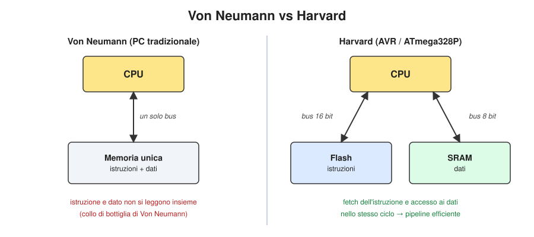
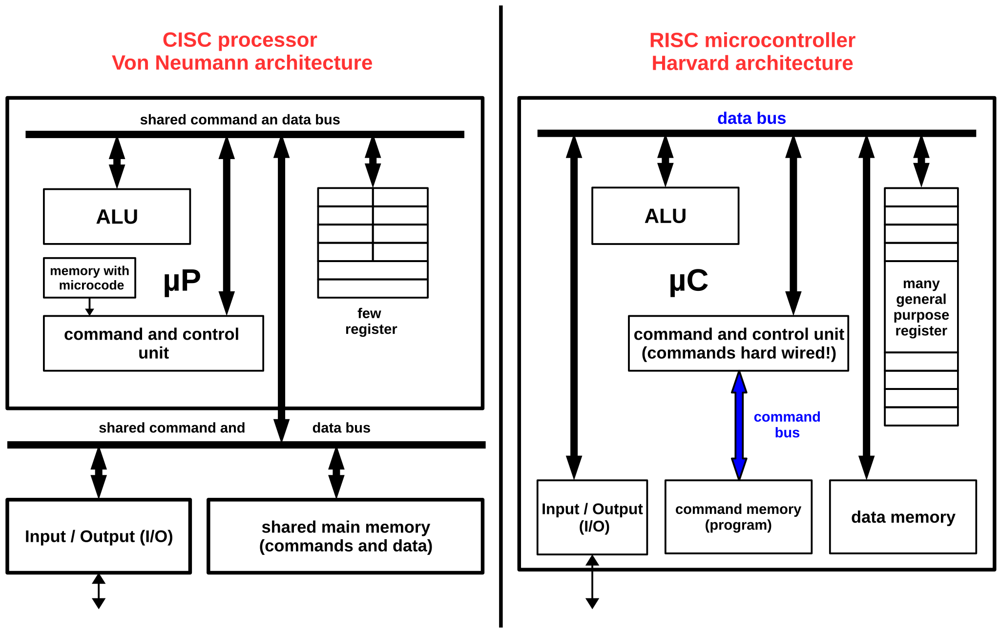
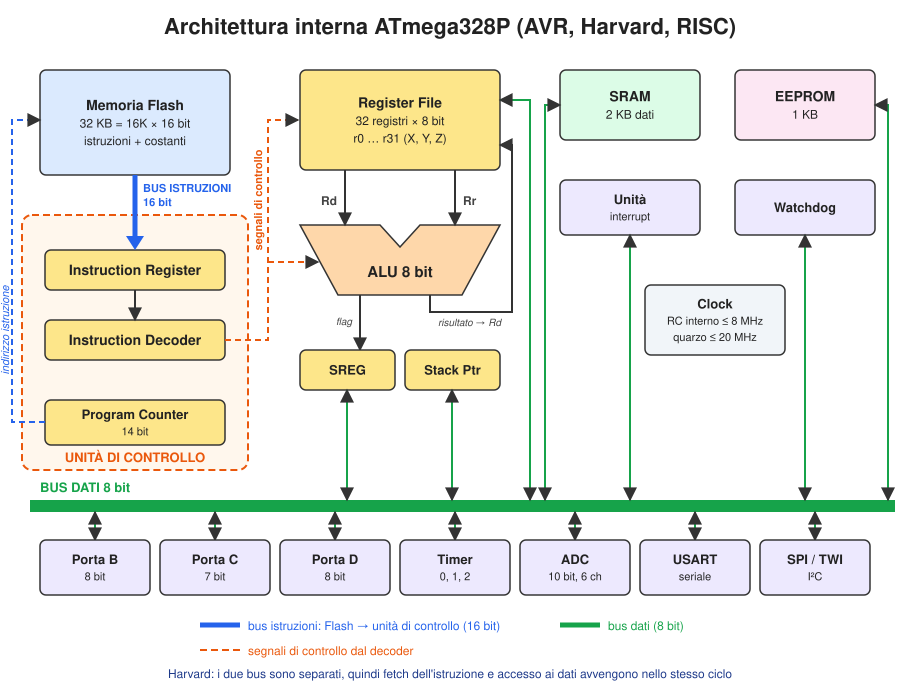
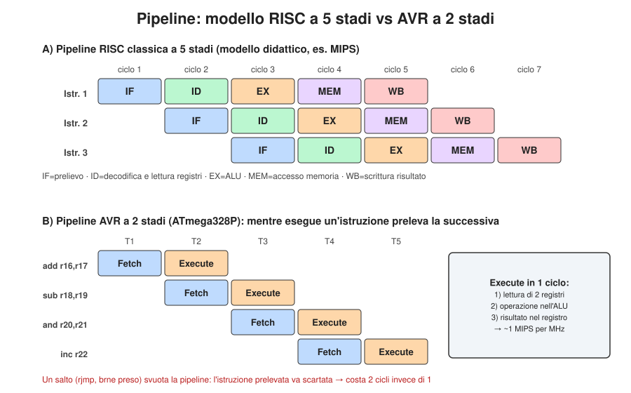
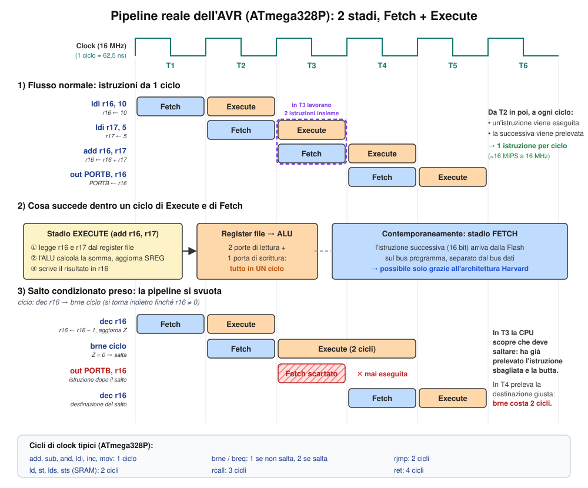
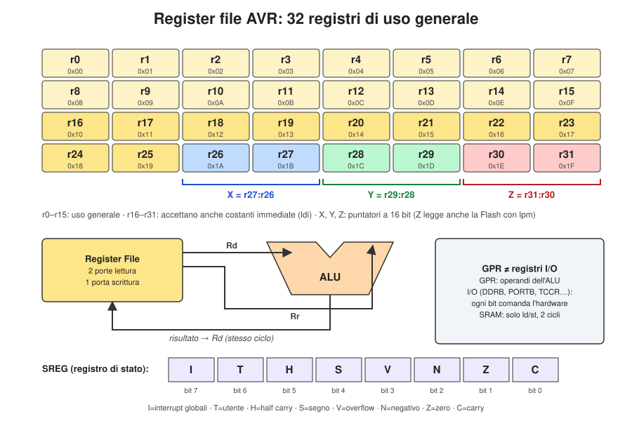
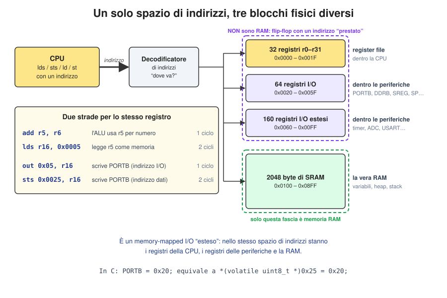
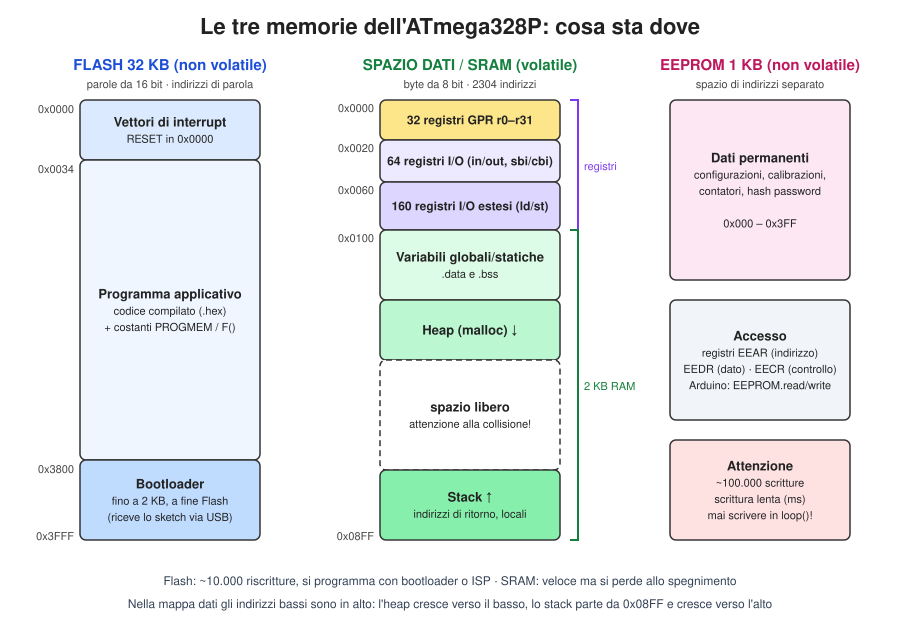
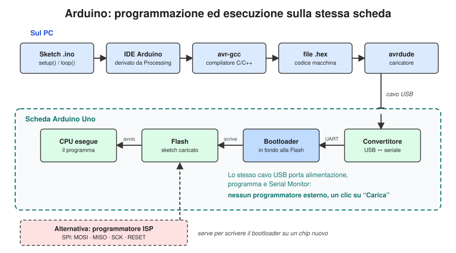

# Il microcontrollore ATmega328P – Dispensa per la 3ª ITI Informatica

*22 ottobre 2026*

## 1. Cos'è un microcontrollore

Un microcontrollore (µC) è un computer completo su un solo chip: CPU, memorie (Flash, SRAM, EEPROM) e periferiche di I/O programmabili. L'ATmega328P, il cuore di Arduino Uno, appartiene alla famiglia megaAVR progettata da Atmel, acquisita da Microchip Technology nel 2016. Ha un core RISC a 8 bit con architettura Harvard modificata.

A differenza del processore di un PC, un µC non ha sistema operativo: esegue un solo programma, in un ciclo infinito, leggendo ingressi e comandando uscite.

| Risorsa | ATmega328P |
| --- | --- |
| CPU | AVR 8 bit, fino a 20 MHz (16 MHz su Arduino Uno) |
| Prestazioni | circa 1 MIPS per MHz |
| Flash (programma) | 32 KB |
| SRAM (dati) | 2 KB |
| EEPROM (dati permanenti) | 1 KB |
| Linee di I/O | 23, porte B, C, D |
| Timer | 2 a 8 bit, 1 a 16 bit, 6 uscite PWM |
| Analogico | ADC a 10 bit, 6 canali; comparatore analogico |
| Comunicazione | USART, SPI, I²C (TWI) |
| Alimentazione | da 1,8 a 5,5 V |

Figura consigliata dalle fonti: [piedinatura dell'ATmega328P (Ariat-Tech)](https://www.ariat-tech.it/upfile/images/ab/20260410063902765.png).

## 2. Harvard contro Von Neumann

L'ATmega328P usa l'architettura Harvard: istruzioni e dati stanno in memorie separate, collegate alla CPU da bus separati. Per questo può prelevare l'istruzione successiva mentre lavora sui dati.



- **Von Neumann** (il PC tradizionale): una sola memoria e un solo bus per istruzioni e dati. Istruzione e dato non si leggono nello stesso istante: è il cosiddetto collo di bottiglia di Von Neumann.
- **Harvard** (AVR): Flash per le istruzioni con bus a 16 bit, SRAM per i dati con bus a 8 bit. Le due memorie possono avere parole di larghezza diversa.

In sintesi: Harvard è più veloce, Von Neumann più flessibile. I processori moderni usano soluzioni ibride.

### Due scelte di progetto: set di istruzioni e organizzazione della memoria

La figura seguente mette a confronto due scelte indipendenti che caratterizzano un processore: quante e quanto complesse sono le istruzioni (CISC o RISC) e come sono organizzate le memorie (Von Neumann o Harvard). I computer classici sono tipicamente CISC con memoria di tipo Von Neumann. I microcontrollori, come l'ATmega328P, sono quasi sempre RISC con architettura Harvard, perché devono essere economici e veloci.



*Fonte della figura: G. Weigel, [weigu.lu – Microcontroller systems: Memory](https://www.weigu.lu/tutorials/microcontroller/04_memory/index.html).*

**Come leggere la figura.** A sinistra c'è un processore (µP) CISC con architettura Von Neumann, a destra un microcontrollore (µC) RISC con architettura Harvard. Conviene confrontare i due lati blocco per blocco:

| Elemento | Sinistra: µP CISC, Von Neumann | Destra: µC RISC, Harvard |
| --- | --- | --- |
| Bus | un unico *shared command and data bus*: istruzioni e dati passano sulle stesse linee | due bus: il *data bus* (nero) e un *command bus* (blu) riservato alle istruzioni |
| Memoria | una sola *shared main memory* per istruzioni e dati | *command memory* (il programma, nell'ATmega la Flash) separata dalla *data memory* (la SRAM) |
| Unità di controllo | *command and control unit* guidata da una *memory with microcode*: ogni istruzione complessa è eseguita come una sequenza di micro-passi | *commands hard wired*: le istruzioni sono cablate in hardware, nessun microcodice, decodifica in un ciclo |
| Registri | *few register*: pochi, quindi molti accessi alla memoria | *many general purpose register*: nell'AVR sono 32, e quasi tutte le operazioni restano dentro la CPU |
| Collocazione della memoria | fuori dal chip del processore | memorie e I/O dentro lo stesso chip del µC |

Le conseguenze:

- **Von Neumann**: la CPU non può leggere un'istruzione e accedere a un dato nello stesso momento, perché il bus è uno solo. È il collo di bottiglia di Von Neumann.
- **Harvard**: la CPU legge l'istruzione successiva sul command bus mentre lavora sui dati del data bus. È ciò che permette la pipeline a 2 stadi (sezione 5). Poiché gli spazi di indirizzamento sono distinti, le due memorie possono avere parole di lunghezza diversa: nell'ATmega328P la Flash è a 16 bit, la SRAM a 8 bit.
- **CISC**: molte istruzioni complesse, eseguite tramite microcodice in più cicli, che possono lavorare direttamente in memoria.
- **RISC**: istruzioni semplici cablate in hardware, quindi decodificate in fretta. Solo load e store accedono alla memoria; tutte le altre lavorano sui registri. La sezione 3 approfondisce questo modello.

## 3. Il modello RISC

L'AVR è un processore RISC (Reduced Instruction Set Computer): poche istruzioni semplici, quasi tutte eseguite in un solo ciclo di clock. A 16 MHz arriva così a circa 16 milioni di istruzioni al secondo.

| Caratteristica | RISC (AVR) | CISC (es. x86) |
| --- | --- | --- |
| Numero di istruzioni | poche (131), semplici | molte, anche complesse |
| Esecuzione | cablata in hardware | spesso tramite microcodice |
| Cicli per istruzione | quasi sempre 1 | variabili, anche molti |
| Lunghezza istruzioni | fissa: 16 bit (poche a 32) | variabile |
| Accesso alla memoria | solo istruzioni load/store (`ld`, `st`) | molte istruzioni operano in memoria |
| Registri | molti (32) di uso generale | pochi, spesso specializzati |

L'idea chiave è l'architettura **load/store**: le operazioni aritmetiche e logiche lavorano solo sui registri. Si porta un dato dalla RAM a un registro (`ld`, 2 cicli), lo si elabora (1 ciclo) e lo si riscrive (`st`, 2 cicli). Avere 32 registri riduce gli accessi alla RAM e fa guadagnare tempo. Il set di istruzioni è stato anche progettato per facilitare il lavoro dei compilatori C.

Per un microcontrollore questa velocità conta soprattutto nella **reazione agli eventi**: poiché le istruzioni sono cablate in hardware e si decodificano in un ciclo, il µC risponde in fretta a un interrupt o al cambiamento di un sensore.

Le istruzioni assembly che compaiono nella dispensa (`ldi`, `add`, `lds`, `sts`, `brne`…) sono spiegate una per una nell'**Appendice** in fondo, prima delle fonti.

## 4. Architettura interna

Il cuore della CPU è il percorso Flash → registro istruzione → decodificatore → register file → ALU → register file. Tutto il resto (porte, timer, ADC, seriali) è collegato al bus dati a 8 bit e viene comandato tramite registri.



- **Program Counter (PC)**, 14 bit: indica la prossima istruzione da prelevare in Flash.
- **Registro istruzione e decodificatore**: trattengono e interpretano l'istruzione corrente.
- **Register file**: 32 registri da 8 bit, gli operandi dell'ALU (sezione 6).
- **ALU a 8 bit**: operazioni aritmetiche e logiche; aggiorna i flag nel registro SREG.
- **Stack Pointer**: punta alla cima dello stack in SRAM.
- **Unità degli interrupt**: interrompe il programma per gestire eventi urgenti (pin, timer, seriale, ADC).
- **Clock**: oscillatore interno RC fino a 8 MHz oppure quarzo esterno fino a 20 MHz.
- **Watchdog**: riavvia il chip se il programma si blocca.

Il ciclo di funzionamento è sempre lo stesso: **preleva → decodifica → esegui**, ripetuto all'infinito a ogni colpo di clock.

### Dettagli utili per chi programma

- **Velocità.** Con un quarzo da 16 MHz l'ATmega328P esegue circa 16 milioni di istruzioni al secondo: più o meno la velocità di un processore Intel 80386 del 1990, in un chip che costa pochi euro.
- **Registri all'accensione.** I 32 registri sono un banco separato dentro la CPU, non celle di SRAM: sono soltanto *mappati* nello spazio di indirizzi dei dati (0x00–0x1F). Come la SRAM, però, sono volatili, e al riavvio contengono **valori non definiti**. Il codice di avvio azzera le variabili globali, ma non i registri né le variabili locali: quelle vanno sempre inizializzate prima di essere usate (sezione 7).
- **Modalità di sleep.** Il chip può spegnere le parti che non servono per consumare meno: il datasheet elenca sei modalità di sleep, dalla più leggera (*Idle*, si ferma solo la CPU) alla più profonda (*Power-down*, resta attivo quasi solo il risveglio). Un interrupt, per esempio un pulsante o un timer, risveglia il microcontrollore. È così che un dispositivo a batteria dura mesi.
- **Niente USB a bordo.** Le descrizioni generali degli AVR citano USB, RTC o PLL, ma l'ATmega328P non li ha. Proprio perché manca l'USB, Arduino Uno ha bisogno di un convertitore USB-seriale (sezione 9).

Figure consigliate dalle fonti:

- [Architettura interna ATmega328P (INCB, fig. 4)](https://www.incbtech.com/images/sampledata/artigo2018/mic0025e_0004.jpg)
- [Schema a blocchi di un AVR (weigu.lu)](https://www.weigu.lu/tutorials/microcontroller/04_memory/svg/avr_bloc.svg)
- [Schema a blocchi ATmega (Ariat-Tech)](https://www.ariat-tech.it/upfile/images/32/20260410063434661.png)

## 5. La pipeline: 5 stadi in teoria, 2 stadi nell'AVR

L'AVR non ha la pipeline a 5 stadi dei libri di testo: ne ha una a **2 stadi**, Fetch ed Execute. Mentre esegue un'istruzione, preleva già la successiva dalla Flash, e così completa un'istruzione per ciclo.

La **pipeline** è una tecnica di parallelismo: l'esecuzione di un'istruzione viene divisa in fasi, e fasi di istruzioni diverse avvengono nello stesso ciclo di clock. Aumenta il throughput, cioè le istruzioni completate per unità di tempo.

### Il modello teorico RISC a 5 stadi

| Stadio | Nome | Cosa fa |
| --- | --- | --- |
| IF | Instruction Fetch | preleva l'istruzione dalla memoria |
| ID | Instruction Decode | decodifica e legge i registri |
| EX | Execute | l'ALU esegue l'operazione |
| MEM | Memory access | legge o scrive la memoria dati |
| WB | Write Back | scrive il risultato nel registro |



### La pipeline reale dell'ATmega328P

Nell'AVR le fasi ID, EX e WB si svolgono tutte nello stesso ciclo di Execute: lettura dei due registri, calcolo dell'ALU e scrittura del risultato. Lo rende possibile il bus programma separato dell'architettura Harvard.



**Perché solo 2 stadi?** Un µC deve essere economico, a basso consumo e con tempi prevedibili, cioè adatto al tempo reale. Le pipeline lunghe alzano la frequenza ma creano conflitti (gli *hazard*). Quando un salto viene preso, l'istruzione già prelevata va scartata: per questo `rjmp` e `brne` (se salta) costano 2 cicli invece di 1.

Figure consigliate dalle fonti (Slideshare, bassa risoluzione; il PDF completo si scarica dalla pagina):

- [Pipeline a 5 stadi (slide 5)](https://image.slidesharecdn.com/5-avrpipelining-240622095839-20db8d65/85/The-AVR-Pipelining-explanation-detailed-pdf-5-320.jpg)
- [Pipeline AVR a 2 stadi (slide 6)](https://image.slidesharecdn.com/5-avrpipelining-240622095839-20db8d65/85/The-AVR-Pipelining-explanation-detailed-pdf-6-320.jpg)

## 6. Il register file e gli altri registri

Il register file è la "lavagna" dell'ALU: 32 registri da 8 bit (r0–r31) da cui partono e in cui tornano i risultati di ogni operazione. I registri di I/O, invece, sono interruttori e spie dell'hardware.



- Il register file ha **due porte di lettura e una di scrittura**: in un solo ciclo legge due registri e ne scrive uno. Esempio: `add r16, r17` esegue r16 ← r16 + r17.
- Gli ultimi sei registri formano tre **puntatori a 16 bit**: X (r27:r26), Y (r29:r28), Z (r31:r30). Servono per l'indirizzamento indiretto della RAM; Z legge anche tabelle in Flash con `lpm`.
- Solo r16–r31 accettano costanti immediate (`ldi r16, 10`).
- A differenza dei processori ad accumulatore come l'8085, dove quasi tutto passa dal registro A, nell'AVR qualunque registro può essere operando o destinazione.

| | Register file (GPR) | Registri I/O | Celle di SRAM |
| --- | --- | --- | --- |
| Quantità | 32 | 64 + 160 estesi | 2048 byte |
| Indirizzi nello spazio dati | 0x00–0x1F | 0x20–0x5F e 0x60–0xFF | 0x100–0x8FF |
| Funzione | operandi dell'ALU | ogni bit comanda una periferica; qui stanno anche SREG e Stack Pointer | variabili, array, heap, stack |
| Accesso | direttamente dall'ALU, 1 ciclo | `in`/`out` 1 ciclo; `sbi`/`cbi` bit per bit sui primi 32; gli estesi solo con `ld`/`st` | solo `ld`/`st`/`lds`/`sts`, 2 cicli |

Scrivere in `DDRB` o `PORTB` non memorizza un dato: accende o spegne qualcosa. Tutti questi registri sono volatili e si perdono allo spegnimento.

### Registri e memoria: un unico spazio di indirizzi

I 32 registri sono **memorie dentro la CPU**, fisicamente separate dalla SRAM. Hanno però anche un **indirizzo**, come se fossero celle di memoria. È un'estensione del memory-mapped I/O: nello stesso spazio di indirizzi l'AVR mette i registri della CPU, i registri delle periferiche e la RAM vera.



Come funziona, in tre punti:

1. Quando la CPU legge o scrive un indirizzo, un **decodificatore** guarda il numero e decide dove mandare la richiesta.
2. Da 0x0000 a 0x00FF l'indirizzo arriva a dei **flip-flop**: i 32 registri della CPU, poi i registri delle periferiche. Non sono RAM: hanno solo un indirizzo "prestato". `PORTB`, per esempio, è un registro dentro il circuito della porta B, e i suoi bit sono collegati ai pin.
3. Solo da 0x0100 in poi l'indirizzo arriva alla **SRAM** vera, dove stanno le variabili.

Per questo lo stesso registro si raggiunge in due modi: **per nome**, con le istruzioni veloci (`add r5, r6`, oppure `out` per PORTB), o **per indirizzo**, con le istruzioni di memoria (`lds`, `sts`), più lente di un ciclo.

**Perché PORTB è sia 0x05 sia 0x25?** Non sono lo stesso numero: sono due modi di contare lo stesso registro, come in un teatro con 32 posti in platea e poi la galleria. Il quinto posto della galleria è "galleria, posto 5" se conti dall'inizio della galleria, oppure "posto 37" se conti dall'inizio del teatro (32 + 5).

- **Numerazione I/O**, usata da `in` e `out`: si conta dal primo registro I/O, quindi PORTB è il numero 0x05.
- **Numerazione dati**, usata da `lds` e `sts`: i primi 32 indirizzi (0x00–0x1F) sono occupati da r0–r31, quindi i registri I/O partono da 0x20 e PORTB è 0x20 + 0x05 = 0x25.

In esadecimale 0x20 vale 32, quindi 0x25 = 32 + 5 = 37: esattamente il posto in galleria. La regola è sempre la stessa: **indirizzo dati = numero I/O + 0x20**.

| Registro | Numero I/O (`in`, `out`) | Indirizzo dati (`lds`, `sts`) |
| --- | --- | --- |
| r0 … r31 | — | 0x00 … 0x1F |
| PINB | 0x03 | 0x23 |
| DDRB | 0x04 | 0x24 |
| PORTB | 0x05 | 0x25 |
| SREG | 0x3F | 0x5F |

Le due numerazioni esistono perché `in` e `out` sono istruzioni veloci (1 ciclo) e corte (16 bit), ma hanno solo 6 bit per l'indirizzo: arrivano da 0 a 63. Numerando i registri I/O da zero, i 64 più usati ci stanno tutti.

**Attenzione: non è isolated I/O.** L'AVR è un sistema **memory-mapped**. `in` e `out` non aprono uno spazio separato come `IN` e `OUT` dell'8085, che attivano un segnale apposito per le porte: sono solo una scorciatoia più corta e veloce per raggiungere i primi 64 registri I/O. Dietro `out 0x05` e `sts 0x0025` c'è lo stesso registro, PORTB. I 160 registri estesi (timer 1, ADC, USART…) non hanno la scorciatoia e si raggiungono solo come memoria.

Anche in C si vede che è memory-mapped I/O. `PORTB = 0x20;` vuol dire letteralmente "scrivi 0x20 all'indirizzo di memoria 0x25":

```c
PORTB = 0x20;                         // quello che scrivi
*(volatile uint8_t *)0x25 = 0x20;     // quello che significa
```

La parola `volatile` avverte il compilatore che a quell'indirizzo c'è hardware, non una variabile qualunque: la scrittura va fatta sempre, senza ottimizzarla.

### E l'accumulatore?

Nell'AVR l'accumulatore come registro dedicato non esiste: il suo ruolo è distribuito sui 32 registri del register file. Nell'8085 c'è un solo accumulatore fisso; nell'AVR ce ne sono 32 intercambiabili.

Nei processori ad accumulatore, come l'8085, quasi ogni operazione dell'ALU usa il registro A come operando implicito e vi scrive il risultato. Servono così continui spostamenti dentro e fuori da A:

```
8085:   MOV A, B      ; porto il dato nell'accumulatore
        ADD C         ; A ← A + C   (A è implicito)
        MOV D, A      ; sposto il risultato fuori da A
```

Nell'AVR ogni istruzione ha due operandi espliciti e il primo (Rd) fa da destinazione. Qualunque registro può quindi fare da accumulatore per quella singola istruzione, e si possono tenere aperti più calcoli in registri diversi:

```
AVR:    add r16, r17  ; r16 ← r16 + r17
        add r20, r21  ; r20 ← r20 + r21  (un altro "accumulatore")
```

Dell'idea di accumulatore restano tre tracce:

- **Rd** è un accumulatore "a scelta": il risultato sovrascrive sempre il primo operando.
- **r1:r0** è l'unica destinazione fissa: il prodotto a 16 bit di `mul` finisce sempre lì.
- **SREG** raccoglie i flag del risultato, come il registro dei flag accanto all'accumulatore dell'8085.

### Il registro di stato SREG

| Bit | 7 | 6 | 5 | 4 | 3 | 2 | 1 | 0 |
| --- | --- | --- | --- | --- | --- | --- | --- | --- |
| Flag | I | T | H | S | V | N | Z | C |
| Significato | interrupt abilitati | bit utente | half carry | segno | overflow | negativo | zero | carry |

Le istruzioni di salto condizionato leggono questi flag: `breq` salta se Z = 1, `brne` se Z = 0. Il carry C permette le somme a 16 bit con `add` seguito da `adc`.

Figure consigliate dalle fonti:

- [Register file (INCB, fig. 5)](https://www.incbtech.com/images/sampledata/artigo2018/mic0025e_0005.png)
- [Registri GPR nello spazio SRAM (weigu.lu)](https://www.weigu.lu/tutorials/microcontroller/04_memory/svg/memory_328p_SRAM_GPR.svg)
- [Formato di un'istruzione AVR (weigu.lu)](https://www.weigu.lu/tutorials/microcontroller/04_memory/svg/avr_instruction.svg)

## 7. Le tre memorie: cosa sta dove e come si accede

Il programma sta in Flash, le variabili in SRAM, i dati da conservare allo spegnimento in EEPROM. Ogni memoria ha la sua tecnologia, la sua dimensione e il suo modo di accesso.



### Flash, 32 KB, non volatile: il programma

- Organizzata in **16K parole da 16 bit**, perché le istruzioni sono a 16 o 32 bit. Per questo il PC è a 14 bit (2¹⁴ = 16K).
- Dall'inizio alla fine contiene: la **tabella dei vettori di interrupt** (al reset il PC riparte da 0x0000), il **programma applicativo** e la **sezione bootloader**.
- Sopporta circa **10.000 riscritture**: si scrive quando si carica il programma, non durante l'esecuzione.
- Può ospitare **costanti** per risparmiare SRAM: `PROGMEM` con `pgm_read_byte()` (libreria `avr/pgmspace.h`), oppure `F()` per le stringhe: `Serial.println(F("testo"));`. In assembly si legge con `lpm` tramite Z.

### SRAM, 2 KB, volatile: i dati in esecuzione

| Indirizzi | Contenuto |
| --- | --- |
| 0x0000–0x001F | 32 registri GPR |
| 0x0020–0x005F | 64 registri I/O |
| 0x0060–0x00FF | 160 registri I/O estesi |
| 0x0100–0x08FF | 2048 byte di SRAM: variabili globali, heap, stack |

- **Variabili globali e statiche** occupano l'inizio della SRAM.
- L'**heap** (`malloc`) cresce verso indirizzi più alti; lo **stack** parte da 0x08FF e cresce verso indirizzi più bassi.
- Lo stack conserva gli indirizzi di ritorno di funzioni e interrupt e le variabili locali (`push`/`pop`, `call`/`ret`).
- Se heap e stack si scontrano, il programma si blocca in modo imprevedibile. Con 2 KB conviene evitare `malloc` e spostare le stringhe in Flash.
- **Modi di indirizzamento**: diretto, indiretto con X/Y/Z, indiretto con spiazzamento, con pre-decremento, con post-incremento.

### Dove finiscono le variabili di uno sketch

Una variabile definita fuori da `loop()` sta in **SRAM**. Non sta in un registro, perché i registri sono pochi e servono solo come appoggio per i calcoli. Non sta in Flash, perché la Flash non si può scrivere mentre il programma gira.

```c
int contatore = 5;    // globale con valore iniziale
int somma;            // globale senza valore iniziale
const int LED = 13;   // costante
const char msg[] PROGMEM = "ciao";  // costante tenuta in Flash

void loop() {
  int i;              // variabile locale
  contatore++;
}
```

**Prima di `setup()`.** All'accensione, prima del tuo codice, gira un breve programma di avvio aggiunto dal compilatore. Fa tre cose:

1. Imposta lo Stack Pointer alla fine della SRAM (0x08FF).
2. Copia i valori iniziali delle globali dalla Flash alla SRAM. Il 5 di `contatore` era salvato in Flash, l'unica memoria che sopravvive allo spegnimento, e ora arriva nella sua cella di SRAM.
3. Azzera le globali senza valore iniziale: `somma` vale 0.

**Le righe, una per una.**

- `int contatore = 5;` — sta in SRAM per tutta la vita del programma e conserva il valore tra un giro di `loop()` e l'altro.
- `int somma;` — sta in SRAM e parte da 0, garantito.
- `const int LED = 13;` — di solito non occupa memoria: il compilatore scrive il 13 direttamente dentro le istruzioni, che stanno in Flash.
- `const char msg[] PROGMEM = "ciao";` — resta in Flash e non occupa SRAM. Si legge con `pgm_read_byte()`.
- `int i;` — nasce quando `loop()` inizia e sparisce quando finisce. Sta in un registro o nello stack, e **nessuno la azzera**: contiene un valore a caso finché non le assegni qualcosa.
- `contatore++;` — qui si vede il RISC load/store. L'ALU non lavora direttamente in SRAM, quindi servono tre passi:

```
lds  r24, contatore     ; 1. copia il valore dalla SRAM in un registro
adiw r24, 1             ; 2. l'ALU aggiunge 1 al registro
sts  contatore, r24     ; 3. riscrive il risultato in SRAM
```

(Il codice è semplificato: un `int` occupa 2 byte, quindi in realtà ogni passo si fa sulla coppia di registri r25:r24 e servono circa 10 cicli. Con un `byte` ne bastano meno: sui microcontrollori conviene usare il tipo più piccolo che basta.)

| Tipo di variabile | Dove sta | Se non le dai un valore |
| --- | --- | --- |
| Globale o `static` | SRAM, per tutto il programma | vale 0 |
| Locale (dentro una funzione) | registro o stack, solo mentre la funzione gira | valore a caso |
| `const` semplice | di solito dentro le istruzioni, in Flash | — |
| `PROGMEM` | Flash | — |

### EEPROM, 1 KB, non volatile: i dati permanenti

- Contiene configurazioni, calibrazioni, contatori, hash di password.
- Ha uno **spazio di indirizzi separato**: non si usa `ld`/`st` ma tre registri dedicati: **EEAR** (indirizzo), **EEDR** (dato), **EECR** (controllo, bit EERE per leggere, EEMPE ed EEPE per scrivere).
- In Arduino: `#include <EEPROM.h>`, poi `EEPROM.read(addr)`, `EEPROM.write(addr, val)` oppure `EEPROM.update(addr, val)`, che scrive solo se il valore cambia.
- Scrittura lenta (qualche millisecondo per byte) e durata di circa **100.000 scritture**. Mai scrivere in EEPROM dentro `loop()` senza una condizione: il limite si raggiunge in pochi minuti. La lettura invece è illimitata.

### Riepilogo

| Contenuto | Dove | Perché |
| --- | --- | --- |
| Codice, vettori di interrupt, bootloader | Flash | grande e non volatile |
| Costanti e tabelle (`PROGMEM`, `F()`) | Flash | si risparmia SRAM |
| Variabili, array, stack, heap | SRAM | veloce, ma si perde allo spegnimento |
| Registri di lavoro e di controllo | inizio dello spazio dati | mappati in memoria |
| Impostazioni da mantenere al riavvio | EEPROM | non volatile, scrivibile dal programma |
| Fuse e lock bit (clock, protezione) | aree speciali | si scrivono solo con un programmatore |

Figure consigliate dalle fonti:

- [Le tre memorie del 328P (weigu.lu)](https://www.weigu.lu/tutorials/microcontroller/04_memory/svg/memory_328p.svg)
- [Dettaglio della SRAM (weigu.lu)](https://www.weigu.lu/tutorials/microcontroller/04_memory/svg/memory_328p_SRAM.svg)
- [EEPROM (weigu.lu)](https://www.weigu.lu/tutorials/microcontroller/04_memory/svg/memory_328p_EEPROM.svg)
- [Mappa della Flash (INCB, fig. 6)](https://www.incbtech.com/images/sampledata/artigo2018/mic0025e_0006.jpg)
- [Mappa della SRAM (INCB, fig. 7)](https://www.incbtech.com/images/sampledata/artigo2018/mic0025e_0007.jpg)

## 8. Le porte di I/O: DDRx, PORTx, PINx

Ogni pin è comandato da un bit in tre registri: DDRx sceglie la direzione, PORTx imposta l'uscita (o il pull-up), PINx legge lo stato. È ciò che `pinMode()`, `digitalWrite()` e `digitalRead()` fanno dietro le quinte.

| Registro | Bit = 1 | Bit = 0 |
| --- | --- | --- |
| DDRx | pin in uscita | pin in ingresso |
| PORTx (pin in uscita) | livello alto, 5 V | livello basso, 0 V |
| PORTx (pin in ingresso) | pull-up interno attivo | pull-up spento |
| PINx (sola lettura) | il pin è alto | il pin è basso |

Le porte dell'ATmega328P sono tre: **B** (8 bit; quarzo, SPI, uscite dei timer), **C** (7 bit; ingressi analogici, I²C), **D** (8 bit; seriale USART, interrupt esterni INT0 e INT1). Il LED integrato di Arduino Uno (pin 13) è PB5.

```c
DDRB  |=  (1 << PB5);   // pin 13 come uscita
PORTB |=  (1 << PB5);   // LED acceso
PORTB &= ~(1 << PB5);   // LED spento
if (PIND & (1 << PD2)) { /* pulsante sul pin 2 premuto (alto) */ }
```

Le maschere di bit (`|=` per mettere a 1, `&= ~` per mettere a 0) cambiano un solo pin lasciando invariati gli altri. In assembly lo stesso si ottiene con `sbi PORTB, 5` e `cbi PORTB, 5`.

Ogni pin regge circa **20 mA**: serve sempre una resistenza in serie al LED (220 Ω).

Figura consigliata dalle fonti: [struttura di un pin di I/O (INCB, fig. 10)](https://www.incbtech.com/images/sampledata/artigo2018/mic0025e_0010.jpg).

## 9. Dal codice al chip

Con Arduino basta un cavo USB: l'IDE compila lo sketch e lo invia al bootloader, che lo scrive in Flash. Senza bootloader serve un programmatore esterno collegato ai pin SPI.



1. Si scrive lo **sketch** in C/C++ semplificato, con `setup()` (eseguita una volta) e `loop()` (ripetuta all'infinito).
2. Il compilatore **avr-gcc** traduce il codice in un file **.hex** di codice macchina. Di default ottimizza per occupare poco spazio (opzione `-Os`).
3. Il programma **avrdude** invia il file .hex alla scheda.
4. Il convertitore USB-seriale resetta il chip; il **bootloader** parte, riceve il programma dalla seriale e lo scrive in Flash.
5. Il bootloader cede il controllo allo sketch, che resta in Flash anche dopo lo spegnimento.

**Programmazione ISP** (In-System Programming): un programmatore esterno, o un secondo Arduino caricato con lo sketch ArduinoISP, scrive direttamente in Flash tramite i pin MOSI, MISO, SCK e RESET. Serve per installare il bootloader su un chip nuovo (nell'IDE: *Strumenti → Scrivi il bootloader*) o per programmare un ATmega senza scheda Arduino. Via ISP si scrivono non solo la Flash ma anche la EEPROM, i fuse (che impostano per esempio la sorgente di clock) e i lock bit, che impediscono di rileggere il programma dal chip e proteggono il codice da copie e reverse engineering.

Si può anche scrivere in **assembly** e caricare il .hex con avrdude: un blink in assembly occupa meno di 100 byte, contro circa un kilobyte dello sketch Arduino equivalente.

## 10. Massimo Banzi, Processing e la nascita di Arduino

Arduino nasce a Ivrea nel 2005 portando nell'elettronica l'idea di Processing: un ambiente semplice, in cui si scrive uno sketch e con un clic lo si vede funzionare. Il passaggio intermedio fu Wiring, la tesi di Hernando Barragán seguita da Massimo Banzi.

| Anno | Tappa |
| --- | --- |
| 2001 | Casey Reas e Ben Fry creano **Processing**, linguaggio e IDE per far programmare artisti e designer; il programma si chiama "sketch". |
| 2003 | All'Interaction Design Institute Ivrea (IDII), scuola legata a Olivetti e Telecom, Hernando Barragán sviluppa **Wiring** come tesi, con Banzi e Reas come relatori: una scheda con un ATmega, un IDE basato su Processing e librerie semplici. |
| 2005 | Banzi, con David Mellis e David Cuartielles, adatta Wiring al più economico **ATmega8**. Il progetto derivato prende il nome di **Arduino**, dal Bar di Re Arduino di Ivrea. Al gruppo si uniscono Gianluca Martino e Tom Igoe. |

### Il ruolo di Banzi

Banzi insegnava all'IDII a studenti di design, non a ingegneri. Le schede in uso (come il BASIC Stamp, circa 50 dollari) erano care e complicate. Spinse per una scheda **economica e open source**, con schemi e software liberi, perché potesse sopravvivere alla chiusura dell'istituto e diffondersi nelle scuole di tutto il mondo.

Per correttezza: Barragán ha contestato il racconto ufficiale, sostenendo che IDE, linguaggio e idea di fondo vengono dal suo Wiring. Il dibattito sulla paternità è ancora aperto.

### L'idea vincente: programmare ed eseguire sulla stessa scheda

Prima di Arduino servivano tre oggetti separati: la scheda con il µC, un programmatore hardware e una toolchain da riga di comando. Arduino li ha fusi in uno solo:

- un **IDE derivato da Processing**, con due pulsanti (Verifica e Carica) che nascondono avr-gcc e avrdude;
- sulla scheda, un **convertitore USB-seriale** e un **bootloader** già installato: lo stesso cavo porta alimentazione, programma e Serial Monitor;
- **librerie** che nascondono i registri: `digitalWrite()` invece di `PORTB`.

La scheda su cui il codice gira è anche lo strumento con cui lo si carica. È questo, insieme al prezzo basso e alla comunità open source, che ha reso Arduino lo standard della didattica.

## 11. In laboratorio e verifica

### Regole pratiche

- Le memorie sono tre: programma in Flash, variabili in SRAM (solo 2 KB), dati permanenti in EEPROM.
- Testi e tabelle lunghe vanno in Flash con `F()` o `PROGMEM`.
- Mai scrivere la EEPROM dentro `loop()` senza una condizione; meglio `EEPROM.update()`.
- Al massimo circa 20 mA per pin: sempre una resistenza in serie ai LED.
- La lista completa dei registri sta in fondo al datasheet dell'ATmega328P.

### Esercizi

1. Fai lampeggiare il LED del pin 13 prima con `digitalWrite()`, poi scrivendo direttamente su `PORTB`. Confronta la memoria Flash occupata dai due sketch.
2. Salva in EEPROM il numero di accensioni della scheda e stampalo sul Serial Monitor a ogni avvio.
3. Stampa una tabella di 10 costanti prima come array normale, poi con `PROGMEM`. Confronta la SRAM usata ("variabili globali") riportata dall'IDE.
4. Stampa in binario il registro `SREG` con `Serial.println(SREG, BIN)`, poi metti a 1 e a 0 il bit T (bit 6) usando le maschere.

### Domande di verifica

1. Che differenza c'è tra architettura Harvard e Von Neumann? Perché un µC preferisce la prima?
2. Quanti stadi ha la pipeline dell'AVR e quali sono? In che cosa differisce dal modello RISC a 5 stadi?
3. Perché un salto condizionato preso costa 2 cicli invece di 1?
4. Che differenza c'è tra un registro del register file e un registro di I/O come `PORTB`?
5. Quanti bit ha il Program Counter dell'ATmega328P e perché?
6. Dove si trova lo stack e in quale direzione cresce? Che cosa succede se incontra l'heap?
7. Quali dati conviene salvare in EEPROM e quali precauzioni servono?
8. A cosa serve il bootloader? Quando serve invece un programmatore ISP?
9. Quale idea di Processing è stata trasferita in Arduino, e da chi?

## Appendice: le istruzioni assembly usate nella dispensa

Ogni istruzione assembly è una parola abbreviata (il **mnemonico**), di solito presa dal nome inglese, seguita dagli operandi. Quando gli operandi sono due, **il primo è la destinazione**: `add r16, r17` vuol dire "a r16 aggiungi r17", e il risultato finisce in r16.

Nelle tabelle si usano queste convenzioni:

- **r0 … r31**: un registro del register file.
- **K**: un numero costante scritto dentro l'istruzione, per esempio `10`.
- **←**: "riceve". `r16 ← r16 + r17` si legge "r16 riceve r16 più r17".
- **Cicli**: quanti colpi di clock servono sull'ATmega328P. A 16 MHz un ciclo dura 62,5 ns.

### Spostare dati tra registri e costanti

| Istruzione | Da | Cosa fa | Esempio | Cicli |
| --- | --- | --- | --- | --- |
| `ldi` | *LoaD Immediate* | mette una costante in un registro (solo r16–r31) | `ldi r16, 10` → r16 ← 10 | 1 |
| `mov` | *MOVe* | copia un registro in un altro | `mov r1, r16` → r1 ← r16 | 1 |

### Calcoli (l'ALU lavora sui registri e aggiorna i flag di SREG)

| Istruzione | Da | Cosa fa | Esempio | Cicli |
| --- | --- | --- | --- | --- |
| `add` | *ADD* | somma due registri | `add r16, r17` → r16 ← r16 + r17 | 1 |
| `adc` | *ADd with Carry* | somma due registri più il carry; serve per i numeri a 16 bit | `adc r17, r19` → r17 ← r17 + r19 + C | 1 |
| `sub` | *SUBtract* | sottrae due registri | `sub r18, r19` → r18 ← r18 − r19 | 1 |
| `and` | *logical AND* | AND bit a bit tra due registri | `and r20, r21` | 1 |
| `inc` | *INCrement* | aggiunge 1 | `inc r22` → r22 ← r22 + 1 | 1 |
| `dec` | *DECrement* | toglie 1; se il risultato è 0 mette Z = 1 | `dec r16` → r16 ← r16 − 1 | 1 |
| `adiw` | *ADd Immediate to Word* | aggiunge una costante a una coppia di registri (16 bit) | `adiw r24, 1` → r25:r24 ← r25:r24 + 1 | 2 |
| `mul` | *MULtiply* | moltiplica due registri; il risultato a 16 bit va sempre in r1:r0 | `mul r16, r17` | 2 |

### Leggere e scrivere la memoria dati (SRAM)

È qui che si vede il modello **load/store**: solo queste istruzioni toccano la SRAM.

| Istruzione | Da | Cosa fa | Esempio | Cicli |
| --- | --- | --- | --- | --- |
| `lds` | *LoaD direct from data Space* | copia in un registro il byte che sta a un certo indirizzo | `lds r24, 0x0100` → r24 ← SRAM[0x0100] | 2 |
| `sts` | *STore direct to data Space* | scrive un registro a un certo indirizzo | `sts 0x0100, r24` → SRAM[0x0100] ← r24 | 2 |
| `ld` | *LoaD indirect* | come `lds`, ma l'indirizzo sta in un puntatore X, Y o Z | `ld r16, X` → r16 ← SRAM[X] | 2 |
| `st` | *STore indirect* | come `sts`, con l'indirizzo in X, Y o Z | `st X, r16` → SRAM[X] ← r16 | 2 |

### Leggere la Flash

| Istruzione | Da | Cosa fa | Esempio | Cicli |
| --- | --- | --- | --- | --- |
| `lpm` | *Load Program Memory* | legge un byte dalla Flash all'indirizzo contenuto in Z; serve per le costanti `PROGMEM` | `lpm r16, Z` → r16 ← Flash[Z] | 3 |

### Registri di I/O (porte e periferiche)

| Istruzione | Da | Cosa fa | Esempio | Cicli |
| --- | --- | --- | --- | --- |
| `in` | *IN from I/O* | legge un registro I/O in un registro | `in r16, 0x03` → r16 ← PINB | 1 |
| `out` | *OUT to I/O* | scrive un registro in un registro I/O | `out 0x05, r16` → PORTB ← r16 | 1 |
| `sbi` | *Set Bit in I/O* | mette a 1 un solo bit di un registro I/O | `sbi PORTB, 5` → accende il LED del pin 13 | 2 |
| `cbi` | *Clear Bit in I/O* | mette a 0 un solo bit di un registro I/O | `cbi PORTB, 5` → spegne il LED | 2 |

### Salti e funzioni

| Istruzione | Da | Cosa fa | Esempio | Cicli |
| --- | --- | --- | --- | --- |
| `rjmp` | *Relative JuMP* | salta a un'altra riga del programma, sempre | `rjmp LOOP` | 2 |
| `breq` | *BRanch if EQual* | salta solo se il flag Z vale 1 (risultato zero, o valori uguali) | `breq FINE` | 1 se non salta, 2 se salta |
| `brne` | *BRanch if Not Equal* | salta solo se Z vale 0; con `dec` fa un ciclo che si ripete finché il contatore non arriva a 0 | `brne CICLO` | 1 se non salta, 2 se salta |
| `rcall` / `call` | *(Relative) CALL* | chiama una funzione: salva sullo stack l'indirizzo di ritorno, poi salta | `rcall DELAY` | 3 / 4 |
| `ret` | *RETurn* | torna dalla funzione: riprende l'indirizzo dallo stack | `ret` | 4 |
| `push` | *PUSH* | salva un registro sullo stack | `push r16` | 2 |
| `pop` | *POP* | riprende un registro dallo stack | `pop r16` | 2 |

### Le istruzioni dell'8085 citate nella sezione 6

Servono solo per il confronto con l'accumulatore. `MOV A, B` copia il registro B nell'accumulatore A. `ADD C` somma C all'accumulatore: A ← A + C. Nell'8085 il registro A è sottinteso, mentre nell'AVR entrambi gli operandi si scrivono sempre.

## Fonti e crediti delle immagini

Gli schemi nella cartella `img/` sono originali e liberamente riutilizzabili, tranne `risc_cisc_neumann_havard.svg`, tratto da weigu.lu e da citare con la sua fonte. Le figure delle fonti sono indicate tramite link, perché restano proprietà dei rispettivi autori: chi le inserisce in una copia stampata deve citarne la fonte sotto ciascuna.

- [Ariat-Tech – Microcontrollori ATmega: struttura, diagramma, funzionamento e programmazione](https://www.ariat-tech.it/blog/Learn-ATmega-Microcontrollers-Structure,Diagram,Working-and-Programming.html)
- [Wikipedia – ATmega328](https://en.wikipedia.org/wiki/ATmega328)
- [Newton C. Braga, INCB – Getting to Know the Core of the Arduino Uno ATmega328P](https://www.incbtech.com/articles/92-microcontroller/2801-getting-to-know-the-core-of-the-arduino-uno-atmega328p-microcontroller-mic025e.html)
- [weigu.lu – Microcontroller systems: Memory](https://www.weigu.lu/tutorials/microcontroller/04_memory/index.html)
- [P. Pavan Kumar, Slideshare – The AVR Pipelining](https://www.slideshare.net/slideshow/the-avr-pipelining-explanation-detailed-pdf/269820625)
- [Hackster – Storia di Wiring e Arduino](https://www.hackster.io/yeshvanth_muniraj/getting-started-with-arduino-bcb879)
- [P2P Foundation – Wiring (con la testimonianza di H. Barragán)](https://wiki.p2pfoundation.net/Wiring)
- [noze – Arduino: le origini a Ivrea](https://www.noze.it/en/insights/arduino-origini-ivrea)
- Datasheet completo: [Microchip – ATmega328P](https://www.microchip.com/wwwproducts/en/ATmega328P)
