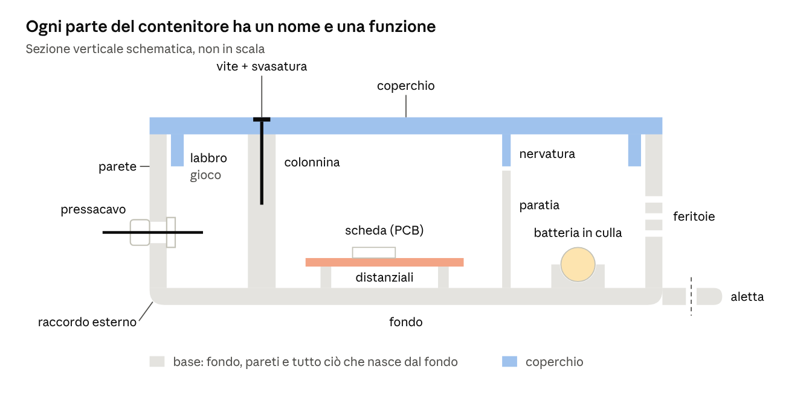

# Lessico tecnico per contenitori elettronici

*Documento collegato alla [dispensa del contenitore LoRaWAN](dispensa-contenitore-lorawan.md) · 6 novembre 2026*

## Come si formula un'istruzione tecnica

Un'istruzione tecnica completa risponde sempre a cinque domande: **cosa fare, a quale elemento, dove, quanto, perché**. Se ne manca una, chi esegue (una persona o un assistente AI) deve indovinare, e di solito indovina male.

| Domanda | Parte dell'istruzione | Esempio |
| --- | --- | --- |
| Cosa fare | il comando | estrudi, taglia, fora, raccorda, ripeti |
| A cosa | l'elemento tecnico | asola, colonnina, aletta, feritoia |
| Dove | il riferimento + la posizione | sulla parete frontale, centrato in X = 84 |
| Quanto | le quote, con il tipo | Ø 12,5, profondo 3, passo 4 |
| Perché | la funzione o il vincolo | per un pressacavo PG7; deve restare a filo |

Il "perché" sembra facoltativo, ma è la parte che permette a chi esegue di correggere un tuo errore: se sa che il foro serve a un PG7, si accorge che Ø 8 è troppo piccolo.

| Vago | Preciso |
| --- | --- |
| Fai un buco per il cavo | Foro passante Ø 12,5 sulla parete frontale, centro in X = 84, Z = 12, per un pressacavo PG7 |
| Metti dei buchi per l'aria | Serie lineare di 5 asole 26 × 2, passo 4 in Z, sulla parete destra; solo nel vano sensori |
| Arrotonda un po' | Raccordo R4 sui 4 spigoli verticali esterni; gli spigoli interni seguono con R1,6 |
| Fallo chiudere bene | Labbro sul coperchio spesso 1,6, alto 4, con gioco 0,3 per lato rispetto alla parete interna |
| Attaccalo al muro | Due alette sui lati corti, spesse 4, a filo con il fondo esterno, foro passante Ø 4,5 per vite da 4 mm |

## Anatomia di un contenitore

Una **sezione** è il disegno che si ottiene tagliando l'oggetto con un piano: mostra in un colpo solo spessori, incastri e parti nascoste. Ogni nome qui sotto compare nelle tabelle che seguono.

  

Il coperchio non poggia solo sui bordi: il labbro entra nella base con un piccolo gioco e la centra, la nervatura prosegue la paratia, la vite lo stringe alla colonnina. Le aperture (pressacavo, feritoie) e i fissaggi esterni (aletta) stanno sulle pareti e sul fondo.

## Comandi CAD, per famiglia

Quasi tutti i CAD parametrici (SolidCraft, Fusion, FreeCAD, Onshape) usano gli stessi comandi, con nomi simili. Tra parentesi il nome inglese: è quello che compare più spesso nei programmi e che gli assistenti AI capiscono meglio.

| Famiglia | Comando | Cosa fa | Uso tipico nei contenitori |
| --- | --- | --- | --- |
| Riferimenti | Piano, asse, punto (plane, axis, point) | crea un appoggio su cui disegnare o misurare | piano a metà altezza per le feritoie |
| Schizzo 2D | Linea, rettangolo, cerchio, arco, asola (slot), poligono | disegna il profilo che diventerà 3D | contorno del guscio, foro, asola USB |
| Schizzo 2D | Vincoli (constraints): coincidente, parallelo, perpendicolare, tangente, orizzontale, verticale, uguale, simmetrico, fisso | blocca la forma, così non si deforma quando cambi una quota | due fori uguali e simmetrici |
| Schizzo 2D | Quota (dimension): lineare, diametrale, radiale, angolare | fissa le misure dello schizzo | Ø 12,5 del pressacavo |
| Da 2D a 3D | Estrusione (extrude), in aggiunta (join) | spinge un profilo e crea materiale | pareti, colonnine, alette |
| Da 2D a 3D | Estrusione in taglio, tasca (cut, pocket) | spinge un profilo e toglie materiale | cavità, fori, finestre |
| Da 2D a 3D | Rivoluzione (revolve) | fa ruotare un profilo attorno a un asse | manopole, tappi, colonnine sagomate |
| Da 2D a 3D | Sweep (sweep) | trascina un profilo lungo un percorso | canale per guarnizione lungo il bordo |
| Da 2D a 3D | Loft (loft) | raccorda due o più profili diversi | imbocchi conici, convogliatori d'aria |
| Modifica del solido | Svuotamento, guscio (shell) | rende cavo un solido con pareti di spessore dato | trasformare un blocco in scatola |
| Modifica del solido | Raccordo (fillet) | arrotonda uno spigolo | spigoli esterni, base delle colonnine |
| Modifica del solido | Smusso (chamfer) | taglia uno spigolo a 45° | imbocco dei fori, primo strato di stampa |
| Modifica del solido | Foro (hole): passante, cieco, svasato, lamato, filettato | crea fori con la forma giusta per le viti | viti del coperchio, fissaggio a muro |
| Modifica del solido | Nervatura (rib) | aggiunge una parete sottile da uno schizzo | paratie, rinforzi |
| Modifica del solido | Sformo (draft) | inclina le pareti di pochi gradi | pezzi stampati a iniezione; in FDM raramente |
| Ripetizione | Serie lineare, circolare (linear / circular pattern) | ripete un elemento a passo costante | feritoie, file di fori |
| Ripetizione | Specchio (mirror) | copia un elemento simmetrico rispetto a un piano | alette sui due lati |
| Booleane | Unione, sottrazione, intersezione (union, subtract, intersect) | combina corpi diversi | coperchio ricavato dalla base |
| Booleane | Dividi corpo (split body) | taglia un corpo in due lungo un piano | separare base e coperchio da un unico blocco |
| Verifica | Misura, sezione, interferenza (measure, section, interference) | controlla quote e collisioni | il labbro tocca le colonnine? |
| Uscita | Esporta mesh (STL, 3MF), solido (STEP) | produce il file per lo slicer o per un altro CAD | `down.stl`, `up.stl` |

## Elementi tecnici, per funzione

Gli elementi di un contenitore si capiscono meglio raggruppati per **funzione**: a cosa servono, non come si disegnano. Quasi ogni progetto pesca da queste otto famiglie.

### 1. Involucro

| Elemento | Cos'è | Quando |
| --- | --- | --- |
| Guscio (shell) | il corpo cavo che contiene tutto | sempre |
| Base / fondo | la parte che porta i componenti | sempre |
| Coperchio (lid, cover) | la parte che chiude e si apre | sempre |
| Linea di divisione (parting line) | dove base e coperchio si separano | si decide all'inizio: dall'alto, a metà, di lato |
| Spigolo raccordato | spigolo arrotondato | esterno: estetica e presa; interno: robustezza |

### 2. Chiusura e giunzione del coperchio

| Elemento | Cos'è | Quando |
| --- | --- | --- |
| Labbro, battuta (lip) | bordo che entra nell'altra parte e la centra | quasi sempre, anche con le viti |
| Linguetta e scanalatura (tongue and groove) | un risalto che entra in un canale | quando serve più tenuta del semplice labbro |
| Colonnina (boss) + vite | cilindro con foro pilota o inserto filettato | coperchi da aprire e richiudere |
| Inserto a caldo (heat-set insert) | boccola filettata in ottone fusa nella plastica | viti aperte spesso: la filettatura non si consuma |
| Incastro a scatto (snap-fit) | dentino elastico che aggancia l'altra parte | chiusure senza viti, pezzi piccoli |
| Cerniera (hinge) | snodo tra base e coperchio | sportelli da aprire spesso |
| Sede guarnizione (gasket groove) | canale per una guarnizione in gomma o TPU | uso all'aperto, tenuta all'acqua |

### 3. Fissaggio dei componenti interni

| Elemento | Cos'è | Quando |
| --- | --- | --- |
| Colonnina distanziale (standoff) | cilindro con foro per vite M2/M2,5/M3 | schede con fori di montaggio |
| Appoggio + battuta (support, stop) | blocchetto su cui la scheda poggia e contro cui si ferma | schede senza fori |
| Guida, binario (rail, card guide) | canale in cui la scheda scorre | schede strette, moduli estraibili |
| Aggancio a scatto per PCB (PCB clip) | dentino che trattiene il bordo della scheda | montaggio rapido senza viti |
| Culla, sella (cradle, saddle) | appoggio sagomato sulla forma del pezzo | batterie cilindriche, sensori tondi |
| Fessura per fascetta (cable-tie slot) | passaggio per una fascetta | batterie, fasci di cavi |

### 4. Fissaggio all'esterno (installazione)

| Elemento | Cos'è | Quando |
| --- | --- | --- |
| Aletta, flangia di fissaggio (mounting flange, ear) | linguetta forata che sporge dal guscio | viti a muro o su pannello |
| Asola di regolazione | foro allungato | per compensare tasselli non precisi |
| Foro a chiave (keyhole) | foro tondo + asola stretta | appendere a una vite già nel muro |
| Passante per fascette (strap slot) | ponticello sotto cui passa una fascetta | pali, tubi, ringhiere |
| Attacco DIN (DIN rail clip) | aggancio per guida DIN da 35 mm | quadri elettrici |

### 5. Aperture e passaggi

| Elemento | Cos'è | Quando |
| --- | --- | --- |
| Foro passante / cieco (through / blind hole) | attraversa tutta la parete / si ferma a una profondità | passante per cavi e viti; cieco per viti nel materiale |
| Asola (slot) | foro allungato a estremità tonde | USB, feritoie, regolazioni |
| Finestra (cutout) | apertura sagomata | display, connettori rettangolari |
| Feritoie (vents, louvers) | serie di asole per far passare aria | sensori ambientali, componenti che scaldano |
| Pressacavo (cable gland) | raccordo filettato a tenuta | cavi verso l'esterno, all'aperto |
| Passacavo in gomma (grommet) | anello elastico nel foro | cavi al chiuso, protezione dagli spigoli |
| Foro per connettore da pannello | foro per SMA, jack, prese, spesso con un piano antirotazione (D-cut) | antenne, alimentazione |
| Foro spillo (pinhole) | foro piccolo per premere un pulsante | reset a scatola chiusa |
| Guida luce (light pipe) | cilindretto trasparente sopra un LED | vedere i LED da fuori |

### 6. Protezione da acqua, polvere e calore

| Elemento | Cos'è | Quando |
| --- | --- | --- |
| Paratia, setto (partition, divider) | parete interna che separa due vani | isolare il calore dai sensori |
| Gocciolatoio, aperture verso il basso | aperture solo sul lato rivolto a terra | all'aperto: la pioggia non entra |
| Feritoie a labirinto (baffled vents) | aperture con un percorso a zig-zag | aria sì, acqua e insetti no |
| Foro di drenaggio (drain hole) | piccolo foro nel punto più basso | scarica la condensa |
| Membrana di sfiato (vent membrane) | tappo traspirante ma impermeabile | scatole stagne che respirano |

### 7. Rinforzi

| Elemento | Cos'è | Quando |
| --- | --- | --- |
| Nervatura (rib) | parete sottile di irrigidimento | pareti lunghe che si flettono |
| Fazzoletto (gusset) | rinforzo triangolare in un angolo | base delle colonnine e delle alette |
| Raccordo interno | spigolo interno arrotondato | dove un pezzo rischia di creparsi |

### 8. Marcature

| Elemento | Cos'è | Quando |
| --- | --- | --- |
| Incisione (engrave, deboss) | testo scavato | etichette di montaggio, nomi |
| Rilievo (emboss) | testo in rilievo | loghi, indicazioni esterne |

## Il vocabolario del "dove" e del "quanto"

Il "dove" si dice sempre rispetto a un **riferimento** che anche chi legge sa trovare: un'origine, una faccia, uno spigolo, un altro elemento. "Un po' più a destra" non è un riferimento.

### Riferimenti geometrici

| Termine | Significato | Esempio |
| --- | --- | --- |
| Origine | il punto (0; 0; 0) da cui partono tutte le coordinate | angolo interno del fondo |
| Faccia | una superficie del solido | la faccia esterna del fondo |
| Spigolo | dove due facce si incontrano | i 4 spigoli verticali esterni |
| Vertice | dove si incontrano tre o più spigoli | l'angolo del guscio |
| Asse | una retta di riferimento, spesso di un foro o di un cilindro | asse della batteria |
| Piano | una superficie piana di riferimento | piano XY, piano di divisione |

### Posizioni relative

| Espressione | Significato | Esempio |
| --- | --- | --- |
| Centrato su / in | il centro dell'elemento coincide con il punto dato | foro centrato in X = 84, Z = 12 |
| A filo con (flush) | le due facce sono sullo stesso piano | aletta a filo con il fondo esterno |
| Allineato a | sulla stessa retta o sullo stesso piano | nervatura allineata alla paratia |
| Concentrico | stesso centro, diametri diversi | svasatura concentrica al foro |
| Simmetrico rispetto a | specchiato rispetto a un piano o a un asse | alette simmetriche rispetto al centro della scatola |
| A distanza d da | distanza misurata da un riferimento preciso | foro a 6 mm dalla parete |
| Sfalsato di (offset) | spostato di una quantità da un altro elemento | piano sfalsato di 15 mm dal fondo |
| Interno / esterno | dentro o fuori dalla cavità | raccordo esterno R4 |
| Passante / cieco | attraversa tutto / si ferma | foro cieco profondo 14 |

### Viste del disegno tecnico

| Vista | Da dove si guarda | Cosa mostra bene |
| --- | --- | --- |
| Pianta | dall'alto | disposizione dei componenti |
| Prospetto frontale | di fronte | aperture sulla parete frontale |
| Fianco (vista laterale) | di lato | aperture sui lati corti |
| Sezione | tagliando l'oggetto con un piano | spessori, labbro, colonnine, tutto ciò che è nascosto |
| Assonometria (isometrica) | in diagonale, dall'alto | l'insieme, per capire la forma |

### Tipi di quota

| Quota | Simbolo | Significato |
| --- | --- | --- |
| Lunghezza, larghezza, altezza | L, W, H | ingombro nelle tre direzioni |
| Spessore | s, t | dimensione di una parete o di una piastra |
| Diametro | Ø | larghezza di un foro o di un cilindro |
| Raggio | R | raggio di un raccordo o di un arco |
| Profondità | prof. | quanto scende un foro cieco o una tasca |
| Interasse | i | distanza tra i centri di due fori |
| Passo | p | distanza costante tra elementi ripetuti |
| Sporgenza | — | quanto un elemento esce da una faccia |
| Gioco | — | spazio voluto tra due parti accoppiate |
| Tolleranza | ± | scostamento accettabile dal valore nominale |
| Angolo | ° | inclinazione rispetto a un riferimento |

Le quote si possono dare in tre modi. **In serie**, ognuna dalla precedente: gli errori si sommano. **In parallelo**, tutte dalla stessa origine: il metodo più sicuro. **Per coordinate**, (X; Y; Z) da un'origine: il più adatto a CAD e assistenti AI.

## Valori di partenza per la stampa FDM

Sono valori indicativi per un ugello da 0,4 mm in PETG o PLA: un punto di partenza, non una regola. Ogni stampante ha il suo carattere, quindi le quote critiche (fori, giochi, incastri) si verificano con un **provino**, un pezzetto stampato apposta per provare.

| Elemento | Valore di partenza | Nota |
| --- | --- | --- |
| Parete esterna | 1,6–2,4 mm | multiplo dell'ugello: 4–6 perimetri; all'aperto almeno 2 |
| Fondo e coperchio | 2–2,4 mm | almeno 5 strati pieni |
| Gioco tra parti che si incastrano | 0,2–0,4 mm per lato | labbro, linguetta, coperchio a pressione |
| Gioco attorno a una scheda | 0,3–0,5 mm per lato | le schede hanno bordi irregolari |
| Foro pilota per vite autofilettante | M2: 1,6–1,8 · M2,5: 2,0–2,2 · M3: 2,5–2,7 | la vite si crea il filetto nella plastica |
| Foro passante per vite | M2: 2,2–2,4 · M3: 3,2–3,4 | la vite deve passare libera |
| Foro per inserto a caldo M3 | circa 4,0–4,2 | dipende dall'inserto: vedi la scheda del produttore |
| Diametro esterno colonnina | circa 2–2,5 volte il foro | troppo sottile si spacca quando avviti |
| Nervatura | 1,2–2 mm | almeno 3 passate dell'ugello |
| Sbalzo senza supporti | fino a circa 45° dalla verticale | oltre servono supporti o un cambio di forma |
| Ponte senza supporti | fino a circa 20–30 mm | feritoie e finestre orizzontali |
| Foro orizzontale grande | oltre circa Ø 8 | la parte alta si affloscia: meglio un foro a goccia (teardrop) |
| Foro verticale piccolo | +0,1–0,2 mm sul nominale | i fori stampati escono più stretti |
| Testo inciso o in rilievo | altezza 3 mm o più, profondità 0,4–0,6 | sotto i 3 mm le lettere si impastano |
| Braccio di un incastro a scatto | lungo almeno 5 volte il suo spessore | corto e spesso si spezza invece di flettere |

## Esempio: da un'esigenza alle istruzioni

Il metodo è sempre lo stesso: si parte da ciò che il contenitore deve **fare**, si sceglie l'**elemento tecnico** che lo fa, poi il **comando** che lo crea, e solo alla fine si scrivono le quote.

Caso d'esempio: una scheda 60 × 40 mm con quattro fori M2,5 (interasse 52 × 32), un display e una presa USB-C; il contenitore va appeso al muro e si deve aprire spesso.

| Esigenza (in parole semplici) | Elemento tecnico | Comando | Istruzione |
| --- | --- | --- | --- |
| Tenere ferma la scheda | colonnine distanziali | estrusione + foro | 4 colonnine Ø 5, alte 5, foro pilota Ø 2,1 per M2,5, interasse 52 × 32 |
| Vedere il display | finestra | estrusione in taglio | finestra 30 × 15 nel coperchio, centrata sul display, con smusso 0,5 sul bordo esterno |
| Collegare il cavo | asola | schizzo asola + taglio | asola passante 13 × 7,5 sulla parete sinistra, centrata sull'asse della presa |
| Aprire spesso senza rovinare | colonnine con inserti a caldo | foro | 4 colonnine Ø 8 negli angoli, foro Ø 4,0 profondo 6 per inserti M3 |
| Chiudere senza giochi | labbro | estrusione | labbro sul coperchio spesso 1,6, alto 3, gioco 0,3 per lato |
| Appendere al muro | fori a chiave | schizzo + taglio | 2 fori a chiave sul fondo, interasse 80, foro Ø 8 + asola larga 4 verso l'alto |
| Non far scaldare la scheda | feritoie | serie lineare | 6 asole 20 × 2, passo 4, sulla parete inferiore |
| Riconoscere il verso | marcatura | incisione | freccia "ALTO" incisa 0,6 sul fondo esterno, altezza 5 |

Messe in fila, nell'ordine dal generale al particolare (involucro, interni, aperture, finiture), queste righe diventano un ciclo di lavorazione completo, pronto da dare a una persona o a un assistente AI.
