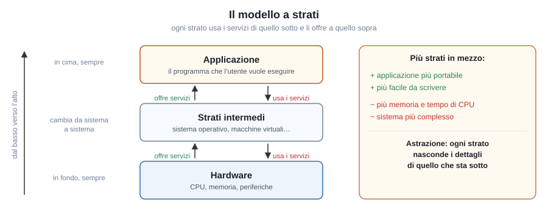
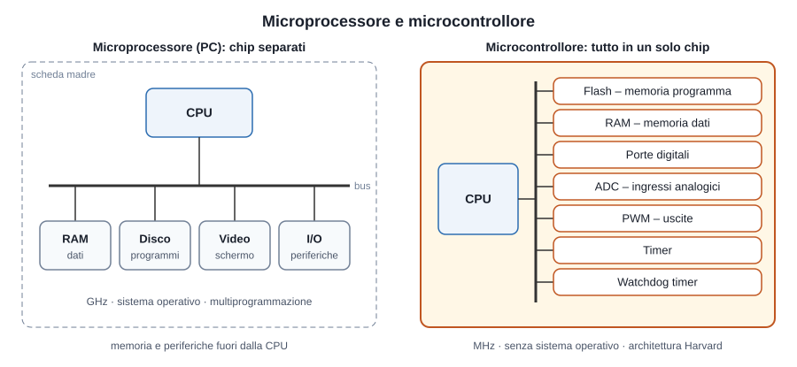
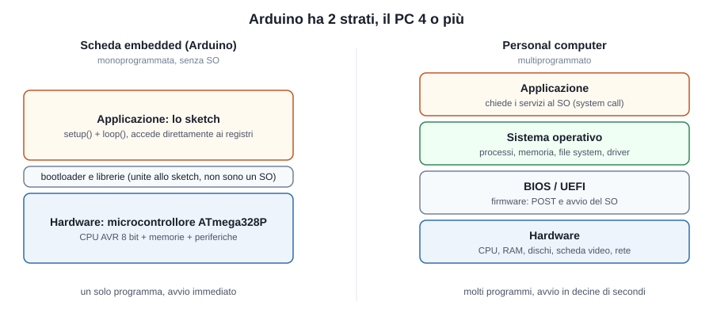
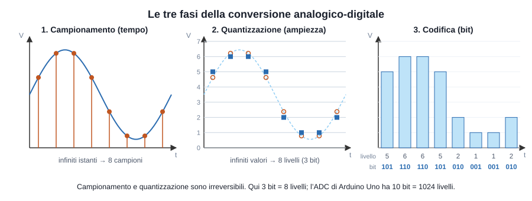
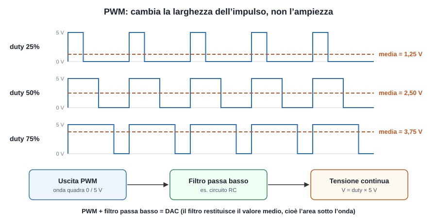
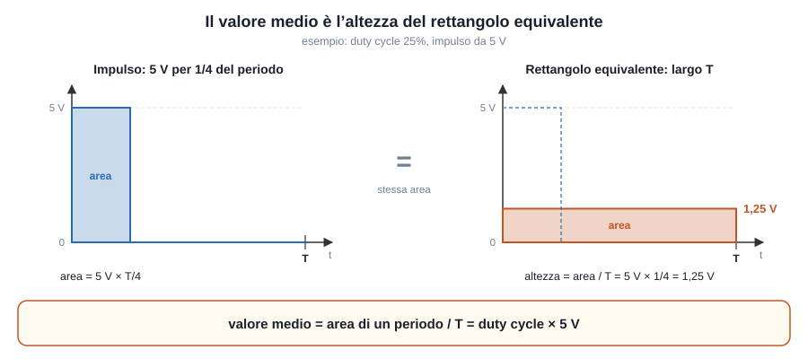
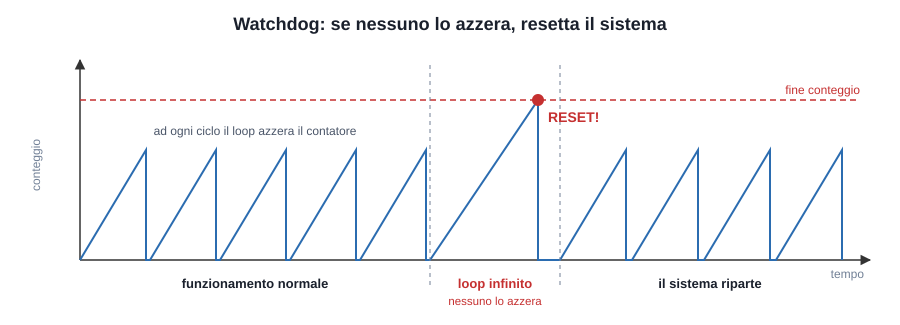
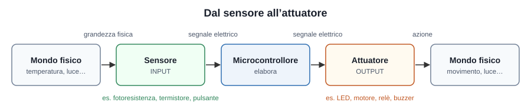
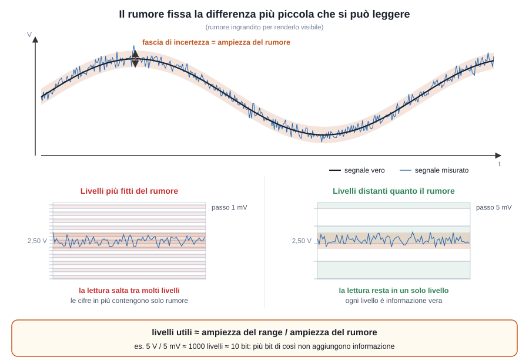
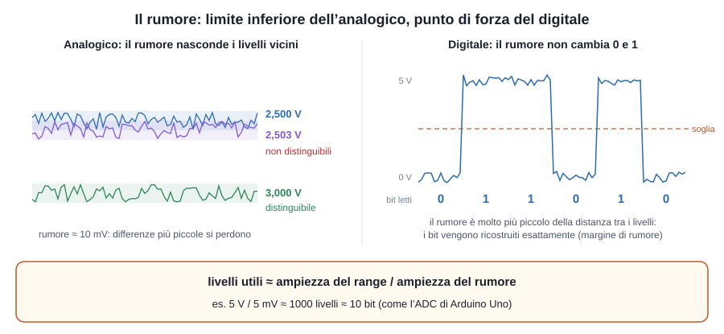

# Microcontrollori: appunti

## 1. Il modello a strati

Un sistema a microprocessore si può descrivere come una **pila di strati** (in inglese *layers*). Ogni strato:

- **usa i servizi** dello strato che sta sotto;
- **offre servizi** allo strato che sta sopra;
- **nasconde i dettagli** di ciò che sta sotto: è il principio di **astrazione**.



In fondo c'è sempre l'**hardware**, in cima c'è sempre l'**applicazione**, cioè il programma che l'utente vuole eseguire. Ciò che cambia da un sistema all'altro è quello che sta **in mezzo**.

Più strati ci sono in mezzo:

- più l'applicazione è **portabile** e **facile da scrivere**, perché non deve conoscere i dettagli dell'hardware;
- più il sistema **consuma risorse** (memoria, tempo di CPU) e diventa complesso.

I due estremi sono la **scheda embedded** (Arduino), con due soli strati, e il **personal computer**, con quattro o più strati.

## 2. Microcontrollore e microprocessore

Un **microprocessore** (la CPU generica di un PC) contiene solo l'unità di elaborazione: memoria RAM, memoria di massa e periferiche sono chip separati collegati sulla scheda madre. È veloce (GHz), costoso e lavora sotto un sistema operativo che gli permette di eseguire più programmi contemporaneamente (**multiprogrammazione**).

Un **microcontrollore** è invece un **sistema completo in un solo chip**: CPU, memoria di programma, memoria dati e periferiche sono integrate nello stesso componente. È quindi una *CPU con le periferiche dentro*. Questa è la differenza fondamentale.



Caratteristiche tipiche di un microcontrollore:

- **prestazioni contenute e basso costo**: frequenza di clock da pochi MHz a qualche centinaio di MHz (Arduino Uno: 16 MHz);
- **nessun sistema operativo**: esegue un solo programma, ripetuto all'infinito nel ciclo principale (*loop*); è quindi **monoprogrammato**;
- **basso consumo**, adatto a dispositivi alimentati a batteria e a sistemi embedded.

Anche gli strati sono diversi nei due casi:



- **PC**: hardware → BIOS/UEFI → sistema operativo → applicazioni. Il **BIOS/UEFI** è il **firmware** della scheda madre: all'accensione esegue il **POST** (Power-On Self Test, il controllo dell'hardware), cerca un dispositivo di avvio e carica in RAM il sistema operativo. Le applicazioni non toccano mai l'hardware: chiedono i servizi al SO con le **chiamate di sistema** (*system call*).
- **Microcontrollore**: hardware → applicazione. Il programma comanda **direttamente** l'hardware. Il sottile strato di **firmware** che sta in mezzo (bootloader e librerie) non è un sistema operativo (vedi paragrafo 3).

**Architettura.** La maggior parte dei microcontrollori ha un'**architettura Harvard**: memoria delle istruzioni e memoria dei dati sono separate e hanno bus distinti, quindi la CPU può leggere un'istruzione e un dato nello stesso momento. Le istruzioni stanno in una memoria non volatile (ROM, oggi quasi sempre **Flash**), i dati in **RAM**. Nei PC si usa invece l'architettura **von Neumann**, con un'unica memoria per istruzioni e dati.

## 3. La scheda Arduino: una scheda embedded monoprogrammata

### Gli strati, dal basso

**Hardware.** Su Arduino UNO l'hardware è il microcontrollore **ATmega328P**, un unico chip che contiene:

- la **CPU** (core AVR a 8 bit, 16 MHz);
- la **memoria**: **Flash** per il programma (32 KB), **SRAM** per le variabili (2 KB), **EEPROM** per i dati che devono restare anche a scheda spenta;
- le **periferiche integrate**: pin digitali (GPIO), convertitore analogico-digitale (ADC), timer, uscite PWM, porta seriale (UART).

**Applicazione.** È lo **sketch**, il programma scritto nell'IDE di Arduino. Ha sempre due funzioni:

- `setup()`: eseguita **una sola volta** all'accensione, serve a configurare la scheda (es. dire quali pin sono ingressi e quali uscite);
- `loop()`: ripetuta **all'infinito**, contiene il lavoro vero e proprio.

```cpp
void setup() {             // eseguita UNA volta all'accensione
  pinMode(13, OUTPUT);     // il pin 13 (LED) è un'uscita
}

void loop() {              // ripetuta all'infinito
  digitalWrite(13, HIGH);  // accende il LED
  delay(500);              // aspetta 500 ms
  digitalWrite(13, LOW);   // spegne il LED
  delay(500);
}
```

### Che cosa significa "monoprogrammata"

- Sulla scheda gira **un solo programma alla volta**. Per cambiarlo bisogna caricarne un altro, che **sovrascrive** il precedente nella memoria Flash.
- **Non c'è un sistema operativo**: nessuno decide quale programma eseguire, nessuno gestisce file o utenti. Il programma parte appena si dà alimentazione e **non termina mai**, perché `loop()` si ripete all'infinito.
- Il programma **accede direttamente all'hardware**: `digitalWrite(13, HIGH)` alla fine scrive un bit in un registro del microcontrollore (il registro **PORTB**), che accende il LED.

### Vantaggi e limiti

| Vantaggi | Limiti |
|---|---|
| Avvio istantaneo | Un solo programma per volta |
| Tempi di risposta prevedibili (adatto al controllo in tempo reale) | Il programma dipende dall'hardware: per un'altra scheda va ricompilato e spesso modificato |
| Consumi e costi molto bassi | Nessuna protezione: un errore può bloccare tutto il sistema (da qui l'utilità del watchdog, paragrafo 8) |
| Il programmatore controlla tutto | Risorse ridottissime (32 KB di Flash, 2 KB di RAM su Arduino UNO) |

> **Approfondimento: il firmware di Arduino.** Tra hardware e sketch c'è un sottile strato di software già pronto: il **bootloader**, che permette di caricare il programma via USB, e le **librerie di Arduino** (`digitalWrite`, `delay`, `Serial`…), che nascondono i registri del microcontrollore. È questo lo strato che negli appunti chiamiamo **firmware** (schema hardware → firmware → applicazione). Non è un sistema operativo: le librerie vengono compilate e unite allo sketch in un unico programma.

## 4. Periferiche di un microcontrollore

Le periferiche tipiche (ad esempio in Arduino) sono:

1. porte digitali;
2. porte analogiche (con ADC ed eventuale DAC);
3. uscite PWM (*Pulse Width Modulation*);
4. timer;
5. watchdog timer.

## 5. Porte digitali

Alle porte digitali si collegano dispositivi esterni, ad esempio LED e pulsanti. Possono essere configurate come **ingresso** o come **uscita** e assumono solo **due valori**:

- **1 (HIGH)**: tensione pari a 5 V oppure 3,3 V, a seconda della scheda;
- **0 (LOW)**: 0 V.

## 6. Porte analogiche e conversione A/D

A differenza delle digitali, le porte analogiche gestiscono segnali che possono assumere **qualunque valore** all'interno di un certo intervallo (es. da 0 a 5 V).

- Se la porta è di **ingresso**, a valle c'è un **ADC** (*Analog to Digital Converter*), che trasforma la tensione in un numero.
- Se la porta è di **uscita**, serve un **DAC** (*Digital to Analog Converter*), che trasforma un numero in una tensione.

Non tutti i microcontrollori hanno un DAC. Arduino Uno, ad esempio, non ce l'ha: in uscita usa il **PWM**, che se viene filtrato bene si comporta come un DAC (vedi paragrafo 7).

### Fasi della conversione analogico-digitale



1. **Campionamento** (discretizzazione nel *tempo*): il segnale analogico è definito in infiniti istanti di tempo; il campionamento ne preleva il valore solo a intervalli regolari, ottenendo un numero finito di campioni.
2. **Quantizzazione** (discretizzazione nell'*ampiezza*): ogni campione può assumere infiniti valori; la quantizzazione lo approssima al più vicino di un numero finito di livelli.
3. **Codifica**: ogni livello viene trasformato in un numero binario, cioè in bit. Con *n* bit si hanno 2^n livelli (ADC di Arduino Uno: 10 bit → 1024 livelli).

Campionamento e quantizzazione sono **irreversibili**: l'informazione scartata non si può recuperare.

## 7. PWM e filtro passa basso

Il **PWM** (*Pulse Width Modulation*, modulazione a larghezza di impulso) genera un'**onda quadra** di frequenza fissa e ampiezza fissa (0 V / 5 V) di cui si varia il **duty cycle**, cioè la percentuale del periodo in cui il segnale è alto. Come modulazione, il duty cycle varia dinamicamente in base al valore istantaneo di un altro segnale.



- duty cycle 0% → sempre 0 V
- duty cycle 50% → metà periodo a 5 V
- duty cycle 100% → sempre 5 V

Attenzione: col PWM **non cambia l'ampiezza** della tensione, cambia la **larghezza dell'impulso**.

All'uscita PWM si mette in cascata un **filtro passa basso** (LP, *Low Pass*), che si chiama così perché lascia passare solo le basse frequenze e blocca le alte. Il filtro elimina le commutazioni veloci dell'onda quadra e ne restituisce il **valore medio**, cioè l'area sottesa all'onda in un periodo divisa per il periodo (in pratica ne fa l'integrale):

- impulso largo → area grande → tensione d'uscita alta;
- impulso stretto → area piccola → tensione d'uscita bassa.

La tensione media vale: **V_out = duty cycle × V_max** (es. 25% di 5 V = 1,25 V).

### Il valore medio: il rettangolo equivalente

Il valore medio è l'**altezza del rettangolo equivalente**: il rettangolo largo quanto un periodo T che ha la **stessa area** dell'impulso. Con un impulso di 5 V lungo un quarto del periodo, l'area è 5 V × T/4; un rettangolo di base T con la stessa area è alto 5 V × 1/4 = **1,25 V**.



### Chi fa la media

Non serve sempre un filtro vero e proprio: la media la fa qualunque cosa sia **più lenta** del PWM. Tutti i sistemi fisici, infatti, si comportano da **passa basso**: per inerzia (meccanica, termica) o per la presenza di condensatori e induttanze, non riescono a seguire variazioni troppo rapide e "vedono" solo il valore medio.

La media la può fare:

- un **filtro passa basso** (es. un circuito RC): serve quando vogliamo una vera tensione continua, cioè un DAC;
- il **carico** collegato all'uscita, senza bisogno di filtro: un **motore** (inerzia del rotore e induttanza degli avvolgimenti) gira a una velocità proporzionale al duty cycle; una **resistenza riscaldante** (inerzia termica) scalda in proporzione al duty cycle;
- i **nostri sensi**: un LED comandato in PWM a circa 500 Hz lampeggia, ma l'**occhio** non riesce a seguirlo (sopra qualche decina di Hz non vediamo lo sfarfallio) e percepisce solo una **luminosità media**. Nel caso del LED, quindi, **la media la fanno i nostri occhi**: il LED si accende e si spegne davvero, ed è l'occhio a fare da filtro passa basso. È così che si regola la luminosità dei LED. (L'occhio però non è lineare: con duty 50% il LED non sembra "metà luminoso", ma più acceso.)

Attenzione: non è la scheda a fare la media. Il pin di Arduino emette sempre l'onda quadra 0 / 5 V; la media la fa chi sta "a valle".

Perché funzioni, la frequenza del PWM deve essere **molto più alta** della velocità di risposta di chi fa la media; altrimenti l'onda si nota (il LED sfarfalla, il motore vibra o fischia). Arduino UNO usa un PWM a circa **490 Hz** (circa 980 Hz sui pin 5 e 6).

Nel filtro RC c'è un compromesso: più il filtro è "lento", più la tensione d'uscita è liscia (meno **ondulazione residua**, o *ripple*), ma più tempo impiega a seguire un cambio del duty cycle.


La combinazione **PWM + filtro passa basso** realizza quindi un **DAC**. I DAC si possono costruire anche in altri modi (es. reti resistive), ma questo è quello usato da Arduino.

## 8. Timer e watchdog timer

### Timer

Il timer è un contatore che avanza al ritmo del clock. Quando arriva al valore impostato (scadenza), genera un **interrupt**: la CPU sospende ciò che sta facendo ed esegue una funzione apposita, la **routine di servizio dell'interrupt** (ISR). Si usa ad esempio per eseguire un'azione a intervalli regolari o per misurare il tempo.

### Watchdog timer

Il **watchdog** ("cane da guardia") è il timer **anti-blocco**: serve a rilevare quando il programma si è bloccato, ad esempio in un loop infinito, e in quel caso **resetta il sistema**.



Funzionamento:

- il watchdog è un contatore che conta in parallelo all'esecuzione del programma;
- se il programma funziona correttamente, a ogni ciclo del loop principale azzera il watchdog, che ricomincia a contare da capo e quindi non arriva mai alla fine;
- se il programma si blocca (es. un `for` o un `while` infinito), il watchdog non viene più azzerato, arriva alla fine del conteggio e genera il **reset** di tutto il sistema, che riparte da capo.

## 9. Sensori e attuatori

Il **sensore** è un dispositivo che rileva una grandezza fisica (temperatura, luce, pressione, distanza, umidità…) e la trasforma in un segnale elettrico, di solito una tensione, che il microcontrollore legge tramite le porte di ingresso. È un dispositivo di **input**: porta informazioni dal mondo esterno al microcontrollore.
Esempi: fotoresistenza, termistore, sensore a ultrasuoni, pulsante (il sensore digitale più semplice).

L'**attuatore** fa il percorso inverso: riceve un segnale elettrico dal microcontrollore e lo trasforma in un'azione sul mondo fisico (movimento, luce, suono, calore). È un dispositivo di **output**.
Esempi: LED, motore, servomotore, relè, buzzer.



## 10. Analogico e digitale: il limite del rumore

Un segnale **analogico** può assumere **infiniti valori** in un certo intervallo e varia in modo continuo nel tempo. Un segnale **digitale** assume solo un **numero finito di valori** (nel caso binario solo due, 0 e 1) ed è definito in istanti di tempo discreti.

In teoria quindi un segnale analogico contiene un'informazione infinita, perché tra due valori qualsiasi ce ne sono infiniti altri. **In pratica non è così, a causa del rumore.**

Il **rumore** è un disturbo casuale (agitazione termica degli elettroni, interferenze elettromagnetiche, disturbi dell'alimentazione…) che si somma sempre al segnale utile. Quando leggo una tensione non ottengo mai il valore "vero", ma il valore vero più un'oscillazione casuale.



Conseguenza: **due livelli che differiscono meno dell'ampiezza del rumore non sono distinguibili**. Se il rumore è di circa 10 mV, non ha senso distinguere 2,500 V da 2,503 V: quella differenza è coperta dal rumore. Il rumore è quindi un **limite inferiore** alla risoluzione, e il numero di livelli realmente distinguibili non è infinito ma circa:

**livelli utili ≈ ampiezza del range / ampiezza del rumore**

Esempio: range 0–5 V, rumore 5 mV → circa 1000 livelli distinguibili, cioè circa 10 bit. Usare un ADC con molti più bit, con lo stesso rumore, non darebbe informazione in più: i bit meno significativi conterrebbero solo rumore.

Per questo la quantizzazione, pur essendo irreversibile, **non fa perdere informazione significativa** se il passo di quantizzazione è paragonabile al rumore: l'informazione "infinita" dell'analogico, in realtà, non era comunque leggibile.



Il digitale ha il vantaggio opposto: i livelli sono pochi e ben separati (0 V e 5 V), quindi un rumore piccolo rispetto alla loro distanza non provoca errori; il ricevitore riconosce comunque se il bit è 0 o 1 e ricostruisce il segnale **esattamente**. Questo margine si chiama **margine di rumore** ed è il motivo per cui il digitale è molto più robusto dell'analogico nella trasmissione, nella copia e nella memorizzazione dei dati.
