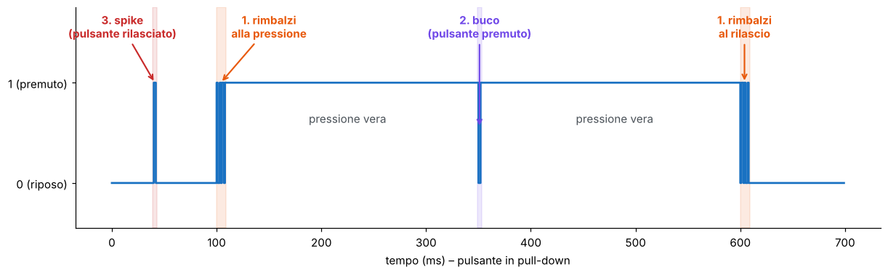

>[Torna all'indice](indexpulsanti.md)

# Che cosa deve filtrare un debouncer: tre fenomeni e le ipotesi di progetto

Un debouncer non "pulisce" il segnale in generale: è progettato contro **fenomeni precisi**, sotto
**ipotesi precise** sulla loro durata. Se le ipotesi valgono, la protezione è certa; se cadono, nessuna
tecnica può distinguere un disturbo da un evento vero. Questa dispensa raccoglie i tre fenomeni, le
ipotesi con cui si sceglie il tempo di antirimbalzo `T`, e quale tecnica copre che cosa.

> Tecniche: [pulsanti-bloccanti.md](pulsanti-bloccanti.md) (attese bloccanti), [pulsanti-rilascio.md](pulsanti-rilascio.md) (non bloccanti), [debouncerFSM.md](debouncerFSM.md) (livello stabile come macchina a stati). Parte elettrica: [interfacce-digitali.md](interfacce-digitali.md).

<p align="center">
  
</p>

## 1. I tre fenomeni

### 1.1 I rimbalzi

**Che cosa sono.** Quando i contatti di un interruttore meccanico si chiudono o si aprono, rimbalzano
per un po' prima di fermarsi: per qualche millisecondo il pin passa più volte fra 0 e 1. Avviene
**a ogni pressione e a ogni rilascio**, su pulsanti, finecorsa, microswitch e contatti di relè.

**Quanto durano.** Jack Ganssle ha misurato una ventina di interruttori diversi: il rimbalzo medio è
stato di circa 1,6 ms e il massimo di 6,2 ms, con pochi casi anomali più lunghi. La durata cambia anche
con il modo in cui si preme: su uno degli interruttori ha trovato una differenza di tre volte a seconda
della velocità del colpo sulla leva.

**Che danno fanno.** Ogni rimbalzo sembra un fronte: un toggle scatta più volte, un contatore conta
due pezzi. Con la logica a livello ("finché è premuto, il motore gira") producono solo un glitch di
pochi millisecondi.

### 1.2 Il buco a pulsante premuto

**Che cos'è.** Mentre il pulsante è tenuto premuto, il contatto si apre per un attimo: il pin scende a 0
per qualche millisecondo e poi torna a 1. È un fenomeno **isolato**, in mezzo a una pressione.

**Da dove viene.** Contatto sporco, ossidato o consumato; vibrazioni della macchina; dito che cambia
pressione. È raro con un pulsante buono, più frequente con uno scadente o vecchio.

**Che danno fa.** Se il debouncer lo prende per un rilascio, fa scattare l'azione del rilascio a
pulsante premuto, e subito dopo vede una nuova pressione: un toggle o un conteggio in più.

### 1.3 Lo spike a pulsante rilasciato

**Che cos'è.** A pulsante rilasciato, un disturbo porta il pin a 1 per un attimo.

**Da dove viene.** Da un accoppiamento elettrico: cavi lunghi vicino a motori, driver, inverter. È
probabile quando a riposo il pin è tenuto al suo livello solo da una resistenza grande (ingresso ad
**alta impedenza**): il pull-down da 10 kΩ di un Arduino, i 45 kΩ interni di un ESP32. È raro sugli
ingressi industriali a 24 V, come quelli di un robot UR, che assorbono milliampere.

**Che danno fa.** Se il debouncer lo prende per una pressione, esegue l'azione della pressione e, poco
dopo, quella del rilascio: un toggle o un conteggio fantasma, senza che nessuno abbia toccato niente.

Lo **sfarfallio** dei sensori elettronici (una fotocellula sul bordo di un oggetto lucido) è una
variante dei rimbalzi: più impulsi brevi all'inizio o alla fine di un evento vero.

## 2. Le ipotesi su cui si dimensiona un debouncer

Un debouncer chiede che un livello resti **fermo** per un tempo `T` prima di accettarlo. Funziona se
valgono queste ipotesi:

| | Ipotesi | Valore tipico | Se non vale |
| --- | --- | --- | --- |
| **I1** | I rimbalzi finiscono entro un tempo massimo `Tr` | `Tr` ≤ 10 ms per un pulsante comune | rimbalzi più lunghi di `T` sembrano eventi veri (limite di fondo) |
| **I2** | Buchi e spike durano meno di un tempo massimo `Td` | `Td` di pochi ms | un disturbo più lungo di `T` è indistinguibile da un evento vero (limite di fondo) |
| **I3** | I disturbi sono **isolati**: fra uno e l'altro passa più di `T` | disturbi occasionali | se arrivano più spesso di `T`, il livello non resta mai fermo: il debouncer non decide mai (un'attesa bloccante non finisce più) |
| **I4** | Gli eventi veri (pressione e rilascio voluti) durano più di `T` | un dito non preme e rilascia in meno di ~100 ms | un evento più breve di `T` viene scartato come disturbo |
| **I5** | Il pin è letto spesso: l'intervallo `p` fra due letture è piccolo rispetto a `T` | `p` = 1 ms | con letture rade la decisione dipende da dove cadono, e la certezza diventa una probabilità |

Messe insieme danno la **finestra di progetto** per `T`:

```
  disturbo più lungo + p   <   T   <   evento vero più breve
     max(Tr, Td) + p
```

<p align="center">
  
</p>

Con un pulsante comune (rimbalzi fino a 10 ms, disturbi di pochi ms, una lettura al millisecondo) e
pressioni umane più lunghe di circa 100 ms, la finestra va da circa 11 a circa 100 ms. Il valore usato
in queste dispense, **50 ms**, sta nel mezzo: copre disturbi quattro volte più lunghi di quelli tipici
(un pulsante scadente o consumato) e resta a metà della pressione più rapida. Per questo `T` non si
abbassa sotto i 50 ms: si perde un po' di prontezza, che a mano non si nota, e si guadagna margine.

Per i **sensori** la finestra va ricalcolata: l'evento vero più breve può essere il passaggio di un
pezzo veloce davanti a una fotocellula, e allora `T` deve essere più corto di quel passaggio.

## 3. Quale tecnica copre quale fenomeno

| Tecnica | Rimbalzi | Buco a pulsante premuto | Spike a pulsante rilasciato |
| --- | --- | --- | --- |
| Una o due letture ogni `T` (bloccanti 1, 2, 3) | ~ dipende da dove cadono le letture | ~ dipende da dove cadono le letture | ✘ |
| Letture continue, solo sul rilascio: polling con `millis()`, DiffTimer, `waitUntilInputLowNB()`, bloccante 5 | ✔ | ✔ | ✘ |
| Schedulatore con N letture uguali | ✔ | ~ se nessuna lettura cade nel buco | ~ se nessuna lettura cade nello spike |
| Livello stabile in tutte e due le direzioni: `changed()`, `Debouncer`, bloccante 6, `waitUntilInputChange()` | ✔ | ✔ | ✔ |

✔ certa, se valgono le ipotesi · ~ probabile · ✘ non filtrato

Le tecniche che filtrano **solo il rilascio** accettano la pressione alla prima lettura alta: la
risposta è immediata, ma lo spike a riposo passa. Le tecniche **a livello stabile** filtrano anche lo
spike, ma anche la pressione arriva `T` dopo, e una pressione più breve di `T` viene ignorata.

## 4. Come scegliere

1. **Quali fenomeni sono possibili?** I rimbalzi dipendono dalla **sorgente**: ci sono solo con i
   contatti meccanici. Gli spike dipendono dall'**ingresso** e dal **cablaggio**: sono probabili sui pin
   ad alta impedenza con cavi lunghi, rari sugli ingressi a 24 V. I buchi dipendono dalla **qualità** e
   dallo stato del contatto.
2. **Quali ipotesi valgono?** Stimate il rimbalzo più lungo, il disturbo più lungo e l'evento vero più
   breve, e verificate che la finestra per `T` esista. Se i disturbi non sono isolati (I3), il problema
   va risolto prima in hardware.
3. **Quanto costa un errore?** Con la logica a livello un disturbo produce solo un glitch transitorio;
   con toggle e contatori lascia un errore permanente.
4. **Scegliete la tecnica**: solo rilascio se gli spike sono improbabili e serve una risposta
   immediata; livello stabile se l'ingresso è disturbato o l'errore costa caro.

## Riferimenti

- [Jack Ganssle, A Guide to Debouncing](https://www.ganssle.com/debouncing.htm): misure dei rimbalzi su interruttori reali
- [Makeability Lab, Debouncing](https://makeabilitylab.github.io/physcomp/arduino/debouncing.html): sintesi delle misure e soluzioni per Arduino
- [pulsanti-bloccanti.md](pulsanti-bloccanti.md), [pulsanti-rilascio.md](pulsanti-rilascio.md), [debouncerFSM.md](debouncerFSM.md), [interfacce-digitali.md](interfacce-digitali.md)
