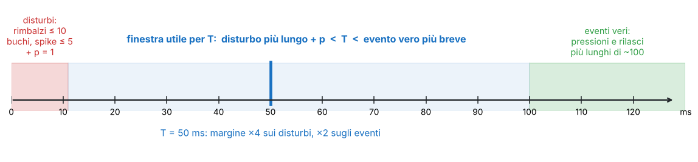

>[Torna all'indice](indexpulsanti.md)

# Che cosa deve filtrare un debouncer: quattro situazioni critiche e le ipotesi di progetto

Un debouncer non "pulisce" il segnale in generale: è progettato contro **situazioni precise**, sotto
**ipotesi precise** sulla loro durata. Se le ipotesi valgono, la protezione è certa; se cadono, nessuna
tecnica può distinguere un disturbo da un evento vero. Questa dispensa raccoglie le quattro situazioni
critiche, le ipotesi con cui si sceglie il tempo di antirimbalzo `T`, e quale tecnica copre che cosa.

> Tecniche: [pulsanti-bloccanti.md](pulsanti-bloccanti.md) (attese bloccanti), [pulsanti-rilascio.md](pulsanti-rilascio.md) (non bloccanti), [debouncerFSM.md](debouncerFSM.md) (livello stabile come macchina a stati). Parte elettrica: [interfacce-digitali.md](interfacce-digitali.md).

<p align="center">
  
</p>

## 1. Le quattro situazioni critiche

Le situazioni sono quattro, le cause fisiche tre: i **rimbalzi** del contatto si presentano due volte,
alla pressione e al rilascio. Si contano separatamente perché hanno effetti diversi e, nelle tecniche
più comuni, sono gestiti da parti diverse del codice (vedi la sezione 3).

| | Situazione | Quando | Causa |
| --- | --- | --- | --- |
| 1 | Rimbalzi alla pressione | il contatto si chiude | meccanica: il contatto rimbalza |
| 2 | Rimbalzi al rilascio | il contatto si apre | meccanica: il contatto rimbalza |
| 3 | Buco a pulsante premuto | durante la pressione | meccanica: contatto sporco o consumato, vibrazioni |
| 4 | Spike a pulsante rilasciato | a riposo | elettrica: disturbo indotto sui cavi |

### I rimbalzi: cosa sono e quanto durano

Quando i contatti di un interruttore meccanico si chiudono o si aprono, rimbalzano per un po' prima di
fermarsi: per qualche millisecondo il pin passa più volte fra 0 e 1. Avviene **a ogni pressione e a
ogni rilascio**, su pulsanti, finecorsa, microswitch e contatti di relè.

Jack Ganssle ha misurato una ventina di interruttori diversi: il rimbalzo medio è stato di circa 1,6 ms
e il massimo di 6,2 ms, con pochi casi anomali più lunghi. La durata cambia anche con il modo in cui si
preme: su uno degli interruttori ha trovato una differenza di tre volte a seconda della velocità del
colpo sulla leva.

Ogni rimbalzo sembra un fronte: un toggle scatta più volte, un contatore conta due pezzi. Con la logica
a livello ("finché è premuto, il motore gira") producono solo un glitch di pochi millisecondi.

### 1.1 Rimbalzi alla pressione

Arrivano subito dopo il primo fronte, quando il debouncer **ha già capito** che il pulsante è stato
premuto: basta che li ignori per qualche millisecondo. Sono la situazione più facile: quasi tutte le
tecniche li gestiscono, spesso con una semplice variabile di stato ("pulsante già premuto") o perché il
programma, dopo il primo fronte, sta già facendo altro.

### 1.2 Rimbalzi al rilascio

Sono più insidiosi, perché arrivano mentre il debouncer **sta decidendo** se il pulsante è stato
rilasciato. Se decide troppo presto, al primo livello basso, il rimbalzo successivo sembra una nuova
pressione: è la *pressione fantasma*. Per questo molte tecniche, e molti errori, riguardano soprattutto
il rilascio.

### 1.3 Buco a pulsante premuto

**Che cos'è.** Mentre il pulsante è tenuto premuto, il contatto si apre per un attimo: il pin scende a 0
per qualche millisecondo e poi torna a 1. È un fenomeno **isolato**, in mezzo a una pressione.

**Da dove viene.** Contatto sporco, ossidato o consumato; vibrazioni della macchina; dito che cambia
pressione. È raro con un pulsante buono, più frequente con uno scadente o vecchio.

**Che danno fa.** Se il debouncer lo prende per un rilascio, fa scattare l'azione del rilascio a
pulsante premuto, e subito dopo vede una nuova pressione: un toggle o un conteggio in più.

### 1.4 Spike a pulsante rilasciato

**Che cos'è.** A pulsante rilasciato, un disturbo porta il pin a 1 per un attimo.

**Da dove viene.** Da un accoppiamento elettrico: cavi lunghi vicino a motori, driver, inverter. È
probabile quando a riposo il pin è tenuto al suo livello solo da una resistenza grande (ingresso ad
**alta impedenza**): il pull-down da 10 kΩ di un Arduino, i 45 kΩ interni di un ESP32. È raro sugli
ingressi industriali a 24 V, come quelli di un robot UR, che assorbono milliampere.

**Che danno fa.** Se il debouncer lo prende per una pressione, esegue l'azione della pressione e, poco
dopo, quella del rilascio: un toggle o un conteggio fantasma, senza che nessuno abbia toccato niente.

### E lo sfarfallio dei sensori?

Lo **sfarfallio** dei sensori elettronici (una fotocellula sul bordo di un oggetto lucido) non è una
quinta situazione: ha la stessa forma dei rimbalzi, una raffica di impulsi brevi all'inizio o alla fine
di un evento vero, e si gestisce come le situazioni 1 e 2. Cambia solo la causa: il sensore che "esita"
sul bordo invece del contatto che rimbalza.

## 2. Le ipotesi su cui si dimensiona un debouncer

Un debouncer chiede che un livello resti **fermo** per un tempo `T` prima di accettarlo. Funziona se
valgono queste ipotesi:

| | Ipotesi | Valore tipico | Se non vale |
| --- | --- | --- | --- |
| **I1** | I rimbalzi finiscono entro un tempo massimo `Tr` | `Tr` ≤ 10 ms per un pulsante comune | rimbalzi più lunghi di `T` sembrano eventi veri (limite di fondo) |
| **I2** | Buchi e spike durano meno di un tempo massimo `Td` | `Td` di pochi ms | un disturbo più lungo di `T` è indistinguibile da un evento vero (limite di fondo) |
| **I3** | I disturbi sono **isolati**: fra uno e l'altro passa più di `T` | disturbi occasionali | se arrivano più spesso di `T`, il livello non resta mai fermo: il debouncer non decide mai (un'attesa bloccante non finisce più) |
| **I4** | Gli eventi veri (pressione e rilascio voluti) durano più di `T` | un dito non preme e rilascia in meno di ~100 ms | un evento più breve di `T` viene scartato come disturbo |
| **I5** | Il pin è letto spesso: l'intervallo `p` fra due letture è piccolo rispetto a `T` | `p` = 1 ms | con letture rade la decisione dipende da dove cadono, e la certezza diventa una probabilità |

Messe insieme, le ipotesi dicono fra quali due limiti deve stare `T`: è la **finestra di progetto**.

1. **Limite inferiore: `T` deve essere più lungo di ogni disturbo.**
   Si prende il disturbo più lungo che ci si aspetta, cioè il più grande fra:
   - `Tr`, la durata massima dei rimbalzi (qui 10 ms);
   - `Td`, la durata massima di un buco o di uno spike (qui 5 ms).

   A questo si aggiunge `p`, l'intervallo fra due letture del pin (qui 1 ms): il debouncer si accorge
   che un disturbo è finito solo alla lettura successiva, quindi un disturbo può "sembrare" lungo fino
   a `p` ms in più. Limite inferiore: 10 + 1 = **11 ms**.
2. **Limite superiore: `T` deve essere più corto di ogni evento vero.**
   Cioè della pressione più breve, e della pausa più breve fra un rilascio e la pressione successiva,
   che si vogliono riconoscere. Per un dito, circa **100 ms**: un evento più breve di `T` verrebbe
   scartato come disturbo.

In formula:

```
  il più grande fra Tr e Td  +  p   <   T   <   l'evento vero più breve
          10 ms              + 1 ms <   T   <   circa 100 ms
```

<p align="center">
  
</p>

Con un pulsante comune (rimbalzi fino a 10 ms, disturbi di pochi ms, una lettura al millisecondo) e
pressioni umane più lunghe di circa 100 ms, la finestra va da circa 11 a circa 100 ms. Il valore usato
in queste dispense, **50 ms**, sta nel mezzo: copre disturbi quattro volte più lunghi di quelli tipici
(un pulsante scadente o consumato) e resta a metà della pressione più rapida. Per questo `T` non si
abbassa sotto i 50 ms: si perde un po' di prontezza, che a mano non si nota, e si guadagna margine.

C'è anche un dato percettivo: nelle prove di Jack Ganssle un ritardo di 50 ms sembrava **istantaneo**,
mentre uno di 100 ms **si notava**. Con `T` = 50 ms, quindi, anche le tecniche che confermano la
pressione rispondono senza che l'utente percepisca il ritardo.

Per i **sensori** la finestra va ricalcolata: l'evento vero più breve può essere il passaggio di un
pezzo veloce davanti a una fotocellula, e allora `T` deve essere più corto di quel passaggio.

## 3. Quale tecnica copre quale situazione

### Due criteri per classificare le tecniche

**Letture discontinue.** Il debouncer decide guardando il pin **in pochi istanti isolati**, separati da
intervalli lunghi (dell'ordine di `T`) in cui il pin non viene letto: ad esempio una lettura, poi
`delay(50)`, poi un'altra lettura. Quello che succede fra due letture non viene visto. La decisione
dipende quindi da **dove cadono** le letture rispetto ai disturbi: la protezione è **probabilistica**.

**Letture continue.** Il pin è letto **spesso**, a intervalli `p` molto più brevi di `T` (ogni
millisecondo, o a ogni giro di `loop()`), e **ogni lettura conta**: una sola lettura contraria fa
ripartire il conteggio. Nessun disturbo più lungo di `p` può passare inosservato, e la protezione è
**certa** finché i disturbi durano meno di `T − p`.

**Livello stabile.** Un livello è stabile quando **tutte** le letture lo hanno confermato, senza
interruzioni, per più di `T`. È la condizione con cui le tecniche a letture continue accettano un
cambiamento.

**Livello stabile in una direzione (tecniche asimmetriche).** La stabilità è richiesta per **una sola**
delle due transizioni, di solito il **rilascio**. L'altra, la pressione, è accettata alla **prima**
lettura. Vantaggio: la pressione è riconosciuta subito. Limite: uno spike a riposo sembra una
pressione (situazione 4).

**Livello stabile in due direzioni (tecniche simmetriche).** La stabilità è richiesta per **ogni**
cambio di livello: sia la pressione sia il rilascio sono accettati solo dopo `T` di livello fermo.
Vantaggio: filtra tutte e quattro le situazioni. Limiti: anche la pressione arriva `T` dopo, e un
evento più breve di `T` viene scartato.

I due criteri si combinano:

| | Livello stabile in **una** direzione (solo rilascio) | Livello stabile in **due** direzioni |
| --- | --- | --- |
| **Letture discontinue** | bloccanti 1, 2, 3 | bloccante 3 bis (due letture in entrambe le direzioni), schedulatore con N letture uguali |
| **Letture continue** | polling con `millis()`, DiffTimer, `waitUntilInputLowNB()`, bloccante 5, script e programma PolyScope sul rilascio | `changed()`, `Debouncer`, bloccante 6, `waitUntilInputChange()`, programma PolyScope che conferma anche la pressione |

**Livelli ed eventi.** Conviene distinguere due cose che spesso si confondono:

- il **livello accettato** è uno **stato**: quello che il debouncer crede *in questo momento*, cioè
  "premuto" oppure "a riposo". Dura nel tempo;
- la **pressione** e il **rilascio** sono **eventi**: avvengono in un istante, quando il livello
  accettato **cambia**.

| | Livello accettato (stato) | Evento quando il livello accettato diventa questo |
| --- | --- | --- |
| Pulsante | premuto | **pressione** |
| Pulsante | a riposo | **rilascio** |
| Sensore di transito (fotocellula) | oggetto presente | **inizio del transito** (l'oggetto arriva) |
| Sensore di transito (fotocellula) | oggetto assente | **fine del transito** (l'oggetto è passato) |

Il debouncer quindi non "accetta la pressione": accetta un **nuovo livello**, e il cambio di livello
**è** l'evento. "Premuto" è lo stato, la pressione è il passaggio da "a riposo" a "premuto"; allo
stesso modo, con un sensore, "oggetto presente" è lo stato e l'inizio del transito è il passaggio.

Come leggere la tabella, con il **principio** di ciascuna famiglia descritto a parole, prima di
qualsiasi codice:

- **Nessuna direzione confermata** (la tecnica *lockout*: sezione 4 di
  [pulsanti-rilascio.md](pulsanti-rilascio.md) e, con `delay()`, sezione 0 di
  [pulsanti-bloccanti.md](pulsanti-bloccanti.md); è anche la soluzione "trust the first change" del
  [Makeability Lab](https://makeabilitylab.github.io/physcomp/arduino/debouncing.html)): sono le più
  **pronte** in assoluto. Filtrano i rimbalzi (situazioni 1 e 2), ma non il buco né lo spike.

  *Come fanno.* Ogni cambio di livello è creduto **alla prima lettura**, sia la pressione sia il
  rilascio, e l'evento parte subito. Subito dopo, per un tempo `T`, l'ingresso viene **ignorato**: i
  rimbalzi che seguono cadono in questa finestra e non vengono visti. Finita la finestra, il primo
  cambio successivo è di nuovo creduto subito. Non c'è nessuna conferma: un buco a pulsante premuto
  sembra un rilascio, uno spike a riposo sembra una pressione.

  *Dove vanno bene.* Dove conta soprattutto la **prontezza**, in entrambe le direzioni, e un errore raro
  è accettabile: i **videogiochi** sono l'esempio tipico, perché non c'è nessun ritardo fra il gesto del
  giocatore e la risposta.

- **Letture continue, livello stabile in una direzione** (polling con `millis()`, DiffTimer,
  bloccante 5): sono le **più usate**. Proteggono con certezza dalle situazioni 1, 2 e 3 e riconoscono
  la pressione **subito**, alla prima lettura; lasciano passare solo lo spike a riposo.

  *Come fanno.* Il debouncer ricorda un **livello accettato**, cioè lo stato in cui crede che sia il
  pulsante, e legge il pin di continuo. Il livello accettato **non è fisso**: cambia a ogni evento, e
  ogni volta il debouncer si mette a sorvegliare il cambiamento **opposto**. Il ciclo ha due fasi:

  1. **A riposo: nessuna conferma.** Il livello accettato è "a riposo" (pulsante rilasciato, nessun
     oggetto davanti al sensore). Alla **prima** lettura "premuto" il debouncer crede subito alla
     pressione: il livello accettato diventa "premuto", si segnala la **pressione** (o l'inizio del
     transito) e i rimbalzi che seguono vengono ignorati.
  2. **Premuto: conferma di `T` ms.** Ora il debouncer sorveglia il cambiamento opposto. Quando arriva
     una lettura "a riposo", comincia a misurare da quanto tempo dura; ogni lettura "premuto" (pulsante
     ancora tenuto, rimbalzo del rilascio, fine di un buco) fa ripartire la misura da zero. Solo quando
     le letture sono state "a riposo" **senza interruzioni** per più di `T`, il livello accettato torna
     "a riposo" e si segnala il **rilascio** (o la fine del transito). Si è di nuovo nella fase 1.

  La direzione **non confermata** (la pressione) è la più **veloce** da valutare: basta una sola
  lettura, quindi la risposta è **immediata**. Il prezzo è l'**incertezza**: una sola lettura non
  distingue l'inizio di una pressione vera da uno spike, e uno spike a riposo viene creduto. La
  direzione **confermata** (il rilascio) è più lenta, perché deve aspettare `T`, ma è **certa**.

- **Letture continue, livello stabile in due direzioni** (`changed()`, `Debouncer`, bloccante 6,
  `waitUntilInputChange()`): sono le **sole** che proteggono con certezza da **tutte e quattro** le
  situazioni, spike a riposo compreso.

  *Come fanno.* Il ciclo ha le stesse due fasi, ma **anche la prima** è confermata, con la stessa
  regola della seconda:

  1. **A riposo: conferma di `T` ms.** Quando arriva una lettura "premuto", il debouncer comincia a
     misurare; se torna una lettura "a riposo" (un rimbalzo o uno spike), la misura riparte da zero.
     Solo quando le letture sono state "premuto" senza interruzioni per più di `T`, il livello
     accettato diventa "premuto" e si segnala la **pressione** (o l'inizio del transito).
  2. **Premuto: conferma di `T` ms.** Esattamente come nella famiglia precedente: il **rilascio** (o la
     fine del transito) è creduto solo dopo più di `T` di letture "a riposo" senza interruzioni.

  Pressione e rilascio sono trattati **allo stesso modo**: nessun cambiamento viene creduto finché non
  è durato `T`. Non c'è più una direzione veloce: si guadagna la **certezza** anche sulla pressione, e
  quindi la protezione dallo spike, al prezzo di una pressione riconosciuta `T` ms dopo e di eventi più
  brevi di `T` scartati.

- **Letture discontinue** (bloccanti 1, 2, 3 e schedulatore): proteggono solo con una certa
  **probabilità**, perché il risultato dipende da dove cadono le letture.

  *Come fanno.* Il debouncer guarda il pin solo **di tanto in tanto**: una lettura, poi una pausa lunga
  (dell'ordine di `T`, o di un intervallo base ripetuto N volte), poi un'altra lettura. Fra una lettura
  e l'altra non sa che cosa succede. Decide in base a **una** lettura (bloccante 1), a una lettura
  seguita da un'attesa fissa (bloccante 2), a **due** letture a distanza `T` (bloccante 3) o a **N
  letture uguali** di fila (schedulatore). Un disturbo che cade **fra** due letture non viene visto, e
  questo aiuta; ma se le letture su cui si basa la decisione cadono **proprio su** un disturbo, il
  disturbo viene scambiato per il livello vero. Usare più letture (due, o N) rende questo caso meno
  probabile, ma non impossibile: per questo la protezione è una probabilità e non una certezza.

  *Dove vanno bene.* Dove un errore raro non costa quasi niente e contano la semplicità del codice o la
  prontezza: nei **videogiochi** su microcontrollore e in genere nei comandi dati da una persona, che se un tasto "non
  prende" o scatta due volte se ne accorge e ripete il gesto. Non vanno bene dove ogni evento deve
  essere contato o eseguito una volta sola: conteggio di pezzi, comandi di macchine, sicurezza.

| Tecnica | 1. Rimbalzi alla pressione | 2. Rimbalzi al rilascio | 3. Buco a pulsante premuto | 4. Spike a riposo |
| --- | --- | --- | --- | --- |
| Nessuna conferma: il primo cambio è creduto, poi l'ingresso è ignorato per `T` | ✔ | ✔ | ✘ | ✘ |
| Bloccante 1: una lettura ogni `T` | ✔ | ~ | ~ | ✘ |
| Bloccante 2: una lettura e un'attesa fissa dopo | ✔ | ✔ | ~ | ✘ |
| Bloccante 3: due letture | ✔ | ✔ | ~ | ✘ |
| Bloccante 3 bis: due letture in entrambe le direzioni | ✔ | ✔ | ~ | ~ |
| Letture continue, solo sul rilascio: polling con `millis()`, DiffTimer, `waitUntilInputLowNB()`, bloccante 5 | ✔ | ✔ | ✔ | ✘ |
| Schedulatore con N letture uguali | ✔ | ✔ | ~ | ~ |
| Livello stabile in tutte e due le direzioni: `changed()`, `Debouncer`, bloccante 6, `waitUntilInputChange()` | ✔ | ✔ | ✔ | ✔ |

✔ certa, se valgono le ipotesi · ~ probabile · ✘ non filtrato

Le tecniche che filtrano **solo il rilascio** accettano la pressione alla prima lettura alta: la
risposta è immediata, ma lo spike a riposo passa. Le tecniche **a livello stabile** filtrano anche lo
spike, ma anche la pressione arriva `T` dopo, e una pressione più breve di `T` viene ignorata.

### Chi se ne occupa nel codice

Nelle tecniche che filtrano solo il rilascio, le quattro situazioni sono gestite da **meccanismi
diversi** del programma. Nelle tecniche a livello stabile, invece, una sola regola le tratta tutte
allo stesso modo.

**Polling con `millis()`** (una direzione). Il codice usa due variabili: `premutoRecente`, vera se c'è stata una
lettura HIGH negli ultimi 50 ms (quindi la pressione è già stata segnalata e il rilascio non ancora), e `t0`, l'istante dell'ultima lettura HIGH.

1. *Rimbalzi alla pressione.* Al primo HIGH `premutoRecente` è falso: parte `doOnRise()` e `premutoRecente` diventa
   vero. I rimbalzi successivi trovano `premutoRecente` già vero, quindi `doOnRise()` non viene richiamata.
   Il rilascio non può scattare, perché richiede più di 50 ms dall'ultimo HIGH e fra un rimbalzo e
   l'altro passano pochi millisecondi.
2. *Rimbalzi al rilascio.* A ogni lettura HIGH si esegue `t0 = millis()`: ogni rimbalzo alto sposta in
   avanti l'istante di riferimento, e i 50 ms ricominciano a contare dall'ultimo rimbalzo.
3. *Buco a pulsante premuto.* È un LOW breve, seguito di nuovo da letture HIGH: la prima di queste
   esegue `t0 = millis()` e il conteggio riparte, come per i rimbalzi del rilascio.
4. *Spike a riposo.* Nessuna istruzione lo ferma: la prima lettura HIGH vale come pressione (`premutoRecente`
   diventa vero, parte `doOnRise()`), e 50 ms dopo la fine dello spike arriva `doOnFall()`.

**Bloccante 5** (una direzione). Qui il ruolo di `premutoRecente` lo svolge il **punto in cui si trova il
programma**: finché è dentro `waitUntilInputLow()`, il pulsante è considerato premuto.

1. *Rimbalzi alla pressione.* Al primo HIGH il programma entra nell'`if`, esegue `doOnRise()` e si
   ferma dentro `waitUntilInputLow()`. Da lì non torna all'`if` finché l'attesa non finisce, quindi
   `doOnRise()` non può ripartire. L'attesa non finisce durante i rimbalzi, perché ogni lettura HIGH
   esegue `tl = millis()` e azzera il conteggio.
2. *Rimbalzi al rilascio.* Stesso meccanismo: ogni rimbalzo alto esegue `tl = millis()`, e l'attesa
   finisce solo 50 ms dopo l'ultimo.
3. *Buco a pulsante premuto.* La lettura HIGH che segue il buco esegue `tl = millis()`: il conteggio
   riparte e l'attesa continua.
4. *Spike a riposo.* Nessuna istruzione lo ferma: il primo HIGH fa entrare nell'`if`, parte
   `doOnRise()`, e l'attesa finisce 50 ms dopo con `doOnFall()`.

**Livello stabile con `changed()`** (due direzioni). Il codice usa `val0`, l'ultima lettura, `val00`,
il livello accettato, e `last`, l'istante dell'ultima variazione. Una **sola regola** vale per tutte le
situazioni: *ogni variazione della lettura esegue `last = millis()`, e un nuovo livello è accettato
solo se è diverso da `val00` ed è rimasto fermo per più di 50 ms.*

1. *Rimbalzi alla pressione.* Ogni rimbalzo è una variazione e riporta `last` all'istante attuale: la
   pressione è accettata 50 ms dopo l'ultimo rimbalzo.
2. *Rimbalzi al rilascio.* Esattamente lo stesso: il rilascio è accettato 50 ms dopo l'ultimo rimbalzo.
3. *Buco a pulsante premuto.* Il buco produce due variazioni (verso LOW e di nuovo verso HIGH) a pochi
   millisecondi di distanza: il LOW non resta fermo 50 ms e non viene accettato.
4. *Spike a riposo.* Stessa cosa al contrario: lo spike produce due variazioni ravvicinate, l'HIGH non
   resta fermo 50 ms e non viene accettato. Nessun evento.

Nelle tecniche asimmetriche il buco è gestito dallo **stesso codice** dei rimbalzi del rilascio: per il
programma sono la stessa cosa, un LOW che non dura abbastanza. I rimbalzi della pressione, invece, sono
gestiti da un **meccanismo diverso** (una variabile di stato o il punto in cui si trova il programma),
che però non sa riconoscere uno spike: per questo lo spike passa. La tecnica a livello stabile tratta
pressione e rilascio con lo stesso codice, e proprio per questo filtra anche lo spike.

## 4. Come scegliere

1. **Quali situazioni sono possibili?** I rimbalzi dipendono dalla **sorgente**: ci sono solo con i
   contatti meccanici. Gli spike dipendono dall'**ingresso** e dal **cablaggio**: sono probabili sui pin
   ad alta impedenza con cavi lunghi, rari sugli ingressi a 24 V. I buchi dipendono dalla **qualità** e
   dallo stato del contatto.
2. **Quali ipotesi valgono?** Stimate il rimbalzo più lungo, il disturbo più lungo e l'evento vero più
   breve, e verificate che la finestra per `T` esista. Se i disturbi non sono isolati (I3), il problema
   va risolto prima in hardware.
3. **Quanto costa un errore?** Con la logica a livello un disturbo produce solo un glitch transitorio;
   con toggle e contatori lascia un errore permanente.
4. **Scegliete la tecnica**: solo rilascio se gli spike sono improbabili e serve una risposta
   immediata; livello stabile se l'ingresso è disturbato o l'errore costa caro.

## 5. Pressione o rilascio: quando agire

Finora abbiamo parlato di **come** riconoscere pressione e rilascio. Resta da decidere **su quale
dei due** far partire l'azione. Nelle dispense si agisce di regola al rilascio, e non è una scelta
solo nostra: è la convenzione prevalente nelle interfacce utente, per tre motivi.

**1. Poter annullare.** Un pulsante a schermo agisce quando si rilascia il tasto del mouse, non
quando lo si preme; lo stesso vale per il tasto Windows e per il tasto Alt (Raymond Chen, Microsoft).
Il motivo principale è che, finché il tasto è premuto, l'utente può ancora cambiare idea: sposta il
puntatore fuori dal pulsante, rilascia, e non succede niente. Le linee guida di accessibilità WCAG
2.5.2 (*Pointer Cancellation*) ne fanno un requisito: l'azione va attivata al rilascio, perché chi ha
difficoltà motorie preme spesso per errore. Per lo stesso motivo i pulsanti nativi di iOS e Android e
l'evento `click` dei browser scattano al rilascio.

**2. Capire che gesto era.** Alla pressione non si sa ancora se sarà un click, un doppio click o una
pressione lunga: lo si sa solo quando il pulsante viene rilasciato (o quando scade un timeout). Le
librerie Arduino più diffuse (OneButton, AceButton, Button2) funzionano così: OneButton segnala il click
dopo pressione **e** rilascio, la pressione lunga dopo 800 ms di pressione mantenuta, e se è attivo
anche il doppio click aspetta 400 ms prima di dichiarare il click singolo. Anche il suo debounce di
default è di 50 ms.

**3. Agire sul fronte confermato.** È l'argomento sviluppato in queste dispense. Se l'azione parte
alla pressione, i rimbalzi del rilascio arrivano **dopo** l'azione e, con un debounce debole, possono
essere letti come una nuova pressione (la pressione fantasma). Se l'azione parte al rilascio
confermato, il fronte su cui si agisce è proprio quello che il debounce ha appena verificato.

**Le eccezioni.** Si agisce alla pressione quando la **prontezza** è il requisito, o quando l'azione
deve durare **quanto** la pressione:

- la **digitazione** e i tastierini (lo nota lo stesso Chen; le WCAG ammettono l'attivazione alla
  pressione quando emula una tastiera);
- i **videogiochi**, dove pochi millisecondi di ritardo si sentono;
- i comandi a **pressione mantenuta** (marcia a impulsi, *jog*, uomo presente): agiscono **a
  livello**, finché il pulsante è premuto, e si fermano al rilascio;
- l'**arresto** con un pulsante di stop: premere vuol già dire "fermati", e aspettare il rilascio
  ritarderebbe l'arresto senza motivo.

In sintesi: **si agisce al rilascio quando sbagliare costa più che aspettare, alla pressione quando la
prontezza è il requisito.**

## 6. Situazioni reali: quale metodo

Le due scelte (**quando** agire e **come** filtrare) dipendono dalla situazione. La tabella le
riassume per i casi più comuni; le tecniche sono quelle delle dispense.

| Situazione reale | Quando agire | Tecnica consigliata | Perché |
| --- | --- | --- | --- |
| Pulsante di un pannello o di un menu (conferma, avanti, OK) | rilascio | una direzione (polling con `millis()`, `waitUntilNB`) | l'utente può "pentirsi"; ingresso vicino e poco disturbato |
| Toggle di una luce o di un modo, contatore di pressioni | rilascio | due direzioni (`changed()` / `Debouncer`, schedulatore) | un errore è **permanente**: lo stato resta invertito o il conteggio sbagliato |
| Pulsante con click, doppio click e pressione lunga | rilascio (o timeout) | due direzioni + timer di durata | il gesto si conosce solo alla fine |
| Pulsante su cavo lungo, ingresso a 3,3 V/5 V vicino a motori o relè | rilascio | due direzioni; meglio ancora interfaccia a 24 V con optoisolatore | gli spike sono probabili: la tecnica a una direzione li scambia per pressioni |
| Gioco su microcontrollore | pressione | lockout (cambio creduto subito, poi 50 ms di silenzio) | conta la prontezza; un errore raro è tollerato. I giochi su PC e console leggono invece i tasti una volta per fotogramma, su segnali già filtrati dal firmware del controller: il confronto con il fotogramma precedente serve solo a trovare i fronti |
| Marcia a impulsi, *jog*, comando ad azione mantenuta (*hold-to-run*) | a livello (finché premuto) | marcia confermata (livello stabile), arresto **immediato** al primo LOW, senza conferma | rilasciando il pulsante il movimento si deve fermare subito; ritardare l'arresto è peggio che fermarsi per un buco |
| Start ciclo di una macchina | pressione confermata o rilascio | due direzioni (livello stabile) | la macchina non deve partire in modo inatteso, quindi uno spike non deve avviarla; la norma chiede un comando di avvio separato, ma non stabilisce su quale fronte |
| Reset dopo un arresto (riarmo) | **rilascio** | due direzioni | EN ISO 13849-1, 5.2.2: il reset va accettato solo quando l'attuatore lascia la posizione di attivazione, così un pulsante bloccato o tenuto premuto non riarma la macchina |
| Sensore a 24 V (induttivo, fotocellula PNP) che conta pezzi | fronte confermato | due direzioni; sul robot UR, programma PolyScope o script con conferma | niente rimbalzi, ma lo sfarfallio sul bordo del pezzo produce conteggi doppi; nei PLC la soluzione standard usa due timer, all'attivazione e alla disattivazione, cioè la conferma in due direzioni |
| Finecorsa meccanico | fronte confermato | due direzioni | ha rimbalzi come un pulsante, e un falso finecorsa ferma o confonde la macchina |
| Ingresso letto da un programma con altri compiti | — | **non bloccante** (`millis()`, schedulatore, `changed()`) | una tecnica bloccante ferma tutto il resto finché il pulsante non viene rilasciato |
| Programma dedicato al solo pulsante, didattica, robot UR | — | bloccante a letture continue (tecnica 5 o 6) | semplice da leggere; la 6 conferma anche la pressione |
| **Arresto di emergenza** | — | **nessun debounce software** | EN ISO 13850 ed EN 60204-1: pulsante a fungo rosso su fondo giallo, contatti ad apertura positiva (diretta), comando che resta agganciato fino al riarmo, arresto di categoria 0 o 1. Il circuito va realizzato con componenti di sicurezza (relè o PLC di sicurezza); Arduino, ESP32 o un ingresso normale del robot possono solo **leggerne** lo stato |

Tre regole riassumono la tabella:

1. **Il costo dell'errore decide la direzione.** Se l'errore è un glitch transitorio (logica a
   livello), basta filtrare il rilascio; se diventa permanente (toggle, contatori, start), serve il
   livello stabile in **due** direzioni.
2. **La prontezza decide il momento.** Se l'utente deve poter annullare o il gesto va classificato, si
   agisce al rilascio; se conta la reazione, alla pressione (lockout o livello stabile, secondo quanto
   costa un errore).
3. **La sicurezza non passa dal debounce.** Quello che protegge le persone (arresto di emergenza,
   comandi ad azione mantenuta usati come protezione) si realizza con componenti di sicurezza; il
   software di un microcontrollore si limita a segnalarlo.

> **La regola delle norme industriali, in una riga: fermarsi subito, ripartire con calma.**
> Non conta il fronte del pulsante, conta che cosa vuol dire quel fronte.
>
> - **Il gesto che ferma agisce subito.** Con il pulsante di emergenza il gesto che ferma è la
>   *pressione*; con il comando ad azione mantenuta (jog) è il *rilascio*, perché lì il pulsante
>   premuto significa "muoviti" e lasciarlo significa "fermati". Fronti opposti, stessa regola: lo
>   stop non aspetta.
> - **Il gesto che fa ripartire aspetta la conferma.** Il reset dopo un arresto è accettato solo al
>   rilascio (EN ISO 13849-1), così un pulsante bloccato o tenuto premuto non riarma la macchina.
>
> È lo stesso principio di tutta la sezione: dove un errore è pericoloso (ripartire per sbaglio) si
> aspetta la conferma; dove è pericoloso aspettare (non fermarsi) si agisce subito.

## Riferimenti

Fonti sulle applicazioni tipiche (sezione 6 e riassunti in testa alle tecniche):

- [QMK, Debounce algorithm](https://docs.qmk.fm/feature_debounce_type): tastiere, modalità *eager* (lockout), *defer* (livello stabile, predefinita) e asimmetrica (pressione subito, rilascio confermato)
- [Microsoft, GameInput readings](https://learn.microsoft.com/en-gb/gaming/gdk/_content/gc/input/overviews/input-readings) e [DirectXTK, GamePad](https://github.com/Microsoft/DirectXTK/wiki/GamePad): i giochi leggono i controller una volta per fotogramma
- [Arduboy, gestione dell'input](https://moduscreate.com/?p=11173): ritardo di debounce in un gioco su microcontrollore
- [Rockwell, Configure Input Filter time](https://rockwellautomation.com/en-nz/docs/add-on-profiles/ra-1756-discrete/40/pv1756discrete-ditamap/1756-digital-input-device-with-filters/configure-input-filter-time.html): filtri Off→On e On→Off dei moduli di ingresso dei PLC
- [S7-1200, tempi del filtro di ingresso](https://industrialmonitordirect.com/blogs/knowledgebase/s7-1200-digital-input-filter-time-selection-guide): valore predefinito 6,4 ms
- [Omron CJ1M, doppio conteggio di una fotocellula](https://industrialmonitordirect.com/blogs/knowledgebase/omron-cj1m-photoelectric-sensor-double-counting-fix) e [Photoeye double count fix](https://industrialmonitordirect.com/blogs/knowledgebase/photoeye-double-count-fix-plc-debounce-timer-solution): due timer contro i conteggi doppi
- [Fanuc, conteggio pezzi su nastro](https://industrialmonitordirect.com/blogs/knowledgebase/fanuc-debounce-timer-for-conveyor-part-counting): lo stesso problema su un robot
- [Forum Universal Robots, Debounce digital inputs](https://forum.universal-robots.com/t/debounce-digital-inputs/18232): attesa con timer azzerato a ogni lettura contraria e `sync()`
- [Applied EE, Menus & Navigation](https://applied-ee.github.io/embedded/docs/screens-displays/ui-layout-patterns/menus-and-navigation/): requisiti del debounce per i menu

Altre fonti:

- [Jack Ganssle, A Guide to Debouncing](https://www.ganssle.com/debouncing.htm): misure dei rimbalzi su interruttori reali
- [Makeability Lab, Debouncing](https://makeabilitylab.github.io/physcomp/arduino/debouncing.html): sintesi delle misure e soluzioni per Arduino
- [W3C, Understanding SC 2.5.2 Pointer Cancellation](https://www.w3.org/WAI/WCAG21/Understanding/pointer-cancellation): attivazione al rilascio per poter annullare
- [Raymond Chen, Why do user interface actions tend to occur on the release, not on the press?](https://devblogs.microsoft.com/oldnewthing/20061216-13/?p=28703)
- [ABB, Using an HMI for reset and start?](https://new.abb.com/low-voltage/products/safety-products/using-an-hmi-for-reset-and-start): requisiti del reset manuale secondo EN ISO 13849-1, 5.2.2
- [Leuze, E-Stop ed E-Off](https://www.leuze.com/en-us/index.php/navigation/d1b3383b3d694042ac8d8eb0557d7cc8): arresto di emergenza secondo EN ISO 13850 ed EN 60204-1, categorie di arresto
- [Axelent, Safe enabling solutions](https://www.axelent.com/safety-book/machine-safety/safe-enabling-solutions/): comandi ad azione mantenuta (*hold-to-run*)
- [OneButton](https://github.com/mathertel/OneButton), [AceButton](https://github.com/bxparks/AceButton), [Button2](https://github.com/LennartHennigs/Button2): librerie Arduino per click, doppio click e pressione lunga
- [pulsanti-bloccanti.md](pulsanti-bloccanti.md), [pulsanti-rilascio.md](pulsanti-rilascio.md), [debouncerFSM.md](debouncerFSM.md), [interfacce-digitali.md](interfacce-digitali.md)
