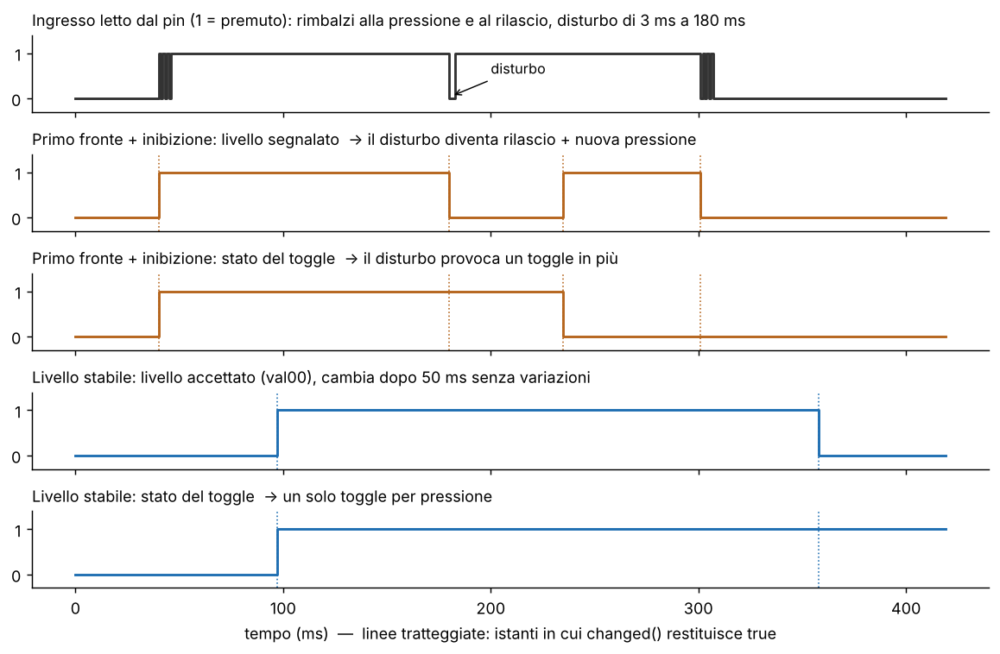

>[Torna all'indice](indexstatifiniti_py.md) >[versione in C++](indexstatifiniti.md)

#  **DEBOUNCER**

##  **Gestione di pulsanti con debouncer**

Questo esempio include due modalità di funzionamento:

### 1. Pulsante senza memoria (momentaneo)
- Il LED1 si accende solo quando il pulsante è premuto
- Quando il pulsante viene rilasciato, il LED si spegne
- Simile a un campanello o un pulsante di un citofono

### 2. Pulsante con memoria (toggle)
- Il LED2 cambia stato ad ogni pressione del pulsante
- Se il LED è spento, premendo si accende
- Se il LED è acceso, premendo si spegne
- Simile a un interruttore della luce in casa

Entrambe le modalità utilizzano lo stesso meccanismo di debounce **a livello stabile**, che:
1. Accetta un cambio di stato solo quando il nuovo livello è rimasto costante per il tempo di debounce
2. Fa ripartire il conteggio a ogni variazione letta, quindi filtra sia i rimbalzi sia i disturbi brevi a pulsante premuto
3. Gestisce correttamente il ritorno a zero del contatore dei millisecondi, perché misura il tempo con ```time.ticks_diff()```


# Esercitazione di controllo con Debouncing per l'accensione di un LED

## Obiettivo del progetto
Realizzare un sistema dimostrativo di controllo LED che implementi diverse tecniche di gestione dei pulsanti. Il sistema deve illustrare i concetti fondamentali del debouncing software, le macchine a stati e i diversi tipi di interazione utente tramite pulsanti (momentanea e con memoria).

## Requisiti funzionali

1. **Sistema di controllo LED**:
   - Implementazione di due modalità di controllo tramite pulsanti:
     - Modalità momentanea: LED acceso solo quando il pulsante è premuto
     - Modalità toggle (con memoria): LED cambia stato ad ogni pressione

2. **Interfaccia utente**:
   - Due pulsanti di controllo:
     - Pulsante 1: Controllo momentaneo del LED1 (senza memoria)
     - Pulsante 2: Controllo toggle del LED2 (con memoria)

3. **Implementazione di gestione del debounce**:
   - Sviluppo di un debounce che accetti un cambio solo dopo un tempo minimo di livello stabile
   - Implementazione di una macchina a stati a due stati (STABILE e ATTESA DI CONFERMA)
   - Gestione corretta del ritorno a zero di ```time.ticks_ms()``` (con ```time.ticks_diff()```) per garantire stabilità a lungo termine

## Aspetti didattici
Il progetto dimostra:
- Differenza tra controlli momentanei e controlli con memoria (toggle)
- Implementazione di una macchina a stati per il debouncing
- Conferma di un cambio di livello tramite un tempo minimo di stabilità
- Programmazione non bloccante
- Gestione dell'overflow nei timer software
- Tecniche per migliorare l'esperienza utente riducendo falsi trigger

## Materiale necessario
- ESP32 con MicroPython
- Due LED con relativi resistori limitatori di corrente
- Due pulsanti
- Resistori di pull-down per i pulsanti (oppure i pull-up interni, ```Pin.PULL_UP```, invertendo i livelli nel codice)
- Breadboard e cavi di collegamento

## Considerazioni finali
Questo progetto è utile come introduzione alle tecniche di debouncing e alla gestione dell'input utente. Può essere utilizzato come base per sistemi più complessi di domotica o automazione che richiedono un'interfaccia utente semplice ma affidabile. L'implementazione della macchina a stati per il debouncing rappresenta un approccio robusto che può essere esteso anche ad altre applicazioni, ad esempio ai segnali di comando provenienti da un altro dispositivo (un PLC o un robot).

## Approcci al debouncing

Dal punto di vista concettuale, ci sono due approcci al debouncing di un ingresso letto in polling:

1. **Primo fronte + inibizione**:
   - Segnala subito il primo cambiamento, poi ignora le variazioni successive finché il livello non resta stabile per il tempo di debounce
   - Vantaggio: risposta immediata
   - Limite: non distingue un **disturbo** da un rilascio vero. Un'apertura breve del contatto a pulsante premuto viene segnalata come rilascio e, al termine dell'inibizione, il ritorno del livello alto viene segnalato come una nuova pressione: un toggle in più, un conteggio in più

2. **Livello stabile (approccio adottato)**:
   - Segnala il cambiamento solo quando il nuovo livello è rimasto costante per il tempo di debounce; ogni variazione fa ripartire il conteggio
   - Vantaggio: filtra sia i rimbalzi sia i disturbi più brevi del tempo di debounce
   - Limite: il cambio viene segnalato con un ritardo pari al tempo di debounce (50 ms, impercettibile per un pulsante azionato a mano)

Il **limite di fondo** è comune a entrambi: un'apertura del contatto più lunga del tempo di debounce non si distingue da un rilascio vero. Il tempo di debounce va quindi scelto in base alla qualità del pulsante: abbastanza lungo da coprire i suoi rimbalzi e i suoi disturbi, abbastanza corto da non perdere le pressioni rapide.

Il cronogramma seguente mette a confronto i due approcci sullo stesso segnale (simulato): rimbalzi alla pressione e al rilascio, e un disturbo di 3 ms a pulsante premuto.



Con il primo approccio il disturbo produce quattro eventi e un toggle in più; con il livello stabile gli eventi sono due, pressione e rilascio, ciascuno 50 ms dopo l'ultima variazione.


# Tabella delle Transizioni - Debounce a livello stabile

## Definizione delle Variabili
- **pin**: oggetto ```Pin``` collegato al pulsante
- **val**: Valore letto dal pin nella chiamata corrente
- **val0**: Ultimo valore letto (anche se instabile), serve a rilevare le variazioni
- **val00**: Ultimo livello stabile accettato
- **last**: Istante dell'ultima variazione letta
- **debtime**: Tempo di debounce in millisecondi

Lo stato della macchina non richiede una variabile apposita: è codificato dal confronto tra **val0** e **val00**.
- **STABILE**: ```val0 == val00```, l'ultimo valore letto coincide con il livello accettato
- **ATTESA DI CONFERMA**: ```val0 != val00```, è stato letto un livello diverso da quello accettato e se ne sta misurando la durata

## Tabella delle Transizioni

| Stato Attuale | Ingresso | Azione | Prossimo Stato | changed() |
|---------------|----------|--------|---------------|--------------|
| STABILE | **variazione**<br>(val != val0) | val0 = val<br>avvio timer: last = ticks_ms() | ATTESA DI CONFERMA | False |
| ATTESA DI CONFERMA | **variazione**<br>(val != val0: rimbalzo o disturbo, val torna uguale a val00) | val0 = val | STABILE | False |
| ATTESA DI CONFERMA | **timeout**<br>(ticks_diff(ticks_ms(), last) > debtime, cioè debtime senza variazioni) | val00 = val | STABILE | **True** |

Gli **ingressi** della macchina sono due, entrambi **eventi**: la **variazione** del valore letto (```val != val0```) e il **timeout** (```debtime``` ms senza variazioni). Come di consueto, lo scadere del timer è trattato come un ingresso. Le righe in cui non accade nulla (nessuna variazione, timer non ancora scaduto) non sono transizioni e non compaiono né nella tabella né nel diagramma. Il timeout è definito solo in ATTESA DI CONFERMA, l'unico stato in cui il timer è attivo.

Poiché il segnale è binario, in ATTESA DI CONFERMA una nuova variazione riporta necessariamente il valore letto uguale a ```val00```: la macchina torna in STABILE senza segnalare nulla. In STABILE il timer non serve e non va inizializzato: viene avviato nella transizione verso ATTESA DI CONFERMA, l'unico stato che lo usa. Così, a ogni rimbalzo, la macchina esce e rientra in ATTESA DI CONFERMA e il conteggio riparte da capo. Nel codice, scritto in logica "prima gli ingressi", l'ingresso **variazione** è gestito da un unico ramo comune ai due stati, quindi ```last = time.ticks_ms()``` viene eseguito anche nella transizione verso STABILE: lì è un'assegnazione innocua, che non cambia il comportamento.

**Uscite: macchina di Mealy.** In STABILE si entra con due transizioni che hanno uscite diverse: ```changed() = False``` dopo un rimbalzo, ```changed() = True``` dopo il timeout. È lecito perché la macchina è di **Mealy**: l'uscita dipende dalla coppia (stato, ingresso), cioè dalla **transizione**, e non solo dallo stato. In una macchina di **Moore**, dove l'uscita dipende solo dallo stato, servirebbe uno stato in più (ad esempio CONFERMATO, con uscita ```True```, che dura un solo passo e torna subito in STABILE): la macchina sarebbe equivalente ma più grande. Per un'uscita di tipo evento come ```changed()```, un impulso che dura una sola chiamata, Mealy è la scelta naturale.

**Il livello accettato è una proprietà dello stato.** In STABILE ```val00``` può valere 0 o 1, ma la macchina reagisce agli ingressi nello stesso modo in entrambi i casi: il livello è una **proprietà** dello stato, come il colore di un LED acceso, non uno stato diverso. Separarlo darebbe una macchina equivalente con quattro stati (STABILE_BASSO, STABILE_ALTO, ATTESA_SALITA, ATTESA_DISCESA) e il livello come uscita di Moore, ma con il doppio degli stati e nessun comportamento in più.

## Caratteristiche della Macchina a Stati
1. **Conferma per stabilità**: un cambio viene segnalato (```changed()``` restituisce ```True```) solo dopo ```debtime``` ms senza variazioni
2. **Riavvio del timer**: ogni variazione letta, rimbalzo o disturbo, fa ripartire il conteggio, perché il timer viene avviato a ogni ingresso in ATTESA DI CONFERMA
3. **Un solo evento per cambio**: pressione e rilascio generano ciascuno un solo evento, con il nuovo livello in ```val```
4. **Chiamata continua**: ```changed()``` va chiamata a ogni giro del ciclo principale, perché è la sequenza delle chiamate a misurare la stabilità

## Comportamento agli eventi
- **Pulsante premuto/rilasciato**: viene segnalato dopo ```debtime``` ms di livello stabile
- **Rimbalzi del contatto**: fanno ripartire il conteggio e vengono filtrati
- **Disturbo breve a pulsante premuto**: fa ripartire il conteggio ma non genera eventi, perché il livello torna a quello accettato
- **Nuova pressione**: viene segnalata come nuovo evento dopo il suo tempo di stabilità


##  **Diagramma degli stati**

```mermaid
flowchart LR
    I(( )) --> S
    S["<b>STABILE</b><br>val0 == val00"]
    A["<b>ATTESA DI CONFERMA</b><br>val0 != val00"]
    S -- "<b>variazione</b><br>val0 = val<br>avvio timer: last = ticks_ms()" --> A
    A -- "<b>variazione</b> (rimbalzo o disturbo)<br>val0 = val" --> S
    A == "<b>timeout</b>: debtime senza variazioni<br>val00 = val<br><b>changed() = True</b>" ==> S
    style I fill:#000,stroke:#000
```



##  **Soluzione in logica "prima gli ingressi"**

La **FSM** che modella il comportamento del pulsante è del tutto **indipendente** ed **isolata** rispetto alla logica principale del programma. Il codice, che implementa la macchina a stati finiti del debouncer, è tutto **incapsulato** all'interno dell'**oggetto pulsante**, realizzato con una **classe** (in Python gli attributi sono accessibili anche dall'esterno, come i membri pubblici di una struct). Il rilevamento del fronte (pressione o rilascio) è lasciato al programma principale, che legge il nuovo livello in ```val``` quando ```changed()``` restituisce ```True```.

Il codice è scritto in logica **"prima gli ingressi"**: ```changed()``` esamina prima la lettura (```val != val0```) e lo **stato** non ha una variabile propria, ma è **implicito** nel confronto tra ```val0``` e ```val00```. La stessa macchina a stati, scritta in logica **"prima gli stati"** con una variabile di stato esplicita, è in [DEBOUNCER 2](debouncer2_py.md).

L'inizializzazione degli **oggetti** è effettuata al momento della creazione tramite il **costruttore** ```__init__()```: ```Button(Pin(BUTTON1_PIN, Pin.IN), 0)``` riceve l'oggetto ```Pin```, il **livello di riposo** e, facoltativo, il tempo di stabilità (predefinito ```DEBOUNCETIME```). Con la resistenza di pull-down il pulsante a riposo legge 0, quindi ```val0``` e ```val00``` partono da 0: se partissero dal livello opposto, all'accensione verrebbe segnalato un cambio che non c'è. Con il pull-up interno (```Pin.PULL_UP```) si passerebbe 1.

L'ultimo **valore valido** è quello che permane **immutato** per tutto l'**intervallo di debounce**, misurato a partire dall'**ultima variazione**.

Esempio che utilizza la struttura di debounce per controllare LED con e senza memoria:

```python
# Due pulsanti gestiti con la classe Button (debounce a livello stabile)
#  - pulsante 1, rosso (GPIO 14), SENZA MEMORIA (momentaneo): il LED 1 rosso
#    (GPIO 13) resta acceso finché il pulsante è premuto;
#  - pulsante 2, verde (GPIO 23), CON MEMORIA (toggle): il LED 2 verde
#    (GPIO 12) cambia stato a ogni pressione.
# Collegamento: pulsanti tra il pin e 3V3, resistenza di pull-down esterna
# verso GND (Pin.IN). Il pin legge 0 a riposo e 1 quando il pulsante è premuto.
from machine import Pin
import time

BUTTON1_PIN = 14    # pulsante momentaneo
BUTTON2_PIN = 23    # pulsante toggle
LED1_PIN = 13       # LED del pulsante momentaneo
LED2_PIN = 12       # LED del pulsante toggle
DEBOUNCETIME = 50   # ms: tempo di stabilità richiesto prima di accettare un cambio
                    # (va scelto in base alla qualità del pulsante: deve superare
                    #  la durata dei suoi rimbalzi e dei suoi disturbi)

class Button:
    """Debounce a LIVELLO STABILE, codifica "prima gli ingressi".

    Un cambio di stato viene accettato solo quando il nuovo livello è rimasto
    costante per debtime millisecondi. Ogni variazione letta (rimbalzo o
    disturbo) fa ripartire il conteggio: il tempo si misura dall'ULTIMA
    variazione, non dalla prima. Il prezzo è un ritardo di debtime ms,
    impercettibile per un pulsante azionato a mano.

    Uso: chiamare changed() a ogni giro del ciclo principale; dopo un True,
    val contiene il nuovo livello stabile.
    """
    def __init__(self, pin, riposo, debtime=DEBOUNCETIME):
        self.pin = pin          # oggetto Pin collegato al pulsante
        self.debtime = debtime  # tempo di stabilità richiesto, in ms
        self.val = riposo       # valore letto nell'ultima chiamata
        self.val0 = riposo      # ultimo valore letto (anche se instabile)
        self.val00 = riposo     # ultimo livello stabile accettato
        self.last = 0           # istante dell'ultima variazione letta

    def changed(self):
        self.val = self.pin.value()
        if self.val != self.val0:           # variazione (rimbalzo, disturbo o cambio vero):
            self.val0 = self.val            # si memorizza il nuovo valore
            self.last = time.ticks_ms()     # e il conteggio della stabilità riparte da qui
        elif (self.val != self.val00 and
              time.ticks_diff(time.ticks_ms(), self.last) > self.debtime):
            self.val00 = self.val           # livello diverso da quello accettato e stabile
            return True                     # da debtime ms: è un cambio vero
        return False

# Scelta: con il pull-down il pulsante a riposo legge 0, quindi il livello di
# riposo passato al costruttore è 0. Con il livello opposto, al primo giro
# changed() vedrebbe un cambio che non c'è (un evento falso all'accensione).
# Con il pull-up interno (Pin.PULL_UP) si passerebbe 1.
buttonMomentary = Button(Pin(BUTTON1_PIN, Pin.IN), 0)
buttonToggle = Button(Pin(BUTTON2_PIN, Pin.IN), 0)
led1 = Pin(LED1_PIN, Pin.OUT)
led2 = Pin(LED2_PIN, Pin.OUT)
toggleState = False     # stato memorizzato del pulsante con memoria

while True:
    # 1. PULSANTE SENZA MEMORIA (momentaneo)
    # Scelta: si reagisce a entrambi i cambi; il LED copia il livello stabile.
    if buttonMomentary.changed():
        if buttonMomentary.val == 1:        # con pull-down, 1 = premuto
            led1.on()
            print("Pulsante 1 premuto - LED 1 acceso")
        else:
            led1.off()
            print("Pulsante 1 rilasciato - LED 1 spento")

    # 2. PULSANTE CON MEMORIA (toggle)
    # Scelta: changed() sta prima dell'and e viene chiamata a ogni giro, così il
    # debounce continua a lavorare anche sui rilasci; si agisce solo sulla pressione.
    if buttonToggle.changed() and buttonToggle.val == 1:
        toggleState = not toggleState       # inverte lo stato memorizzato
        led2.value(toggleState)
        print("Pulsante 2 premuto - LED 2", "acceso" if toggleState else "spento")

    time.sleep_ms(1)    # solo per non bloccare il simulatore; il ciclo deve restare veloce
```

Il circuito è lo stesso della versione C++: pulsanti su GPIO 14 e 23 con pull-down esterno, LED su GPIO 13 e 12.

>[Torna all'indice](indexstatifiniti_py.md) >[versione in C++](indexstatifiniti.md)
