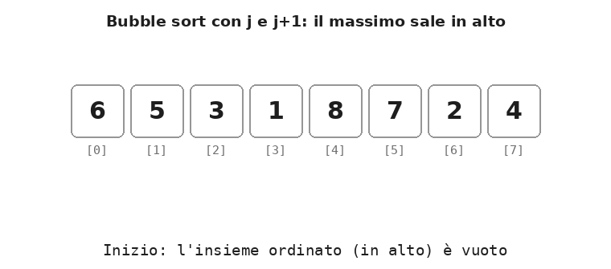
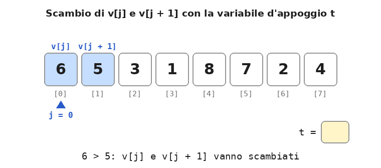
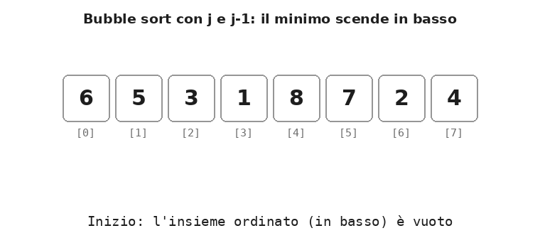
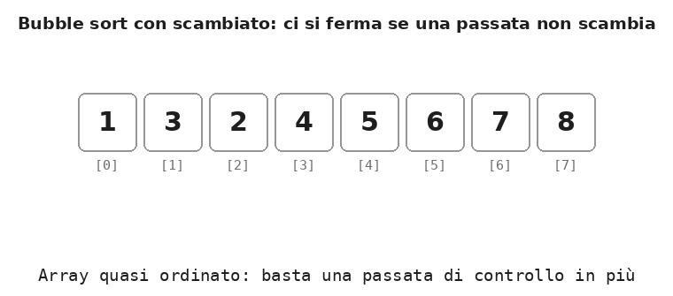

# Dispensa: bubble sort

10 novembre 2026

## 1. L'idea

Il **bubble sort** (ordinamento a bolle) ordina un array confrontando ripetutamente coppie di elementi **vicini** e scambiandoli quando sono nell'ordine sbagliato. A ogni passata il valore più grande ancora fuori posto "sale" fino in cima, come una bolla d'aria nell'acqua: da qui il nome.

Anche qui l'array è sempre diviso in **due insiemi**, ma in posizione opposta rispetto all'insertion sort:

- l'**insieme non ordinato**, in basso (a sinistra, indici piccoli): i valori non ancora sistemati;
- l'**insieme ordinato**, in alto (a destra, indici grandi): i valori più grandi, già nella loro posizione **definitiva**.

All'inizio l'insieme ordinato è vuoto. Ogni passata porta in cima il massimo dell'insieme non ordinato: l'insieme ordinato cresce di uno e quello non ordinato cala di uno. Dopo `N - 1` passate in basso resta un solo elemento, che è per forza il più piccolo: l'array è ordinato.

**Definizione.** Il *bubble sort* ordina un array eseguendo una serie di passate; in ogni passata confronta le coppie di elementi vicini `v[j]` e `v[j + 1]` dell'insieme non ordinato e le scambia se `v[j] > v[j + 1]`, così che il massimo dell'insieme non ordinato arrivi in cima.

C'è una differenza importante con l'insertion sort. Nell'insertion sort l'insieme ordinato è ordinato "fra sé", ma i suoi valori possono ancora spostarsi per fare posto ai nuovi. Nel bubble sort i valori dell'insieme ordinato sono già nella posizione finale e non si muovono più.

L'animazione mostra l'ordinamento completo di 6 5 3 1 8 7 2 4. La linea verticale con l'etichetta `i` separa l'insieme non ordinato da quello ordinato (in verde); in azzurro la coppia confrontata, con le etichette `v[j]` e `v[j + 1]` e la freccia su `j`.

<p align="center">
  
</p>

## 2. Passo per passo

Ogni riga mostra l'array **dopo** la passata `i`. La barra `|` separa l'insieme non ordinato (a sinistra) da quello ordinato (a destra).

| Passata `i` | `j` va da 0 a | Confronti | Scambi | Array dopo la passata | Sale in cima |
| --- | --- | --- | --- | --- | --- |
| 0 | 6 | 7 | 6 | 5 3 1 6 7 2 4 \| 8 | 8 in `v[7]` |
| 1 | 5 | 6 | 4 | 3 1 5 6 2 4 \| 7 8 | 7 in `v[6]` |
| 2 | 4 | 5 | 3 | 1 3 5 2 4 \| 6 7 8 | 6 in `v[5]` |
| 3 | 3 | 4 | 2 | 1 3 2 4 \| 5 6 7 8 | 5 in `v[4]` |
| 4 | 2 | 3 | 1 | 1 2 3 \| 4 5 6 7 8 | 4 in `v[3]` |
| 5 | 1 | 2 | 0 | 1 2 \| 3 4 5 6 7 8 | 3 in `v[2]` |
| 6 | 0 | 1 | 0 | 1 \| 2 3 4 5 6 7 8 | 2 in `v[1]` |
| **Totale** | | **28** | **16** | | |

Nella passata 0 la "bolla" non è sempre lo stesso valore: il 6 sale finché non incontra l'8, che è più grande; da lì è l'8 a continuare a salire fino in cima. In ogni passata quindi sale il massimo, qualunque sia il valore da cui si parte.

Dalla passata 5 l'array è già ordinato, ma l'algoritmo continua a confrontare. Nella sezione 6 si vede come evitarlo.

## 3. Il loop esterno: `i` conta le passate

Il loop esterno esegue le passate. L'indice `i` conta le passate già fatte, cioè quanti valori sono già arrivati in cima, e fa da **separatore** tra i due insiemi:

- `v[0] … v[N - 1 - i]` è l'**insieme non ordinato** (in basso);
- `v[N - i] … v[N - 1]` è l'**insieme ordinato** (in alto), con i valori in posizione definitiva.

```cpp
for (int i = 0; i < N - 1; i++) {
    // qui: v[N-i..N-1] ordinato e definitivo, v[0..N-1-i] non ordinato
    // la passata porta il massimo di v[0..N-1-i] in v[N-1-i]
}
```

Le passate sono `N - 1` e non `N`: quando gli `N - 1` valori più grandi sono in cima, quello che resta in `v[0]` è il più piccolo ed è già al suo posto.

La proprietà "*prima di ogni passata, `v[N-i..N-1]` contiene gli `i` valori più grandi, in ordine*" è l'**invariante del ciclo**: è vera all'inizio (con `i = 0` l'insieme è vuoto), ogni passata la conserva e alla fine garantisce il risultato.

## 4. Il loop interno: confronto tra vicini e scambio

Il loop interno esegue una passata: scorre l'insieme non ordinato dal basso verso l'alto, confronta ogni coppia di vicini e la scambia se è nell'ordine sbagliato.

```cpp
for (int j = 0; j < N - 1 - i; j++)
    if (v[j] > v[j + 1]) {
        int t = v[j];          // scambio v[j] e v[j + 1]
        v[j] = v[j + 1];
        v[j + 1] = t;
    }
```

L'indice `j` indica la coppia confrontata: `v[j]` e il suo vicino di sopra `v[j + 1]`. Dopo il confronto `v[j + 1]` contiene il più grande dei due, quindi il massimo incontrato fin lì viene "trascinato" in su a ogni passo.

### Perché il limite è `j < N - 1 - i`

Il limite ha due parti:

- **`- 1`**: si confronta `v[j]` con `v[j + 1]`, quindi l'ultima coppia possibile è `v[N - 2]`, `v[N - 1]`. Con `j = N - 1` si leggerebbe `v[N]`, fuori dall'array.
- **`- i`**: le ultime `i` celle contengono già i valori più grandi, in ordine. Confrontarle non produrrebbe mai uno scambio: sarebbe solo lavoro inutile.

| Passata `i` | Ultimo valore di `j` | Ultima coppia confrontata |
| --- | --- | --- |
| 0 | 6 | `v[6]`, `v[7]` |
| 1 | 5 | `v[5]`, `v[6]` |
| 2 | 4 | `v[4]`, `v[5]` |
| 3 | 3 | `v[3]`, `v[4]` |
| 4 | 2 | `v[2]`, `v[3]` |
| 5 | 1 | `v[1]`, `v[2]` |
| 6 | 0 | `v[0]`, `v[1]` |

L'ultima coppia arriva sempre fino alla cella `v[N - 1 - i]`, quella subito sotto il separatore: è lì che si ferma il massimo della passata.

### Focus: lo scambio con la variabile d'appoggio

Lo scambio è l'operazione base del bubble sort. Per scambiare due celle serve una **variabile d'appoggio** `t`: il primo assegnamento sovrascrive una delle due celle, quindi il suo valore va salvato prima.

| Istruzione | `v[j]` | `v[j + 1]` | `t` |
| --- | --- | --- | --- |
| (inizio) | 6 | 5 | – |
| `t = v[j]` | 6 | 5 | 6 |
| `v[j] = v[j + 1]` | 5 | 5 | 6 |
| `v[j + 1] = t` | 5 | 6 | 6 |

Senza `t`, la prima istruzione `v[j] = v[j + 1]` cancella il 6 e la seconda `v[j + 1] = v[j]` ricopia il 5: alla fine le due celle valgono 5 e 5, e il 6 è perso. L'animazione mostra prima lo scambio corretto, poi quello sbagliato.

<p align="center">
  
</p>

Uno scambio costa **3 assegnamenti**. In C++ esiste anche la funzione `swap(v[j], v[j + 1])`, che fa le stesse tre operazioni.

### Bubble sort e shift

Una bolla che sale di più posizioni con scambi successivi equivale a uno **shift circolare a sinistra** del tratto che attraversa. Nella passata 0, per esempio, l'8 parte da `v[4]` e arriva in `v[7]` con tre scambi: il tratto `v[4..7]` passa da 8 7 2 4 a 7 2 4 8. Il risultato è lo stesso di uno shift circolare, ma ottenuto con 3 scambi (9 assegnamenti) invece che con 3 copie più il salvataggio e il rientro dell'8 (5 assegnamenti).

## 5. Il programma completo e la variante con `j` e `j-1`

```cpp
#include <iostream>
using namespace std;

const int N = 8;

void stampa(int v[], int n) {
    for (int i = 0; i < n; i++)
        cout << v[i] << " ";
    cout << endl;
}

int main() {
    int v[N] = {6, 5, 3, 1, 8, 7, 2, 4};

    cout << "Non ordinato: ";
    stampa(v, N);

    for (int i = 0; i < N - 1; i++)                  // loop esterno: le passate
        for (int j = 0; j < N - 1 - i; j++)          // loop interno: le coppie di vicini
            if (v[j] > v[j + 1]) {
                int t = v[j];                        // scambio con la variabile d'appoggio
                v[j] = v[j + 1];
                v[j + 1] = t;
            }

    cout << "Ordinato:     ";
    stampa(v, N);
    return 0;
}
```

Output: `6 5 3 1 8 7 2 4` diventa `1 2 3 4 5 6 7 8`.

### La variante con `j` e `j-1`: il minimo scende in basso

Si può anche scorrere l'array **dall'alto verso il basso**, confrontando `v[j - 1]` con `v[j]`. In questo caso a ogni passata è il valore **più piccolo** a scendere in fondo, e l'insieme ordinato si forma **in basso**.

```cpp
for (int i = 0; i < N - 1; i++)
    for (int j = N - 1; j > i; j--)
        if (v[j - 1] > v[j]) {
            int t = v[j];          // scambio v[j] e v[j - 1]
            v[j] = v[j - 1];
            v[j - 1] = t;
        }
```

Qui l'insieme ordinato è `v[0] … v[i - 1]`. Il ciclo interno parte da `j = N - 1` e scende finché `j > i`: l'ultima coppia confrontata è `v[i]`, `v[i + 1]`, e il minimo della passata si ferma in `v[i]`. Con `j > i` vale sempre `j - 1 >= 0`, quindi `v[-1]` non viene mai letto.

<p align="center">
  
</p>

| Passata `i` | Array dopo la passata | Scende in fondo |
| --- | --- | --- |
| 0 | 1 \| 6 5 3 2 8 7 4 | 1 in `v[0]` |
| 1 | 1 2 \| 6 5 3 4 8 7 | 2 in `v[1]` |
| 2 | 1 2 3 \| 6 5 4 7 8 | 3 in `v[2]` |
| 3 | 1 2 3 4 \| 6 5 7 8 | 4 in `v[3]` |
| 4 | 1 2 3 4 5 \| 6 7 8 | 5 in `v[4]` |
| 5 | 1 2 3 4 5 6 \| 7 8 | 6 in `v[5]` |
| 6 | 1 2 3 4 5 6 7 \| 8 | 7 in `v[6]` |

Le due varianti a confronto:

| | Versione con `j` e `j+1` | Versione con `j` e `j-1` |
| --- | --- | --- |
| Insieme ordinato | in alto, `v[N-i..N-1]` | in basso, `v[0..i-1]` |
| Ogni passata porta | il massimo in `v[N - 1 - i]` | il minimo in `v[i]` |
| `j` | sale da 0 a `N - 2 - i` | scende da `N - 1` a `i + 1` |
| Confronto | `v[j] > v[j + 1]` | `v[j - 1] > v[j]` |
| Condizione del `for` interno | `j < N - 1 - i` | `j > i` |
| Confronti e scambi sull'esempio | 28 e 16 | 28 e 16 |

## 6. Ottimizzazione: fermarsi quando una passata non scambia

Se in una passata non avviene **nessuno scambio**, ogni coppia di vicini è già in ordine: l'array è ordinato e le passate successive sono inutili. Per accorgersene si usa una variabile booleana, `scambiato`:

```cpp
bool scambiato = true;                       // true per entrare nella prima passata
for (int i = 0; i < N - 1 && scambiato; i++) {
    scambiato = false;                       // nessuno scambio, per ora
    for (int j = 0; j < N - 1 - i; j++)
        if (v[j] > v[j + 1]) {
            int t = v[j];
            v[j] = v[j + 1];
            v[j + 1] = t;
            scambiato = true;                // c'è stato almeno uno scambio
        }
}
```

All'inizio di ogni passata `scambiato` torna a `false`; il primo scambio lo mette a `true`. Se a fine passata è ancora `false`, la condizione del `for` esterno diventa falsa e l'ordinamento finisce.

L'animazione usa l'array quasi ordinato 1 3 2 4 5 6 7 8: la passata 0 scambia 3 e 2, la passata 1 non scambia nulla e l'algoritmo si ferma. In basso a destra si vede il valore di `scambiato`.

<p align="center">
  
</p>

| Array | Passate | Confronti senza `scambiato` | Confronti con `scambiato` |
| --- | --- | --- | --- |
| 6 5 3 1 8 7 2 4 | 6 invece di 7 | 28 | 27 |
| 1 3 2 4 5 6 7 8 | 2 | 28 | 13 |
| 1 2 3 4 5 6 7 8 (già ordinato) | 1 | 28 | 7 |

Senza `scambiato` il bubble sort fa sempre `N · (N - 1) / 2` confronti, cioè 28 con `N = 8`, anche se l'array è già ordinato. Con `scambiato`, su un array già ordinato basta una passata: `N - 1` confronti.

## 7. Bubble sort e insertion sort a confronto

Sullo stesso array 6 5 3 1 8 7 2 4:

| | Bubble sort | Insertion sort (con lo shift) |
| --- | --- | --- |
| Insieme ordinato | in alto, valori in posizione definitiva | in basso, valori ancora spostabili |
| Operazione base | scambio di due vicini (3 assegnamenti) | shift (1 assegnamento), più salvataggio e inserimento di `x` |
| Confronti | 28 (27 con `scambiato`) | 20 |
| Spostamenti | 16 scambi | 16 shift |
| Assegnamenti | 48 | 30 |

Scambi e shift sono entrambi 16 perché l'array contiene 16 **inversioni**: coppie di valori in cui il più grande sta prima del più piccolo, come (6, 5) o (8, 2). Ogni scambio di due vicini e ogni shift sistemano esattamente un'inversione, quindi ne servono tanti quante sono le inversioni.

Il bubble sort è più semplice da scrivere, ma fa più lavoro: più confronti e, soprattutto, scambi che costano tre assegnamenti invece di uno. Nel caso peggiore, con l'array ordinato al contrario, entrambi fanno circa `N² / 2` confronti.

## 8. Errori tipici

| Errore | Effetto | Correzione |
| --- | --- | --- |
| Scambio senza variabile d'appoggio | un valore viene perso e l'altro duplicato | `t = v[j]; v[j] = v[j + 1]; v[j + 1] = t;` |
| Ciclo interno con `j < N` | con `j = N - 1` si legge `v[N]`, fuori dall'array | `j < N - 1 - i` |
| Ciclo interno senza `- i` | confronti inutili sulla parte già ordinata: il risultato è giusto ma più lento | `j < N - 1 - i` |
| Confronto con `>=` invece di `>` | scambia anche i valori uguali: più scambi, e l'ordinamento non è più *stabile* (valori uguali non restano nell'ordine di partenza) | `v[j] > v[j + 1]` |
| Nella variante con `j-1`, condizione `j >= i` | con `i = 0` arriva a `j = 0` e legge `v[-1]` | `j > i` |
| `scambiato = false` non rimesso a ogni passata | dopo il primo scambio resta `true` per sempre: l'ottimizzazione non funziona | `scambiato = false;` come prima istruzione della passata |
| `scambiato` inizializzato a `false` | non si entra mai nel ciclo esterno: l'array non viene ordinato | `bool scambiato = true;` |
