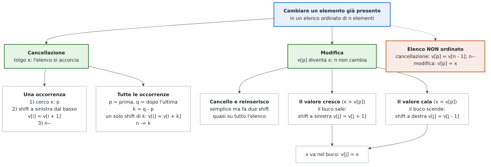
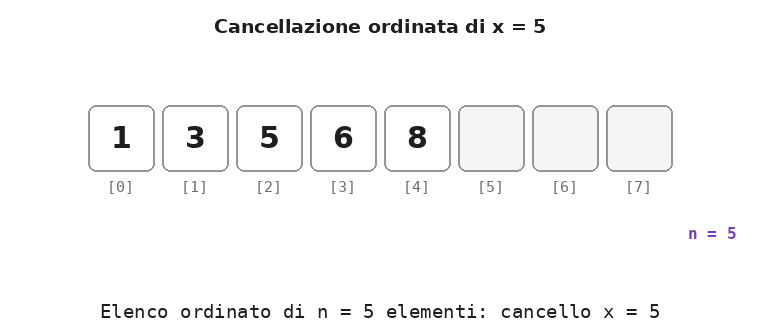
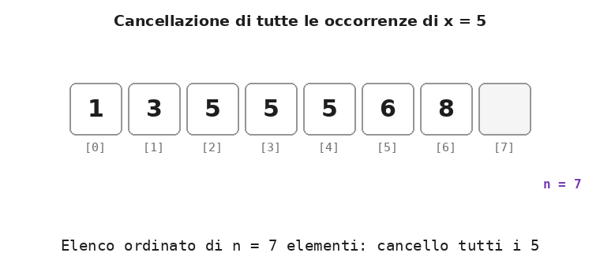
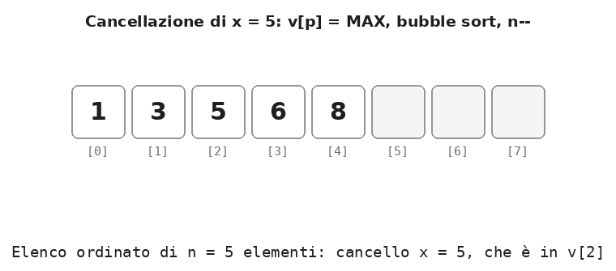
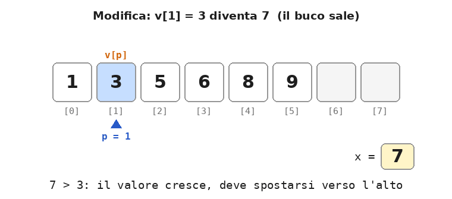

# Dispensa: cancellazione e modifica in un elenco ordinato

10 novembre 2026

Un **elenco** è un array `v` di capacità `N` in cui sono usati i primi `n` elementi, da `v[0]` a `v[n - 1]`, con `n <= N`. In un **elenco ordinato** i valori sono in ordine crescente, e ogni operazione deve lasciarli in ordine.

Questa dispensa tratta le due operazioni che cambiano un elemento **già presente**: la **cancellazione**, che lo toglie e accorcia l'elenco, e la **modifica**, che ne cambia il valore e lo sposta al posto giusto. Entrambe usano lo **shift**: la cancellazione per chiudere un buco, la modifica per far viaggiare un buco fino al posto del nuovo valore.

## 1. Mappa

<p align="center">
  
</p>

| | Cancellazione | Modifica |
| --- | --- | --- |
| Cosa cambia | un elemento sparisce | un elemento cambia valore |
| `n` | diminuisce: `n--` (o `n -= k`) | resta uguale |
| Ricerca | serve: dov'è `x`? | di solito no: si conosce già `p` |
| Shift | a sinistra, **dal basso** (oppure `INT_MAX` e riordino) | a sinistra se il valore cresce, a destra se cala |
| Nel caso peggiore | `n - 1` shift | `n - 1` shift |

Gli esempi usano l'elenco `1 3 5 6 8` (con `N = 8`), e le sue varianti `1 3 5 5 5 6 8` (con valori ripetuti) e `1 3 5 6 8 9`.

## 2. La cancellazione ordinata

**Definizione.** La *cancellazione ordinata* elimina un valore `x` da un elenco ordinato, chiudendo il buco in modo che i restanti `n - 1` elementi siano ancora contigui e ordinati.

Le fasi:

1. **ricerca** di `x`; se non c'è, non si fa niente;
2. **shift a sinistra** di una posizione degli elementi che seguono, **partendo dal basso**;
3. **aggiornamento** della dimensione: `n--`.

```cpp
int p;
for (p = 0; p < n && v[p] < x; p++)       // 1) ricerca sequenziale su elenco ordinato
    ;
if (p < n && v[p] == x) {                 // trovato in v[p]
    for (int i = p; i < n - 1; i++)       // 2) shift a sinistra, dal basso
        v[i] = v[i + 1];
    n--;                                  // 3) un elemento in meno
}
```

La ricerca sfrutta l'ordine: si ferma sul primo elemento non minore di `x`, e se quell'elemento non è `x` allora `x` non c'è. Al suo posto si può usare la ricerca binaria, che fa meno confronti; gli shift però restano gli stessi.

Lo shift parte **dal basso**: `v[p]` viene coperto da `v[p + 1]`, poi `v[p + 1]` da `v[p + 2]` e così via. Ogni valore viene letto prima di essere sovrascritto. Il ciclo si ferma a `i < n - 1` perché l'ultimo assegnamento è `v[n - 2] = v[n - 1]`: con `i < n` si leggerebbe `v[n]`, che non fa parte dell'elenco.

<p align="center">
  
</p>

Dopo lo shift, `v[n - 1]` contiene ancora una copia dell'ultimo valore, ma con `n--` non fa più parte dell'elenco: non serve azzerarla.

| Caso | Esempio su 1 3 5 6 8 | Shift |
| --- | --- | --- |
| In mezzo | `x = 5` → 1 3 6 8 | 2 |
| In testa | `x = 1` → 3 5 6 8 | 4, tutti gli altri |
| In coda | `x = 8` → 1 3 5 6 | 0: basta `n--` |
| `x` non c'è | `x = 4` → 1 3 5 6 8 | 0: l'elenco non cambia |

## 3. Cancellare tutte le occorrenze

In un elenco ordinato i valori uguali sono **vicini**. Per cancellarli tutti non serve ripetere la cancellazione tre volte (tre shift): basta trovare dove iniziano e dove finiscono e fare un unico **shift a sinistra di `k` posizioni**.

```cpp
int p, q;
for (p = 0; p < n && v[p] < x; p++)       // 1) p: primo elemento non minore di x
    ;
for (q = p; q < n && v[q] == x; q++)      // 2) q: primo elemento dopo gli x
    ;
int k = q - p;                            // quante occorrenze (0 se x non c'è)
for (int i = p; i < n - k; i++)           // 3) shift a sinistra di k posizioni, dal basso
    v[i] = v[i + k];
n -= k;                                   // 4) k elementi in meno
```

Gli elementi da cancellare sono `v[p..q-1]`. Ogni elemento che li segue scende di `k` posizioni: `v[i] = v[i + k]`.

<p align="center">
  
</p>

| Passo | Valori | Risultato |
| --- | --- | --- |
| 1) ricerca di `p` | `v[0] = 1`, `v[1] = 3` minori di 5; `v[2] = 5` no | `p = 2` |
| 2) ricerca di `q` | `v[2]`, `v[3]`, `v[4]` uguali a 5; `v[5] = 6` no | `q = 5`, `k = 3` |
| 3) shift di 3 | `v[2] = v[5]`, `v[3] = v[6]` | 1 3 6 8 5 6 8 |
| 4) `n -= 3` | `n = 4` | 1 3 6 8 |

Con tre cancellazioni separate gli shift sarebbero 4 + 3 + 2 = 9; con lo shift di `k` sono 2. Se `x` non c'è, `k` vale 0: lo shift copia ogni elemento su se stesso e `n` non cambia. Si può comunque evitare il lavoro inutile con un `if (k > 0)`.

`p` e `q` si possono trovare anche con la ricerca binaria: sono il **lower bound** e l'**upper bound** di `x` (dispensa sull'inserimento).

## 4. Cancellazione con un valore massimo e riordino

C'è un modo più semplice da scrivere, che non usa lo shift: il valore da cancellare viene **sostituito con un valore massimo**, più grande di tutti quelli che possono stare nell'elenco; un **ordinamento** lo porta in cima; a quel punto basta **escluderlo** con `n--`.

Come valore massimo si usa `INT_MAX`, il più grande `int`, definito in `<climits>`. Per ordinare si usa il bubble sort con la bandierina `scambiato`: a ogni passata il valore più grande sale in cima, quindi già la prima passata porta `INT_MAX` in `v[n - 1]`.

```cpp
#include <climits>                        // per INT_MAX
...
int p;
for (p = 0; p < n && v[p] < x; p++)       // 1) ricerca di x
    ;
if (p < n && v[p] == x) {
    v[p] = INT_MAX;                       // 2) x diventa il valore massimo
    bool scambiato = true;                // 3) bubble sort: INT_MAX sale in cima
    for (int i = 0; i < n - 1 && scambiato; i++) {
        scambiato = false;
        for (int j = 0; j < n - 1 - i; j++)
            if (v[j] > v[j + 1]) {
                int t = v[j];
                v[j] = v[j + 1];
                v[j + 1] = t;
                scambiato = true;
            }
    }
    n--;                                  // 4) INT_MAX è in v[n - 1]: lo escludo
}
```

L'ordine delle fasi conta: il sort va fatto su **tutti** gli `n` elementi, e solo dopo si scrive `n--`. Se si decrementasse `n` prima, il sort non vedrebbe l'ultimo elemento, e `INT_MAX` resterebbe dentro l'elenco.

<p align="center">
  
</p>

Nella prima passata `INT_MAX` viene scambiato con tutti i valori che lo seguono e arriva in cima; la seconda passata non fa scambi e la bandierina ferma l'ordinamento. Il resto dell'elenco era già ordinato, quindi non serve altro.

Lo stesso schema cancella **tutte le occorrenze** in un colpo: si sostituiscono con `INT_MAX` tutti i valori uguali a `x`, si ordina e si toglie il numero `k` di valori sostituiti.

```cpp
int k = 0;
for (int j = 0; j < n; j++)
    if (v[j] == x) {
        v[j] = INT_MAX;                   // ogni occorrenza diventa il massimo
        k++;
    }
// ... bubble sort su n elementi, come sopra ...
n -= k;                                   // i k massimi sono in cima: li escludo
```

Il risultato è lo stesso della cancellazione con lo shift, ma il lavoro no:

| Cancellazione | Con lo shift (sezioni 2 e 3) | Con `INT_MAX` + bubble sort |
| --- | --- | --- |
| `x = 5` da 1 3 5 6 8 | 2 shift | 7 confronti, 2 scambi, 2 passate |
| `x = 1` da 1 3 5 6 8 (in testa) | 4 shift | 7 confronti, 4 scambi, 2 passate |
| `x = 8` da 1 3 5 6 8 (in coda) | 0 shift | 4 confronti, 0 scambi, 1 passata |
| tutti i 5 da 1 3 5 5 5 6 8 | 2 shift di 3 posizioni | 18 confronti, 6 scambi, 4 passate |

In più ogni scambio costa tre assegnamenti, contro uno solo per uno shift. È la stessa idea dell'inserimento in coda con riordino (dispensa sull'inserimento): **più semplice da scrivere**, perché riusa un ordinamento già pronto, ma **più costosa**.

Due cautele:

- `INT_MAX` non deve poter essere un valore vero dell'elenco: altrimenti, dopo il sort, non si distinguerebbe da un elemento da tenere;
- funziona così solo su un elenco **ordinato**. Su un elenco non ordinato il sort riordinerebbe anche tutti gli altri valori: il risultato conterrebbe gli elementi giusti, ma non più nell'ordine di partenza.

## 5. La modifica mediante shift

**Definizione.** La *modifica ordinata* cambia il valore di un elemento `v[p]` in un nuovo valore `x`, spostandolo nella posizione giusta perché l'elenco resti ordinato.

### L'idea semplice: cancello e reinserisco

La prima idea è usare le operazioni già note: si **cancella** `v[p]` (shift a sinistra di tutto ciò che lo segue) e poi si **inserisce** `x` con l'inserimento ordinato (shift a destra di tutto ciò che è maggiore di `x`). Funziona, ma i due shift percorrono quasi tutto l'elenco, e spesso uno disfa il lavoro dell'altro: gli elementi scendono di un posto e poi risalgono.

### La modifica diretta: un buco che si sposta

È meglio spostare il valore **direttamente**, nella sola direzione in cui deve andare:

- se il valore **cresce** (`x > v[p]`), deve salire: gli elementi successivi minori di `x` scendono di una posizione (**shift a sinistra**) e il buco sale;
- se il valore **cala** (`x < v[p]`), deve scendere: gli elementi precedenti maggiori di `x` salgono di una posizione (**shift a destra**) e il buco scende.

```cpp
int j = p;                                // v[p] diventa il buco
if (x > v[p])                             // il valore cresce: il buco sale
    for ( ; j < n - 1 && v[j + 1] < x; j++)
        v[j] = v[j + 1];                  // shift a sinistra
else                                      // il valore cala: il buco scende
    for ( ; j > 0 && v[j - 1] > x; j--)
        v[j] = v[j - 1];                  // shift a destra
v[j] = x;                                 // il nuovo valore va nel buco
```

Il confronto `x > v[p]` si fa prima di toccare l'elenco, quando `v[p]` contiene ancora il vecchio valore. Il buco, qui, è sempre `v[j]`. Se il valore non cambia (`x == v[p]`) si entra nel ramo `else`, il ciclo si ferma subito e `v[p] = x` lascia tutto com'è.

Come sempre, il controllo sull'indice va scritto per primo: `j < n - 1` evita di leggere `v[n]` quando il buco arriva in cima, `j > 0` evita di leggere `v[-1]` quando arriva in fondo.

<p align="center">
  
</p>

| Modifica su 1 3 5 6 8 9 | Risultato | Shift diretti | Shift con cancella + inserisci |
| --- | --- | --- | --- |
| `v[1]`: 3 → 7 | 1 5 6 7 8 9 | 2 | 6 (4 + 2) |
| `v[4]`: 8 → 2 | 1 2 3 5 6 9 | 3 | 5 (1 + 4) |

È la stessa tecnica dell'inserimento ordinato e dell'insertion sort: un buco che si sposta finché il valore non trova il suo posto.

Si potrebbe anche scrivere `v[p] = x` e poi riordinare tutto, come nella sezione 4, ma il bubble sort con il massimo che sale fa scendere un valore di una sola posizione per passata: se il valore cala molto servono molte passate. Lo spostamento diretto del buco fa esattamente gli spostamenti necessari.

Se invece della posizione `p` si conosce il **vecchio valore** ("cambia il 3 in 7"), prima lo si cerca, con la ricerca sequenziale o binaria, e poi si procede come sopra.

## 6. E in un elenco non ordinato?

Se l'ordine non conta, cancellare e modificare costa pochissimo:

```cpp
// elenco NON ordinato: cancellazione di v[p], l'ultimo elemento va a chiudere il buco
v[p] = v[n - 1];
n--;

// elenco NON ordinato: modifica di v[p]
v[p] = x;
```

Nella cancellazione l'ultimo elemento si sposta nel buco: un solo assegnamento invece di fino a `n - 1` shift. Si può fare proprio perché l'ordine non va rispettato; in un elenco ordinato metterebbe un valore grande in mezzo a valori piccoli.

| Operazione | Elenco non ordinato | Elenco ordinato |
| --- | --- | --- |
| Cancellazione (dopo la ricerca) | 1 assegnamento | fino a `n - 1` shift |
| Cancellazione di tutte le occorrenze | per ognuna, l'ultimo nel buco | un solo shift di `k` |
| Modifica | 1 assegnamento | fino a `n - 1` shift |
| Ricerca dell'elemento | esaustiva: `n` confronti se non c'è | binaria: circa `log₂ n` confronti |

## 7. Riepilogo

| Operazione | Ricerca | Spostamenti nel caso peggiore | Attenzione a |
| --- | --- | --- | --- |
| Cancellazione ordinata | ricerca di `x` | `n - 1` shift a sinistra, dal basso | `i < n - 1`; `n--`; se `x` non c'è, nulla |
| Cancellazione di tutte le occorrenze | `p` e `q` | `n - k` shift di `k` posizioni | `v[i] = v[i + k]`, `i < n - k`; `n -= k` |
| Modifica diretta | nessuna: si conosce `p` | `n - 1` shift in una sola direzione | decidere la direzione prima di sovrascrivere `v[p]` |
| Cancellazione con `INT_MAX` + bubble sort | ricerca di `x` | un ordinamento completo | sort su tutti gli `n`, poi `n--`; `INT_MAX` non deve essere un valore vero |
| Cancella + inserisci | ricerca del posto per `x` | due shift, quasi `2n` | funziona, ma fa più lavoro |
| Elenco non ordinato | esaustiva | nessuno | cancellazione: l'ultimo nel buco |

## 8. Errori tipici

| Errore | Effetto | Correzione |
| --- | --- | --- |
| Shift a sinistra partendo dall'alto | lo stesso valore viene copiato su tutta la parte spostata | a sinistra si parte dal basso, da `v[p]` |
| Shift della cancellazione con `i < n` | l'ultimo giro legge `v[n]`, che non fa parte dell'elenco (oltre la fine dell'array se `n == N`) | `i < n - 1` |
| Cancellare senza controllare che `x` ci sia | si cancella il primo elemento maggiore di `x` (o, se `x` è più grande di tutti, l'ultimo, con il solo `n--`) | `if (p < n && v[p] == x)` |
| Dimenticare `n--` (o `n -= k`) | l'ultimo valore compare due volte | aggiornare `n` alla fine |
| Tutte le occorrenze con tre cancellazioni in un ciclo che fa `p++` dopo ogni cancellazione | il valore scalato in `v[p]` non viene ricontrollato: alcune occorrenze restano | un solo shift di `k`, oppure non avanzare `p` dopo una cancellazione |
| Cancellazione con `INT_MAX`: `n--` prima del sort | il sort non vede l'ultimo elemento: `INT_MAX` resta nell'elenco e l'ultimo valore si perde | prima il sort su `n` elementi, poi `n--` |
| Modifica che confronta `x` con `v[p]` dopo averlo sovrascritto | la direzione dello shift viene scelta male | decidere la direzione prima di toccare `v[p]` |
| Modifica con `v[j + 1] < x && j < n - 1` | quando il buco arriva in cima si legge `v[n]` | `j < n - 1 && v[j + 1] < x` |
| "Cancellazione veloce" (l'ultimo nel buco) su un elenco ordinato | l'elenco non è più ordinato | in un elenco ordinato serve lo shift |
