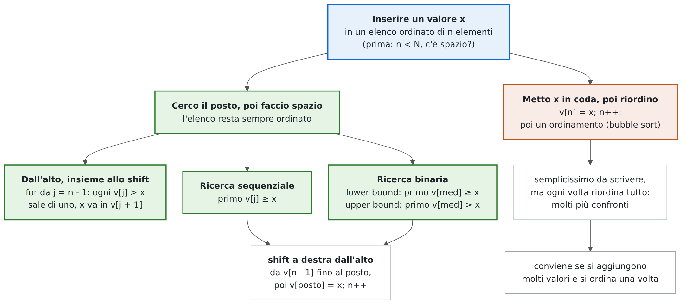
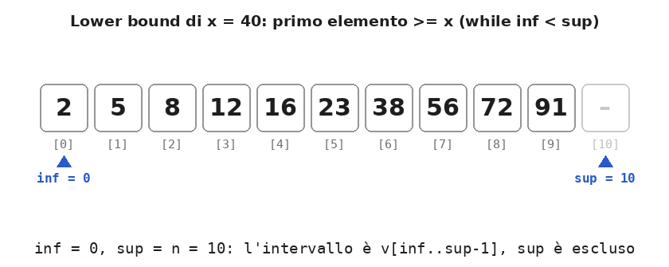
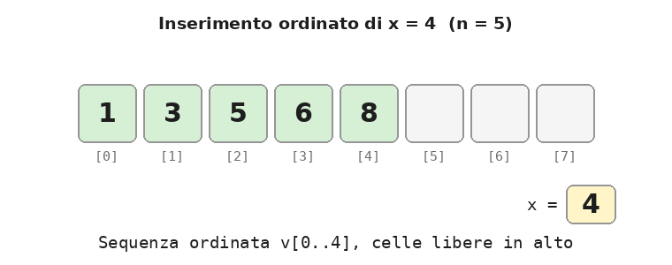
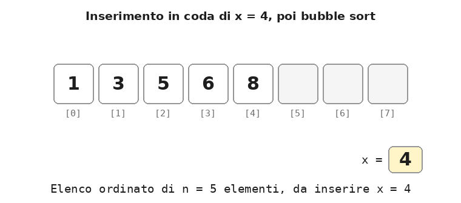

# Dispensa: l'inserimento in un elenco ordinato

10 novembre 2026

Un **elenco** è un array `v` di capacità `N` in cui sono usati i primi `n` elementi, da `v[0]` a `v[n - 1]`, con `n <= N`. In un **elenco ordinato** i valori sono in ordine crescente, e un inserimento deve lasciarli in ordine.

L'inserimento ordinato si costruisce con due mattoni: la **ricerca del posto** (dove andrebbe messo il valore) e lo **shift** (fare posto). C'è anche una strada più semplice da scrivere: mettere il valore in fondo e poi riordinare tutto. Cancellazione e modifica sono trattate in una dispensa a parte, così come la creazione di nuovi elenchi (filtraggio, fusione, operazioni sugli insiemi).

## 1. Mappa: come si inserisce un valore

<p align="center">
  
</p>

Le due strade portano allo stesso risultato, un elenco di `n + 1` elementi ancora ordinato, ma con un lavoro molto diverso:

| | Cerco il posto e faccio spazio | Metto in coda e riordino |
| --- | --- | --- |
| Idea | trovo il primo elemento maggiore di `x`, sposto in su quelli da lì in poi, metto `x` nel buco | `v[n] = x; n++;` e poi ordino tutto l'elenco |
| Cosa serve | ricerca (sequenziale o binaria) + shift a destra | un algoritmo di ordinamento (qui il bubble sort) |
| Lavoro | al massimo `n` confronti e `n` shift | un ordinamento completo: molti più confronti |
| Quando conviene | quasi sempre, per un valore alla volta | se si aggiungono molti valori e si ordina una volta sola |

Gli esempi usano l'elenco `1 3 5 6 8` (con `N = 8`) e, per la ricerca binaria, l'elenco di dieci valori `2 5 8 12 16 23 38 56 72 91`.

## 2. Trovare il punto di inserimento

Il **punto di inserimento** di `x` è la posizione del **primo elemento maggiore o uguale a `x`**: è lì che `x` va messo perché l'elenco resti ordinato. Se `x` è più grande di tutti, il punto di inserimento è `n`, una posizione oltre l'ultimo.

### Con la ricerca sequenziale

Si scorre l'elenco finché i valori sono minori di `x`:

```cpp
int j;
for (j = 0; j < n && v[j] < x; j++)
    ;                                     // avanza finché v[j] < x
// j è il punto di inserimento; se j < n && v[j] == x, x c'è già
```

Con `1 3 5 6 8` e `x = 4` il ciclo si ferma su `v[2] = 5`: il 4 va in `v[2]`. `j < n` va scritto per primo: con `j == n` la valutazione a corto circuito evita di leggere `v[n]`.

### Con la ricerca binaria: il lower bound

La ricerca binaria del **valore esatto** usa un intervallo **chiuso** `v[inf..sup]`, con `sup = n - 1`, `while (inf <= sup)` e gli aggiornamenti `inf = med + 1` e `sup = med - 1`; si ferma appena trova `x`.

Per il punto di inserimento, detto **lower bound**, si usa una seconda forma, con l'intervallo **semiaperto** `v[inf..sup-1]`: `sup` indica la prima posizione **esclusa**, e all'inizio vale `n`, una posizione oltre l'ultimo elemento.

```cpp
int inf = 0, sup = n;                     // sup = n: una posizione oltre l'ultimo
while (inf < sup) {
    int med = (inf + sup) / 2;
    if (v[med] < x)
        inf = med + 1;                    // v[med] è troppo piccolo: il posto è dopo med
    else
        sup = med;                        // v[med] >= x: med può essere il posto, lo tengo
}
// qui inf == sup: è il lower bound, cioè il punto di inserimento di x
bool trovato = (inf < n && v[inf] == x);
```

Quando `v[med] >= x` non si scrive `sup = med - 1`: `med` potrebbe essere proprio il posto cercato, quindi va tenuto tra i candidati. Il ciclo non si ferma quando incontra `x`, ma va avanti finché resta **un solo candidato** (`inf == sup`).

<p align="center">
  
</p>

| Giro | `inf` | `sup` | `med` | `v[med]` | `x = 40` | Nuovo intervallo |
| --- | --- | --- | --- | --- | --- | --- |
| 1 | 0 | 10 | 5 | 23 | 23 < 40 | `inf = 6`: candidati `v[6..9]` |
| 2 | 6 | 10 | 8 | 72 | 72 >= 40 | `sup = 8`: candidati `v[6..7]` |
| 3 | 6 | 8 | 7 | 56 | 56 >= 40 | `sup = 7`: candidato `v[6]` |
| 4 | 6 | 7 | 6 | 38 | 38 < 40 | `inf = 7`: `inf == sup`, fine |

Il risultato è 7: il 40 andrebbe inserito in `v[7]`, prima del 56. Cercando `x = 56` i giri sono gli stessi e il risultato è ancora 7, ma questa volta `v[7] == 56`: trovato. Nel giro 3 la ricerca incontra il 56 ma non si ferma, perché non sa ancora se c'è un altro 56 più in basso.

Le due forme a confronto:

| | Valore esatto | Punto di inserimento (lower bound) |
| --- | --- | --- |
| Intervallo | chiuso, `v[inf..sup]` | semiaperto, `v[inf..sup-1]` |
| Inizializzazione di `sup` | `sup = n - 1`, l'ultimo elemento valido | `sup = n`, una posizione oltre l'ultimo |
| Condizione del ciclo | `while (inf <= sup)` | `while (inf < sup)` |
| Se `v[med] < x` | `inf = med + 1` | `inf = med + 1` |
| Altrimenti | `sup = med - 1` (oppure trovato, se uguale) | `sup = med` |
| Fine del ciclo | trovato, oppure gli indici si **incrociano** (`inf > sup`) | gli indici **coincidono** (`inf == sup`) |
| Risultato | `pos`, oppure -1 se `x` non c'è | `inf`, il primo elemento `>= x` |
| Uso tipico | sapere se `x` c'è e dove | inserimento ordinato, conteggi |

Le due forme non vanno mescolate. Con `sup = n` e `while (inf < sup)` ma `sup = med - 1`, per esempio, cercando 72 si ottiene 7 invece di 8: con `med - 1` si scarta un candidato che poteva essere quello giusto.

Per gli elenchi molto grandi vale la stessa avvertenza della ricerca del valore esatto: la somma `inf + sup` può superare `INT_MAX`, e allora si usa `med = inf + (sup - inf) / 2`.

### L'upper bound

Cambiando `<` in `<=` nel confronto si ottiene l'**upper bound**, cioè il primo elemento **strettamente maggiore** di `x`:

```cpp
if (v[med] <= x)                          // unica differenza rispetto al lower bound
    inf = med + 1;
else
    sup = med;
```

È il punto di inserimento **dopo** gli eventuali valori uguali a `x`. In un elenco ordinato i valori uguali a `x` stanno tutti tra lower bound e upper bound, quindi la loro differenza è il **numero di occorrenze**: in `1 3 5 5 5 6 8`, con `x = 5`, il lower bound è 2, l'upper bound è 5 e i 5 sono 5 - 2 = 3. Sono proprio le posizioni che servono per cancellare tutte le occorrenze di un valore con un solo shift (dispensa su cancellazione e modifica).

In C++ le due ricerche sono già pronte nella libreria `<algorithm>`: `lower_bound(v, v + n, x) - v` e `upper_bound(v, v + n, x) - v` restituiscono le stesse posizioni.

## 3. L'inserimento ordinato

**Definizione.** L'*inserimento ordinato* aggiunge un valore `x` a un elenco ordinato di `n` elementi, mettendolo nella posizione giusta, in modo che l'elenco di `n + 1` elementi sia ancora ordinato.

Le fasi:

1. **controllo dello spazio**: serve almeno una cella libera, cioè `n < N`;
2. **ricerca del posto**: il primo elemento maggiore di `x` (sezione 2);
3. **shift a destra** di una posizione degli elementi da quel posto fino a `v[n - 1]`, **partendo dall'alto**;
4. **inserimento** di `x` nel posto liberato;
5. **aggiornamento** della dimensione: `n++`.

Le fasi 2 e 3 si possono fare insieme, scorrendo l'elenco dall'alto: ogni elemento maggiore di `x` viene subito spostato in su, e ci si ferma al primo non maggiore. Il buco che si crea scende insieme a `j` e resta sempre in `v[j + 1]`.

```cpp
if (n < N) {
    int j;
    for (j = n - 1; j >= 0 && v[j] > x; j--)
        v[j + 1] = v[j];                  // shift a destra: il buco scende
    v[j + 1] = x;                         // x va nel buco
    n++;
}
```

<p align="center">
  
</p>

Se il posto è già stato trovato con la ricerca binaria (il lower bound, `posto = inf`), restano solo lo shift e l'inserimento:

```cpp
for (int i = n; i > posto; i--)
    v[i] = v[i - 1];                      // shift a destra, dall'alto
v[posto] = x;
n++;
```

La ricerca binaria riduce i confronti, ma gli shift restano gli stessi: nel caso peggiore, inserendo in testa, bisogna spostare tutti gli `n` elementi.

| Caso | Esempio su 1 3 5 6 8 | Shift |
| --- | --- | --- |
| In mezzo | `x = 4` → 1 3 4 5 6 8 | 3 |
| In testa | `x = 0` → 0 1 3 5 6 8 | 5, tutti |
| In coda | `x = 9` → 1 3 5 6 8 9 | 0 |
| Elenco pieno (`n == N`) | — | l'inserimento va rifiutato |

## 4. Inserimento in coda e riordino con un sort

C'è un modo più semplice da scrivere, che non richiede di cercare il posto: il nuovo valore si mette **sempre in coda**, come in un elenco non ordinato, e poi si **riordina** tutto l'elenco con un algoritmo di ordinamento già noto. Qui si usa il bubble sort con la bandierina `scambiato`, che si ferma appena una passata non fa scambi.

```cpp
if (n < N) {
    v[n] = x;                             // 1) x va in coda
    n++;                                  // 2) un elemento in più
    bool scambiato = true;                // 3) bubble sort con la bandierina
    for (int i = 0; i < n - 1 && scambiato; i++) {
        scambiato = false;
        for (int j = 0; j < n - 1 - i; j++)
            if (v[j] > v[j + 1]) {
                int t = v[j];             // scambio v[j] e v[j + 1]
                v[j] = v[j + 1];
                v[j + 1] = t;
                scambiato = true;
            }
    }
}
```

Dopo `v[n] = x` l'elenco è ordinato tranne l'ultimo elemento. Il bubble sort lo riporta in ordine: a ogni passata il 4 scende di una posizione, perché viene scambiato con il valore più grande che gli sta davanti, finché non trova il suo posto. L'ultima passata non fa scambi e la bandierina ferma l'ordinamento.

<p align="center">
  
</p>

Il risultato è lo stesso dell'inserimento ordinato, ma il lavoro no:

| `x` su 1 3 5 6 8 | Inserimento ordinato (sezione 3) | In coda + bubble sort |
| --- | --- | --- |
| 4 (in mezzo) | 4 confronti, 3 shift | 14 confronti, 3 scambi, 4 passate |
| 0 (in testa) | 5 confronti, 5 shift | 15 confronti, 5 scambi, 5 passate |
| 9 (in coda) | 1 confronto, 0 shift | 5 confronti, 0 scambi, 1 passata |

Ogni scambio, poi, costa tre assegnamenti, mentre uno shift ne costa uno solo. Inserire in coda e riordinare è quindi **più semplice da scrivere** (si riusa un ordinamento già pronto) ma **fa più lavoro**, e la differenza cresce con la lunghezza dell'elenco. Diventa conveniente quando si devono aggiungere **molti valori**: si mettono tutti in coda e si ordina **una volta sola** alla fine, invece di fare un inserimento ordinato per ciascuno.

## 5. Ordinato o non ordinato?

Tenere un elenco ordinato ha un costo: ogni inserimento richiede degli shift. In un elenco **non** ordinato, invece, inserire costa pochissimo, perché l'ordine non va rispettato:

```cpp
// elenco NON ordinato: inserimento in coda, nessuno shift
v[n] = x;
n++;
```

| Operazione | Elenco non ordinato | Elenco ordinato |
| --- | --- | --- |
| Ricerca | esaustiva: `n` confronti se `x` non c'è | binaria: circa `log₂ n` confronti |
| Inserimento | in coda: 1 assegnamento | ricerca del posto + fino a `n` shift (oppure in coda + riordino) |
| Valori in ordine, minimo e massimo | richiedono un ordinamento o una scansione | già pronti: `v[0]` e `v[n - 1]` |

La scelta dipende dall'uso: se l'elenco si consulta molto più spesso di quanto si modifica, conviene tenerlo ordinato; se si aggiungono molti valori e si cerca raramente, può convenire lasciarlo in disordine e, se serve, ordinarlo una volta sola.

## 6. Riepilogo

| Operazione | Fase di ricerca | Spostamenti nel caso peggiore | Attenzione a |
| --- | --- | --- | --- |
| Punto di inserimento, sequenziale | fino a `n` confronti | — | `j < n` per primo |
| Punto di inserimento, binaria (lower bound) | circa `log₂ n` confronti | — | `sup = n`, `inf < sup`, `sup = med` |
| Inserimento ordinato | ricerca del posto | `n` shift a destra, dall'alto | `n < N`, poi `n++` |
| Inserimento in coda + bubble sort | nessuna | un ordinamento completo | `n < N`; più lavoro, codice più semplice |

## 7. Errori tipici

| Errore | Effetto | Correzione |
| --- | --- | --- |
| Ricerca del posto con `v[j] < x && j < n` | se `x` è più grande di tutti si legge `v[n]` | `j < n && v[j] < x` |
| Lower bound (`sup = n`, `inf < sup`) con `sup = med - 1` | si scarta un candidato che poteva essere quello giusto: cercando 72 si ottiene 7 invece di 8 | `sup = med` |
| Lower bound con `inf = med` | quando `inf` e `sup` sono vicini l'intervallo non si riduce più: ciclo infinito | `inf = med + 1` |
| Lower bound con `sup = n - 1` | se `x` è più grande di tutti il risultato è `n - 1` invece di `n`: il valore finisce prima dell'ultimo | `sup = n` |
| Inserimento senza controllare `n < N` | scrittura oltre la fine dell'array | `if (n < N)` |
| Shift a destra partendo dal basso | un valore viene copiato su tutta la parte spostata | lo shift a destra parte dall'alto |
| Dimenticare `n++` | il valore inserito resta fuori dall'elenco | aggiornare `n` alla fine |
| In coda + sort: ordinare con `n` vecchio (prima di `n++`) | il valore appena messo in coda resta fuori dall'ordinamento | `n++` prima del sort |
