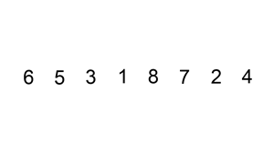
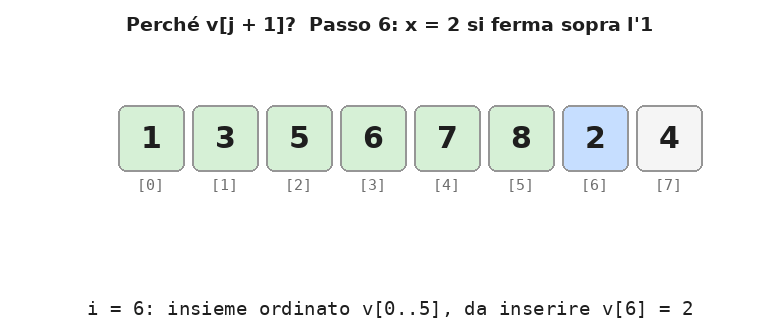
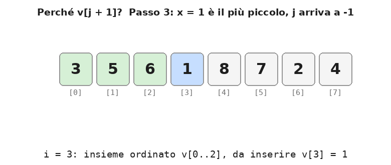

# Dispensa: insertion sort

9 novembre 2026

## 1. L'idea, dall'animazione

L'animazione mostra l'insertion sort al lavoro sulla sequenza **6 5 3 1 8 7 2 4**. Guardandola si nota che l'array è sempre diviso in **due insiemi**:

<p align="center">
  
</p>

- l'**insieme ordinato**, in basso (a sinistra, indici piccoli): i valori già sistemati, in ordine crescente fra loro;
- l'**insieme non ordinato**, in alto (a destra, indici grandi): i valori non ancora esaminati, nell'ordine in cui sono arrivati.

All'inizio l'insieme ordinato contiene solo il primo elemento, `6`: un solo valore è ordinato per definizione. A ogni passo l'algoritmo prende il **primo elemento dell'insieme non ordinato** e lo fa scendere fino al suo posto nell'insieme ordinato. Così l'insieme ordinato cresce di uno e quello non ordinato cala di uno.

Quando l'insieme non ordinato è vuoto, l'intero array è ordinato.

**Definizione.** L'*insertion sort* (ordinamento per inserimento) ordina un array inserendo, uno alla volta, ciascun elemento dell'insieme non ordinato nell'insieme ordinato, con la tecnica dell'*inserimento ordinato*.

## 2. Passo per passo

Ogni riga mostra l'array **dopo** l'inserimento dell'elemento `x = v[i]`. La barra `|` separa l'insieme ordinato (a sinistra) da quello non ordinato (a destra).

| Passo | i | x | Array dopo l'inserimento | Shift a destra |
| --- | --- | --- | --- | --- |
| inizio | – | – | 6 \| 5 3 1 8 7 2 4 | – |
| 1 | 1 | 5 | 5 6 \| 3 1 8 7 2 4 | 1 (il 6) |
| 2 | 2 | 3 | 3 5 6 \| 1 8 7 2 4 | 2 (5, 6) |
| 3 | 3 | 1 | 1 3 5 6 \| 8 7 2 4 | 3 (3, 5, 6) |
| 4 | 4 | 8 | 1 3 5 6 8 \| 7 2 4 | 0 (8 è già al suo posto) |
| 5 | 5 | 7 | 1 3 5 6 7 8 \| 2 4 | 1 (l'8) |
| 6 | 6 | 2 | 1 2 3 5 6 7 8 \| 4 | 5 (3, 5, 6, 7, 8) |
| 7 | 7 | 4 | 1 2 3 4 5 6 7 8 | 4 (5, 6, 7, 8) |

Con `N = 8` elementi servono `N - 1 = 7` passi: il primo elemento non va inserito. Il numero di shift dipende da quanto il valore è piccolo rispetto a quelli già ordinati: l'8 non ne richiede nessuno, il 2 ne richiede 5.

## 3. Il loop esterno: l'indice separatore

Il loop esterno mantiene un indice `i` che fa da **separatore** tra i due insiemi:

- `v[0] … v[i-1]` è l'**insieme ordinato** (in basso);
- `v[i] … v[N-1]` è l'**insieme non ordinato** (in alto);
- `v[i]` è il prossimo elemento da inserire.

```cpp
for (int i = 1; i < N; i++) {
    // qui: v[0..i-1] ordinato, v[i..N-1] non ordinato
    // inserimento ordinato di v[i] in v[0..i-1]
}
```

Il ciclo parte da `i = 1` perché l'insieme formato dal solo `v[0]` è già ordinato. A ogni iterazione l'inserimento allarga l'insieme ordinato di un elemento; l'incremento `i++` sposta il separatore di una posizione verso l'alto.

All'uscita `i = N`: l'insieme non ordinato è vuoto e tutto l'array è ordinato.

La proprietà "*prima di ogni iterazione, `v[0..i-1]` è ordinato*" si chiama **invariante del ciclo**: è vera all'inizio, ogni iterazione la conserva, e alla fine garantisce il risultato.

## 4. Il loop interno: l'inserimento ordinato

Il loop interno esegue l'**inserimento ordinato** di `x = v[i]` nell'insieme ordinato `v[0..i-1]`. Inserire in modo ordinato richiede due cose:

1. **cercare il posto giusto**: la posizione dopo l'ultimo elemento minore o uguale a `x`;
2. **fare uno shift a destra** di una posizione degli elementi maggiori di `x`, per lasciare libero quel posto al nuovo valore.

Lo shift a destra va fatto **partendo dall'alto**, altrimenti ogni copia cancellerebbe un valore non ancora spostato. Per questo la ricerca parte da `j = i - 1`, cioè dal valore più alto dell'insieme ordinato, e scende: ogni elemento maggiore di `x` viene subito spostato in su di una posizione. Ricerca e shift avvengono così nello stesso ciclo.

```cpp
int x = v[i];          // salvo il valore: v[i] verrà sovrascritto
int j;                 // dichiarata fuori: serve anche dopo il for
for (j = i - 1; j >= 0 && v[j] > x; j--)
    v[j + 1] = v[j];   // shift a destra di v[j], la ricerca scende con j--
v[j + 1] = x;          // inserisco nel posto liberato
```

Il `for` riunisce in una riga i tre elementi del ciclo: partenza dall'alto (`j = i - 1`), condizione di continuazione (`j >= 0 && v[j] > x`) e discesa (`j--`). La variabile `j` va dichiarata **prima** del `for`: se fosse dichiarata dentro, non esisterebbe più nella riga `v[j + 1] = x`, dove serve per sapere dove inserire.

### Esempio: il passo 6 dell'animazione

Prima del passo l'array è `1 3 5 6 7 8 | 2 4`, con `i = 6` e `x = 2`.

| j | v\[j\] | v\[j\] > 2? | Azione | Array |
| --- | --- | --- | --- | --- |
| 5 | 8 | sì | `v[6] = 8` | 1 3 5 6 7 8 8 4 |
| 4 | 7 | sì | `v[5] = 7` | 1 3 5 6 7 7 8 4 |
| 3 | 6 | sì | `v[4] = 6` | 1 3 5 6 6 7 8 4 |
| 2 | 5 | sì | `v[3] = 5` | 1 3 5 5 6 7 8 4 |
| 1 | 3 | sì | `v[2] = 3` | 1 3 3 5 6 7 8 4 |
| 0 | 1 | no | stop, posto trovato: `j + 1 = 1` |  |
| – | – | – | `v[1] = 2` | 1 2 3 5 6 7 8 4 |

Durante lo shift un valore compare due volte (ad esempio `8 8`): è normale, la copia in basso verrà sovrascritta al passo successivo o dall'inserimento finale. Il valore `x` non va perso perché è stato salvato all'inizio.

L'ordine delle condizioni `j >= 0 && v[j] > x` è importante: se `j` arriva a -1, il controllo sul limite ferma il ciclo prima di leggere `v[-1]`.

### Focus: perché si inserisce in `v[j + 1]`

La chiave è il **buco**, cioè la cella libera in cui finirà `x`. Durante tutto il ciclo interno vale questa regola: **il buco è sempre `v[j + 1]`**.

1. **All'inizio** `j = i - 1`, quindi `j + 1 = i`. Il buco è proprio `v[i]`: il suo valore è stato salvato in `x`, quindi la cella si può sovrascrivere.
2. **A ogni passo** `v[j]` è maggiore di `x` e viene copiato nel buco con `v[j + 1] = v[j]`. Ora è `v[j]` a contenere una copia inutile: è lui il nuovo buco. Con `j--` l'indice scende di uno e il buco torna a essere `v[j + 1]`.
3. **Alla fine** il ciclo si ferma e il buco è ancora in `v[j + 1]`. Lì va `x`.

In altre parole, `j` indica l'elemento che si sta confrontando con `x`, e `j + 1` la cella libera subito sopra di lui. I due scendono insieme.

<p align="center">
  
</p>

### Perché `v[j + 1]` è il posto giusto

Quando il ciclo si ferma, l'insieme ordinato è diviso in due parti attorno al buco:

- sotto il buco, da `v[0]` a `v[j]`, ci sono i valori **minori o uguali** a `x`: non sono stati toccati;
- sopra il buco, da `v[j + 2]` a `v[i]`, ci sono i valori **maggiori** di `x`: sono stati spostati in su di una posizione.

Mettendo `x` nel buco l'ordine è rispettato su entrambi i lati. Il ciclo si può fermare in tre modi, e la stessa istruzione `v[j + 1] = x` funziona in tutti:

| Caso | Esempio dall'animazione | Dove si ferma `j` | Perché si ferma | `x` va in |
| --- | --- | --- | --- | --- |
| Trova un elemento non maggiore di `x` | passo 6, `x = 2` | `j = 0` (`v[0] = 1`) | `1 > 2` è falso | `v[1]` |
| `x` è il più piccolo di tutti | passo 3, `x = 1` | `j = -1` | `j >= 0` è falso | `v[0]` |
| `x` è già al suo posto | passo 4, `x = 8` | `j = 3` (`v[3] = 6`), nessuno shift | `6 > 8` è falso | `v[4]`, la sua cella di partenza |

Nel secondo caso si vede perché non si può scrivere `v[j] = x`: con `j = -1` si scriverebbe fuori dall'array.

<p align="center">
  
</p>

### L'errore tipico: `v[j] = x`

Nel passo 6, dopo gli shift l'array è `1 3 3 5 6 7 8 | 4`, con `j = 0` e il buco in `v[1]`. Scrivendo `v[j] = x` il 2 finisce in `v[0]`: l'1 viene cancellato e in `v[1]` resta la copia inutile del 3. Il risultato è `2 3 3 5 6 7 8`, che ha perso l'1. Con `v[j + 1] = x` invece si ottiene `1 2 3 5 6 7 8`.

Regola da ricordare: **`j` si ferma sull'ultimo elemento da lasciare dov'è; `x` va subito sopra, in `j + 1`.**

Per la teoria completa degli shift e dell'inserimento ordinato vedi la *Dispensa: gli shift negli array*.

## 5. Il programma completo e le varianti

```cpp
#include <iostream>
using namespace std;

const int N = 8;

void stampa(int v[], int n) {
    for (int i = 0; i < n; i++)
        cout << v[i] << " ";
    cout << endl;
}

int main() {
    int v[N] = {6, 5, 3, 1, 8, 7, 2, 4};

    cout << "Non ordinato: ";
    stampa(v, N);

    for (int i = 1; i < N; i++) {                   // loop esterno: i = separatore
        int x = v[i];
        int j;
        for (j = i - 1; j >= 0 && v[j] > x; j--)    // loop interno: inserimento ordinato
            v[j + 1] = v[j];
        v[j + 1] = x;
    }

    cout << "Ordinato:     ";
    stampa(v, N);
    return 0;
}
```

Output: `6 5 3 1 8 7 2 4` diventa `1 2 3 4 5 6 7 8`.

### Varianti

| Variante | Insieme ordinato | Loop esterno | Loop interno |
| --- | --- | --- | --- |
| j e j+1 (quella sopra) | in basso | `i` da 1 a N-1 | salva `x`, shift `v[j+1] = v[j]`, inserisce `x` alla fine |
| j e j-1 | in basso | `i` da 1 a N-1 | parte da `j = i`, scambia `v[j]` e `v[j-1]` finché `v[j-1] > v[j]` |
| Ordinati in alto | in alto | `i` da N-2 a 0 | parte da `j = i`, scambia `v[j]` e `v[j+1]` finché `v[j] > v[j+1]` |

La variante con gli scambi è più semplice da scrivere ma fa più assegnamenti: ogni scambio ne richiede tre, lo shift uno solo.

Nella variante con gli ordinati in alto i ruoli si invertono: l'insieme ordinato è `v[i+1..N-1]`, il separatore `i` scende, e ogni nuovo elemento viene fatto **salire** al suo posto.

### La variante con j e j-1 in azione

In questa variante il valore da inserire non viene salvato in `x` e non c'è nessun buco. Il valore scende al suo posto con una serie di **scambi** tra `v[j-1]` e `v[j]`: finché il vicino di sotto è più grande, i due si scambiano e `j` scende di uno.

```cpp
for (int i = 1; i < N; i++)
    for (int j = i; j > 0 && v[j - 1] > v[j]; j--) {
        int t = v[j];          // scambio v[j] e v[j-1]
        v[j] = v[j - 1];
        v[j - 1] = t;
    }
```

Qui `j` si può dichiarare dentro il `for`, perché dopo il ciclo non serve più: non c'è un `x` da mettere in `v[j + 1]`. Il valore da inserire si trova sempre in `v[j]`.

<p align="center">
  
</p>

Nell'animazione il valore da inserire è in arancione e la freccia indica `j`; a ogni scambio il valore più grande passa sopra e quello da inserire sotto. Su 6 5 3 1 8 7 2 4 servono **16 scambi**, cioè 48 assegnamenti. La versione con `x` e gli shift fa lo stesso lavoro con 16 shift più 2 assegnamenti per passo (salvare `x` e inserirlo): 30 assegnamenti in tutto.
