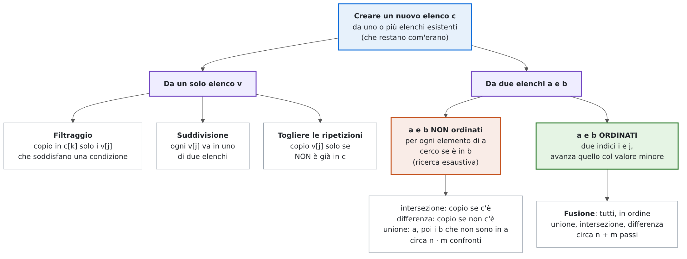
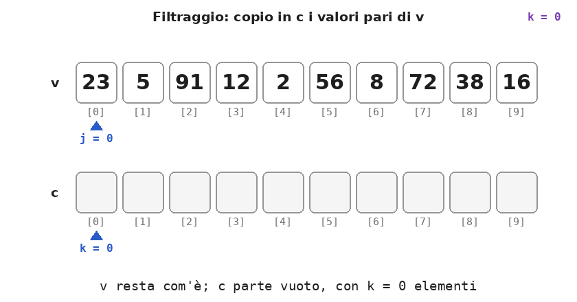
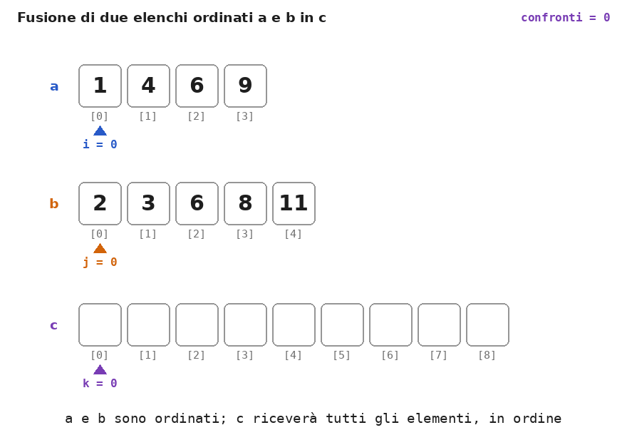

# Dispensa: creare nuovi elenchi da elenchi esistenti

10 novembre 2026

Un **elenco** è un array `v` di capacità `N` in cui sono usati i primi `n` elementi, da `v[0]` a `v[n - 1]`, con `n <= N`.

Nelle dispense precedenti l'elenco veniva cambiato **sul posto**: si inseriva, si cancellava, si modificava. Qui invece gli elenchi di partenza **restano com'erano** e il risultato è un **nuovo elenco** `c`, costruito copiando alcuni dei loro elementi: solo quelli che soddisfano una condizione (filtraggio), quelli presenti in un altro elenco (intersezione), tutti in ordine (fusione) e così via.

Lo schema è sempre lo stesso: un indice scorre l'elenco di partenza e un contatore `k` dice quanti elementi sono già stati messi in `c`. `c[k]` è la prima cella libera, quindi ogni copia si fa con:

```cpp
c[k] = valore;                            // copio nella prima cella libera...
k++;                                      // ...e c ha un elemento in più
```

Alla fine `k` è il numero di elementi di `c`. L'array `c` deve avere una capacità sufficiente per il caso peggiore, in cui vengono copiati tutti gli elementi.

## 1. Mappa

<p align="center">
  
</p>

Gli esempi usano:

- l'elenco non ordinato `v = 23 5 91 12 2 56 8 72 38 16` e la sua versione ordinata `2 5 8 12 16 23 38 56 72 91`;
- gli insiemi `a = {1, 4, 6, 9}` e `b = {2, 3, 6, 8, 11}`, scritti in disordine (`a = 9 4 1 6`, `b = 8 2 11 6 3`) oppure in ordine.

## 2. Il filtraggio

**Definizione.** Il *filtraggio* crea un nuovo elenco `c` con i soli elementi di `v` che soddisfano una condizione, nello stesso ordine in cui compaiono in `v`.

```cpp
int k = 0;                                // c è vuoto
for (int j = 0; j < n; j++)
    if (v[j] % 2 == 0) {                  // la condizione: v[j] è pari
        c[k] = v[j];
        k++;
    }
// c contiene k elementi
```

I due indici avanzano in modo diverso: `j` avanza a **ogni** giro, perché tutti gli elementi di `v` vanno esaminati; `k` avanza **solo quando si copia**. Per questo `c[k]` e non `c[j]`: con `c[j]` il 12 finirebbe in `c[3]`, lasciando in `c` dei buchi con valori a caso.

<p align="center">
  
</p>

Cambiando la condizione si ottengono filtraggi diversi:

| Condizione su `v = 23 5 91 12 2 56 8 72 38 16` | `c` | `k` |
| --- | --- | --- |
| `v[j] % 2 == 0` (pari) | 12 2 56 8 72 38 16 | 7 |
| `v[j] > 20` | 23 91 56 72 38 | 5 |
| `v[j] >= 10 && v[j] <= 50` | 23 12 38 16 | 4 |

Il filtraggio **conserva l'ordine**: se `v` è ordinato, anche `c` lo è. Filtrando `2 5 8 12 16 23 38 56 72 91` con `v[j] > 20` si ottiene `23 38 56 72 91`, già in ordine.

## 3. La suddivisione

**Definizione.** La *suddivisione* distribuisce gli elementi di `v` in **due** nuovi elenchi: quelli che soddisfano la condizione nel primo, tutti gli altri nel secondo.

È un filtraggio con un ramo `else`, e quindi con **due contatori**, uno per ogni elenco:

```cpp
int np = 0, nd = 0;                       // pari e dispari: entrambi vuoti
for (int j = 0; j < n; j++)
    if (v[j] % 2 == 0) {
        pari[np] = v[j];
        np++;
    } else {
        dispari[nd] = v[j];
        nd++;
    }
// np + nd == n: ogni elemento è finito in uno solo dei due elenchi
```

Con `v = 23 5 91 12 2 56 8 72 38 16` si ottengono `pari = 12 2 56 8 72 38 16` (`np = 7`) e `dispari = 23 5 91` (`nd = 3`). Ognuno dei due elenchi deve poter contenere fino a `n` elementi, perché in un caso estremo vanno tutti nello stesso.

## 4. La ricerca di un elemento in un altro elenco

Spesso la condizione per copiare un elemento non riguarda il suo valore, ma la sua **presenza** in un altro elenco: "copio `a[i]` solo se c'è anche in `b`". Per saperlo serve una **ricerca**. Se `b` non è ordinato, l'unica possibile è la ricerca esaustiva, che conviene scrivere una volta per tutte come funzione:

```cpp
// true se x è tra i primi m elementi di b
bool presente(int b[], int m, int x) {
    bool trovato = false;
    for (int j = 0; j < m && !trovato; j++)
        if (b[j] == x)
            trovato = true;
    return trovato;
}
```

Con questa funzione le operazioni sugli insiemi diventano dei filtraggi.

**Intersezione** (gli elementi presenti in entrambi): si filtra `a`, copiando gli elementi che **ci sono** in `b`.

```cpp
int k = 0;
for (int i = 0; i < n; i++)
    if (presente(b, m, a[i])) {
        c[k] = a[i];
        k++;
    }
```

**Differenza** `a - b` (gli elementi di `a` che non sono in `b`): stesso ciclo, con la condizione negata, `!presente(b, m, a[i])`.

**Unione** (gli elementi presenti in almeno uno dei due, senza doppioni): si copia tutto `a`, poi si filtra `b`, aggiungendo gli elementi che **non sono** in `a`.

```cpp
int k = 0;
for (int i = 0; i < n; i++) {             // tutto a
    c[k] = a[i];
    k++;
}
for (int j = 0; j < m; j++)               // gli elementi di b che non sono in a
    if (!presente(a, n, b[j])) {
        c[k] = b[j];
        k++;
    }
```

| Operazione su `a = 9 4 1 6` e `b = 8 2 11 6 3` | `c` | Confronti |
| --- | --- | --- |
| Intersezione | 6 | 19 |
| Differenza `a - b` | 9 4 1 | 19 |
| Unione | 9 4 1 6 8 2 11 3 | 20 |

Ogni elemento di `a` richiede una ricerca in `b`, che costa fino a `m` confronti: in tutto, nel caso peggiore, circa **`n · m`** confronti. Qui 9, 4 e 1 non sono in `b` e costano 5 confronti ciascuno; il 6 viene trovato al quarto: 5 + 5 + 5 + 4 = 19.

### Togliere le ripetizioni

La ricerca può avvenire anche nel **nuovo elenco**: per creare un elenco senza ripetizioni si copia `v[j]` solo se **non è già** in `c`.

```cpp
int k = 0;
for (int j = 0; j < n; j++)
    if (!presente(c, k, v[j])) {          // cerco tra i k elementi già copiati
        c[k] = v[j];
        k++;
    }
```

Con `v = 3 7 3 1 7 7 2 1` si ottiene `c = 3 7 1 2`. La ricerca si fa sui soli `k` elementi già copiati, non su tutto l'array `c`: le celle da `c[k]` in poi non contengono ancora niente di significativo.

## 5. La fusione di due elenchi ordinati

Se gli elenchi di partenza sono **ordinati**, non serve cercare ogni elemento nell'altro elenco: basta scorrerli insieme, con un indice per ciascuno.

**Definizione.** La *fusione* (*merge*) di due elenchi ordinati `a` (di `n` elementi) e `b` (di `m` elementi) produce un terzo elenco `c`, di `n + m` elementi, che li contiene tutti in ordine.

L'idea è quella di due mazzi di carte già ordinati, a faccia in su: si confrontano le due carte in cima e si prende la più piccola, finché uno dei due mazzi non finisce; poi si aggiunge tutto ciò che resta dell'altro. Servono tre indici: `i` per `a`, `j` per `b` e `k` per `c`.

```cpp
int i = 0, j = 0, k;
for (k = 0; i < n && j < m; k++)          // finché entrambi hanno elementi
    if (a[i] <= b[j]) {
        c[k] = a[i];                      // il più piccolo è in a
        i++;
    } else {
        c[k] = b[j];                      // il più piccolo è in b
        j++;
    }
for ( ; i < n; i++, k++)                  // ciò che resta di a
    c[k] = a[i];
for ( ; j < m; j++, k++)                  // ciò che resta di b
    c[k] = b[j];
```

Solo uno dei due cicli finali viene eseguito davvero: quando si arriva lì, almeno uno dei due elenchi è già finito.

<p align="center">
  
</p>

| Confronto | Preso | `c` dopo il passo |
| --- | --- | --- |
| `a[0] = 1` e `b[0] = 2` | 1 da `a` | 1 |
| `a[1] = 4` e `b[0] = 2` | 2 da `b` | 1 2 |
| `a[1] = 4` e `b[1] = 3` | 3 da `b` | 1 2 3 |
| `a[1] = 4` e `b[2] = 6` | 4 da `a` | 1 2 3 4 |
| `a[2] = 6` e `b[2] = 6` | 6 da `a` (uguali: con `<=` vince `a`) | 1 2 3 4 6 |
| `a[3] = 9` e `b[2] = 6` | 6 da `b` | 1 2 3 4 6 6 |
| `a[3] = 9` e `b[3] = 8` | 8 da `b` | 1 2 3 4 6 6 8 |
| `a[3] = 9` e `b[4] = 11` | 9 da `a`: `a` è finito | 1 2 3 4 6 6 8 9 |
| — | 11, il resto di `b` | 1 2 3 4 6 6 8 9 11 |

La fusione fa al massimo `n + m - 1` confronti (qui 8) e sempre `n + m` copie (qui 9). Con `<=` a parità di valore si prende prima da `a`: i valori uguali mantengono l'ordine di partenza.

## 6. Unione, intersezione e differenza di elenchi ordinati

Se `a` e `b` rappresentano **insiemi** ordinati (senza ripetizioni), lo schema a due indici della fusione dà anche le operazioni insiemistiche. A ogni passo si confrontano `a[i]` e `b[j]`, e ci sono tre casi:

- `a[i] < b[j]`: `a[i]` non può essere in `b` (tutti i valori successivi di `b` sono ancora più grandi), quindi è solo in `a`;
- `a[i] > b[j]`: allo stesso modo `b[j]` è solo in `b`;
- `a[i] == b[j]`: il valore è in entrambi.

Le tre operazioni differiscono solo per **che cosa si copia** in ciascun caso:

| Caso | Unione | Intersezione | Differenza `a - b` |
| --- | --- | --- | --- |
| `a[i] < b[j]` | copio `a[i]` | — | copio `a[i]` |
| `a[i] > b[j]` | copio `b[j]` | — | — |
| `a[i] == b[j]` | copio il valore una volta | copio il valore | — |
| Alla fine | copio il resto di `a` e di `b` | niente | copio il resto di `a` |

In tutti i casi avanza l'indice dell'elemento più piccolo, o entrambi se sono uguali. L'**unione**:

```cpp
int i = 0, j = 0, k;
for (k = 0; i < n && j < m; k++)
    if (a[i] < b[j]) {
        c[k] = a[i];
        i++;
    } else if (a[i] > b[j]) {
        c[k] = b[j];
        j++;
    } else {                              // uguali: lo copio una volta sola
        c[k] = a[i];
        i++;
        j++;
    }
for ( ; i < n; i++, k++)
    c[k] = a[i];
for ( ; j < m; j++, k++)
    c[k] = b[j];
// k è il numero di elementi dell'unione
```

Nell'intersezione e nella differenza `k` non avanza a ogni passo, quindi il `while` è più naturale:

```cpp
// intersezione: solo i valori presenti in entrambi
int i = 0, j = 0, k = 0;
while (i < n && j < m)
    if (a[i] < b[j])
        i++;
    else if (a[i] > b[j])
        j++;
    else {
        c[k] = a[i];
        k++;
        i++;
        j++;
    }
```

```cpp
// differenza a - b: i valori di a che non sono in b
int i = 0, j = 0, k = 0;
while (i < n && j < m)
    if (a[i] < b[j]) {                    // a[i] non è in b
        c[k] = a[i];
        k++;
        i++;
    } else if (a[i] > b[j])
        j++;
    else {                                // a[i] è in b: non lo copio
        i++;
        j++;
    }
for ( ; i < n; i++, k++)                  // il resto di a non è in b
    c[k] = a[i];
```

| Operazione su `a = 1 4 6 9` e `b = 2 3 6 8 11` | Risultato | Passi con due indici | Confronti con la ricerca (elenchi non ordinati) |
| --- | --- | --- | --- |
| Fusione (con ripetizioni) | 1 2 3 4 6 6 8 9 11 | 8 | — |
| Unione | 1 2 3 4 6 8 9 11 | 7 | 20 |
| Intersezione | 6 | 7 | 19 |
| Differenza `a - b` | 1 4 9 | 7 | 19 |

Con due indici ogni passo fa avanzare almeno uno dei due, quindi i passi sono al massimo **`n + m`**, contro i circa **`n · m`** confronti della versione con la ricerca. Con due elenchi di 1 000 elementi sono circa 2 000 passi contro circa 1 000 000 di confronti. Inoltre il risultato è già ordinato.

Anche **togliere le ripetizioni** è più semplice se l'elenco è ordinato: i valori uguali sono vicini, quindi basta confrontare `v[j]` con l'**ultimo** elemento copiato, senza cercarlo in tutto `c`:

```cpp
int k = 0;
for (int j = 0; j < n; j++)
    if (k == 0 || v[j] != c[k - 1]) {     // diverso dall'ultimo copiato
        c[k] = v[j];
        k++;
    }
```

Con `1 1 2 3 3 3 7` si ottiene `1 2 3 7`. `k == 0` va scritto per primo: quando `c` è vuoto, la valutazione a corto circuito evita di leggere `c[-1]`.

## 7. Riepilogo

| Operazione | Elenchi di partenza | Lavoro | Dimensione massima di `c` |
| --- | --- | --- | --- |
| Filtraggio | uno qualsiasi | `n` controlli | `n` |
| Suddivisione | uno qualsiasi | `n` controlli | `n` per ciascuno dei due |
| Togliere le ripetizioni | non ordinato | ricerca in `c` per ogni elemento: fino a circa `n²/2` confronti | `n` |
| Togliere le ripetizioni | ordinato | `n` confronti con l'ultimo copiato | `n` |
| Intersezione, differenza, unione | non ordinati | ricerca nell'altro elenco: circa `n · m` confronti | `n` (intersezione, differenza), `n + m` (unione) |
| Fusione | ordinati | al massimo `n + m - 1` confronti, `n + m` copie | `n + m` |
| Unione, intersezione, differenza | ordinati | al massimo `n + m` passi | `n + m` (unione), `n` (intersezione, differenza) |

## 8. Errori tipici

| Errore | Effetto | Correzione |
| --- | --- | --- |
| Filtraggio con `c[j] = v[j]` | `c` ha dei buchi con valori a caso, e manca il numero dei suoi elementi | `c[k] = v[j]; k++;` |
| `k++` fuori dall'`if` | `k` conta tutti gli elementi esaminati, non quelli copiati | `k++` solo quando si copia |
| Dimenticare `k = 0` | si scrive in posizioni casuali di `c` | inizializzare `k` prima del ciclo |
| `c` troppo piccolo | scrittura oltre la fine di `c` | capacità pari al caso peggiore: `n`, o `n + m` per unione e fusione |
| Suddivisione con un solo contatore | i due elenchi hanno buchi, o si sovrascrivono | un contatore per ogni elenco |
| Togliere le ripetizioni cercando in tutto `c` (fino a `N`) invece che nei primi `k` | si confronta con valori a caso nelle celle non ancora usate | `presente(c, k, v[j])` |
| Ripetizioni su elenco ordinato con `v[j] != c[k - 1] \|\| k == 0` | con `k == 0` si legge `c[-1]` | `k == 0 \|\| v[j] != c[k - 1]` |
| Intersezione o differenza "a due indici" su elenchi non ordinati | si scartano elementi che sono nell'altro elenco: risultati sbagliati | con elenchi non ordinati serve la ricerca; i due indici richiedono elenchi ordinati |
| Fusione o unione senza i cicli finali | gli elementi rimasti nell'elenco non finito vengono persi | copiare il resto di `a` e di `b` |
| Unione di elenchi ordinati che, se `a[i] == b[j]`, avanza solo `i` | il valore comune viene copiato due volte | se uguali, copiare una volta e avanzare entrambi |
