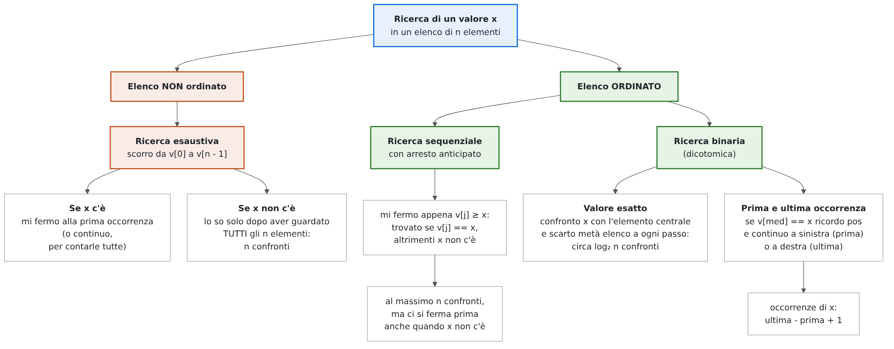
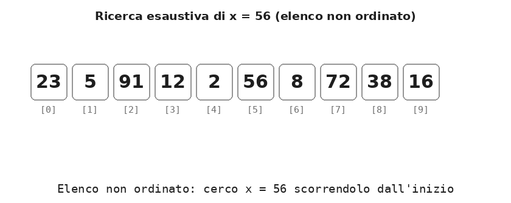
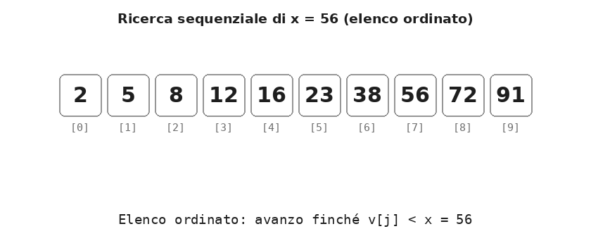
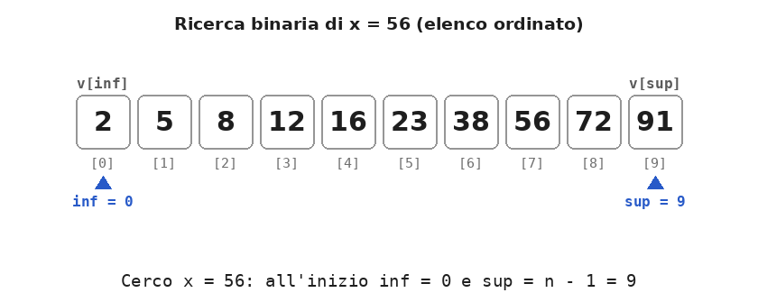
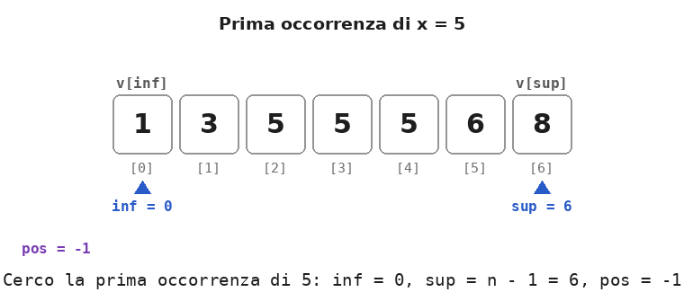

# Dispensa: la ricerca in un elenco

10 novembre 2026

Un **elenco** è un array `v` di capacità `N` in cui sono usati i primi `n` elementi, da `v[0]` a `v[n - 1]`, con `n <= N`. In un **elenco ordinato** i valori sono in ordine crescente.

Cercare un valore `x` vuol dire stabilire se è nell'elenco e, se c'è, in quale posizione. Questa dispensa tratta la ricerca di un **valore esatto** e, per i valori ripetuti, della sua **prima** e **ultima occorrenza**. La ricerca del posto in cui *inserire* un valore è trattata nella dispensa sull'inserimento.

## 1. Mappa dei casi

Il modo di cercare `x` dipende da una sola domanda: **l'elenco è ordinato?**

<p align="center">
  
</p>

| | Ricerca esaustiva | Ricerca sequenziale su elenco ordinato | Ricerca binaria |
| --- | --- | --- | --- |
| Elenco | qualsiasi | ordinato | ordinato |
| Come procede | dal primo all'ultimo elemento | dal primo, finché `v[j] < x` | dimezza a ogni passo l'intervallo `v[inf..sup]` |
| Se `x` c'è, si ferma | alla prima occorrenza | quando `v[j] == x` | quando `v[med] == x` |
| Se `x` non c'è, si ferma | dopo aver visto tutti gli `n` elementi | appena trova `v[j] > x` (o a fine elenco) | quando `inf > sup` |
| Confronti nel caso peggiore | `n` | `n` | circa `log₂ n` |

Gli esempi usano dieci valori: lo stesso insieme scritto in disordine per la ricerca esaustiva e in ordine per le altre due.

- non ordinato: `23 5 91 12 2 56 8 72 38 16`
- ordinato: `2 5 8 12 16 23 38 56 72 91`

| `x` | Ricerca esaustiva | Ricerca sequenziale su elenco ordinato | Ricerca binaria |
| --- | --- | --- | --- |
| 56 (c'è) | 6 confronti | 8 confronti | 2 confronti |
| 40 (non c'è) | 10 | 8 | 4 |
| 10 (non c'è) | 10 | 4 | 4 |
| 95 (non c'è, più grande di tutti) | 10 | 10 | 4 |
| 2 (c'è, è il primo dell'elenco ordinato) | 5 | 1 | 3 |

La ricerca binaria non vince sempre: se `x` è tra i primi elementi, la sequenziale lo trova prima. Ma nel caso peggiore la binaria fa al massimo 4 confronti su 10 elementi, e la differenza cresce enormemente con elenchi lunghi (sezione 4).

## 2. La ricerca esaustiva (elenco non ordinato)

In un elenco non ordinato la posizione di un valore non dice niente sugli altri: dopo aver visto `v[j]` non si sa nulla di `v[j + 1]`. Per concludere che `x` **non c'è**, quindi, bisogna guardare **tutti** gli elementi.

```cpp
int pos = -1;                             // -1 = non trovato
for (int j = 0; j < n && pos == -1; j++)
    if (v[j] == x)
        pos = j;                          // trovato: la condizione del for fa uscire
```

La variabile `pos` fa anche da bandierina: finché vale -1 la ricerca continua; appena `x` viene trovato, `pos == -1` diventa falso e il ciclo si ferma alla **prima occorrenza**.

<p align="center">
  
</p>

Se invece si vogliono **contare tutte le occorrenze**, non ci si può mai fermare prima della fine:

```cpp
int cont = 0;
for (int j = 0; j < n; j++)
    if (v[j] == x)
        cont++;
```

## 3. La ricerca sequenziale su un elenco ordinato

Se l'elenco è ordinato, appena si incontra un valore **più grande** di `x` ci si può fermare: tutti quelli successivi sono ancora più grandi, quindi `x` non può essere tra loro.

```cpp
int j;
for (j = 0; j < n && v[j] < x; j++)
    ;                                     // avanza finché v[j] < x
bool trovato = (j < n && v[j] == x);
```

Il ciclo si ferma sul primo elemento **non minore** di `x`. A quel punto ci sono tre possibilità: `v[j] == x` (trovato), `v[j] > x` (non c'è) oppure `j == n` (non c'è, ed è più grande di tutti). Come sempre `j < n` va scritto per primo: con `j == n` la valutazione a corto circuito evita di leggere `v[n]`.

<p align="center">
  
</p>

Le differenze rispetto alla ricerca esaustiva:

- **si ferma prima anche quando `x` non c'è**: per `x = 40` si ferma sul 56, dopo 8 confronti invece di 10; per `x = 10` dopo 4;
- **trova la prima occorrenza**: se `x` è ripetuto, `j` si ferma sul primo dei valori uguali, perché quelli prima sono tutti minori;
- **funziona solo se l'elenco è ordinato**: su un elenco in disordine si fermerebbe al primo valore più grande di `x`, anche se `x` si trova più avanti.

## 4. La ricerca binaria

La ricerca binaria (o dicotomica) sfrutta l'ordine come si fa con un dizionario: si apre a metà e, a seconda della parola trovata, si continua nella metà giusta, scartando l'altra.

Si tengono due indici, `inf` e `sup`, che delimitano la parte di elenco in cui `x` può ancora trovarsi. A ogni passo si confronta `x` con l'elemento centrale `v[med]`:

- se `v[med] == x`, trovato;
- se `v[med] < x`, `x` può stare solo a destra di `med`: `inf = med + 1`;
- se `v[med] > x`, `x` può stare solo a sinistra di `med`: `sup = med - 1`.

```cpp
int inf = 0, sup = n - 1, pos = -1;
while (inf <= sup && pos == -1) {
    int med = (inf + sup) / 2;           // elemento centrale (per elenchi enormi, vedi sotto)
    if (v[med] == x)
        pos = med;
    else if (v[med] < x)
        inf = med + 1;                   // scarto la metà sinistra
    else
        sup = med - 1;                   // scarto la metà destra
}
// se pos == -1, x non c'è
```

Qui il `while` è più naturale del `for`, perché non c'è un indice che avanza di uno a ogni giro: a ogni passo cambia o `inf` o `sup`. La ricerca finisce quando `x` viene trovato oppure quando l'intervallo è vuoto (`inf > sup`).

L'intervallo è **chiuso**: `sup` parte da `n - 1`, l'ultimo elemento valido, e `v[inf..sup]` comprende entrambi gli estremi. Per questo la condizione è `inf <= sup`: quando `inf == sup` resta ancora un elemento da controllare.

<p align="center">
  
</p>

Ecco i passi per `x = 40`, che non c'è:

| Passo | `inf` | `sup` | `med` | `v[med]` | Confronto | Nuovo intervallo |
| --- | --- | --- | --- | --- | --- | --- |
| 1 | 0 | 9 | 4 | 16 | 16 < 40 | `inf = 5`: restano `v[5..9]` |
| 2 | 5 | 9 | 7 | 56 | 56 > 40 | `sup = 6`: restano `v[5..6]` |
| 3 | 5 | 6 | 5 | 23 | 23 < 40 | `inf = 6`: resta `v[6]` |
| 4 | 6 | 6 | 6 | 38 | 38 < 40 | `inf = 7`: intervallo vuoto |

Alla fine `inf = 7 > sup = 6`: 40 non c'è. (Gli indici si sono fermati proprio tra il 38 e il 56, dove il 40 andrebbe inserito: è l'idea da cui parte la dispensa sull'inserimento.)

A ogni passo la parte da esaminare si dimezza, quindi i confronti crescono pochissimo con la lunghezza dell'elenco:

| `n` | Ricerca sequenziale, caso peggiore | Ricerca binaria, caso peggiore |
| --- | --- | --- |
| 10 | 10 | 4 |
| 100 | 100 | 7 |
| 1 000 | 1 000 | 10 |
| 1 000 000 | 1 000 000 | 20 |

La ricerca binaria richiede due condizioni: l'elenco deve essere **ordinato** e si deve poter leggere direttamente qualsiasi elemento `v[med]`, come succede negli array.

### Elenchi molto grandi: `med = inf + (sup - inf) / 2`

La formula più intuitiva per l'elemento centrale è `(inf + sup) / 2`, ma con array molto grandi la somma `inf + sup` può superare il valore massimo di un `int`, `INT_MAX = 2 147 483 647`: si ha un **overflow** e `med` diventa un numero sbagliato, anche negativo.

Con `inf = 1 500 000 000` e `sup = 2 000 000 000`, per esempio, `inf + sup = 3 500 000 000` non sta in un `int`. La formula `inf + (sup - inf) / 2` calcola lo stesso valore (1 750 000 000) senza mai superare `sup`, perché somma a `inf` solo metà della **distanza** tra i due indici. Gli esempi di questa dispensa usano `(inf + sup) / 2`, più semplice da leggere: con elenchi di qualche migliaio di elementi le due formule danno sempre lo stesso risultato. Con elenchi molto grandi, invece, va usata `inf + (sup - inf) / 2`.

## 5. Prima e ultima occorrenza

Se `x` è ripetuto, la ricerca binaria del valore esatto si ferma su **una** delle sue occorrenze, non necessariamente la prima: in `1 3 5 5 5 6 8`, cercando 5, trova subito `v[3]`, cioè il 5 di mezzo.

Con la stessa forma a intervallo chiuso (`inf <= sup`) si possono trovare la **prima** e l'**ultima** occorrenza. L'idea: quando `v[med] == x` non ci si ferma, ma si **ricorda** la posizione in `pos` e si continua a cercare dalla parte in cui potrebbe esserci un'altra occorrenza.

```cpp
// prima occorrenza di x, -1 se non c'è
int inf = 0, sup = n - 1, pos = -1;
while (inf <= sup) {                      // esco quando gli indici si incrociano
    int med = (inf + sup) / 2;
    if (v[med] < x)
        inf = med + 1;                    // x sta a destra
    else if (v[med] > x)
        sup = med - 1;                    // x sta a sinistra
    else {                                // trovato: lo ricordo...
        pos = med;
        sup = med - 1;                    // ...e continuo a cercarlo a sinistra
    }
}
```

Per l'**ultima occorrenza** cambia solo l'ultimo ramo: dopo `pos = med` si continua a cercare **a destra**, con `inf = med + 1`.

Rispetto alla ricerca del valore esatto, la condizione del ciclo non contiene più `pos == -1`: trovare `x` non basta per fermarsi, si esce solo quando gli indici si incrociano.

<p align="center">
  
</p>

| Giro | `inf` | `sup` | `med` | `v[med]` | Prima occorrenza di 5 | `pos` |
| --- | --- | --- | --- | --- | --- | --- |
| 1 | 0 | 6 | 3 | 5 | uguale: `pos = 3`, cerco a sinistra, `sup = 2` | 3 |
| 2 | 0 | 2 | 1 | 3 | 3 < 5: `inf = 2` | 3 |
| 3 | 2 | 2 | 2 | 5 | uguale: `pos = 2`, cerco a sinistra, `sup = 1` | 2 |
| fine | 2 | 1 | | | `inf > sup`: la prima occorrenza è 2 | **2** |

Allo stesso modo l'ultima occorrenza è 4. Da qui si ricava subito il **numero di occorrenze**: ultima - prima + 1 = 4 - 2 + 1 = 3, trovato in circa `2 · log₂ n` passi invece che scorrendo l'elenco.

Si può scrivere anche con un solo `if`, mettendo nell'`else` tutti i casi `v[med] >= x`. In quel caso però `pos` va aggiornato **solo se `v[med] == x`**, altrimenti la funzione restituisce una posizione anche quando `x` non c'è:

```cpp
// prima occorrenza, con un solo if
if (v[med] < x)
    inf = med + 1;
else {                                    // v[med] >= x: si va comunque a sinistra
    if (v[med] == x)                      // indispensabile: altrimenti pos punta
        pos = med;                        // anche a valori più grandi di x
    sup = med - 1;
}
```

Senza quel controllo, con `1 3 5 5 5 6 8` e `x = 4` (che non c'è) la prima occorrenza risulta 2, cioè il primo 5; l'errore simmetrico nell'ultima occorrenza dà 1, cioè il 3.

## 6. Riepilogo

| Ricerca | Elenco | Confronti nel caso peggiore | Risultato | Attenzione a |
| --- | --- | --- | --- | --- |
| Esaustiva | qualsiasi | `n` | prima occorrenza, o -1 | `pos = -1` solo prima del ciclo |
| Sequenziale su elenco ordinato | ordinato | `n` | primo `v[j] >= x`: trovato se `v[j] == x` | `j < n` scritto per primo |
| Binaria, valore esatto | ordinato | circa `log₂ n` | una occorrenza qualsiasi, o -1 | `sup = n - 1`, `inf <= sup`, `med ± 1` |
| Binaria, prima occorrenza | ordinato | circa `log₂ n` | la prima, o -1 | trovato: `pos = med`, `sup = med - 1` |
| Binaria, ultima occorrenza | ordinato | circa `log₂ n` | l'ultima, o -1 | trovato: `pos = med`, `inf = med + 1` |

## 7. Errori tipici

| Errore | Effetto | Correzione |
| --- | --- | --- |
| Ricerca esaustiva con `else pos = -1` dentro il ciclo | un valore trovato viene "dimenticato" agli elementi successivi: cercando 56 si ottiene -1 | `pos = -1` solo prima del ciclo |
| Ricerca sequenziale ordinata con `v[j] < x && j < n` | se `x` è più grande di tutti si legge `v[n]` | `j < n && v[j] < x` |
| Ricerca sequenziale "ordinata" su un elenco non ordinato | si ferma al primo valore più grande di `x`, anche se `x` c'è più avanti | ordinare l'elenco o usare la ricerca esaustiva |
| Ricerca binaria su un elenco non ordinato | scarta la metà sbagliata: risultati casuali | la binaria richiede un elenco ordinato |
| Ricerca binaria con `sup = n - 1` e `while (inf < sup)` | l'ultimo elemento rimasto non viene controllato: cercando 91 si ottiene -1 | `while (inf <= sup)` |
| Ricerca binaria con `inf = med` o `sup = med` | quando `inf` e `sup` sono vicini l'intervallo non si riduce più: ciclo infinito | `inf = med + 1`, `sup = med - 1` |
| Prima o ultima occorrenza con `while (inf <= sup && pos == -1)` | si ferma alla prima occorrenza incontrata, non necessariamente la prima o l'ultima: in 1 3 5 5 5 6 8 dà 3 | `while (inf <= sup)`: si esce solo quando gli indici si incrociano |
| Prima o ultima occorrenza con un solo `if`, aggiornando `pos` anche se `v[med] != x` | se `x` non c'è si ottiene una posizione invece di -1: in 1 3 5 5 5 6 8, con `x = 4`, la prima occorrenza risulta 2 | aggiornare `pos` solo se `v[med] == x` |
| `med = (inf + sup) / 2` con array enormi | `inf + sup` supera `INT_MAX`: overflow, `med` sbagliato o negativo | `med = inf + (sup - inf) / 2` |
