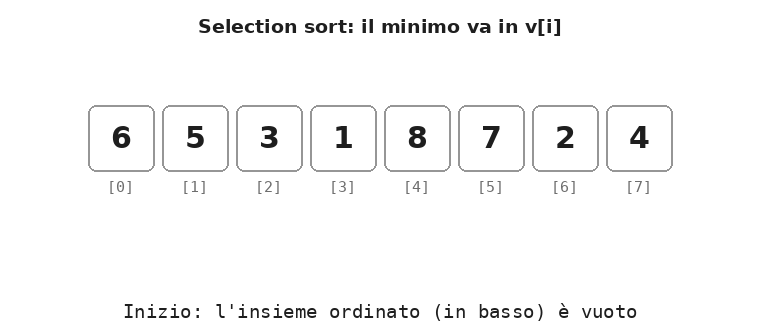
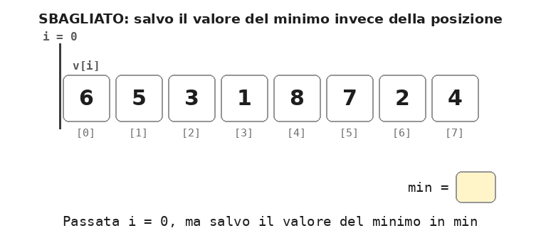
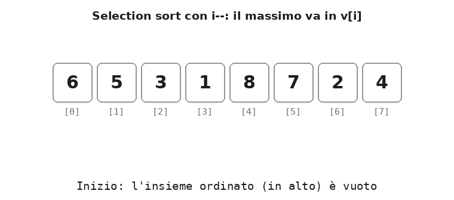

[← Indice delle dispense](indice.md)

# Dispensa: selection sort

10 novembre 2026

<a id="s1"></a>

## 1. L'idea

Il **selection sort** (ordinamento per selezione) a ogni passata **seleziona** il valore più piccolo della parte non ordinata e lo porta in fondo alla parte ordinata con un **solo scambio**.

Anche qui l'array è sempre diviso in **due insiemi**:

- l'**insieme ordinato**, in basso (a sinistra, indici piccoli): i valori più piccoli, già nella loro posizione **definitiva**;
- l'**insieme non ordinato**, in alto (a destra, indici grandi): i valori ancora da sistemare, in un ordine qualsiasi.

All'inizio l'insieme ordinato è vuoto. A ogni passata si cerca il minimo dell'insieme non ordinato e lo si scambia con il primo elemento dell'insieme non ordinato: l'insieme ordinato cresce di uno, quello non ordinato cala di uno. Dopo `N - 1` passate in alto resta un solo elemento, che è per forza il più grande: l'array è ordinato.

**Definizione.** Il *selection sort* ordina un array eseguendo `N - 1` passate; nella passata `i` cerca la posizione `pmin` del minimo tra `v[i] … v[N - 1]` e scambia `v[i]` con `v[pmin]`.

Rispetto agli altri due ordinamenti:

- come nel **bubble sort**, i valori dell'insieme ordinato sono già nella posizione finale e non si muovono più;
- a differenza del bubble sort, ogni passata fa **al massimo uno scambio**, tra due celle anche lontane, invece di tanti scambi tra vicini;
- a differenza dell'**insertion sort**, il valore che entra nell'insieme ordinato non viene inserito al suo posto con degli shift: viene scelto già giusto, perché è il minimo di ciò che resta.

L'animazione mostra l'ordinamento completo di 6 5 3 1 8 7 2 4. La linea verticale con l'etichetta `i` separa l'insieme ordinato (in verde) da quello non ordinato. In viola la cella `v[pmin]`, il minimo trovato finora, con il valore di `pmin` in basso a destra; in azzurro `v[j]`, l'elemento confrontato.

<p align="center">
  
</p>

<a id="s2"></a>

## 2. Passo per passo

Ogni riga mostra l'array **dopo** la passata `i`. La barra `|` separa l'insieme ordinato (a sinistra) da quello non ordinato (a destra).

| Passata `i` | Cerco il minimo in | `pmin` passa per | Minimo trovato | Scambio | Array dopo la passata |
| --- | --- | --- | --- | --- | --- |
| 0 | `v[0..7]` | 0 → 1 → 2 → 3 | 1 in `v[3]` | `v[0]` ↔ `v[3]` | 1 \| 5 3 6 8 7 2 4 |
| 1 | `v[1..7]` | 1 → 2 → 6 | 2 in `v[6]` | `v[1]` ↔ `v[6]` | 1 2 \| 3 6 8 7 5 4 |
| 2 | `v[2..7]` | 2 | 3 in `v[2]` | nessuno | 1 2 3 \| 6 8 7 5 4 |
| 3 | `v[3..7]` | 3 → 6 → 7 | 4 in `v[7]` | `v[3]` ↔ `v[7]` | 1 2 3 4 \| 8 7 5 6 |
| 4 | `v[4..7]` | 4 → 5 → 6 | 5 in `v[6]` | `v[4]` ↔ `v[6]` | 1 2 3 4 5 \| 7 8 6 |
| 5 | `v[5..7]` | 5 → 7 | 6 in `v[7]` | `v[5]` ↔ `v[7]` | 1 2 3 4 5 6 \| 8 7 |
| 6 | `v[6..7]` | 6 → 7 | 7 in `v[7]` | `v[6]` ↔ `v[7]` | 1 2 3 4 5 6 7 \| 8 |
| **Totale** | | | | **6 scambi** | **28 confronti** |

Nella passata 2 il minimo, il 3, è già in `v[2]`: `pmin` resta uguale a `i` e non serve nessuno scambio.

Lo scambio sposta lontano anche il valore che si trovava in `v[i]`. Nella passata 0, per esempio, il 6 finisce in `v[3]`, al posto dell'1: per lui non è ancora la posizione giusta, ci arriverà in una passata successiva.

<a id="s3"></a>

## 3. Il loop esterno: `i` è il separatore

Il loop esterno esegue le passate, e il suo indice `i` è direttamente il **separatore** tra i due insiemi:

- `v[0] … v[i - 1]` è l'**insieme ordinato** (in basso), con gli `i` valori più piccoli in posizione definitiva;
- `v[i] … v[N - 1]` è l'**insieme non ordinato** (in alto);
- `v[i]` è la cella che, alla fine della passata, riceverà il minimo.

```cpp
for (int i = 0; i < N - 1; i++) {
    // qui: v[0..i-1] ordinato e definitivo, v[i..N-1] non ordinato
    // la passata cerca il minimo di v[i..N-1] e lo mette in v[i]
}
```

Le passate sono `N - 1`: quando gli `N - 1` valori più piccoli sono al loro posto, quello che resta in `v[N - 1]` è il più grande ed è già sistemato.

La proprietà "*prima di ogni passata, `v[0..i-1]` contiene gli `i` valori più piccoli, in ordine*" è l'**invariante del ciclo**: è vera all'inizio (con `i = 0` l'insieme è vuoto), ogni passata la conserva e alla fine garantisce il risultato.

Qui il separatore vale `i` usando `i++`, perché l'insieme ordinato cresce dal basso. Nella variante della sezione 5, in cui l'insieme ordinato cresce dall'alto, il separatore vale di nuovo `i`, ma usando `i--`.

<a id="s4"></a>

## 4. Il loop interno: la ricerca del minimo

Il loop interno non sposta niente: **cerca** il minimo dell'insieme non ordinato. Lo scambio avviene una volta sola, dopo il ciclo.

```cpp
int pmin = i;                          // per ora il minimo è v[i]
for (int j = i + 1; j < N; j++)
    if (v[j] < v[pmin])
        pmin = j;                      // trovato un valore più piccolo: ricordo DOVE sta

if (pmin != i) {                       // scambio v[i] e v[pmin]
    int t = v[i];
    v[i] = v[pmin];
    v[pmin] = t;
}
```

La variabile `pmin` (posizione del minimo) parte da `i`: all'inizio il "minimo trovato finora" è il primo elemento dell'insieme non ordinato. Poi `j` scorre tutti gli altri e, ogni volta che trova un valore più piccolo, `pmin` si sposta su di lui.

### I limiti del ciclo interno: da `i + 1` a `N - 1`

- **`j = i + 1`**: `v[i]` è già stato "considerato" mettendo `pmin = i`, quindi si parte dal successivo. Partire da `j = i` farebbe solo un confronto inutile; partire da `j = 0` sarebbe un errore, perché si cercherebbe il minimo anche nella parte già ordinata.
- **`j < N`**: la ricerca deve arrivare fino all'ultimo elemento. A differenza del bubble sort non si legge `v[j + 1]`, quindi il limite è `N` e non `N - 1`.

| Passata `i` | `j` va da | a | Confronti |
| --- | --- | --- | --- |
| 0 | 1 | 7 | 7 |
| 1 | 2 | 7 | 6 |
| 2 | 3 | 7 | 5 |
| 3 | 4 | 7 | 4 |
| 4 | 5 | 7 | 3 |
| 5 | 6 | 7 | 2 |
| 6 | 7 | 7 | 1 |
| **Totale** | | | **28** |

### Focus: si salva la posizione, non il valore

Durante la ricerca si salva **dove** si trova il minimo (`pmin`), non **quanto** vale. È indispensabile per lo scambio: per mettere il minimo in `v[i]` bisogna anche spostare il vecchio `v[i]` nella cella in cui stava il minimo, e per farlo serve conoscere quella cella.

Un errore frequente è salvare il valore:

```cpp
// SBAGLIATO
int min = v[i];
for (int j = i + 1; j < N; j++)
    if (v[j] < min)
        min = v[j];
v[i] = min;          // e il vecchio v[i]? Non so dove metterlo
```

Nella passata 0 `min` diventa 1 e l'1 viene scritto in `v[0]`, ma il 6 che stava lì va perso, e l'1 resta anche in `v[3]`: l'array diventa 1 5 3 1 8 7 2 4. Con `pmin = 3` invece si sa che bisogna scambiare `v[0]` e `v[3]`. Il valore del minimo non serve salvarlo a parte, perché è sempre `v[pmin]`.

<p align="center">
  
</p>

### Lo scambio a distanza

Lo scambio è lo stesso del bubble sort, con la variabile d'appoggio `t`, ma tra due celle che possono essere **lontane**: `v[i]` e `v[pmin]`. Il controllo `if (pmin != i)` evita lo scambio quando il minimo è già al suo posto, come nella passata 2. Senza il controllo il programma resterebbe corretto, perché scambiare una cella con se stessa non cambia niente, ma farebbe 3 assegnamenti inutili.

<a id="s5"></a>

## 5. Il programma completo e la variante con il massimo in alto

```cpp
#include <iostream>
using namespace std;

const int N = 8;

void stampa(int v[], int n) {
    for (int i = 0; i < n; i++)
        cout << v[i] << " ";
    cout << endl;
}

int main() {
    int v[N] = {6, 5, 3, 1, 8, 7, 2, 4};

    cout << "Non ordinato: ";
    stampa(v, N);

    for (int i = 0; i < N - 1; i++) {            // loop esterno: i = separatore
        int pmin = i;
        for (int j = i + 1; j < N; j++)          // loop interno: ricerca del minimo
            if (v[j] < v[pmin])
                pmin = j;
        if (pmin != i) {                         // un solo scambio per passata
            int t = v[i];
            v[i] = v[pmin];
            v[pmin] = t;
        }
    }

    cout << "Ordinato:     ";
    stampa(v, N);
    return 0;
}
```

Output: `6 5 3 1 8 7 2 4` diventa `1 2 3 4 5 6 7 8`.

### Variante: il massimo in alto, con `i--`

Si può anche cercare il **massimo** dell'insieme non ordinato e portarlo **in cima**. In questo caso l'insieme ordinato si forma in alto, e conviene scrivere il loop esterno con `i--`: così `i` è di nuovo direttamente il separatore, cioè la cella che riceve il massimo della passata.

```cpp
for (int i = N - 1; i > 0; i--) {            // i = cella che riceve il massimo
    int pmax = 0;
    for (int j = 1; j <= i; j++)             // cerco il massimo in v[0..i]
        if (v[j] > v[pmax])
            pmax = j;
    if (pmax != i) {
        int t = v[i];
        v[i] = v[pmax];
        v[pmax] = t;
    }
}
```

Qui l'insieme ordinato è `v[i + 1] … v[N - 1]` e la ricerca riguarda `v[0] … v[i]`: `pmax` parte da 0 e `j` va da 1 fino a `i` compreso.

<p align="center">
  
</p>

| `i` | `pmax` | Scambio | Array dopo la passata |
| --- | --- | --- | --- |
| 7 | 4 (l'8) | `v[4]` ↔ `v[7]` | 6 5 3 1 4 7 2 \| 8 |
| 6 | 5 (il 7) | `v[5]` ↔ `v[6]` | 6 5 3 1 4 2 \| 7 8 |
| 5 | 0 (il 6) | `v[0]` ↔ `v[5]` | 2 5 3 1 4 \| 6 7 8 |
| 4 | 1 (il 5) | `v[1]` ↔ `v[4]` | 2 4 3 1 \| 5 6 7 8 |
| 3 | 1 (il 4) | `v[1]` ↔ `v[3]` | 2 1 3 \| 4 5 6 7 8 |
| 2 | 2 (il 3) | nessuno | 2 1 \| 3 4 5 6 7 8 |
| 1 | 0 (il 2) | `v[0]` ↔ `v[1]` | 1 \| 2 3 4 5 6 7 8 |

Le due versioni a confronto:

| | Minimo in basso | Massimo in alto |
| --- | --- | --- |
| Loop esterno | `for (i = 0; i < N - 1; i++)` | `for (i = N - 1; i > 0; i--)` |
| Insieme ordinato | in basso, `v[0..i-1]` | in alto, `v[i+1..N-1]` |
| Si cerca | il minimo in `v[i..N-1]` | il massimo in `v[0..i]` |
| Loop interno | `for (j = i + 1; j < N; j++)` | `for (j = 1; j <= i; j++)` |
| Confronto | `v[j] < v[pmin]` | `v[j] > v[pmax]` |
| Scambio | `v[i]` ↔ `v[pmin]` | `v[i]` ↔ `v[pmax]` |
| Confronti e scambi sull'esempio | 28 e 6 | 28 e 6 |

<a id="s6"></a>

## 6. Perché non ci si può fermare prima

Nel bubble sort una bandierina permette di fermarsi quando l'array è già ordinato. Nel selection sort no: per essere sicuri di aver trovato il minimo bisogna **guardare tutti** i valori rimasti, anche se sono già in ordine. Il numero di confronti è quindi sempre lo stesso, `N · (N - 1) / 2`, cioè 28 con `N = 8`. Cambia solo il numero di scambi:

| Array | Confronti | Scambi |
| --- | --- | --- |
| 6 5 3 1 8 7 2 4 | 28 | 6 |
| 1 2 3 4 5 6 7 8 (già ordinato) | 28 | 0 |
| 8 7 6 5 4 3 2 1 (al rovescio) | 28 | 4 |

Gli scambi sono al massimo `N - 1`, uno per passata. È il punto di forza del selection sort: scrive pochissimo nell'array.

<a id="s7"></a>

## 7. Il selection sort non è stabile

Un ordinamento è **stabile** se i valori uguali restano nell'ordine in cui erano all'inizio. Il selection sort non lo è, perché lo scambio a distanza può far "scavalcare" un valore uguale.

Esempio con due 5, chiamati 5a e 5b per distinguerli: 5a 5b 2.

| Passata | Minimo | Scambio | Array |
| --- | --- | --- | --- |
| inizio | | | 5a 5b 2 |
| 0 | 2 in `v[2]` | `v[0]` ↔ `v[2]` | 2 5b 5a |
| 1 | 5b in `v[1]` | nessuno | 2 5b 5a |

Alla fine 5b viene prima di 5a: l'ordine dei due 5 si è invertito. L'insertion sort e il bubble sort (con il confronto `>`) invece sono stabili, perché spostano i valori solo tra vicini e mai oltre un valore uguale.

<a id="s8"></a>

## 8. I tre algoritmi a confronto

Sullo stesso array 6 5 3 1 8 7 2 4:

| | Insertion sort | Bubble sort | Selection sort |
| --- | --- | --- | --- |
| Insieme ordinato | in basso, provvisorio | in alto, definitivo | in basso, definitivo |
| Ogni passata | inserisce `v[i]` al suo posto con degli shift | porta il massimo in cima con scambi tra vicini | cerca il minimo e lo scambia con `v[i]` |
| Confronti | 20 | 28 (27 con la bandierina) | 28, sempre |
| Spostamenti | 16 shift | 16 scambi | 6 scambi |
| Assegnamenti agli elementi dell'array | 30 | 48 | 18 |
| Confronti su un array già ordinato | 7 | 7 con la bandierina | 28 |
| Stabile | sì | sì | no |

Il selection sort fa sempre tanti confronti, ma è quello che scrive meno nell'array; l'insertion sort è il più veloce quando l'array è già quasi ordinato; il bubble sort è il più semplice da scrivere, ma in genere il più lento. Nel caso peggiore tutti e tre fanno circa `N² / 2` confronti.

<a id="s9"></a>

## 9. Errori tipici

| Errore | Effetto | Correzione |
| --- | --- | --- |
| Salvare il valore del minimo invece della posizione | un valore va perso e un altro compare due volte | salvare `pmin` e scambiare `v[i]` con `v[pmin]` |
| `pmin = 0` invece di `pmin = i` | il "minimo" resta `v[0]`, che è già nella parte ordinata: sull'esempio si ottiene 6 1 2 3 4 5 7 8 | `int pmin = i;` all'inizio di ogni passata |
| Ciclo interno che parte da `j = 0` | il minimo viene cercato anche nella parte ordinata: si ottiene 5 3 6 8 7 2 1 4 | `j = i + 1` |
| Ciclo interno con `j < N - 1` | l'ultimo elemento non viene mai considerato: si ottiene 1 2 3 5 6 7 8 4 | `j < N` |
| Scambio dentro il ciclo interno, a ogni nuovo minimo | il risultato è giusto, ma sull'esempio gli scambi diventano 16 invece di 6: si perde il vantaggio del selection sort | un solo scambio, dopo il ciclo interno |
| Scambio senza variabile d'appoggio | un valore viene perso e l'altro duplicato | `t = v[i]; v[i] = v[pmin]; v[pmin] = t;` |
| Nella variante con `i--`, ciclo interno con `j < i` | `v[i]` non viene confrontato: se il massimo è proprio lì, viene spostato via; sull'esempio si ottiene 1 3 2 4 5 6 7 8 | `j <= i` |
