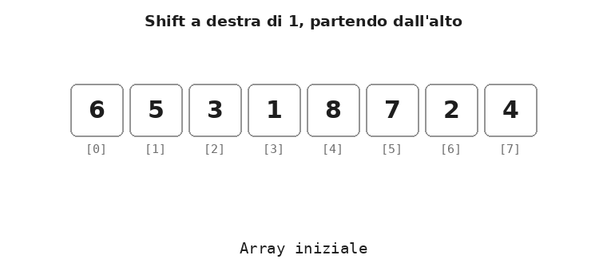
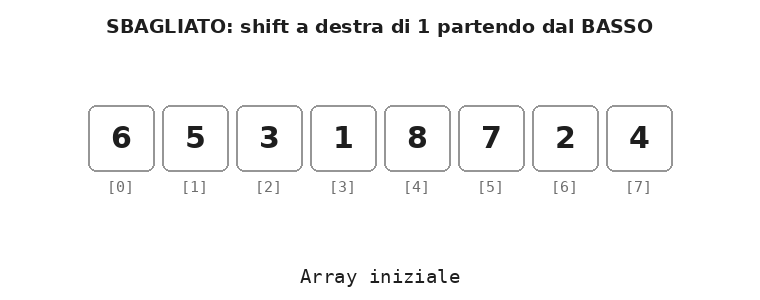
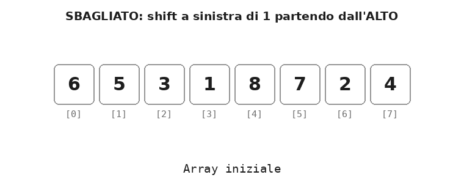
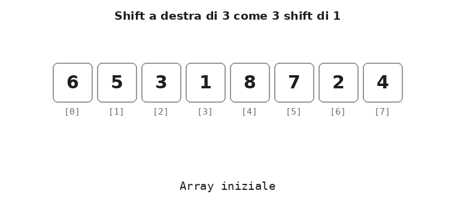
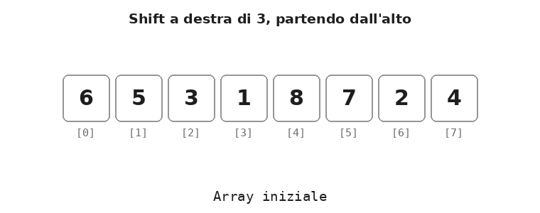
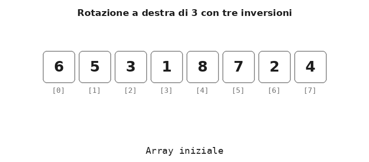
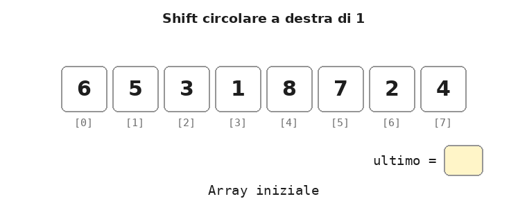
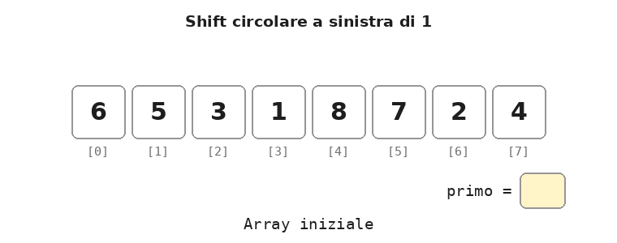
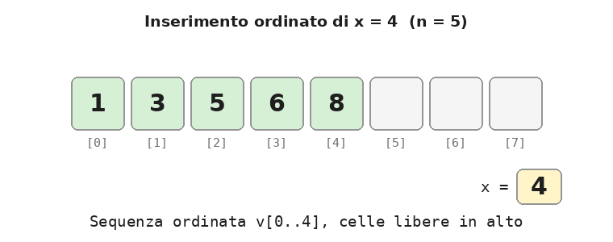
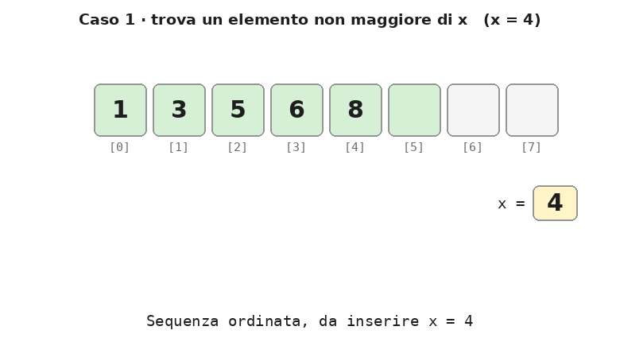

[← Indice delle dispense](indice.md)

# Dispensa: gli shift negli array

9 novembre 2026

<a id="s1"></a>

## 1. Che cos'è uno shift

Uno **shift** (scorrimento) sposta tutti i valori di un array di una posizione, verso destra o verso sinistra. Ogni valore viene copiato nella cella vicina: `v[i]` finisce in `v[i+1]` (shift a destra) oppure in `v[i-1]` (shift a sinistra).

In questa dispensa usiamo queste convenzioni:

- **basso** = inizio dell'array, indici piccoli (`v[0]`, `v[1]`, …);
- **alto** = fine dell'array, indici grandi (`v[N-1]`, `v[N-2]`, …);
- **destra** = verso l'alto; **sinistra** = verso il basso.

Quando si fa uno shift succedono sempre due cose:

1. un valore **esce** dall'array dal lato verso cui si sposta (va perso);
2. un posto dal lato opposto resta **scoperto**, cioè senza un nuovo valore.

Cosa mettere nei posti scoperti distingue i due tipi di shift:

| Tipo | Posti scoperti | Valori che escono |
| --- | --- | --- |
| Shift con valore di default | riempiti con un valore fisso (ad es. 0) | persi |
| Shift circolare | riempiti con i valori usciti dall'altro lato | rientrano, nessuno si perde |

In tutti gli esempi l'array è `int v[N]` con `N = 8`.

<a id="s2"></a>

## 2. Shift a destra con valore di default

**Regola: lo shift a destra si fa partendo dall'alto** (dall'ultimo indice verso il primo).

Esempio: shift a destra di `k = 1` posizione, posto scoperto riempito con 0.

| Indice | 0 | 1 | 2 | 3 | 4 | 5 | 6 | 7 |
| --- | --- | --- | --- | --- | --- | --- | --- | --- |
| Prima | 6 | 5 | 3 | 1 | 8 | 7 | 2 | 4 |
| Dopo | **0** | 6 | 5 | 3 | 1 | 8 | 7 | 2 |

<p align="center">
  
</p>

Il valore 4 esce dall'alto e va perso; il posto 0 è scoperto e riceve 0.

### Perché si parte dall'alto

Ogni copia `v[i] = v[i-1]` **sovrascrive** `v[i]`. Partendo dall'alto, la cella sovrascritta è già stata copiata più su, quindi il suo valore non serve più.

Se invece si partisse dal basso, `v[1] = v[0]` cancellerebbe il 5 prima che venga copiato in `v[2]`. Poi `v[2] = v[1]` copierebbe di nuovo il 6, e così via fino in cima. Alla fine il 6 sarebbe copiato su tutto l'array: 0 6 6 6 6 6 6 6.

L'animazione mostra l'errore: le celle in rosso alla fine sono i valori sbagliati.

<p align="center">
  
</p>

### Codice C++

```cpp
// 1) copia dall'alto verso il basso
for (int i = N - 1; i > 0; i--)
    v[i] = v[i - 1];

// 2) riempimento del posto scoperto
v[0] = 0;
```

Il ciclo si ferma a `i = 1`: con `i = 0` si leggerebbe `v[-1]`, fuori dall'array.

<a id="s3"></a>

## 3. Shift a sinistra con valore di default

**Regola: lo shift a sinistra si fa partendo dal basso** (dal primo indice verso l'ultimo). È la regola simmetrica di quella dello shift a destra.

Esempio: shift a sinistra di `k = 1` posizione, posto scoperto riempito con 0.

| Indice | 0 | 1 | 2 | 3 | 4 | 5 | 6 | 7 |
| --- | --- | --- | --- | --- | --- | --- | --- | --- |
| Prima | 6 | 5 | 3 | 1 | 8 | 7 | 2 | 4 |
| Dopo | 5 | 3 | 1 | 8 | 7 | 2 | 4 | **0** |

<p align="center">
  
</p>

Il valore 6 esce dal basso e va perso; il posto 7 è scoperto e riceve 0.

Anche qui il motivo è lo stesso: la copia `v[i] = v[i+1]` sovrascrive `v[i]`, e partendo dal basso quella cella è già stata copiata più giù (oppure è il valore che deve uscire).

Se invece si partisse dall'alto, `v[6] = v[7]` cancellerebbe il 2 prima che venga copiato in `v[5]`. Poi `v[5] = v[6]` copierebbe di nuovo il 4, e così via fino in fondo. Alla fine il 4 sarebbe copiato su tutto l'array: 4 4 4 4 4 4 4 0.

<p align="center">
  
</p>

### Codice C++

```cpp
// 1) copia dal basso verso l'alto
for (int i = 0; i < N - 1; i++)
    v[i] = v[i + 1];

// 2) riempimento del posto scoperto
v[N - 1] = 0;
```

Il ciclo si ferma a `i = N - 2`: con `i = N - 1` si leggerebbe `v[N]`, fuori dall'array.

### Regola da ricordare

| Shift | Da dove parte il ciclo | Copia |
| --- | --- | --- |
| A destra | dall'alto (`i = N-1` e scende fino a 1) | `v[i] = v[i-1]` |
| A sinistra | dal basso (`i = 0` e sale fino a N-2) | `v[i] = v[i+1]` |

In entrambi i casi **si parte dal lato verso cui i valori si spostano**.

<a id="s4"></a>

## 4. Shift di più posizioni

Uno shift a destra di 3 posizioni, con i posti scoperti riempiti con 0, trasforma 6 5 3 1 8 7 2 4 in **0 0 0 6 5 3 1 8**. Si può ottenere in due modi.

### Primo modo: tre shift di una posizione

Uno shift di `k` posizioni equivale a `k` shift di una posizione eseguiti uno dopo l'altro. Si riusa così il codice già visto, chiudendolo in un ciclo che lo ripete 3 volte.

| Situazione | Array |
| --- | --- |
| Iniziale | 6 5 3 1 8 7 2 4 |
| Dopo il 1° shift di 1 | 0 6 5 3 1 8 7 2 |
| Dopo il 2° shift di 1 | 0 0 6 5 3 1 8 7 |
| Dopo il 3° shift di 1 | 0 0 0 6 5 3 1 8 |

<p align="center">
  
</p>

```cpp
for (int volta = 0; volta < 3; volta++) {
    for (int i = N - 1; i > 0; i--)   // shift di una posizione, dall'alto
        v[i] = v[i - 1];
    v[0] = 0;                         // posto scoperto
}
```

È semplice da capire, ma lavora molto: a ogni ripetizione ricopia quasi tutto l'array. Con `N = 8` fa 3 × 7 = 21 copie più 3 zeri, cioè **24 assegnamenti**.

### Secondo modo: shift diretto di k posizioni

Questa è la soluzione usata nei testi di algoritmi: ogni valore salta **direttamente** di `k` posizioni con un'unica copia, `v[i] = v[i-k]`. La regola resta la stessa: lo shift a destra parte dall'alto.

```cpp
const int K = 3;

// 1) ogni valore salta di K posizioni, partendo dall'alto
for (int i = N - 1; i >= K; i--)
    v[i] = v[i - K];

// 2) i K posti scoperti in basso ricevono 0
for (int i = 0; i < K; i++)
    v[i] = 0;
```

<p align="center">
  
</p>

Con `N = 8` fa 5 copie più 3 zeri, cioè **8 assegnamenti**: uno per cella. Lo shift a sinistra di `K` è simmetrico: si parte dal basso con `v[i] = v[i+K]` per `i` da 0 a `N-K-1`, poi `v[N-K] … v[N-1]` ricevono 0.

| Metodo | Assegnamenti (N = 8, K = 3) | In generale |
| --- | --- | --- |
| K shift di una posizione | 24 | circa K × N |
| Shift diretto di K | 8 | N, qualunque sia K |

Il costo dello shift diretto non cresce con `K`: per questo è il metodo preferito. Se `K >= N` tutti i valori escono e l'array diventa tutto 0.

### E lo shift circolare di k posizioni?

Nella rotazione nessun valore deve andare perso, quindi la copia diretta `v[i] = v[i-k]` non basta: i `k` valori che escono andrebbero salvati in un array d'appoggio. La tecnica classica che evita l'array d'appoggio è quella delle **tre inversioni**, resa celebre da Jon Bentley in *Programming Pearls* (colonna 2). Per ruotare a destra di `K`:

1. si inverte tutto l'array;
2. si invertono i primi `K` elementi;
3. si invertono i restanti `N - K`.

| Passo | Array |
| --- | --- |
| Iniziale | 6 5 3 1 8 7 2 4 |
| 1) Inverto tutto | 4 2 7 8 1 3 5 6 |
| 2) Inverto i primi 3 | 7 2 4 8 1 3 5 6 |
| 3) Inverto gli altri 5 | 7 2 4 6 5 3 1 8 |

<p align="center">
  
</p>

```cpp
void inverti(int v[], int da, int a) {
    for (int i = da, j = a; i < j; i++, j--) {
        int t = v[i];
        v[i] = v[j];
        v[j] = t;
    }
}

inverti(v, 0, N - 1);   // 1) tutto
inverti(v, 0, K - 1);   // 2) primi K
inverti(v, K, N - 1);   // 3) restanti
```

Ogni elemento viene scambiato al massimo due volte, quindi anche qui il costo è proporzionale a `N` e non dipende da `K`.

<a id="s5"></a>

## 5. Shift circolari

Nello **shift circolare** (o rotazione) i valori che escono da un lato rientrano dall'altro: nessun valore si perde e i posti scoperti vengono riempiti proprio con loro.

La tecnica per una posizione ha tre passi:

1. **salvare** in una variabile il valore che sta per uscire;
2. fare lo **shift normale** di una posizione, con la regola della sezione precedente;
3. **rimettere** il valore salvato nel posto scoperto.

### Shift circolare a destra di 1

Esce `v[N-1]`, che rientra in `v[0]`.

| Indice | 0 | 1 | 2 | 3 | 4 | 5 | 6 | 7 |
| --- | --- | --- | --- | --- | --- | --- | --- | --- |
| Prima | 6 | 5 | 3 | 1 | 8 | 7 | 2 | 4 |
| Dopo | **4** | 6 | 5 | 3 | 1 | 8 | 7 | 2 |

<p align="center">
  
</p>

```cpp
int ultimo = v[N - 1];          // 1) salvo chi esce
for (int i = N - 1; i > 0; i--) // 2) shift dall'alto
    v[i] = v[i - 1];
v[0] = ultimo;                  // 3) rientra in basso
```

### Shift circolare a sinistra di 1

Esce `v[0]`, che rientra in `v[N-1]`.

| Indice | 0 | 1 | 2 | 3 | 4 | 5 | 6 | 7 |
| --- | --- | --- | --- | --- | --- | --- | --- | --- |
| Prima | 6 | 5 | 3 | 1 | 8 | 7 | 2 | 4 |
| Dopo | 5 | 3 | 1 | 8 | 7 | 2 | 4 | **6** |

<p align="center">
  
</p>

```cpp
int primo = v[0];               // 1) salvo chi esce
for (int i = 0; i < N - 1; i++) // 2) shift dal basso
    v[i] = v[i + 1];
v[N - 1] = primo;               // 3) rientra in alto
```

<a id="s6"></a>

## 6. Applicazione: l'inserimento ordinato

**Definizione.** L'*inserimento ordinato* è l'operazione che aggiunge un nuovo valore `x` a una sequenza **già ordinata** di `n` elementi, collocandolo nella posizione corretta, in modo che dopo l'inserimento la sequenza di `n+1` elementi sia ancora ordinata.

L'array deve avere almeno una cella libera in alto (cioè `n < N`), perché la sequenza cresce di un elemento.

### Le fasi

1. **Ricerca del posto giusto**: si trova l'indice `p` del primo elemento maggiore di `x`. Se nessun elemento è maggiore, `p = n` (`x` va in coda).
2. **Shift a destra** di una posizione degli elementi da `v[p]` a `v[n-1]`, **partendo dall'alto**. Così il posto `v[p]` resta libero.
3. **Inserimento**: si scrive `x` nel posto liberato, `v[p] = x`.
4. **Aggiornamento della dimensione**: `n++`.

### Esempio

Sequenza ordinata 1 3 5 6 8 (`n = 5`), valore da inserire `x = 4`.

| Fase | 0 | 1 | 2 | 3 | 4 | 5 |
| --- | --- | --- | --- | --- | --- | --- |
| Situazione iniziale | 1 | 3 | 5 | 6 | 8 | – |
| 1) Ricerca: primo maggiore di 4 è 5, quindi `p = 2` | 1 | 3 | **5** | 6 | 8 | – |
| 2) Shift a destra di `v[2..4]` | 1 | 3 | \_ | 5 | 6 | 8 |
| 3) Inserimento `v[2] = 4` | 1 | 3 | **4** | 5 | 6 | 8 |

<p align="center">
  
</p>

### Codice C++ con le fasi separate

```cpp
// 1) ricerca del posto giusto
int p;
for (p = 0; p < n && v[p] <= x; p++)
    ;   // corpo vuoto: il for serve solo a far avanzare p

// 2) shift a destra di una posizione, dall'alto
for (int i = n; i > p; i--)
    v[i] = v[i - 1];

// 3) inserimento
v[p] = x;

// 4) aggiornamento della dimensione
n++;
```

La condizione del primo `for` ha due parti, con ruoli diversi:

- `p < n` è la **guardia di fine corsa**: impedisce di andare oltre l'ultimo elemento (in letteratura si parla di *condizione di guardia*, o di *controllo dei limiti*; in inglese *bounds check*);
- `v[p] <= x` è la **condizione di avanzamento** (o di permanenza nel ciclo): `p` va avanti finché il valore la rispetta.

All'uscita `p` è il **primo indice che rompe la condizione di avanzamento** (o di permanenza), cioè l'indice successivo all'ultimo valore `<= x`: è proprio il posto di `x`. Se nessun valore la rompe, `p` si ferma sul fine corsa, `n`, e `x` va in coda.

### Versione compatta: ricerca e shift insieme

La ricerca si può fare anche **dall'alto**, scorrendo la sequenza da `v[n-1]` verso il basso. Ogni elemento maggiore di `x` incontrato viene subito spostato a destra; ci si ferma al primo elemento non maggiore. Le fasi 1 e 2 diventano un solo ciclo.

```cpp
int j;                                   // dichiarata fuori: serve dopo il for
for (j = n - 1; j >= 0 && v[j] > x; j--)
    v[j + 1] = v[j];                     // shift a destra, la ricerca scende con j--
v[j + 1] = x;                            // inserimento
n++;
```

Il `for` riunisce partenza dall'alto (`j = n - 1`), condizione (`j >= 0 && v[j] > x`) e discesa (`j--`). Nella condizione `j >= 0` è la **guardia di fine corsa** (scendendo, la corsa finisce dopo `v[0]`) e `v[j] > x` è la **condizione di avanzamento**. All'uscita `j` è il primo indice che, scendendo, rompe la condizione di avanzamento (o di permanenza), oppure -1, il fine corsa: `x` va subito sopra, in `v[j + 1]`. La variabile `j` va dichiarata **prima** del `for`, perché serve ancora nella riga `v[j + 1] = x`.

È esattamente il ciclo interno dell'**insertion sort**: l'ordinamento ripete l'inserimento ordinato per ogni elemento dell'array.

Usare `>` e non `>=` rende l'inserimento **stabile**: un valore uguale a uno già presente viene messo dopo di esso.

### Focus: perché si inserisce in `v[j + 1]`

La chiave è il **buco**, cioè la cella libera in cui finirà `x`. Durante tutto il ciclo vale questa regola: **il buco è sempre `v[j + 1]`**.

1. **All'inizio** `j = n - 1`, quindi `j + 1 = n`: il buco è la prima cella libera in alto.
2. **A ogni passo** `v[j]` è maggiore di `x` e viene copiato nel buco con `v[j + 1] = v[j]`. Ora è `v[j]` a contenere una copia inutile: è lui il nuovo buco. Con `j--` l'indice scende di uno e il buco torna a essere `v[j + 1]`.
3. **Alla fine** il ciclo si ferma e il buco è ancora in `v[j + 1]`. Lì va `x`.

In altre parole, `j` indica l'elemento che si sta confrontando con `x`, e `j + 1` la cella libera subito sopra di lui. I due scendono insieme.

L'animazione mostra i tre modi in cui il ciclo può fermarsi, con `x = 4`, `x = 0` e `x = 9`. Nel momento del blocco compaiono la freccia rossa su `j` e la condizione calcolata con i valori di quel momento.

<p align="center">
  
</p>

### Perché `v[j + 1]` è il posto giusto

Quando il ciclo si ferma, la sequenza è divisa in due parti attorno al buco:

- sotto il buco, da `v[0]` a `v[j]`, ci sono i valori **minori o uguali** a `x`: non sono stati toccati;
- sopra il buco, da `v[j + 2]` a `v[n]`, ci sono i valori **maggiori** di `x`: sono stati spostati in su di una posizione.

Mettendo `x` nel buco l'ordine è rispettato su entrambi i lati. Con la sequenza 1 3 5 6 8 il ciclo si può fermare in tre modi, e la stessa istruzione `v[j + 1] = x` funziona in tutti:

| Caso | `x` | Dove si ferma `j` | Perché si ferma | `x` va in | Risultato |
| --- | --- | --- | --- | --- | --- |
| Trova un elemento non maggiore di `x` | 4 | `j = 1` (`v[1] = 3`) | `3 > 4` è falso | `v[2]` | 1 3 4 5 6 8 |
| `x` è il più piccolo di tutti | 0 | `j = -1` | `j >= 0` è falso | `v[0]` | 0 1 3 5 6 8 |
| `x` è il più grande di tutti | 9 | `j = 4` (`v[4] = 8`), nessuno shift | `8 > 9` è falso | `v[5]`, in coda | 1 3 5 6 8 9 |

Nel secondo caso si vede perché non si può scrivere `v[j] = x`: con `j = -1` si scriverebbe fuori dall'array.

### Come fa `j` a diventare -1 se la condizione è `j >= 0`?

Proprio perché `j >= 0` è la condizione per **continuare**, il ciclo si ferma sul primo valore di `j` che la rende falsa, cioè -1. In un `for` il controllo viene fatto **prima** di ogni giro, il `j--` **alla fine**:

```
inizializzazione → controllo → corpo → j-- → controllo → corpo → j-- → controllo → ...
```

Con `j = 0` il controllo è ancora vero; se anche `v[0] > x`, si esegue lo shift e poi `j--` porta `j` a -1. Il controllo successivo è falso e il ciclo esce. Ecco gli ultimi momenti dell'inserimento di `x = 0` in 1 3 5 6 8, quando 8, 6, 5 e 3 sono già stati spostati in su:

| Momento | `j` | Controllo `j >= 0 && v[j] > x` | Cosa succede |
| --- | --- | --- | --- |
| dopo il `j--` precedente | 0 | `0 >= 0` vero, `1 > 0` vero | si entra nel corpo |
| corpo | 0 | | `v[1] = v[0]`: shift dell'1 |
| `j--` | -1 | | |
| controllo | -1 | `-1 >= 0` falso | **stop**, `v[-1]` non viene letto |
| dopo il ciclo | -1 | | `v[j + 1] = v[0] = 0` |

`j = -1` non è un errore: è il valore con cui il ciclo esce, e serve, perché `v[j + 1]` diventa `v[0]`, il posto giusto per il valore più piccolo.

### La valutazione a corto circuito

`v[-1]` non viene mai letto grazie alla **valutazione a corto circuito** (*short-circuit evaluation*) degli operatori logici `&&` e `||`: il secondo operando viene valutato solo se serve a decidere il risultato.

- con `a && b`, se `a` è falso il risultato è sicuramente falso e `b` **non viene valutato**;
- con `a || b`, se `a` è vero il risultato è sicuramente vero e `b` **non viene valutato**.

Per questo l'ordine delle condizioni conta:

```cpp
j >= 0 && v[j] > x    // corretto: con j = -1 si ferma prima di leggere v[-1]
v[j] > x && j >= 0    // sbagliato: con j = -1 legge v[-1], fuori dall'array
j >= 0 & v[j] > x     // sbagliato: & (bit a bit) valuta sempre entrambi i lati
```

In generale la **guardia di fine corsa** va sempre scritta **prima** della condizione di avanzamento. Lo stesso vale per la ricerca della versione a fasi separate, `p < n && v[p] <= x`: quando `p` arriva a `n` il ciclo si ferma prima di leggere `v[n]`, che non fa parte della sequenza.

### L'errore tipico: `v[j] = x`

Con `x = 4`, dopo gli shift l'array è `1 3 5 5 6 8`, con `j = 1` e il buco in `v[2]`. Scrivendo `v[j] = x` il 4 finisce in `v[1]`: il 3 viene cancellato e in `v[2]` resta la copia inutile del 5. Il risultato è `1 4 5 5 6 8`, che ha perso il 3. Con `v[j + 1] = x` invece si ottiene `1 3 4 5 6 8`.

Regola da ricordare: **`j` si ferma sull'ultimo elemento da lasciare dov'è; `x` va subito sopra, in `j + 1`.**

<a id="s7"></a>

## 7. Errori tipici

| Errore | Effetto | Correzione |
| --- | --- | --- |
| Shift a destra partendo dal basso | il primo valore viene copiato su tutto l'array | far partire il ciclo da `N-1` e scendere |
| Shift a sinistra partendo dall'alto | l'ultimo valore viene copiato su tutto l'array | far partire il ciclo da `0` e salire |
| Limiti del ciclo sbagliati | lettura di `v[-1]` o `v[N]`, fuori dall'array | a destra `i > 0`, a sinistra `i < N-1` |
| Shift circolare senza salvare il valore | il valore che esce va perso | salvarlo in una variabile **prima** dello shift |
| Inserimento ordinato in un array pieno | scrittura di `v[N]` | controllare `n < N` prima di inserire |
| Condizione `v[j] > x && j >= 0` | legge `v[-1]` quando `j` arriva a -1 | mettere prima il controllo sul limite (valutazione a corto circuito): `j >= 0 && v[j] > x` |
