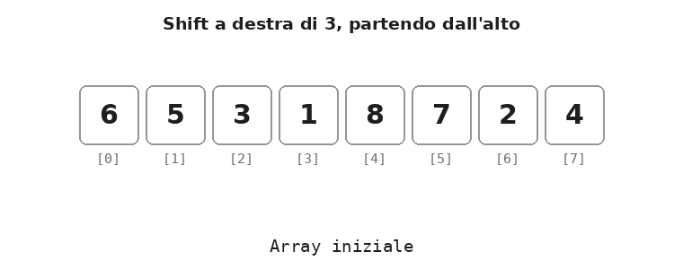
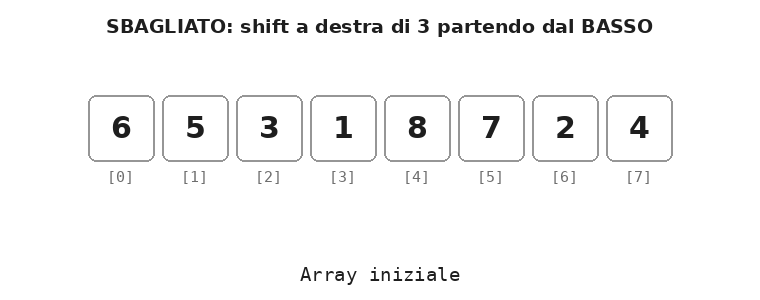
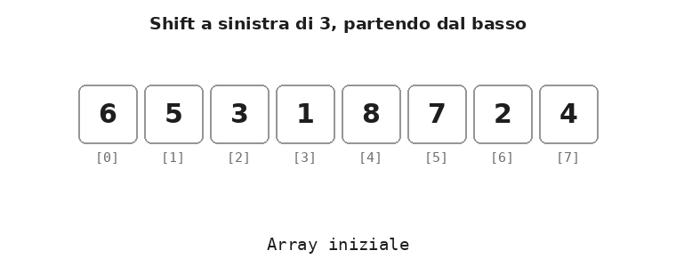
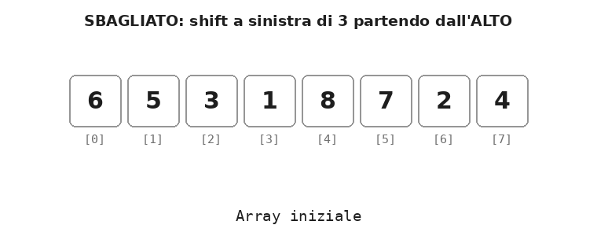

# Dispensa: gli shift negli array

9 novembre 2026

## 1. Che cos'è uno shift

Uno **shift** (scorrimento) sposta tutti i valori di un array di un certo numero di posizioni, verso destra o verso sinistra. Ogni valore viene copiato in una cella vicina: `v[i]` finisce in `v[i+k]` (shift a destra) oppure in `v[i-k]` (shift a sinistra).

In questa dispensa usiamo queste convenzioni:

- **basso** = inizio dell'array, indici piccoli (`v[0]`, `v[1]`, …);
- **alto** = fine dell'array, indici grandi (`v[N-1]`, `v[N-2]`, …);
- **destra** = verso l'alto; **sinistra** = verso il basso.

Quando si fa uno shift succedono sempre due cose:

1. alcuni valori **escono** dall'array dal lato verso cui si sposta (vanno persi);
2. alcuni posti dal lato opposto restano **scoperti**, cioè senza un nuovo valore.

Cosa mettere nei posti scoperti distingue i due tipi di shift:

| Tipo | Posti scoperti | Valori che escono |
| --- | --- | --- |
| Shift con valore di default | riempiti con un valore fisso (ad es. 0) | persi |
| Shift circolare | riempiti con i valori usciti dall'altro lato | rientrano, nessuno si perde |

In tutti gli esempi l'array è `int v[N]` con `N = 8`.

## 2. Shift a destra con valore di default

**Regola: lo shift a destra si fa partendo dall'alto** (dall'ultimo indice verso il primo).

Esempio: shift a destra di `k = 3` posizioni, posti scoperti riempiti con 0.

| Indice | 0 | 1 | 2 | 3 | 4 | 5 | 6 | 7 |
| --- | --- | --- | --- | --- | --- | --- | --- | --- |
| Prima | 6 | 5 | 3 | 1 | 8 | 7 | 2 | 4 |
| Dopo | **0** | **0** | **0** | 6 | 5 | 3 | 1 | 8 |

<p align="center">
  
</p>

I valori 7, 2, 4 escono dall'alto e vanno persi; i posti 0, 1, 2 sono scoperti e ricevono 0.

### Perché si parte dall'alto

Ogni copia `v[i] = v[i-k]` **sovrascrive** `v[i]`. Partendo dall'alto, la cella sovrascritta è già stata copiata più su, quindi il suo valore non serve più.

Se invece si partisse dal basso, `v[3] = v[0]` cancellerebbe il valore 1 prima che venga copiato in `v[6]`. Alla fine l'array conterrebbe solo copie ripetute dei primi valori: 0 0 0 6 5 3 6 5.

L'animazione mostra l'errore: le celle in rosso alla fine sono i valori sbagliati.

<p align="center">
  
</p>

### Codice C++

```cpp
const int N = 8;
const int K = 3;

// 1) copia dall'alto verso il basso
for (int i = N - 1; i >= K; i--)
    v[i] = v[i - K];

// 2) riempimento dei posti scoperti
for (int i = 0; i < K; i++)
    v[i] = 0;
```

Caso particolare frequente: shift di **una** posizione (`K = 1`) con `v[i] = v[i-1]` e `v[0] = 0`.

## 3. Shift a sinistra con valore di default

**Regola: lo shift a sinistra si fa partendo dal basso** (dal primo indice verso l'ultimo). È la regola simmetrica di quella dello shift a destra.

Esempio: shift a sinistra di `k = 3` posizioni, posti scoperti riempiti con 0.

| Indice | 0 | 1 | 2 | 3 | 4 | 5 | 6 | 7 |
| --- | --- | --- | --- | --- | --- | --- | --- | --- |
| Prima | 6 | 5 | 3 | 1 | 8 | 7 | 2 | 4 |
| Dopo | 1 | 8 | 7 | 2 | 4 | **0** | **0** | **0** |

<p align="center">
  
</p>

I valori 6, 5, 3 escono dal basso e vanno persi; i posti 5, 6, 7 sono scoperti e ricevono 0.

Anche qui il motivo è lo stesso: la copia `v[i] = v[i+k]` sovrascrive `v[i]`, e partendo dal basso quella cella è già stata copiata più giù (oppure è un valore che deve uscire).

Se invece si partisse dall'alto, `v[4] = v[7]` cancellerebbe l'8 prima che venga copiato in `v[1]`. Il risultato sarebbe 2 4 7 2 4 0 0 0 invece di 1 8 7 2 4 0 0 0.

<p align="center">
  
</p>

### Codice C++

```cpp
// 1) copia dal basso verso l'alto
for (int i = 0; i < N - K; i++)
    v[i] = v[i + K];

// 2) riempimento dei posti scoperti
for (int i = N - K; i < N; i++)
    v[i] = 0;
```

### Regola da ricordare

| Shift | Da dove parte il ciclo | Copia |
| --- | --- | --- |
| A destra | dall'alto (`i = N-1` e scende) | `v[i] = v[i-k]` |
| A sinistra | dal basso (`i = 0` e sale) | `v[i] = v[i+k]` |

In entrambi i casi **si parte dal lato verso cui i valori si spostano**.

## 4. Shift circolari

Nello **shift circolare** (o rotazione) i valori che escono da un lato rientrano dall'altro: nessun valore si perde e i posti scoperti vengono riempiti proprio con loro.

La tecnica per una posizione ha tre passi:

1. **salvare** in una variabile il valore che sta per uscire;
2. fare lo **shift normale** di una posizione, con la regola della sezione precedente;
3. **rimettere** il valore salvato nel posto scoperto.

### Shift circolare a destra di 1

Esce `v[N-1]`, che rientra in `v[0]`.

| Indice | 0 | 1 | 2 | 3 | 4 | 5 | 6 | 7 |
| --- | --- | --- | --- | --- | --- | --- | --- | --- |
| Prima | 6 | 5 | 3 | 1 | 8 | 7 | 2 | 4 |
| Dopo | **4** | 6 | 5 | 3 | 1 | 8 | 7 | 2 |

<p align="center">
  
</p>

```cpp
int ultimo = v[N - 1];          // 1) salvo chi esce
for (int i = N - 1; i > 0; i--) // 2) shift dall'alto
    v[i] = v[i - 1];
v[0] = ultimo;                  // 3) rientra in basso
```

### Shift circolare a sinistra di 1

Esce `v[0]`, che rientra in `v[N-1]`.

| Indice | 0 | 1 | 2 | 3 | 4 | 5 | 6 | 7 |
| --- | --- | --- | --- | --- | --- | --- | --- | --- |
| Prima | 6 | 5 | 3 | 1 | 8 | 7 | 2 | 4 |
| Dopo | 5 | 3 | 1 | 8 | 7 | 2 | 4 | **6** |

<p align="center">
  
</p>

```cpp
int primo = v[0];               // 1) salvo chi esce
for (int i = 0; i < N - 1; i++) // 2) shift dal basso
    v[i] = v[i + 1];
v[N - 1] = primo;               // 3) rientra in alto
```

### Shift circolare di k posizioni

Il modo più semplice è ripetere `k` volte lo shift di una posizione. Ad esempio, una rotazione a destra di 3 trasforma 6 5 3 1 8 7 2 4 in 7 2 4 6 5 3 1 8.

```cpp
for (int volta = 0; volta < K; volta++) {
    int ultimo = v[N - 1];
    for (int i = N - 1; i > 0; i--)
        v[i] = v[i - 1];
    v[0] = ultimo;
}
```

Ruotare di `N` posizioni riporta l'array com'era: per questo basta ruotare di `k % N`.

## 5. Applicazione: l'inserimento ordinato

**Definizione.** L'*inserimento ordinato* è l'operazione che aggiunge un nuovo valore `x` a una sequenza **già ordinata** di `n` elementi, collocandolo nella posizione corretta, in modo che dopo l'inserimento la sequenza di `n+1` elementi sia ancora ordinata.

L'array deve avere almeno una cella libera in alto (cioè `n < N`), perché la sequenza cresce di un elemento.

### Le fasi

1. **Ricerca del posto giusto**: si trova l'indice `p` del primo elemento maggiore di `x`. Se nessun elemento è maggiore, `p = n` (`x` va in coda).
2. **Shift a destra** di una posizione degli elementi da `v[p]` a `v[n-1]`, **partendo dall'alto**. Così il posto `v[p]` resta libero.
3. **Inserimento**: si scrive `x` nel posto liberato, `v[p] = x`.
4. **Aggiornamento della dimensione**: `n++`.

### Esempio

Sequenza ordinata 1 3 5 6 8 (`n = 5`), valore da inserire `x = 4`.

| Fase | 0 | 1 | 2 | 3 | 4 | 5 |
| --- | --- | --- | --- | --- | --- | --- |
| Situazione iniziale | 1 | 3 | 5 | 6 | 8 | – |
| 1) Ricerca: primo maggiore di 4 è 5, quindi `p = 2` | 1 | 3 | **5** | 6 | 8 | – |
| 2) Shift a destra di `v[2..4]` | 1 | 3 | \_ | 5 | 6 | 8 |
| 3) Inserimento `v[2] = 4` | 1 | 3 | **4** | 5 | 6 | 8 |

<p align="center">
  
</p>

### Codice C++ con le fasi separate

```cpp
// 1) ricerca del posto giusto
int p = 0;
while (p < n && v[p] <= x)
    p++;

// 2) shift a destra di una posizione, dall'alto
for (int i = n; i > p; i--)
    v[i] = v[i - 1];

// 3) inserimento
v[p] = x;

// 4) aggiornamento della dimensione
n++;
```

### Versione compatta: ricerca e shift insieme

La ricerca si può fare anche **dall'alto**, scorrendo la sequenza da `v[n-1]` verso il basso. Ogni elemento maggiore di `x` incontrato viene subito spostato a destra; ci si ferma al primo elemento non maggiore. Le fasi 1 e 2 diventano un solo ciclo.

```cpp
int j = n - 1;
while (j >= 0 && v[j] > x) {
    v[j + 1] = v[j];   // shift a destra
    j--;               // ricerca verso il basso
}
v[j + 1] = x;          // inserimento
n++;
```

È esattamente il ciclo interno dell'**insertion sort**: l'ordinamento ripete l'inserimento ordinato per ogni elemento dell'array (vedi la dispensa sull'insertion sort).

Usare `>` e non `>=` rende l'inserimento **stabile**: un valore uguale a uno già presente viene messo dopo di esso.

## 6. Errori tipici

| Errore | Effetto | Correzione |
| --- | --- | --- |
| Shift a destra partendo dal basso | il primo valore viene copiato su tutto l'array | far partire il ciclo da `N-1` e scendere |
| Shift a sinistra partendo dall'alto | l'ultimo valore viene copiato su tutto l'array | far partire il ciclo da `0` e salire |
| Limiti del ciclo sbagliati | lettura di `v[-1]` o `v[N]`, fuori dall'array | a destra `i > 0` (o `i >= K`), a sinistra `i < N-1` (o `i < N-K`) |
| Shift circolare senza salvare il valore | il valore che esce va perso | salvarlo in una variabile **prima** dello shift |
| Inserimento ordinato in un array pieno | scrittura di `v[N]` | controllare `n < N` prima di inserire |
| Condizione `v[j] > x && j >= 0` | legge `v[-1]` quando `j` arriva a -1 | mettere prima il controllo sul limite: `j >= 0 && v[j] > x` |
