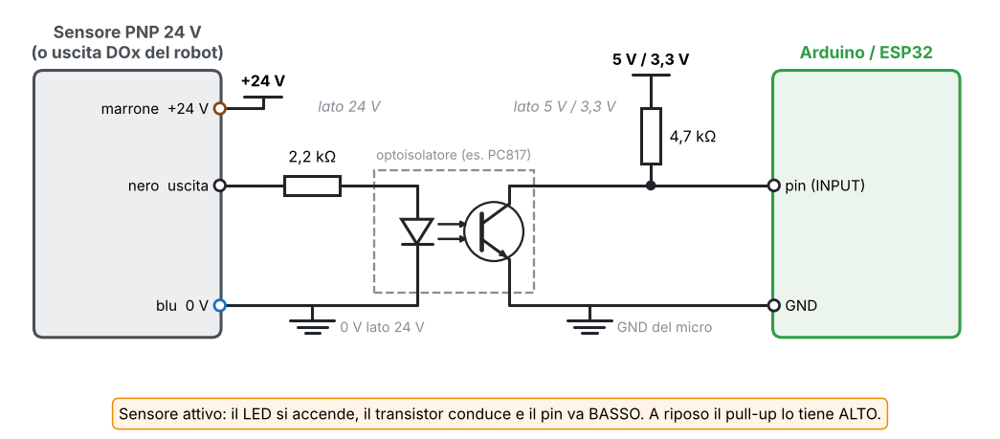
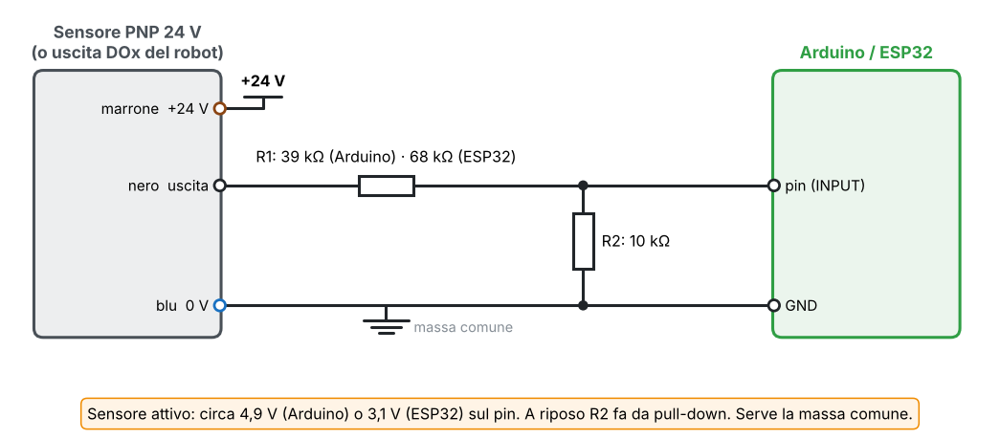
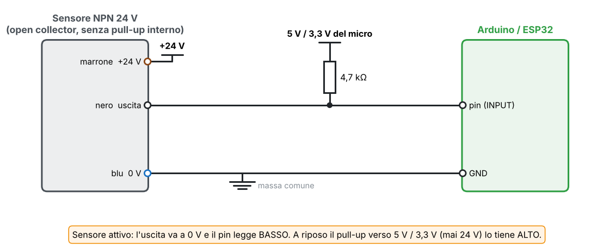
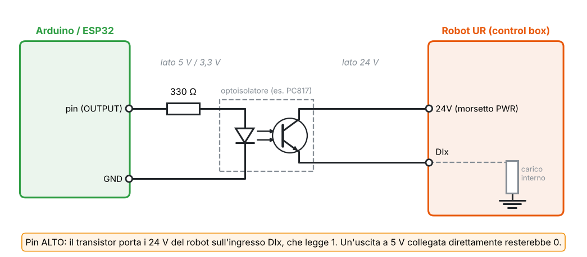
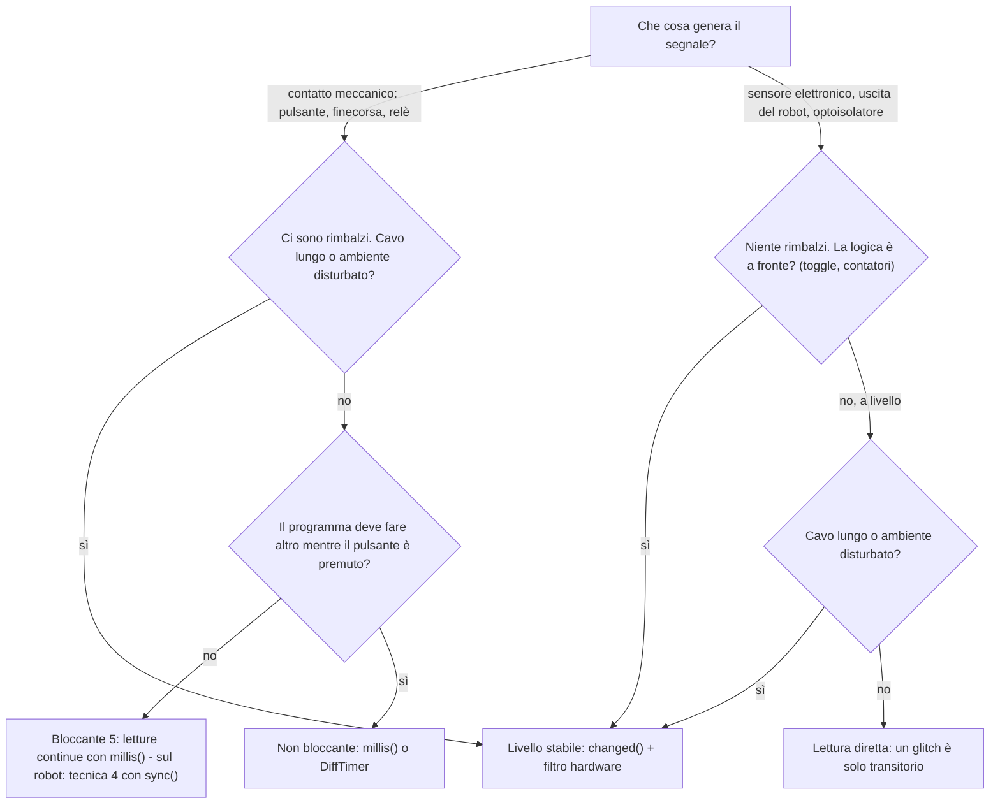

>[Torna all'indice](indexpulsanti.md)

# Interfacce digitali a confronto: Arduino, ESP32 e robot UR

Lo stesso pulsante, o lo stesso sensore, può essere letto da ingressi molto diversi: il pin di un
Arduino UNO a 5 V, il pin di un ESP32 a 3,3 V, l'ingresso a 24 V di un robot UR. La parte elettrica
decide **quali disturbi arrivano al programma**, e quindi quale tecnica antirimbalzo serve davvero.
Questa dispensa mette a confronto i tre ingressi, i tipi di sensori a 24 V e a 5 V, i modi per
collegarli fra loro, e porta alla scelta della tecnica software.

> Tecniche software: [pulsanti-bloccanti.md](pulsanti-bloccanti.md) (attese bloccanti), [pulsanti-rilascio.md](pulsanti-rilascio.md) (non bloccanti, compresa `changed()` a livello stabile)

## 1. I tre ingressi a confronto

| | Arduino UNO (ATmega328P) | ESP32 | Robot UR (control box) |
| --- | --- | --- | --- |
| Tensione dei segnali | 5 V | 3,3 V | 24 V |
| Letto come basso (0) | fino a 0,3 × 5 V = **1,5 V** | fino a 0,25 × 3,3 V ≈ **0,8 V** | fino a **5 V** |
| Letto come alto (1) | da 0,6 × 5 V = **3 V** | da 0,75 × 3,3 V ≈ **2,5 V** | da **11 V** |
| Zona incerta | 1,5 – 3 V | 0,8 – 2,5 V | 5 – 11 V |
| Tensione massima sul pin | 5,5 V | 3,6 V: **non tollera i 5 V** | 30 V |
| Corrente assorbita dall'ingresso | al massimo 1 µA | al massimo 50 nA | **2 – 15 mA** |
| Resistenze interne | solo pull-up, 20 – 50 kΩ | pull-up e pull-down, circa 45 kΩ (assenti su GPIO 34–39) | non servono: ingresso di tipo PNP |
| Come legge il programma | `digitalRead()` a ogni giro di `loop()` | `digitalRead()` o `Pin.value()` a ogni giro | una lettura per *frame*: 2 ms (e-Series), 8 ms (CB3) |

Due numeri contano più degli altri per i disturbi.

**La distanza tra le soglie e il segnale.** Sul robot un disturbo deve portare un ingresso a 0 V
oltre gli 11 V per essere letto come 1: servono più di 11 V di disturbo. Su un ESP32 bastano 2,5 V,
su un Arduino 3 V.

**La corrente.** Un pin di microcontrollore non assorbe quasi niente: è un ingresso ad **alta
impedenza**, e una corrente minuscola indotta su un cavo basta a spostarne la tensione. Se a riposo
il pin è tenuto basso solo da una resistenza di pull-down da 10 kΩ, o dai 45 kΩ interni dell'ESP32,
un cavo lungo vicino a un motore fa da antenna. L'ingresso del robot, invece, assorbe milliampere:
per spostarlo un disturbo deve fornire molta più energia.

Per questo gli **spike** sono un problema reale sui pin di Arduino e soprattutto di ESP32 (soglie più
basse, resistenze interne più alte), e raro sugli ingressi a 24 V del robot.

## 2. I tipi di uscita dei sensori

| Uscita | Esempi | Come si comporta | Rimbalza? |
| --- | --- | --- | --- |
| **Contatto meccanico** | pulsante, finecorsa, microswitch, contatto di un relè, reed | un interruttore: funziona a qualsiasi tensione, ma da solo non dà un livello, serve una resistenza di pull-up o pull-down | **sì**, 1 – 10 ms a ogni chiusura e apertura |
| **PNP (sourcing), 24 V** | sensori induttivi, capacitivi, fotocellule industriali a 3 fili | attivo: collega l'uscita a +24 V; inattivo: uscita scollegata | no |
| **NPN (sinking), 24 V** | gli stessi sensori, versione NPN | attivo: collega l'uscita a 0 V; inattivo: uscita scollegata, serve un pull-up | no |
| **Push-pull 5 V / 3,3 V** | moduli per Arduino: sensori di Hall, IR, PIR, finecorsa ottici | l'uscita forza sia l'alto sia il basso, alla tensione del modulo | no |
| **Open collector / open drain** | molti moduli e sensori NPN | come l'NPN: porta a 0 V, per l'alto serve un pull-up | no |
| **Uscita digitale del robot UR** | DO0 – DO7 | PNP a 24 V, fino a 1 A | no |

I sensori industriali a 3 fili seguono quasi sempre la stessa convenzione di colori: **marrone** +24 V,
**blu** 0 V, **nero** uscita. In Europa si usano soprattutto sensori PNP, ed è PNP anche l'ingresso del
robot UR: un sensore PNP si collega direttamente al robot.

Un sensore elettronico non rimbalza, ma può **sfarfallare** quando il bordo di un oggetto passa al
limite della zona di rilevamento (superfici lucide, bordi irregolari, oggetti alla distanza massima).
Quasi tutti hanno un'isteresi interna che riduce il problema, senza eliminarlo del tutto.

## 3. Collegare il mondo a 24 V e il mondo a 5 V / 3,3 V

Collegare direttamente un'uscita a 24 V a un pin di Arduino o di ESP32 **lo distrugge**. Al contrario,
un'uscita a 5 V non basta a far commutare un ingresso del robot: 5 V sono ancora nella zona "basso".
Servono sempre un adattamento e, in tutti i casi, una **massa comune** oppure un isolamento ottico.

### 3.1 Sensore PNP a 24 V (o uscita del robot) → Arduino / ESP32

**Optoisolatore (consigliato).** Il lato a 24 V accende il LED interno attraverso una resistenza;
il transistor d'uscita lavora alla tensione del microcontrollore. I due circuiti restano separati:
un guasto o un picco sul lato a 24 V non arriva al microcontrollore. Molti moduli per Arduino con
un PC817 fanno esattamente questo.

  

Con il pull-up il pin è **alto a riposo** e **basso** quando il sensore è attivo: si ragiona come con un
pulsante in pull-up.

**Partitore di tensione (solo con massa comune).** Due resistenze riducono i 24 V. La resistenza verso
massa fa anche da pull-down quando il sensore è inattivo, ed è più bassa di quelle interne: l'ingresso
diventa meno sensibile ai disturbi.

  

| Microcontrollore | R1 (verso il sensore) | R2 (verso massa) | Con 24 V | Con 26,4 V (+10 %) | Alto garantito da |
| --- | --- | --- | --- | --- | --- |
| Arduino UNO | 39 kΩ | 10 kΩ | 4,9 V | 5,4 V | 14,7 V in ingresso |
| ESP32 | 68 kΩ | 10 kΩ | 3,1 V | 3,4 V | 19,3 V in ingresso |

Il partitore non protegge da sovratensioni e richiede la massa in comune fra i due circuiti: in un
impianto vero si preferisce l'optoisolatore.

### 3.2 Sensore NPN a 24 V → Arduino / ESP32

Il sensore NPN porta l'uscita a 0 V quando è attivo e la lascia scollegata quando è inattivo: basta
un pull-up verso la tensione **del microcontrollore** (5 V o 3,3 V), non verso i 24 V. Il sensore resta
alimentato a 24 V, con la massa in comune.

  

Attenzione: alcuni sensori NPN hanno un **pull-up interno verso l'alimentazione**. In quel caso a
sensore inattivo l'uscita sale a 24 V e il pin si rompe. Usate solo sensori con uscita **open collector**
senza pull-up interno (lo dice la scheda tecnica), oppure un optoisolatore.

### 3.3 Arduino / ESP32 → ingresso del robot UR

Un'uscita a 5 V o a 3,3 V è nella zona "basso" del robot (fino a 5 V): il robot non vedrà mai un 1.
Bisogna **commutare i 24 V** del robot. L'ingresso UR è di tipo PNP: aspetta che qualcuno gli porti i
24 V, il carico verso 0 V è già dentro.

  

La resistenza da 330 Ω fa passare nel LED circa 10 mA a 5 V e 6 mA a 3,3 V: il transistor
dell'optoisolatore deve poter fornire all'ingresso del robot qualche milliampere (l'ingresso ne
assorbe da 2 a 15). Molti moduli optoisolati per Arduino sono già dimensionati così.

Si può usare anche un **relè**, ma il contatto del relè **rimbalza**: il robot riceverà i rimbalzi come
da un pulsante. Con un optoisolatore o un transistor il segnale arriva pulito.

### 3.4 Pulsanti e finecorsa

Un contatto meccanico si adatta a qualsiasi lato: sul robot si collega fra 24 V e DIx; su Arduino o
ESP32 fra il pin e 5 V / 3,3 V, con un pull-down, oppure fra il pin e GND con il pull-up. In tutti i casi
**rimbalza**.

## 4. Da dove vengono i disturbi

Le quattro situazioni critiche, e le ipotesi con cui si sceglie il tempo di antirimbalzo, sono discusse in [debounce-fenomeni.md](debounce-fenomeni.md).

| Disturbo | Da dove nasce | Dove è più probabile |
| --- | --- | --- |
| **Rimbalzi** | contatti meccanici: pulsanti, finecorsa, relè | qualsiasi ingresso collegato a un contatto |
| **Buco sul livello alto** | contatto sporco o consumato, vibrazioni, pulsante tenuto male | contatti meccanici |
| **Sfarfallio** | bordo di un oggetto al limite della rilevazione | sensori elettronici (fotocellule, induttivi) |
| **Spike** | cavi lunghi vicino a motori, driver, inverter | ingressi ad alta impedenza: pin di Arduino e ancora di più di ESP32, soprattutto a riposo con pull-down |

Sul robot UR i disturbi elettrici sono rari (24 V, milliampere); i rimbalzi no: un pulsante collegato
al robot rimbalza come su Arduino. Sui microcontrollori valgono entrambi.

**Prima l'hardware.** Molti problemi si risolvono prima del software:
1. pull-up o pull-down più bassi, da 1 a 4,7 kΩ: l'ingresso diventa meno sensibile;
2. un condensatore da 100 nF fra pin e massa: con la resistenza forma un filtro RC che taglia gli impulsi brevissimi;
3. cavi dei segnali lontani da quelli dei motori, intrecciati con la loro massa;
4. per i segnali a 24 V, l'optoisolatore.

### 4.1 Pull-up o pull-down: quale è più immune ai disturbi?

A parità di resistenza la differenza è piccola. Conta molto di più **quanto vale** la resistenza.

**Le soglie favoriscono un po' il pull-up su Arduino.** A riposo il pin deve restare dalla parte
giusta della zona incerta (tabella della sezione 1). La distanza fra il livello di riposo e il bordo
della zona incerta è il **margine** che un disturbo deve superare:

| | Riposo | Il disturbo deve portare il pin | Margine |
| --- | --- | --- | --- |
| Arduino, pull-down | 0 V | sopra 1,5 V | **1,5 V** |
| Arduino, pull-up | 5 V | sotto 3 V | **2 V** |
| ESP32, pull-down | 0 V | sopra 0,8 V | **0,8 V** |
| ESP32, pull-up | 3,3 V | sotto 2,5 V | **0,8 V** |

Su Arduino le soglie non sono centrate (la zona incerta è più vicina a 0 V che a 5 V), e il pull-up
ha mezzo volt di margine in più. Sull'ESP32 le soglie sono simmetriche e la differenza sparisce.
Con la vecchia logica TTL (basso fino a 0,8 V, alto da 2 V) il vantaggio del pull-up era molto più
grande: è uno dei motivi per cui il pull-up è diventato l'abitudine.

**Il valore della resistenza conta di più, e qui il pull-up interno perde.** Un disturbo che si
accoppia al cavo sposta tanto più la tensione del pin quanto più alta è la resistenza che lo tiene a
riposo. Il pull-up interno di Arduino vale da 20 a 50 kΩ, quello dell'ESP32 circa 45 kΩ: un pulsante
con `INPUT_PULLUP` è in genere **meno** immune di uno con un pull-down esterno da 10 kΩ, nonostante le
soglie a favore. Sui cavi lunghi conviene una resistenza esterna da 1 a 4,7 kΩ, in pull-up o in
pull-down.

**Un vantaggio pratico del pull-up, che non riguarda i disturbi.** Con il pull-up il cavo verso il
pulsante porta la massa: se si spella e tocca la carcassa metallica della macchina, non succede
niente. Con il pull-down il cavo porta i 5 V (o i 3,3 V) fuori dalla scheda, e un corto verso massa
mette in corto l'alimentazione.

**In sintesi**, contro spike e rumore servono, in quest'ordine: un debouncer che conferma anche la
pressione (`changed()` o `Debouncer`, l'unico che filtra lo spike a riposo), una resistenza più bassa
sui cavi lunghi, il filtro RC, il cablaggio, e per i segnali a 24 V l'optoisolatore. La scelta fra
pull-up e pull-down viene dopo.

## 5. Logica a livello o a fronte: quanto serve filtrare

Prima di scegliere la tecnica, chiedetevi **che cosa fa il programma con il segnale**.

**Logica a livello.** Il programma copia lo stato dell'ingresso in uno stato: "finché il sensore è
attivo, il nastro è fermo", "con START alto il motore gira". Un rimbalzo o uno spike producono solo un
**glitch transitorio**, lungo quanto il disturbo: finiti i rimbalzi, lo stato è giusto. Spesso basta un
filtro leggero, o nessuno, se un glitch di qualche millisecondo non fa danni.

**Logica a fronte.** Il programma reagisce al **cambiamento**: toggle, contatori, "a ogni pezzo
incrementa", "a ogni pressione cambia modo". Ogni rimbalzo o spike preso per un fronte lascia un
**errore permanente**: un toggle in più, un pezzo contato due volte. Qui il filtro è indispensabile.

Esempio: nel nastro trasportatore i comandi arrivano dal robot come livelli (START alto = nastro
acceso) e un glitch dura pochi millisecondi. Se invece lo stesso START fosse un toggle, un solo
rimbalzo accenderebbe e spegnerebbe il nastro.

## 6. Dalla sorgente alla tecnica antirimbalzo

| Sorgente → ingresso | Disturbi attesi | Hardware | Software consigliato |
| --- | --- | --- | --- |
| Pulsante su breadboard → Arduino / ESP32 | rimbalzi | pull-down 10 kΩ o `INPUT_PULLUP` | non bloccante con `millis()` o DiffTimer; bloccante 5 se il programma non fa altro |
| Pulsante o finecorsa con cavo lungo → Arduino / ESP32 | rimbalzi, spike | pull-down 1 – 4,7 kΩ, 100 nF, cavo intrecciato | `changed()` a livello stabile |
| Sensore PNP 24 V → Arduino / ESP32 | sfarfallio ai bordi, qualche spike | optoisolatore (o partitore) | `changed()`; se la logica è a livello, anche `millis()` |
| Uscita del robot UR → Arduino / ESP32 (es. il nastro) | niente rimbalzi, disturbi sui cavi | optoisolatore (o partitore) | `changed()`, con comandi a livello |
| Arduino / ESP32 → ingresso del robot | nessuno con opto o transistor | optoisolatore o transistor che commuta i 24 V | Wait sull'ingresso va bene |
| Relè → ingresso del robot | rimbalzi del contatto | meglio un relè statico o un opto | attesa con livello basso continuo: script con `sync()` o programma PolyScope (sezione sul robot UR di [pulsanti-bloccanti.md](pulsanti-bloccanti.md)) |
| Pulsante → ingresso del robot | rimbalzi | collegamento fra 24 V e DIx | attesa con livello basso continuo (script o programma PolyScope in [pulsanti-bloccanti.md](pulsanti-bloccanti.md)); la Wait da sola sbaglia |
| Sensore PNP 24 V → ingresso del robot | sfarfallio ai bordi | collegamento diretto | Wait va bene con logica a livello; attesa con livello basso continuo se conta i pezzi |

**In sintesi.**
- I **rimbalzi** dipendono dalla sorgente: ci sono solo con i contatti meccanici, su qualsiasi
  piattaforma, robot compreso. Li filtrano tutte le tecniche sicure (bloccante 5, `millis()`, DiffTimer,
  `changed()`, script con `sync()` sul robot).
- Gli **spike** dipendono dall'ingresso: sono probabili sui pin ad alta impedenza dei microcontrollori,
  rari sugli ingressi a 24 V. Li filtra solo `changed()` (o lo schedulatore con N letture uguali), e
  ancora meglio l'hardware.
- Il **tipo di logica** decide quanto costa un errore: con la logica a livello un disturbo passa e
  basta, con la logica a fronte resta.

## Riferimenti

- [Universal Robots, Controller I/O](https://www.universal-robots.com/manuals/EN/HTML/SW10_14/Content/prod-CB5/cb_controller_i_o.htm): specifiche degli ingressi e delle uscite digitali a 24 V
- [ESP32, scheda tecnica](https://www.espressif.com/sites/default/files/documentation/esp32_datasheet_en.pdf) e [ESP-IDF, GPIO](https://docs.espressif.com/projects/esp-idf/en/v5.1.2/api-reference/peripherals/gpio.html): soglie, resistenze interne, GPIO 34–39
- [ATmega328P, DC Characteristics](https://onlinedocs.microchip.com/oxy/GUID-173AD72D-41FE-4760-A93C-7078A02BD908-en-US-7.1.1/GUID-E52E7333-1737-41D3-BBFD-5C58AEF322C5.html): soglie e pull-up dell'Arduino UNO
- [Forum Arduino, pull-up vs pull-down resistor](https://forum.arduino.cc/t/pull-up-vs-pull-down-resistor/19765): la soglia fra basso e alto è più vicina a 0 V, quindi il pull-up protegge un po' meglio
- [Make, Understanding pull-up and pull-down resistors](https://makezine.com/article/technology/arduino/understanding-pullup-and-pulldown-r): con più rumore serve una resistenza più piccola
- [pulsanti-bloccanti.md](pulsanti-bloccanti.md): tecniche bloccanti e quale è sicura su Arduino, ESP32 e UR
- [pulsanti-rilascio.md](pulsanti-rilascio.md): tecniche non bloccanti, compresa `changed()`
- [debouncerFSM.md](debouncerFSM.md): la macchina a stati del debouncer a livello stabile
