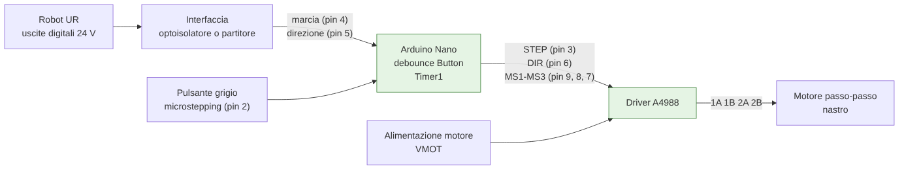
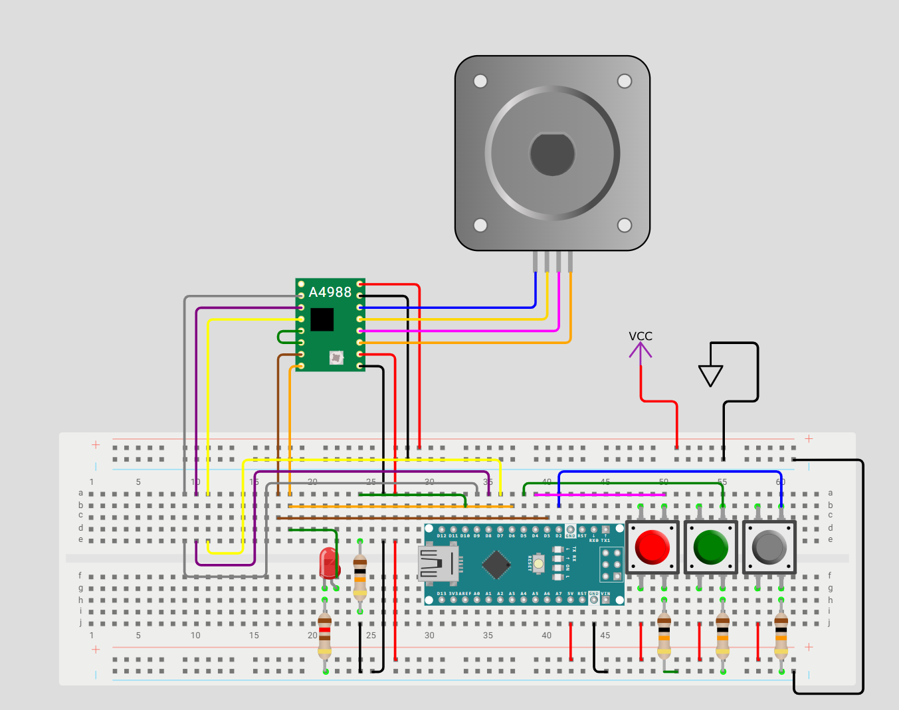
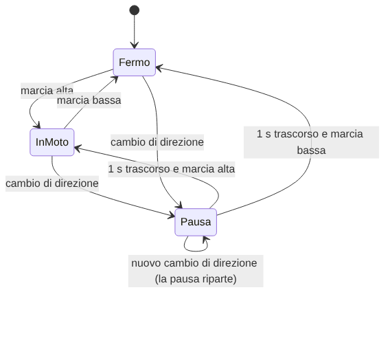
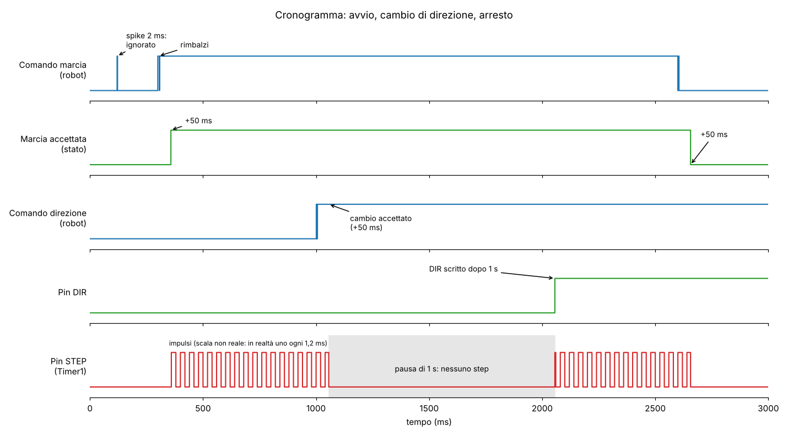
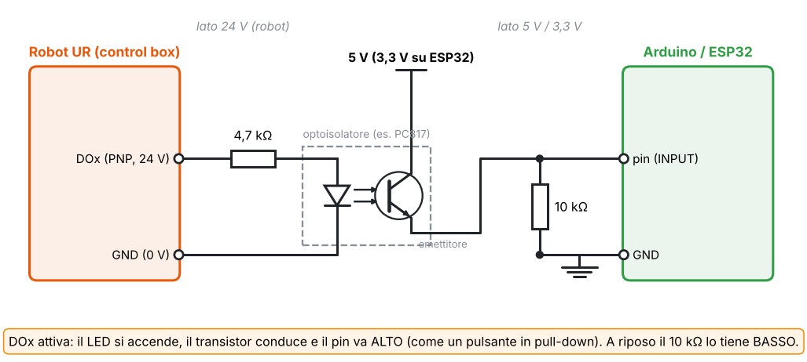
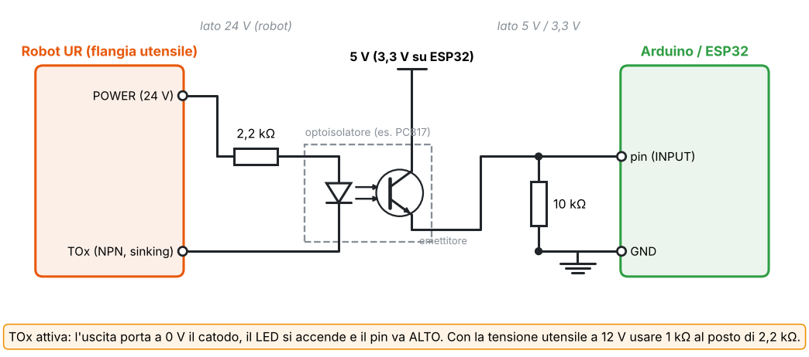

>[Torna all'indice](indexpulsanti.md)


# Controllo del motore passo-passo del nastro trasportatore

Questa dispensa spiega il programma che muove il motore passo-passo (*stepper*) di un nastro
trasportatore. Il nastro è comandato da un **robot UR** attraverso due segnali digitali: uno dice
se il nastro deve girare, l'altro in che verso. Un terzo pulsante, usato a mano, cambia la
velocità. In laboratorio, e nella simulazione Wokwi, i due comandi del robot sono sostituiti da due
pulsanti.

Il programma è la versione 4.3. Il codice completo è in fondo alla dispensa.

## 1. Lo schema

Lo schema a blocchi mostra il percorso dei segnali, dal robot al motore:



Lo schema di montaggio usato nella simulazione Wokwi, con i pulsanti al posto dei comandi del robot:



| Componente | Collegamento | Funzione |
| --- | --- | --- |
| Pulsante rosso | pin 4 (`button_HaltStart`) | comando di marcia: il motore gira finché è alto |
| Pulsante verde | pin 5 (`button_ForwardReverse`) | comando di direzione: il verso segue il livello |
| Pulsante grigio | pin 2 (`button_Microstep`) | a ogni pressione passa alla risoluzione successiva |
| Driver, ingresso STEP | pin 3 (`stepPin`) | un fronte di salita = un passo |
| Driver, ingresso DIR | pin 6 (`dirPin`) | verso di rotazione |
| Driver, MS1, MS2, MS3 | pin 9, 8, 7 | risoluzione del passo (microstepping) |

I tre pulsanti sono collegati in **pull-down**: ognuno ha una resistenza verso GND, quindi a riposo
il pin legge LOW e premuto legge HIGH. Sul driver, RESET e SLEEP sono collegati fra loro (il
ponticello verde nello schema): così il driver resta sempre attivo, come si fa di solito quando non
serve metterlo a riposo. Lo schema Wokwi contiene anche un LED con la sua resistenza, che il
programma descritto qui non usa.

## 2. Il driver A4988

Un motore passo-passo bipolare ha due avvolgimenti. Per farlo ruotare bisogna alimentarli in una
sequenza precisa, con correnti di qualche centinaio di milliampere o più: Arduino non può farlo
direttamente. Il **driver** A4988 fa questo lavoro e offre ad Arduino un'interfaccia semplicissima:

- **STEP**: a ogni fronte di salita il motore avanza di un passo (o di una frazione di passo);
- **DIR**: il livello sceglie il verso di rotazione;
- **MS1, MS2, MS3**: scelgono la risoluzione del passo;
- **ENABLE, RESET, SLEEP**: abilitano il driver;
- **1A, 1B, 2A, 2B**: le uscite verso i due avvolgimenti del motore;
- **V_MOTORE (VMOT)**: l'alimentazione del motore, separata da quella logica (VDD).

Il potenziometro sul driver regola la **corrente massima** negli avvolgimenti. Va tarato in base al
motore, altrimenti il motore perde passi oppure scalda troppo.

### Il microstepping

Un motore tipico fa 200 passi interi al giro (1,8° per passo). Con il **microstepping** il driver
divide ogni passo in frazioni, regolando la corrente nei due avvolgimenti: il movimento diventa più
fluido e silenzioso, ma a parità di impulsi su STEP il motore va più piano.

| MS1 | MS2 | MS3 | A4988 | DRV8825 |
| --- | --- | --- | --- | --- |
| Low | Low | Low | passo intero | passo intero |
| High | Low | Low | 1/2 | 1/2 |
| Low | High | Low | 1/4 | 1/4 |
| High | High | Low | 1/8 | 1/8 |
| Low | Low | High | — | 1/16 |
| High | High | High | 1/16 | 1/32 |

Il DRV8825 si monta al posto dell'A4988 (sulla stessa scheda i pin MS1-MS3 si chiamano M0-M2), ma
le ultime righe della tabella sono diverse. Per questo il programma ha la riga

```cpp
// #define DRIVER_DRV8825   // togliere il commento se si usa il DRV8825
```

che sceglie la combinazione giusta per il quinto livello (`SIXTEENTH`, 1/16).

## 3. Generare gli step: l'interrupt del Timer1

Per far girare il motore bisogna mandare su STEP un'onda quadra regolare. Farlo nel `loop()` con
`delay()` bloccherebbe la lettura dei pulsanti; farlo con `millis()` darebbe impulsi irregolari,
perché il `loop()` non gira sempre alla stessa velocità. La soluzione è un **interrupt periodico di
un timer hardware**, con la libreria `TimerOne`:

```cpp
Timer1.initialize(stepInterval/2);  // un interrupt ogni 600 µs
Timer1.attachInterrupt(stepMotor);  // funzione chiamata a ogni interrupt
Timer1.stop();                      // fermo finché non arriva il comando
```

A ogni interrupt la funzione `stepMotor()` inverte il livello del pin STEP:

```cpp
void stepMotor() {
  static bool stepState = false;
  if (directionChange) {
    return;  // nessuno step durante il cambio di direzione
  }
  stepState = !stepState;
  digitalWrite(stepPin, stepState);
}
```

Due interrupt fanno un periodo: 600 µs alto e 600 µs basso, cioè un passo ogni **1200 µs**, circa
833 passi al secondo. Fermare e far ripartire il motore significa solo fermare e far ripartire il
timer (`Timer1.stop()`, `Timer1.start()`, `Timer1.resume()`).

### Velocità del nastro

Con un motore da 200 passi al giro, a 833 impulsi al secondo:

| Livello | Risoluzione | Passi interi al secondo | Giri al minuto |
| --- | --- | --- | --- |
| 0 (`FULL`) | passo intero | 833 | 250 |
| 1 (`HALF`) | 1/2 | 417 | 125 |
| 2 (`QUARTER`) | 1/4 | 208 | 62,5 |
| 3 (`EIGHTH`) | 1/8 | 104 | 31,3 |
| 4 (`SIXTEENTH`) | 1/16 | 52 | 15,6 |

La frequenza degli impulsi resta sempre la stessa: è la **risoluzione** a cambiare la velocità.
Ogni pressione del pulsante grigio la dimezza, e dopo il quinto livello si torna al passo intero.

## 4. I comandi: a livello e a impulso

Il programma tratta i tre ingressi in due modi diversi, e la differenza è importante.

**Marcia e direzione sono comandi a livello.** Il robot UR tiene alta un'uscita digitale finché vuole
che il nastro giri, e la riporta bassa per fermarlo. Il programma quindi non conta le pressioni: copia
il livello stabile dell'ingresso.

```cpp
if (buttonStart.changed()) {
  stato = (buttonStart.val == ATTIVO);  // il motore gira finché il comando è attivo
  if (stato) {
    if (!waitingForDirChange) Timer1.start();
  } else {
    Timer1.stop();
  }
}
```

Lo stesso per la direzione: il verso segue il livello del comando. Un comando a livello ha un
vantaggio: se un evento va perso o un disturbo produce un errore, al cambio successivo il motore si
rimette comunque nello stato giusto, perché conta il livello e non la storia delle pressioni.

**Il microstepping è un comando a impulso.** A ogni pressione del pulsante grigio si passa al livello
successivo, quindi qui conta il fronte:

```cpp
if (buttonStep.changed() && buttonStep.val) {   // pressione confermata
  stepLevel = (stepLevel + 1) % 5;
  setResolution(stepLevel);
}
```

### Il cambio di direzione

Invertire il verso di un nastro in movimento di colpo è brusco: il carico ha inerzia e il motore può
perdere passi. Per questo, quando cambia il comando di direzione, il programma:

1. ferma gli impulsi (`Timer1.stop()` e `directionChange = true`);
2. aspetta **1 secondo**, senza bloccare il `loop()`: memorizza l'istante in `dirChangeStartTime` e
   a ogni giro controlla se è passato;
3. scrive il nuovo verso su DIR;
4. se il comando di marcia è ancora alto, fa ripartire il motore con `Timer1.resume()`.

Se durante la pausa il comando di direzione cambia ancora, la pausa riparte da capo. Se durante la
pausa arriva il comando di marcia, il motore parte solo alla fine della pausa.



Il cronogramma mostra gli stessi passaggi nel tempo: uno spike ignorato, l'avvio con i rimbalzi,
il cambio di direzione con la pausa di 1 s, l'arresto. I comandi sono accettati 50 ms dopo l'ultimo
rimbalzo, come spiegato nella sezione 5.



## 5. Il debounce: la struttura Button

I tre ingressi sono letti in polling con la struttura `Button`, che realizza il **debounce a livello
stabile in due direzioni** (lo stesso di `changed()` e di `Debouncer` della libreria `urutils`):

```cpp
bool changed() {
  val = digitalRead(pin);
  if (val != val0) {        // ogni variazione, rimbalzi e disturbi compresi,
    val0 = val;             // fa ripartire il timer
    last = millis();
  } else if (val != val00 && (unsigned long)(millis() - last) > debtime) {
    val00 = val;            // livello stabile da debtime: cambio vero
    return true;
  }
  return false;
}
```

Un nuovo livello è accettato solo se resta fermo per `DEBOUNCETIME` (50 ms). Questo filtra tutte e
quattro le situazioni critiche descritte in [debounce-fenomeni.md](debounce-fenomeni.md):

- i rimbalzi alla pressione e al rilascio dei pulsanti usati in laboratorio;
- un'apertura breve del contatto a pulsante premuto (buco): il motore non si ferma;
- uno **spike** sul cavo a comando basso: il nastro non parte. È la situazione più probabile con il
  robot, perché i cavi dei comandi passano vicino a motori e azionamenti.

Il prezzo è un ritardo di 50 ms su ogni comando, sia in partenza sia in arresto. Per un nastro è
trascurabile.

L'inizializzazione dice da quale livello si parte:

```cpp
// pin, val0, debtime, val, val00, last
Button buttonStart = {button_HaltStart, RIPOSO, DEBOUNCETIME, RIPOSO, RIPOSO, 0};
```

`RIPOSO` vale LOW con i pulsanti in pull-down e con le schede d'interfaccia a uscita PNP, HIGH con
quelle a uscita NPN (paragrafo 6.3). Se all'accensione il robot tiene già alto un comando,
dopo 50 ms viene accettato e il nastro parte: con un comando a livello è il comportamento giusto.

## 6. Il collegamento al robot UR

Le uscite digitali del robot UR lavorano a **24 V**: collegate direttamente a un pin di Arduino lo
distruggono. Fra il robot e Arduino si mette un **optoisolatore** per ogni comando: il lato del robot
accende il LED interno, il fototransistor lavora a 5 V dalla parte di Arduino. I due circuiti restano
separati, anche nelle masse: un guasto o un disturbo sul lato a 24 V non arriva ad Arduino.

Servono due canali uguali: uno per la **marcia** (pin 4) e uno per la **direzione** (pin 5).

### 6.1 Uscite del control box (DO0 – DO7)

Le uscite digitali del control box sono di tipo **PNP** (*sourcing*): quando sono attive portano
+24 V sul morsetto, quando sono inattive lo lasciano scollegato. Possono erogare fino a 1 A e
rispettano la norma IEC 61131-2. È il collegamento consigliato.



- **Lato robot.** DOx → resistenza da 2,2 kΩ → anodo del LED; catodo → GND (0 V) del robot.
  La corrente nel LED è circa (24 V − 1,2 V) / 2,2 kΩ ≈ **10 mA**, ben sotto i 50 mA massimi di un
  PC817.
- **Lato Arduino.** Collettore a +5 V, **emettitore al pin**, resistenza da 10 kΩ dal pin a GND.
  Quando il LED è acceso il transistor conduce e il pin sale a circa 4,8 V; quando è spento il
  10 kΩ tiene il pin a 0 V. Il pin è quindi **alto quando il comando è attivo**, esattamente come i
  pulsanti in pull-down della simulazione: il programma non cambia.
- **Le masse non vanno collegate fra loro.** Il GND del robot e il GND di Arduino restano separati:
  è questo che rende l'isolamento efficace.
- Con un ESP32 il collettore va a 3,3 V invece che a 5 V; il resto è uguale.

### 6.2 Uscite della flangia utensile (TO0, TO1)

Le due uscite sul polso del robot sono diverse. Sui robot e-Series si possono configurare come
**NPN** (*sinking*), **PNP** (*sourcing*) o *push-pull*, anche da script con
`set_tool_digital_output_mode()`; sui robot della serie CB sono sempre **NPN**. Una uscita NPN,
quando è attiva, collega il morsetto a 0 V: il LED va quindi alimentato dal morsetto POWER della
flangia e chiuso verso l'uscita.



La tensione della flangia si imposta a 0, 12 o 24 V: a 12 V la resistenza del LED scende a
**1 kΩ** per avere ancora circa 10 mA. Se l'uscita utensile è configurata PNP, si usa lo schema
del paragrafo 6.1.

### 6.3 Moduli pronti e controlli

Invece di montare gli optoisolatori si può usare una scheda pronta. Ce ne sono di tre tipi:

| Scheda | Ingresso | Uscita verso Arduino | Note |
| --- | --- | --- | --- |
| Modulo PC817 a 4 canali (per esempio MOD-PC817) | da 3,6 a 30 V circa, a seconda del modello | transistor con pull-up: **attiva bassa** | economico, morsetti a vite o pin; alcuni hanno un ponticello per scegliere la fascia 3-9 V o 10-24 V |
| Scheda "24V to 5V PLC level converter" a 4 o 8 canali | 24 V, ingressi `+`/`−` per canale (vanno bene sia PNP sia NPN) | versione **NPN** (attiva bassa) o versione **PNP** (attiva alta) | va alimentata a 5 V dal lato Arduino; scegliere la versione PNP per non cambiare il programma |
| Interfaccia industriale su barra DIN (per esempio Phoenix Contact PLC-OPT-24DC/TTL) | 24 V DC | TTL, 5 V | per un impianto vero: robusta, da quadro elettrico |

- **Schede con uscita PNP o NPN: la define `INGRESSI_ATTIVI_BASSI`.** Le schede con uscita PNP, e il
  circuito del paragrafo 6.1, danno il pin **alto** quando il comando del robot è attivo: è il
  comportamento predefinito del programma. Con i moduli che hanno l'uscita NPN o con pull-up il pin
  è invece **basso** quando il comando è attivo. In quel caso basta togliere il commento a una riga:

  ```cpp
  // #define INGRESSI_ATTIVI_BASSI   // togliere il commento con schede a uscita NPN
  ```

  La define sceglie tre costanti: `ATTIVO` (il livello del comando attivo), `RIPOSO` (il livello a
  riposo, da cui partono i due `Button` dei comandi) e `MODO_COMANDI` (`INPUT`, oppure
  `INPUT_PULLUP` per le uscite a collettore aperto senza resistenza sulla scheda). Il programma
  confronta poi il livello accettato con `ATTIVO`:

  ```cpp
  stato = (buttonStart.val == ATTIVO);       // il motore gira finché il comando è attivo
  direction = (buttonDir.val == ATTIVO);     // comando attivo: verso HIGH
  ```

  Il pulsante grigio del microstepping è un pulsante locale e resta in pull-down in tutti e due i
  casi. Se una scheda con uscita PNP ha l'uscita a collettore aperto, senza resistenza verso massa,
  sul pin va aggiunto un pull-down esterno da 10 kΩ.
- **Verificare la tensione d'ingresso del modulo.** Deve essere adatta a 24 V: i moduli pensati per
  12 V hanno una resistenza troppo piccola.
- **Programma fermo, nastro fermo.** Nel robot si può impostare che le uscite digitali si
  disattivino automaticamente quando il programma si ferma. Con i comandi a livello, il nastro si
  ferma insieme al programma del robot.
- **Disturbi.** I cavi dei comandi passano spesso vicino a motori e azionamenti. Il debounce a
  livello stabile della struttura `Button` scarta gli spike più brevi di 50 ms: il nastro non parte
  per un disturbo.

Il comando di marcia non è una funzione di sicurezza. L'arresto di emergenza del nastro va
realizzato in hardware, con un pulsante di emergenza e componenti di sicurezza, e non deve passare
da Arduino (vedi la sezione 6 di [debounce-fenomeni.md](debounce-fenomeni.md)). Gli altri schemi
di collegamento fra il mondo a 24 V e quello a 5 V sono in [interfacce-digitali.md](interfacce-digitali.md).

## 7. Note sul codice

- **`directionChange`.** Durante il cambio di direzione il timer è già fermo, quindi questo flag non
  serve. Resta come protezione: se un domani si togliesse il `Timer1.stop()`, impedirebbe comunque
  gli step con il verso che sta cambiando.
- **Pin 9.** È anche l'uscita PWM del Timer1. Qui è usato come uscita digitale per MS1, e va bene
  finché non si chiama `Timer1.pwm()`.
- **`delay(1)` alla fine del `loop()`.** Non serve né al debounce né al motore, si può togliere.
- **Variabili condivise.** `stato`, `direction` e `directionChange` sono dichiarate `volatile` perché
  sono lette anche nella funzione di interrupt.
- **`digitalWrite()` nell'interrupt.** È più lenta della scrittura diretta sui registri, ma con un
  interrupt ogni 600 µs c'è tutto il tempo.

## 8. Domande

1. Perché gli impulsi su STEP sono generati da un interrupt del timer e non nel `loop()`?
2. Calcolare la velocità in giri al minuto con un `stepInterval` di 2000 µs e risoluzione 1/4.
3. Che cosa succederebbe se il comando di marcia fosse gestito come un toggle e il robot lo tenesse
   alto per tutto il tempo in cui il nastro deve girare?
4. Uno spike di 2 ms arriva sul comando di marcia a nastro fermo. Che cosa fa il programma? E se il
   debounce confermasse solo il rilascio?
5. Perché il cambio di direzione aspetta 1 secondo? Come si potrebbe sostituire la pausa con una
   rampa di velocità?
6. Che cosa cambia se si monta un DRV8825 al posto dell'A4988 senza modificare il programma?
7. Perché nell'interfaccia del paragrafo 6.1 il pin è preso dall'emettitore e non dal collettore?
   Che cosa bisognerebbe cambiare nel programma con un modulo PC817 che ha il pull-up in uscita?

## 9. Codice completo

Simulazione: https://wokwi.com/projects/426024956545802241

```cpp
/*################### File version: 4.3 ##################*/
/*########################################################*/
/* Controllo stepmotor per il nastro trasportatore a      */
/* scopo didattico (il docente dovrà spiegarne il         */
/* funzionamento).                                        */
/* vengono utilizzati tre pulsanti:                       */
/*  - pulsante rosso P1 per halt e stop del motore;       */
/*  - pulsante verde P2 per controllare il senso          */
/*    di rotazione;                                       */
/*  - pulsante grigio per controllare il microstepping    */
/*    (quindi la velocità) del motore.                    */
/* I tre pulsanti sono letti in polling con la struttura  */
/* Button: un cambio è accettato solo quando il nuovo     */
/* livello resta stabile per DEBOUNCETIME ms (filtra      */
/* rimbalzi e disturbi brevi). P1 e P2 emulano i comandi */
/* a livello del robot UR: il motore gira finché P1 è     */
/* alto, il verso segue il livello di P2. Gli step del    */
/* motore sono generati dall'interrupt del Timer1.        */
/*                                                        */
/* Con il robot UR, marcia e direzione arrivano da una    */
/* scheda d'interfaccia optoisolata 24 V -> 5 V. Se la    */
/* scheda ha l'uscita NPN (attiva bassa), togliere il     */
/* commento a #define INGRESSI_ATTIVI_BASSI.              */
/*                                                        */
/*     driver A4988 (tra parentesi i nomi sul DRV8825)    */
/*         ,-----------,                                  */
/*  ENABLE |o         o| V_MOTORE                         */
/* MS1(M0) |o ____    o| GND                              */
/* MS2(M1) |o|    |   o| 2B                               */
/* MS3(M2) |o|____|   o| 2A                               */
/*   RESET |o         o| 1A                               */
/*   SLEEP |o     _   o| 1B                               */
/*    STEP |o    |_|  o| VDD (FAULT sul DRV8825)          */
/*     DIR |o         o| GND                              */
/*         `-----------'                                  */
/*                                                        */
/*   ===================================================  */
/*    MS1 | MS2  | MS3  |  A4988     |  DRV8825           */
/*   -----|------|------|------------|-----------------   */
/*    Low | Low  | Low  |  Full step |  Full step         */
/*    High| Low  | Low  |  1/2 step  |  1/2 step          */
/*    Low | High | Low  |  1/4 step  |  1/4 step          */
/*    High| High | Low  |  1/8 step  |  1/8 step          */
/*    Low | Low  | High |  -         |  1/16 step         */
/*    High| High | High |  1/16 step |  1/32 step         */
/*   ===================================================  */
/* Il quinto livello (SIXTEENTH) usa la riga giusta per   */
/* il driver scelto con #define DRIVER_DRV8825.           */
/*########################################################*/
// https://wokwi.com/projects/426024956545802241
#include <TimerOne.h>  // Libreria per gestire interrupt basati su timer
#define dirPin 6 //2
#define stepPin 3
// Nota: il pin 9 (MS1) è anche l'uscita PWM del Timer1: va bene finché
// non si usa Timer1.pwm().
#define button_ForwardReverse 5
#define button_HaltStart 4
#define button_Microstep 2 //6
#define  DEBOUNCETIME 50
// #define DRIVER_DRV8825   // togliere il commento se si usa il DRV8825

// Comandi del robot (marcia e direzione) attraverso la scheda d'interfaccia:
// - uscita PNP, o pulsanti in pull-down: pin ALTO quando il comando è attivo (default);
// - uscita NPN o modulo PC817 con pull-up: pin BASSO quando il comando è attivo.
// #define INGRESSI_ATTIVI_BASSI   // togliere il commento con schede a uscita NPN
#ifdef INGRESSI_ATTIVI_BASSI
  #define ATTIVO LOW                  // livello del comando attivo
  #define RIPOSO HIGH                 // livello a riposo
  #define MODO_COMANDI INPUT_PULLUP   // pull-up interno per le uscite a collettore aperto
#else
  #define ATTIVO HIGH
  #define RIPOSO LOW
  #define MODO_COMANDI INPUT          // il pull-down è sulla scheda (o la resistenza esterna)
#endif

volatile bool directionChange = false;  // Flag per prevenire step durante cambio dir:
                                        // ridondante finché il Timer1 viene fermato
                                        // durante il cambio, ma protegge se lo si toglie
volatile bool direction = LOW;    // HIGH quando il comando di direzione è attivo
volatile bool stato = false;
uint8_t stepLevel = 0;
uint16_t stepInterval = 1200; // Microsecond (600µs HIGH + 600µs LOW)

// Variabili per gestione non bloccante del cambio di direzione
unsigned long dirChangeStartTime = 0;
bool waitingForDirChange = false;

int MS[3] = {9, 8, 7}; // pin microstepper MS1=MS[0]->9, MS2=MS[1]->8, MS3=MS[2]->7
boolean microstepArray[5][3] = {
 {LOW, LOW, LOW},     // full step
 {HIGH, LOW, LOW},    // 1/2
 {LOW, HIGH, LOW},    // 1/4
 {HIGH, HIGH, LOW},   // 1/8
#ifdef DRIVER_DRV8825
 {LOW, LOW, HIGH}     // 1/16 sul DRV8825 (HIGH, HIGH, HIGH sarebbe 1/32)
#else
 {HIGH, HIGH, HIGH}   // 1/16 sull'A4988
#endif
};

enum resolution{
	FULL,
	HALF,
	QUARTER,
	EIGHTH,
	SIXTEENTH
};

/**
 * Struttura Button per la gestione del debounce
 * 
 * Ogni variazione letta (rimbalzi e disturbi compresi) fa ripartire il timer.
 * Un cambio è accettato solo quando il nuovo livello è rimasto stabile per debtime ms:
 * un'apertura breve del contatto a pulsante premuto non viene presa per un rilascio.
 */
struct Button {
  uint8_t pin;           // Pin di Arduino collegato al pulsante
  uint8_t val0;          // Ultimo valore letto
  unsigned long debtime; // Tempo di debounce in millisecondi
  uint8_t val;           // Valore attuale letto
  uint8_t val00;         // Ultimo stato stabile (accettato)
  unsigned long last;    // Timestamp ultima variazione letta
  
  /**
   * Verifica se c'è stato un cambiamento valido dello stato del pulsante.
   * 
   * @return true quando il nuovo livello è stabile da debtime ms, false altrimenti
   */
  bool changed() {
    val = digitalRead(pin);
    if (val != val0) {              // ogni variazione, rimbalzi e disturbi compresi,
      val0 = val;                   // fa ripartire il timer
      last = millis();
    } else if (val != val00 && (unsigned long)(millis() - last) > debtime) {
      val00 = val;                  // livello stabile da debtime: cambio vero
      return true;
    }
    return false;
  }
};

// Inizializzazione dei pulsanti: pin, val0, debtime, val, val00, last.
// I comandi del robot partono dal livello di RIPOSO; il pulsante del microstepping
// resta un pulsante locale in pull-down (riposo LOW). Se all'accensione un comando
// del robot è già attivo, viene accettato dopo DEBOUNCETIME ms.
Button buttonStart = {button_HaltStart, RIPOSO, DEBOUNCETIME, RIPOSO, RIPOSO, 0};    // start/stop
Button buttonDir = {button_ForwardReverse, RIPOSO, DEBOUNCETIME, RIPOSO, RIPOSO, 0};  // direzione
Button buttonStep = {button_Microstep, LOW, DEBOUNCETIME, LOW, LOW, 0};              // microstepping

/**
 * Imposta la risoluzione del microstepping
 * 
 * @param level Livello di microstepping (0-4)
 * @return true se il livello è valido, false altrimenti
 */
bool setResolution(uint8_t level){
  if (level > 4) return false;
  
  Serial.print("Res: ");
  for (int i = 0; i < 3; i++) {
    digitalWrite(MS[i],microstepArray[level][i]);
    Serial.print(microstepArray[level][i]);
  }
  Serial.println();
  return true;
}

/**
 * Funzione di interrupt per controllare gli step del motore
 * Viene eseguita a ogni interrupt del timer
 */
void stepMotor() {
  static bool stepState = false;
  
  if (directionChange) {
    return;  // Non generare step durante il cambio di direzione
  }
  
  stepState = !stepState;
  digitalWrite(stepPin, stepState);
}

void setup() {
  Serial.begin(115200);
 
  pinMode(stepPin, OUTPUT);
  pinMode(dirPin, OUTPUT);
  pinMode(MS[0], OUTPUT);
  pinMode(MS[1], OUTPUT);
  pinMode(MS[2], OUTPUT);
  pinMode(button_ForwardReverse, MODO_COMANDI);
  pinMode(button_HaltStart, MODO_COMANDI);
  pinMode(button_Microstep, INPUT);
   
  setResolution(FULL);
  stato = false;
  direction = LOW;                    // comando di direzione a riposo
  directionChange = false;
  digitalWrite(dirPin, direction);    // verso di rotazione iniziale definito
  
  // Configura l'interrupt di timer per gli step del motore
  Timer1.initialize(stepInterval/2);  // Metà del periodo totale
  Timer1.attachInterrupt(stepMotor);
  Timer1.stop();  // Ferma il timer finché non è necessario
}

void loop() {
  // Gestione non bloccante del cambio di direzione
  if (waitingForDirChange && ((unsigned long) millis() - dirChangeStartTime >= 1000)) {
    waitingForDirChange = false;
    digitalWrite(dirPin, direction);
    directionChange = false;
    
    // Se il motore era in movimento prima del cambio direzione, riprendi
    if (stato) {
      Timer1.resume();
    }
  }
  
  // Controlla il pulsante di microstepping
  if (buttonStep.changed() && buttonStep.val) {
    stepLevel = (stepLevel + 1) % 5;
    setResolution(stepLevel);
  }

  // Comando di direzione (livello): cambio del verso a ogni cambio di livello stabile
  if (buttonDir.changed()) {
    direction = (buttonDir.val == ATTIVO);  // comando attivo: verso HIGH
    directionChange = true;
    Serial.print("Direction: ");
    Serial.println(direction);
    if (stato) Timer1.stop();          // ferma il motore durante il cambio
    waitingForDirChange = true;        // cambio di direzione non bloccante
    dirChangeStartTime = millis();     // un nuovo cambio durante l'attesa la fa ripartire
  }

  // Comando di avvio/arresto (livello): il motore gira finché il comando è alto
  if (buttonStart.changed()) {
    stato = (buttonStart.val == ATTIVO);    // il motore gira finché il comando è attivo
    if (stato) {
      if (!waitingForDirChange) Timer1.start();   // durante il cambio direzione riparte dopo
      Serial.println("Timer started");
    } else {
      Timer1.stop();
      Serial.println("Timer stopped");
    }
  }
  
  delay(1); // non serve al debounce né al motore: si può togliere
}
// https://wokwi.com/projects/426024956545802241
```

## Riferimenti

- [debounce-fenomeni.md](debounce-fenomeni.md): le quattro situazioni critiche e la scelta del debounce
- [debouncerFSM.md](debouncerFSM.md): il debounce a livello stabile come macchina a stati
- [interfacce-digitali.md](interfacce-digitali.md): collegare le uscite a 24 V del robot UR ad Arduino
- [Pololu, A4988 Stepper Motor Driver Carrier](https://www.pololu.com/product/1182): pin, microstepping, taratura della corrente
- [Pololu, DRV8825 Stepper Motor Driver Carrier](https://www.pololu.com/product/2133): differenze rispetto all'A4988
- [TimerOne](https://github.com/PaulStoffregen/TimerOne): la libreria per l'interrupt del Timer1
- [Universal Robots, Controller I/O (e-Series)](https://www.universal-robots.com/manuals/EN/HTML/SW10_14/Content/prod-CB5/cb_controller_i_o.htm): uscite digitali PNP, 1 A, IEC 61131-2
- [Funduino, scheda optoisolata 24 V → 5 V a 4 canali (PDF)](https://funduinoshop.com/media/pdf/1c/f2/c8/optokoppler.pdf): morsetti e funzionamento delle schede "PLC level converter"
- [Phoenix Contact PLC-OPT-24DC/TTL](https://www.phoenixcontact.com/product/2900363): interfaccia su barra DIN, ingresso 24 V, uscita TTL
- [Universal Robots, Tool I/O: Digital Input and Output](https://www.universal-robots.com/manuals/EN/HTML/SW10_13/Content/prod-CB5/cb_digital_out.htm): uscite utensile sinking, sourcing, push-pull

>[Torna all'indice](indexpulsanti.md)
