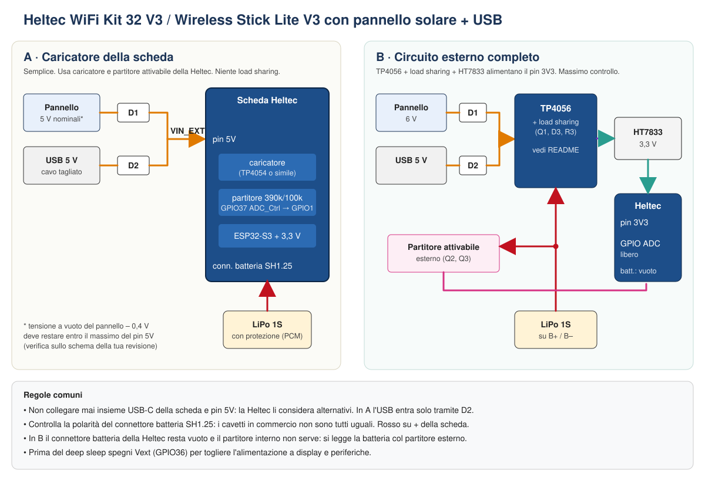
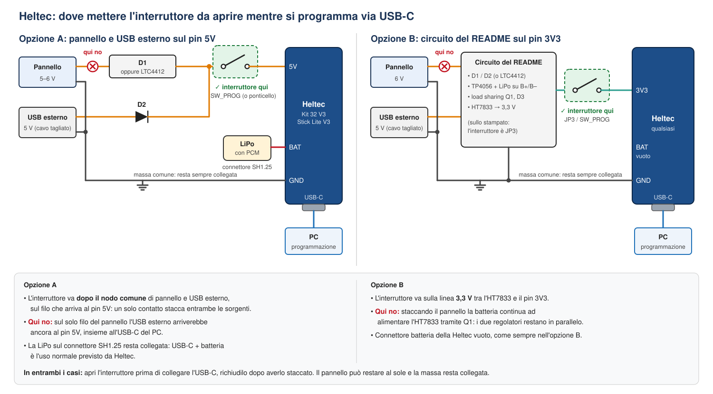
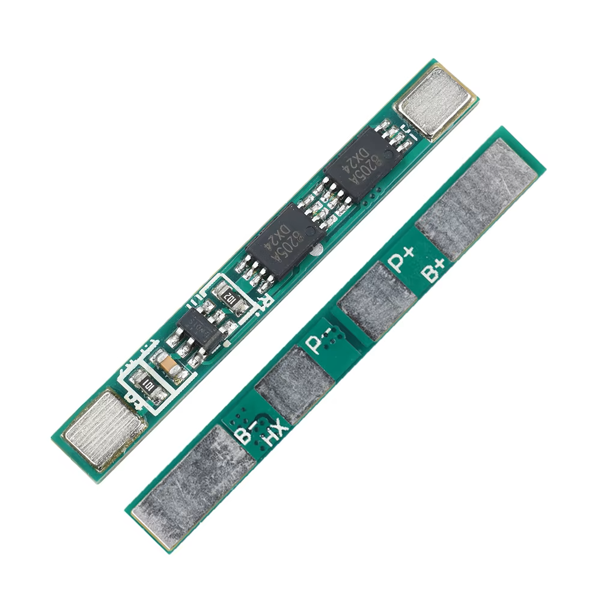
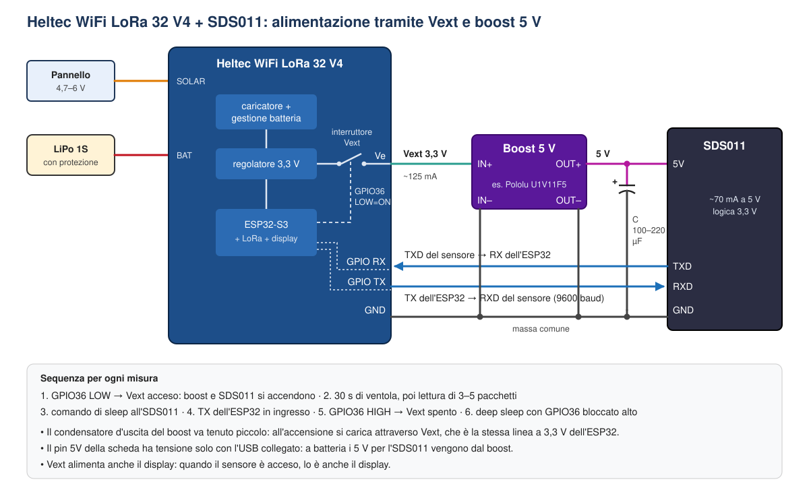

# Uso con schede Heltec (WiFi Kit 32 V3, Wireless Stick Lite V3, WiFi LoRa 32 V4)

Questa guida spiega come adattare il progetto alle schede **Heltec WiFi Kit 32 V3** e **Heltec Wireless Stick Lite V3**, entrambe basate su ESP32-S3. Per il circuito di base, il load sharing e la sezione SDS011 fai riferimento al [panel2esp32.md](panel2esp32.md).

<p align="center">
  
</p>

---

## Cosa c'è già sulle schede Heltec

Dai datasheet e dalle schede tecniche risulta questo:

| | WiFi Kit 32 V3 | Wireless Stick Lite V3 |
|---|---|---|
| Caricatore LiPo integrato | Sì (chip non indicato nel datasheet) | Sì, **TP4054** |
| Connettore batteria | SH1.25, 2 pin | SH1.25, 2 pin |
| Lettura batteria | **GPIO1** (ADC1_CH0), partitore **390k/100k** | **GPIO1**, partitore **390k/100k** |
| Attivazione partitore | **GPIO37** (`ADC_Ctrl`) | **GPIO37** (`ADC_Ctrl`), attivo **basso** secondo la scheda tecnica |
| Uscita Vext comandata | **GPIO36** (Vext, 350 mA) | — |
| Ingresso pannello solare | **No** | **No** |
| Load sharing documentato | **No** | **No** |

In pratica queste schede hanno già il **partitore attivabile**: consumo zero a riposo, come la variante descritta nel README. Non hanno invece un ingresso solare dedicato né un load sharing documentato. Il TP4054 della Wireless Stick Lite, come il TP4056, da solo non separa il carico dalla batteria.

> ℹ️ Per la WiFi Kit 32 V3 il datasheet nomina `ADC_Ctrl` ma non indica a quale livello attiva la lettura. Se leggi sempre 0 V, inverti il livello (vedi il codice più sotto).

---

## Opzione A: usare il caricatore della scheda

È la soluzione più **semplice**: uni pannello e USB con i diodi D1 e D2 e mandi il risultato al **pin 5V** della scheda. Ricarica e lettura della batteria sono affidate alla Heltec.

### Collegamenti

1. **Batteria:** LiPo da una cella **con protezione** (PCM) sul connettore SH1.25 della scheda.
2. **Pannello:** + all'anodo di **D1** (1N5819).
3. **USB:** + del cavo tagliato all'anodo di **D2** (1N5819).
4. **Catodi di D1 e D2** uniti, collegati al **pin 5V** della Heltec.
5. **Masse** (– del pannello, – dell'USB) al **GND** della scheda.

### Regole importanti

- **Non usare insieme l'USB-C della scheda e il pin 5V.** Heltec li considera ingressi alternativi. L'USB deve entrare solo tramite D2. Per programmare la scheda basta staccare il filo che arriva al pin 5V, meglio con un interruttore o un ponticello: vedi [Programmare la scheda](#programmare-la-scheda-dove-mettere-linterruttore).
- **Tensione del pannello.** La tensione a vuoto del pannello, meno circa 0,4 V del diodo, deve restare entro il massimo ammesso dal pin 5V. Per la WiFi LoRa 32 V4 Heltec dichiara 4,7–6 V; per la Kit 32 V3 e la Stick Lite V3 verificalo sullo schema della tua revisione. In caso di dubbio usa un pannello da **5 V nominali** e misura la tensione a vuoto al sole: dopo D1 non deve superare 6 V. Se al posto di D1 usi il diodo ideale LTC4412, i requisiti diventano più stretti: vedi [Diodo ideale LTC4412 al posto di D1](#diodo-ideale-ltc4412-al-posto-di-d1).
- **Polarità del connettore batteria.** I cavetti SH1.25 in commercio non sono tutti uguali: controlla che il rosso arrivi sul + della scheda prima di collegare.

### Limiti

- **Niente load sharing.** Mentre la batteria è in carica, l'ESP32 assorbe dalla stessa linea. Con l'ESP32 quasi sempre in deep sleep il problema è trascurabile. Con il WiFi sempre acceso la carica potrebbe non terminare mai e la batteria resterebbe a 4,2 V a lungo.
- **Corrente di carica fissa**, decisa dalla scheda e non documentata per queste versioni, quindi non regolabile.

---

## Opzione B: circuito esterno completo

Si usa **tutto il circuito del README** (TP4056 + D1/D2 + load sharing + HT7833) e si alimenta la Heltec dal **pin 3V3**. Il connettore batteria della scheda resta **vuoto**.

### Collegamenti

1. Monta il circuito del README fino all'uscita dell'**HT7833**.
2. Uscita HT7833 al **pin 3V3** della Heltec, massa al **GND**.
3. **Connettore batteria della Heltec: vuoto.** La batteria va solo su **B+/B–** del TP4056.
4. **Lettura batteria:** il partitore della scheda (GPIO1) è collegato al suo connettore, che è vuoto, quindi non serve. Usa il **partitore attivabile esterno** del README (Q2, Q3) su un pin ADC1 libero dell'ESP32-S3 (GPIO1–GPIO10). Controlla sul pinout della tua scheda quali sono davvero liberi: alcuni sono usati da display o radio.

### Perché non si può usare il partitore interno della scheda

Il partitore interno (390k/100k su GPIO1) non è un ingresso separato: è collegato **in modo fisso alla linea batteria della scheda**, la stessa a cui arrivano il caricatore e il percorso di alimentazione verso il regolatore a 3,3 V:

```
connettore batteria ──┬── caricatore della scheda (TP4054 o simile)
       (VBAT)         ├── passaggio automatico USB/batteria ──► regolatore 3,3 V ──► ESP32
                      └── partitore 390k/100k ──► GPIO1   (attivato da GPIO37)
```

Per farlo funzionare bisognerebbe collegare la batteria **anche** al connettore della Heltec. Così però:

1. **Il load sharing viene scavalcato.** Il regolatore interno della scheda comincia a prendere corrente direttamente dalla batteria, anche con il pannello al sole. Il TP4056 torna a vedere il carico durante la carica, cioè il problema che il load sharing doveva risolvere.
2. **Ci sono due regolatori sulla stessa linea 3,3 V.** L'HT7833 alimenta il pin 3V3 e il regolatore interno, alimentato dalla batteria, alimenta la stessa linea dall'altra parte. Quale dei due eroghi la corrente non è prevedibile e cambia con la temperatura e la tensione della batteria.
3. **Ci sono due caricatori sulla stessa cella.** Se colleghi l'USB-C per programmare, il caricatore della Heltec si aggiunge al TP4056. Con le LiPo è una situazione da evitare.

Partitore e alimentazione della scheda condividono lo stesso nodo, quindi non esiste un punto in cui collegare "solo il partitore". Per questo nell'opzione B il connettore batteria della Heltec resta **vuoto** e la batteria si legge con il **partitore attivabile esterno**.

> ℹ️ Se lo schema elettrico della tua revisione mostrasse che il regolatore interno viene staccato dalla batteria quando c'è tensione sul pin 3V3, la cosa si potrebbe rivalutare. Non è documentato: senza schema non darlo per scontato.

Se invece preferisci usare il partitore interno, la strada è l'**opzione A**: la batteria sta sul connettore della Heltec, ma rinunci al load sharing esterno.

### Vantaggi e limiti

- ✅ Load sharing vero, corrente di carica regolabile, pannelli da 6 V senza problemi.
- ✅ Funziona anche con schede ESP32 diverse, senza dipendere dai dettagli della Heltec.
- ⚠️ Il pin 3V3 viene usato come **ingresso**: per la V4 Heltec dichiara 2,7–3,5 V in ingresso sul pin 3V3. Per la tua scheda verifica sul datasheet o sullo schema.
- ⚠️ Mentre programmi via USB-C, il regolatore della scheda e l'HT7833 si trovano in parallelo sulla linea 3V3: per sicurezza stacca il filo tra l'HT7833 e il pin 3V3 (vedi [Programmare la scheda](#programmare-la-scheda-dove-mettere-linterruttore)).

---

## A o B?

| | Opzione A | Opzione B |
|---|---|---|
| Componenti esterni | 2 diodi | Circuito completo del README |
| Load sharing | No | Sì |
| Pannello | 5 V nominali (verificare il massimo del pin 5V) | 6 V |
| Corrente di carica | Fissa, decisa dalla scheda | Regolabile (R_PROG) |
| Lettura batteria | Partitore interno (GPIO1 + GPIO37) | Partitore attivabile esterno |
| Adatto a | ESP32 quasi sempre in deep sleep, montaggio rapido | Uso 24/7, sensori pesanti, massimo controllo |

---

## Programmare la scheda: dove mettere l'interruttore

Mentre programmi la Heltec via USB-C, l'alimentazione esterna non deve arrivare alla scheda dallo stesso lato dell'USB del PC. Non serve staccare tutto: basta **un interruttore (o un ponticello a 2 pin) nel punto giusto**.

<p align="center">
  
</p>

| | Dove va l'interruttore | Perché proprio lì |
|---|---|---|
| **Opzione A** | Sul filo tra il **nodo comune** di D1 e D2 (o dell'LTC4412 e D2) e il **pin 5V** | Pannello e USB esterno arrivano alla scheda solo da quel filo: un solo contatto li stacca tutti e due. Se lo metti sul solo filo del pannello, l'USB esterno arriva ancora al pin 5V, insieme all'USB-C del PC |
| **Opzione B** | Sulla linea **3,3 V** tra l'uscita dell'HT7833 e il **pin 3V3** (sullo stampato è **JP3**) | Il problema sono i due regolatori in parallelo sul 3,3 V. Staccare il pannello non basta: la batteria continua ad alimentare l'HT7833 attraverso Q1 |

In entrambi i casi:

- **apri** l'interruttore **prima** di collegare l'USB-C e **richiudilo** dopo averlo staccato;
- il **pannello può restare collegato** e al sole: a monte dell'interruttore non disturba;
- la **massa resta sempre collegata**;
- nell'opzione A la **LiPo sul connettore SH1.25 resta collegata**: USB-C più batteria è l'uso normale previsto da Heltec.

Basta un deviatore a slitta o un pettine a 2 pin con cappuccio. La corrente è al massimo qualche centinaio di mA, quindi va bene qualunque piccolo interruttore da circuito stampato.

---

## Diodo ideale LTC4412 al posto di D1

La variante del [README](README.md#variante-diodo-ideale-ltc4412-al-posto-di-d1) (U2 LTC4412 con Q6 e Q7 contrapposti e R_CTL) si può usare anche con la WiFi Kit 32 V3 e la Wireless Stick Lite V3. Il risultato però cambia molto tra le due opzioni.

### Con l'opzione B: nessun problema

L'LTC4412 sta prima del TP4056 esterno, che accetta fino a 8 V. La Heltec riceve solo i 3,3 V dell'HT7833 e non si accorge di nulla. Hai tutti i vantaggi descritti nel README: caduta di poche decine di mV invece di 0,3–0,45 V, quindi più carica con poco sole, e precedenza all'USB tramite R_CTL. Anche lo stampato ([PCB.md](PCB.md)) va bene così com'è.

### Con l'opzione A: attenzione alla tensione sul pin 5V

Nell'opzione A l'uscita del diodo ideale va al **pin 5V** della scheda, che ha un **massimo** (per la V4 Heltec dichiara 4,7–6 V; per la Kit 32 V3 e la Stick Lite V3 cercalo sullo schema della tua revisione). Con D1 una parte della tensione del pannello si perdeva sul diodo. Con il diodo ideale quella caduta sparisce e **sul pin arriva quasi tutta la tensione a vuoto del pannello**, cioè quella che c'è quando la scheda assorbe poco: batteria carica, carica terminata, ESP32 in deep sleep. Un pannello da "5 V" che al sole a vuoto dà 6,2–6,5 V passa da "al limite" a "oltre il limite".

Con l'opzione A hai quindi due strade:

1. **Pannello che non supera mai il massimo del pin**, senza altri componenti (vedi i requisiti più sotto);
2. **Zener di protezione** in parallelo al pannello, se il pannello può superarlo.

Restano le regole dell'opzione A: R_CTL vede solo l'USB esterno che entra da D2, non l'USB-C della scheda, quindi **mentre programmi stacca pannello e USB esterno**.

#### Perché una resistenza in serie non basta

Viene spontaneo pensare di "far cadere" la tensione in eccesso con una resistenza. Non funziona, perché la caduta su una resistenza è **V = R · I** e dipende dalla corrente:

- quando la scheda assorbe poco, cioè proprio nel momento pericoloso, la corrente è quasi zero, la caduta è quasi zero e sul pin arriva tutta la tensione a vuoto;
- quando la batteria si carica e la corrente è alta, la resistenza fa cadere tensione proprio quando servirebbe al caricatore, e spreca potenza.

La resistenza protegge quando non serve e toglie tensione quando serve: il contrario di quello che vogliamo. Lo stesso ragionamento vale, in piccolo, anche per D1: a correnti molto basse uno Schottky fa cadere solo 0,15–0,2 V, non 0,4 V.

#### Lo zener di protezione

Uno zener in parallelo al pannello, con il catodo sul + e l'anodo su GND, limita la tensione. Funziona perché **un pannello solare si comporta come una sorgente di corrente**: non può dare più della sua corrente di cortocircuito I<sub>SC</sub>. Quando la tensione arriva a V<sub>Z</sub>, lo zener comincia a condurre e assorbe la corrente che la scheda non usa. La tensione resta così ferma poco sopra V<sub>Z</sub>.

```
pannello + ──┬──────► VIN di U2 / drain di Q6 ──► ... ──► pin 5V della Heltec
             │
            ─┴─  DZ  (catodo in alto)
            ─┬─  1N5338B, 5,1 V 5 W
             │
pannello – ──┴──────► GND
```

**Dove metterlo: ai capi del pannello, prima di Q6.** Perché:

- assorbe solo la corrente del pannello, mai quella dell'USB o della batteria;
- di notte il pannello è a 0 V: lo zener non conduce e non consuma nulla;
- protegge anche l'LTC4412, che così vede al massimo 5,6 V circa sul pin VIN.

**Componente consigliato: 1N5338B** (zener da 5 W, contenitore assiale). Dati dal datasheet:

| Grandezza | Valore |
|---|---|
| V<sub>Z</sub> | 5,1 V nominali, da 4,8 a 5,4 V (tolleranza ±5 %) a I<sub>ZT</sub> = 240 mA |
| Resistenza dinamica Z<sub>ZT</sub> | 1,5 Ω |
| Potenza massima | 5 W, **ma con i terminali tenuti a 75 °C** a 9,5 mm dal corpo |

**Perché 5,1 V e non 5,6 V.** Lo zener da 5,6 V (1N5339B) può arrivare a 5,9 V già alla corrente di prova, e sopra quella corrente la tensione sale ancora di Z<sub>ZT</sub> · ΔI. Con un pannello da 0,4 A si arriva a circa 6,1 V, sopra i 6 V del pin. Con il 5,1 V il caso peggiore resta intorno a 5,6 V. Il caricatore della scheda lavora comunque, perché gli bastano circa 4,5 V.

**Perché contare solo 2 W e non 5 W.** I 5 W valgono solo se i terminali dello zener restano a 75 °C, cioè saldati su piazzole di rame grandi che fanno da dissipatore. Su una millefori o con fili volanti il calore non va via così bene. Si usa quindi circa il 40 % del valore nominale, come per il declassamento visto in [MOSFET.md](MOSFET.md). A 2 W lo zener è comunque **molto caldo**: tienilo sollevato di qualche millimetro dalla scheda, lontano da plastica e batteria.

#### Requisiti del pannello

| | **Senza zener** (diodo ideale da solo) | **Con lo zener 1N5338B** |
|---|---|---|
| Tensione nominale (V<sub>MP</sub>, quella "di targa") | 5 V | **da 5 a 6 V** |
| Tensione a vuoto V<sub>OC</sub> | **Misurata al sole × 1,1 ≤ massimo del pin 5V** (con 6 V di massimo: misurata ≤ 5,4 V) | Nessun limite stretto: la limita lo zener. In pratica quella di un pannello da 5–6 V, cioè 6–7,5 V |
| Corrente di cortocircuito I<sub>SC</sub> (dati di targa) | Nessun limite per la scheda | **≤ 0,30 A** |
| Potenza indicativa | Qualsiasi, se la V<sub>OC</sub> rispetta il limite | **Circa 1,5 W al massimo** (es. 5 V × 0,3 A) |

Il perché di ogni riga:

- **V<sub>OC</sub> × 1,1 (senza zener).** La tensione a vuoto di un pannello sale quando fa freddo (circa +0,3 % per ogni °C sotto i 25 °C). Una misura fatta d'estate può essere superata del 5–10 % in una giornata limpida d'inverno. Misura con il tester ai capi del pannello, in pieno sole e **senza carico**.
- **V<sub>MP</sub> da 5 a 6 V (con zener).** Sotto i 5 V il caricatore non ha abbastanza margine. Con un pannello da 9 o 12 V lo zener terrebbe il pannello a circa 5,3 V, molto lontano dal suo punto di massima potenza: il pannello renderebbe meno della metà e lo zener lavorerebbe quasi sempre. Con 5–6 V nominali, invece, lo zener interviene solo quando la scheda assorbe poco.
- **I<sub>SC</sub> ≤ 0,30 A (con zener).** Il caso peggiore è sole pieno con la batteria carica: la scheda non assorbe quasi nulla e **tutta** la corrente del pannello passa nello zener. La potenza da dissipare è P = V<sub>Z,max</sub> · I<sub>SC</sub>. Imponendo P ≤ 2 W e V<sub>Z,max</sub> ≈ 5,6 V, la corrente massima è 2 / 5,6 ≈ 0,36 A. Si divide poi per 1,2, perché con riflessi, nuvole bianche ai bordi del sole o vetri vicini l'irraggiamento può superare per un po' i 1000 W/m² su cui si misura la I<sub>SC</sub>: 0,36 / 1,2 ≈ **0,30 A**.

**Verifica a posteriori.** Il caso peggiore si può riprodurre al banco. Con il pannello in pieno sole e la scheda **staccata**, misura la tensione ai capi dello zener: deve stare **sotto il massimo del pin 5V** (per esempio sotto 5,7 V con un massimo di 6 V). Dopo una decina di minuti misura la temperatura del corpo dello zener con la termocoppia del tester o con un termometro a infrarossi, **senza toccarlo con le dita**: deve restare sotto i 100 °C circa. Se la tensione è troppo alta o lo zener supera quella temperatura, il pannello è troppo potente per questa soluzione.

Se il pannello non rientra in nessuna delle due colonne, con l'opzione A tieni **D1**, oppure passa all'opzione B.

---

## Codice per l'opzione A (Arduino IDE, ESP32-S3)

```cpp
#include <Arduino.h>

const int   VBAT_PIN      = 1;      // ADC1_CH0: lettura batteria
const int   ADC_CTRL_PIN  = 37;     // attiva il partitore interno
const int   ADC_CTRL_ON   = LOW;    // Stick Lite V3: LOW. Se leggi 0 V, prova HIGH
const int   VEXT_PIN      = 36;     // alimentazione Vext (display, periferiche)
const float DIVIDER       = 4.9;    // (390k + 100k) / 100k
const uint64_t SLEEP_US   = 10ULL * 60ULL * 1000000ULL;   // 10 minuti

float readBatteryVoltage() {
  pinMode(ADC_CTRL_PIN, OUTPUT);
  digitalWrite(ADC_CTRL_PIN, ADC_CTRL_ON);    // collega il partitore
  delay(20);

  uint32_t sum = 0;
  for (int i = 0; i < 16; i++) {
    sum += analogReadMilliVolts(VBAT_PIN);
    delay(2);
  }

  digitalWrite(ADC_CTRL_PIN, !ADC_CTRL_ON);   // scollega il partitore
  return (sum / 16.0f) * DIVIDER / 1000.0f;
}

void setup() {
  Serial.begin(115200);
  delay(200);

  float vbat = readBatteryVoltage();
  Serial.printf("Batteria: %.2f V\n", vbat);

  // ... sensori, WiFi, invio dati ...

  // Prima del deep sleep: spegni Vext (secondo Heltec si attiva con LOW)
  pinMode(VEXT_PIN, OUTPUT);
  digitalWrite(VEXT_PIN, HIGH);

  esp_sleep_enable_timer_wakeup(SLEEP_US);
  esp_deep_sleep_start();
}

void loop() {}
```

Per convertire la tensione in percentuale puoi riusare la funzione `batteryPercent()` del README.

> 💡 Con l'ESP32 in deep sleep i GPIO restano flottanti. Se misurando il consumo vedi che il partitore resta collegato, mantieni il livello di `ADC_CTRL_PIN` durante il sonno con `gpio_hold_en((gpio_num_t)ADC_CTRL_PIN)` e `gpio_deep_sleep_hold_en()`.

---

## Protezione dalla scarica profonda con le Heltec

La protezione software descritta nel README (sezione [Protezione dalla scarica profonda](README.md#protezione-dalla-scarica-profonda)) funziona allo stesso modo: basta usare la `readBatteryVoltage()` di questa guida. Cambia invece la parte hardware:

- **Opzione A:** la scheda dichiara una protezione dalla sovraccarica, ma una protezione dalla **sovrascarica** del carico non è documentata. Usa una cella LiPo **con PCM integrato** (la piccola scheda di protezione sotto la guaina) oppure aggiungi una **BMS 1S** tra cella e connettore: B+/B– verso la cella, P+/P– verso la scheda.

<p align="center">
  
</p>

<p align="center"><em>Scheda BMS 1S 5A per celle 18650/14500/LiPo. I quattro pad principali sono B+ e B– (verso la cella), P+ e P– (verso il carico).</em></p>
- **Opzione B:** la batteria è sul TP4056, quindi la protezione DW01 + 8205A c'è già, come nel README.

Per le soglie software tieni un margine in più: il partitore della scheda ha resistenze con una tolleranza tipica del 5 %. Confronta la lettura con un tester e, se serve, correggi `DIVIDER`.

---

## SDS011 con le schede Heltec

Vale tutto quanto descritto nella sezione [SDS011](README.md#sensore-pesante-sds011) del README. Ci sono solo due differenze:

- **Da dove prendere i 5 V.** Il pin 5V della Heltec ha tensione solo con l'USB collegato, e Vext dà 3,3 V, non 5 V. Il boost dell'SDS011 va quindi alimentato da **VBAT**:
  - **opzione A:** derivala dai fili della batteria, prima del connettore SH1.25 (oppure dalle piazzole del connettore sulla scheda);
  - **opzione B:** usa **OUT+** del TP4056, come nel README.
- **Pin.** Sull'ESP32-S3 l'UART si può assegnare a quasi tutti i GPIO: scegli due pin liberi della tua scheda per RX e TX e un terzo per il comando del boost, poi aggiorna le costanti nel codice.

Con la **WiFi LoRa 32 V4** c'è una strada più semplice, descritta nella sezione seguente.

---

## Heltec WiFi LoRa 32 V4 con SDS011: alimentazione tramite Vext

La WiFi LoRa 32 V4 ha già sulla scheda quasi tutto quello che, nelle altre configurazioni, si costruisce a parte: ingresso per il pannello solare (4,7–6 V), caricatore, connettore della batteria e soprattutto un'**uscita di alimentazione commutata, Vext**. Vext fornisce **3,3 V fino a 500 mA** e si accende portando a livello basso **GPIO36** (Vext_Ctrl). In pratica è l'interruttore lato alto che sulle altre schede si realizza con Q4 e Q5: per alimentare un SDS011 basta aggiungere un **modulo boost a 5 V** tra Vext e il sensore.

<p align="center">
  
</p>

### Il collegamento

- **Vext → ingresso del boost → 5V dell'SDS011.** Il boost serve perché Vext dà 3,3 V e l'SDS011 vuole 5 V. Il pin 5V della scheda non si può usare: ha tensione solo quando è collegato l'USB.
- **Masse in comune:** GND della Heltec, ingresso e uscita del boost, GND dell'SDS011.
- **Seriale:** TXD del sensore → un GPIO libero usato come RX; un altro GPIO libero usato come TX → RXD del sensore. I livelli dell'SDS011 sono a 3,3 V, quindi il collegamento è diretto. Scegli i GPIO sul pinout della V4 tra quelli non usati dalla radio LoRa, dal display, da GPIO36 (Vext_Ctrl) e da GPIO37 (ADC_Ctrl).

### Il bilancio di corrente

L'SDS011 assorbe circa 70 mA a 5 V. Con un rendimento del boost intorno all'85 %, da Vext servono circa 5 × 0,07 / (3,3 × 0,85) ≈ **125 mA**, ben sotto i 500 mA disponibili.

Vext però prende corrente dalla **stessa linea a 3,3 V** dell'ESP32 e della radio LoRa. Con sensore e radio in trasmissione insieme si resta intorno ai 300 mA; il WiFi aggiungerebbe picchi di circa 400 mA. Durante la misura **lascia spento il WiFi**.

### Il picco all'accensione

L'uscita Vext probabilmente non ha un soft-start, e un boost ha un percorso diretto tra ingresso e uscita (induttore e diodo). Quando Vext si accende, il condensatore d'uscita del boost si carica di colpo, e il picco può far calare la linea a 3,3 V da cui si alimenta anche l'ESP32. Per questo:

- tieni il condensatore sull'uscita del boost **piccolo**, 100–220 µF, invece dei 470–1000 µF usati con l'interruttore con soft-start;
- se all'accensione del sensore vedi dei reset, usa un boost che da spento isoli l'uscita, come il **Pololu U1V11F5**, oppure passa al circuito con soft-start del README.

### La sequenza di ogni misura

1. **GPIO36 LOW**: Vext si accende, e con lui il boost e l'SDS011.
2. **30 secondi** di ventola, poi lettura di 3–5 pacchetti.
3. **Comando di sleep** all'SDS011, che ferma ventola e laser.
4. **Pin TX dell'ESP32 in ingresso**, per non alimentare il sensore spento attraverso la seriale.
5. **GPIO36 HIGH**: Vext si spegne.
6. **Deep sleep**, con GPIO36 **bloccato alto**: durante il deep sleep i GPIO restano flottanti, e un Vext riacceso consumerebbe la batteria.

Vext alimenta anche il display della scheda: mentre il sensore è acceso, si accende anche quello.

### Codice

Il codice SDS011 del README (`readSdsFrame()`, `sdsSleep()`) vale così com'è. Cambiano solo le funzioni di accensione e spegnimento:

```cpp
#include "driver/gpio.h"

const int VEXT_CTRL  = 36;   // LOW = Vext acceso
const int SDS_RX_PIN = 47;   // RX dell'ESP32  <- TXD dell'SDS011  (scegli un GPIO libero)
const int SDS_TX_PIN = 48;   // TX dell'ESP32  -> RXD dell'SDS011  (scegli un GPIO libero)

HardwareSerial sds(1);

void sdsPowerOn() {
  gpio_hold_dis((gpio_num_t)VEXT_CTRL);     // sblocca il pin bloccato prima del deep sleep
  pinMode(VEXT_CTRL, OUTPUT);
  digitalWrite(VEXT_CTRL, LOW);             // Vext acceso
  delay(50);
  sds.begin(9600, SERIAL_8N1, SDS_RX_PIN, SDS_TX_PIN);
}

void sdsPowerOff() {
  sdsSleep();                               // ferma ventola e laser
  sds.end();
  pinMode(SDS_TX_PIN, INPUT);               // niente alimentazione dalla linea TX
  digitalWrite(VEXT_CTRL, HIGH);            // Vext spento
}

void goToSleep(uint64_t us) {
  digitalWrite(VEXT_CTRL, HIGH);
  gpio_hold_en((gpio_num_t)VEXT_CTRL);      // mantiene Vext spento durante il deep sleep
  gpio_deep_sleep_hold_en();
  esp_sleep_enable_timer_wakeup(us);
  esp_deep_sleep_start();
}
```

> ⚠️ I numeri di GPIO 47 e 48 per la seriale sono solo un esempio: **verificali sul pinout della tua revisione della V4** prima di usarli, e sceglili tra quelli liberi.

### Consumi

Valgono le tabelle della [sezione SDS011](README.md#bilancio-energetico) del README: con una misura ogni 30 minuti l'SDS011 consuma circa 60 mAh al giorno. In deep sleep a batteria la V4 assorbe circa 20 µA (dato del datasheet), quindi il bilancio è dominato dal sensore, e il pannello va dimensionato di conseguenza.

---

## Fonti

- [Heltec WiFi Kit 32 V3, datasheet Rev1.1](https://resource.heltec.cn/download/WiFi_Kit_32_V3/HTIT-WiFi%20kit32_V3(Rev1.1).pdf)
- [ESPBoards: Heltec Wireless Stick Lite (V3)](https://www.espboards.dev/esp32/heltec-wireless-stick-lite-v3/)
- [Heltec WiFi LoRa 32 V4.2.0, datasheet](https://resource.heltec.cn/download/WiFi_LoRa_32_V4/datasheet/WiFi_LoRa_32_V4.2.0.pdf) (pin 5V e 3V3, uscita Vext 500 mA con GPIO36, consumo in deep sleep)
- [Pololu 5V Step-Up Voltage Regulator U1V11F5](https://www.pololu.com/product/2562)
