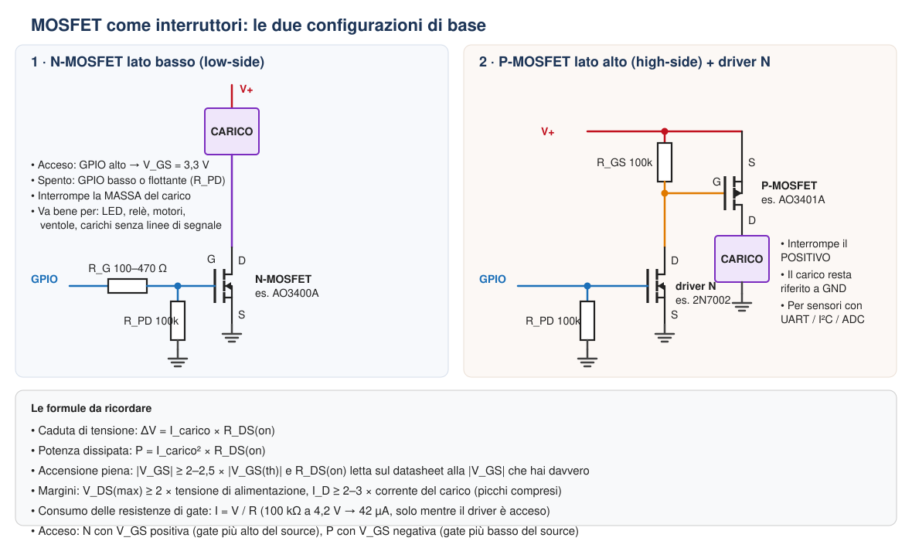

# Dispensa: dimensionare P-MOSFET e N-MOSFET come interruttori

Questa dispensa riassume come scegliere e dimensionare un MOSFET usato come **interruttore** comandato da un microcontrollore (ESP32 a 3,3 V) in un circuito a batteria. Gli esempi numerici sono presi dal progetto descritto nel [README](README.md): load sharing (Q1), partitore attivabile (Q2, Q3), alimentazione dell'SDS011 (Q4, Q5).

  

---

## 1. Il MOSFET in breve

Un MOSFET ha tre terminali:

- **Gate (G):** il comando. Non assorbe corrente in modo continuo: si comporta come un piccolo condensatore che va caricato e scaricato.
- **Drain (D)** e **Source (S):** i due capi dell'interruttore. Quando il MOSFET è acceso, tra loro c'è una resistenza piccolissima, la **RDS(on)**.

A comandarlo è la tensione **tra gate e source (VGS)**, non la tensione del gate rispetto a massa. Questo è il punto da cui dipende tutto il resto.

| | N-MOSFET | P-MOSFET |
|---|---|---|
| Si accende quando | il gate è **più alto** del source (VGS > 0) | il gate è **più basso** del source (VGS < 0) |
| Source collegato tipicamente a | **GND** | **V+** (alimentazione) |
| Posizione tipica | **lato basso**: tra carico e massa | **lato alto**: tra alimentazione e carico |
| A parità di dimensioni | RDS(on) più bassa | RDS(on) un po' più alta |

Ogni MOSFET contiene anche un **diodo interno (body diode)** tra drain e source:
- nel **N-MOSFET** l'anodo è sul source e il catodo sul drain;
- nel **P-MOSFET** l'anodo è sul drain e il catodo sul source.

Anche con il MOSFET spento, questo diodo conduce se la tensione ha il verso "giusto". Bisogna sempre tenerne conto quando si sceglie l'orientamento.

---

## 2. Lato basso o lato alto?

### N-MOSFET lato basso (schema 1)

Il carico sta tra V+ e il drain, il source va a GND. Il GPIO comanda direttamente il gate.

- ✅ È il più semplice: basta un componente, perché VGS = tensione del GPIO.
- ✅ Gli N-MOSFET hanno RDS(on) più basse e costano meno.
- ❌ Interrompe la **massa** del carico. Quando è spento, il carico "galleggia" verso V+.

Va bene per carichi "stupidi": LED, relè, motori, ventole, buzzer.

### P-MOSFET lato alto con driver N (schema 2)

Il P-MOSFET sta tra V+ e il carico, che resta collegato a GND. Un piccolo N-MOSFET comandato dal GPIO porta il gate del P a massa per accenderlo.

- ✅ Il carico resta **sempre riferito a GND**. È indispensabile quando il carico ha linee di segnale verso l'ESP32 (UART, I²C, ADC).
- ✅ Il driver N permette di commutare tensioni più alte di quella del GPIO.
- ❌ Servono due transistor e una resistenza in più.

> ⚠️ **Perché non si può usare un N lato basso per un sensore con UART o I²C.** Con la massa interrotta, il sensore cerca un'altra strada verso GND e la trova attraverso le linee di segnale e i diodi di protezione dei pin dell'ESP32. Il risultato sono letture sbagliate, consumi anomali o pin danneggiati. È lo stesso motivo per cui nel partitore attivabile l'interruttore è sul lato batteria: un N verso massa lascerebbe GPIO33 "appeso" a VBAT attraverso R1, con fino a 4,2 V sul pin.

### Perché non pilotare il P direttamente dal GPIO?

Per spegnere un P-MOSFET il gate deve arrivare alla stessa tensione del source. Se il source è a VBAT (fino a 4,2 V) e il GPIO arriva solo a 3,3 V, resta VGS ≈ –0,9 V: abbastanza vicino alla soglia da lasciare il P **mezzo acceso**. Il driver N risolve il problema: da spento lascia che RGS porti il gate esattamente a V+.

Si può pilotare il P direttamente dal GPIO solo se V+ ≤ 3,3 V, cioè se l'alimentazione da commutare non supera quella dell'ESP32.

---

## 3. I parametri del datasheet, uno per uno

### 3.1 VDS(max): tensione massima drain-source

È la tensione massima che il MOSFET regge da spento.
**Regola:** VDS(max) ≥ **2 ×** la tensione più alta del circuito, per assorbire picchi e transitori.
*Nel progetto:* al massimo circa 6,5 V (pannello a vuoto). Un MOSFET da 20–30 V va benissimo.

### 3.2 ID: corrente di drain

È la corrente continua massima.
**Regola:** ID ≥ **2–3 ×** la corrente del carico, **picchi compresi** (spunto di motori e ventole, carica dei condensatori, picchi del WiFi).
Il valore in prima pagina del datasheet è misurato con il contenitore tenuto a 25 °C. Su un SOT-23 saldato su millefori la corrente reale sostenibile è molto più bassa: conta la verifica della potenza (punto 3.5).

### 3.3 VGS(th): tensione di soglia

È la tensione a cui il MOSFET **comincia** a condurre, tipicamente con una corrente minima di 250 µA.

⚠️ **Non è la tensione a cui il MOSFET è acceso del tutto.** A VGS(th) conduce appena. È l'errore più comune.

**Regola:** la |VGS| disponibile deve essere almeno **2–2,5 ×** la |VGS(th)| **massima** (non quella tipica). Con il GPIO a 3,3 V, oppure con una LiPo quasi scarica a circa 3,0 V, servono MOSFET **logic level**, con VGS(th) massima intorno a 1–1,5 V.

### 3.4 RDS(on): resistenza da acceso

È la resistenza tra drain e source con il MOSFET acceso. Il datasheet la riporta **a diverse VGS**, per esempio a 10 V, 4,5 V e 2,5 V.

**Regola:** usa il valore misurato alla VGS **che hai davvero** nel circuito. Se il datasheet la specifica solo a 10 V, il MOSFET non è adatto a 3,3 V.

Da RDS(on) ricavi:

- **la caduta di tensione:** ΔV = I × RDS(on)
- **la potenza dissipata:** P = I² × RDS(on)

Tieni conto che RDS(on) **aumenta con la temperatura**: a 100 °C è circa 1,5 volte il valore a 25 °C.

### 3.5 Potenza e temperatura

Un SOT-23 su una scheda senza grandi aree di rame dissipa senza problemi **qualche centinaio di mW**.
**Regola pratica:** sotto **100 mW** non serve pensarci. Sopra i 200–300 mW conviene un contenitore più grande (SOT-89, SOT-223, DPAK) o un MOSFET con RDS(on) più bassa.

### 3.6 VGS(max): tensione massima gate-source

Il gate è fragile: oltre questa tensione l'isolante si rompe. Tipicamente vale ±8, ±12 o ±20 V.
**Regola:** la |VGS| applicata, cioè la tensione di alimentazione nel caso del P lato alto, deve restare sotto VGS(max) con margine. Con la batteria a 4,2 V e il pannello a 6,5 V, ±12 V basta e avanza.

### 3.7 Body diode

Controlla sempre in che verso conduce e se può creare percorsi indesiderati:

- in un **interruttore lato alto** (P con source a V+), il body diode non conduce da V+ verso il carico: il MOSFET spento isola davvero il carico;
- nel **load sharing** (Q1) il P è montato **al contrario** (drain verso la batteria) proprio per sfruttare il body diode: conduce dalla batteria verso il carico e blocca il verso opposto.

---

## 4. Le resistenze attorno al gate

### Pull-down (N) o pull-up gate-source (P)

Durante il reset, durante il boot e in deep sleep i GPIO dell'ESP32 sono **flottanti**: senza una resistenza il gate prende una tensione casuale.

- **RPD** tra gate e source dell'N: lo tiene **spento** finché il GPIO non lo comanda.
- **RGS** tra gate e source del P: lo tiene **spento** finché il driver N non tira il gate a massa.

**Valore:** **10–100 kΩ**. Nei circuiti a batteria conviene 100 kΩ: quando il driver è acceso, RGS consuma I = V+/R, cioè circa 42 µA a 4,2 V con 100 kΩ, contro 420 µA con 10 kΩ.

### Resistenza in serie al gate (RG)

Una resistenza da **100–470 Ω** tra GPIO e gate:
- limita il picco di corrente con cui il GPIO carica la capacità del gate;
- smorza eventuali oscillazioni con fili lunghi.

Per interruttori lenti (pochi cambi al secondo) e fili corti è **facoltativa**. Nel driver N di uno schema high-side, che pilota solo un gate, si può omettere.

### Accensione lenta (soft-start)

Se il carico ha grossi condensatori in ingresso (un boost, o C6 da 1000 µF per l'SDS011), all'accensione il MOSFET li carica con un picco di corrente che può far scendere la tensione della batteria e resettare l'ESP32. Per rallentare l'accensione:

- aggiungi un condensatore da **10–100 nF tra gate e source del P**. Insieme a RGS rallenta la salita della tensione sul carico;
- oppure scegli un MOSFET con ID abbondante, che regga il picco senza problemi.

---

## 5. Esempi dal progetto

### Q4 + Q5: alimentazione dell'SDS011

| Dato | Valore |
|---|---|
| Tensione | VBAT 3,0–4,2 V |
| Corrente | ~110 mA in funzionamento, picco di qualche centinaio di mA all'avvio del boost |

**Q4 (P, AO3401A)**
- VDS(max) 30 V ≥ 2 × 4,2 V ✅
- VGS disponibile: da –3,0 V (batteria scarica) a –4,2 V. VGS(th) massima circa –1,3 V → rapporto ≥ 2,3 ✅
- RDS(on) a –2,5 V circa 0,1 Ω, a –4,5 V circa 0,06 Ω (valori indicativi da datasheet)
- ΔV = 0,11 A × 0,1 Ω ≈ **11 mV**, P = 0,11² × 0,1 ≈ **1,2 mW** ✅

**Q5 (N, 2N7002)**: pilota solo il gate di Q4
- Corrente: quella di R6, 4,2 V / 100 kΩ = **42 µA**
- VGS = 3,3 V dal GPIO, VGS(th) massima 2,5 V → rapporto 1,3. È basso, ma con 42 µA anche una RDS(on) di qualche ohm dà una caduta di pochi decimi di millivolt ✅

> 💡 Un driver che deve solo "tirare" un gate porta correnti di microampere: va bene quasi qualsiasi piccolo N-MOSFET. Lo stesso 2N7002 **non** andrebbe bene per commutare direttamente l'SDS011: 110 mA × qualche ohm farebbe cadere alcuni decimi di volt, e la corrente sarebbe vicina al suo massimo.

### Q2 + Q3: partitore attivabile

| Dato | Valore |
|---|---|
| Corrente | VBAT / 200 kΩ ≈ **21 µA** |

Qualsiasi P-MOSFET logic level va bene: ΔV = 21 µA × 0,1 Ω ≈ 2 µV, del tutto trascurabile. Qui la scelta si fa sulla **soglia** (accensione piena con la batteria scarica) e sulla **corrente di perdita da spento** (IDSS, tipicamente sotto 1 µA), non su RDS(on).

### Q1: load sharing

| Dato | Valore |
|---|---|
| Corrente | ~80 mA media con il WiFi, picchi di circa 400 mA all'avvio del WiFi |

- ΔV di picco = 0,4 A × 0,08 Ω ≈ **32 mV**, P di picco ≈ **13 mW** ✅
- Confronto con un diodo Schottky al suo posto: circa 0,35 V di caduta, cioè il 10 % della tensione della batteria buttato in calore. Ecco perché qui serve un MOSFET.

### Controesempio: IRF9540 al posto dell'AO3401A

- VGS(th) da –2 a –4 V, e RDS(on) specificata solo a –10 V.
- Con la batteria a 3,5 V, VGS ≈ –3,5 V è **sotto** la soglia massima: il MOSFET potrebbe non accendersi affatto, o restare mezzo acceso e scaldare.
- ❌ È un ottimo MOSFET per 12–24 V, ma non è logic level.

---

## 6. MOSFET consigliati (SOT-23, logic level)

Valori **indicativi**: verifica sempre sul datasheet del produttore esatto, perché lo stesso nome può avere specifiche leggermente diverse.

| Modello | Tipo | VDS | ID | VGS(th) | RDS(on) indicativa | Uso tipico |
|---|---|---|---|---|---|---|
| **AO3401A** | P | –30 V | ~–4 A | –0,5…–1,3 V | ~60 mΩ a –4,5 V, ~100 mΩ a –2,5 V | Interruttore lato alto, load sharing |
| **DMG2305UX** | P | –20 V | ~–4 A | –0,5…–0,9 V | ~50 mΩ a –4,5 V | Alternativa all'AO3401A |
| **AO3400A** | N | 30 V | ~5 A | 0,65…1,45 V | ~30 mΩ a 4,5 V, ~50 mΩ a 2,5 V | Interruttore lato basso per carichi fino a qualche ampere |
| **2N7002** | N | 60 V | ~0,1–0,3 A | 1…2,5 V | qualche Ω | **Solo** driver di gate o segnali |
| **BSS138** | N | 50 V | ~0,2 A | 0,8…1,5 V | qualche Ω | Driver di gate, traslatori di livello |

---

## 7. Checklist di dimensionamento

1. **Posizione:** il carico ha linee di segnale verso l'ESP32? → **P lato alto** con driver N. Altrimenti → **N lato basso**.
2. **VDS(max)** ≥ 2 × la tensione massima del circuito.
3. **ID** ≥ 2–3 × la corrente del carico, picchi compresi.
4. **Logic level:** la |VGS| che hai davvero (3,3 V dal GPIO, o la batteria scarica) è ≥ 2–2,5 × la |VGS(th)| massima.
5. **RDS(on)** letta alla VGS reale → calcola ΔV = I × RDS(on) e verifica che sia accettabile.
6. **Potenza** P = I² × RDS(on) → sotto 100 mW nessun problema in SOT-23.
7. **VGS(max)** > la tensione di alimentazione commutata, con margine.
8. **Body diode:** controlla in che verso conduce, e che non crei percorsi indesiderati.
9. **Pull-down / pull-up** sul gate da 100 kΩ, per uno stato definito in reset e deep sleep.
10. **Picco di accensione:** se il carico ha grossi condensatori, valuta il soft-start.
11. **Linee di segnale:** prima di spegnere un carico, metti in ingresso (alta impedenza) i GPIO collegati a lui, per non alimentarlo attraverso i segnali.
