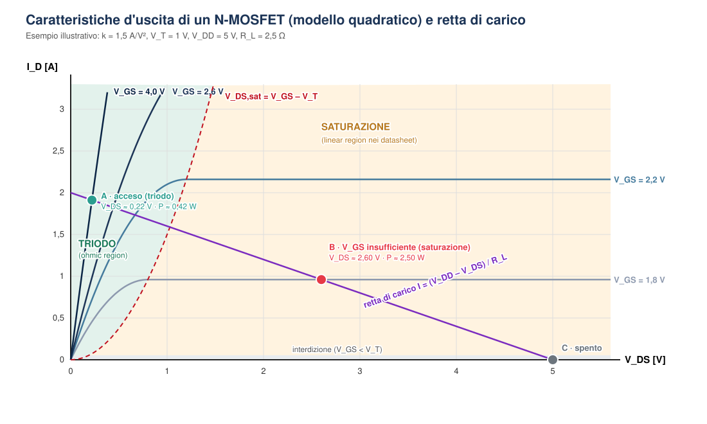

# Approfondimento: perché la regola 2–2,5× — il modello quadratico e la zona di triodo

Nella [dispensa MOSFET](MOSFET.md) la regola "|VGS| ≥ 2–2,5 × |VGS(th)|" è presentata come regola pratica. Questo approfondimento ne mostra la **base teorica**: con il modello quadratico del MOSFET (quello "a canale lungo" dei libri di testo) si ricava la VGS minima che tiene il MOSFET in **zona di triodo**, cioè acceso come un interruttore chiuso, con una certa corrente. Si vede anche perché, nella pratica, a quel valore si aggiunge un margine.

Le formule si riferiscono a un **N-MOSFET ad arricchimento**. Per un P-MOSFET valgono le stesse relazioni con tensioni e correnti cambiate di segno.

---

## 1. Le tre zone di funzionamento

Si definisce la **tensione di overdrive** Vov = VGS – VT, cioè di quanto la tensione di gate supera la soglia, e la costante del dispositivo:

k = ½ · μn · Cox · W / L   [A/V²]

| Zona | Condizioni | Corrente di drain | Stato dell'interruttore ([punto 3.0](MOSFET.md#30-i-tre-stati-dellinterruttore-quando-si-raggiungono-i-limiti)) |
|---|---|---|---|
| **Interdizione** | VGS < VT | ID ≈ 0 | **Spento** |
| **Triodo** | VGS > VT e VDS < Vov | ID = k · (2 Vov VDS – VDS²) | **Acceso** (interruttore chiuso) |
| **Saturazione** | VGS > VT e VDS ≥ Vov | ID = k · Vov² (non dipende da VDS) | **Transizione**, o MOSFET pilotato male. È invece la zona di lavoro degli **amplificatori** (vedi sotto) |

Il confine tra triodo e saturazione è la curva **VDS,sat = VGS – VT**. Sostituita nella formula della saturazione, dà la parabola ID = k · VDS², tratteggiata nella figura.

> ⚠️ **Trappola di terminologia.** La stessa parola indica cose diverse a seconda del contesto:
>
> | Nella teoria del MOSFET | Nei datasheet e nelle application note di potenza | Nel BJT |
> |---|---|---|
> | **Triodo** | *Ohmic region* | — |
> | **Saturazione** (corrente costante) | ***Linear region*** | Zona attiva |
> | — | — | **Saturazione** = interruttore **chiuso** |
>
> Un MOSFET "in saturazione" è quindi un interruttore **non** completamente chiuso, mentre un BJT "in saturazione" è un interruttore chiuso. Quando i datasheet parlano di *linear mode* (per esempio nelle curve SOA) intendono la saturazione della teoria.

### Che cosa succede fisicamente in saturazione: il generatore di corrente

**Il canale si strozza.** In triodo il canale invertito collega source e drain per tutta la sua lunghezza, e il MOSFET si comporta come una resistenza comandata da VGS. Quando VDS raggiunge VGS – VT, la tensione tra gate e drain scende alla soglia (VGD = VT): vicino al drain il canale non è più invertito e si **strozza** (*pinch-off*).

**La tensione in più cade sulla zona di svuotamento.** Se VDS cresce ancora, l'aumento cade quasi tutto sulla piccola **zona di svuotamento** tra la fine del canale e il drain. Gli elettroni che arrivano al bordo del canale vengono trascinati al drain dal campo elettrico intenso di quella zona. La corrente è quindi fissata dalla carica che il gate induce nel canale, cioè da VGS, e quasi non dipende più da VDS: le curve della figura diventano orizzontali.

**Il risultato è un generatore di corrente pilotato in tensione:**

- per grandi segnali, ID = k · (VGS – VT)²;
- per piccoli segnali attorno a un punto di lavoro, id = gm · vgs, con **gm = 2k · Vov** (transconduttanza).

È la zona usata negli **amplificatori**, analoga alla **zona attiva del BJT**, dove IC = β · IB è un generatore di corrente pilotato in corrente.

**Il generatore non è ideale.** Aumentando VDS, la zona strozzata si allarga e il canale efficace si accorcia (*modulazione della lunghezza di canale*). La corrente cresce leggermente:

ID ≈ k · Vov² · (1 + λ · VDS)

con λ parametro del dispositivo. Ne risulta una resistenza d'uscita finita ro ≈ 1 / (λ · ID). È l'analogo dell'**effetto Early** nel BJT.

**"Lineare" vale per i piccoli segnali.** Per grandi segnali la legge è quadratica, non lineare. Il nome *linear region* usato nei datasheet di potenza viene dall'impiego come amplificatore o come regolatore lineare, non da una proporzionalità tra VGS e ID.

### Interruttore o amplificatore: le zone "incrociate"

| | Funzionamento da amplificatore (generatore di corrente) | Funzionamento da interruttore chiuso |
|---|---|---|
| **BJT** | Zona attiva | **Saturazione** |
| **MOSFET** | **Saturazione** | Triodo (*ohmic region*) |

Per l'interruttore, la saturazione del MOSFET è la zona da **attraversare in fretta** (la transizione) o da **evitare** (VGS insufficiente, punto B della figura). Proprio perché lì il MOSFET si comporta da generatore di corrente, limita la corrente del carico e "assorbe" la differenza di tensione, dissipando VDS · I. Per l'amplificatore è invece la zona di lavoro, in cui si fissa il punto di riposo con la polarizzazione.

---

## 2. La figura: caratteristiche d'uscita e retta di carico

  

La figura usa valori scelti per essere leggibili (k = 1,5 A/V², VT = 1 V): **non** rappresenta un MOSFET reale, che a parità di scala avrebbe le curve di triodo quasi verticali.

Il MOSFET e il carico RL sono in serie su VDD, quindi il punto di lavoro deve stare sia su una curva del MOSFET sia sulla **retta di carico**:

ID = (VDD – VDS) / RL

che va da (0 V; VDD/RL) a (VDD; 0 A). I tre punti segnati corrispondono ai tre stati dell'interruttore:

- **C · spento:** VGS < VT, corrente nulla, VDS = VDD. Tutta la tensione è ai capi del MOSFET, ed è qui che conta VDS(max).
- **A · acceso, in triodo (VGS = 4 V):** la curva incontra la retta molto vicino all'asse verticale. VDS ≈ 0,22 V e il MOSFET dissipa circa 0,42 W, mentre quasi tutta la tensione va al carico.
- **B · VGS insufficiente (1,8 V):** la corrente di saturazione a quella VGS, k · 0,8² ≈ 0,96 A, è **minore** di quella che il carico vorrebbe (fino a 2 A). Il punto di lavoro finisce in saturazione: il MOSFET limita la corrente, VDS ≈ 2,6 V e dissipa circa **2,5 W**, sei volte più che nel punto A, e il carico riceve meno corrente del previsto.

Durante l'accensione e lo spegnimento il punto di lavoro percorre tutta la retta, da C ad A e ritorno, attraversando la saturazione: è per questo che la **transizione** è lo stato in cui tensione e corrente sono alte insieme.

---

## 3. La condizione per restare in triodo

Il punto B mostra il rischio principale. La corrente che il circuito "chiede" è

I = VDD / (RL + Ron)

e il MOSFET resta in triodo solo se è in grado di erogarla, cioè se la corrente di saturazione alla VGS applicata è maggiore:

I < ID,sat(VGS) = k · (VGS – VT)²

Se la condizione non è rispettata il MOSFET **esce dal triodo da solo**: limita la corrente, VDS sale e la potenza VDS · I diventa grande. È il motivo per cui un MOSFET pilotato con una VGS troppo bassa scalda, anche se "è acceso".

Risolvendo la condizione rispetto a VGS si ottiene la **VGS minima** per una corrente I:

**VGS,min = VT + √(I / k)**

Al limite (VGS = VGS,min) il MOSFET sta proprio sul confine con la saturazione, e la sua VDS vale già Vov: non è ancora un buon interruttore. Per avere una VDS piccola bisogna stare **ben sopra** questo valore, cioè VGS ≫ VGS,min.

---

## 4. La resistenza da acceso nel modello

In triodo profondo, con VDS ≪ Vov, il termine VDS² è trascurabile e il MOSFET si comporta come una resistenza:

ID ≈ 2k · Vov · VDS   →   **RDS(on) = 1 / [2k · (VGS – VT)]**

La formula conferma due fatti usati nella dispensa:

- RDS(on) **diminuisce** all'aumentare di VGS: un valore del datasheet garantito a una VGS più bassa della tua è un limite superiore sicuro ([passo 3, vincolo 2](MOSFET.md#54-la-procedura-passo-per-passo));
- RDS(on) cresce molto quando VGS si avvicina alla soglia: con Vov che tende a zero, la resistenza tende all'infinito.

---

## 5. Come ricavare k dal datasheet

k non compare nel datasheet: si ricava da altri dati, in tre modi. **Ogni metodo dà un valore diverso**, perché il modello quadratico descrive i MOSFET di potenza solo in modo approssimato (punto 7).

| Metodo | Dato del datasheet | Formula | Note |
|---|---|---|---|
| 1 · Caratteristica di trasferimento | Grafico *"Transfer Characteristics"* (ID in funzione di VGS): un punto (VGS,on; ID,on) in saturazione | k = ID,on / (VGS,on – VT)² | Il più diretto: usa la zona che interessa per la condizione del punto 3 |
| 2 · Resistenza da acceso | RDS(on) a una certa VGS, dalla tabella | k = 1 / [2 · RDS(on) · (VGS – VT)] | Valido perché RDS(on) si misura in triodo con VDS piccola |
| 3 · Transconduttanza | gfs a una corrente ID | k = gfs² / (4 · ID) | Da gm = 2k Vov e ID = k Vov² |

Nel modello vale anche k = 1 / (4 · ID · RDS²), perché la transconduttanza in saturazione (2k Vov) e la conduttanza in triodo (1/RDS = 2k Vov) coincidono alla stessa VGS. Su un MOSFET reale questa uguaglianza è solo approssimata.

---

## 6. Forme equivalenti di VGS,min, e una da evitare

**VGS,min = VT + √(I / k)** è la forma di riferimento.

**VGS,min = VT + 2 · RDS · I** è equivalente: con RDS = 1/(2k Vov) si ha 2 RDS I = I/(k Vov), che uguagliato a Vov riporta a Vov² = I/k. Però è **circolare**: RDS dipende dalla VGS che si sta cercando, e la formula vale solo con RDS valutata alla VGS,min stessa. Se ci si mette la RDS(on) del datasheet, misurata a 4,5 V o 10 V, cioè con una resistenza più bassa, si ottiene una VGS,min **troppo ottimistica**.

**Da evitare: ID = IDSS · (1 – VGS/VT)².** È l'equazione di Shockley dei **JFET e dei MOSFET a svuotamento**, dove IDSS è la corrente con VGS = 0. In un MOSFET ad arricchimento, con VGS = 0 la corrente è nulla. L'uguaglianza regge solo definendo IDSS ≡ k · VT², che non ha un significato fisico. Inoltre **nei datasheet dei MOSFET IDSS indica la corrente di perdita da spento**, dell'ordine di nA–µA: usare lo stesso simbolo con due significati genera confusione. Se si vuole questa forma, conviene chiamare la costante in un altro modo, per esempio I0 = k · VT², da cui VGS,min = VT · (1 + √(I / I0)).

---

## 7. Dal modello alla regola 2–2,5×

Il modello dà una VGS,min precisa, ma nella pratica si aggiunge un margine generoso, per quattro motivi:

1. **Il modello quadratico descrive male i MOSFET di potenza.** Nei componenti verticali, trench e a canale corto la corrente cresce in modo più vicino a (VGS – VT)α, con α tra 1 e 2. Le formule danno ordini di grandezza, non valori di progetto.
2. **VT del modello non è la VGS(th) del datasheet.** Il datasheet misura la soglia a una corrente minima (tipicamente 250 µA), mentre nel modello VT è una soglia estrapolata.
3. **La soglia ha una dispersione ampia** (un fattore 2–3 tra esemplari) e **diminuisce con la temperatura**.
4. **Stare al confine non basta:** a VGS,min il MOSFET è appena in triodo, con VDS = Vov. Per essere un buon interruttore deve stare in triodo **profondo**.

La regola "|VGS| ≥ 2–2,5 × |VGS(th),max|" copre tutti e quattro gli aspetti senza doverli calcolare. Per il dimensionamento vero restano più affidabili i grafici del datasheet: *RDS(on) vs VGS* e *Output Characteristics*.

---

## 8. Esempio: AO3400A pilotato da un GPIO a 3,3 V

Valori **indicativi**: VGS(th),max ≈ 1,45 V, usata come VT; RDS(on) ≈ 50 mΩ a VGS = 2,5 V.

| Passo | Calcolo | Risultato |
|---|---|---|
| k con il metodo 2 | 1 / [2 × 0,05 × (2,5 – 1,45)] | ≈ **9,5 A/V²** |
| Corrente di saturazione a 3,3 V | 9,5 × (3,3 – 1,45)² | ≈ **32 A** |
| Condizione di triodo con la pompa dell'[esercizio 1](MOSFET.md#esercizio-1--low-side-pompa-per-irrigazione-a-12-v) (spunto 3 A) | 3 A < 32 A | ✅ ben dentro il triodo |
| VGS,min per 3 A | 1,45 + √(3 / 9,5) | ≈ **2,0 V**, circa 1,4 volte la soglia |

Il GPIO dà 3,3 V, circa 2,3 volte la soglia massima: rispetta la regola pratica e sta ben sopra la VGS,min teorica. Il margine tra 2,0 V e 3,3 V copre i limiti del modello elencati al punto 7.

---

## 9. Il confronto con il BJT

Nel BJT usato come interruttore la condizione analoga è la **sovrasaturazione**: la corrente di base deve essere abbondantemente superiore a IC/β, così il transistor resta saturo (cioè chiuso) anche con β minimo. Nel MOSFET il ruolo della corrente di base lo ha la tensione VGS: deve superare abbondantemente VGS,min.

Il vantaggio del MOSFET è che, una volta carico il gate, per restare acceso **non serve corrente continua**: il GPIO non deve fornire alcuna corrente di pilotaggio a regime, mentre la base di un BJT assorbe corrente per tutto il tempo in cui è acceso.
