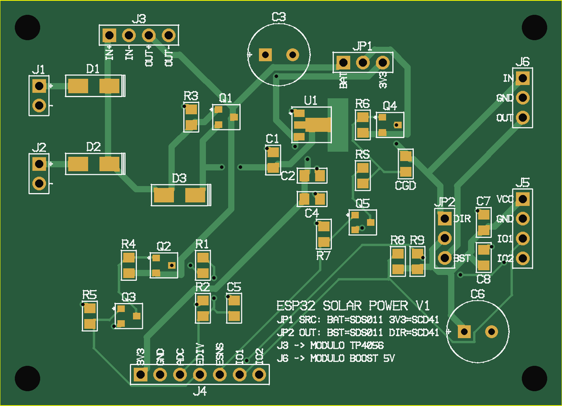
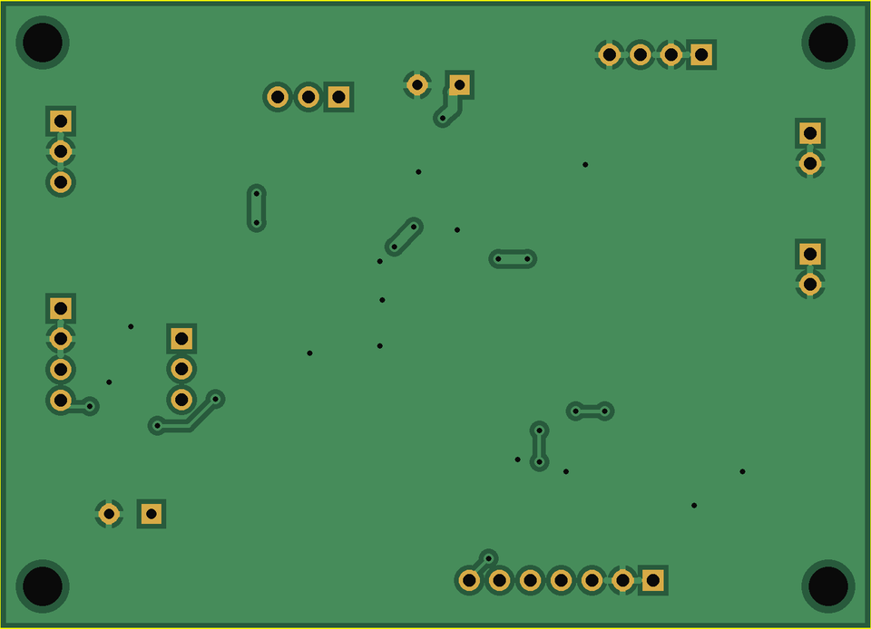

# Circuito stampato: modulo di alimentazione ESP32 solare

Stampato a due strati che raccoglie tutto il progetto del [panel2esp32.md](panel2esp32.md) su una scheda unica:

- ingressi da **pannello solare** e **USB**, uniti dai diodi D1 e D2;
- collegamento al modulo **TP4056**;
- **load sharing** (Q1, D3, R3);
- regolatore **HT7833** a 3,3 V;
- **partitore attivabile** per la lettura della batteria (Q2, Q3);
- **interruttore con soft-start** per un sensore (Q4, Q5, R<sub>S</sub>, C<sub>GD</sub>).

L'uscita per il sensore si configura con due ponticelli: funziona sia con un sensore "pesante" a 5 V come l'**SDS011** (tramite un modulo boost esterno) sia con un sensore a basso consumo a 3,3 V come l'**SCD41**.

È un **modulo separato**: si collega con fili o connettori a qualunque scheda ESP32 (DevKit, Heltec…).

<p align="center">
  
  
</p>

*Le due immagini sono ricavate rileggendo i file Gerber definitivi: a sinistra il lato superiore, a destra quello inferiore visto da sotto, con il piano di massa.*

---

## File per la produzione

Tutto è nella cartella [`pcb/gerber/`](pcb/gerber/):

| File | Contenuto |
|---|---|
| **`esp32_solar_gerber.zip`** | **Il file da caricare sul sito del fornitore** |
| `esp32_solar.GTL` / `.GBL` | Rame lato superiore / inferiore |
| `esp32_solar.GTS` / `.GBS` | Maschera di saldatura superiore / inferiore |
| `esp32_solar.GTO` | Serigrafia (lato superiore) |
| `esp32_solar.GTP` | Pasta saldante (serve solo per lo stencil) |
| `esp32_solar.GKO` | Contorno della scheda |
| `esp32_solar-PTH.DRL` / `-NPTH.DRL` | Fori metallizzati / fori di fissaggio non metallizzati (Excellon) |
| `BOM.csv` | Distinta dei componenti |

### Come ordinare

1. Carica `esp32_solar_gerber.zip` sul sito del fornitore (JLCPCB, PCBWay, ecc.).
2. Imposta: **2 strati**, spessore **1,6 mm**, rame **1 oz**, finitura **HASL** (o *lead free* HASL), colore a piacere. Le altre opzioni restano quelle standard.
3. **Controlla l'anteprima che il sito genera dal file**: deve corrispondere alle immagini qui sopra (contorno 72 × 52 mm, quattro fori di fissaggio, piano di massa sul lato inferiore).
4. Lo stencil e il montaggio da parte del fornitore non servono: i componenti si saldano a mano.

### Caratteristiche e regole di progetto

| Voce | Valore |
|---|---|
| Dimensioni | 72 × 52 mm, 4 fori di fissaggio Ø 3,2 mm (viti M3) |
| Strati | 2: segnali sul lato superiore, **piano di massa** sul lato inferiore |
| Isolamento minimo rame-rame | 0,25 mm |
| Larghezza piste | 0,8 mm alimentazioni, 0,6 mm massa, 0,3 mm segnali |
| Via | foro 0,4 mm, corona 0,8 mm, coperte dalla maschera |
| Distanza rame-bordo | ≥ 0,4 mm (piano arretrato di 0,5 mm) |

Sono valori larghi rispetto alle capacità standard dei fornitori più comuni, che arrivano a circa 0,13 mm di isolamento e 0,3 mm di foro.

---

## Connettori

Tutti i connettori sono a pettine con passo 2,54 mm. Si possono saldare i fili direttamente o montare connettori maschio o femmina.

| Connettore | Pin | Collegamento |
|---|---|---|
| **J1 SOLAR** | 1 `+` · 2 `−` | Pannello solare 6 V |
| **J2 USB 5V** | 1 `+` · 2 `−` | 5 V da cavo USB tagliato (rosso +, nero −) |
| **J3 TP4056** | 1 `IN+` · 2 `IN−` · 3 `OUT+` · 4 `OUT−` | Alle piazzole omonime del modulo TP4056. **La batteria va solo su B+/B− del modulo** |
| **J4 ESP32** | 1 `3V3` · 2 `GND` · 3 `ADC` · 4 `EDIV` · 5 `ESNS` · 6 `IO1` · 7 `IO2` | 3V3 → pin 3V3 dell'ESP32; ADC → GPIO33 (o un altro pin ADC1); EDIV → GPIO del partitore (es. GPIO25); ESNS → GPIO del sensore (es. GPIO26); IO1/IO2 → GPIO per il sensore (UART o I²C) |
| **J5 SENSOR** | 1 `VCC` · 2 `GND` · 3 `IO1` · 4 `IO2` | Al sensore. IO1 e IO2 passano direttamente da J4 |
| **J6 BOOST** | 1 `IN` · 2 `GND` · 3 `OUT` | Al modulo boost 5 V (solo per l'SDS011): IN → piazzola + d'ingresso, OUT → +5 V d'uscita |
| **JP1 SRC** | `BAT` – centro – `3V3` | Ponticello: da dove l'interruttore prende l'alimentazione |
| **JP2 OUT** | `DIR` – centro – `BST` | Ponticello: uscita diretta o attraverso il boost |

> ⚠️ Il connettore micro-USB del modulo TP4056 **non** va usato: l'USB entra da J2, attraverso il diodo D2 (vedi il README).

---

## Configurazione dei ponticelli

| | **SDS011** (5 V, ~110 mA dalla batteria) | **SCD41** (3,3 V, picchi ~200 mA) |
|---|---|---|
| **JP1** | `BAT`: la batteria alimenta il boost | `3V3`: il sensore è alimentato dai 3,3 V regolati |
| **JP2** | `BST`: il sensore riceve i 5 V del boost | `DIR`: uscita diretta dell'interruttore |
| **J6** | Modulo boost collegato | Vuoto |
| **C6** (470 µF) | Montato | Facoltativo (bastano C7 e C8) |
| **R8, R9** | **Non montate** (IO1/IO2 sono la seriale) | 4,7 kΩ **solo se** la scheda del sensore non ha già le resistenze di pull-up I²C |
| **IO1 / IO2** | TX e RX della seriale (incrociati verso il sensore) | SDA e SCL |

> ⚠️ **Non usare JP1 = `BAT` con JP2 = `DIR` con l'SCD41**: il sensore riceverebbe fino a 4,2 V e le sue linee I²C lavorerebbero a quella tensione, oltre i 3,3 V dell'ESP32.

### Note per l'SCD41

- **Picchi di corrente.** L'SCD41 assorbe picchi di 175–205 mA a 3,3 V, che si sommano a quelli del WiFi dell'ESP32 sull'HT7833 (500 mA). Conviene **non trasmettere in WiFi durante la misura** del sensore.
- **Ripple.** Il datasheet chiede un'ondulazione sull'alimentazione inferiore a 30 mV: C7 (10 µF) e C8 (100 nF) vanno montati, e il sensore va collegato con fili corti.
- **Spegnimento completo o comando di power-down.** Con l'interruttore il sensore si spegne del tutto tra una misura e l'altra. L'SCD41 offre anche le modalità *single shot* e *power_down / wake_up* (circa 0,45 mA medi con una misura ogni 5 minuti, secondo il datasheet). Per gli algoritmi di autocalibrazione (ASC) e per la prima lettura dopo l'accensione o il risveglio, segui le indicazioni del datasheet Sensirion sui modi a basso consumo. Se preferisci lasciarlo sempre alimentato, tieni ESNS a livello alto.

---

## Distinta dei componenti

| Riferimenti | Q.tà | Componente | Contenitore |
|---|---|---|---|
| D1 D2 D3 | 3 | Diodo Schottky **SS34** (3 A, 40 V) | SMA |
| Q1 Q2 Q4 | 3 | P-MOSFET **AO3401A** | SOT-23 |
| Q3 Q5 | 2 | N-MOSFET **2N7002** (o BSS138) | SOT-23 |
| U1 | 1 | Regolatore LDO **HT7833** (3,3 V, 500 mA) | SOT-89-3 |
| R1 R2 R3 R4 R5 R6 R7 | 7 | Resistenza 100 kΩ 1 % | 0805 |
| RS | 1 | Resistenza 10 kΩ 1 % | 0805 |
| R8 R9 | 2 | Resistenza 4,7 kΩ (**opzionali**, pull-up I²C) | 0805 |
| C1 C2 C7 | 3 | Condensatore ceramico 10 µF ≥ 10 V X5R/X7R | 0805 |
| C4 C5 C8 | 3 | Condensatore ceramico 100 nF X7R | 0805 |
| CGD | 1 | Condensatore ceramico 1 µF ≥ 10 V X7R | 0805 |
| C3 C6 | 2 | Condensatore elettrolitico 470 µF ≥ 10 V, Ø 8 mm, passo 3,5 mm | radiale |
| J1 J2 | 2 | Connettore a pettine 1×2, passo 2,54 mm | THT |
| J6 JP1 JP2 | 3 | Connettore a pettine 1×3 | THT |
| J3 J5 | 2 | Connettore a pettine 1×4 | THT |
| J4 | 1 | Connettore a pettine 1×7 | THT |
| — | 2 | Cappuccio per ponticello 2,54 mm (JP1, JP2) | — |

> ⚠️ **Verifica la piedinatura dell'HT7833 che compri.** Lo stampato usa quella del datasheet Holtek per il contenitore SOT-89: pin 1 = GND, pin 2 (linguetta) = VIN, pin 3 = VOUT. Regolatori "equivalenti" di altri produttori in SOT-89 possono avere i pin in un altro ordine.

---

## Montaggio

**Ordine consigliato** (dal componente più basso al più alto, così la scheda appoggia sempre piana):

1. Resistenze e condensatori 0805.
2. MOSFET SOT-23 (Q1–Q5): il **puntino** in serigrafia indica il pin 1 (gate).
3. HT7833 (U1): il **puntino** indica il pin 1 (GND); la linguetta va sulla piazzola grande, verso l'area di rame di dissipazione.
4. Diodi SMA (D1–D3): la **barra** in serigrafia indica il catodo, che sul diodo è il lato con la fascia.
5. Connettori a pettine.
6. Elettrolitici C3 e C6: il **pad quadrato** e il segno **+** indicano il positivo.

**Prima accensione**, senza ESP32 e senza sensore:

1. Con il tester in continuità, controlla che non ci siano cortocircuiti tra 3V3 e GND, tra OUT+ (J3.3) e GND e tra USB+ (J2.1) e GND.
2. Collega il modulo TP4056 a J3 e la batteria al TP4056.
3. Misura **3V3 su J4.1: 3,25–3,35 V**.
4. Collega l'USB a J2: il LED rosso del TP4056 si accende e 3V3 resta stabile.
5. Solo a questo punto collega l'ESP32 e il sensore.

---

## Come è stato prodotto, e cosa controllare

I file sono generati da script Python nella cartella [`pcb/`](pcb/), senza un programma CAD:

| Script | Funzione |
|---|---|
| `board.py` | Impronte con le dimensioni della libreria ufficiale di KiCad (SOT-23, SOT-89-3, SMA, 0805 *HandSolder*, elettrolitico D8 P3,5, connettori 2,54 mm), componenti, collegamenti e piazzamento |
| `route.py` | Sbroglio automatico su griglia da 0,2 mm (A*, due strati) e vie di massa |
| `drc.py` | Verifica indipendente: distanze esatte tra tutte le geometrie, continuità di ogni rete, continuità del piano di massa |
| `gerber.py` | Scrittura di Gerber, forature, distinta |
| `gview.py` | Rilettura dei Gerber e delle forature per produrre le immagini di controllo |

Il controllo (`drc.py`) è stato a sua volta verificato introducendo di proposito un'interruzione, un cortocircuito e un taglio del piano di massa: li ha segnalati tutti e tre. Sulla scheda finale non riporta errori.

Restano comunque due controlli da fare tu, perché non è stato usato un CAD commerciale con il suo DRC:

- l'**anteprima del fornitore** dopo il caricamento (punto 3 di "Come ordinare");
- la **piedinatura dell'HT7833** acquistato, come indicato sopra.

Per rigenerare i file dopo una modifica (servono Python 3, numpy e Pillow):

```bash
cd pcb
python3 route.py    # sbroglio  -> routing.json
python3 drc.py      # verifica: deve stampare "Nessun errore."
python3 gerber.py   # Gerber, forature e BOM in gerber/
```
