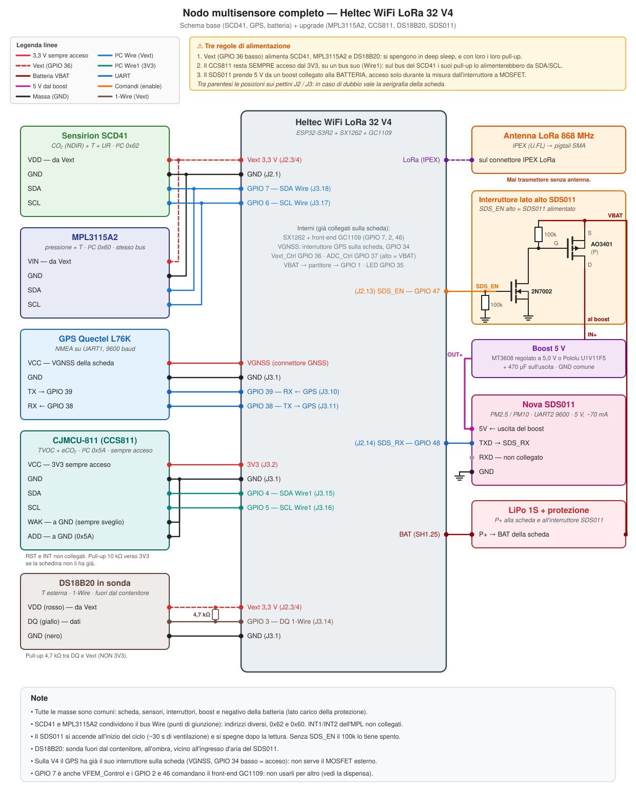
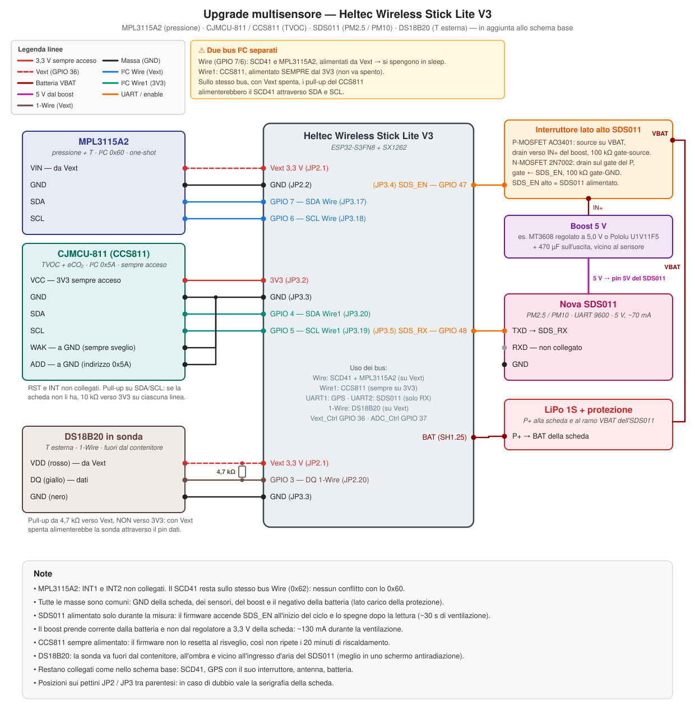
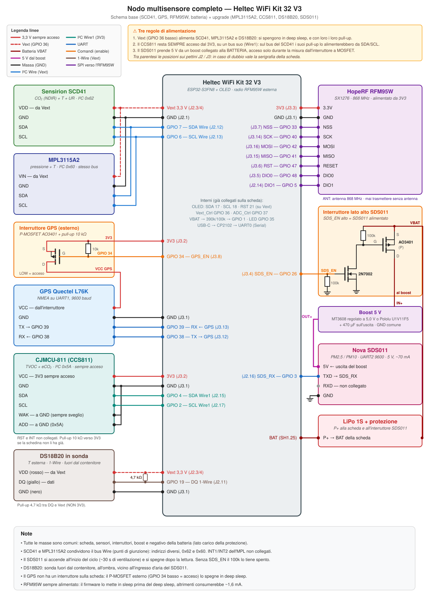
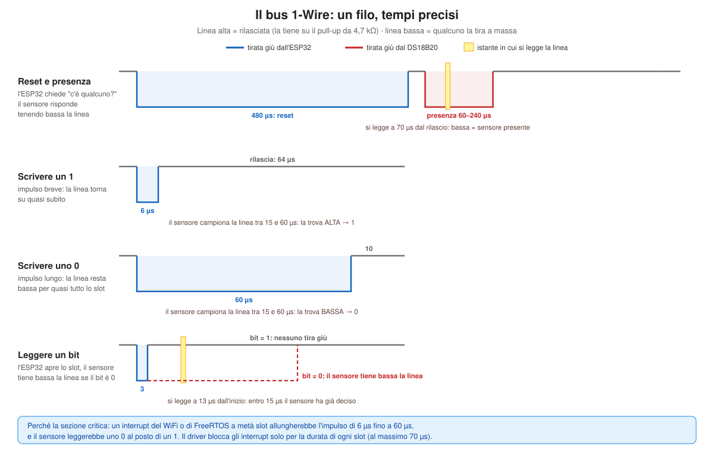
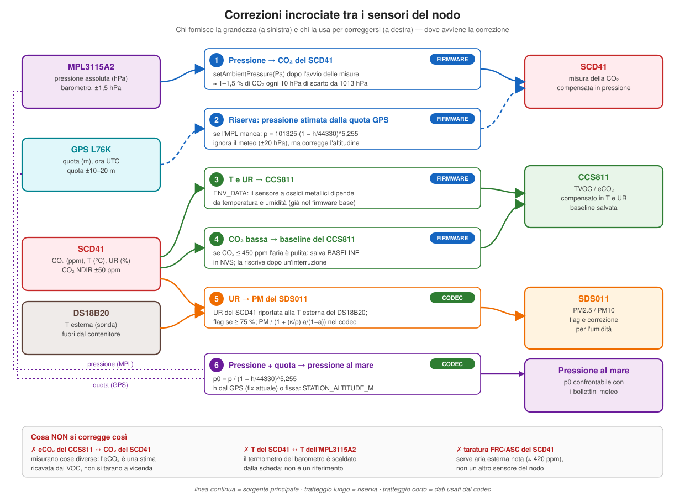
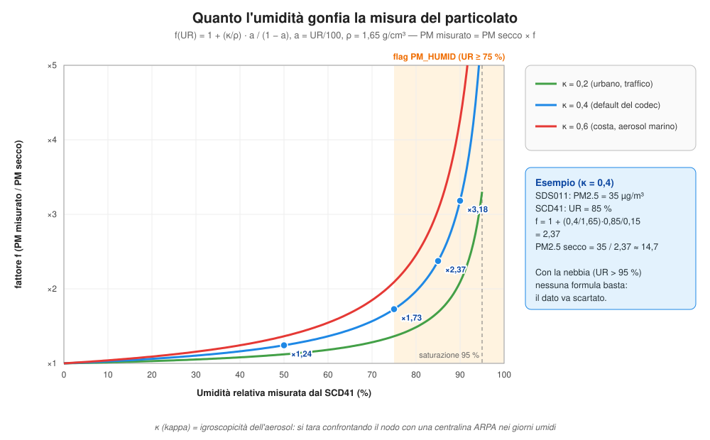
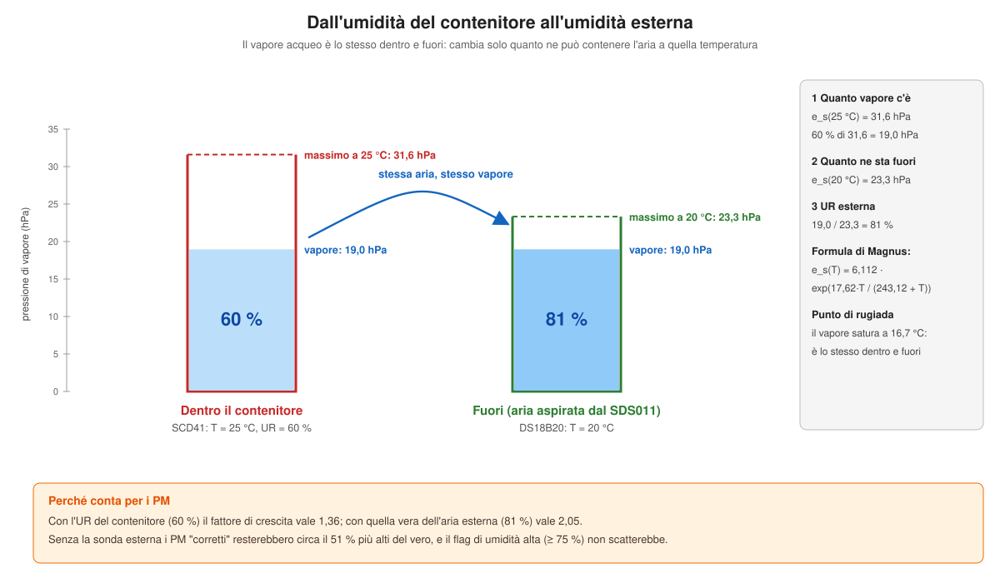

# Upgrade multisensore: SDS011, CCS811, MPL3115A2 e DS18B20 sul nodo LoRaWAN

Questa dispensa descrive l'**upgrade** del nodo LoRaWAN low-power: al sensore di CO₂ SCD41 e al GPS L76K si aggiungono

- **SDS011** (Nova Fitness): polveri sottili **PM2.5 e PM10**;
- **CJMCU-811** (chip **CCS811** di ScioSense/ams): composti organici volatili **TVOC** ed **eCO₂** stimata;
- **MPL3115A2** (NXP): **pressione atmosferica** e temperatura;
- **DS18B20** (Maxim/Analog Devices) in sonda impermeabile: **temperatura dell'aria esterna**, che serve a ricalcolare l'umidità esterna per la correzione dei PM.

Vale per tutte e tre le schede del progetto, con un firmware per ciascuna:

| Scheda | Dispensa di base | Firmware dell'upgrade |
|---|---|---|
| Heltec WiFi LoRa 32 V4 | [dispensa-firmware-lorawan-lowpower.md](dispensa-firmware-lorawan-lowpower.md) | [`FWs/heltec_v4_multisensor_lorawan.ino`](FWs/heltec_v4_multisensor_lorawan.ino) |
| Heltec Wireless Stick Lite V3 | [dispensa-firmware-lorawan-lowpower-wsl-v3.md](dispensa-firmware-lorawan-lowpower-wsl-v3.md) | [`FWs/heltec_wsl_v3_multisensor_lorawan.ino`](FWs/heltec_wsl_v3_multisensor_lorawan.ino) |
| Heltec WiFi Kit 32 V3 + RFM95W | [dispensa-firmware-lorawan-lowpower-kit32-v3.md](dispensa-firmware-lorawan-lowpower-kit32-v3.md) | [`FWs/heltec_kit32_v3_rfm95_multisensor_lorawan.ino`](FWs/heltec_kit32_v3_rfm95_multisensor_lorawan.ino) |

Il **codec ChirpStack** è unico: [`codecs/chirpstack_codec.js`](codecs/chirpstack_codec.js), aggiornato in modo da decodificare sia i payload vecchi (0x42) sia quelli nuovi (0x44).

Tutto ciò che non è descritto qui (LoRaWAN, OTAA, persistenza, watchdog, downlink, menu seriale, protezione della batteria) funziona esattamente come nella dispensa di base della propria scheda.

## Indice

1. [Upgrade e downgrade: un solo firmware](#upgrade-e-downgrade-un-solo-firmware)
2. [I sensori in breve](#i-sensori-in-breve)
3. [Alimentazione e bus: le scelte di progetto](#alimentazione-e-bus-le-scelte-di-progetto)
4. [Collegamenti per ogni scheda](#collegamenti-per-ogni-scheda)
5. [Il ciclo del firmware con i nuovi sensori](#il-ciclo-del-firmware-con-i-nuovi-sensori)
6. [I driver: come si parla con i sensori](#i-driver-come-si-parla-con-i-sensori)
7. [Il payload 0x44 a blocchi](#il-payload-0x44-a-blocchi)
8. [Payload state 0x43 esteso](#payload-state-0x43-esteso)
9. [Nuovi comandi downlink](#nuovi-comandi-downlink)
10. [Il codec ChirpStack](#il-codec-chirpstack)
11. [Consumi e autonomia](#consumi-e-autonomia)
12. [Limiti delle misure](#limiti-delle-misure)
13. [Correzioni e compensazioni tra sensori](#correzioni-e-compensazioni-tra-sensori)
14. [Verifiche al banco](#verifiche-al-banco)

---

## Upgrade e downgrade: un solo firmware

Invece di scrivere un firmware diverso per ogni combinazione di sensori, il firmware dell'upgrade li contiene **tutti**, ognuno con il proprio interruttore di compilazione:

```cpp
#define ENABLE_SCD41       1   // CO2 / T / RH (Sensirion SCD41, I2C su Vext)
#define ENABLE_GPS         1   // posizione (Quectel L76K, UART1)
#define ENABLE_SDS011      1   // PM2.5 / PM10 (Nova SDS011, UART2, 5 V da boost)
#define ENABLE_CCS811      1   // TVOC / eCO2 (CJMCU-811, I2C Wire1, sempre acceso)
#define ENABLE_MPL3115A2   1   // pressione / T (MPL3115A2, I2C su Vext)
#define ENABLE_DS18B20     1   // T esterna (DS18B20 in sonda, 1-Wire su Vext)
```

Il **downgrade** consiste nel mettere a 0 i sensori che non hai montato:

- i sensori nuovi a 0 **spariscono del tutto** dal binario (`#if ENABLE_... #endif`);
- SCD41 e GPS a 0 restano nel codice ma non vengono mai accesi. Per questo richiedono `ENABLE_SENSOR_DISABLE = 1`, altrimenti la compilazione si ferma con un `#error`;
- un sensore escluso **non compare nel payload**, che diventa più corto (vedi [Il payload 0x44 a blocchi](#il-payload-0x44-a-blocchi)).

Ogni sensore compilato si può poi spegnere anche **a runtime**, con un downlink, senza riflashare (vedi [Nuovi comandi downlink](#nuovi-comandi-downlink)).

I firmware con lo schema 0x42 restano disponibili e invariati: sono la versione "stabile" di partenza. Il codec li decodifica entrambi, quindi un nodo vecchio e uno aggiornato possono convivere sullo stesso Network Server.

Tutti e tre i firmware dell'upgrade sono stati **compilati** con il core esp32 3.3.12 e RadioLib 7.8.1, sia nella configurazione completa sia in quella minima (solo GPS), senza errori né avvisi. Il codec è stato provato con payload generati dalla stessa funzione del firmware. Sul campo, però, i collegamenti vanno verificati al banco (vedi [Verifiche al banco](#verifiche-al-banco)).

---

## I sensori in breve

| | SDS011 | CJMCU-811 (CCS811) | MPL3115A2 | DS18B20 (sonda) |
|---|---|---|---|---|
| Misura | PM2.5 e PM10 (µg/m³) | TVOC (ppb), eCO₂ stimata (ppm) | pressione (hPa), temperatura | temperatura esterna (°C) |
| Principio | diffusione laser, con ventola | ossido metallico riscaldato (MOX) | piezoresistivo MEMS | sensore di temperatura a semiconduttore, ±0,5 °C tra −10 e +85 °C |
| Interfaccia | UART 9600 baud, livelli 3,3 V | I²C, indirizzo **0x5A** (ADD a GND) | I²C, indirizzo **0x60** (fisso) | **1-Wire**: un solo filo dati, pull-up da 4,7 kΩ |
| Alimentazione | **5 V**, circa 70 mA (fino a 100 mA) | 1,8–3,6 V | 1,95–3,6 V | 3,0–5,5 V, ~1 mA durante la conversione |
| Riscaldamento | ~30 s di ventilazione a ogni misura | **20 minuti** dopo ogni accensione | nessuno | nessuno: 750 ms di conversione |
| Come lo spegniamo | togliendo l'alimentazione (interruttore + boost) | **non lo spegniamo**: modo a basso consumo | con Vext, insieme al SCD41 | con Vext |
| Nel payload | PM2.5, PM10 (×10) | eCO₂, TVOC, codice d'errore | pressione (hPa ×10), temperatura (×100) | temperatura esterna (×100) |

Il CJMCU-811 ha anche i pin **WAK**, **INT**, **RST** e **ADD**: WAK e ADD vanno a massa, RST e INT restano scollegati. Sulla scheda dell'MPL3115A2 i due pin in più sono **INT1** e **INT2**, che non servono. La sonda del DS18B20 ha tre fili: di solito **rosso** VDD, **nero** GND e **giallo** (a volte bianco) per i dati, DQ. I colori non sono uno standard: in caso di dubbio vale la scheda del venditore.

---

## Alimentazione e bus: le scelte di progetto

Ogni sensore ha un'esigenza diversa, e il collegamento nasce da queste.

### SDS011: 5 V solo durante la misura

L'SDS011 vuole **5 V** e assorbe circa 70 mA per tutta la misura, con picchi alla partenza della ventola. Il pin 5V delle Heltec ha tensione solo con l'USB collegato, e Vext dà 3,3 V. Per questo serve un **boost a 5 V**.

Il boost non va collegato ai 3,3 V della scheda: chiederebbe al regolatore della Heltec oltre 100 mA in più, insieme ai picchi del WiFi, della radio e del SCD41. Va collegato **alla batteria** (VBAT), attraverso un **interruttore lato alto**:

- un **P-MOSFET AO3401** con il source su VBAT e il drain sull'ingresso del boost, con 100 kΩ tra gate e source;
- un **N-MOSFET 2N7002** che porta a massa il gate del P quando **SDS_EN** è alto, con 100 kΩ tra il suo gate e GND.

Con SDS_EN alto il SDS011 è alimentato; con SDS_EN basso, o con il pin flottante durante il deep sleep, è spento del tutto: non resta nemmeno la piccola corrente del boost a vuoto. È lo stesso circuito dell'uscita sensore dello stampato ([PCB.md](PCB.md), ponticello JP1 su BAT e JP2 su BST) e del dimensionamento visto in [MOSFET.md](MOSFET.md). Se all'accensione la scheda si resetta, aggiungi il soft-start descritto lì.

Sull'uscita del boost serve un condensatore da **470 µF** vicino al sensore, per i picchi della ventola.

Del SDS011 si collega solo il **TX** (verso un ingresso dell'ESP32): il firmware non gli manda comandi, perché lo spegne togliendo l'alimentazione. Alla riaccensione il sensore riparte da solo nella modalità che invia una misura al secondo.

### CCS811: sempre acceso, su un bus tutto suo

Il CCS811 è un sensore a ossido metallico con un piccolo riscaldatore. Dopo ogni accensione, e dopo ogni cambio di modalità, ha bisogno di **20 minuti di condizionamento** prima di dare valori affidabili. Se lo spegnessimo a ogni deep sleep come il SCD41, non uscirebbe mai da quei 20 minuti.

Per questo:

- è alimentato **sempre** dal 3V3 della scheda, non da Vext;
- lavora nel **modo 3**: fa da solo una misura ogni 60 secondi, anche mentre l'ESP32 dorme. Secondo il datasheet consuma in media circa 1,2 mW, cioè meno di 1 mA;
- il pin **WAK** è a massa: il sensore resta sempre raggiungibile sull'I²C.

Il CCS811 non può stare sullo stesso bus I²C del SCD41. Quel bus è alimentato da Vext, che durante il deep sleep è spento. I pull-up del CCS811, alimentati sempre, terrebbero alte SDA e SCL, e la corrente entrerebbe nel SCD41 spento attraverso i diodi di protezione dei suoi pin. Il sensore resterebbe mezzo alimentato, con consumi e comportamenti imprevedibili. L'ESP32-S3 ha due controller I²C: il CCS811 usa il secondo, **Wire1**, su due pin dedicati.

### MPL3115A2: insieme al SCD41

L'MPL3115A2 non ha bisogno di riscaldarsi: si accende, fa una misura in circa mezzo secondo e torna in standby. Va quindi **su Vext**, sullo **stesso bus Wire** del SCD41 (GPIO 7 e 6), e si spegne con lui. Gli indirizzi sono diversi (0x60 contro 0x62), quindi non c'è conflitto. Le resistenze di pull-up della sua schedina sono alimentate da Vext come quelle del SCD41, e si spengono insieme.

### DS18B20: una sonda fuori dal contenitore, su Vext

Il DS18B20 serve a misurare l'aria **di fuori**. Il SCD41 sta nel contenitore, che si scalda (sole, elettronica), e la sua temperatura non è quella dell'aria che il SDS011 aspira. Per questo si usa la versione **in sonda impermeabile**: un tubetto d'acciaio con il sensore dentro e un cavo di un metro. La sonda esce dal contenitore attraverso un pressacavo e va messa **all'ombra**, vicino all'ingresso d'aria del SDS011. L'ideale è uno schermo antiradiazione, quei "piattini" impilati delle stazioni meteo.

Il bus **1-Wire** usa un solo filo per i dati, più l'alimentazione. Il filo dati ha bisogno di una resistenza di **pull-up da 4,7 kΩ**, e qui c'è una scelta importante: il pull-up va verso **Vext**, non verso il 3V3.

- La sonda è alimentata da Vext, quindi durante il deep sleep è spenta.
- Con il pull-up verso 3V3, il filo dati resterebbe a 3,3 V anche con Vext spento. Il DS18B20 ha la modalità "parassita": sa **alimentarsi dal filo dati**. Resterebbe quindi acceso a metà, con un consumo inutile per tutto il sonno.
- Con il pull-up verso Vext, durante il sonno tutto è a 0 V: sonda, pull-up e filo dati.

È lo stesso ragionamento che ha portato il CCS811 sul secondo bus I²C: **un pull-up sempre alimentato non deve stare su una linea di un sensore che si spegne**.

---

## Collegamenti per ogni scheda

I pin sono stati scelti tra quelli liberi su ciascuna scheda, evitando i pin di strapping, l'USB e quelli già usati dalla scheda o dallo schema di base.

| Segnale | Heltec V4 | Wireless Stick Lite V3 | WiFi Kit 32 V3 + RFM95W |
|---|---|---|---|
| MPL3115A2 SDA / SCL (bus Wire, con il SCD41) | GPIO 7 / 6 | GPIO 7 / 6 | GPIO 7 / 6 |
| MPL3115A2 VIN | Vext | Vext | Vext |
| CCS811 SDA (Wire1) | GPIO 4 (J3.15) | GPIO 4 (JP3.20) | GPIO 4 (J2.15) |
| CCS811 SCL (Wire1) | GPIO 5 (J3.16) | GPIO 5 (JP3.19) | GPIO 2 (J2.17) |
| CCS811 VCC | 3V3 | 3V3 | 3V3 |
| SDS011 TX → ESP32 (SDS_RX) | GPIO 48 (J2.14) | GPIO 48 (JP3.5) | GPIO 3 (J2.16) |
| Interruttore SDS011 (SDS_EN) | GPIO 47 (J2.13) | GPIO 47 (JP3.4) | GPIO 26 (J3.4) |
| DS18B20 DQ (1-Wire) | GPIO 3 (J3.14) | GPIO 3 (JP2.20) | GPIO 19 (J2.11) |
| DS18B20 VDD e pull-up da 4,7 kΩ | Vext | Vext | Vext |

Sulla Kit 32 V3 i GPIO 47 e 48 sono occupati dall'RFM95W, per questo l'SDS011 usa il 3 e il 26. Il GPIO 3 è un pin di strapping solo se è stato programmato un fusibile apposito, cosa che sulle Heltec non succede; in più il SDS011 è spento all'avvio, quindi non può disturbare. Il GPIO 26 è libero perché l'ESP32-S3FN8 della Kit non ha PSRAM (sulla V4, invece, il GPIO 26 è usato dalla PSRAM e non va toccato).

Per il DS18B20 la Kit usa il **GPIO 19**, uno dei due pin dell'USB nativo dell'ESP32-S3. Sulla Kit 32 V3 l'USB passa dal convertitore CP2102 e i GPIO 19 e 20 non sono collegati al connettore, quindi sono liberi. Sulla V4 e sulla Stick Lite il DS18B20 usa il **GPIO 3**, come il SDS011 sulla Kit: vale lo stesso discorso sullo strapping.

Gli schemi seguenti sono **completi**: oltre ai sensori nuovi contengono tutto lo schema di base (SCD41, GPS con il suo interruttore, radio o antenna, batteria), quindi bastano da soli per montare il nodo. Gli interruttori sono disegnati con i simboli veri dei MOSFET: quello del GPS (solo Stick Lite e Kit 32, la V4 ce l'ha sulla scheda) e quello del SDS011.

<p align="center">
  
</p>

<p align="center">
  
</p>

<p align="center">
  
</p>

> ⚠️ **Heltec V4: GPIO 7, 2 e 46.** Il datasheet della V4.2 indica il GPIO 7 anche come **VFEM_Control**, il comando di alimentazione del front-end radio GC1109. Il firmware di base lo usa come SDA del bus Wire, e funziona perché la linea, a riposo, è tenuta alta dai pull-up. Le configurazioni della V4 nei firmware MeshCore usano poi il **GPIO 2** come abilitazione del front-end (CSD) e il **GPIO 46** come scelta tra amplificatore e bypass (CPS): anche questi due pin **non vanno usati per i sensori**. Se noti trasmissioni che non partono o una portata ridotta e vuoi spostare il bus Wire, sui pettini della V4 resta libero il GPIO 33 (J2.12), più il GPIO 3 se non monti il DS18B20.

---

## Il ciclo del firmware con i nuovi sensori

Il ciclo resta quello della dispensa di base. I nuovi sensori si inseriscono così:

1. **Boot e rilascio degli hold** dei GPIO, compreso SDS_EN.
2. **Alimentazione**: Vext (SCD41 e MPL3115A2), GPS e, **subito**, il SDS011. La sua ventilazione di 30 secondi avviene così **in parallelo** all'attesa del fix GPS e alle misure del SCD41.
3. **Nuovo**: lettura dell'**MPL3115A2** (una misura one-shot). Avviene **prima** di avviare il SCD41, perché la sua pressione serve a compensare la misura di CO₂. Subito dopo parte la **conversione del DS18B20**, che dura 750 ms: il firmware non la aspetta, e la legge più avanti.
4. Inizializzazione del SCD41, seguita dalla **compensazione di pressione** (`setAmbientPressure`), e attesa del fix GPS, come prima.
5. Lettura del SCD41.
6. **Nuovo**: lettura del **DS18B20**, la cui conversione è finita da un pezzo, poi lettura del **CCS811**, dopo avergli passato temperatura e umidità misurate dal SCD41 per la compensazione. Se il SCD41 vede aria pulita, il firmware salva la *baseline* del CCS811.
7. **Nuovo**: lettura del **SDS011**. Se il GPS ha già impiegato più di 30 secondi non si aspetta nulla, altrimenti si attende la fine della ventilazione. Poi si mediano 5 pacchetti e **si spegne il SDS011**. Se l'umidità è alta, si alza il flag che segnala i PM come poco affidabili. Con il DS18B20, l'umidità controllata è quella **esterna**, ricalcolata dalla temperatura della sonda.
8. Lettura della batteria, che avviene con il SDS011 già spento, quindi senza il calo di tensione dovuto alla ventola.
9. Composizione del payload 0x42 come prima, poi **traduzione nel formato 0x44** con l'aggiunta dei nuovi sensori.
10. Trasmissione, finestre RX, deep sleep. Prima del sleep SDS_EN viene messo basso e bloccato con `gpio_hold_en()`.

Il passo 9 è una scelta precisa: tutta la logica già collaudata per batteria, SCD41 e GPS (GPS SKIP, posizione stale, sensori disattivati) continua a riempire la struttura `Payload_v0x42`. La funzione `buildPayload44()` la prende così com'è e la traduce nel formato nuovo, aggiungendo i blocchi dei sensori nuovi. Il codice vecchio non va riscritto, e il rischio di introdurre errori è minimo.

```cpp
uint8_t p44[PAYLOAD44_MAX_LEN];
size_t  p44len = buildPayload44(p44, payload, doScdThisCycle, scdOk,
                                cfgGpsEnabled, timeEpoch, xr);
sendPayload(p44, p44len);
```

`xr` è una struttura `ExtraReadings` che raccoglie le letture dei sensori nuovi, con un flag "presente" e un flag "lettura riuscita" per ciascuno.

In **modalità identify** il nodo resta sveglio e trasmette spesso: il payload contiene solo batteria e SCD41, senza GPS né SDS011.

---

## I driver: come si parla con i sensori

Per i sensori nuovi il firmware **non usa librerie esterne**: bastano poche funzioni scritte direttamente sui registri, o, per il DS18B20, sui tempi del bus. Il motivo principale riguarda il CCS811: le librerie più diffuse (Adafruit, SparkFun) nella funzione `begin()` fanno un **reset software** del sensore. A ogni risveglio dal deep sleep il CCS811 ripartirebbe da capo, e i 20 minuti di condizionamento non finirebbero mai. Per gli altri due sensori scrivere il driver costa poche righe, ed è utile vedere come si parla davvero con un dispositivo I²C o seriale.

### Lettura I²C con repeated start

L'MPL3115A2 richiede che la lettura di un registro avvenga con un **repeated start**: si scrive l'indirizzo del registro e si legge senza rilasciare il bus in mezzo. In Arduino si ottiene con `endTransmission(false)`:

```cpp
bool i2cReadReg(TwoWire& bus, uint8_t addr, uint8_t reg, uint8_t* data, size_t n) {
    bus.beginTransmission(addr);
    bus.write(reg);
    if (bus.endTransmission(false) != 0) return false;   // repeated start
    if (bus.requestFrom((uint16_t)addr, (uint8_t)n) != n) return false;
    for (size_t i = 0; i < n; i++) data[i] = bus.read();
    return true;
}
```

La stessa funzione serve per entrambi i bus: le si passa `Wire` o `Wire1`.

### MPL3115A2: una misura one-shot

| Registro | Indirizzo | Uso |
|---|---|---|
| WHO_AM_I | 0x0C | vale 0xC4: verifica che il sensore risponda |
| PT_DATA_CFG | 0x13 | 0x07: abilita i flag "dato pronto" |
| CTRL_REG1 | 0x26 | 0x38 = barometro, oversampling 128, standby; 0x3A = idem + avvia una misura (OST) |
| STATUS | 0x00 | bit 3 (PTDR) = pressione e temperatura pronte |
| OUT_P_MSB… | 0x01–0x05 | 3 byte di pressione + 2 di temperatura |

La pressione è un numero a 20 bit in formato Q18.2 (18 bit interi e 2 frazionari, in pascal), allineato a sinistra nei 3 byte. Letti i 3 byte come un intero a 24 bit, si divide per 64 per avere i pascal, o per 6400 per gli hPa:

```cpp
uint32_t raw = ((uint32_t)d[0] << 16) | ((uint32_t)d[1] << 8) | d[2];
pressHpa = raw / 6400.0f;                          // raw/64 Pa
tempC    = (int16_t)((d[3] << 8) | d[4]) / 256.0f; // Q8.8 in gradi
```

Con oversampling 128 la misura dura circa mezzo secondo: il firmware interroga STATUS ogni 20 ms, con un timeout di 1,5 s.

### CCS811: avviarlo solo se serve

Il CCS811 parte nel suo **bootloader** e va portato nella modalità applicazione con il comando `APP_START` (0xF4). Il firmware lo fa **solo se necessario**, leggendo il registro STATUS:

```cpp
i2cReadReg(Wire1, CCS811_ADDR, CCS_REG_STATUS, &st, 1);
if (!(st & 0x80)) {             // bit 7 FW_MODE = 0: ancora nel bootloader
    // APP_START, poi annota l'inizio del condizionamento
}
i2cReadReg(Wire1, CCS811_ADDR, CCS_REG_MEAS_MODE, &mm, 1);
if (((mm >> 4) & 0x07) != CCS811_DRIVE_MODE) {
    // imposta il modo 3, e anche questo riavvia il condizionamento
}
```

Al primo avvio dopo l'accensione della batteria il sensore è nel bootloader e viene avviato. Ai risvegli successivi è già in modalità applicazione e già nel modo 3: il firmware **non lo tocca**, legge soltanto.

L'istante di avvio viene salvato in RTC memory (`ccsStartUptimeS`). Per i primi 20 minuti il payload porta il flag **CCS811 in riscaldamento** e il codec lo espone come `ccs_warmup: true`: la dashboard può mostrare i valori come indicativi.

Prima di ogni lettura il firmware scrive nel registro ENV_DATA la **temperatura e l'umidità misurate dal SCD41**: l'algoritmo del CCS811 le usa per compensare la misura. Il formato è in 1/512 di grado e di %RH, con la temperatura spostata di 25 °C:

```cpp
uint16_t h = humRH * 512 + 0.5;
uint16_t t = (tempC + 25) * 512 + 0.5;
```

Il risultato si legge dal registro ALG_RESULT_DATA (0x02): eCO₂ (2 byte), TVOC (2 byte), STATUS e ERROR_ID, in big-endian. Nel primo minuto dopo l'avvio il sensore restituisce 0: il firmware lo considera "nessuna misura".

Se il CCS811 viene disattivato via downlink, il firmware lo mette in **idle** (MEAS_MODE = 0), perché non può spegnerlo. Quando lo si riattiva riparte il condizionamento.

### SDS011: leggere i pacchetti seriali

Il SDS011 manda un pacchetto di 10 byte al secondo:

```
AA C0 PM25_L PM25_H PM10_L PM10_H ID_L ID_H CHECKSUM AB
```

- `AA C0` è l'intestazione, `AB` la coda;
- PM2.5 e PM10 sono interi a 16 bit little-endian, in **decimi** di µg/m³;
- il checksum è la somma dei 6 byte di dati, modulo 256.

Il driver è una piccola macchina a stati che scarta i byte finché non trova `AA C0`, raccoglie 10 byte, controlla coda e checksum, e accumula i valori. Ne media 5, con un timeout di 10 s. Usa la **UART2** dell'ESP32-S3, in sola ricezione:

```cpp
SdsSerial.begin(9600, SERIAL_8N1, PIN_SDS_RX, -1);   // -1 = nessun pin TX
```

### DS18B20: il bus 1-Wire

Sull'I²C ci sono due fili, dati e clock, e il clock dice al sensore **quando** leggere ogni bit. Sul 1-Wire c'è un filo solo: il "quando" è dato dalla **durata degli impulsi**. Tutti i bit stanno in uno *slot* di circa 70 µs, e conta solo per quanto tempo la linea resta bassa.

<p align="center"></p>

La linea è **open drain**: chi vuole trasmettere può solo tirarla a massa, e quando la rilascia la riporta su il pull-up. Così due dispositivi non vanno mai in conflitto, uno che spinge a 3,3 V e l'altro a 0 V. Sull'ESP32 basta configurare il pin una volta in `OUTPUT_OPEN_DRAIN`: scrivere 0 tira giù la linea, scrivere 1 la rilascia, e il pin si può leggere senza cambiare modo.

```cpp
void owWriteBit(uint8_t bit) {
    portENTER_CRITICAL(&owMux);          // niente interrupt durante lo slot
    owLow();
    if (bit) { delayMicroseconds(6);  owRelease(); delayMicroseconds(64); }
    else     { delayMicroseconds(60); owRelease(); delayMicroseconds(10); }
    portEXIT_CRITICAL(&owMux);
}
```

Perché la **sezione critica**? Se arrivasse un interrupt durante l'impulso da 6 µs, l'impulso durerebbe molto di più: il sensore, che campiona la linea tra 15 e 60 µs, la troverebbe bassa e capirebbe uno 0. Il driver blocca gli interrupt solo per uno slot alla volta, al massimo 70 µs, un tempo che il resto del sistema non nota.

Per la misura servono due scambi, separati dal tempo di conversione:

1. **reset**, comando `0xCC` (*skip ROM*: c'è un solo sensore sul bus, non serve il suo indirizzo), comando `0x44` (*converti*). Il firmware lo fa all'inizio del ciclo e prosegue;
2. più avanti: **reset**, `0xCC`, `0xBE` (*leggi*). Il sensore manda 9 byte: la temperatura in **1/16 di grado** (byte 0 e 1), qualche registro e un **CRC** nell'ultimo byte.

La lettura viene scartata in tre casi:
- il **CRC** non torna: qualche bit è arrivato sbagliato, per esempio per un cavo troppo lungo o un pull-up mancante;
- la temperatura vale esattamente **85,0 °C**: è il valore che il sensore ha all'accensione, e significa che la conversione non è avvenuta (per esempio perché il sensore non era ancora alimentato);
- il byte di configurazione non ha la forma attesa: è il caso di una linea bloccata a 0, che darebbe tutti byte a zero e un CRC "corretto".

Il calcolo dell'**umidità esterna** è una funzione a parte, usata sia dal firmware (per il flag) sia, nella stessa forma, dal codec. È spiegata nella [sezione sulle correzioni](#7-con-la-sonda-esterna-lumidità-dellaria-di-fuori).

---

## Il payload 0x44 a blocchi

Lo schema 0x42 aveva una lunghezza fissa di 32 byte. Con sei sensori, una struttura fissa conterrebbe sempre anche i campi dei sensori assenti: un nodo con il solo SCD41 trasmetterebbe una trentina di byte inutili a ogni ciclo. Lo schema 0x44 è invece **a blocchi**: un'intestazione dice quali sensori sono presenti, e seguono solo i loro dati.

### Intestazione (10 byte)

| Offset | Byte | Tipo | Campo | Note |
|---|---|---|---|---|
| 0 | 1 | u8 | schema_id | 0x44 |
| 1 | 1 | u8 | sensor_mask | bit 0 SCD41, bit 1 GPS, bit 2 SDS011, bit 3 CCS811, bit 4 MPL3115A2, bit 5 DS18B20 |
| 2 | 1 | u8 | flags | bit 0 timestamp dal GPS, bit 1 posizione non aggiornata, bit 2 CCS811 in riscaldamento, bit 3 umidità alta durante la misura dei PM, bit 4 SCD41 compensato con la pressione dell'MPL3115A2, bit 5 SCD41 compensato con la pressione stimata dalla quota GPS |
| 3 | 1 | u8 | battery_pct | % |
| 4 | 2 | u16 | vbat_mv | mV |
| 6 | 4 | u32 | timestamp | epoch UTC dal GPS, oppure secondi dal boot |

Il timestamp passa da 8 a 4 byte: un `uint32` di secondi basta fino al 2106. Il flag del bit 0 dice se è un'ora vera (dal GPS) o un contatore.

### Blocchi, nell'ordine dei bit

| Bit | Sensore | Byte | Campi |
|---|---|---|---|
| 0 | SCD41 | 6 | co2_ppm u16, temp_c100 i16, hum_pct100 u16 |
| 1 | GPS | 14 | fix_quality u8, satellites u8, lat_e7 i32, lon_e7 i32, alt_m i16, hdop_x100 u16 |
| 2 | SDS011 | 4 | pm25_x10 u16, pm10_x10 u16 |
| 3 | CCS811 | 5 | eco2_ppm u16, tvoc_ppb u16, error_id u8 |
| 4 | MPL3115A2 | 4 | press_hpa10 u16 (hPa ×10), temp_c100 i16 |
| 5 | DS18B20 | 2 | temp_ext_c100 i16 |

La lunghezza va da **10 byte** (solo intestazione) a **45 byte** (tutti i sensori). 45 byte entrano anche nel data rate più lento dell'EU868 (DR0, SF12), il cui limite è di 51 byte.

### Sensore assente e lettura fallita

Sono due situazioni diverse, e il payload le distingue:

- **sensore assente** (escluso in compilazione o spento via downlink): il suo bit nella maschera è 0 e **il blocco non c'è**;
- **sensore presente ma lettura fallita**: il bit è 1, il blocco c'è, ma contiene i valori sentinella **0xFFFF** (campi senza segno) o **0x7FFF** (campi con segno). Il codec li trasforma in `null`.

Per il GPS valgono le stesse convenzioni dello schema 0x42: `hdop_x100 = 9999` indica una posizione vecchia (GPS SKIP o fix fallito), `0xFFFF` indica che non c'è nessuna posizione nota.

### Un esempio

Con tutti i sensori presenti, il firmware produce 45 byte:

```
44 3F 15 58 AC0F 0078E768        intestazione: maschera 0x3F, flag 0x15,
                                 88 %, 4012 mV, timestamp 1760000000 (epoch)
6402 6A08 0613                   SCD41: 612 ppm, 21,54 °C, 48,70 %
01 07 00EE5B16 4D88FE08 2A00 6E00   GPS: fix, 7 satelliti, 37,5123456 / 15,0898765, 42 m, HDOP 1,10
7B00 F500                        SDS011: PM2.5 12,3 · PM10 24,5 µg/m³
3403 4000 00                     CCS811: eCO2 820 ppm · TVOC 64 ppb · nessun errore
9427 A208                        MPL3115A2: 1013,2 hPa · 22,10 °C
BC07                             DS18B20: 19,80 °C all'esterno
```

Il flag 0x15 è la somma di 0x01 (timestamp dal GPS), 0x04 (CCS811 ancora nei primi 20 minuti) e 0x10 (CO₂ del SCD41 compensata con la pressione dell'MPL3115A2).

---

## Payload state 0x43 esteso

Il payload state (FPort 2) cresce da 26 a **32 byte**. I primi 26 sono identici a prima, quindi una webapp vecchia continua a leggerli. In coda ci sono:

| Offset | Campo | Note |
|---|---|---|
| 26 | cfgSdsEnabled | 0/1 |
| 27 | cfgCcsEnabled | 0/1 |
| 28 | cfgMplEnabled | 0/1 |
| 29 | cfgSdsWarmupS | secondi di ventilazione del SDS011 |
| 30 | sensorsCompiled | maschera dei sensori compilati, stessi bit della sensor_mask |
| 31 | cfgDsEnabled | 0/1 |

Il campo `sensorsCompiled` serve alla webapp per sapere quali interruttori mostrare: inutile proporre di accendere il SDS011 su un nodo compilato senza.

---

## Nuovi comandi downlink

Si aggiungono cinque comandi di configurazione su **FPort 20**, salvati in NVS come gli altri:

| Comando | Byte | Argomento | Base64 di esempio |
|---|---|---|---|
| `SET_SDS_ENABLED` | 0x1A | 0 / 1 | `GgA=` spegne, `GgE=` accende |
| `SET_CCS_ENABLED` | 0x1B | 0 / 1 | `GwA=` spegne (idle), `GwE=` accende |
| `SET_MPL_ENABLED` | 0x1C | 0 / 1 | `HAA=` spegne, `HAE=` accende |
| `SET_SDS_WARMUP` | 0x1D | secondi 5–120 | `HR4=` 30 s, `HTw=` 60 s |
| `SET_DS_ENABLED` | 0x1E | 0 / 1 | `HgA=` spegne, `HgE=` accende |

Esempio con mosquitto: spegnere il SDS011 di un nodo installato in un luogo dove le polveri non interessano, per risparmiare batteria.

```bash
mosquitto_pub -h <IP-broker> -p 1883 \
  -t "application/<app-uuid>/device/<devEUI>/command/down" \
  -m '{"devEui":"<devEUI>","fPort":20,"confirmed":false,"data":"GgA="}'
```

Come per gli altri comandi di configurazione, dopo l'applicazione il nodo invia un payload state al ciclo successivo, come conferma. Un comando che accende un sensore **non compilato** viene salvato ma non ha effetto: al boot successivo il firmware lo forza di nuovo a spento.

---

## Il codec ChirpStack

Il codec [`codecs/chirpstack_codec.js`](codecs/chirpstack_codec.js) è stato esteso, non sostituito:

- gli schemi **0x41, 0x42 e 0x43** si decodificano come prima;
- lo schema **0x43** da 32 byte espone in più `cfg_sds_enabled`, `cfg_ccs_enabled`, `cfg_mpl_enabled`, `cfg_sds_warmup_s`, `sensors_compiled` e `cfg_ds_enabled`. Con 26 byte quei campi valgono `null`, e con 31 byte (firmware senza DS18B20) vale `null` solo `cfg_ds_enabled`;
- lo schema **0x44** viene letto blocco per blocco seguendo la maschera. Prima di tutto il codec controlla che la lunghezza ricevuta corrisponda alla maschera, e in caso contrario restituisce un errore leggibile invece di valori sbagliati;
- il downlink accetta ora i comandi fino a **0x1E** su FPort 20;
- per lo schema 0x44 il codec calcola anche alcune **grandezze derivate**: umidità esterna e punto di rugiada, PM corretti per l'umidità e pressione al livello del mare. Sono spiegate nella sezione [Correzioni e compensazioni tra sensori](#correzioni-e-compensazioni-tra-sensori).

È stato corretto anche un piccolo difetto della funzione `readU32LE`: in JavaScript gli operatori sui bit lavorano con interi **con segno**, e un valore oltre 2³¹ (per esempio un uptime molto lungo) sarebbe diventato negativo. Ora il risultato passa per `>>> 0`, che lo rende senza segno.

L'oggetto decodificato per il payload d'esempio è:

```json
{
  "schema_id": 68, "payload_type": "measure",
  "sensors": { "scd41": true, "gps": true, "sds011": true, "ccs811": true, "mpl3115a2": true, "ds18b20": true },
  "battery_pct": 88, "vbat_mv": 4012,
  "timestamp": 1760000000, "timestamp_is_epoch": true,
  "co2_ppm": 612, "temp_c": 21.54, "hum_pct": 48.7,
  "fix_quality": 1, "satellites": 7, "alt_m": 42, "hdop": 1.1, "gps_stale": false,
  "pm25": 12.3, "pm10": 24.5,
  "eco2_ppm": 820, "tvoc_ppb": 64, "ccs_error": 0, "ccs_warmup": true,
  "pressure_hpa": 1013.2, "mpl_temp_c": 22.1,
  "temp_ext_c": 19.8,
  "location": { "latitude": 37.5123456, "longitude": 15.0898765, "altitude": 42,
                "source": "GPS", "accuracy": 6 },
  "scd_pressure_comp": "MPL3115A2",
  "pm_humidity_warning": false,
  "dew_point_c": 10.3, "hum_ext_pct": 54.2, "pm_rh_source": "DS18B20",
  "pm_rh_factor": 1.29, "pm25_rh_corr": 9.6, "pm10_rh_corr": 19,
  "pressure_sea_hpa": 1018.3,
  "scd_disabled": false, "gps_disabled": false
}
```

I campi che c'erano già nello schema 0x42 hanno lo **stesso nome** (`co2_ppm`, `temp_c`, `hum_pct`, `battery_pct`, `vbat_mv`, `location`, `scd_disabled`, `gps_disabled`, …): le dashboard esistenti continuano a funzionare. Per vedere PM, TVOC e pressione bisogna aggiungere i relativi widget. Anche la webapp di configurazione va estesa con i cinque comandi nuovi, per esempio aggiungendo a `mqtt_downlink_encoder.js` funzioni che restituiscano i byte `[0x1A, v]`, `[0x1B, v]`, `[0x1C, v]`, `[0x1D, s]` e `[0x1E, v]`.

---

## Consumi e autonomia

I nuovi sensori cambiano molto il bilancio energetico, ed è giusto saperlo prima di installare il nodo.

| Sensore | Quando consuma | Quanto | Effetto |
|---|---|---|---|
| SDS011 | ~35 s a ogni ciclo (ventilazione + lettura) | ~110–130 mA dalla batteria (5 V × 70 mA attraverso il boost) | **circa 1,2 mAh per ciclo** |
| CCS811 | sempre, anche in deep sleep | circa 0,7 mA di media nel modo 3 (1,2 mW secondo il datasheet) | **circa 17 mAh al giorno** |
| MPL3115A2 | ~0,5 s a ogni ciclo, poi spento con Vext | pochi mA per mezzo secondo | trascurabile |
| DS18B20 | 750 ms di conversione a ogni ciclo, poi spento con Vext | circa 1 mA durante la conversione | trascurabile |

Il SDS011 domina. Con una batteria da 1500 mAh utili e solo il consumo del SDS011:

| Intervallo TX | Cicli al giorno | SDS011 al giorno | Autonomia (solo SDS011) |
|---|---|---|---|
| 1 min | 1440 | ~1700 mAh | meno di un giorno |
| 10 min | 144 | ~170 mAh | ~9 giorni |
| 30 min | 48 | ~58 mAh | ~3–4 settimane |
| 1 h | 24 | ~29 mAh | ~7 settimane |

In pratica:

- **con il SDS011 acceso** usa un intervallo di almeno 10–30 minuti, oppure un **pannello solare** dimensionato di conseguenza;
- l'intervallo di 1 minuto della configurazione di fabbrica va bene solo per le prove al banco, con l'USB collegato;
- il SDS011 si può spegnere da remoto con `SET_SDS_ENABLED = 0` (base64 `GgA=`) quando le polveri non servono;
- i 17 mAh al giorno del CCS811 da soli scaricherebbero 1500 mAh in circa tre mesi: se il TVOC non serve, è meglio non montarlo o compilare con `ENABLE_CCS811 = 0`. Con `SET_CCS_ENABLED = 0` va in idle, dove consuma quasi nulla, ma riaccendendolo riparte il condizionamento.

Il ventilatore e il laser del SDS011 hanno una vita di circa 8000 ore di funzionamento. Con 35 secondi ogni 10 minuti lavorano circa il 6 % del tempo: la vita utile si allunga di oltre dieci volte rispetto all'uso continuo.

---

## Limiti delle misure

**SDS011.** Con umidità relativa sopra il 70–80 % le goccioline d'acqua vengono contate come particelle e i valori di PM salgono molto. È un limite di tutti i sensori ottici a basso costo. Il nodo usa l'umidità del SCD41, riportata alla temperatura esterna se c'è il DS18B20, per segnalarlo e per correggere i valori: vedi la [sezione sulle correzioni](#correzioni-e-compensazioni-tra-sensori).

**CCS811.** Non misura la CO₂: la **eCO₂** è una stima ricavata dai composti organici volatili, che ha senso solo in ambienti chiusi abitati. Con il SCD41 sul nodo, la CO₂ vera è quella del SCD41, e il dato utile del CCS811 è il **TVOC**. Altri punti:
- secondo il datasheet le letture si possono usare dopo **60 minuti** di funzionamento dalla prima accensione, e il sensore si stabilizza nelle prime **48 ore**;
- la correzione automatica della linea di base lavora su tempi di almeno 24 ore. Il firmware la salva in NVS e la ripristina dopo un'interruzione di alimentazione, usando il SCD41 per scegliere il momento giusto (vedi la [sezione sulle correzioni](#correzioni-e-compensazioni-tra-sensori)).

**MPL3115A2.** Misura la pressione **alla quota del sensore**, non quella riportata al livello del mare dei bollettini meteo. Il codec fa la conversione (campo `pressure_sea_hpa`, vedi la [sezione sulle correzioni](#correzioni-e-compensazioni-tra-sensori)). La sua temperatura (`mpl_temp_c`) è utile come controllo, ma risente del calore della scheda: per la temperatura dell'aria vale quella del DS18B20 se c'è, altrimenti quella del SCD41.

**DS18B20.** È preciso (±0,5 °C), ma misura la temperatura **della sonda**. Al sole, o vicino a un muro scaldato, la sonda è più calda dell'aria anche di parecchi gradi: senza ombra o schermo antiradiazione la misura non vale. Con cavi lunghi (oltre qualche metro) il pull-up da 4,7 kΩ può non bastare: si scende a 2,2 kΩ.

---

## Correzioni e compensazioni tra sensori

Ogni sensore misura bene la propria grandezza, ma è **disturbato** da grandezze che non misura. Il SCD41 sbaglia la CO₂ se non conosce la pressione dell'aria. Il CCS811 cambia risposta con temperatura e umidità. Il SDS011 conta come polvere anche le goccioline d'acqua. Sul nodo però ci sono altri sensori che misurano proprio quelle grandezze: basta **passare il dato giusto al sensore giusto**.

Lo schema riassume tutte le correzioni: a sinistra il sensore che **fornisce** la grandezza, a destra quello che la **usa**. Nel mezzo c'è la correzione, con l'indicazione di **dove** avviene: nel **firmware**, quando il sensore deve ricevere il dato prima di misurare, oppure nel **codec**, quando basta ricalcolare il valore dopo.

<p align="center"></p>

Perché alcune correzioni stanno nel codec? Una correzione nel firmware **cambia il dato trasmesso**: se la formula è sbagliata o va tarata, il dato originale è perso e per cambiarla bisogna riprogrammare tutti i nodi. Nel codec invece il nodo trasmette il **dato grezzo più le informazioni per correggerlo**, e la formula si modifica in un minuto dall'interfaccia di ChirpStack. Le correzioni vanno quindi nel firmware **solo quando il sensore ha bisogno del dato per misurare** (1–4 nello schema).

| # | Chi fornisce | Chi corregge | Dove | Interruttore / parametro |
|---|---|---|---|---|
| 1 | MPL3115A2 (pressione) | SCD41 (CO₂) | firmware | `ENABLE_PRESSURE_COMPENSATION` |
| 2 | GPS (quota), se manca l'MPL | SCD41 (CO₂) | firmware | `ENABLE_PRESSURE_COMPENSATION` |
| 3 | SCD41 (T, UR) | CCS811 (TVOC) | firmware | sempre attiva |
| 4 | SCD41 (CO₂ bassa) | CCS811 (baseline) | firmware | `ENABLE_CCS811_BASELINE` |
| 5 | SCD41 (UR) | SDS011 (PM) | firmware (flag) + codec (valore) | `PM_HUMIDITY_WARN_RH`, `PM_KAPPA` |
| 7 | DS18B20 (T esterna) + SCD41 (T, UR) | UR esterna per la correzione 5 | firmware (flag) + codec (valore) | `ENABLE_DS18B20` |
| 6 | MPL3115A2 + GPS (quota) | pressione al livello del mare | codec | `STATION_ALTITUDE_M` |

### 1. La pressione compensa la CO₂ del SCD41

Il SCD41 è un sensore **NDIR**: manda luce infrarossa attraverso una piccola cella piena d'aria e misura quanta ne assorbe la CO₂. L'assorbimento dipende dal **numero di molecole** di CO₂ nella cella, non dalla loro percentuale. A parità di concentrazione (ppm), con pressione più bassa l'aria è più rarefatta, nella cella ci sono meno molecole e il sensore legge **meno CO₂** di quella vera.

Il sensore è tarato a **1013 hPa**. L'errore vale circa **1–1,5 % della lettura ogni 10 hPa** di differenza:

| Situazione | Pressione | Scarto da 1013 hPa | Errore su 1000 ppm, senza compensazione |
|---|---|---|---|
| Alta pressione, livello del mare | 1030 hPa | +17 hPa | circa +20 ppm |
| Bassa pressione (perturbazione) | 990 hPa | −23 hPa | circa −30 ppm |
| Collina, 500 m | 955 hPa | −58 hPa | circa −70 ppm |
| Montagna, 1500 m | 845 hPa | −168 hPa | circa −200 ppm |

Le variazioni meteo valgono poche decine di ppm, più o meno quanto la precisione del sensore (±50 ppm). La **quota** invece pesa molto: un nodo in montagna senza compensazione sbaglia di centinaia di ppm.

Il SCD41 ha un comando apposta, `set_ambient_pressure`, che riceve la pressione in pascal. Il firmware legge l'MPL3115A2 **prima** di avviare il SCD41 e gli passa il valore subito dopo l'avvio delle misure periodiche:

```cpp
uint8_t applyScdPressureCompensation(const ExtraReadings& x) {
    uint32_t pa = 0;
    uint8_t  source = 0;
    if (x.mplOk) {
        pa = (uint32_t)x.press_hpa10 * 10;          // hPa x 10 -> Pa
        source = 1;
    } else if (rtcLastFixValid) {
        pa = pressureFromAltitudePa(rtcLastAlt_m);  // riserva: dalla quota GPS
        source = 2;
    }
    if (source == 0 || pa < 70000 || pa > 120000) return 0;   // fuori range: 1013 hPa
    if (scd4x.setAmbientPressure(pa) != 0) return 0;
    return source;
}
```

Perché proprio **dopo** `startPeriodicMeasurement`? Questo comando, a differenza di quasi tutti gli altri del SCD41, è accettato anche durante le misure e vale dalla misura successiva. La prima misura arriva dopo 5 secondi, quindi è già compensata. Il valore **non viene salvato** nel sensore: il SCD41 si spegne con Vext a ogni ciclo, e a ogni ciclo riceve la pressione aggiornata.

Il range 700–1200 hPa (70 000–120 000 Pa) è quello accettato dal sensore. Un valore fuori range indica una lettura sbagliata dell'MPL, e in quel caso è meglio lasciare il valore di fabbrica.

### 2. Se manca il barometro: la pressione stimata dalla quota GPS

Senza l'MPL3115A2 (non montato, guasto o spento con `SET_MPL_ENABLED = 0`) il firmware usa la **quota dell'ultimo fix GPS** e calcola la pressione dell'**atmosfera standard** a quella quota:

```
p = 101325 · (1 − h / 44330)^5,255     [Pa]
```

È una stima: ignora il meteo, che sposta la pressione di ±20–30 hPa. Corregge però la parte che pesa di più, cioè la quota. Un nodo a 1500 m passa da un errore di circa 200 ppm a uno di qualche decina.

Il flag del payload dice quale delle due fonti è stata usata: **bit 4** per l'MPL3115A2, **bit 5** per il GPS. Se nessuno dei due è alzato, il SCD41 ha lavorato con il valore di fabbrica (1013 hPa). Il codec lo riporta nel campo `scd_pressure_comp` (`"MPL3115A2"`, `"GPS"` oppure `null`).

### 3. Temperatura e umidità compensano il CCS811

Il CCS811 è un sensore a **ossidi metallici** (MOX): uno strato riscaldato cambia resistenza quando incontra i composti organici volatili. Ma la resistenza dipende anche dall'**umidità**, perché il vapore acqueo reagisce con lo strato, e dalla **temperatura**. Il sensore ha un registro, ENV_DATA, in cui scrivere le condizioni ambientali per correggere il calcolo.

Questa correzione c'era già nella prima versione dell'upgrade (vedi il driver del CCS811): prima di ogni lettura il firmware scrive in ENV_DATA la temperatura e l'umidità misurate dal SCD41. Se il SCD41 non ha una lettura valida, il firmware non scrive nulla: il CCS811, che resta sempre alimentato, continua a usare gli ultimi valori ricevuti (25 °C e 50 % se non ne ha mai ricevuti).

### 4. La CO₂ del SCD41 aiuta la baseline del CCS811

Il CCS811 non sa quale sia il valore di "aria pulita" per il suo strato sensibile, che cambia con l'invecchiamento e la temperatura. Per questo tiene una **baseline**, una specie di "zero" che aggiusta da solo con un'ipotesi: almeno una volta ogni tanto vedrà aria pulita, e il valore più basso visto corrisponde a quella. La baseline sta nel registro **BASELINE (0x11)**, 2 byte.

Il problema è che la baseline **si perde** quando il sensore resta senza alimentazione, per esempio quando si scarica la batteria o si stacca il connettore. Il sensore deve allora reimpararla, e per giorni le letture di TVOC sono meno affidabili. Il datasheet consiglia di **salvarla** e **riscriverla** dopo l'accensione.

La domanda è **quando** salvarla. Se si salva mentre nella stanza ci sono trenta studenti, lo "zero" è sbagliato. Qui entra in gioco il SCD41: quando la CO₂ vera scende vicino a quella dell'aria esterna (≈ 420 ppm), l'ambiente è appena stato **ventilato** e il momento è giusto.

Il firmware salva la baseline in NVS solo se valgono **tutte** queste condizioni:

| Condizione | Perché |
|---|---|
| CCS811 acceso da almeno **24 ore** (`CCS811_BASELINE_MIN_RUN_S`) | prima la baseline interna non si è ancora assestata |
| condizionamento di 20 minuti finito | durante il condizionamento le letture non sono valide |
| CO₂ del SCD41 ≤ **450 ppm** (`CCS811_CLEAN_AIR_CO2_PPM`) | aria pulita: ambiente appena ventilato, o nodo all'esterno |
| ultimo salvataggio più vecchio di **24 ore** (`CCS811_BASELINE_EVERY_S`) | non consumare la flash con scritture continue |

Il ripristino avviene da solo. Quando il firmware deve eseguire APP_START (il CCS811 è stato senza alimentazione), segna in RTC che c'è una baseline da ripristinare. Finiti i 20 minuti di condizionamento, la rilegge da NVS e la scrive nel registro 0x11. Sul monitor seriale compaiono:

```
CCS811: aria pulita (CO2 432 ppm), baseline 0x84C3 salvata in NVS
...
CCS811: baseline 0x84C3 ripristinata da NVS
```

> Un nodo che vive in una stanza **mai ventilata** non vedrà mai CO₂ sotto i 450 ppm e non salverà mai la baseline. Non è un errore: in quell'ambiente anche il CCS811 non ha mai visto aria pulita, e non c'è uno zero affidabile da salvare.

### 5. L'umidità corregge i PM del SDS011

Il SDS011 conta le particelle dalla luce laser che diffondono. Le particelle di sali (solfati, nitrati, sale marino) sono **igroscopiche**: con aria umida assorbono acqua e **si gonfiano**. Il sensore vede particelle più grandi e calcola una massa più alta. Le centraline ufficiali invece misurano il particolato **secco**, perché lo scaldano o lo essiccano prima della misura. Per confrontare il nodo con loro bisogna togliere l'acqua, almeno con un calcolo.

Il modello usato è il **κ-Köhler** nella forma per la massa (Crilley et al., 2018):

```
f(UR) = 1 + (κ / ρ) · a / (1 − a)         con a = UR / 100

PM_secco = PM_misurato / f(UR)
```

- **κ** (kappa) è l'**igroscopicità** dell'aerosol: circa 0,2 per aerosol urbano da traffico, 0,4 con molti solfati e nitrati, fino a 0,6 vicino al mare;
- **ρ** è la densità delle particelle secche, circa 1,65 g/cm³;
- il termine a/(1−a) è quello che **esplode** quando l'umidità si avvicina al 100 %.

<p align="center"></p>

Il grafico mostra il punto chiave: fino al 60 % circa il fattore resta sotto 1,4 e la correzione è piccola. Oltre il 75–80 % cresce velocemente, e al 90 % il sensore legge **più del triplo** della massa secca.

La correzione è divisa in due parti.

**Nel firmware, un flag.** Se il SCD41 misura UR ≥ `PM_HUMIDITY_WARN_RH` (75 %) durante la lettura del SDS011, il firmware alza il **bit 3** del campo flags. Il codec lo espone come `pm_humidity_warning`, e la dashboard può colorare i PM come "poco affidabili". Il dato trasmesso resta quello grezzo.

**Nel codec, il valore corretto.** Il codec calcola `pm_rh_factor` (il fattore f), `pm25_rh_corr` e `pm10_rh_corr`. I parametri sono in cima al codec:

```javascript
var PM_KAPPA   = 0.4;    // igroscopicita' dell'aerosol: si tara
var PM_DENSITY = 1.65;   // densita' delle particelle secche, g/cm3
var PM_RH_MAX  = 95;     // oltre, la formula esplode: si satura qui
```

Il valore di κ **non si conosce a priori**: dipende dal luogo e anche dalla stagione. Si tara così:

1. si installa il nodo vicino a una **centralina ARPA** che pubblica i PM2.5 orari;
2. si raccolgono alcune settimane di dati, con giorni secchi e giorni umidi;
3. si sceglie il κ che rende `pm25_rh_corr` più vicino al valore ARPA **nei giorni umidi**. Nei giorni secchi f vale circa 1 e κ non conta.

È un buon esercizio di analisi dati: un foglio di calcolo, una colonna per ogni κ di prova e l'errore medio per ciascuna.

Limiti da conoscere:
- **sopra il 95 %** (nebbia, pioggia fine) le goccioline sono acqua liquida e nessuna formula basta: il codec satura a 95 %, ma quei dati vanno **scartati**, non corretti;
- senza il DS18B20 l'umidità è quella misurata dal SCD41 **nel contenitore**. Se il contenitore è più caldo dell'aria esterna, l'UR interna è più bassa e la correzione risulta troppo debole. Il rimedio è la sonda esterna, al punto 7;
- con aerosol poco igroscopico, come le polveri minerali o il fumo fresco, la crescita è minore e la correzione con κ = 0,4 **sottostima** il PM vero.

### 6. Pressione al livello del mare: MPL3115A2 più la quota

L'MPL3115A2 misura la pressione **dove si trova**. I bollettini meteo riportano invece la pressione **ridotta al livello del mare**, per poter confrontare stazioni a quote diverse. A 100 m di quota la differenza è di circa 12 hPa, e confrontare i due valori senza convertirli porta a conclusioni sbagliate.

Il codec fa la conversione, con la formula inversa di quella del punto 2:

```
p_mare = p / (1 − h / 44330)^5,255
```

La quota h arriva da una di due fonti:
- **`STATION_ALTITUDE_M`** in cima al codec, se si conosce la quota esatta del nodo (da una mappa o dal catasto). È la scelta migliore per un nodo fisso;
- altrimenti la **quota del GPS**, ma **solo con un fix attuale** (non "stale"). L'errore tipico del GPS sulla quota, ±10–20 m, vale ±1–2 hPa sulla pressione al mare.

Il risultato è il campo `pressure_sea_hpa`.

### 7. Con la sonda esterna: l'umidità dell'aria di fuori

Il SDS011 aspira aria **esterna**, e il gonfiamento delle particelle dipende dall'umidità di **quell'aria**. Il SCD41, però, misura l'umidità **dentro il contenitore**, che di solito è un po' più caldo. Il DS18B20 misura solo la temperatura, ma con quella e con le due misure del SCD41 si ricava l'umidità esterna.

L'idea è che **il vapore acqueo è lo stesso**. L'aria del contenitore è aria esterna che è entrata e si è scaldata: non ha guadagnato né perso acqua. È cambiato solo il **massimo** di vapore che può contenere, che cresce molto con la temperatura. L'umidità relativa è proprio il rapporto tra il vapore presente e quel massimo.

<p align="center"></p>

I passi, con i numeri dello schema:

1. **Quanto vapore c'è.** Il SCD41 misura 25 °C e UR 60 %. A 25 °C il massimo (la *pressione di vapore saturo*) è e_s(25) = 31,6 hPa, quindi il vapore presente è il 60 % di 31,6, cioè **19,0 hPa**.
2. **Quanto ne starebbe fuori.** Il DS18B20 misura 20 °C, e a 20 °C il massimo è e_s(20) = **23,3 hPa**.
3. **L'umidità esterna.** Stesso vapore, massimo più piccolo: 19,0 / 23,3 = **81 %**.

In una formula sola:

```
UR_esterna = UR_SCD41 · e_s(T_SCD41) / e_s(T_esterna)

e_s(T) = 6,112 · exp(17,62 · T / (243,12 + T))     [hPa, formula di Magnus]
```

La **formula di Magnus** è empirica: approssima la curva del vapore saturo con un errore sotto lo 0,5 % tra −40 e +50 °C, ed è quella usata in meteorologia. Le costanti 17,62 e 243,12 sono quelle raccomandate dall'Organizzazione Meteorologica Mondiale.

Nel firmware il calcolo serve per il **flag**: con il DS18B20, la soglia di 75 % si confronta con l'UR esterna e non con quella del contenitore. Nell'esempio il contenitore direbbe 60 % e il flag non scatterebbe, mentre fuori l'aria è all'81 %.

```cpp
float rhAtTemperature(float rh, float tFromC, float tToC) {
    float r = rh * saturationVaporHpa(tFromC) / saturationVaporHpa(tToC);
    return r > 100.0f ? 100.0f : r;             // oltre: condensa (nebbia)
}
```

Il codec ripete lo stesso calcolo e lo usa per i PM corretti:

| Campo | Significato |
|---|---|
| `temp_ext_c` | temperatura esterna del DS18B20 |
| `hum_ext_pct` | UR esterna ricalcolata (null senza DS18B20 o senza SCD41) |
| `dew_point_c` | **punto di rugiada**: la temperatura a cui quel vapore satura l'aria. Non dipende da dove lo si misura: è lo stesso dentro e fuori |
| `pm_rh_source` | quale umidità è stata usata per correggere i PM: `"DS18B20"` (UR esterna) o `"SCD41"` (UR del contenitore) |

Nell'esempio la differenza non è piccola. Con l'UR del contenitore il fattore di crescita vale 1,36, con quella esterna 2,05: senza la sonda i PM "corretti" resterebbero circa il **50 % più alti del vero**.

> **Il DS18B20 è facoltativo.** Senza la sonda (non montata, `ENABLE_DS18B20 = 0`, oppure spenta con `SET_DS_ENABLED = 0`) il nodo usa l'umidità del SCD41 così com'è, come ai punti precedenti: `pm_rh_source` vale `"SCD41"`. La correzione resta valida quando il contenitore è ben ventilato e all'ombra, cioè quando la sua temperatura è vicina a quella esterna; tende a **correggere troppo poco** quando il contenitore è più caldo. Se la sonda è compilata ma non montata, il blocco del payload arriva con il valore sentinella e il codec ricade sul SCD41: funziona, ma è meglio spegnerla, per non trasmettere 2 byte inutili.

Il calcolo vale solo se tra dentro e fuori **non si aggiunge né si toglie acqua**:
- niente bustine di gel di silice nel contenitore, perché assorbono vapore;
- niente condensa sulle pareti. Il campo `dew_point_c` aiuta a capirlo: se la temperatura esterna scende sotto il punto di rugiada, `hum_ext_pct` vale 100 % e fuori c'è nebbia o rugiada;
- il contenitore deve avere **aperture** che lasciano ricambiare l'aria. Servono comunque, al SDS011 e al SCD41.

### Cosa NON si può correggere così

Non tutte le coppie di sensori si correggono a vicenda. Quattro casi che sembrano possibili e non lo sono:

- **eCO₂ del CCS811 con la CO₂ del SCD41.** Sembrano la stessa grandezza, ma l'eCO₂ è una **stima** ricavata dai VOC, sulla base dell'ipotesi che le persone emettano VOC e CO₂ insieme. Non misura la CO₂: con una vernice fresca l'eCO₂ sale a migliaia di ppm mentre la CO₂ vera non cambia. Usare il SCD41 per "tarare" l'eCO₂ non ha senso. Il dato utile del CCS811 è il TVOC.
- **Temperatura del SCD41 con quella dell'MPL3115A2.** Il termometro dell'MPL serve a compensare internamente il barometro, e sta su una scheda scaldata dal resto del circuito. Nessuno dei due termometri è un **riferimento**: per correggerne uno serve un termometro tarato. Lo stesso vale per l'offset di temperatura del SCD41 (`setTemperatureOffset`), che si regola confrontandolo con un termometro di riferimento nel contenitore chiuso.
- **Temperatura del DS18B20 per compensare il CCS811.** Sembra un miglioramento, perché il DS18B20 è più preciso, ma il CCS811 sta **dentro** il contenitore e respira l'aria di dentro. Per lui il dato giusto è quello del SCD41, che gli sta accanto e misura anche l'umidità, cioè la compensazione che conta di più per un sensore a ossidi metallici. La sonda esterna misura un'aria diversa da quella che il CCS811 analizza: lo compenserebbe peggio.
- **Taratura della CO₂ del SCD41.** L'autotaratura (ASC) e la taratura forzata (FRC) richiedono un riferimento esterno: aria esterna nota a circa 420 ppm, per l'FRC, oppure la certezza che il sensore veda aria esterna almeno una volta alla settimana, per l'ASC. Un altro sensore del nodo non può fare da riferimento, perché nessuno misura la CO₂ meglio del SCD41.

La regola generale: un sensore può **compensarne** un altro, cioè dargli una grandezza che gli serve, quando misura quella grandezza **meglio** di quanto l'altro la conosca. Non può **tararlo**, cioè correggerne l'errore sulla grandezza principale, se non è più preciso proprio su quella.

---

## Verifiche al banco

Prima di chiudere il nodo nel contenitore:

1. **Scansione I²C.** Con Vext acceso, sul bus Wire (GPIO 7/6) devono rispondere **0x62** (SCD41) e **0x60** (MPL3115A2); sul bus Wire1 **0x5A** (CCS811). Uno sketch di scansione va eseguito sui due bus separatamente. Il DS18B20 non è I²C e non compare nella scansione.
2. **Log del primo ciclo.** Con il Monitor Seriale aperto devono comparire, in ordine:
   ```
   SDS011: alimentato, ventilazione in corso
   ...
   MPL3115A2: P=1012.84 hPa  T=23.40 C
   SCD41: compensazione pressione 1012.8 hPa (MPL3115A2)
   DS18B20: T esterna=19.81 C
   CCS811: avviato (inizio condizionamento di 20 minuti)
   UR esterna: 54% (SCD41 49% a 21.5 C, esterno 19.8 C)
   SDS011: PM2.5=8.4  PM10=11.2 ug/m3 (5 pacchetti)
   TX 45 byte: 443F15...
   ```
   Al primo ciclo il CCS811 può non dare ancora una misura: nel primo minuto dopo l'avvio restituisce 0.
3. **DS18B20.** Se il log dice "nessuna risposta", controlla il pull-up da 4,7 kΩ tra DQ e Vext e i colori dei fili. "Conversione non eseguita (85 C)" indica che la sonda non era alimentata quando è partita la conversione. Per una prova rapida, stringi la sonda in mano: in un paio di cicli la temperatura deve salire verso i 30 °C.
4. **SDS011 spento in sleep.** Durante il deep sleep la ventola deve essere ferma. Se gira, l'interruttore lato alto non si spegne: controlla la resistenza da 100 kΩ tra gate e source del P-MOSFET.
5. **Consumo in deep sleep.** Con un multimetro in serie alla batteria (portata µA o mA): al consumo della dispensa di base si aggiunge quasi solo il CCS811, quindi qualche centinaio di µA di media, con picchi ogni 60 secondi. Valori di decine di mA indicano il SDS011 o il boost ancora alimentati.
6. **Payload su ChirpStack.** Nella scheda *Events* del device, l'oggetto decodificato deve mostrare `sensors` con i sensori montati a `true` e nessun errore del codec. Un errore "la maschera richiede N byte" indica un firmware e un codec non allineati.

---

## Fonti

- [Datasheet CCS811 (ams/ScioSense)](https://www.mouser.com/datasheet/2/1081/CCS811_Datasheet-1889753.pdf): modi di misura, consumi, condizionamento, registri
- [Adafruit CCS811 library](https://github.com/adafruit/Adafruit_CCS811): mappa dei registri e formato di ENV_DATA usati come riferimento
- [Adafruit MPL3115A2 library](https://github.com/adafruit/Adafruit_MPL3115A2_Library): registri e conversione della pressione usati come riferimento
- [Datasheet Heltec WiFi LoRa 32 V4.2](https://resource.heltec.cn/download/WiFi_LoRa_32_V4/datasheet/WiFi_LoRa_32_V4.2.0.pdf): pin dei pettini, GPIO 7 VFEM_Control, GPIO usati dalla scheda
- [Sensirion arduino-i2c-scd4x](https://github.com/Sensirion/arduino-i2c-scd4x): comando `setAmbientPressure` (range 70 000–120 000 Pa, accettato durante le misure periodiche)
- [Crilley et al., *Evaluation of a low-cost optical particle counter (Alphasense OPC-N2) for ambient air monitoring*, AMT 11, 709–720 (2018)](https://amt.copernicus.org/articles/11/709/2018/): correzione κ-Köhler dei PM per l'umidità
- [Datasheet DS18B20 (Analog Devices / Maxim)](https://www.analog.com/media/en/technical-documentation/data-sheets/DS18B20.pdf): tempi del bus 1-Wire, comandi, formato dello scratchpad, CRC
- [Pinout della Heltec WiFi Kit 32 V3 (espboards.dev)](https://www.espboards.dev/esp32/heltec-wifi-kit-32-v3/): pettini J2/J3 e GPIO 19/20 non collegati all'USB
- [MeshCore, variante Heltec V4](https://skwrus.duckdns.org/meshcore-dev/MeshCore/pull/1249/files): GPIO 7, 2 e 46 per il front-end GC1109
- Protocollo seriale del SDS011: già descritto nel [README](README.md#sensore-pesante-sds011) del progetto di alimentazione
