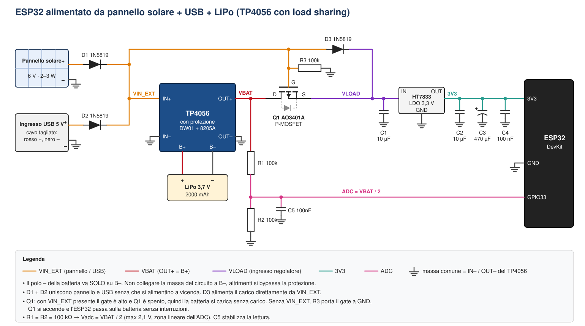
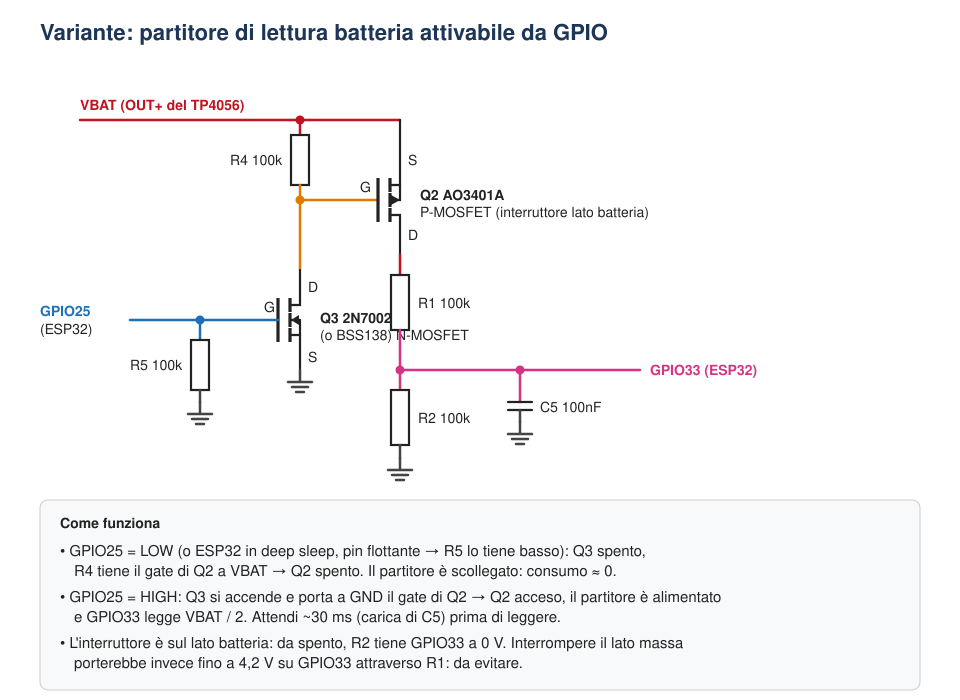
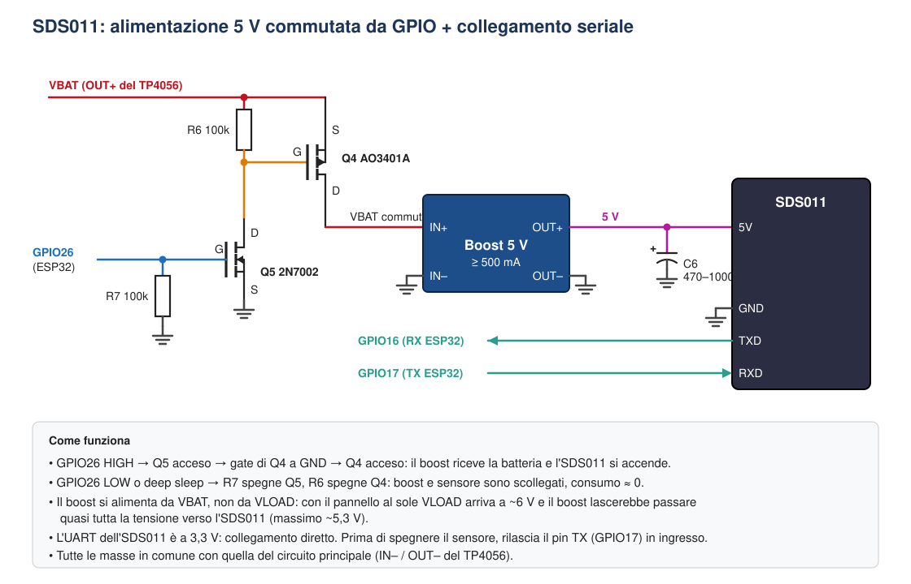

# ESP32 a energia solare + USB con batteria LiPo e load sharing

Alimentazione autonoma per un ESP32 con **pannello solare e/o alimentatore USB** che caricano una **batteria LiPo** tramite un modulo **TP4056**. Un semplice circuito di **load sharing** (un P-MOSFET e un diodo) fa sì che, quando c'è alimentazione esterna, l'ESP32 si alimenti direttamente da questa e la batteria si carichi senza carico addosso. Quando l'alimentazione esterna manca, il circuito passa da solo alla batteria, senza interruzioni.

Il progetto parte dal tutorial di Random Nerd Tutorials [*Power ESP32/ESP8266 with Solar Panels and Battery*](https://randomnerdtutorials.com/power-esp32-esp8266-solar-panels-battery-level-monitoring/) e aggiunge:

- **due sorgenti contemporanee** (pannello e USB) unite da diodi Schottky;
- **load sharing**, così il TP4056 termina correttamente la carica anche con l'ESP32 acceso;
- il regolatore **HT7833** (500 mA) al posto dell'MCP1700 (250 mA), più adatto ai picchi del WiFi;
- un partitore **100k/100k**, che porta la lettura nella zona più lineare dell'ADC.

Altre guide in questo repository:

- **[HELTEC.md](HELTEC.md)**: come usare il progetto con le schede Heltec WiFi Kit 32 V3 e Wireless Stick Lite V3;
- **[Sensore pesante: SDS011](#sensore-pesante-sds011)**: come alimentare e collegare un sensore di particolato SDS011.

---

## Schema

<p align="center">
  
</p>

---

## Componenti

| Rif. | Componente | Quantità | Note |
|---|---|---|---|
| — | Modulo **TP4056 con protezione** (DW01 + 8205A, 6 piazzole con OUT+/OUT–) | 1 | La versione con protezione stacca la batteria se si scarica troppo |
| — | Batteria **LiPo 3,7 V** (es. 2000 mAh) | 1 | |
| — | **Pannello solare 6 V**, 2–3 W | 1 | Con il TP4056 i pannelli da 6 V funzionano meglio di quelli da 5 V |
| — | Ingresso **USB 5 V** | 1 | Un vecchio cavo USB tagliato (rosso = +5 V, nero = GND) o un breakout USB femmina |
| D1, D2, D3 | Diodo Schottky **1N5819** (o 1N5817, SS14, SS34) | 3 | |
| Q1 | P-MOSFET **AO3401A** (SOT-23) | 1 | Se non saldi SMD, prendilo su adattatore SOT-23 → DIP |
| R3 | Resistenza **100 kΩ** | 1 | Pull-down del gate |
| U1 | Regolatore LDO **HT7833** (3,3 V, 500 mA) | 1 | Alternative: HT7333, RT9013-33 |
| C1, C2 | Condensatore **10 µF** | 2 | Ingresso e uscita del regolatore |
| C3 | Condensatore elettrolitico **470 µF** (≥ 6,3 V) | 1 | Assorbe i picchi del WiFi. **Ha una polarità!** |
| C4 | Condensatore ceramico **100 nF** | 1 | |
| R1, R2 | Resistenza **100 kΩ** | 2 | Partitore per leggere la batteria |
| C5 | Condensatore ceramico **100 nF** | 1 | Stabilizza la lettura dell'ADC |
| — | **ESP32 DevKit** | 1 | |

---

## Come funziona

### 1. Due sorgenti, nessun conflitto (D1, D2)

Pannello e USB arrivano allo stesso nodo **VIN_EXT** attraverso un diodo ciascuno. In ogni momento conduce solo la sorgente a tensione più alta. I diodi impediscono che il pannello, che a vuoto arriva a 6–7 V, spinga corrente nell'alimentatore USB o nella porta di un PC, e che l'USB spinga corrente nel pannello.

Dopo la caduta sui diodi (circa 0,3–0,45 V) arrivano circa 4,6 V dall'USB e circa 5,5–6,5 V dal pannello: entrambi valori adatti al TP4056, che accetta da 4,5 a 8 V.

> ⚠️ Il connettore micro-USB **sul modulo TP4056** è collegato direttamente a IN+, senza diodo. Così com'è **non usarlo** con il pannello collegato: porta l'USB a VIN_EXT passando per D2, oppure modifica il modulo come descritto in [Alternativa: usare il micro-USB del TP4056](#alternativa-usare-il-micro-usb-del-tp4056).

### 2. Load sharing (Q1, D3, R3)

Il TP4056 non ha un "power path": se il carico sta su OUT+ mentre la batteria si carica, il chip vede anche la corrente dell'ESP32. Con il WiFi acceso può quindi non terminare mai la carica e tenere la batteria fissa a 4,2 V.

Il circuito di load sharing risolve il problema:

| Situazione | Gate di Q1 | Q1 | L'ESP32 è alimentato da | La batteria |
|---|---|---|---|---|
| Pannello o USB presenti | alto (VIN_EXT) | **spento** | VIN_EXT tramite D3 | si carica senza carico |
| Nessuna alimentazione esterna | basso (R3 verso GND) | **acceso** | batteria tramite Q1 | si scarica normalmente |

#### Il MOSFET Q1 nel dettaglio

**Cos'è.** Q1 è un **MOSFET a canale P**, in pratica un interruttore elettronico con tre terminali: **source (S)**, **drain (D)** e **gate (G)**. Un P-MOSFET conduce quando il gate è **più basso del source** di almeno la tensione di soglia (|V<sub>GS(th)</sub>| ≈ 0,5–1,3 V per l'AO3401A). Quando conduce, tra drain e source c'è una resistenza di poche decine di milliohm.

Ogni MOSFET contiene anche un **diodo interno (body diode)**, che nello schema è disegnato tratteggiato. In un P-MOSFET il body diode ha l'anodo sul drain e il catodo sul source.

**Perché è montato "al contrario".** Q1 ha il **drain verso la batteria** (OUT+) e il **source verso il carico** (VLOAD). Così il body diode conduce solo dalla batteria verso il carico, mai al contrario. Da spento, Q1 impedisce quindi che l'alimentazione esterna finisca nella batteria scavalcando il TP4056.

**Caso A: pannello o USB presenti**

| Punto | Tensione tipica (USB) | Tensione tipica (pannello al sole) |
|---|---|---|
| VIN_EXT = gate | ~4,6 V | ~5,5–6,5 V |
| VLOAD = source (VIN_EXT – D3) | ~4,2 V | ~5,1–6,1 V |
| V<sub>GS</sub> = gate – source | **+0,4 V** | **+0,4 V** |

V<sub>GS</sub> è positiva, quindi un P-MOSFET è **spento**. Anche il body diode è interdetto, perché la batteria (al massimo 4,2 V) non supera VLOAD. L'ESP32 è alimentato da VIN_EXT attraverso D3, e il TP4056 carica la batteria senza carico: la corrente che misura è solo quella di carica e la carica termina correttamente.

**Caso B: nessuna alimentazione esterna**

1. VIN_EXT scende a 0 e **R3 porta il gate a GND**.
2. Nel primo istante conduce il body diode: VLOAD ≈ VBAT – 0,6 V.
3. A quel punto V<sub>GS</sub> ≈ 0 – (VBAT – 0,6) ≈ **–3 V**, ben oltre la soglia: Q1 **si accende completamente**.
4. Il canale del MOSFET scavalca il body diode e VLOAD ≈ VBAT meno pochi millivolt.

**Il passaggio da una sorgente all'altra** non interrompe l'alimentazione. Quando l'esterno sparisce, il body diode alimenta subito il carico, mentre il gate scende in poche decine di microsecondi. Nel frattempo i condensatori C1 e C3 tengono su la tensione. Quando l'esterno torna, il gate si alza, Q1 si spegne e D3 riprende a fornire la corrente.

**Pannello debole (alba, tramonto, nuvole).** Se VIN_EXT è più bassa della batteria (per esempio 3,5 V con la batteria a 3,9 V), D3 è interdetto e Q1 conduce, almeno in parte, oppure conduce il suo body diode. L'ESP32 resta alimentato dalla batteria, mentre il pannello dà quel poco che può al TP4056.

#### Perché proprio questi componenti

- **Perché un MOSFET e non un semplice diodo dalla batteria?** Un diodo Schottky farebbe cadere 0,3–0,4 V. Con 200 mA, invece, Q1 fa cadere circa 200 mA × 0,08 Ω ≈ **16 mV**. L'HT7833 ha bisogno di circa 3,4–3,5 V in ingresso per dare 3,3 V, quindi ogni decimo di volt risparmiato è carica della batteria che puoi davvero usare.
- **Perché serve D3?** Senza D3, quando Q1 è acceso la batteria tornerebbe su VIN_EXT: alzerebbe il gate di Q1 e lo spegnerebbe, con un'oscillazione continua. Inoltre alimenterebbe all'indietro l'ingresso del TP4056. D3 lascia passare corrente solo da VIN_EXT verso il carico.
- **Perché serve R3?** Senza alimentazione esterna il gate resterebbe "flottante", cioè a una tensione indefinita, e Q1 potrebbe non accendersi. R3 lo porta con certezza a GND. Con 100 kΩ consuma circa 50 µA, e **solo quando c'è l'alimentazione esterna**: a batteria non consuma nulla.
- **Perché l'AO3401A?** È un MOSFET "logic level": si accende bene anche con V<sub>GS</sub> di soli –2,5/–3 V, cioè con la batteria quasi scarica. Regge –30 V e alcuni ampere, molto più del necessario. Vanno bene anche altri P-MOSFET con soglia bassa e R<sub>DS(on)</sub> bassa, come DMG2305UX o Si2301.

> ⚠️ Non usare P-MOSFET "classici" come IRF9540 o IRF9Z34: hanno una soglia troppo alta (2–4 V) e con la batteria a 3,5 V non si accenderebbero del tutto.

### 3. Regolatore a 3,3 V (U1, C1–C4)

L'HT7833 porta VLOAD (da circa 3,3 a 6,5 V) a 3,3 V stabili per il pin **3V3** dell'ESP32. Ha un dropout basso e una corrente a vuoto di pochi µA, quindi va bene anche con il deep sleep. C3 (470 µF), montato vicino all'ESP32, copre i picchi di corrente all'avvio del WiFi.

> ⚠️ Non collegare **mai** OUT+ della batteria direttamente al pin 3V3: una LiPo carica arriva a 4,2 V, mentre l'ESP32 regge al massimo circa 3,6 V.

### 4. Lettura della batteria (R1, R2, C5)

Il partitore 100k/100k dimezza la tensione della batteria: a 4,2 V corrispondono 2,1 V sull'ADC, nella zona in cui l'ADC dell'ESP32 è più lineare. Il consumo continuo del partitore è di circa 21 µA. Si usa **GPIO33**, che fa parte dell'ADC1: i pin ADC2 non funzionano quando il WiFi è attivo.

---

## ⚠️ Attenzione alla massa

Sui moduli TP4056 con protezione, l'interruttore di protezione è sul **negativo**:

- **B–** → solo il polo negativo della batteria;
- **IN–** e **OUT–** → massa comune di tutto il circuito (pannello, USB, regolatore, ESP32, partitore).

Se colleghi la massa del circuito a B–, scavalchi la protezione dalla sovrascarica. **OUT+ coincide invece con B+**, per questo il partitore è collegato a OUT+.

---

## Montaggio passo passo

1. **Batteria.** Collega la LiPo a **B+ / B–** del TP4056, rispettando la polarità.
2. **Sorgenti.** Collega il + del pannello all'**anodo di D1** e il + dell'USB all'**anodo di D2**. I due **catodi** (lato con la fascetta) vanno uniti e collegati a **IN+**. Il – del pannello e il – dell'USB vanno a **IN–**.
3. **Prima prova.** Senza ESP32, controlla che il LED rosso del TP4056 si accenda (carica in corso) sia con il solo pannello sia con il solo USB.
4. **Load sharing.**
   - **Drain** di Q1 → **OUT+**
   - **Source** di Q1 → nodo **VLOAD**
   - **Gate** di Q1 → **VIN_EXT**, con R3 (100k) dal gate verso **GND**
   - **D3**: anodo su VIN_EXT, catodo su VLOAD
5. **Regolatore.** VLOAD → IN dell'HT7833, con C1 verso GND. GND dell'HT7833 → massa. OUT → C2, C3 e C4 verso GND.
6. **Verifica prima di collegare l'ESP32.** Con il tester:
   - OUT dell'HT7833 = **3,25–3,35 V**, sia con alimentazione esterna sia solo a batteria;
   - VLOAD ≈ VIN_EXT – 0,4 V con alimentazione esterna, ≈ VBAT senza.
7. **ESP32.** OUT dell'HT7833 → pin **3V3**, massa → **GND**.
8. **Partitore.** OUT+ → R1 (100k) → **GPIO33** → R2 (100k) → GND. C5 (100 nF) va tra GPIO33 e GND.

> 💡 **Programmazione via USB dell'ESP32:** quando colleghi il cavo USB alla DevKit per caricare il firmware, il regolatore della scheda e l'HT7833 si trovano in parallelo sulla linea 3V3. Di solito non succede nulla, ma per sicurezza scollega il filo 3V3 dell'HT7833 mentre programmi.

---

## Alternativa: usare il micro-USB del TP4056

Se preferisci collegare l'alimentatore USB direttamente al connettore micro-USB del modulo, invece del cavo tagliato, puoi trasformare quel connettore nell'ingresso protetto da diodo. Basta inserire un diodo Schottky tra il pin VBUS del connettore e la piazzola IN+: **il diodo saldato sul modulo prende il posto di D2**.

### Perché serve la modifica

Sul modulo originale il pin **VBUS** del micro-USB è collegato con una pista direttamente a **IN+**. Senza diodo, in pieno sole il pannello (circa 5,5–6,5 V dopo D1) spinge tensione verso l'alimentatore USB, che ne ha solo 5. Un caricatore da muro di solito lo tollera, ma la porta USB di un PC, un hub o un power bank potrebbero non gradire.

### Cosa serve

- 1 diodo Schottky **SMD SS14** (1 A, 40 V) oppure **SS34** (3 A, 40 V), contenitore SMA;
- cutter o bisturi, saldatore a punta fine, flussante, filo di rame sottile (eventualmente un reoforo tagliato);
- tester con la funzione continuità.

### Procedura

1. **Individua la pista.** Con il tester in continuità, trova la pista che collega il pin **VBUS** del micro-USB (il pin più esterno, dal lato del + del modulo) alla piazzola **IN+**. Spesso passa vicino al connettore o attraverso un via.
2. **Taglia la pista.** Incidi due volte con il cutter a circa 1 mm di distanza e asporta il rame tra i due tagli. Fallo in un tratto **senza altre piste vicine**.
3. **Verifica il taglio.** Tra VBUS del micro-USB e IN+ il tester **non deve più dare continuità**.
4. **Gratta la vernice** ai due lati del taglio, quanto basta per scoprire un po' di rame da stagnare.
5. **Salda il diodo** a cavallo del taglio:
   - **anodo** verso il connettore micro-USB (lato VBUS);
   - **catodo** (il lato con la fascetta) verso **IN+**.

   Se il diodo non arriva a coprire il taglio, completa il collegamento con un pezzetto di filo di rame.
6. **Controlla con il tester in modalità diodo.** Puntale rosso su VBUS, nero su IN+: devi leggere circa **0,2–0,4 V**. Al contrario deve risultare aperto (OL).
7. **Prova sotto tensione.** Collega un alimentatore USB senza batteria e senza ESP32. Su IN+ devi misurare circa **4,6–4,8 V**.

```
                PRIMA                              DOPO
  micro-USB VBUS ─────────── IN+     micro-USB VBUS ──►|── IN+
                                                     SS14
                                              (catodo verso IN+)
```

### Dopo la modifica

- **D2 e il cavo USB tagliato non servono più**: collega l'alimentatore direttamente al micro-USB del modulo. Il pannello resta collegato a IN+ tramite D1, come nello schema.
- Il **load sharing funziona allo stesso modo**: VIN_EXT è il nodo IN+, e da lì partono il gate di Q1 e D3.
- Puoi usare qualunque sorgente USB (caricatore da muro, PC, power bank) anche con il pannello collegato.
- Dall'USB arrivano circa 4,6–4,8 V, comunque sufficienti per il TP4056.

> ⚠️ Lavora con il modulo **scollegato** da batteria e alimentazioni. Se tagli la pista sbagliata o danneggi il connettore, il modulo costa poco: tienine uno di scorta.

---

## Codice di esempio (Arduino IDE)

Legge la tensione della batteria, la converte in una percentuale approssimata, la stampa e manda l'ESP32 in deep sleep per 10 minuti.

```cpp
#include <Arduino.h>

const int   PIN_BATT    = 33;     // GPIO33 (ADC1)
const float DIVIDER     = 2.0;    // R1 = R2 = 100k  ->  Vbat = Vadc * 2
const uint64_t SLEEP_US = 10ULL * 60ULL * 1000000ULL;  // 10 minuti

float readBatteryVoltage() {
  uint32_t sum = 0;
  for (int i = 0; i < 16; i++) {
    sum += analogReadMilliVolts(PIN_BATT);  // valore già calibrato in mV
    delay(2);
  }
  return (sum / 16.0f) * DIVIDER / 1000.0f;
}

// Curva di scarica LiPo approssimata (a riposo, a 25 °C)
int batteryPercent(float v) {
  const float volts[] = {3.30, 3.50, 3.60, 3.70, 3.75, 3.80, 3.85, 3.90, 4.00, 4.10, 4.20};
  const int   pct[]   = {   0,    5,   10,   20,   30,   40,   50,   60,   75,   90,  100};
  const int n = sizeof(volts) / sizeof(volts[0]);

  if (v <= volts[0])     return 0;
  if (v >= volts[n - 1]) return 100;
  for (int i = 1; i < n; i++) {
    if (v < volts[i]) {
      float t = (v - volts[i - 1]) / (volts[i] - volts[i - 1]);
      return pct[i - 1] + t * (pct[i] - pct[i - 1]);
    }
  }
  return 100;
}

void setup() {
  Serial.begin(115200);
  delay(200);

  float vbat = readBatteryVoltage();
  Serial.printf("Batteria: %.2f V  (%d %%)\n", vbat, batteryPercent(vbat));

  // ... qui il tuo codice: WiFi, sensori, invio dati ...

  esp_sleep_enable_timer_wakeup(SLEEP_US);
  esp_deep_sleep_start();
}

void loop() {}
```

**Note sulla lettura**
- Durante la carica leggerai la tensione di carica (fino a circa 4,2 V), più alta di quella reale a riposo. Considera la percentuale affidabile solo senza alimentazione esterna.
- Per una lettura più precisa, misura VBAT con il tester e correggi `DIVIDER` di conseguenza (le resistenze hanno una tolleranza dell'1–5 %).

---

## Variante: partitore attivabile (consumo zero a riposo)

Il partitore R1/R2 dello schema base è sempre collegato alla batteria e consuma circa **21 µA**, giorno e notte. È poco, circa 0,5 mAh al giorno, ma se punti a mesi di autonomia conviene alimentarlo **solo nel momento della lettura**. Lo stesso principio è usato da schede come le Heltec, che hanno un pin `ADC_Ctrl` per attivare la lettura.

<p align="center">
  
</p>

### Componenti aggiuntivi

| Rif. | Componente | Note |
|---|---|---|
| Q2 | P-MOSFET **AO3401A** | Interruttore tra VBAT e R1 |
| Q3 | N-MOSFET **2N7002** o **BSS138** | Comandato dall'ESP32, pilota il gate di Q2 |
| R4 | Resistenza **100 kΩ** | Tra gate e source di Q2: tiene Q2 spento |
| R5 | Resistenza **100 kΩ** | Tra gate di Q3 e GND: tiene Q3 spento quando il GPIO è flottante (deep sleep, reset) |

### Come funziona

- **GPIO25 basso, oppure ESP32 in deep sleep o in reset:** R5 tiene spento Q3, R4 tiene il gate di Q2 a VBAT e quindi anche Q2 è spento. Il partitore è scollegato dalla batteria e consuma **praticamente zero**. GPIO33 resta a 0 V grazie a R2.
- **GPIO25 alto:** Q3 si accende e porta a GND il gate di Q2. V<sub>GS</sub> di Q2 diventa ≈ –VBAT e Q2 si accende: il partitore è alimentato e GPIO33 legge VBAT/2. Durante la lettura R4 consuma circa 42 µA, ma solo per qualche decina di millisecondi.
- Il body diode di Q2 è orientato in modo da non far passare corrente dalla batteria al partitore quando Q2 è spento.

> ⚠️ **Perché l'interruttore è sul lato batteria e non verso massa.** Verrebbe spontaneo mettere un solo N-MOSFET tra R2 e GND. Ma quando è spento il partitore resta "appeso" a VBAT attraverso R1, e su GPIO33 arriverebbero fino a **4,2 V**, oltre il massimo dell'ESP32. Con l'interruttore sul lato alto, a riposo GPIO33 è sempre a 0 V.

### Codice

Al posto della funzione `readBatteryVoltage()` dell'esempio precedente:

```cpp
const int PIN_BATT_EN = 25;   // comando del partitore (Q3)

float readBatteryVoltage() {
  pinMode(PIN_BATT_EN, OUTPUT);
  digitalWrite(PIN_BATT_EN, HIGH);   // accende il partitore
  delay(30);                          // attende che C5 si carichi (τ ≈ 5 ms)

  uint32_t sum = 0;
  for (int i = 0; i < 16; i++) {
    sum += analogReadMilliVolts(PIN_BATT);
    delay(2);
  }

  digitalWrite(PIN_BATT_EN, LOW);    // spegne il partitore
  return (sum / 16.0f) * DIVIDER / 1000.0f;
}
```

Al posto di GPIO25 puoi usare qualsiasi GPIO di uscita libero. Evita i pin di strapping (GPIO0, 2, 5, 12, 15) e quelli solo di ingresso (GPIO34–39).

---

## Sensore pesante: SDS011

L'SDS011 (sensore di particolato PM2.5/PM10) è "pesante" per un sistema a batteria per tre motivi:

1. **Vuole 5 V** (circa 4,7–5,3 V), mentre la batteria ne dà 3,0–4,2.
2. **Assorbe circa 70 mA** con ventola e laser accesi. Anche in modalità sleep consuma ancora qualche mA.
3. **Ha bisogno di circa 30 s di ventola** prima di dare letture affidabili.

Per questo il sensore va alimentato con un **boost 5 V** e **scollegato del tutto** tra una misura e l'altra.

<p align="center">
  
</p>

### Componenti aggiuntivi

| Rif. | Componente | Note |
|---|---|---|
| — | Modulo **boost 5 V**, ≥ 500 mA | Va bene il classico modulo da power bank con USB-A (ingresso 0,9–5 V), o un MT3608 tarato a 5,0 V. **Togli il LED** se c'è |
| Q4 | P-MOSFET **AO3401A** | Interruttore tra VBAT e l'ingresso del boost |
| Q5 | N-MOSFET **2N7002** o **BSS138** | Comandato da GPIO26 |
| R6 | Resistenza **100 kΩ** | Tra gate e source di Q4: tiene Q4 spento |
| R7 | Resistenza **100 kΩ** | Tra gate di Q5 e GND: tiene Q5 spento in deep sleep |
| C6 | Elettrolitico **470–1000 µF**, ≥ 10 V | Sui 5 V, vicino al sensore: assorbe lo spunto della ventola |

### Collegamenti

1. **VBAT (OUT+ del TP4056)** → source di **Q4**. Drain di Q4 → **IN+** del boost. IN– del boost → GND.
2. **Comando:** GPIO26 → gate di **Q5**, con **R7** verso GND. Drain di Q5 → gate di Q4, con **R6** verso VBAT. Source di Q5 → GND.
3. **Uscita 5 V del boost** → pin **5V** dell'SDS011, con **C6** verso GND. Se il modulo ha l'USB-A, salda i fili sulle piazzole del connettore (i due pin esterni: VBUS e GND) o sui terminali del condensatore d'uscita.
4. **GND** dell'SDS011 → massa comune.
5. **Seriale** (livelli a 3,3 V, collegamento diretto):
   - **TXD** dell'SDS011 → **GPIO16** (RX dell'ESP32)
   - **RXD** dell'SDS011 ← **GPIO17** (TX dell'ESP32)

I nomi dei pin sono stampati sul connettore dell'SDS011: controlla la serigrafia del tuo esemplare.

> ⚠️ **Il boost va alimentato da VBAT, non da VLOAD.** Con il pannello al sole VLOAD arriva a circa 6 V. Un boost con l'ingresso più alto dell'uscita lascia passare quasi tutta la tensione, e l'SDS011 riceverebbe circa 5,6 V, oltre il suo massimo.

> ℹ️ Mentre l'SDS011 è acceso, il TP4056 vede un carico sulla batteria (come nel caso senza load sharing). Dura solo circa 40 s per misura, quindi non disturba la terminazione della carica.

### Bilancio energetico

Dalla batteria l'SDS011 con il boost assorbe circa **110 mA** (70 mA a 5 V con un'efficienza di circa l'85 %). Con circa 40 s di accensione per misura:

| Intervallo tra le misure | Consumo medio | Al giorno | Autonomia senza sole (2000 mAh, solo SDS011) |
|---|---|---|---|
| 10 min | ~7 mA | ~180 mAh | ~10 giorni |
| 30 min | ~2,5 mA | ~60 mAh | ~1 mese |
| 60 min | ~1,2 mA | ~30 mAh | ~2 mesi |

A questi valori va aggiunto il consumo dell'ESP32 (WiFi, invio dei dati).

- **Pannello:** con misure ogni 10 minuti, il pannello da 2–3 W d'inverno non basta: servono **5–6 W**. Con misure ogni 30–60 minuti il pannello da 2–3 W è in genere sufficiente.
- **Durata del laser:** il produttore indica circa 8000 ore di funzionamento. Accenderlo solo per le misure, come qui, ne allunga molto la vita.

### Codice di esempio

Accende il sensore, attende 30 s, legge e fa la media di alcuni pacchetti, spegne il sensore e manda l'ESP32 in deep sleep.

```cpp
#include <Arduino.h>

const int SDS_EN_PIN = 26;   // comando del boost (Q5)
const int SDS_RX_PIN = 16;   // RX dell'ESP32  <- TXD dell'SDS011
const int SDS_TX_PIN = 17;   // TX dell'ESP32  -> RXD dell'SDS011
const uint32_t WARMUP_MS = 30000;
const uint64_t SLEEP_US  = 30ULL * 60ULL * 1000000ULL;   // 30 minuti

HardwareSerial sds(2);

// Legge un pacchetto SDS011 (10 byte: AA C0 ... AB). Restituisce true se valido.
bool readSdsFrame(float &pm25, float &pm10, uint32_t timeoutMs = 2000) {
  uint8_t buf[10];
  uint32_t t0 = millis();
  int idx = 0;

  while (millis() - t0 < timeoutMs) {
    if (!sds.available()) { delay(5); continue; }
    uint8_t b = sds.read();

    if (idx == 0 && b != 0xAA) continue;          // attende l'header
    if (idx == 1 && b != 0xC0) { idx = 0; continue; }
    buf[idx++] = b;

    if (idx == 10) {
      uint8_t sum = 0;
      for (int i = 2; i <= 7; i++) sum += buf[i];
      if (buf[9] != 0xAB || buf[8] != sum) { idx = 0; continue; }
      pm25 = ((buf[3] << 8) | buf[2]) / 10.0f;
      pm10 = ((buf[5] << 8) | buf[4]) / 10.0f;
      return true;
    }
  }
  return false;
}

void sdsPowerOn() {
  pinMode(SDS_EN_PIN, OUTPUT);
  digitalWrite(SDS_EN_PIN, HIGH);
  sds.begin(9600, SERIAL_8N1, SDS_RX_PIN, SDS_TX_PIN);
}

void sdsPowerOff() {
  sds.end();
  pinMode(SDS_TX_PIN, INPUT);       // non alimentare il sensore spento dalla linea TX
  digitalWrite(SDS_EN_PIN, LOW);
}

void setup() {
  Serial.begin(115200);

  sdsPowerOn();
  delay(WARMUP_MS);                 // ventola accesa: lascia stabilizzare il flusso d'aria
  while (sds.available()) sds.read();   // scarta i pacchetti del riscaldamento

  float pm25Sum = 0, pm10Sum = 0;
  int n = 0;
  for (int i = 0; i < 5; i++) {     // l'SDS011 invia un pacchetto al secondo
    float pm25, pm10;
    if (readSdsFrame(pm25, pm10)) { pm25Sum += pm25; pm10Sum += pm10; n++; }
  }
  sdsPowerOff();

  if (n > 0) {
    Serial.printf("PM2.5: %.1f µg/m³  PM10: %.1f µg/m³  (%d letture)\n",
                  pm25Sum / n, pm10Sum / n, n);
  } else {
    Serial.println("SDS011: nessuna lettura valida");
  }

  // ... lettura batteria, WiFi, invio dati ...

  esp_sleep_enable_timer_wakeup(SLEEP_US);
  esp_deep_sleep_start();
}

void loop() {}
```

### Consigli per l'installazione all'esterno

- **Umidità:** sopra circa il 70 % di umidità relativa l'SDS011 tende a **sovrastimare** il particolato, perché le goccioline vengono contate come particelle. Affiancagli un sensore di umidità (per esempio un BME280) per scartare o correggere le letture nelle giornate umide.
- **Contenitore:** riparato da pioggia e sole diretto, ma con aria che circola. Il tubetto di aspirazione dell'SDS011 non deve essere ostruito.
- **Alimentazione:** il picco di corrente all'avvio della ventola è il momento critico. Se l'ESP32 si resetta quando accendi il sensore, aumenta C6 o il condensatore C3 sui 3,3 V.

---

## Regolazioni facoltative

### Corrente di carica del TP4056

Di default il modulo carica a **1 A** (resistenza di programmazione R_PROG da 1,2 kΩ, siglata spesso "122"). Con un pannello piccolo conviene impostare una corrente vicina a quella che il pannello riesce davvero a dare:

| R_PROG | Corrente di carica |
|---|---|
| 1,2 kΩ | 1000 mA (default) |
| 2 kΩ | ~580 mA |
| 3 kΩ | ~400 mA |
| 5 kΩ | ~250 mA |
| 10 kΩ | ~130 mA |

Per una LiPo da 2000 mAh, 400–1000 mA va bene.

### Stato di carica sull'ESP32

I pin **CHRG** e **STDBY** del TP4056 sono open-drain e pilotano i LED rosso e blu. Si possono collegare a due GPIO con `INPUT_PULLUP` per sapere dal software se la batteria è in carica o carica. I LED vanno rimossi.

### Consumi in deep sleep

Una DevKit ESP32 ha a bordo il LED di alimentazione e il convertitore USB-seriale, che consumano qualche mA anche in deep sleep. Per un'autonomia massima rimuovi il LED oppure usa un modulo ESP32 "nudo" o una scheda pensata per il basso consumo.

---

## Errori comuni da evitare

- ❌ **Alimentare il TP4056 dal pin 3V3 dell'ESP32**: 3,3 V non bastano per caricare una LiPo.
- ❌ **OUT+ direttamente sul 3V3**: fino a 4,2 V sull'ESP32.
- ❌ **Pannello e USB in parallelo senza diodi**: si alimentano a vicenda.
- ❌ **Regolatori della serie 78xx (es. 78L05)**: hanno un dropout troppo alto e una corrente a vuoto di qualche mA, quindi non sono adatti a una batteria.
- ❌ **Moduli boost 5 V "da power bank" per alimentare l'ESP32**: fanno una doppia conversione e hanno un consumo a vuoto alto.
- ❌ **Leggere la batteria su un pin non ADC** (es. GPIO23) o su un pin ADC2 con il WiFi attivo.

---

## Crediti

- Tutorial originale: [Random Nerd Tutorials, *Power ESP32/ESP8266 with Solar Panels and Battery*](https://randomnerdtutorials.com/power-esp32-esp8266-solar-panels-battery-level-monitoring/)
- Modifiche (doppia sorgente, load sharing, HT7833, partitore 100k/100k): questo repository.
