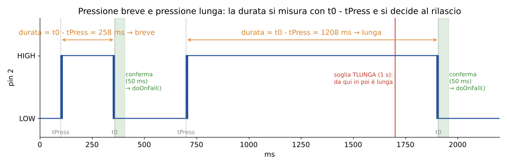
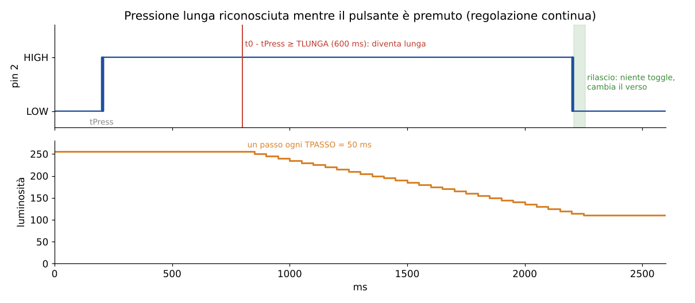
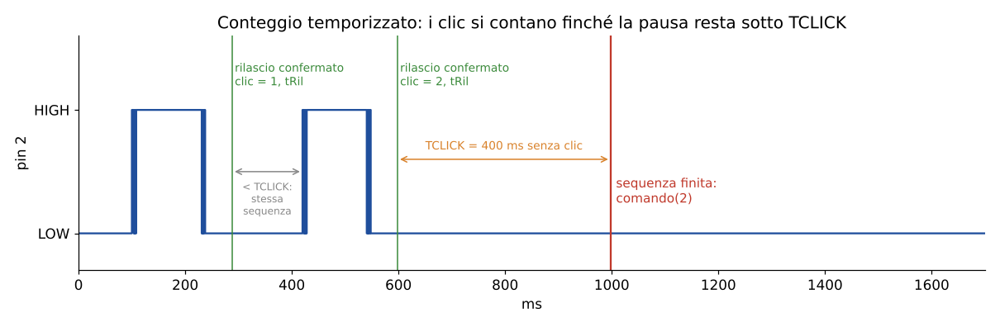

>[Torna all'indice](indexpulsanti.md)

# Pressioni brevi, pressioni lunghe e conteggio delle pressioni

Molti dispositivi hanno un solo pulsante ma fanno più cose: una lampada che si accende con un clic
e si regola tenendo premuto, un auricolare che con un clic mette in pausa e con due clic salta il
brano. Il programma distingue i comandi dal **modo** in cui si preme il pulsante, cioè dal **gesto**.

I gesti più usati sono tre, e tutti si riconoscono **misurando il tempo** con `millis()`:

| Gesto | Che cosa si misura | Quando si decide | Esempio tipico |
| --- | --- | --- | --- |
| Pressione **breve** o **lunga** | quanto dura la pressione | al rilascio | lampada: clic = accendi/spegni, pressione lunga = luminosità successiva |
| Pressione lunga **mentre è premuto** | da quanto dura la pressione in corso | dopo una soglia, con il pulsante ancora premuto | dimmer: tenendo premuto la luce cala o cresce |
| **Conteggio** dei clic | quanti clic arrivano prima di una pausa | dopo la pausa | LED: 1 clic acceso/spento, 2 clic lampeggio lento, 3 clic veloce |

> Prima di questa dispensa: i fenomeni da filtrare e la scelta del tempo di antirimbalzo in [debounce-fenomeni.md](debounce-fenomeni.md), le tecniche non bloccanti in [pulsanti-rilascio.md](pulsanti-rilascio.md).

## 1. Quale debounce usare

Per riconoscere un gesto bisogna misurare dei tempi, e la misura è giusta solo se il debounce non
inventa e non perde eventi. I due errori più gravi sono:

- un **buco a pulsante premuto** preso per un rilascio: una pressione lunga si **spezza** in due
  pressioni brevi, cioè un doppio clic falso;
- uno **spike a pulsante rilasciato** preso per una pressione: compare un **clic falso**.

Con un programma di prova abbiamo simulato 2000 pressioni lunghe con un buco di 3 ms in un punto a
caso e 2000 spike di 3 ms a pulsante rilasciato:

| Tecnica | Buco: pressione spezzata | Spike: clic falso | Errore sulla durata |
| --- | --- | --- | --- |
| millis(), pressione subito e rilascio confermato ([pulsanti-rilascio.md, sez. 1](pulsanti-rilascio.md)) | mai | sempre | nessuno, se si usa `t0 - tPress` |
| livello stabile con `changed()` ([pulsanti-rilascio.md, sez. 5](pulsanti-rilascio.md)) | mai | mai | nessuno: pressione e rilascio sono ritardati tutti e due di 50 ms |
| schedulatore, una lettura ogni 50 ms | 6% (buco/TBASE) | 6% | fino a 50 ms in più o in meno |
| lockout senza conferma | il buco diventa un rilascio anticipato | sempre | grande: una pressione lunga può diventare breve |

Le conclusioni:

- **La scelta di base** è la versione con `millis()` delle dispense: la pressione è riconosciuta
  subito, il rilascio dopo 50 ms di livello basso continuo, e un buco non spezza mai la pressione.
  È quella usata negli esempi.
- **Con cavi lunghi o ingressi disturbati** si usa `changed()` (o `Debouncer` di `urutils`), che
  filtra anche gli spike. Il ritardo di 50 ms c'è sia alla pressione sia al rilascio, quindi nella
  durata si annulla.
- **Lo schedulatore va bene solo per soglie lunghe** e ingressi puliti: un errore di 50 ms su una
  soglia di 1 s si può accettare, un doppio clic falso no.
- **Le tecniche bloccanti** possono misurare la durata di una pressione, ma mentre aspettano non
  fanno nient'altro: non si possono usare per la pressione lunga "mentre è premuto", né per contare
  i clic mentre il LED lampeggia.

## 2. Pressione breve e pressione lunga, decisione al rilascio

### Come si misura la durata

Servono due istanti:

- `tPress`, salvato in `doOnRise()`: l'**inizio** della pressione;
- `t0`, aggiornato a **ogni** lettura alta dal debounce: l'**ultimo** istante in cui il pulsante
  era premuto.

Al rilascio confermato, in `doOnFall()`, la durata è `t0 - tPress`. Non si usa
`millis() - tPress`, perché `doOnFall()` viene chiamata 50 ms dopo il rilascio vero: la durata
risulterebbe più lunga di 50 ms, e una pressione di 960 ms verrebbe presa per lunga.

<p align="center">
  
</p>

La decisione si prende **al rilascio** perché solo allora si sa quanto è durata la pressione:
mentre il pulsante è premuto, un clic e l'inizio di una pressione lunga sono identici.

La soglia `TLUNGA` di solito sta fra mezzo secondo e un secondo: abbastanza lunga da non essere
raggiunta con un clic normale, abbastanza corta da non far aspettare troppo. La libreria Arduino
OneButton, per esempio, usa 800 ms come soglia predefinita della pressione lunga e 50 ms per il
debounce.

### Esempio 1: lampada con tre livelli di luminosità

**Circuito** (Arduino Uno R3): pulsante fra il pin 2 e 5V, resistenza da 10 kΩ fra il pin 2 e GND
(pull-down); LED con resistenza da 220 Ω sul pin 11, che è un pin PWM.

**Comportamento:**
- clic (pressione più breve di 1 s): la lampada si accende o si spegne;
- pressione lunga (1 s o più): si passa alla luminosità successiva (bassa, media, alta, poi di nuovo
  bassa) e la lampada si accende, se era spenta.

```cpp
const byte P1   = 2;                 // pulsante (pull-down esterno): premuto = HIGH
const byte LUCE = 11;                // LED su un pin PWM
const unsigned long TDEB   = 50;     // ms di livello basso per confermare il rilascio
const unsigned long TLUNGA = 1000;   // soglia fra pressione breve e lunga
const byte LIVELLI[3] = {40, 120, 255};   // tre luminosità (0..255)

bool attivo = false;                 // pulsante premuto, rilascio da confermare
unsigned long t0 = 0;                // ultima lettura "premuto"
unsigned long tPress = 0;            // istante della pressione
bool accesa = false;                 // la lampada è accesa?
byte livello = 2;                    // indice della luminosità: parte dalla massima

void aggiornaLuce() {
  analogWrite(LUCE, accesa ? LIVELLI[livello] : 0);
}

void doOnRise() {
  // PRESSIONE: si ricorda solo quando è cominciata
  tPress = millis();
}

void doOnFall() {
  // RILASCIO: si misura la durata e si sceglie il comando
  unsigned long durata = t0 - tPress;     // ultima lettura "premuto" - inizio
  if (durata >= TLUNGA) {
    livello = (livello + 1) % 3;          // LUNGA: luminosità successiva
    accesa = true;                        // (e la lampada si accende)
  } else {
    accesa = !accesa;                     // BREVE: accende o spegne
  }
  aggiornaLuce();
}

void setup() {
  pinMode(P1, INPUT);
  pinMode(LUCE, OUTPUT);
  aggiornaLuce();
}

void loop() {
  if (digitalRead(P1) == HIGH) {
    if (!attivo) {                        // prima lettura alta: pressione
      attivo = true;
      doOnRise();
    }
    t0 = millis();                        // a ogni lettura alta il timer riparte
  } else if (attivo && millis() - t0 > TDEB) {
    attivo = false;                       // basso da più di 50 ms: rilascio
    doOnFall();
  }
}
```

In simulazione, con rimbalzi e un buco di 3 ms a metà di ogni pressione: 200 clic su 200 hanno
acceso o spento la lampada, le pressioni lunghe hanno cambiato livello senza accendere e spegnere,
e la soglia è esatta (1000 ms è lunga, 990 ms è breve).

**Con `changed()`.** Se l'ingresso è disturbato, il compito del pulsante diventa:

```cpp
  if (changed()) {                        // nuovo livello fermo da più di 50 ms
    if (val00 == HIGH) {
      tPress = millis();                  // pressione confermata
    } else {
      unsigned long durata = millis() - tPress;   // rilascio confermato
      // ... stessa scelta fra breve e lunga
    }
  }
```

Qui `millis() - tPress` va bene: pressione e rilascio arrivano tutti e due 50 ms dopo quelli veri,
quindi la differenza è la durata vera.

## 3. Pressione lunga riconosciuta mentre il pulsante è premuto

Decidere al rilascio ha un difetto: chi preme non sa quando la pressione è diventata "lunga", e
lascia il pulsante a caso. Molti dispositivi riconoscono la pressione lunga **mentre il pulsante è
ancora premuto**: appena si supera la soglia succede qualcosa (un LED, un suono, un cambio), e da lì
in poi l'azione può anche **ripetersi** finché si tiene premuto. Fa così anche OneButton: la
pressione lunga viene segnalata quando si supera la soglia, e il rilascio che segue non conta come
clic.

Si aggiunge un **secondo compito** nel `loop()`, che guarda la pressione in corso:

```cpp
if (attivo && t0 - tPress >= TLUNGA) {   // premuto da almeno TLUNGA
  ...
}
```

e una variabile `lunga`, messa a `false` in `doOnRise()` e a `true` quando la soglia viene superata.
Serve a due cose: fare una volta sola le azioni dell'inizio della pressione lunga, e dire a
`doOnFall()` che quella pressione **non** era un clic.

<p align="center">
  
</p>

La ripetizione è la stessa idea dei tasti che, tenuti premuti, ripetono il carattere, o delle
frecce della barra di scorrimento. In Windows, con le impostazioni predefinite, la ripetizione
delle frecce parte dopo 0,4 s e continua ogni 0,05 s.

### Esempio 2: dimmer a un pulsante

**Circuito:** lo stesso dell'esempio 1.

**Comportamento:**
- clic: la lampada si accende o si spegne, alla luminosità di prima;
- tenendo premuto per più di 0,6 s la luminosità cambia di un passo ogni 50 ms finché non si lascia;
  si ferma agli estremi;
- ogni pressione lunga va nel verso opposto alla precedente: una abbassa, la successiva alza.

```cpp
const byte P1   = 2;                 // pulsante (pull-down esterno): premuto = HIGH
const byte LUCE = 11;                // LED su un pin PWM
const unsigned long TDEB   = 50;     // ms di livello basso per confermare il rilascio
const unsigned long TLUNGA = 600;    // dopo 600 ms la pressione è "lunga"
const unsigned long TPASSO = 50;     // durante la pressione lunga: un passo ogni 50 ms
const int PASSO = 5;                 // quanto cambia la luminosità a ogni passo
const int LUMMIN = 10;               // luminosità minima (sotto si spegnerebbe)

bool attivo = false;                 // pulsante premuto, rilascio da confermare
unsigned long t0 = 0;                // ultima lettura "premuto"
unsigned long tPress = 0;            // istante della pressione
bool lunga = false;                  // questa pressione è già diventata lunga?
unsigned long tPasso = 0;            // istante dell'ultimo passo di regolazione
bool accesa = false;
int lum = 255;                       // luminosità attuale (LUMMIN..255)
bool sale = false;                   // verso della regolazione: alla prima lunga scende

void aggiornaLuce() {
  analogWrite(LUCE, accesa ? lum : 0);
}

void regola() {
  // un passo di regolazione nel verso attuale, fermandosi agli estremi
  if (sale) {
    lum = lum + PASSO;
    if (lum > 255) lum = 255;
  } else {
    lum = lum - PASSO;
    if (lum < LUMMIN) lum = LUMMIN;
  }
  aggiornaLuce();
}

void doOnRise() {
  // PRESSIONE: nuova pressione, ancora breve
  tPress = millis();
  lunga = false;
}

void doOnFall() {
  // RILASCIO
  if (lunga) {
    sale = !sale;                    // era una regolazione: la prossima va nel verso opposto
  } else {
    accesa = !accesa;                // era breve: accende o spegne
    aggiornaLuce();
  }
}

void setup() {
  pinMode(P1, INPUT);
  pinMode(LUCE, OUTPUT);
  aggiornaLuce();
}

void loop() {
  // --- compito 1: il pulsante
  if (digitalRead(P1) == HIGH) {
    if (!attivo) {
      attivo = true;
      doOnRise();
    }
    t0 = millis();
  } else if (attivo && millis() - t0 > TDEB) {
    attivo = false;
    doOnFall();
  }

  // --- compito 2: la pressione lunga, mentre il pulsante è ancora premuto
  if (attivo && t0 - tPress >= TLUNGA) {     // premuto da almeno TLUNGA
    if (!lunga) {                            // appena diventata lunga: una volta sola
      lunga = true;
      accesa = true;                         // si regola sempre una lampada accesa
      tPasso = millis();
      aggiornaLuce();
    }
    if (millis() - tPasso >= TPASSO) {      // un passo ogni TPASSO ms
      tPasso = millis();
      regola();
    }
  }
}
```

Perché `t0 - tPress` anche qui, e non `millis() - tPress`? Durante un buco del contatto `t0` resta
fermo, quindi la pressione non "invecchia" mentre il contatto è aperto. Per la stessa ragione, se
il buco dura più di 50 ms, il debounce conferma un rilascio vero: la regolazione si ferma, come
deve.

In simulazione: un clic accende a 255; tenendo premuto 2 s la luminosità scende da 255 a 110 a passi
di 5, e al rilascio la lampada resta accesa; la pressione lunga successiva risale; due clic spengono
e riaccendono alla stessa luminosità.

## 4. Conteggio temporizzato delle pressioni (doppio e triplo clic)

L'idea è contare i clic finché arrivano **vicini**: ogni rilascio confermato aumenta un contatore e
fa ripartire un timer. Se passa un tempo `TCLICK` senza nuovi clic, la sequenza è finita e si
esegue il comando corrispondente al numero contato.

<p align="center">
  
</p>

Le variabili sono due:

- `clic`, aumentato in `doOnFall()`;
- `tRil`, l'istante dell'ultimo rilascio, salvato anch'esso in `doOnFall()`.

La fine della sequenza si controlla in un compito separato del `loop()`:

```cpp
if (clic > 0 && !attivo && millis() - tRil > TCLICK) {
  comando(clic);       // nessun nuovo clic da TCLICK ms: sequenza finita
  clic = 0;
}
```

La condizione `!attivo` serve se il pulsante è di nuovo premuto: la sequenza non è finita, anche se
il rilascio precedente è lontano.

**Il prezzo: il clic singolo arriva in ritardo.** Dopo un clic il programma non può sapere se ne
arriverà un secondo: deve aspettare `TCLICK`. È lo stesso motivo per cui in Esplora file di Windows,
dopo un clic sul nome di un file, la modifica del nome parte solo dopo il tempo del doppio clic.
Per questo `TCLICK` va scelto con cura:

- abbastanza lungo da lasciare il tempo per il secondo clic: in Windows il tempo massimo predefinito
  fra i due clic di un doppio clic è 500 ms, in OneButton 400 ms;
- abbastanza corto da non rendere lento il clic singolo.

Se un dispositivo ha solo comandi a clic singolo, il conteggio non serve e conviene agire subito al
rilascio.

### Esempio 3: LED comandato da uno, due o tre clic

**Circuito:** pulsante come negli esempi precedenti; LED con resistenza da 220 Ω sul pin 12.

**Comportamento** (il numero di clic viene anche stampato sul Monitor seriale):
- 1 clic: LED acceso fisso, o spento se era acceso o lampeggiava;
- 2 clic: lampeggio lento (500 ms);
- 3 clic o più: lampeggio veloce (100 ms).

```cpp
const byte P1  = 2;                  // pulsante (pull-down esterno): premuto = HIGH
const byte LED = 12;
const unsigned long TDEB   = 50;     // ms di livello basso per confermare il rilascio
const unsigned long TCLICK = 400;    // pausa massima fra due clic della stessa sequenza

bool attivo = false;                 // pulsante premuto, rilascio da confermare
unsigned long t0 = 0;                // ultima lettura "premuto"
byte clic = 0;                       // clic contati nella sequenza in corso
unsigned long tRil = 0;              // istante dell'ultimo rilascio
byte modo = 0;                       // 0 spento, 1 acceso fisso, 2 lampeggio lento, 3 veloce
unsigned long tBlink = 0;

void doOnRise() {
  // PRESSIONE: qui non serve nulla
}

void doOnFall() {
  // RILASCIO: un clic in più, e la pausa riparte da adesso
  clic++;
  tRil = millis();
}

void comando(byte n) {
  // eseguito UNA volta, a sequenza finita, con il numero di clic
  Serial.print("Clic: ");
  Serial.println(n);
  if (n == 1) {
    modo = (modo == 0) ? 1 : 0;      // 1 clic: acceso fisso / spento
  } else if (n == 2) {
    modo = 2;                        // 2 clic: lampeggio lento
  } else {
    modo = 3;                        // 3 o più: lampeggio veloce
  }
}

void setup() {
  Serial.begin(9600);
  pinMode(P1, INPUT);
  pinMode(LED, OUTPUT);
}

void loop() {
  // --- compito 1: il pulsante
  if (digitalRead(P1) == HIGH) {
    if (!attivo) {
      attivo = true;
      doOnRise();
    }
    t0 = millis();
  } else if (attivo && millis() - t0 > TDEB) {
    attivo = false;
    doOnFall();
  }

  // --- compito 2: fine della sequenza di clic
  if (clic > 0 && !attivo && millis() - tRil > TCLICK) {
    comando(clic);                   // nessun nuovo clic da TCLICK ms: sequenza finita
    clic = 0;
  }

  // --- compito 3: il LED
  if (modo == 0) {
    digitalWrite(LED, LOW);
  } else if (modo == 1) {
    digitalWrite(LED, HIGH);
  } else {
    unsigned long semi = (modo == 2) ? 500 : 100;   // mezzo periodo
    if (millis() - tBlink > semi) {
      tBlink = millis();
      digitalWrite(LED, !digitalRead(LED));
    }
  }
}
```

In simulazione: sequenze di 1, 2 e 3 clic (pressioni di 120 ms, pause di 150 ms) hanno stampato
`Clic: 1`, `Clic: 2`, `Clic: 3`; due clic separati da 600 ms sono stati contati come due clic
singoli, come deve essere.

**Attenzione agli spike.** Con questa tecnica di debounce uno spike a pulsante rilasciato è un clic
falso: se cade subito dopo un clic vero, il clic singolo diventa un doppio clic. Su cavi lunghi o
vicino a motori il conteggio va fatto con `changed()`.

## 5. Tutti i gesti sullo stesso pulsante

Le tre tecniche si possono combinare, come fa OneButton con clic, doppio clic e pressione lunga.
Le regole sono quelle viste:

- la pressione lunga si riconosce mentre il pulsante è premuto (sezione 3) e **annulla** il
  conteggio: in `doOnFall()`, se `lunga` è vera, non si aumenta `clic`;
- i clic brevi si contano (sezione 4) e il comando parte dopo `TCLICK`.

## Riepilogo

| | Breve / lunga al rilascio | Lunga mentre è premuto | Conteggio dei clic |
| --- | --- | --- | --- |
| Variabili | `tPress` | `tPress`, `lunga`, `tPasso` | `clic`, `tRil` |
| Misura | `t0 - tPress` in `doOnFall()` | `t0 - tPress` nel `loop()`, con il pulsante premuto | `millis() - tRil` nel `loop()`, con il pulsante rilasciato |
| Quando agisce | al rilascio | appena superata la soglia, poi a ogni passo | `TCLICK` dopo l'ultimo clic |
| Tempi tipici | `TLUNGA` 0,5-1 s | `TLUNGA` 0,4-1 s, passo 50-100 ms | `TCLICK` 300-500 ms |
| Debounce | millis() con rilascio confermato; `changed()` se disturbato | come a sinistra | come a sinistra, ma con gli spike meglio `changed()` |

## Riferimenti

- [debounce-fenomeni.md](debounce-fenomeni.md): le quattro situazioni critiche e le ipotesi di progetto
- [pulsanti-rilascio.md](pulsanti-rilascio.md): le tecniche non bloccanti, con `changed()` nella sezione 5
- [OneButton, file OneButton.h](https://github.com/mathertel/OneButton/blob/master/src/OneButton.h): valori predefiniti di debounce (50 ms), clic (400 ms) e pressione lunga (800 ms)
- [OneButton, descrizione della macchina a stati](https://www.mathertel.de/Arduino/OneButtonLibrary.aspx): clic, doppio clic e pressione lunga riconosciuta mentre il pulsante è premuto
- [Microsoft, SetDoubleClickTime](https://learn.microsoft.com/windows/win32/api/winuser/nf-winuser-setdoubleclicktime): tempo predefinito del doppio clic, 500 ms
- [R. Chen, The double-click time tells the window manager how good your reflexes are](https://devblogs.microsoft.com/oldnewthing/20080423-00/?p=22623): ripetizione delle frecce di scorrimento dopo 0,4 s, ogni 0,05 s
- [R. Chen, How does Explorer determine the delay between clicking on an item and initiating an edit?](https://devblogs.microsoft.com/oldnewthing/20120625-00/?p=7293): il clic singolo aspetta il tempo del doppio clic
