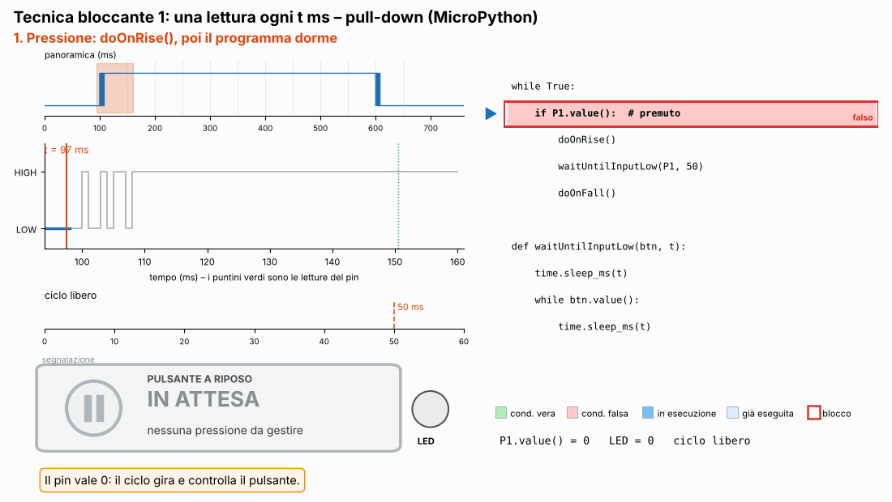
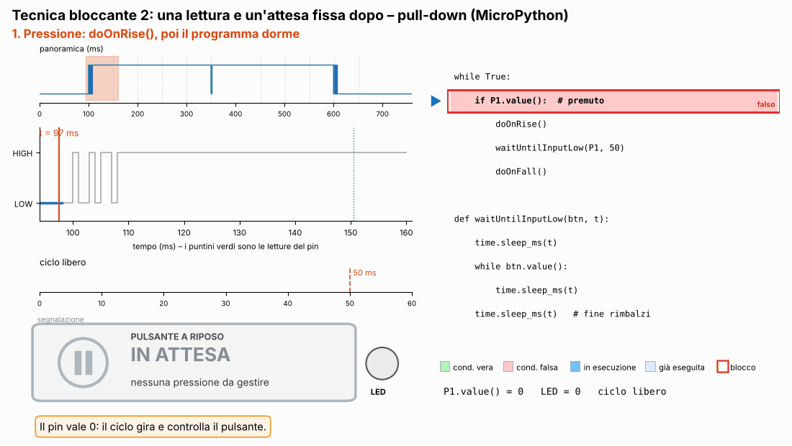
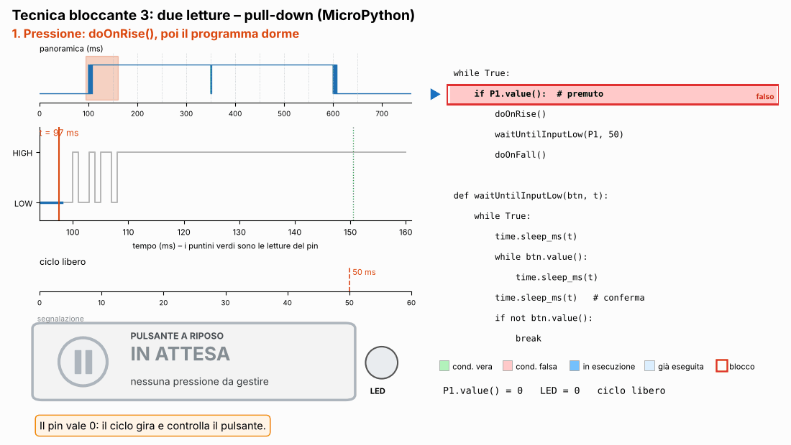
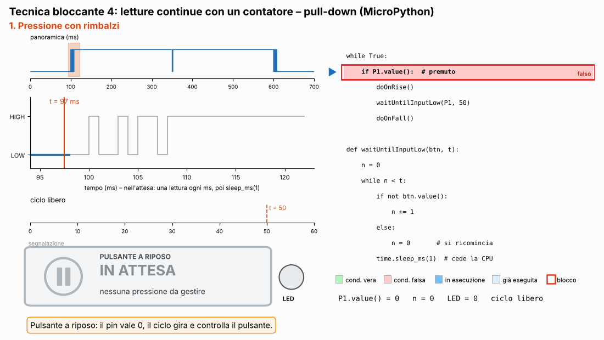
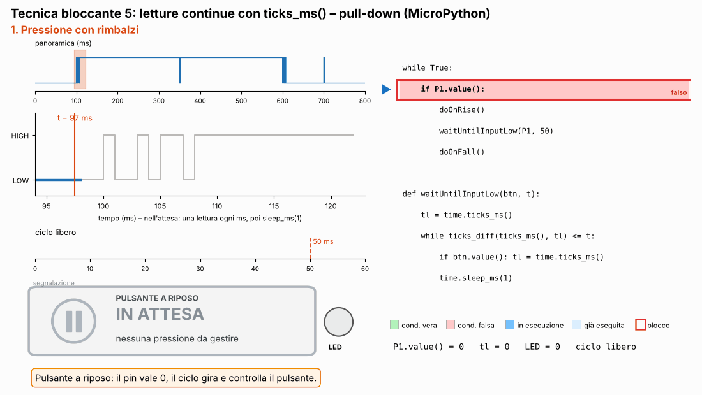

>[Torna all'indice](indexpulsanti.md)   >[versione in C++](pulsanti-bloccanti.md)

# Pulsanti in MicroPython: tecniche bloccanti (attivazione sul rilascio)

In una tecnica **bloccante** il programma, dopo aver visto il pulsante premuto, resta fermo dentro una
funzione di attesa finché il rilascio non è confermato. È la soluzione più semplice da scrivere e da
capire, ma per tutto il tempo della pressione il ciclo principale non fa altro: va bene quando il
programma non ha altri compiti, oppure quando gli altri compiti girano in altri thread (`_thread`).
Attenzione con `asyncio`: `time.sleep_ms()` ferma anche gli altri task asincroni, che lì vanno
attesi con `await asyncio.sleep_ms()`.

Le tecniche sono presentate dalla più semplice alla più robusta. Le funzioni di attesa sono definite
nel programma: la libreria `urutils.py` contiene solo le versioni **non bloccanti**
(`waitUntilInputLowNB()` / `waitUntilInputHighNB()`).

Pin di esempio per ESP32: pulsante su GPIO 12, LED su GPIO 13. Al posto di `millis()` si usa
`time.ticks_ms()`, e le differenze di tempo si calcolano con `time.ticks_diff()`, che resta corretta
anche quando il contatore ricomincia da capo; al posto di `delay()` si usa `time.sleep_ms()`.

> Tecniche non bloccanti: [pulsanti-rilascio-mpy.md](pulsanti-rilascio-mpy.md) (complete) e [pulsanti-rilascio-corte-mpy.md](pulsanti-rilascio-corte-mpy.md) (solo azione al rilascio)
> Versione Arduino: [pulsanti-bloccanti.md](pulsanti-bloccanti.md)

| Collegamento | Riposo | Premuto | Pressione | Rilascio | Funzione di attesa |
| --- | --- | --- | --- | --- | --- |
| Pull-down (resistenza verso GND o `Pin.PULL_DOWN`) | 0 | 1 | fronte di salita | fronte di discesa | `waitUntilInputLow()` |
| Pull-up (resistenza verso Vcc o `Pin.PULL_UP`) | 1 | 0 | fronte di discesa | fronte di salita | `waitUntilInputHigh()` |

## La struttura comune e il punto debole

Il ciclo principale è lo stesso in tutte le versioni (pull-down):

```python
while True:
    if P1.value():                 # (1) letto all'inizio di OGNI giro
        doOnRise()                 # pressione
        waitUntilInputLow(P1, 50)  # (2) fermo qui fino al rilascio
        doOnFall()                 # (3) rilascio
    # (4) fine del giro: si torna subito a (1)
```

Cambia solo **come** la funzione di attesa decide che il pulsante è stato rilasciato. Per giudicarle
bisogna ricordare che il ciclo `while True` ricomincia subito: appena l'attesa finisce e `doOnFall()`
è eseguita, il giro successivo rilegge il pin in (1). Se in quel momento il contatto sta ancora
rimbalzando, il pin può risultare alto e il rimbalzo viene preso per una **nuova pressione**: il
toggle scatta due volte (*pressione fantasma*). Un'attesa è corretta solo se esce quando i rimbalzi
del rilascio sono **finiti**.

I due disturbi da considerare sono:
- i **rimbalzi** del contatto, alla pressione e al rilascio (qualche ms);
- un **buco sul livello alto**: il contatto si apre per un attimo mentre il pulsante è ancora premuto
  (contatto sporco o consumato, vibrazioni).

I numeri riportati sotto vengono da una simulazione di 5000 pressioni per caso, con rimbalzi fino a
10 ms e buchi di 2 ms.

## 1. Una lettura ogni t ms

La versione più semplice: aspetta `t` ms, legge il pin una volta e, se è ancora premuto, aspetta di
nuovo. Esce alla **prima lettura** che trova il pulsante rilasciato. In Python non c'è il
`do ... while`: la prima attesa si scrive prima del ciclo.

<p align="center">
  
</p>

<table>
<tr>
<th>Pull-down: azione sul fronte di discesa</th>
<th>Pull-up: azione sul fronte di salita</th>
</tr>
<tr>
<td>

```python
from machine import Pin
import time

P1  = Pin(12, Pin.IN)   # pull-down esterno
LED = Pin(13, Pin.OUT)
stato = False

def waitUntilInputLow(btn, t):
    # aspetta t ms, poi legge una volta:
    # se il pin è ancora alto, aspetta
    # di nuovo
    time.sleep_ms(t)
    while btn.value():
        time.sleep_ms(t)

def doOnRise():
    # PRESSIONE (fronte di salita):
    # qui vanno le azioni immediate
    # alla pressione.
    # Lasciatela vuota se non serve.
    pass

def doOnFall():
    # RILASCIO (fronte di discesa):
    # qui vanno le azioni al rilascio.
    # Esempio: toggle, inverte lo
    # stato del LED a ogni rilascio.
    global stato
    stato = not stato
    LED.value(stato)

while True:
    if P1.value():  # premuto
        doOnRise()
        waitUntilInputLow(P1, 50)
        doOnFall()
```

</td>
<td>

```python
from machine import Pin
import time

P1  = Pin(12, Pin.IN, Pin.PULL_UP)  # pull-up interno
LED = Pin(13, Pin.OUT)
stato = False

def waitUntilInputHigh(btn, t):
    # aspetta t ms, poi legge una volta:
    # se il pin è ancora basso, aspetta
    # di nuovo
    time.sleep_ms(t)
    while not btn.value():
        time.sleep_ms(t)

def doOnFall():
    # PRESSIONE (fronte di discesa):
    # qui vanno le azioni immediate
    # alla pressione.
    # Lasciatela vuota se non serve.
    pass

def doOnRise():
    # RILASCIO (fronte di salita):
    # qui vanno le azioni al rilascio.
    # Esempio: toggle, inverte lo
    # stato del LED a ogni rilascio.
    global stato
    stato = not stato
    LED.value(stato)

while True:
    if not P1.value():  # premuto
        doOnFall()
        waitUntilInputHigh(P1, 50)
        doOnRise()
```

</td>
</tr>
</table>

**Limiti.** La decisione dipende da dove cade una sola lettura:
- se cade all'inizio dei rimbalzi del rilascio, l'attesa esce subito e il giro successivo del ciclo
  legge un rimbalzo alto: pressione fantasma (184 errori su 5000 con i soli rimbalzi);
- se cade dentro un buco sul livello alto, il rilascio viene confermato a pulsante ancora premuto
  (368 errori su 5000).

Funziona "quasi sempre" solo perché, leggendo di rado, di solito scavalca i rimbalzi. La Wait su un
ingresso digitale di un robot UR si comporta come questa versione, ma con una lettura per ciclo di
controllo (2 ms) invece che ogni 50 ms: per questo vede i rimbalzi quasi sempre.

## 2. Una lettura e un'attesa fissa dopo

Come la 1, ma dopo la lettura che trova il pulsante rilasciato aspetta altri `t` ms: quando il ciclo
rilegge il pin i rimbalzi del rilascio sono finiti.

<p align="center">
  
</p>

<table>
<tr>
<th>Pull-down: azione sul fronte di discesa</th>
<th>Pull-up: azione sul fronte di salita</th>
</tr>
<tr>
<td>

```python
from machine import Pin
import time

P1  = Pin(12, Pin.IN)   # pull-down esterno
LED = Pin(13, Pin.OUT)
stato = False

def waitUntilInputLow(btn, t):
    # come la 1: aspetta finché una
    # lettura trova il pin basso...
    time.sleep_ms(t)
    while btn.value():
        time.sleep_ms(t)
    # ...poi aspetta ancora t ms, perché
    # i rimbalzi del rilascio finiscano
    # prima che il ciclo rilegga il pin
    time.sleep_ms(t)

def doOnRise():
    # PRESSIONE (fronte di salita):
    # qui vanno le azioni immediate
    # alla pressione.
    # Lasciatela vuota se non serve.
    pass

def doOnFall():
    # RILASCIO (fronte di discesa):
    # qui vanno le azioni al rilascio.
    # Esempio: toggle, inverte lo
    # stato del LED a ogni rilascio.
    global stato
    stato = not stato
    LED.value(stato)

while True:
    if P1.value():  # premuto
        doOnRise()
        waitUntilInputLow(P1, 50)
        doOnFall()
```

</td>
<td>

```python
from machine import Pin
import time

P1  = Pin(12, Pin.IN, Pin.PULL_UP)  # pull-up interno
LED = Pin(13, Pin.OUT)
stato = False

def waitUntilInputHigh(btn, t):
    # come la 1: aspetta finché una
    # lettura trova il pin alto...
    time.sleep_ms(t)
    while not btn.value():
        time.sleep_ms(t)
    # ...poi aspetta ancora t ms, perché
    # i rimbalzi del rilascio finiscano
    # prima che il ciclo rilegga il pin
    time.sleep_ms(t)

def doOnFall():
    # PRESSIONE (fronte di discesa):
    # qui vanno le azioni immediate
    # alla pressione.
    # Lasciatela vuota se non serve.
    pass

def doOnRise():
    # RILASCIO (fronte di salita):
    # qui vanno le azioni al rilascio.
    # Esempio: toggle, inverte lo
    # stato del LED a ogni rilascio.
    global stato
    stato = not stato
    LED.value(stato)

while True:
    if not P1.value():  # premuto
        doOnFall()
        waitUntilInputHigh(P1, 50)
        doOnRise()
```

</td>
</tr>
</table>

**Cosa migliora.** Niente più pressioni fantasma: 0 errori su 5000 con i soli rimbalzi.

**Limiti.** L'attesa fissa non sa cosa è successo prima: un buco sul livello alto letto al momento
sbagliato fa ancora confermare un rilascio a pulsante premuto (165 errori su 5000). Il rilascio
arriva in media circa 70 ms dopo la fine dei rimbalzi.

Un'attesa fissa messa **prima** del ciclo, invece, non serve: copre i rimbalzi della pressione, che il
ciclo di attesa ignora già, mentre gli errori nascono alla fine.

## 3. Due letture: rilascio confermato dopo t ms

La prima lettura che trova il pulsante rilasciato non basta: dopo `t` ms si legge di nuovo, e solo
se anche la seconda trova il pulsante rilasciato l'attesa finisce (`break`). Se la conferma fallisce
si ricomincia da capo.

<p align="center">
  
</p>

<table>
<tr>
<th>Pull-down: azione sul fronte di discesa</th>
<th>Pull-up: azione sul fronte di salita</th>
</tr>
<tr>
<td>

```python
from machine import Pin
import time

P1  = Pin(12, Pin.IN)   # pull-down esterno
LED = Pin(13, Pin.OUT)
stato = False

def waitUntilInputLow(btn, t):
    while True:
        # prima lettura bassa...
        time.sleep_ms(t)
        while btn.value():
            time.sleep_ms(t)
        # ...confermata da una seconda
        # lettura t ms dopo
        time.sleep_ms(t)
        if not btn.value():
            break

def doOnRise():
    # PRESSIONE (fronte di salita):
    # qui vanno le azioni immediate
    # alla pressione.
    # Lasciatela vuota se non serve.
    pass

def doOnFall():
    # RILASCIO (fronte di discesa):
    # qui vanno le azioni al rilascio.
    # Esempio: toggle, inverte lo
    # stato del LED a ogni rilascio.
    global stato
    stato = not stato
    LED.value(stato)

while True:
    if P1.value():  # premuto
        doOnRise()
        waitUntilInputLow(P1, 50)
        doOnFall()
```

</td>
<td>

```python
from machine import Pin
import time

P1  = Pin(12, Pin.IN, Pin.PULL_UP)  # pull-up interno
LED = Pin(13, Pin.OUT)
stato = False

def waitUntilInputHigh(btn, t):
    while True:
        # prima lettura alta...
        time.sleep_ms(t)
        while not btn.value():
            time.sleep_ms(t)
        # ...confermata da una seconda
        # lettura t ms dopo
        time.sleep_ms(t)
        if btn.value():
            break

def doOnFall():
    # PRESSIONE (fronte di discesa):
    # qui vanno le azioni immediate
    # alla pressione.
    # Lasciatela vuota se non serve.
    pass

def doOnRise():
    # RILASCIO (fronte di salita):
    # qui vanno le azioni al rilascio.
    # Esempio: toggle, inverte lo
    # stato del LED a ogni rilascio.
    global stato
    stato = not stato
    LED.value(stato)

while True:
    if not P1.value():  # premuto
        doOnFall()
        waitUntilInputHigh(P1, 50)
        doOnRise()
```

</td>
</tr>
</table>

**Cosa migliora.** Un buco isolato non basta più: servirebbero due buchi colti esattamente a `t` ms
di distanza. In simulazione: 0 errori sui rimbalzi e sui buchi singoli.

**Limiti.** La protezione è **probabilistica**: due letture sfortunate (due buchi a 50 ms l'uno
dall'altro, oppure un buco seguito da una lettura dentro i rimbalzi del rilascio) producono ancora un
errore, raro ma possibile. Il rilascio arriva in media circa 70 ms dopo la fine dei rimbalzi
(massimo circa 100).

## 4. Letture continue con un contatore

Invece di poche letture, si legge il pin **ogni millisecondo** e si contano le letture "rilasciato"
consecutive: ogni lettura "premuto" (pulsante ancora premuto, rimbalzo o buco) azzera il conteggio.
L'attesa finisce solo dopo `t` letture "rilasciato" di fila.

<p align="center">
  
</p>

<table>
<tr>
<th>Pull-down: azione sul fronte di discesa</th>
<th>Pull-up: azione sul fronte di salita</th>
</tr>
<tr>
<td>

```python
from machine import Pin
import time

P1  = Pin(12, Pin.IN)   # pull-down esterno
LED = Pin(13, Pin.OUT)
stato = False

def waitUntilInputLow(btn, t):
    # conta le letture basse consecutive,
    # una ogni ms: ogni lettura alta
    # (rimbalzo, disturbo o pulsante
    # ancora premuto) azzera il conteggio
    n = 0
    while n < t:
        if not btn.value():
            n += 1
        else:
            n = 0
        time.sleep_ms(1)  # cede la CPU

def doOnRise():
    # PRESSIONE (fronte di salita):
    # qui vanno le azioni immediate
    # alla pressione.
    # Lasciatela vuota se non serve.
    pass

def doOnFall():
    # RILASCIO (fronte di discesa):
    # qui vanno le azioni al rilascio.
    # Esempio: toggle, inverte lo
    # stato del LED a ogni rilascio.
    global stato
    stato = not stato
    LED.value(stato)

while True:
    if P1.value():  # premuto
        doOnRise()
        waitUntilInputLow(P1, 50)
        doOnFall()
```

</td>
<td>

```python
from machine import Pin
import time

P1  = Pin(12, Pin.IN, Pin.PULL_UP)  # pull-up interno
LED = Pin(13, Pin.OUT)
stato = False

def waitUntilInputHigh(btn, t):
    # conta le letture alte consecutive,
    # una ogni ms: ogni lettura bassa
    # (rimbalzo, disturbo o pulsante
    # ancora premuto) azzera il conteggio
    n = 0
    while n < t:
        if btn.value():
            n += 1
        else:
            n = 0
        time.sleep_ms(1)  # cede la CPU

def doOnFall():
    # PRESSIONE (fronte di discesa):
    # qui vanno le azioni immediate
    # alla pressione.
    # Lasciatela vuota se non serve.
    pass

def doOnRise():
    # RILASCIO (fronte di salita):
    # qui vanno le azioni al rilascio.
    # Esempio: toggle, inverte lo
    # stato del LED a ogni rilascio.
    global stato
    stato = not stato
    LED.value(stato)

while True:
    if not P1.value():  # premuto
        doOnFall()
        waitUntilInputHigh(P1, 50)
        doOnRise()
```

</td>
</tr>
</table>

**Cosa migliora.** La decisione non dipende più da dove cadono poche letture: per uscire servono 50 ms
di livello di riposo **ininterrotto**. È certa, purché rimbalzi e buchi durino meno di `t` − 1 ms
(1 ms è l'intervallo tra due letture). In simulazione: 0 errori.

**Limite.** Il tempo è misurato contando i giri: è preciso solo se ogni giro dura davvero 1 ms. In
MicroPython ogni giro costa anche il tempo dell'interprete, quindi il tempo reale di conferma è un
po' più lungo di `t` ms. Attenzione: in Python non si può "ripartire" assegnando l'indice di un
ciclo `for` (`for i in range(t)`), perché il `for` prende comunque il valore successivo: per
azzerare il conteggio serve un `while` con un contatore, come qui.

## 5. Letture continue con ticks_ms() (consigliata)

Stessa logica della 4, ma il tempo si misura con `time.ticks_ms()`: `tl` è l'istante dell'ultima
lettura "premuto", e l'attesa finisce quando ne sono passati più di `t` ms. La durata non dipende più
da quanto dura un giro del ciclo.

<p align="center">
  
</p>

Con il pull-up il comportamento è identico con i livelli invertiti: il pulsante premuto legge 0 e si attende con `waitUntilInputHigh()`.

<table>
<tr>
<th>Pull-down: azione sul fronte di discesa</th>
<th>Pull-up: azione sul fronte di salita</th>
</tr>
<tr>
<td>

```python
from machine import Pin
import time

P1  = Pin(12, Pin.IN)   # pull-down esterno
LED = Pin(13, Pin.OUT)
stato = False

def waitUntilInputLow(btn, t):
    # attende t ms di livello basso
    # continuo: ogni lettura alta
    # (rimbalzo, disturbo o pulsante
    # ancora premuto) fa ripartire
    # il conteggio
    tl = time.ticks_ms()
    while time.ticks_diff(
            time.ticks_ms(), tl) <= t:
        if btn.value():
            tl = time.ticks_ms()
        time.sleep_ms(1)  # cede la CPU

def doOnRise():
    # PRESSIONE (fronte di salita):
    # qui vanno le azioni immediate
    # alla pressione.
    # Lasciatela vuota se non serve.
    pass

def doOnFall():
    # RILASCIO (fronte di discesa):
    # qui vanno le azioni al rilascio.
    # Esempio: toggle, inverte lo
    # stato del LED a ogni rilascio.
    global stato
    stato = not stato
    LED.value(stato)

while True:
    if P1.value():  # premuto
        doOnRise()
        waitUntilInputLow(P1, 50)
        doOnFall()
```

</td>
<td>

```python
from machine import Pin
import time

P1  = Pin(12, Pin.IN, Pin.PULL_UP)  # pull-up interno
LED = Pin(13, Pin.OUT)
stato = False

def waitUntilInputHigh(btn, t):
    # attende t ms di livello alto
    # continuo: ogni lettura bassa
    # (rimbalzo, disturbo o pulsante
    # ancora premuto) fa ripartire
    # il conteggio
    tl = time.ticks_ms()
    while time.ticks_diff(
            time.ticks_ms(), tl) <= t:
        if not btn.value():
            tl = time.ticks_ms()
        time.sleep_ms(1)  # cede la CPU

def doOnFall():
    # PRESSIONE (fronte di discesa):
    # qui vanno le azioni immediate
    # alla pressione.
    # Lasciatela vuota se non serve.
    pass

def doOnRise():
    # RILASCIO (fronte di salita):
    # qui vanno le azioni al rilascio.
    # Esempio: toggle, inverte lo
    # stato del LED a ogni rilascio.
    global stato
    stato = not stato
    LED.value(stato)

while True:
    if not P1.value():  # premuto
        doOnFall()
        waitUntilInputHigh(P1, 50)
        doOnRise()
```

</td>
</tr>
</table>

**Cosa garantisce.** Esce solo dopo più di `t` ms in cui **tutte** le letture, una ogni millisecondo,
hanno trovato il pulsante rilasciato: né un rimbalzo del rilascio né un buco breve a pulsante premuto
possono farla uscire, e quando il ciclo rilegge il pin il livello è stabile da `t` ms. Lo
`sleep_ms(1)` fissa il passo di lettura e cede la CPU agli altri thread (non ai task di `asyncio`). In
simulazione: 0 errori, rilascio circa 50 ms dopo la fine dei rimbalzi.

## Confronto

| Versione | Rimbalzi al rilascio (pressione fantasma) | Buco sul livello alto | Ritardo del rilascio dopo i rimbalzi |
| --- | --- | --- | --- |
| 1. Una lettura ogni t ms | ✘ 184 / 5000 | ✘ 368 / 5000 | medio ~22 ms, max ~50 ms |
| 2. Una lettura + attesa dopo | ✔ 0 | ✘ 165 / 5000 | medio ~70 ms, max ~100 ms |
| 3. Due letture | ✔ 0 | ~ probabilistica (0 / 5000) | medio ~70 ms, max ~100 ms |
| 4. Letture continue, contatore | ✔ 0 | ✔ 0 | ~50 ms |
| 5. Letture continue, ticks_ms() | ✔ 0 | ✔ 0 | ~50 ms |

✔ protegge sempre (se il disturbo dura meno di `t`) · ~ protegge quasi sempre · ✘ non protegge

## Quale tecnica è sicura su ESP32 e robot UR

La logica delle tecniche è la stessa ovunque, ma l'attesa di un millisecondo si comporta in modo
diverso a seconda della piattaforma, e questo cambia quale versione conviene.

| Tecnica | MicroPython (ESP32) | Robot UR (URScript) |
| --- | --- | --- |
| 1. Una lettura ogni t ms | ✘ non sicura | ✘ non sicura: è il comando **Wait** su un ingresso digitale, con una lettura per ciclo di controllo |
| 2. Una lettura + attesa dopo | ✘ non sicura (buchi) | ✘ non sicura: è una Wait seguita da un movimento o da una Wait a tempo |
| 3. Due letture | ~ quasi sempre | ~ quasi sempre |
| 4. Letture continue, contatore | ✔ sicura, tempo di conferma approssimato | ✔ **sicura e consigliata**: si contano i cicli di controllo con `sync()` |
| 5. Letture continue, ticks_ms() | ✔ **sicura e consigliata** | non serve: sul robot il ciclo di controllo fa già da orologio |

**MicroPython su ESP32.** Ogni giro del ciclo di attesa costa, oltre allo `sleep_ms(1)`, anche il
tempo dell'interprete, e un altro thread può allungare l'attesa: con il contatore il tempo reale di
conferma è solo *circa* `t` ms (un po' di più), mentre con `ticks_ms()` è misurato. Per questo la 5
è la scelta giusta. Le tecniche bloccanti sono accettabili con più compiti solo se gli altri girano
in thread separati (`_thread`): `time.sleep_ms()` non cede la CPU ai task di `asyncio`.

**Robot UR.** Il programma URScript è scandito dal ciclo di controllo del robot: un *frame* di 2 ms
sugli e-Series (8 ms sui CB3), e `sync()` aspetta il frame successivo. Il comando **Wait** su un
ingresso digitale legge l'ingresso una volta per frame ed esce alla **prima** lettura che soddisfa
la condizione: è la tecnica 1 con un passo di 2 ms, quindi vede quasi sempre i rimbalzi di un
pulsante meccanico. Mettere una Wait a tempo o un movimento dopo la Wait sull'ingresso equivale alla
tecnica 2: copre i rimbalzi, non i buchi. Su un robot la versione sicura è la 4, scritta in uno
Script node: siccome il frame dura sempre lo stesso tempo, contare i frame equivale a misurare il
tempo.

```python
def waitUntilLow(n, t):        # t in secondi, es. 0.05
  tl = 0
  while tl < t:
    if get_standard_digital_in(n):
      tl = 0                   # lettura alta: il conteggio riparte
    else:
      tl = tl + 0.002          # un frame (e-Series) di LOW in più; 0.008 sui CB3
    end
    sync()                     # aspetta il frame successivo
  end
end
```

Lo script (URScript, non Python) segue la documentazione di Universal Robots ma non è stato provato
su un robot. Per verificarlo: un pulsante su DI0 e un contatore che aumenta a ogni rilascio; con due
Wait in fila (HI e poi LO) il contatore sale di più di 1 a ogni pressione, con lo script deve salire
di 1. Gli ingressi del robot sono a 24 V e in genere li comandano sensori elettronici, che non
rimbalzano: il problema riguarda soprattutto i pulsanti meccanici collegati direttamente.

## Considerazioni finali

**Il limite di fondo, comune a tutte le tecniche.** Ogni antirimbalzo stabilisce un tempo minimo,
qui 50 ms, oltre il quale un'apertura del contatto viene considerata un rilascio vero. Un disturbo
più lungo non si distingue da un rilascio breve. Si supera scegliendo un tempo adatto alla qualità
del pulsante: abbastanza lungo da coprire i suoi rimbalzi e i suoi disturbi, abbastanza corto da non
perdere le pressioni rapide.

**Lo spike alto a pulsante rilasciato non è filtrato da nessuna tecnica bloccante.** Tutte accettano la
pressione alla **prima** lettura "premuto": un disturbo che porta il pin alto per un attimo a pulsante
rilasciato (tipico del pull-down con cavi lunghi, perché a riposo il pin è tenuto basso solo dalla
resistenza) diventa una pressione, e dopo 50 ms un rilascio: il toggle scatta (5000 errori su 5000 in
simulazione). Se l'ingresso è disturbato servono una resistenza di pull-down più bassa o un filtro RC,
oppure la versione a **livello stabile** con `changed()` di [pulsanti-rilascio-mpy.md](pulsanti-rilascio-mpy.md),
che chiede il livello fermo per 50 ms anche alla pressione.

**Quando usarle.** Le tecniche bloccanti fermano il ciclo principale per tutta la durata della
pressione: vanno bene in un programma che deve solo reagire al pulsante, o quando gli altri compiti
girano in altri thread. Se il ciclo deve fare altro mentre il pulsante è premuto (un lampeggio, un
motore), servono le tecniche non bloccanti.

**Versione con la sola azione al rilascio.** Basta togliere la callback della pressione (`doOnRise()`
nel pull-down, `doOnFall()` nel pull-up) e la sua chiamata nel ciclo: l'attesa non cambia.

## Riferimenti

- [pulsanti-rilascio-mpy.md](pulsanti-rilascio-mpy.md): tecniche non bloccanti, con azione alla pressione e al rilascio
- [pulsanti-rilascio-corte-mpy.md](pulsanti-rilascio-corte-mpy.md): tecniche non bloccanti, solo azione al rilascio
- [debouncerFSM_py.md](debouncerFSM_py.md): la macchina a stati del debouncer a livello stabile
- [interfacce-digitali.md](interfacce-digitali.md): ingressi di Arduino, ESP32 e robot UR, sensori a 24 V e a 5 V, e quale tecnica scegliere
- [pulsanti-bloccanti.md](pulsanti-bloccanti.md): versione Arduino
