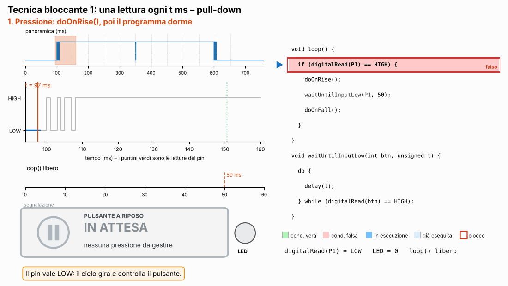
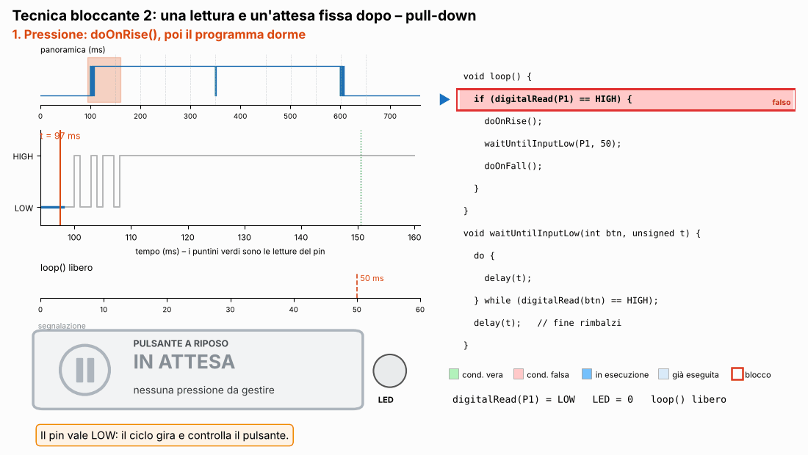
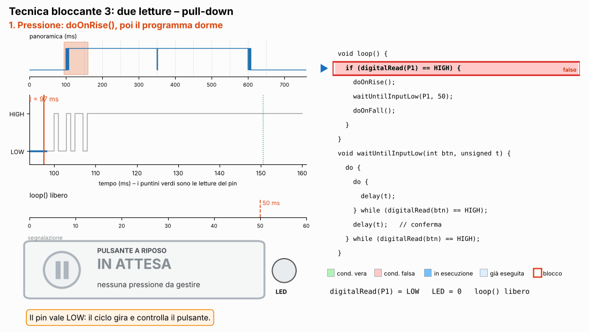
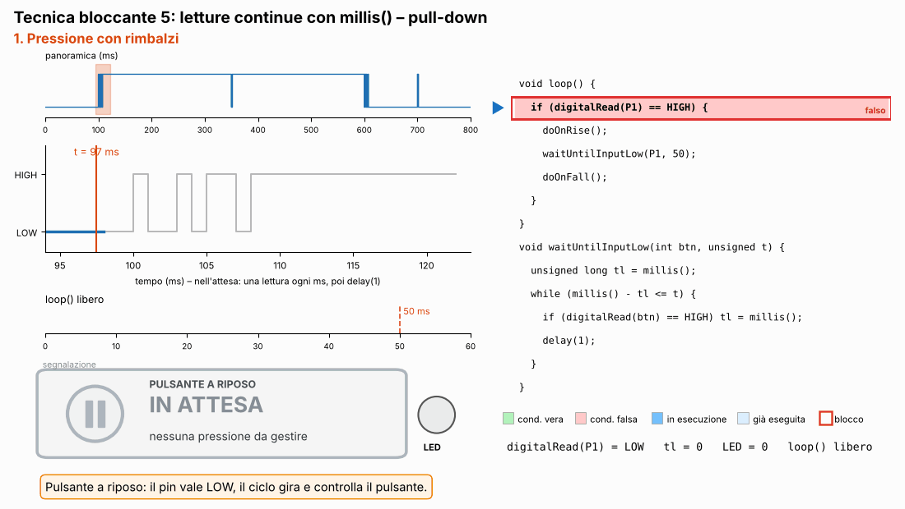
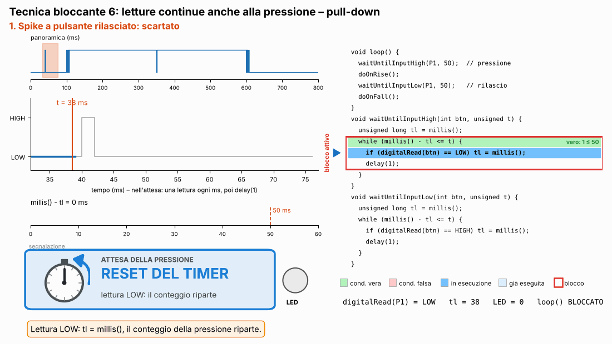
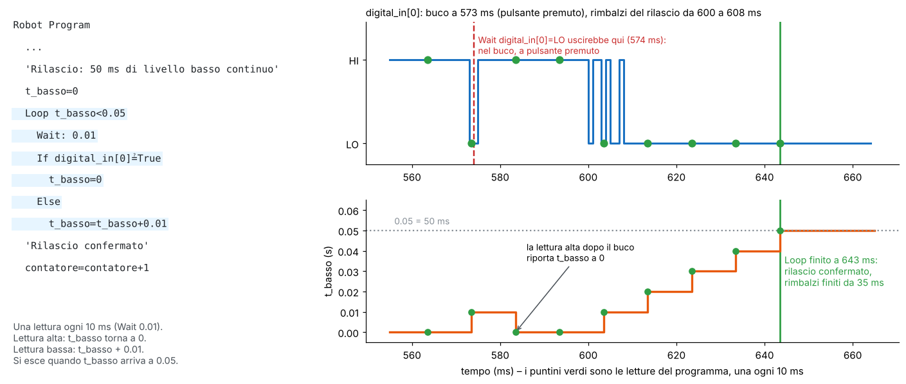

>[Torna all'indice](indexpulsanti.md)   >[versione in Python](pulsanti-bloccanti-mpy.md)

# Pulsanti: tecniche bloccanti (attivazione sul rilascio)

In una tecnica **bloccante** il programma, dopo aver visto il pulsante premuto, resta fermo dentro una
funzione di attesa finché il rilascio non è confermato. È la soluzione più semplice da scrivere e da
capire, ma per tutto il tempo della pressione `loop()` non fa altro: va bene quando il programma non ha
altri compiti, oppure su ESP32, dove gli altri task (FreeRTOS) continuano a girare.

Le tecniche sono presentate dalla più semplice alla più robusta. Le funzioni di attesa sono definite
nello sketch, così si vede come sono fatte. Le versioni migliori sono anche nella libreria
`urutils.h`: `waitUntilInputLow()` e `waitUntilInputHigh()` della tecnica 5, e
`waitUntilInputChange()`, che conferma il cambio di livello in tutte e due le direzioni come la
tecnica 6. Se includete la libreria, togliete dallo sketch le definizioni con lo stesso nome.

> Le quattro situazioni critiche di un debouncer (rimbalzi alla pressione e al rilascio, buchi, spike) e come si sceglie il tempo di antirimbalzo: [debounce-fenomeni.md](debounce-fenomeni.md)
> Tecniche non bloccanti: [pulsanti-rilascio.md](pulsanti-rilascio.md) (complete) e [pulsanti-rilascio-corte.md](pulsanti-rilascio-corte.md) (solo azione al rilascio)

| Collegamento | Riposo | Premuto | Pressione | Rilascio | Funzione di attesa |
| --- | --- | --- | --- | --- | --- |
| Pull-down (resistenza verso GND) | LOW | HIGH | fronte di salita | fronte di discesa | `waitUntilInputLow()` |
| Pull-up (verso Vcc o `INPUT_PULLUP`) | HIGH | LOW | fronte di discesa | fronte di salita | `waitUntilInputHigh()` |

## La struttura comune e il punto debole

Il `loop()` è lo stesso nelle versioni da 1 a 5 (pull-down):

```cpp
void loop() {
  if (digitalRead(P1) == HIGH) {   // (1) primo HIGH: il primo rimbalzo della pressione
    doOnRise();                    // (2) azione alla pressione, subito
    waitUntilInputLow(P1, 50);     // (3) esce quando il pin è LOW, ma non prima di 50 ms
    doOnFall();                    // (4) azione al rilascio
  }
}                                  // (5) fine del giro: si torna subito a (1)
```

Seguiamo una pressione dall'inizio.

1. **Il primo HIGH è il primo rimbalzo della pressione.** Il contatto si chiude per la prima volta e il
   `loop()`, che rilegge il pin di continuo, se ne accorge subito. Non può essere altro: un pulsante non
   premuto non dà livelli alti (salvo uno spike, vedi le considerazioni finali). Il primo rimbalzo
   basta per sapere che la pressione è cominciata.
2. **`doOnRise()` parte subito**, al primo rimbalzo: la risposta alla pressione è immediata.
3. **Gli altri rimbalzi non li legge più il `loop()`**: il programma è già dentro l'attesa. Il compito
   dell'attesa è lasciarli passare. Deve uscire quando trova il pin basso, ma **non prima di 50 ms**:
   così non scambia per un rilascio i buchi fra i rimbalzi della pressione.
4. **`doOnFall()` parte quando l'attesa esce**, cioè quando il pulsante risulta rilasciato.

Le versioni differiscono solo nel modo in cui l'attesa decide, al punto 3, che il pulsante è stato
rilasciato, e qui sta il punto debole. "Non prima di 50 ms" può voler dire due cose diverse:

- **50 ms di livello LOW continuo** (versioni 4 e 5): ogni lettura HIGH fa ripartire il conteggio.
  Se i 50 ms sono scelti in base alla qualità del pulsante, cioè più lunghi dei suoi rimbalzi,
  l'attesa **non può** uscire mentre il rilascio rimbalza: finché rimbalza, qualche lettura è HIGH.
- **50 ms fra una lettura e l'altra** (versioni 1, 2 e 3): il tempo è misurato dalla lettura
  precedente, non dall'inizio del rilascio. I rimbalzi della pressione sono finiti prima della
  prima lettura, quindi il problema riguarda solo quelli del **rilascio**: il rilascio arriva in un
  istante qualsiasi, e una lettura può capitare proprio mentre il contatto rimbalza, in un istante
  in cui è aperto. Se i rimbalzi durano meno di 50 ms ci cade al massimo **una** lettura, ma una
  basta: l'attesa esce subito, **qualunque sia** il tempo scelto. Allungarlo sposta le letture, non
  le tiene lontane dai rimbalzi.

Che cosa succede se l'attesa esce durante i rimbalzi del rilascio? Al punto 5 il `loop()` ricomincia
subito e rilegge il pin in (1). Se trova un rimbalzo HIGH, per il punto 1 quello sembra il primo
rimbalzo di una **nuova pressione**: il toggle scatta due volte (*pressione fantasma*). Un'attesa è
corretta solo se esce quando i rimbalzi del rilascio sono **finiti**, ed è quello che garantiscono
le versioni 4 e 5.

I due disturbi da considerare sono:
- i **rimbalzi** del contatto, alla pressione e al rilascio (qualche ms);
- un **buco sul livello alto**: il contatto si apre per un attimo mentre il pulsante è ancora premuto
  (contatto sporco o consumato, vibrazioni).

I numeri riportati sotto vengono da una simulazione di 5000 pressioni per caso, con rimbalzi fino a
10 ms e buchi di 2 ms.

## 1. Una lettura ogni t ms

La versione più semplice: aspetta `t` ms, legge il pin una volta e, se è ancora premuto, aspetta di
nuovo. Esce alla **prima lettura** che trova il pulsante rilasciato.

<p align="center">
  
</p>

L'animazione mostra l'errore più subdolo: i rimbalzi del rilascio durano meno di 50 ms, ma una lettura ci cade dentro in un istante basso, l'attesa finisce e il giro successivo prende un rimbalzo per una nuova pressione.

<table>
<tr>
<th>Pull-down: azione sul fronte di discesa</th>
<th>Pull-up: azione sul fronte di salita</th>
</tr>
<tr>
<td>

```cpp
const byte P1  = 2;
const byte LED = 13;
bool stato = LOW;

void waitUntilInputLow(int btn, unsigned t) {
  // aspetta t ms, poi legge una volta:
  // se il pin è ancora HIGH, aspetta
  // di nuovo
  do {
    delay(t);
  } while (digitalRead(btn) == HIGH);
}

void doOnRise() {
  // PRESSIONE (fronte di salita):
  // qui vanno le azioni immediate
  // alla pressione.
  // Lasciatela vuota se non serve.
}

void doOnFall() {
  // RILASCIO (fronte di discesa):
  // qui vanno le azioni al rilascio.
  // Esempio: toggle, inverte lo
  // stato del LED a ogni rilascio.
  stato = !stato;
  digitalWrite(LED, stato);
}

void setup() {
  pinMode(P1, INPUT);
  pinMode(LED, OUTPUT);
}

void loop() {
  if (digitalRead(P1) == HIGH) {
    doOnRise();
    waitUntilInputLow(P1, 50);
    doOnFall();
  }
}
```

</td>
<td>

```cpp
const byte P1  = 2;
const byte LED = 13;
bool stato = LOW;

void waitUntilInputHigh(int btn, unsigned t) {
  // aspetta t ms, poi legge una volta:
  // se il pin è ancora LOW, aspetta
  // di nuovo
  do {
    delay(t);
  } while (digitalRead(btn) == LOW);
}

void doOnFall() {
  // PRESSIONE (fronte di discesa):
  // qui vanno le azioni immediate
  // alla pressione.
  // Lasciatela vuota se non serve.
}

void doOnRise() {
  // RILASCIO (fronte di salita):
  // qui vanno le azioni al rilascio.
  // Esempio: toggle, inverte lo
  // stato del LED a ogni rilascio.
  stato = !stato;
  digitalWrite(LED, stato);
}

void setup() {
  pinMode(P1, INPUT_PULLUP);
  pinMode(LED, OUTPUT);
}

void loop() {
  if (digitalRead(P1) == LOW) {
    doOnFall();
    waitUntilInputHigh(P1, 50);
    doOnRise();
  }
}
```

</td>
</tr>
</table>

**Limiti.** La decisione dipende da dove cade una sola lettura:
- se cade all'inizio dei rimbalzi del rilascio, l'attesa esce subito e il giro successivo di `loop()`
  legge un rimbalzo alto: pressione fantasma (171 errori su 5000 con i soli rimbalzi);
- se cade dentro un buco sul livello alto, il rilascio viene confermato a pulsante ancora premuto
  (388 errori su 5000).

Funziona "quasi sempre" solo perché, leggendo di rado, di solito scavalca i rimbalzi. La Wait su un
ingresso digitale di un robot UR si comporta come questa versione, ma con una lettura per ciclo di
controllo (2 ms) invece che ogni 50 ms: per questo vede i rimbalzi quasi sempre.

## 2. Una lettura e un'attesa fissa dopo

Come la 1, ma dopo la lettura che trova il pulsante rilasciato aspetta altri `t` ms: quando `loop()`
rilegge il pin i rimbalzi del rilascio sono finiti.

<p align="center">
  
</p>

<table>
<tr>
<th>Pull-down: azione sul fronte di discesa</th>
<th>Pull-up: azione sul fronte di salita</th>
</tr>
<tr>
<td>

```cpp
const byte P1  = 2;
const byte LED = 13;
bool stato = LOW;

void waitUntilInputLow(int btn, unsigned t) {
  // come la 1: aspetta finché una
  // lettura trova LOW...
  do {
    delay(t);
  } while (digitalRead(btn) == HIGH);
  // ...poi aspetta ancora t ms, perché
  // i rimbalzi del rilascio finiscano
  // prima che loop() rilegga il pin
  delay(t);
}

void doOnRise() {
  // PRESSIONE (fronte di salita):
  // qui vanno le azioni immediate
  // alla pressione.
  // Lasciatela vuota se non serve.
}

void doOnFall() {
  // RILASCIO (fronte di discesa):
  // qui vanno le azioni al rilascio.
  // Esempio: toggle, inverte lo
  // stato del LED a ogni rilascio.
  stato = !stato;
  digitalWrite(LED, stato);
}

void setup() {
  pinMode(P1, INPUT);
  pinMode(LED, OUTPUT);
}

void loop() {
  if (digitalRead(P1) == HIGH) {
    doOnRise();
    waitUntilInputLow(P1, 50);
    doOnFall();
  }
}
```

</td>
<td>

```cpp
const byte P1  = 2;
const byte LED = 13;
bool stato = LOW;

void waitUntilInputHigh(int btn, unsigned t) {
  // come la 1: aspetta finché una
  // lettura trova HIGH...
  do {
    delay(t);
  } while (digitalRead(btn) == LOW);
  // ...poi aspetta ancora t ms, perché
  // i rimbalzi del rilascio finiscano
  // prima che loop() rilegga il pin
  delay(t);
}

void doOnFall() {
  // PRESSIONE (fronte di discesa):
  // qui vanno le azioni immediate
  // alla pressione.
  // Lasciatela vuota se non serve.
}

void doOnRise() {
  // RILASCIO (fronte di salita):
  // qui vanno le azioni al rilascio.
  // Esempio: toggle, inverte lo
  // stato del LED a ogni rilascio.
  stato = !stato;
  digitalWrite(LED, stato);
}

void setup() {
  pinMode(P1, INPUT_PULLUP);
  pinMode(LED, OUTPUT);
}

void loop() {
  if (digitalRead(P1) == LOW) {
    doOnFall();
    waitUntilInputHigh(P1, 50);
    doOnRise();
  }
}
```

</td>
</tr>
</table>

**Cosa migliora.** Niente più pressioni fantasma: 0 errori su 5000 con i soli rimbalzi.

**Limiti.** L'attesa fissa non sa cosa è successo prima: un buco sul livello alto letto al momento
sbagliato fa ancora confermare un rilascio a pulsante premuto (190 errori su 5000). Il rilascio
arriva in media 71 ms dopo la fine dei rimbalzi.

Un'attesa fissa messa **prima** del ciclo, invece, non serve: copre i rimbalzi della pressione, che il
ciclo di attesa ignora già, mentre gli errori nascono alla fine.

## 3. Due letture: rilascio confermato dopo t ms

La prima lettura che trova il pulsante rilasciato non basta: dopo `t` ms si legge di nuovo, e solo
se anche la seconda trova il pulsante rilasciato l'attesa finisce. Se la conferma fallisce si
ricomincia da capo.

<p align="center">
  
</p>

<table>
<tr>
<th>Pull-down: azione sul fronte di discesa</th>
<th>Pull-up: azione sul fronte di salita</th>
</tr>
<tr>
<td>

```cpp
const byte P1  = 2;
const byte LED = 13;
bool stato = LOW;

void waitUntilInputLow(int btn, unsigned t) {
  do {
    // prima lettura LOW...
    do {
      delay(t);
    } while (digitalRead(btn) == HIGH);
    // ...confermata da una seconda
    // lettura t ms dopo
    delay(t);
  } while (digitalRead(btn) == HIGH);
}

void doOnRise() {
  // PRESSIONE (fronte di salita):
  // qui vanno le azioni immediate
  // alla pressione.
  // Lasciatela vuota se non serve.
}

void doOnFall() {
  // RILASCIO (fronte di discesa):
  // qui vanno le azioni al rilascio.
  // Esempio: toggle, inverte lo
  // stato del LED a ogni rilascio.
  stato = !stato;
  digitalWrite(LED, stato);
}

void setup() {
  pinMode(P1, INPUT);
  pinMode(LED, OUTPUT);
}

void loop() {
  if (digitalRead(P1) == HIGH) {
    doOnRise();
    waitUntilInputLow(P1, 50);
    doOnFall();
  }
}
```

</td>
<td>

```cpp
const byte P1  = 2;
const byte LED = 13;
bool stato = LOW;

void waitUntilInputHigh(int btn, unsigned t) {
  do {
    // prima lettura HIGH...
    do {
      delay(t);
    } while (digitalRead(btn) == LOW);
    // ...confermata da una seconda
    // lettura t ms dopo
    delay(t);
  } while (digitalRead(btn) == LOW);
}

void doOnFall() {
  // PRESSIONE (fronte di discesa):
  // qui vanno le azioni immediate
  // alla pressione.
  // Lasciatela vuota se non serve.
}

void doOnRise() {
  // RILASCIO (fronte di salita):
  // qui vanno le azioni al rilascio.
  // Esempio: toggle, inverte lo
  // stato del LED a ogni rilascio.
  stato = !stato;
  digitalWrite(LED, stato);
}

void setup() {
  pinMode(P1, INPUT_PULLUP);
  pinMode(LED, OUTPUT);
}

void loop() {
  if (digitalRead(P1) == LOW) {
    doOnFall();
    waitUntilInputHigh(P1, 50);
    doOnRise();
  }
}
```

</td>
</tr>
</table>

**Cosa migliora.** Un buco isolato non basta più: servirebbero due buchi colti esattamente a `t` ms
di distanza. In simulazione: 0 errori sui rimbalzi e sui buchi singoli.

**Limiti.** La protezione è **probabilistica**: due letture sfortunate (due buchi a 50 ms l'una
dall'altra, oppure un buco seguito da una lettura dentro i rimbalzi del rilascio) producono ancora un
errore, raro ma possibile. Il rilascio arriva in media 71 ms dopo la fine dei rimbalzi (massimo 99).

## 4. Letture continue con un contatore

Invece di poche letture, si legge il pin **ogni millisecondo** e si contano le letture "rilasciato"
consecutive: ogni lettura "premuto" (pulsante ancora premuto, rimbalzo o buco) azzera il conteggio.
L'attesa finisce solo dopo `t` letture "rilasciato" di fila.

<p align="center">
  
</p>

<table>
<tr>
<th>Pull-down: azione sul fronte di discesa</th>
<th>Pull-up: azione sul fronte di salita</th>
</tr>
<tr>
<td>

```cpp
const byte P1  = 2;
const byte LED = 13;
bool stato = LOW;

void waitUntilInputLow(int btn, unsigned t) {
  // conta le letture LOW consecutive,
  // una ogni ms: ogni lettura HIGH
  // (rimbalzo, disturbo o pulsante
  // ancora premuto) azzera il conteggio
  unsigned n = 0;
  while (n < t) {
    if (digitalRead(btn) == LOW) {
      n++;
    } else {
      n = 0;
    }
    delay(1);  // cede la CPU agli altri
               // task (ESP32, FreeRTOS)
  }
}

void doOnRise() {
  // PRESSIONE (fronte di salita):
  // qui vanno le azioni immediate
  // alla pressione.
  // Lasciatela vuota se non serve.
}

void doOnFall() {
  // RILASCIO (fronte di discesa):
  // qui vanno le azioni al rilascio.
  // Esempio: toggle, inverte lo
  // stato del LED a ogni rilascio.
  stato = !stato;
  digitalWrite(LED, stato);
}

void setup() {
  pinMode(P1, INPUT);
  pinMode(LED, OUTPUT);
}

void loop() {
  if (digitalRead(P1) == HIGH) {
    doOnRise();
    waitUntilInputLow(P1, 50);
    doOnFall();
  }
}
```

</td>
<td>

```cpp
const byte P1  = 2;
const byte LED = 13;
bool stato = LOW;

void waitUntilInputHigh(int btn, unsigned t) {
  // conta le letture HIGH consecutive,
  // una ogni ms: ogni lettura LOW
  // (rimbalzo, disturbo o pulsante
  // ancora premuto) azzera il conteggio
  unsigned n = 0;
  while (n < t) {
    if (digitalRead(btn) == HIGH) {
      n++;
    } else {
      n = 0;
    }
    delay(1);  // cede la CPU agli altri
               // task (ESP32, FreeRTOS)
  }
}

void doOnFall() {
  // PRESSIONE (fronte di discesa):
  // qui vanno le azioni immediate
  // alla pressione.
  // Lasciatela vuota se non serve.
}

void doOnRise() {
  // RILASCIO (fronte di salita):
  // qui vanno le azioni al rilascio.
  // Esempio: toggle, inverte lo
  // stato del LED a ogni rilascio.
  stato = !stato;
  digitalWrite(LED, stato);
}

void setup() {
  pinMode(P1, INPUT_PULLUP);
  pinMode(LED, OUTPUT);
}

void loop() {
  if (digitalRead(P1) == LOW) {
    doOnFall();
    waitUntilInputHigh(P1, 50);
    doOnRise();
  }
}
```

</td>
</tr>
</table>

**Cosa migliora.** La decisione non dipende più da dove cadono poche letture: per uscire servono 50 ms
di livello di riposo **ininterrotto**. È certa, purché rimbalzi e buchi durino meno di `t` − 1 ms
(1 ms è l'intervallo tra due letture). In simulazione: 0 errori. Il rilascio arriva 49–50 ms dopo la
fine dei rimbalzi.

**Limite.** Il tempo è misurato contando i giri: è preciso solo se ogni giro dura davvero 1 ms. Se il
ciclo contiene altro codice, o se `delay(1)` dura meno di 1 ms (su ESP32 aspetta il *prossimo* tick
di FreeRTOS), il tempo reale di conferma cambia.

## 5. Letture continue con millis() (consigliata)

Stessa logica della 4, ma il tempo si misura con `millis()`: `tl` è l'istante dell'ultima lettura
"premuto", e l'attesa finisce quando ne sono passati più di `t` ms. La durata non dipende più da
quanto dura un giro del ciclo.

<p align="center">
  
</p>

L'ultima scena mostra il limite che resta: uno spike a pulsante rilasciato viene preso per una pressione (lo risolve la versione 6).

Con il pull-up il comportamento è identico con i livelli invertiti: il pulsante premuto legge LOW e si attende con `waitUntilInputHigh()`.

<table>
<tr>
<th>Pull-down: azione sul fronte di discesa</th>
<th>Pull-up: azione sul fronte di salita</th>
</tr>
<tr>
<td>

```cpp
const byte P1  = 2;
const byte LED = 13;
bool stato = LOW;

void waitUntilInputLow(int btn, unsigned t) {
  // attende t ms di LOW continuo: ogni
  // lettura HIGH (rimbalzo, disturbo o
  // pulsante ancora premuto) fa
  // ripartire il conteggio
  unsigned long tl = millis();
  while (millis() - tl <= t) {
    if (digitalRead(btn) == HIGH) {
      tl = millis();
    }
    delay(1);  // cede la CPU agli altri
               // task (ESP32, FreeRTOS)
  }
}

void doOnRise() {
  // PRESSIONE (fronte di salita):
  // qui vanno le azioni immediate
  // alla pressione.
  // Lasciatela vuota se non serve.
}

void doOnFall() {
  // RILASCIO (fronte di discesa):
  // qui vanno le azioni al rilascio.
  // Esempio: toggle, inverte lo
  // stato del LED a ogni rilascio.
  stato = !stato;
  digitalWrite(LED, stato);
}

void setup() {
  pinMode(P1, INPUT);
  pinMode(LED, OUTPUT);
}

void loop() {
  if (digitalRead(P1) == HIGH) {
    doOnRise();
    waitUntilInputLow(P1, 50);
    doOnFall();
  }
}
```

</td>
<td>

```cpp
const byte P1  = 2;
const byte LED = 13;
bool stato = LOW;

void waitUntilInputHigh(int btn, unsigned t) {
  // attende t ms di HIGH continuo: ogni
  // lettura LOW (rimbalzo, disturbo o
  // pulsante ancora premuto) fa
  // ripartire il conteggio
  unsigned long tl = millis();
  while (millis() - tl <= t) {
    if (digitalRead(btn) == LOW) {
      tl = millis();
    }
    delay(1);  // cede la CPU agli altri
               // task (ESP32, FreeRTOS)
  }
}

void doOnFall() {
  // PRESSIONE (fronte di discesa):
  // qui vanno le azioni immediate
  // alla pressione.
  // Lasciatela vuota se non serve.
}

void doOnRise() {
  // RILASCIO (fronte di salita):
  // qui vanno le azioni al rilascio.
  // Esempio: toggle, inverte lo
  // stato del LED a ogni rilascio.
  stato = !stato;
  digitalWrite(LED, stato);
}

void setup() {
  pinMode(P1, INPUT_PULLUP);
  pinMode(LED, OUTPUT);
}

void loop() {
  if (digitalRead(P1) == LOW) {
    doOnFall();
    waitUntilInputHigh(P1, 50);
    doOnRise();
  }
}
```

</td>
</tr>
</table>

**Cosa garantisce.** Esce solo dopo più di `t` ms in cui **tutte** le letture, una ogni millisecondo,
hanno trovato il pulsante rilasciato: né un rimbalzo del rilascio né un buco breve a pulsante premuto
possono farla uscire, e quando `loop()` rilegge il pin il livello è stabile da `t` ms. Il `delay(1)`
fissa il passo di lettura e cede la CPU: su ESP32 gli altri task continuano a girare. In
simulazione: 0 errori, rilascio 49–50 ms dopo la fine dei rimbalzi.

## 6. Letture continue anche alla pressione

Le versioni da 1 a 5 accettano la pressione alla **prima** lettura "premuto". Questa usa la stessa
attesa a letture continue della 5 anche per la pressione: prima aspetta 50 ms di livello HIGH
senza interruzioni, poi chiama `doOnRise()`, poi aspetta 50 ms di livello LOW senza interruzioni
e chiama `doOnFall()`. Le due attese sono le stesse funzioni della versione 5,
`waitUntilInputHigh()` e `waitUntilInputLow()`: nel pull-down la prima conferma la pressione e la
seconda il rilascio, nel pull-up il contrario. È la stessa idea del programma PolyScope che
conferma anche la pressione (vedi la sezione sul robot UR) e di `changed()` nelle versioni non
bloccanti.

<p align="center">
  
</p>

<table>
<tr>
<th>Pull-down: azione sul fronte di discesa</th>
<th>Pull-up: azione sul fronte di salita</th>
</tr>
<tr>
<td>

```cpp
const byte P1  = 2;
const byte LED = 13;
bool stato = LOW;

void waitUntilInputLow(int btn, unsigned t) {
  // attende t ms di LOW continuo: ogni
  // lettura HIGH (rimbalzo, disturbo o
  // cambio di livello) fa ripartire
  // il conteggio
  unsigned long tl = millis();
  while (millis() - tl <= t) {
    if (digitalRead(btn) == HIGH) {
      tl = millis();
    }
    delay(1);
  }
}

void waitUntilInputHigh(int btn, unsigned t) {
  // attende t ms di HIGH continuo: ogni
  // lettura LOW (rimbalzo, disturbo o
  // cambio di livello) fa ripartire
  // il conteggio
  unsigned long tl = millis();
  while (millis() - tl <= t) {
    if (digitalRead(btn) == LOW) {
      tl = millis();
    }
    delay(1);
  }
}

void doOnRise() {
  // PRESSIONE CONFERMATA (fronte di salita):
  // il pulsante è premuto da 50 ms.
  // Lasciatela vuota se non serve.
}

void doOnFall() {
  // RILASCIO (fronte di discesa):
  // qui vanno le azioni al rilascio.
  // Esempio: toggle, inverte lo
  // stato del LED a ogni rilascio.
  stato = !stato;
  digitalWrite(LED, stato);
}

void setup() {
  pinMode(P1, INPUT);
  pinMode(LED, OUTPUT);
}

void loop() {
  waitUntilInputHigh(P1, 50);  // pressione: 50 ms di HIGH fermo
  doOnRise();
  waitUntilInputLow(P1, 50);  // rilascio: 50 ms di LOW fermo
  doOnFall();
}
```

</td>
<td>

```cpp
const byte P1  = 2;
const byte LED = 13;
bool stato = LOW;

void waitUntilInputLow(int btn, unsigned t) {
  // attende t ms di LOW continuo: ogni
  // lettura HIGH (rimbalzo, disturbo o
  // cambio di livello) fa ripartire
  // il conteggio
  unsigned long tl = millis();
  while (millis() - tl <= t) {
    if (digitalRead(btn) == HIGH) {
      tl = millis();
    }
    delay(1);
  }
}

void waitUntilInputHigh(int btn, unsigned t) {
  // attende t ms di HIGH continuo: ogni
  // lettura LOW (rimbalzo, disturbo o
  // cambio di livello) fa ripartire
  // il conteggio
  unsigned long tl = millis();
  while (millis() - tl <= t) {
    if (digitalRead(btn) == LOW) {
      tl = millis();
    }
    delay(1);
  }
}

void doOnFall() {
  // PRESSIONE CONFERMATA (fronte di discesa):
  // il pulsante è premuto da 50 ms.
  // Lasciatela vuota se non serve.
}

void doOnRise() {
  // RILASCIO (fronte di salita):
  // qui vanno le azioni al rilascio.
  // Esempio: toggle, inverte lo
  // stato del LED a ogni rilascio.
  stato = !stato;
  digitalWrite(LED, stato);
}

void setup() {
  pinMode(P1, INPUT_PULLUP);
  pinMode(LED, OUTPUT);
}

void loop() {
  waitUntilInputLow(P1, 50);  // pressione: 50 ms di LOW fermo
  doOnFall();
  waitUntilInputHigh(P1, 50);  // rilascio: 50 ms di HIGH fermo
  doOnRise();
}
```

</td>
</tr>
</table>

Con la libreria lo stesso `loop()` si può scrivere con `waitUntilInputChange()`, che riceve il
livello attuale e restituisce quello nuovo, confermato da 50 ms di livello fermo:

```cpp
#include "urutils.h"
byte liv = LOW;                              // pull-down: riposo LOW (pull-up: HIGH)

void loop() {
  liv = waitUntilInputChange(P1, liv, 50);   // attende il prossimo cambio confermato
  if (liv == HIGH) {
    doOnRise();                              // pressione confermata
  } else {
    doOnFall();                              // rilascio confermato
  }
}
```

**Cosa garantisce.** Filtra in tutte e due le direzioni: rimbalzi, buchi a pulsante premuto e anche
lo **spike a pulsante rilasciato**, che le versioni da 1 a 5 prendono per una pressione. Uno spike
di pochi millisecondi fa partire l'attesa della pressione, ma la prima lettura bassa la fa
ripartire da capo, e non succede niente. In simulazione: 0 errori su 5000 in tutti e tre i casi.

**Cosa costa.** `doOnRise()` arriva 50 ms dopo l'inizio della pressione, e una pressione più breve di
50 ms viene ignorata, come se fosse un disturbo. In più `loop()` resta fermo **anche a pulsante
rilasciato**, dentro l'attesa della pressione: il programma non fa altro che aspettare il pulsante.
Va bene solo se il pulsante è l'unico compito, oppure su ESP32 con gli altri compiti in altri
task.

## Confronto

| Versione | Rimbalzi al rilascio (pressione fantasma) | Buco sul livello alto | Spike a pulsante rilasciato | Ritardo del rilascio dopo i rimbalzi |
| --- | --- | --- | --- | --- |
| 1. Una lettura ogni t ms | ✘ 171 / 5000 | ✘ 388 / 5000 | ✘ | medio 22 ms, max 49 ms |
| 2. Una lettura + attesa dopo | ✔ 0 | ✘ 190 / 5000 | ✘ | medio 71 ms, max 99 ms |
| 3. Due letture | ✔ 0 | ~ probabilistica (0 / 5000) | ✘ | medio 71 ms, max 99 ms |
| 4. Letture continue, contatore | ✔ 0 | ✔ 0 | ✘ | 49–50 ms |
| 5. Letture continue, millis() | ✔ 0 | ✔ 0 | ✘ | 49–50 ms |
| 6. Letture continue anche alla pressione | ✔ 0 | ✔ 0 | ✔ 0 | 49–50 ms (pressione ritardata di 50 ms) |

✔ protegge sempre (se il disturbo dura meno di `t`) · ~ protegge quasi sempre · ✘ non protegge

## Quale tecnica è sicura su Arduino, ESP32 e robot UR

La logica delle tecniche è la stessa ovunque, ma l'attesa di un millisecondo si comporta in modo
diverso a seconda della piattaforma, e questo cambia quale versione conviene.

| Tecnica | Arduino UNO | ESP32 (Arduino con FreeRTOS) | Robot UR (URScript) |
| --- | --- | --- | --- |
| 1. Una lettura ogni t ms | ✘ non sicura | ✘ non sicura | ✘ non sicura: è il comando **Wait** su un ingresso digitale, con una lettura per ciclo di controllo |
| 2. Una lettura + attesa dopo | ✘ non sicura (buchi) | ✘ non sicura (buchi) | ✘ non sicura: è una Wait seguita da un movimento o da una Wait a tempo |
| 3. Due letture | ~ quasi sempre | ~ quasi sempre | ~ quasi sempre |
| 4. Letture continue, contatore | ✔ sicura | ✔ sicura, tempo di conferma approssimato | ✔ **sicura e consigliata**: si contano i cicli di controllo con `sync()` |
| 5. Letture continue, millis() | ✔ **sicura e consigliata** | ✔ **sicura e consigliata** | non serve: sul robot il ciclo di controllo fa già da orologio |
| 6. Letture continue anche alla pressione | ✔ sicura, anche contro gli spike | ✔ sicura, anche contro gli spike | ✔ programma PolyScope che conferma anche la pressione |

**Arduino UNO.** C'è un solo flusso di esecuzione e `delay(1)` è un'attesa attiva di circa 1 ms: il
contatore misura bene il tempo, quindi la 4 e la 5 sono entrambe sicure. La 5 resta preferibile perché
il tempo di conferma non dipende da quanto dura un giro del ciclo. Le tecniche bloccanti vanno bene
solo se il programma non ha altro da fare mentre il pulsante è premuto.

**ESP32.** `loop()` è un task di FreeRTOS e `delay(1)` sospende il task fino al prossimo *tick*
(1 ms), cedendo la CPU agli altri task: per questo le tecniche bloccanti sono accettabili anche con
più compiti, purché gli altri girino in task separati. Il primo `delay(1)` può durare meno di 1 ms
(aspetta il tick successivo, non 1 ms pieno) e un task a priorità più alta può allungarlo: con il
contatore il tempo reale di conferma è quindi solo *circa* `t` ms, mentre con `millis()` è misurato.
Per questo su ESP32 la 5 è la scelta giusta. Non usate `delay(0)`: cede la CPU solo ai task di pari
priorità.

**Robot UR.** Il programma URScript è scandito dal ciclo di controllo del robot: un *frame* di 2 ms
sugli e-Series (8 ms sui CB3), e `sync()` aspetta il frame successivo. Il comando **Wait** su un
ingresso digitale legge l'ingresso una volta per frame ed esce alla **prima** lettura che soddisfa
la condizione: è la tecnica 1 con un passo di 2 ms, quindi vede quasi sempre i rimbalzi di un
pulsante meccanico. Mettere una Wait a tempo o un movimento dopo la Wait sull'ingresso equivale alla
tecnica 2: copre i rimbalzi, non i buchi. Su un robot la versione sicura è la 4, scritta in uno
Script node: siccome il frame dura sempre lo stesso tempo, contare i frame equivale a misurare il
tempo.

```python
def waitUntilLow(n, t):        # t in secondi: 0.05 = 50 ms, uguale per e-Series e CB3
  dt = get_steptime()          # durata di un frame: 0.002 s (e-Series), 0.008 s (CB3)
  tl = 0
  while tl < t:
    if get_standard_digital_in(n):
      tl = 0                   # lettura alta: il conteggio riparte
    else:
      tl = tl + dt             # un frame di LOW in più
    end
    sync()                     # aspetta il frame successivo
  end
end
```

Si chiama con lo stesso valore su tutti i robot, ad esempio `waitUntilLow(0, 0.05)` per 50 ms
sull'ingresso DI0: `t` è un **tempo**, non un numero di frame. La durata del frame la legge
`get_steptime()`, quindi lo script funziona senza modifiche sia sugli e-Series sia sui CB3.
Cambia solo la risoluzione: sugli e-Series si legge l'ingresso ogni 2 ms e l'attesa finisce dopo
25 frame di LOW (50 ms); sui CB3 si legge ogni 8 ms e servono 7 frame (56 ms), perché 50 non è un
multiplo di 8. Con letture ogni 8 ms la conferma è certa se rimbalzi e buchi durano meno di
`t` − 8 ms, cioè 42 ms: per un pulsante va benissimo.

**La stessa attesa con i nodi di PolyScope, senza script.** Se si preferisce costruire il programma
dall'interfaccia grafica, bastano un Loop, un If e un Wait a tempo:

```
Program
  BeforeStart
    contatore≔0
  Robot Program
    'Pressione: il primo livello alto basta'
    Wait digital_in[0]=HI
    'qui le azioni alla pressione (opzionale)'
    'Rilascio: almeno 50 ms di livello basso senza interruzioni'
    t_basso≔0
    Loop t_basso<0.05
      Wait: 0.01
      If digital_in[0]≟True
        t_basso≔0
      Else
        t_basso≔t_basso+0.01
    'Rilascio confermato: azione al rilascio'
    contatore≔contatore+1
```

<p align="center">
  
</p>

Nella figura il programma legge l'ingresso ogni 10 ms (puntini verdi). Una lettura cade nel buco a pulsante premuto e porta `t_basso` a 0,01, ma la lettura alta successiva lo riporta a 0. Al rilascio `t_basso` sale di 0,01 a ogni lettura bassa e il Loop finisce solo a 0,05, quando i rimbalzi sono finiti da un pezzo. Una semplice `Wait digital_in[0]=LO` sarebbe uscita già nel buco.

Come si costruisce:
1. in *BeforeStart*, un nodo **Assignment** `contatore = 0`;
2. un nodo **Wait** → "Wait for Digital Input" → `digital_in[0]` = HI;
3. un **Assignment** `t_basso = 0`;
4. un nodo **Loop** → "Loop as long as expression is true" → `t_basso < 0.05`, **senza** l'opzione
   "Check expression continuously";
5. dentro il Loop: un **Wait** di 0,01 s e un **If** `digital_in[0] == True`, con un Assignment
   `t_basso = 0` nel ramo If e, nel ramo **Else**, un Assignment `t_basso = t_basso + 0.01`;
6. dopo il Loop, l'azione al rilascio (qui il contatore, oppure un Set su un'uscita, un movimento...).

Nell'albero PolyScope mostra il confronto come `≟` e l'assegnazione come `≔`; nell'editor di
espressioni si scrivono `==` e `=`. Ogni lettura alta riporta `t_basso` a 0, quindi si esce solo
dopo 5 letture basse di fila, cioè 50 ms. Il Wait da 0,01 s fissa una lettura ogni 10 ms e fa
consumare tempo al Loop: la conferma è certa se rimbalzi e buchi durano meno di 50 − 10 = 40 ms, e
il programma è uguale su e-Series e CB3. Come tutte le attese, ferma il programma durante la
pressione: se il robot deve fare altro, questa parte va in un **Thread** di PolyScope, che passa il
risultato al programma principale con una variabile.

Per provarlo: un pulsante su DI0 e la variabile `contatore` nella scheda Variables, che deve salire
di 1 a ogni pressione. Con un programma che ha solo `Wait digital_in[0]=HI`, `Wait digital_in[0]=LO`
e `contatore≔contatore+1` il contatore invece salta.

**Variante che conferma anche la pressione.** Come suggerito sul forum di Universal Robots (un
timer che riparte a ogni lettura contraria, sul modello del temporizzatore T_on dei PLC), si può
confermare anche la pressione: prima di proseguire si chiedono 50 ms di livello alto senza
interruzioni. Così il programma filtra in tutte e due le direzioni, come `changed()`, e scarta
anche uno spike a pulsante rilasciato:

```
Program
  BeforeStart
    contatore≔0
  Robot Program
    'Pressione: almeno 50 ms di livello alto senza interruzioni'
    t_alto≔0
    Loop t_alto<0.05
      Wait: 0.01
      If digital_in[0]≟True
        t_alto≔t_alto+0.01
      Else
        t_alto≔0
    'Pressione confermata: azioni alla pressione (opzionale)'
    'Rilascio: almeno 50 ms di livello basso senza interruzioni'
    t_basso≔0
    Loop t_basso<0.05
      Wait: 0.01
      If digital_in[0]≟True
        t_basso≔0
      Else
        t_basso≔t_basso+0.01
    'Rilascio confermato: azione al rilascio'
    contatore≔contatore+1
```

Il primo Loop è lo specchio del secondo: una lettura alta fa crescere `t_alto`, una lettura bassa lo
azzera. In una simulazione della stessa logica (5000 pressioni per caso, rimbalzi fino a 10 ms,
buchi e spike di 2 ms) non ci sono stati errori né con i rimbalzi, né con un buco a pulsante
premuto, né con uno spike a riposo. Il prezzo è lo stesso di `changed()`: l'azione alla pressione
arriva 50 ms dopo, e una pressione più breve di 50 ms viene ignorata. Su un ingresso a 24 V gli
spike sono rari, quindi la prima versione di solito basta; questa serve quando il pulsante è lontano
dal robot o vicino a sorgenti di disturbo.

Lo script e i programmi PolyScope seguono la documentazione di Universal Robots ma non sono stati provati su un robot. Per verificarlo:
un pulsante su DI0 e un contatore che aumenta a ogni rilascio; con due Wait in fila (HI e poi LO)
il contatore sale di più di 1 a ogni pressione, con lo script deve salire di 1. Gli ingressi del
robot sono a 24 V e in genere li comandano sensori elettronici, che non rimbalzano: il problema
riguarda soprattutto i pulsanti meccanici collegati direttamente.

## Considerazioni finali

**Il limite di fondo, comune a tutte le tecniche.** Ogni antirimbalzo stabilisce un tempo minimo,
qui 50 ms, oltre il quale un'apertura del contatto viene considerata un rilascio vero. Un disturbo
più lungo non si distingue da un rilascio breve. Si supera scegliendo un tempo adatto alla qualità
del pulsante: abbastanza lungo da coprire i suoi rimbalzi e i suoi disturbi, abbastanza corto da non
perdere le pressioni rapide.

**Lo spike alto a pulsante rilasciato è filtrato solo dalla versione 6.** Le versioni da 1 a 5
accettano la pressione alla **prima** lettura "premuto": un disturbo che porta il pin alto per un
attimo a pulsante rilasciato (tipico del pull-down con cavi lunghi, perché a riposo il pin è tenuto
basso solo dalla resistenza) diventa una pressione, e dopo 50 ms un rilascio: il toggle scatta (5000
errori su 5000 in simulazione). Se l'ingresso è disturbato servono una resistenza di pull-down più
bassa o un filtro RC, oppure una tecnica che chieda il livello fermo per 50 ms anche alla pressione:
la versione 6, se il programma può restare fermo ad aspettare il pulsante, o `changed()` di
[pulsanti-rilascio.md](pulsanti-rilascio.md) se deve fare altro.

**Sono sicure in tutte le situazioni? No.** Le versioni 4, 5 e 6, e le funzioni della libreria,
sono **certe** contro i disturbi per cui sono state pensate, purché durino meno di `t − p` (49 ms con
le letture ogni millisecondo):

| Disturbo | `waitUntilInputLow` / `High` (versione 5) | `waitUntilInputChange` (versione 6) |
| --- | --- | --- |
| Rimbalzi alla pressione e al rilascio | ✔ | ✔ |
| Buchi brevi a pulsante premuto | ✔ | ✔ |
| Spike a pulsante rilasciato | ✘ | ✔ |

Fuori da queste condizioni possono sbagliare o bloccarsi:

1. **Disturbi lunghi.** Se un contatto consumato resta aperto 60 ms, per qualsiasi tecnica è un
   rilascio vero: è il limite di fondo, che si supera solo scegliendo `t` adatto al pulsante.
2. **Disturbi che si ripetono.** Se un disturbo arriva più spesso di `t` (ad esempio ogni 20 ms, da un
   motore o da un PWM vicino ai cavi), il conteggio riparte sempre e l'attesa **non finisce mai**: il
   programma resta bloccato. Qui serve l'hardware: pull-down più basso, filtro RC, cavi separati,
   optoisolatore (vedi [interfacce-digitali.md](interfacce-digitali.md)).
3. **Impulsi veri più brevi di `t`.** `waitUntilInputChange` li scarta come disturbi. Con un pulsante va
   bene; con un sensore può essere un problema: se su un nastro un pezzo passa davanti a una
   fotocellula in meno di 50 ms, non viene contato. In quel caso `t` va scelto più corto del passaggio
   più rapido.
4. **Programma bloccato.** Mentre aspetta, il programma non fa altro. Su Arduino UNO non legge gli altri ingressi: se un nastro aspetta che
   un pezzo lasci il sensore di partenza, non vede il sensore di arrivo. Sul robot, una Wait nel
   programma principale ferma anche i movimenti. Le attese bloccanti sono sicure per il pulsante, non
   per il resto del sistema.
5. **ESP32 molto carico.** Un task a priorità più alta può distanziare le letture più di 1 ms: il tempo resta misurato correttamente, ma il margine `t − p` si riduce.
6. **Problemi elettrici.** Nessun software corregge un pin flottante (senza resistenza di pull), una
   tensione nella zona incerta fra le soglie, o 5 V su un ingresso a 3,3 V.

In sintesi: contro rimbalzi e disturbi brevi la protezione è una **certezza**, non una probabilità.
In un sistema reale servono però anche un tempo `t` adatto al pulsante o al sensore, un collegamento
elettrico corretto, disturbi non continui e un programma che possa permettersi di aspettare;
altrimenti servono le versioni non bloccanti, come `Debouncer`.

**Quando usarle.** Le tecniche bloccanti fermano `loop()` per tutta la durata della pressione: vanno
bene in un programma che deve solo reagire al pulsante, o su ESP32 dove gli altri compiti girano in
altri task. Se `loop()` deve fare altro mentre il pulsante è premuto (un lampeggio, un motore), servono
le tecniche non bloccanti.

**Versione con la sola azione al rilascio.** Basta togliere la callback della pressione (`doOnRise()`
nel pull-down, `doOnFall()` nel pull-up) e la sua chiamata nel `loop()`: l'attesa non cambia.

## Riferimenti

- [pulsanti-rilascio.md](pulsanti-rilascio.md): tecniche non bloccanti, con azione alla pressione e al rilascio
- [pulsanti-rilascio-corte.md](pulsanti-rilascio-corte.md): tecniche non bloccanti, solo azione al rilascio
- [debouncerFSM.md](debouncerFSM.md): la macchina a stati del debouncer a livello stabile
- [interfacce-digitali.md](interfacce-digitali.md): ingressi di Arduino, ESP32 e robot UR, sensori a 24 V e a 5 V, e quale tecnica scegliere
- [urutils.h](https://github.com/sebastianomelita/ArduinoBareMetal/blob/master/urutils.h): sorgente della libreria
