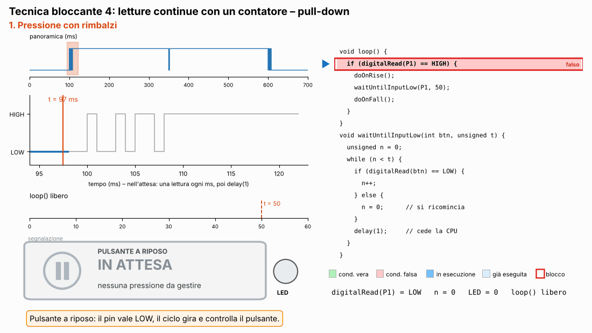

>[Torna all'indice](indexpulsanti.md)   >[versione in Python](pulsanti-bloccanti-mpy.md)

# Pulsanti: tecniche bloccanti (attivazione sul rilascio)

In una tecnica **bloccante** il programma, dopo aver visto il pulsante premuto, resta fermo dentro una
funzione di attesa finché il rilascio non è confermato. È la soluzione più semplice da scrivere e da
capire, ma per tutto il tempo della pressione `loop()` non fa altro: va bene quando il programma non ha
altri compiti, oppure su ESP32, dove gli altri task (FreeRTOS) continuano a girare.

Le tecniche sono presentate dalla più semplice alla più robusta. Le funzioni di attesa sono definite
nello sketch: la libreria `urutils.h` contiene solo le versioni **non bloccanti**
(`waitUntilInputLowNB()` / `waitUntilInputHighNB()`).

> Tecniche non bloccanti: [pulsanti-rilascio.md](pulsanti-rilascio.md) (complete) e [pulsanti-rilascio-corte.md](pulsanti-rilascio-corte.md) (solo azione al rilascio)

| Collegamento | Riposo | Premuto | Pressione | Rilascio | Funzione di attesa |
| --- | --- | --- | --- | --- | --- |
| Pull-down (resistenza verso GND) | LOW | HIGH | fronte di salita | fronte di discesa | `waitUntilInputLow()` |
| Pull-up (verso Vcc o `INPUT_PULLUP`) | HIGH | LOW | fronte di discesa | fronte di salita | `waitUntilInputHigh()` |

## La struttura comune e il punto debole

Il `loop()` è lo stesso in tutte le versioni (pull-down):

```cpp
void loop() {
  if (digitalRead(P1) == HIGH) {   // (1) letto all'inizio di OGNI giro
    doOnRise();                    // pressione
    waitUntilInputLow(P1, 50);     // (2) bloccato qui fino al rilascio
    doOnFall();                    // (3) rilascio
  }
}                                 // (4) fine del giro: si torna subito a (1)
```

Cambia solo **come** la funzione di attesa decide che il pulsante è stato rilasciato. Per giudicarle
bisogna ricordare che `loop()` viene richiamato all'infinito: appena l'attesa finisce e `doOnFall()` è
eseguita, pochi microsecondi dopo il giro successivo rilegge il pin in (1). Se in quel momento il
contatto sta ancora rimbalzando, il pin può risultare HIGH e il rimbalzo viene preso per una **nuova
pressione**: il toggle scatta due volte (*pressione fantasma*). Un'attesa è corretta solo se esce
quando i rimbalzi del rilascio sono **finiti**.

I due disturbi da considerare sono:
- i **rimbalzi** del contatto, alla pressione e al rilascio (qualche ms);
- un **buco sul livello alto**: il contatto si apre per un attimo mentre il pulsante è ancora premuto
  (contatto sporco o consumato, vibrazioni).

I numeri riportati sotto vengono da una simulazione di 5000 pressioni per caso, con rimbalzi fino a
10 ms e buchi di 2 ms.

## 1. Una lettura ogni t ms

La versione più semplice: aspetta `t` ms, legge il pin una volta e, se è ancora premuto, aspetta di
nuovo. Esce alla **prima lettura** che trova il pulsante rilasciato.

<p align="center">
  
</p>

<table>
<tr>
<th>Pull-down: azione sul fronte di discesa</th>
<th>Pull-up: azione sul fronte di salita</th>
</tr>
<tr>
<td>

```cpp
const byte P1  = 2;
const byte LED = 13;
bool stato = LOW;

void waitUntilInputLow(int btn, unsigned t) {
  // aspetta t ms, poi legge una volta:
  // se il pin è ancora HIGH, aspetta
  // di nuovo
  do {
    delay(t);
  } while (digitalRead(btn) == HIGH);
}

void doOnRise() {
  // PRESSIONE (fronte di salita):
  // qui vanno le azioni immediate
  // alla pressione.
  // Lasciatela vuota se non serve.
}

void doOnFall() {
  // RILASCIO (fronte di discesa):
  // qui vanno le azioni al rilascio.
  // Esempio: toggle, inverte lo
  // stato del LED a ogni rilascio.
  stato = !stato;
  digitalWrite(LED, stato);
}

void setup() {
  pinMode(P1, INPUT);
  pinMode(LED, OUTPUT);
}

void loop() {
  if (digitalRead(P1) == HIGH) {
    doOnRise();
    waitUntilInputLow(P1, 50);
    doOnFall();
  }
}
```

</td>
<td>

```cpp
const byte P1  = 2;
const byte LED = 13;
bool stato = LOW;

void waitUntilInputHigh(int btn, unsigned t) {
  // aspetta t ms, poi legge una volta:
  // se il pin è ancora LOW, aspetta
  // di nuovo
  do {
    delay(t);
  } while (digitalRead(btn) == LOW);
}

void doOnFall() {
  // PRESSIONE (fronte di discesa):
  // qui vanno le azioni immediate
  // alla pressione.
  // Lasciatela vuota se non serve.
}

void doOnRise() {
  // RILASCIO (fronte di salita):
  // qui vanno le azioni al rilascio.
  // Esempio: toggle, inverte lo
  // stato del LED a ogni rilascio.
  stato = !stato;
  digitalWrite(LED, stato);
}

void setup() {
  pinMode(P1, INPUT_PULLUP);
  pinMode(LED, OUTPUT);
}

void loop() {
  if (digitalRead(P1) == LOW) {
    doOnFall();
    waitUntilInputHigh(P1, 50);
    doOnRise();
  }
}
```

</td>
</tr>
</table>

**Limiti.** La decisione dipende da dove cade una sola lettura:
- se cade all'inizio dei rimbalzi del rilascio, l'attesa esce subito e il giro successivo di `loop()`
  legge un rimbalzo alto: pressione fantasma (171 errori su 5000 con i soli rimbalzi);
- se cade dentro un buco sul livello alto, il rilascio viene confermato a pulsante ancora premuto
  (388 errori su 5000).

Funziona "quasi sempre" solo perché, leggendo di rado, di solito scavalca i rimbalzi. La Wait su un
ingresso digitale di un robot UR si comporta come questa versione, ma con una lettura per ciclo di
controllo (2 ms) invece che ogni 50 ms: per questo vede i rimbalzi quasi sempre.

## 2. Una lettura e un'attesa fissa dopo

Come la 1, ma dopo la lettura che trova il pulsante rilasciato aspetta altri `t` ms: quando `loop()`
rilegge il pin i rimbalzi del rilascio sono finiti.

<p align="center">
  
</p>

<table>
<tr>
<th>Pull-down: azione sul fronte di discesa</th>
<th>Pull-up: azione sul fronte di salita</th>
</tr>
<tr>
<td>

```cpp
const byte P1  = 2;
const byte LED = 13;
bool stato = LOW;

void waitUntilInputLow(int btn, unsigned t) {
  // come la 1: aspetta finché una
  // lettura trova LOW...
  do {
    delay(t);
  } while (digitalRead(btn) == HIGH);
  // ...poi aspetta ancora t ms, perché
  // i rimbalzi del rilascio finiscano
  // prima che loop() rilegga il pin
  delay(t);
}

void doOnRise() {
  // PRESSIONE (fronte di salita):
  // qui vanno le azioni immediate
  // alla pressione.
  // Lasciatela vuota se non serve.
}

void doOnFall() {
  // RILASCIO (fronte di discesa):
  // qui vanno le azioni al rilascio.
  // Esempio: toggle, inverte lo
  // stato del LED a ogni rilascio.
  stato = !stato;
  digitalWrite(LED, stato);
}

void setup() {
  pinMode(P1, INPUT);
  pinMode(LED, OUTPUT);
}

void loop() {
  if (digitalRead(P1) == HIGH) {
    doOnRise();
    waitUntilInputLow(P1, 50);
    doOnFall();
  }
}
```

</td>
<td>

```cpp
const byte P1  = 2;
const byte LED = 13;
bool stato = LOW;

void waitUntilInputHigh(int btn, unsigned t) {
  // come la 1: aspetta finché una
  // lettura trova HIGH...
  do {
    delay(t);
  } while (digitalRead(btn) == LOW);
  // ...poi aspetta ancora t ms, perché
  // i rimbalzi del rilascio finiscano
  // prima che loop() rilegga il pin
  delay(t);
}

void doOnFall() {
  // PRESSIONE (fronte di discesa):
  // qui vanno le azioni immediate
  // alla pressione.
  // Lasciatela vuota se non serve.
}

void doOnRise() {
  // RILASCIO (fronte di salita):
  // qui vanno le azioni al rilascio.
  // Esempio: toggle, inverte lo
  // stato del LED a ogni rilascio.
  stato = !stato;
  digitalWrite(LED, stato);
}

void setup() {
  pinMode(P1, INPUT_PULLUP);
  pinMode(LED, OUTPUT);
}

void loop() {
  if (digitalRead(P1) == LOW) {
    doOnFall();
    waitUntilInputHigh(P1, 50);
    doOnRise();
  }
}
```

</td>
</tr>
</table>

**Cosa migliora.** Niente più pressioni fantasma: 0 errori su 5000 con i soli rimbalzi.

**Limiti.** L'attesa fissa non sa cosa è successo prima: un buco sul livello alto letto al momento
sbagliato fa ancora confermare un rilascio a pulsante premuto (190 errori su 5000). Il rilascio
arriva in media 71 ms dopo la fine dei rimbalzi.

Un'attesa fissa messa **prima** del ciclo, invece, non serve: copre i rimbalzi della pressione, che il
ciclo di attesa ignora già, mentre gli errori nascono alla fine.

## 3. Due letture: rilascio confermato dopo t ms

La prima lettura che trova il pulsante rilasciato non basta: dopo `t` ms si legge di nuovo, e solo
se anche la seconda trova il pulsante rilasciato l'attesa finisce. Se la conferma fallisce si
ricomincia da capo.

<p align="center">
  
</p>

<table>
<tr>
<th>Pull-down: azione sul fronte di discesa</th>
<th>Pull-up: azione sul fronte di salita</th>
</tr>
<tr>
<td>

```cpp
const byte P1  = 2;
const byte LED = 13;
bool stato = LOW;

void waitUntilInputLow(int btn, unsigned t) {
  do {
    // prima lettura LOW...
    do {
      delay(t);
    } while (digitalRead(btn) == HIGH);
    // ...confermata da una seconda
    // lettura t ms dopo
    delay(t);
  } while (digitalRead(btn) == HIGH);
}

void doOnRise() {
  // PRESSIONE (fronte di salita):
  // qui vanno le azioni immediate
  // alla pressione.
  // Lasciatela vuota se non serve.
}

void doOnFall() {
  // RILASCIO (fronte di discesa):
  // qui vanno le azioni al rilascio.
  // Esempio: toggle, inverte lo
  // stato del LED a ogni rilascio.
  stato = !stato;
  digitalWrite(LED, stato);
}

void setup() {
  pinMode(P1, INPUT);
  pinMode(LED, OUTPUT);
}

void loop() {
  if (digitalRead(P1) == HIGH) {
    doOnRise();
    waitUntilInputLow(P1, 50);
    doOnFall();
  }
}
```

</td>
<td>

```cpp
const byte P1  = 2;
const byte LED = 13;
bool stato = LOW;

void waitUntilInputHigh(int btn, unsigned t) {
  do {
    // prima lettura HIGH...
    do {
      delay(t);
    } while (digitalRead(btn) == LOW);
    // ...confermata da una seconda
    // lettura t ms dopo
    delay(t);
  } while (digitalRead(btn) == LOW);
}

void doOnFall() {
  // PRESSIONE (fronte di discesa):
  // qui vanno le azioni immediate
  // alla pressione.
  // Lasciatela vuota se non serve.
}

void doOnRise() {
  // RILASCIO (fronte di salita):
  // qui vanno le azioni al rilascio.
  // Esempio: toggle, inverte lo
  // stato del LED a ogni rilascio.
  stato = !stato;
  digitalWrite(LED, stato);
}

void setup() {
  pinMode(P1, INPUT_PULLUP);
  pinMode(LED, OUTPUT);
}

void loop() {
  if (digitalRead(P1) == LOW) {
    doOnFall();
    waitUntilInputHigh(P1, 50);
    doOnRise();
  }
}
```

</td>
</tr>
</table>

**Cosa migliora.** Un buco isolato non basta più: servirebbero due buchi colti esattamente a `t` ms
di distanza. In simulazione: 0 errori sui rimbalzi e sui buchi singoli.

**Limiti.** La protezione è **probabilistica**: due letture sfortunate (due buchi a 50 ms l'una
dall'altra, oppure un buco seguito da una lettura dentro i rimbalzi del rilascio) producono ancora un
errore, raro ma possibile. Il rilascio arriva in media 71 ms dopo la fine dei rimbalzi (massimo 99).

## 4. Letture continue con un contatore

Invece di poche letture, si legge il pin **ogni millisecondo** e si contano le letture "rilasciato"
consecutive: ogni lettura "premuto" (pulsante ancora premuto, rimbalzo o buco) azzera il conteggio.
L'attesa finisce solo dopo `t` letture "rilasciato" di fila.

<p align="center">
  
</p>

<table>
<tr>
<th>Pull-down: azione sul fronte di discesa</th>
<th>Pull-up: azione sul fronte di salita</th>
</tr>
<tr>
<td>

```cpp
const byte P1  = 2;
const byte LED = 13;
bool stato = LOW;

void waitUntilInputLow(int btn, unsigned t) {
  // conta le letture LOW consecutive,
  // una ogni ms: ogni lettura HIGH
  // (rimbalzo, disturbo o pulsante
  // ancora premuto) azzera il conteggio
  unsigned n = 0;
  while (n < t) {
    if (digitalRead(btn) == LOW) {
      n++;
    } else {
      n = 0;
    }
    delay(1);  // cede la CPU agli altri
               // task (ESP32, FreeRTOS)
  }
}

void doOnRise() {
  // PRESSIONE (fronte di salita):
  // qui vanno le azioni immediate
  // alla pressione.
  // Lasciatela vuota se non serve.
}

void doOnFall() {
  // RILASCIO (fronte di discesa):
  // qui vanno le azioni al rilascio.
  // Esempio: toggle, inverte lo
  // stato del LED a ogni rilascio.
  stato = !stato;
  digitalWrite(LED, stato);
}

void setup() {
  pinMode(P1, INPUT);
  pinMode(LED, OUTPUT);
}

void loop() {
  if (digitalRead(P1) == HIGH) {
    doOnRise();
    waitUntilInputLow(P1, 50);
    doOnFall();
  }
}
```

</td>
<td>

```cpp
const byte P1  = 2;
const byte LED = 13;
bool stato = LOW;

void waitUntilInputHigh(int btn, unsigned t) {
  // conta le letture HIGH consecutive,
  // una ogni ms: ogni lettura LOW
  // (rimbalzo, disturbo o pulsante
  // ancora premuto) azzera il conteggio
  unsigned n = 0;
  while (n < t) {
    if (digitalRead(btn) == HIGH) {
      n++;
    } else {
      n = 0;
    }
    delay(1);  // cede la CPU agli altri
               // task (ESP32, FreeRTOS)
  }
}

void doOnFall() {
  // PRESSIONE (fronte di discesa):
  // qui vanno le azioni immediate
  // alla pressione.
  // Lasciatela vuota se non serve.
}

void doOnRise() {
  // RILASCIO (fronte di salita):
  // qui vanno le azioni al rilascio.
  // Esempio: toggle, inverte lo
  // stato del LED a ogni rilascio.
  stato = !stato;
  digitalWrite(LED, stato);
}

void setup() {
  pinMode(P1, INPUT_PULLUP);
  pinMode(LED, OUTPUT);
}

void loop() {
  if (digitalRead(P1) == LOW) {
    doOnFall();
    waitUntilInputHigh(P1, 50);
    doOnRise();
  }
}
```

</td>
</tr>
</table>

**Cosa migliora.** La decisione non dipende più da dove cadono poche letture: per uscire servono 50 ms
di livello di riposo **ininterrotto**. È certa, purché rimbalzi e buchi durino meno di `t` − 1 ms
(1 ms è l'intervallo tra due letture). In simulazione: 0 errori. Il rilascio arriva 49–50 ms dopo la
fine dei rimbalzi.

**Limite.** Il tempo è misurato contando i giri: è preciso solo se ogni giro dura davvero 1 ms. Se il
ciclo contiene altro codice, o se `delay(1)` dura meno di 1 ms (su ESP32 aspetta il *prossimo* tick
di FreeRTOS), il tempo reale di conferma cambia.

## 5. Letture continue con millis() (consigliata)

Stessa logica della 4, ma il tempo si misura con `millis()`: `tl` è l'istante dell'ultima lettura
"premuto", e l'attesa finisce quando ne sono passati più di `t` ms. La durata non dipende più da
quanto dura un giro del ciclo.

<p align="center">
  
</p>

Con il pull-up il comportamento è identico con i livelli invertiti: il pulsante premuto legge LOW e si attende con `waitUntilInputHigh()`.

<table>
<tr>
<th>Pull-down: azione sul fronte di discesa</th>
<th>Pull-up: azione sul fronte di salita</th>
</tr>
<tr>
<td>

```cpp
const byte P1  = 2;
const byte LED = 13;
bool stato = LOW;

void waitUntilInputLow(int btn, unsigned t) {
  // attende t ms di LOW continuo: ogni
  // lettura HIGH (rimbalzo, disturbo o
  // pulsante ancora premuto) fa
  // ripartire il conteggio
  unsigned long tl = millis();
  while (millis() - tl <= t) {
    if (digitalRead(btn) == HIGH) {
      tl = millis();
    }
    delay(1);  // cede la CPU agli altri
               // task (ESP32, FreeRTOS)
  }
}

void doOnRise() {
  // PRESSIONE (fronte di salita):
  // qui vanno le azioni immediate
  // alla pressione.
  // Lasciatela vuota se non serve.
}

void doOnFall() {
  // RILASCIO (fronte di discesa):
  // qui vanno le azioni al rilascio.
  // Esempio: toggle, inverte lo
  // stato del LED a ogni rilascio.
  stato = !stato;
  digitalWrite(LED, stato);
}

void setup() {
  pinMode(P1, INPUT);
  pinMode(LED, OUTPUT);
}

void loop() {
  if (digitalRead(P1) == HIGH) {
    doOnRise();
    waitUntilInputLow(P1, 50);
    doOnFall();
  }
}
```

</td>
<td>

```cpp
const byte P1  = 2;
const byte LED = 13;
bool stato = LOW;

void waitUntilInputHigh(int btn, unsigned t) {
  // attende t ms di HIGH continuo: ogni
  // lettura LOW (rimbalzo, disturbo o
  // pulsante ancora premuto) fa
  // ripartire il conteggio
  unsigned long tl = millis();
  while (millis() - tl <= t) {
    if (digitalRead(btn) == LOW) {
      tl = millis();
    }
    delay(1);  // cede la CPU agli altri
               // task (ESP32, FreeRTOS)
  }
}

void doOnFall() {
  // PRESSIONE (fronte di discesa):
  // qui vanno le azioni immediate
  // alla pressione.
  // Lasciatela vuota se non serve.
}

void doOnRise() {
  // RILASCIO (fronte di salita):
  // qui vanno le azioni al rilascio.
  // Esempio: toggle, inverte lo
  // stato del LED a ogni rilascio.
  stato = !stato;
  digitalWrite(LED, stato);
}

void setup() {
  pinMode(P1, INPUT_PULLUP);
  pinMode(LED, OUTPUT);
}

void loop() {
  if (digitalRead(P1) == LOW) {
    doOnFall();
    waitUntilInputHigh(P1, 50);
    doOnRise();
  }
}
```

</td>
</tr>
</table>

**Cosa garantisce.** Esce solo dopo più di `t` ms in cui **tutte** le letture, una ogni millisecondo,
hanno trovato il pulsante rilasciato: né un rimbalzo del rilascio né un buco breve a pulsante premuto
possono farla uscire, e quando `loop()` rilegge il pin il livello è stabile da `t` ms. Il `delay(1)`
fissa il passo di lettura e cede la CPU: su ESP32 gli altri task continuano a girare. In
simulazione: 0 errori, rilascio 49–50 ms dopo la fine dei rimbalzi.

## Confronto

| Versione | Rimbalzi al rilascio (pressione fantasma) | Buco sul livello alto | Ritardo del rilascio dopo i rimbalzi |
| --- | --- | --- | --- |
| 1. Una lettura ogni t ms | ✘ 171 / 5000 | ✘ 388 / 5000 | medio 22 ms, max 49 ms |
| 2. Una lettura + attesa dopo | ✔ 0 | ✘ 190 / 5000 | medio 71 ms, max 99 ms |
| 3. Due letture | ✔ 0 | ~ probabilistica (0 / 5000) | medio 71 ms, max 99 ms |
| 4. Letture continue, contatore | ✔ 0 | ✔ 0 | 49–50 ms |
| 5. Letture continue, millis() | ✔ 0 | ✔ 0 | 49–50 ms |

✔ protegge sempre (se il disturbo dura meno di `t`) · ~ protegge quasi sempre · ✘ non protegge

## Quale tecnica è sicura su Arduino, ESP32 e robot UR

La logica delle tecniche è la stessa ovunque, ma l'attesa di un millisecondo si comporta in modo
diverso a seconda della piattaforma, e questo cambia quale versione conviene.

| Tecnica | Arduino UNO | ESP32 (Arduino con FreeRTOS) | Robot UR (URScript) |
| --- | --- | --- | --- |
| 1. Una lettura ogni t ms | ✘ non sicura | ✘ non sicura | ✘ non sicura: è il comando **Wait** su un ingresso digitale, con una lettura per ciclo di controllo |
| 2. Una lettura + attesa dopo | ✘ non sicura (buchi) | ✘ non sicura (buchi) | ✘ non sicura: è una Wait seguita da un movimento o da una Wait a tempo |
| 3. Due letture | ~ quasi sempre | ~ quasi sempre | ~ quasi sempre |
| 4. Letture continue, contatore | ✔ sicura | ✔ sicura, tempo di conferma approssimato | ✔ **sicura e consigliata**: si contano i cicli di controllo con `sync()` |
| 5. Letture continue, millis() | ✔ **sicura e consigliata** | ✔ **sicura e consigliata** | non serve: sul robot il ciclo di controllo fa già da orologio |

**Arduino UNO.** C'è un solo flusso di esecuzione e `delay(1)` è un'attesa attiva di circa 1 ms: il
contatore misura bene il tempo, quindi la 4 e la 5 sono entrambe sicure. La 5 resta preferibile perché
il tempo di conferma non dipende da quanto dura un giro del ciclo. Le tecniche bloccanti vanno bene
solo se il programma non ha altro da fare mentre il pulsante è premuto.

**ESP32.** `loop()` è un task di FreeRTOS e `delay(1)` sospende il task fino al prossimo *tick*
(1 ms), cedendo la CPU agli altri task: per questo le tecniche bloccanti sono accettabili anche con
più compiti, purché gli altri girino in task separati. Il primo `delay(1)` può durare meno di 1 ms
(aspetta il tick successivo, non 1 ms pieno) e un task a priorità più alta può allungarlo: con il
contatore il tempo reale di conferma è quindi solo *circa* `t` ms, mentre con `millis()` è misurato.
Per questo su ESP32 la 5 è la scelta giusta. Non usate `delay(0)`: cede la CPU solo ai task di pari
priorità.

**Robot UR.** Il programma URScript è scandito dal ciclo di controllo del robot: un *frame* di 2 ms
sugli e-Series (8 ms sui CB3), e `sync()` aspetta il frame successivo. Il comando **Wait** su un
ingresso digitale legge l'ingresso una volta per frame ed esce alla **prima** lettura che soddisfa
la condizione: è la tecnica 1 con un passo di 2 ms, quindi vede quasi sempre i rimbalzi di un
pulsante meccanico. Mettere una Wait a tempo o un movimento dopo la Wait sull'ingresso equivale alla
tecnica 2: copre i rimbalzi, non i buchi. Su un robot la versione sicura è la 4, scritta in uno
Script node: siccome il frame dura sempre lo stesso tempo, contare i frame equivale a misurare il
tempo.

```python
def waitUntilLow(n, t):        # t in secondi, es. 0.05
  tl = 0
  while tl < t:
    if get_standard_digital_in(n):
      tl = 0                   # lettura alta: il conteggio riparte
    else:
      tl = tl + 0.002          # un frame (e-Series) di LOW in più; 0.008 sui CB3
    end
    sync()                     # aspetta il frame successivo
  end
end
```

Lo script segue la documentazione di URScript ma non è stato provato su un robot. Per verificarlo:
un pulsante su DI0 e un contatore che aumenta a ogni rilascio; con due Wait in fila (HI e poi LO)
il contatore sale di più di 1 a ogni pressione, con lo script deve salire di 1. Gli ingressi del
robot sono a 24 V e in genere li comandano sensori elettronici, che non rimbalzano: il problema
riguarda soprattutto i pulsanti meccanici collegati direttamente.

## Considerazioni finali

**Il limite di fondo, comune a tutte le tecniche.** Ogni antirimbalzo stabilisce un tempo minimo,
qui 50 ms, oltre il quale un'apertura del contatto viene considerata un rilascio vero. Un disturbo
più lungo non si distingue da un rilascio breve. Si supera scegliendo un tempo adatto alla qualità
del pulsante: abbastanza lungo da coprire i suoi rimbalzi e i suoi disturbi, abbastanza corto da non
perdere le pressioni rapide.

**Lo spike alto a pulsante rilasciato non è filtrato da nessuna tecnica bloccante.** Tutte accettano la
pressione alla **prima** lettura "premuto": un disturbo che porta il pin alto per un attimo a pulsante
rilasciato (tipico del pull-down con cavi lunghi, perché a riposo il pin è tenuto basso solo dalla
resistenza) diventa una pressione, e dopo 50 ms un rilascio: il toggle scatta (5000 errori su 5000 in
simulazione). Se l'ingresso è disturbato servono una resistenza di pull-down più bassa o un filtro RC,
oppure la versione a **livello stabile** con `changed()` di [pulsanti-rilascio.md](pulsanti-rilascio.md),
che chiede il livello fermo per 50 ms anche alla pressione.

**Quando usarle.** Le tecniche bloccanti fermano `loop()` per tutta la durata della pressione: vanno
bene in un programma che deve solo reagire al pulsante, o su ESP32 dove gli altri compiti girano in
altri task. Se `loop()` deve fare altro mentre il pulsante è premuto (un lampeggio, un motore), servono
le tecniche non bloccanti.

**Versione con la sola azione al rilascio.** Basta togliere la callback della pressione (`doOnRise()`
nel pull-down, `doOnFall()` nel pull-up) e la sua chiamata nel `loop()`: l'attesa non cambia.

## Riferimenti

- [pulsanti-rilascio.md](pulsanti-rilascio.md): tecniche non bloccanti, con azione alla pressione e al rilascio
- [pulsanti-rilascio-corte.md](pulsanti-rilascio-corte.md): tecniche non bloccanti, solo azione al rilascio
- [debouncerFSM.md](debouncerFSM.md): la macchina a stati del debouncer a livello stabile
- [interfacce-digitali.md](interfacce-digitali.md): ingressi di Arduino, ESP32 e robot UR, sensori a 24 V e a 5 V, e quale tecnica scegliere
- [urutils.h](https://github.com/sebastianomelita/ArduinoBareMetal/blob/master/urutils.h): sorgente della libreria
