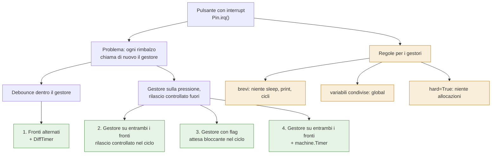

>[Torna all'indice](indexpulsanti.md)   >[versione in C++](pulsanti-interrupt.md)

# Pulsanti con interrupt in MicroPython: attivazione sul rilascio (pull-down e pull-up)

Versione MicroPython di [pulsanti-interrupt.md](pulsanti-interrupt.md), con le stesse tecniche e
le stesse convenzioni: la pressione viene riconosciuta **subito**, dal gestore dell'interrupt, e
l'azione principale parte al **rilascio**; `doOnRise()` e `doOnFall()` sono le callback dei
due fronti.

> Versione semplificata: [pulsanti-interrupt-semplice-mpy.md](pulsanti-interrupt-semplice-mpy.md)
> Versioni senza interrupt (polling): [pulsanti-rilascio-mpy.md](pulsanti-rilascio-mpy.md)

| Collegamento | Premuto | Gestore della pressione | Callback pressione | Callback rilascio |
| --- | --- | --- | --- | --- |
| Pull-down | 1 | `Pin.IRQ_RISING` | `doOnRise()` | `doOnFall()` |
| Pull-up (`Pin.PULL_UP`) | 0 | `Pin.IRQ_FALLING` | `doOnFall()` | `doOnRise()` |

Pin di esempio per ESP32: pulsante su GPIO 12, LED su GPIO 13. Le tecniche 1 e 3 usano
`urutils.py` (versione corretta, con `DiffTimer` e `waitUntilInputLow()` con conferma del
rilascio).

## Mappa concettuale



## Confronto delle tecniche

| Tecnica | Dove si fa il debounce | Callback pressione | Callback rilascio | Il ciclo principale è libero? |
| --- | --- | --- | --- | --- |
| 1. Debounce nel gestore | nel gestore, con DiffTimer | nel gestore | nel gestore | sì, del tutto |
| 2. Gestore su entrambi i fronti + ciclo | gestore (tempi) e ciclo (decisione) | nel gestore | nel ciclo | sì, anche lento |
| 3. Gestore con flag + attesa bloccante | nel ciclo | nel gestore | nel ciclo | no, fermo finché il pulsante è premuto |
| 4. Gestore su entrambi i fronti + Timer | gestore (tempi) e Timer (decisione) | nel gestore | nel Timer | sì, del tutto |

In nessuna tecnica l'interrupt viene disattivato: i rimbalzi chiamano il gestore più volte,
ma ogni volta esso esegue solo poche istruzioni.

## 1. Debounce nel gestore con fronti alternati

L'interrupt è attivo su un solo fronte alla volta: prima quello di pressione, poi, appena la
pressione è accettata, quello di rilascio. Ogni fronte viene accettato solo se dall'ultimo
fronte accettato sono passati più di 50 ms. Tutto avviene nel gestore, quindi il ciclo
principale è libero. Una pressione più breve di 50 ms fa saltare un giro alla sequenza, che poi
si rimette in passo da sola.

<table>
<tr>
<th>Pull-down: azione sul fronte di discesa</th>
<th>Pull-up: azione sul fronte di salita</th>
</tr>
<tr>
<td>

```python
from machine import Pin
import time
from urutils import DiffTimer

P1  = Pin(12, Pin.IN)  # pull-down
LED = Pin(13, Pin.OUT)
stato = False
debt = DiffTimer()
debt.start()  # il primo fronte passa

def doOnRise():
    # PRESSIONE (fronte di salita):
    # qui vanno le azioni immediate
    # alla pressione.
    # Eseguita nel gestore: breve!
    pass

def doOnFall():
    # RILASCIO (fronte di discesa):
    # qui vanno le azioni al rilascio.
    # Eseguita nel gestore: breve!
    # Esempio: toggle del LED.
    global stato
    stato = not stato
    LED.value(stato)

def isrPress(pin):  # armata sulla pressione
    if debt.get() > 50:
        debt.reset()
        doOnRise()
        P1.irq(trigger=Pin.IRQ_FALLING,
               handler=isrRel)

def isrRel(pin):    # armata sul rilascio
    if debt.get() > 50:
        debt.reset()
        doOnFall()
        P1.irq(trigger=Pin.IRQ_RISING,
               handler=isrPress)

P1.irq(trigger=Pin.IRQ_RISING,
       handler=isrPress)

while True:
    pass  # libero per altri compiti
```

</td>
<td>

```python
from machine import Pin
import time
from urutils import DiffTimer

P1  = Pin(12, Pin.IN, Pin.PULL_UP)
LED = Pin(13, Pin.OUT)
stato = False
debt = DiffTimer()
debt.start()  # il primo fronte passa

def doOnFall():
    # PRESSIONE (fronte di discesa):
    # qui vanno le azioni immediate
    # alla pressione.
    # Eseguita nel gestore: breve!
    pass

def doOnRise():
    # RILASCIO (fronte di salita):
    # qui vanno le azioni al rilascio.
    # Eseguita nel gestore: breve!
    # Esempio: toggle del LED.
    global stato
    stato = not stato
    LED.value(stato)

def isrPress(pin):  # armata sulla pressione
    if debt.get() > 50:
        debt.reset()
        doOnFall()
        P1.irq(trigger=Pin.IRQ_RISING,
               handler=isrRel)

def isrRel(pin):    # armata sul rilascio
    if debt.get() > 50:
        debt.reset()
        doOnRise()
        P1.irq(trigger=Pin.IRQ_FALLING,
               handler=isrPress)

P1.irq(trigger=Pin.IRQ_FALLING,
       handler=isrPress)

while True:
    pass  # libero per altri compiti
```

</td>
</tr>
</table>

## 2. Gestore su entrambi i fronti, rilascio controllato nel ciclo

Il gestore è attivo su entrambi i fronti. A ogni fronte, rimbalzi compresi, salva l'istante in
`tFronte`; se il pulsante risulta premuto e la pressione non è ancora stata segnalata, chiama la
callback della pressione. Il ciclo principale chiama la callback del rilascio solo quando il
pin è rilasciato e da più di 50 ms non c'è stato nessun fronte. Siccome i tempi li registra il
gestore, la tecnica funziona anche se il ciclo è lento.

<table>
<tr>
<th>Pull-down: azione sul fronte di discesa</th>
<th>Pull-up: azione sul fronte di salita</th>
</tr>
<tr>
<td>

```python
from machine import Pin
import time

P1  = Pin(12, Pin.IN)  # pull-down
LED = Pin(13, Pin.OUT)
stato = False
premuto = False
tFronte = 0  # ultimo fronte

def doOnRise():
    # PRESSIONE (fronte di salita):
    # qui vanno le azioni immediate
    # alla pressione.
    # Eseguita nel gestore: breve!
    pass

def doOnFall():
    # RILASCIO (fronte di discesa):
    # qui vanno le azioni al rilascio.
    # Eseguita nel ciclo principale.
    # Esempio: toggle del LED.
    global stato
    stato = not stato
    LED.value(stato)

def isrChange(pin):
    # registra ogni fronte,
    # rimbalzi compresi
    global premuto, tFronte
    tFronte = time.ticks_ms()
    if not premuto and pin.value():
        premuto = True
        doOnRise()

P1.irq(trigger=Pin.IRQ_RISING |
       Pin.IRQ_FALLING,
       handler=isrChange)

while True:
    if premuto and not P1.value() and \
       time.ticks_diff(time.ticks_ms(),
                       tFronte) > 50:
        premuto = False
        doOnFall()
    # qui altri compiti, anche lenti
```

</td>
<td>

```python
from machine import Pin
import time

P1  = Pin(12, Pin.IN, Pin.PULL_UP)
LED = Pin(13, Pin.OUT)
stato = False
premuto = False
tFronte = 0  # ultimo fronte

def doOnFall():
    # PRESSIONE (fronte di discesa):
    # qui vanno le azioni immediate
    # alla pressione.
    # Eseguita nel gestore: breve!
    pass

def doOnRise():
    # RILASCIO (fronte di salita):
    # qui vanno le azioni al rilascio.
    # Eseguita nel ciclo principale.
    # Esempio: toggle del LED.
    global stato
    stato = not stato
    LED.value(stato)

def isrChange(pin):
    # registra ogni fronte,
    # rimbalzi compresi
    global premuto, tFronte
    tFronte = time.ticks_ms()
    if not premuto and not pin.value():
        premuto = True
        doOnFall()

P1.irq(trigger=Pin.IRQ_RISING |
       Pin.IRQ_FALLING,
       handler=isrChange)

while True:
    if premuto and P1.value() and \
       time.ticks_diff(time.ticks_ms(),
                       tFronte) > 50:
        premuto = False
        doOnRise()
    # qui altri compiti, anche lenti
```

</td>
</tr>
</table>

## 3. Gestore con flag, attesa bloccante nel ciclo

Il gestore riconosce la pressione, chiama la callback e alza il flag `premuto`, che fa scartare
i rimbalzi successivi. Il ciclo principale aspetta il rilascio con `waitUntilInputLow()`
(pull-down) o `waitUntilInputHigh()` (pull-up) di `urutils.py`, che escono solo con un rilascio
confermato, poi chiama la callback e abbassa il flag.

<table>
<tr>
<th>Pull-down: azione sul fronte di discesa</th>
<th>Pull-up: azione sul fronte di salita</th>
</tr>
<tr>
<td>

```python
from machine import Pin
import time
from urutils import waitUntilInputLow

P1  = Pin(12, Pin.IN)  # pull-down
LED = Pin(13, Pin.OUT)
stato = False
premuto = False

def doOnRise():
    # PRESSIONE (fronte di salita):
    # qui vanno le azioni immediate
    # alla pressione.
    # Eseguita nel gestore: breve!
    pass

def doOnFall():
    # RILASCIO (fronte di discesa):
    # qui vanno le azioni al rilascio.
    # Eseguita nel ciclo principale.
    # Esempio: toggle del LED.
    global stato
    stato = not stato
    LED.value(stato)

def isrPress(pin):
    # resta armata: i rimbalzi
    # vengono scartati dal flag
    global premuto
    if not premuto:
        premuto = True
        doOnRise()

P1.irq(trigger=Pin.IRQ_RISING,
       handler=isrPress)

while True:
    if premuto:
        # rilascio confermato
        waitUntilInputLow(P1, 50)
        doOnFall()
        premuto = False
```

</td>
<td>

```python
from machine import Pin
import time
from urutils import waitUntilInputHigh

P1  = Pin(12, Pin.IN, Pin.PULL_UP)
LED = Pin(13, Pin.OUT)
stato = False
premuto = False

def doOnFall():
    # PRESSIONE (fronte di discesa):
    # qui vanno le azioni immediate
    # alla pressione.
    # Eseguita nel gestore: breve!
    pass

def doOnRise():
    # RILASCIO (fronte di salita):
    # qui vanno le azioni al rilascio.
    # Eseguita nel ciclo principale.
    # Esempio: toggle del LED.
    global stato
    stato = not stato
    LED.value(stato)

def isrPress(pin):
    # resta armata: i rimbalzi
    # vengono scartati dal flag
    global premuto
    if not premuto:
        premuto = True
        doOnFall()

P1.irq(trigger=Pin.IRQ_FALLING,
       handler=isrPress)

while True:
    if premuto:
        # rilascio confermato
        waitUntilInputHigh(P1, 50)
        doOnRise()
        premuto = False
```

</td>
</tr>
</table>

## 4. Gestore su entrambi i fronti e machine.Timer

Come la tecnica 2, ma il rilascio lo controlla un `machine.Timer` in modalità `ONE_SHOT`, che
si riprogramma ogni 50 ms finché il pin non è rilasciato e senza fronti da almeno 50 ms. Il
ciclo principale è del tutto libero. `Timer(0)` è un timer hardware di ESP32: su altre schede il
numero può essere diverso.

<table>
<tr>
<th>Pull-down: azione sul fronte di discesa</th>
<th>Pull-up: azione sul fronte di salita</th>
</tr>
<tr>
<td>

```python
from machine import Pin, Timer
import time

P1  = Pin(12, Pin.IN)  # pull-down
LED = Pin(13, Pin.OUT)
stato = False
premuto = False
tFronte = 0
tim = Timer(0)

def doOnRise():
    # PRESSIONE (fronte di salita):
    # qui vanno le azioni immediate
    # alla pressione.
    # Eseguita nel gestore: breve!
    pass

def doOnFall():
    # RILASCIO (fronte di discesa):
    # qui vanno le azioni al rilascio.
    # Eseguita dal Timer.
    # Esempio: toggle del LED.
    global stato
    stato = not stato
    LED.value(stato)

def controllaRilascio(t):
    global premuto
    if P1.value() or time.ticks_diff(
            time.ticks_ms(), tFronte) <= 50:
        # premuto o fronte recente
        tim.init(mode=Timer.ONE_SHOT,
                 period=50,
                 callback=controllaRilascio)
    else:
        premuto = False   # stabile
        doOnFall()

def isrChange(pin):
    global premuto, tFronte
    tFronte = time.ticks_ms()
    if not premuto and pin.value():
        premuto = True
        doOnRise()
        tim.init(mode=Timer.ONE_SHOT,
                 period=50,
                 callback=controllaRilascio)

P1.irq(trigger=Pin.IRQ_RISING |
       Pin.IRQ_FALLING,
       handler=isrChange)

while True:
    pass  # libero per altri compiti
```

</td>
<td>

```python
from machine import Pin, Timer
import time

P1  = Pin(12, Pin.IN, Pin.PULL_UP)
LED = Pin(13, Pin.OUT)
stato = False
premuto = False
tFronte = 0
tim = Timer(0)

def doOnFall():
    # PRESSIONE (fronte di discesa):
    # qui vanno le azioni immediate
    # alla pressione.
    # Eseguita nel gestore: breve!
    pass

def doOnRise():
    # RILASCIO (fronte di salita):
    # qui vanno le azioni al rilascio.
    # Eseguita dal Timer.
    # Esempio: toggle del LED.
    global stato
    stato = not stato
    LED.value(stato)

def controllaRilascio(t):
    global premuto
    if not P1.value() or time.ticks_diff(
            time.ticks_ms(), tFronte) <= 50:
        # premuto o fronte recente
        tim.init(mode=Timer.ONE_SHOT,
                 period=50,
                 callback=controllaRilascio)
    else:
        premuto = False   # stabile
        doOnRise()

def isrChange(pin):
    global premuto, tFronte
    tFronte = time.ticks_ms()
    if not premuto and not pin.value():
        premuto = True
        doOnFall()
        tim.init(mode=Timer.ONE_SHOT,
                 period=50,
                 callback=controllaRilascio)

P1.irq(trigger=Pin.IRQ_RISING |
       Pin.IRQ_FALLING,
       handler=isrChange)

while True:
    pass  # libero per altri compiti
```

</td>
</tr>
</table>

## Regole per i gestori di interrupt

- **Il gestore deve essere breve.** Niente `time.sleep_ms()`, niente `print()`, niente cicli:
  deve fare il suo lavoro e tornare subito. Il commento dentro ogni callback dice dove viene
  eseguita: quelle eseguite nel gestore devono contenere solo operazioni rapide.
- **Le variabili condivise si dichiarano `global`** nel gestore che le modifica, e vanno
  create prima di attivare l'interrupt.
- **`hard=True` o no.** `Pin.irq()` ha il parametro `hard`, che vale `False` se non si
  specifica. Con `hard=True` si usa un vero interrupt hardware: il gestore viene chiamato con
  meno ritardo, ma non può allocare memoria, quindi non può creare oggetti, usare numeri in
  virgola mobile o aggiungere elementi a una lista. Non tutti i port lo supportano. Gli esempi
  usano il valore predefinito.
- **Per segnalare un errore nel gestore** conviene riservare il buffer per le eccezioni con
  `micropython.alloc_emergency_exception_buf(100)` all'inizio del programma.
- **Disarmare l'interrupt** non serve in nessuna tecnica: i rimbalzi vengono scartati con un
  flag o con il tempo. La documentazione di `Pin.irq()` non dice in modo esplicito come
  disattivarlo, e riattivarlo può far scattare il gestore per fronti avvenuti nel frattempo.

## Riferimenti

- [MicroPython, machine.Pin](https://docs.micropython.org/en/latest/library/machine.Pin.html): `Pin.irq()`, fronti e parametro `hard`
- [MicroPython, scrivere gestori di interrupt](https://docs.micropython.org/en/latest/reference/isr_rules.html): regole per i gestori
- [pulsanti-interrupt.md](pulsanti-interrupt.md): versione Arduino
- [pulsanti-interrupt-semplice-mpy.md](pulsanti-interrupt-semplice-mpy.md): versione semplificata
- [pulsanti-rilascio-mpy.md](pulsanti-rilascio-mpy.md): versioni senza interrupt
