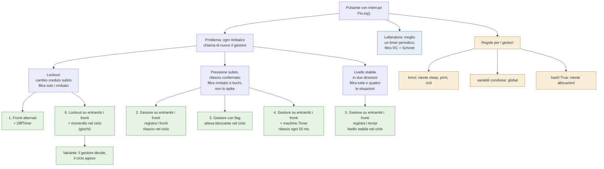

>[Torna all'indice](indexpulsanti.md)   >[versione in C++](pulsanti-interrupt.md)

# Pulsanti con interrupt in MicroPython: attivazione sul rilascio (pull-down e pull-up)

Versione MicroPython di [pulsanti-interrupt.md](pulsanti-interrupt.md), con le stesse tecniche e
le stesse convenzioni: la pressione viene riconosciuta **subito**, dal gestore dell'interrupt, e
l'azione principale parte al **rilascio**; `doOnRise()` e `doOnFall()` sono le callback dei
due fronti.

> Versione semplificata: [pulsanti-interrupt-semplice-mpy.md](pulsanti-interrupt-semplice-mpy.md)
> Versioni senza interrupt (polling): [pulsanti-rilascio-mpy.md](pulsanti-rilascio-mpy.md)

| Collegamento | Premuto | Gestore della pressione | Callback pressione | Callback rilascio |
| --- | --- | --- | --- | --- |
| Pull-down | 1 | `Pin.IRQ_RISING` | `doOnRise()` | `doOnFall()` |
| Pull-up (`Pin.PULL_UP`) | 0 | `Pin.IRQ_FALLING` | `doOnFall()` | `doOnRise()` |

Pin di esempio per ESP32: pulsante su GPIO 12, LED su GPIO 13. La tecnica 1 usa
`urutils.py` (versione corretta, con `DiffTimer`); la tecnica 3 definisce nel programma
l'attesa bloccante `waitUntilInputLow()`, con conferma del rilascio.

## Mappa concettuale



## Confronto delle tecniche

| Tecnica | Dove si fa il debounce | Callback pressione | Callback rilascio | Il ciclo principale è libero? |
| --- | --- | --- | --- | --- |
| 1. Debounce nel gestore | nel gestore, con DiffTimer | nel gestore | nel gestore | sì, del tutto |
| 2. Gestore su entrambi i fronti + ciclo | gestore (tempi) e ciclo (decisione) | nel gestore | nel ciclo | sì, anche lento |
| 3. Gestore con flag + attesa bloccante | nel ciclo | nel gestore | nel ciclo | no, fermo finché il pulsante è premuto |
| 4. Gestore su entrambi i fronti + Timer | gestore (tempi) e Timer (decisione) | nel gestore | nel Timer | sì, del tutto |
| 5. Gestore su entrambi i fronti + livello stabile nel ciclo | gestore (tempi) e ciclo (decisione) | nel ciclo, 50 ms dopo | nel ciclo | sì, anche lento |
| 6. Lockout su entrambi i fronti + ricontrollo | nel gestore (blocco di 50 ms) e ricontrollo nel ciclo | nel gestore, subito | nel gestore, subito | sì, anche lento |

### Le quattro situazioni critiche

Le stesse prove delle altre dispense (simulazione della versione Arduino in pull-down, 5000
prove per caso, passo di 1 ms; la logica è la stessa), con le quattro situazioni critiche di
[debounce-fenomeni.md](debounce-fenomeni.md):

| Tecnica | Rimbalzi alla pressione | Rimbalzi al rilascio | Buco a pulsante premuto | Spike a riposo | Errore prodotto |
| --- | --- | --- | --- | --- | --- |
| 1. Fronti alternati nel gestore | ✔ 0 | ✔ 0 | ✘ 4046 su 5000 | ✘ 5000 su 5000 | buco: due rilasci; spike: due pressioni |
| 2. Gestore su entrambi i fronti + rilascio nel ciclo | ✔ 0 | ✔ 0 | ✔ 0 | ✘ 5000 su 5000 | spike: pressione e rilascio falsi |
| 3. Gestore con flag + attesa bloccante | ✔ 0 | ✔ 0 | ✔ 0 | ✘ 5000 su 5000 | spike: pressione e rilascio falsi |
| 4. Gestore + Timer | ✔ 0 | ✔ 0 | ✔ 0 | ✘ 5000 su 5000 | spike: pressione e rilascio falsi |
| 5. Gestore + livello stabile | ✔ 0 | ✔ 0 | ✔ 0 | ✔ 0 | nessuno |
| 6. Lockout + ricontrollo | ✔ 0 | ✔ 0 | ✘ 4017 su 5000 | ✘ 5000 su 5000 | buco: rilascio e pressione falsi; spike: pressione e rilascio falsi |

Ogni situazione è simulata da sola, su 5000 prove. Le tecniche 1-4 e la 6 riconoscono la
pressione **subito**, al primo fronte: per questo uno spike a riposo vale sempre come pressione.
Le tecniche 1 e 6 sono lockout e sbagliano anche sul buco, quando cade più di 50 ms dopo la
pressione. In testa a ogni tecnica un richiamo dice che cosa rileva e che cosa no.

La tecnica 5 conferma anche la pressione e filtra tutte e quattro le situazioni, anche con un ciclo lento; il prezzo è che la pressione arriva 50 ms dopo l'ultimo
rimbalzo.

In nessuna tecnica l'interrupt viene disattivato: i rimbalzi chiamano il gestore più volte,
ma ogni volta esso esegue solo poche istruzioni.

## 1. Debounce nel gestore con fronti alternati

> **Rileva:** rimbalzi alla pressione e al rilascio. **Non rileva:** buco a pulsante premuto (due rilasci) e spike a riposo (due pressioni).
>
> **Prontezza** su pressione e rilascio: il gestore li crede al primo fronte, senza ritardo e senza aspettare il ciclo principale. Nessuna sicurezza: non c'è conferma.
>
> **Applicazioni tipiche:** didattica: mostra il lockout dentro il gestore; per un uso reale è meglio la tecnica 6.


L'interrupt è attivo su un solo fronte alla volta: prima quello di pressione, poi, appena la
pressione è accettata, quello di rilascio. Ogni fronte viene accettato solo se dall'ultimo
fronte accettato sono passati più di 50 ms. Tutto avviene nel gestore, quindi il ciclo
principale è libero. Una pressione più breve di 50 ms fa saltare un giro alla sequenza, che poi
si rimette in passo da sola.

**Riarmo a ogni fronte.** Il fronte opposto viene armato a **ogni** fronte, anche a quelli scartati come rimbalzi: così il gestore resta sempre armato sul fronte che il livello attuale del pin può produrre. Se si riarmasse solo sui fronti accettati, un fronte scartato (una pressione più breve di 50 ms, un disturbo) lascerebbe il gestore armato sul verso sbagliato e da lì in poi le due callback resterebbero scambiate per sempre.

**Limiti.** Gli errori restano **locali**: la sequenza si rimette in passo da sola al fronte successivo.
- Una pressione più breve di 50 ms esegue la callback della pressione ma non quella del rilascio (con il toggle al rilascio: nessun toggle).
- Un rilascio più breve di 50 ms (si ripreme subito) perde la callback della pressione successiva.
- Un'interruzione breve del contatto a pulsante premuto (contatto usurato, filo che si muove, disturbo) fa scattare una callback del rilascio in più (con il toggle: un toggle in più).
- Un fronte perso dall'hardware (rimbalzi più vicini di pochi microsecondi, arrivati mentre il gestore girava) può far sbagliare un evento.

Con un pulsante in buone condizioni questi casi sono rari; se serve robustezza anche a questi, conviene la tecnica 2, che considera il pulsante rilasciato solo dopo 50 ms senza fronti.

<table>
<tr>
<th>Pull-down: azione sul fronte di discesa</th>
<th>Pull-up: azione sul fronte di salita</th>
</tr>
<tr>
<td>

```python
from machine import Pin
import time
from urutils import DiffTimer

P1  = Pin(12, Pin.IN)  # pull-down
LED = Pin(13, Pin.OUT)
stato = False
debt = DiffTimer()
debt.start()  # il primo fronte passa

def doOnRise():
    # PRESSIONE (fronte di salita):
    # qui vanno le azioni immediate
    # alla pressione.
    # Eseguita nel gestore: breve!
    pass

def doOnFall():
    # RILASCIO (fronte di discesa):
    # qui vanno le azioni al rilascio.
    # Eseguita nel gestore: breve!
    # Esempio: toggle del LED.
    global stato
    stato = not stato
    LED.value(stato)

def isrPress(pin):  # armata sulla pressione
    if debt.get() > 50:
        debt.reset()
        doOnRise()
    # sempre, anche per un fronte scartato:
    # si arma il fronte opposto
    P1.irq(trigger=Pin.IRQ_FALLING,
           handler=isrRel)

def isrRel(pin):    # armata sul rilascio
    if debt.get() > 50:
        debt.reset()
        doOnFall()
    # sempre, anche per un fronte scartato:
    # si arma il fronte opposto
    P1.irq(trigger=Pin.IRQ_RISING,
           handler=isrPress)

P1.irq(trigger=Pin.IRQ_RISING,
       handler=isrPress)

while True:
    pass  # libero per altri compiti
```

</td>
<td>

```python
from machine import Pin
import time
from urutils import DiffTimer

P1  = Pin(12, Pin.IN, Pin.PULL_UP)
LED = Pin(13, Pin.OUT)
stato = False
debt = DiffTimer()
debt.start()  # il primo fronte passa

def doOnFall():
    # PRESSIONE (fronte di discesa):
    # qui vanno le azioni immediate
    # alla pressione.
    # Eseguita nel gestore: breve!
    pass

def doOnRise():
    # RILASCIO (fronte di salita):
    # qui vanno le azioni al rilascio.
    # Eseguita nel gestore: breve!
    # Esempio: toggle del LED.
    global stato
    stato = not stato
    LED.value(stato)

def isrPress(pin):  # armata sulla pressione
    if debt.get() > 50:
        debt.reset()
        doOnFall()
    # sempre, anche per un fronte scartato:
    # si arma il fronte opposto
    P1.irq(trigger=Pin.IRQ_RISING,
           handler=isrRel)

def isrRel(pin):    # armata sul rilascio
    if debt.get() > 50:
        debt.reset()
        doOnRise()
    # sempre, anche per un fronte scartato:
    # si arma il fronte opposto
    P1.irq(trigger=Pin.IRQ_FALLING,
           handler=isrPress)

P1.irq(trigger=Pin.IRQ_FALLING,
       handler=isrPress)

while True:
    pass  # libero per altri compiti
```

</td>
</tr>
</table>

## 2. Gestore su entrambi i fronti, rilascio controllato nel ciclo

> **Rileva:** rimbalzi alla pressione e al rilascio, buco a pulsante premuto. **Non rileva:** spike a riposo (pressione e rilascio falsi).
>
> **Prontezza** sulla pressione: il gestore la riconosce al primo fronte, anche se il ciclo principale è lento. **Sicurezza** sul rilascio, confermato da 50 ms senza fronti.
>
> **Applicazioni tipiche:** il ciclo principale lento o con compiti pesanti, quando basta filtrare il rilascio.


Il gestore è attivo su entrambi i fronti. A ogni fronte, rimbalzi compresi, salva l'istante in
`tFronte`; se il pulsante risulta premuto e la pressione non è ancora stata segnalata, chiama la
callback della pressione. Il ciclo principale chiama la callback del rilascio solo quando il
pin è rilasciato e da più di 50 ms non c'è stato nessun fronte. Siccome i tempi li registra il
gestore, la tecnica funziona anche se il ciclo è lento.

<table>
<tr>
<th>Pull-down: azione sul fronte di discesa</th>
<th>Pull-up: azione sul fronte di salita</th>
</tr>
<tr>
<td>

```python
from machine import Pin
import time

P1  = Pin(12, Pin.IN)  # pull-down
LED = Pin(13, Pin.OUT)
stato = False
premuto = False
tFronte = 0  # ultimo fronte

def doOnRise():
    # PRESSIONE (fronte di salita):
    # qui vanno le azioni immediate
    # alla pressione.
    # Eseguita nel gestore: breve!
    pass

def doOnFall():
    # RILASCIO (fronte di discesa):
    # qui vanno le azioni al rilascio.
    # Eseguita nel ciclo principale.
    # Esempio: toggle del LED.
    global stato
    stato = not stato
    LED.value(stato)

def isrChange(pin):
    # registra ogni fronte,
    # rimbalzi compresi
    global premuto, tFronte
    tFronte = time.ticks_ms()
    if not premuto and pin.value():
        premuto = True
        doOnRise()

P1.irq(trigger=Pin.IRQ_RISING |
       Pin.IRQ_FALLING,
       handler=isrChange)

while True:
    if premuto and not P1.value() and \
       time.ticks_diff(time.ticks_ms(),
                       tFronte) > 50:
        premuto = False
        doOnFall()
    # qui altri compiti, anche lenti
```

</td>
<td>

```python
from machine import Pin
import time

P1  = Pin(12, Pin.IN, Pin.PULL_UP)
LED = Pin(13, Pin.OUT)
stato = False
premuto = False
tFronte = 0  # ultimo fronte

def doOnFall():
    # PRESSIONE (fronte di discesa):
    # qui vanno le azioni immediate
    # alla pressione.
    # Eseguita nel gestore: breve!
    pass

def doOnRise():
    # RILASCIO (fronte di salita):
    # qui vanno le azioni al rilascio.
    # Eseguita nel ciclo principale.
    # Esempio: toggle del LED.
    global stato
    stato = not stato
    LED.value(stato)

def isrChange(pin):
    # registra ogni fronte,
    # rimbalzi compresi
    global premuto, tFronte
    tFronte = time.ticks_ms()
    if not premuto and not pin.value():
        premuto = True
        doOnFall()

P1.irq(trigger=Pin.IRQ_RISING |
       Pin.IRQ_FALLING,
       handler=isrChange)

while True:
    if premuto and P1.value() and \
       time.ticks_diff(time.ticks_ms(),
                       tFronte) > 50:
        premuto = False
        doOnRise()
    # qui altri compiti, anche lenti
```

</td>
</tr>
</table>

## 3. Gestore con flag, attesa bloccante nel ciclo

> **Rileva:** rimbalzi alla pressione e al rilascio, buco a pulsante premuto. **Non rileva:** spike a riposo (pressione e rilascio falsi).
>
> **Prontezza** sulla pressione: il gestore la riconosce al primo fronte. **Sicurezza** sul rilascio, confermato da 50 ms continui di livello basso, con il programma fermo nell'attesa.
>
> **Applicazioni tipiche:** programmi dedicati al pulsante che devono reagire subito alla pressione.


Il gestore riconosce la pressione, chiama la callback e alza il flag `premuto`, che fa scartare
i rimbalzi successivi. Il ciclo principale aspetta il rilascio con `waitUntilInputLow()`
(pull-down) o `waitUntilInputHigh()` (pull-up), definite nel programma, che escono solo con un rilascio
confermato, poi chiama la callback e abbassa il flag.

<table>
<tr>
<th>Pull-down: azione sul fronte di discesa</th>
<th>Pull-up: azione sul fronte di salita</th>
</tr>
<tr>
<td>

```python
from machine import Pin
import time

P1  = Pin(12, Pin.IN)  # pull-down
LED = Pin(13, Pin.OUT)
stato = False
premuto = False

def waitUntilInputLow(btn, t):
    # attende t ms di livello basso
    # continuo: ogni lettura alta
    # (rimbalzo, disturbo o pulsante
    # ancora premuto) fa ripartire
    # il conteggio
    tl = time.ticks_ms()
    while time.ticks_diff(
            time.ticks_ms(), tl) <= t:
        if btn.value():
            tl = time.ticks_ms()
        time.sleep_ms(1)  # cede la CPU

def doOnRise():
    # PRESSIONE (fronte di salita):
    # qui vanno le azioni immediate
    # alla pressione.
    # Eseguita nel gestore: breve!
    pass

def doOnFall():
    # RILASCIO (fronte di discesa):
    # qui vanno le azioni al rilascio.
    # Eseguita nel ciclo principale.
    # Esempio: toggle del LED.
    global stato
    stato = not stato
    LED.value(stato)

def isrPress(pin):
    # resta armata: i rimbalzi
    # vengono scartati dal flag
    global premuto
    if not premuto:
        premuto = True
        doOnRise()

P1.irq(trigger=Pin.IRQ_RISING,
       handler=isrPress)

while True:
    if premuto:
        # rilascio confermato
        waitUntilInputLow(P1, 50)
        doOnFall()
        premuto = False
```

</td>
<td>

```python
from machine import Pin
import time

P1  = Pin(12, Pin.IN, Pin.PULL_UP)
LED = Pin(13, Pin.OUT)
stato = False
premuto = False

def waitUntilInputHigh(btn, t):
    # attende t ms di livello alto
    # continuo: ogni lettura bassa
    # (rimbalzo, disturbo o pulsante
    # ancora premuto) fa ripartire
    # il conteggio
    tl = time.ticks_ms()
    while time.ticks_diff(
            time.ticks_ms(), tl) <= t:
        if not btn.value():
            tl = time.ticks_ms()
        time.sleep_ms(1)  # cede la CPU

def doOnFall():
    # PRESSIONE (fronte di discesa):
    # qui vanno le azioni immediate
    # alla pressione.
    # Eseguita nel gestore: breve!
    pass

def doOnRise():
    # RILASCIO (fronte di salita):
    # qui vanno le azioni al rilascio.
    # Eseguita nel ciclo principale.
    # Esempio: toggle del LED.
    global stato
    stato = not stato
    LED.value(stato)

def isrPress(pin):
    # resta armata: i rimbalzi
    # vengono scartati dal flag
    global premuto
    if not premuto:
        premuto = True
        doOnFall()

P1.irq(trigger=Pin.IRQ_FALLING,
       handler=isrPress)

while True:
    if premuto:
        # rilascio confermato
        waitUntilInputHigh(P1, 50)
        doOnRise()
        premuto = False
```

</td>
</tr>
</table>

## 4. Gestore su entrambi i fronti e machine.Timer

> **Rileva:** rimbalzi alla pressione e al rilascio, buco a pulsante premuto. **Non rileva:** spike a riposo (pressione e rilascio falsi).
>
> **Prontezza** sulla pressione: il gestore la riconosce al primo fronte, anche se il ciclo principale è lento. **Sicurezza** sul rilascio, confermato da 50 ms senza fronti.
>
> **Applicazioni tipiche:** ESP32 con il ciclo principale occupato: tutto il debounce è fuori dal ciclo principale.


Come la tecnica 2, ma il rilascio lo controlla un `machine.Timer` in modalità `ONE_SHOT`, che
si riprogramma ogni 50 ms finché il pin non è rilasciato e senza fronti da almeno 50 ms. Il
ciclo principale è del tutto libero. `Timer(0)` è un timer hardware di ESP32: su altre schede il
numero può essere diverso.

<table>
<tr>
<th>Pull-down: azione sul fronte di discesa</th>
<th>Pull-up: azione sul fronte di salita</th>
</tr>
<tr>
<td>

```python
from machine import Pin, Timer
import time

P1  = Pin(12, Pin.IN)  # pull-down
LED = Pin(13, Pin.OUT)
stato = False
premuto = False
tFronte = 0
tim = Timer(0)

def doOnRise():
    # PRESSIONE (fronte di salita):
    # qui vanno le azioni immediate
    # alla pressione.
    # Eseguita nel gestore: breve!
    pass

def doOnFall():
    # RILASCIO (fronte di discesa):
    # qui vanno le azioni al rilascio.
    # Eseguita dal Timer.
    # Esempio: toggle del LED.
    global stato
    stato = not stato
    LED.value(stato)

def controllaRilascio(t):
    global premuto
    if P1.value() or time.ticks_diff(
            time.ticks_ms(), tFronte) <= 50:
        # premuto o fronte recente
        tim.init(mode=Timer.ONE_SHOT,
                 period=50,
                 callback=controllaRilascio)
    else:
        premuto = False   # stabile
        doOnFall()

def isrChange(pin):
    global premuto, tFronte
    tFronte = time.ticks_ms()
    if not premuto and pin.value():
        premuto = True
        doOnRise()
        tim.init(mode=Timer.ONE_SHOT,
                 period=50,
                 callback=controllaRilascio)

P1.irq(trigger=Pin.IRQ_RISING |
       Pin.IRQ_FALLING,
       handler=isrChange)

while True:
    pass  # libero per altri compiti
```

</td>
<td>

```python
from machine import Pin, Timer
import time

P1  = Pin(12, Pin.IN, Pin.PULL_UP)
LED = Pin(13, Pin.OUT)
stato = False
premuto = False
tFronte = 0
tim = Timer(0)

def doOnFall():
    # PRESSIONE (fronte di discesa):
    # qui vanno le azioni immediate
    # alla pressione.
    # Eseguita nel gestore: breve!
    pass

def doOnRise():
    # RILASCIO (fronte di salita):
    # qui vanno le azioni al rilascio.
    # Eseguita dal Timer.
    # Esempio: toggle del LED.
    global stato
    stato = not stato
    LED.value(stato)

def controllaRilascio(t):
    global premuto
    if not P1.value() or time.ticks_diff(
            time.ticks_ms(), tFronte) <= 50:
        # premuto o fronte recente
        tim.init(mode=Timer.ONE_SHOT,
                 period=50,
                 callback=controllaRilascio)
    else:
        premuto = False   # stabile
        doOnRise()

def isrChange(pin):
    global premuto, tFronte
    tFronte = time.ticks_ms()
    if not premuto and not pin.value():
        premuto = True
        doOnFall()
        tim.init(mode=Timer.ONE_SHOT,
                 period=50,
                 callback=controllaRilascio)

P1.irq(trigger=Pin.IRQ_RISING |
       Pin.IRQ_FALLING,
       handler=isrChange)

while True:
    pass  # libero per altri compiti
```

</td>
</tr>
</table>

## 5. Gestore su entrambi i fronti, livello stabile nel ciclo (conferma in due direzioni)

> **Rileva:** tutte e quattro le situazioni: rimbalzi alla pressione e al rilascio, buco a pulsante premuto, spike a riposo.
>
> **Sicurezza** su pressione e rilascio, tutti e due confermati da 50 ms senza fronti, anche se il ciclo principale è lento. Nessuna prontezza: ogni evento arriva 50 ms dopo l'ultimo rimbalzo.
>
> **Applicazioni tipiche:** il ciclo principale lento con ingressi disturbati; toggle e contatori.


È la tecnica `changed()` di [pulsanti-rilascio-mpy.md](pulsanti-rilascio-mpy.md) (sezione 5),
con l'interrupt al posto delle letture continue. Il gestore fa **una cosa sola**: salva in
`tFronte` l'istante di ogni fronte, rimbalzi e disturbi compresi. Il ciclo principale accetta un
nuovo livello solo se è diverso da quello accettato (`stabile`) e da più di 50 ms non c'è stato
nessun fronte. Una sola regola, per pressione e rilascio: un rimbalzo, un buco o uno spike
producono fronti ravvicinati, il livello non resta fermo 50 ms e non viene accettato.

- **Il gestore non legge il pin e non guarda il verso del fronte.** Se un fronte si perde o
  arriva dal verso sbagliato (succede su ESP32 con fronti lenti, vedi più sotto), conta solo che
  `tFronte` venga aggiornato: il livello lo legge il ciclo quando il pin è fermo.
- **Prima la lettura, poi il controllo del tempo.** Se un fronte arriva fra le due istruzioni,
  `tFronte` è già aggiornato e il livello letto non viene accettato; nell'ordine inverso un
  fronte caduto in mezzo farebbe accettare un livello appena cambiato.
- **Il limite.** Una pressione **intera** più breve di un giro del ciclo non viene vista; la
  tecnica 2 invece la ricorda, perché la pressione la segnala il gestore.
- `tFronte` parte da `time.ticks_ms()`: all'avvio il primo livello è accettato dopo 50 ms.

<table>
<tr>
<th>Pull-down: azione sul fronte di discesa</th>
<th>Pull-up: azione sul fronte di salita</th>
</tr>
<tr>
<td>

```python
from machine import Pin
import time

P1  = Pin(12, Pin.IN)  # pull-down
LED = Pin(13, Pin.OUT)
stato = False
stabile = 0  # livello accettato
tFronte = time.ticks_ms()
# istante dell'ultimo fronte,
# rimbalzi e disturbi compresi

def doOnRise():
    # PRESSIONE (fronte di salita):
    # qui vanno le azioni alla
    # pressione confermata.
    # Eseguita nel ciclo principale.
    pass

def doOnFall():
    # RILASCIO (fronte di discesa):
    # qui vanno le azioni al rilascio.
    # Eseguita nel ciclo principale.
    # Esempio: toggle del LED.
    global stato
    stato = not stato
    LED.value(stato)

def isrChange(pin):
    # registra solo l'istante
    global tFronte
    tFronte = time.ticks_ms()

P1.irq(trigger=Pin.IRQ_RISING |
       Pin.IRQ_FALLING,
       handler=isrChange)

while True:
    val = P1.value()          # prima
    if time.ticks_diff(time.ticks_ms(),
                       tFronte) > 50 \
       and val != stabile:    # poi
        # nessun fronte da 50 ms:
        # nuovo livello accettato
        stabile = val
        if stabile == 1:
            doOnRise()
        else:
            doOnFall()
    # qui altri compiti, anche lenti
```

</td>
<td>

```python
from machine import Pin
import time

P1  = Pin(12, Pin.IN, Pin.PULL_UP)
LED = Pin(13, Pin.OUT)
stato = False
stabile = 1  # livello accettato
tFronte = time.ticks_ms()
# istante dell'ultimo fronte,
# rimbalzi e disturbi compresi

def doOnFall():
    # PRESSIONE (fronte di discesa):
    # qui vanno le azioni alla
    # pressione confermata.
    # Eseguita nel ciclo principale.
    pass

def doOnRise():
    # RILASCIO (fronte di salita):
    # qui vanno le azioni al rilascio.
    # Eseguita nel ciclo principale.
    # Esempio: toggle del LED.
    global stato
    stato = not stato
    LED.value(stato)

def isrChange(pin):
    # registra solo l'istante
    global tFronte
    tFronte = time.ticks_ms()

P1.irq(trigger=Pin.IRQ_RISING |
       Pin.IRQ_FALLING,
       handler=isrChange)

while True:
    val = P1.value()          # prima
    if time.ticks_diff(time.ticks_ms(),
                       tFronte) > 50 \
       and val != stabile:    # poi
        # nessun fronte da 50 ms:
        # nuovo livello accettato
        stabile = val
        if stabile == 0:
            doOnFall()
        else:
            doOnRise()
    # qui altri compiti, anche lenti
```

</td>
</tr>
</table>

## 6. Lockout su entrambi i fronti: la versione pronta, per i giochi

> **Rileva:** rimbalzi alla pressione e al rilascio. **Non rileva:** buco a pulsante premuto (rilascio e pressione falsi) e spike a riposo (pressione e rilascio falsi).
>
> **Prontezza** su pressione e rilascio: il gestore li crede al primo fronte, senza ritardo e senza aspettare il ciclo principale. Nessuna sicurezza: non c'è conferma.
>
> **Applicazioni tipiche:** giochi su microcontrollore e altri comandi dove conta la prontezza, anche con il ciclo principale lento.


È il lockout di [pulsanti-rilascio-mpy.md](pulsanti-rilascio-mpy.md) (sezione 6) con
l'interrupt: il primo cambio di livello è creduto **subito**, nel gestore, e per i 50 ms
successivi ogni altro fronte è ignorato. Pressione e rilascio arrivano senza ritardo e senza
aspettare il ciclo principale: è la scelta per i **giochi**, dove conta la prontezza e un errore
raro è tollerato. Non filtra buchi e spike (vedi la tabella delle quattro situazioni).

**Perché serve il ricontrollo nel ciclo.** Con il solo gestore, se l'ultimo fronte di un
rimbalzo o di un disturbo cade dentro i 50 ms di blocco, viene ignorato e **nessun altro fronte
arriverà**: il livello creduto resta sbagliato finché non si tocca di nuovo il pulsante. Nel
gioco, il personaggio continuerebbe a correre a pulsante rilasciato. In simulazione, senza
ricontrollo il livello creduto è rimasto sbagliato fino a circa un secondo; con il ricontrollo,
al massimo circa 50 ms. Il ciclo chiama la stessa funzione `prova()` del gestore, con gli
interrupt disabilitati perché non si sovrappongano: un cambio caduto nel blocco viene recuperato
appena il blocco finisce.

<table>
<tr>
<th>Pull-down</th>
<th>Pull-up</th>
</tr>
<tr>
<td>

```python
from machine import Pin
import machine, time

P1  = Pin(12, Pin.IN)  # pull-down
LED = Pin(13, Pin.OUT)
stabile = 0  # livello creduto
t0 = time.ticks_ms()  # ultimo evento

def doOnRise():
    # PRESSIONE (fronte di salita):
    # azioni immediate, per esempio
    # il salto del personaggio.
    # Eseguita nel gestore: breve!
    LED.value(1)

def doOnFall():
    # RILASCIO (fronte di discesa):
    # azioni al rilascio.
    # Eseguita nel gestore: breve!
    LED.value(0)

def prova():
    # cambio creduto subito, ma non
    # nei 50 ms dopo l'ultimo evento
    global stabile, t0
    val = P1.value()
    if val != stabile and \
       time.ticks_diff(time.ticks_ms(),
                       t0) > 50:
        stabile = val
        t0 = time.ticks_ms()
        if stabile == 1:
            doOnRise()
        else:
            doOnFall()

def isrChange(pin):
    prova()  # reazione al fronte

P1.irq(trigger=Pin.IRQ_RISING |
       Pin.IRQ_FALLING,
       handler=isrChange)

while True:
    # ricontrollo: recupera un cambio
    # caduto nei 50 ms di blocco
    irq = machine.disable_irq()
    prova()
    machine.enable_irq(irq)
    # qui altri compiti, anche lenti
```

</td>
<td>

```python
from machine import Pin
import machine, time

P1  = Pin(12, Pin.IN, Pin.PULL_UP)
LED = Pin(13, Pin.OUT)
stabile = 1  # livello creduto
t0 = time.ticks_ms()  # ultimo evento

def doOnFall():
    # PRESSIONE (fronte di discesa):
    # azioni immediate, per esempio
    # il salto del personaggio.
    # Eseguita nel gestore: breve!
    LED.value(1)

def doOnRise():
    # RILASCIO (fronte di salita):
    # azioni al rilascio.
    # Eseguita nel gestore: breve!
    LED.value(0)

def prova():
    # cambio creduto subito, ma non
    # nei 50 ms dopo l'ultimo evento
    global stabile, t0
    val = P1.value()
    if val != stabile and \
       time.ticks_diff(time.ticks_ms(),
                       t0) > 50:
        stabile = val
        t0 = time.ticks_ms()
        if stabile == 0:
            doOnFall()
        else:
            doOnRise()

def isrChange(pin):
    prova()  # reazione al fronte

P1.irq(trigger=Pin.IRQ_RISING |
       Pin.IRQ_FALLING,
       handler=isrChange)

while True:
    # ricontrollo: recupera un cambio
    # caduto nei 50 ms di blocco
    irq = machine.disable_irq()
    prova()
    machine.enable_irq(irq)
    # qui altri compiti, anche lenti
```

</td>
</tr>
</table>

### Variante: il gestore decide, il ciclo agisce

Nella tecnica 6 le callback girano nel gestore: la risposta è immediata, ma possono fare solo
operazioni minime (accendere un LED, alzare un flag). In un gioco vero le azioni sono più lunghe:
conviene allora **separare la decisione dall'azione**. Il gestore decide subito, con il lockout, e
segna soltanto l'evento in `evPress` o `evRel`; il ciclo principale copia e azzera gli eventi a
interrupt disabilitati, poi chiama le callback, che possono contenere qualunque codice (qui `print()`,
da evitare nel gestore).

- La **decisione** resta pronta: i rimbalzi sono scartati al momento giusto anche se il ciclo
  è occupato.
- L'**azione** parte al giro successivo del ciclo: nei giochi il ciclo principale è il ciclo dei
  fotogrammi, che gira ogni 10-20 ms, e il ritardo non si nota.
- Se in un solo giro arrivano sia una pressione sia un rilascio (ciclo molto lento), il codice
  li esegue in quest'ordine, che è quello giusto nei casi normali.

<table>
<tr>
<th>Pull-down</th>
<th>Pull-up</th>
</tr>
<tr>
<td>

```python
from machine import Pin
import machine, time

P1 = Pin(12, Pin.IN)  # pull-down
stabile = 0  # livello creduto
t0 = time.ticks_ms()  # ultimo evento
evPress = False  # eventi per
evRel = False    # il ciclo

def doOnRise():
    # PRESSIONE (fronte di salita):
    # eseguita nel ciclo principale:
    # può contenere qualunque codice.
    print("salto")

def doOnFall():
    # RILASCIO (fronte di discesa):
    # eseguita nel ciclo principale.
    print("fine salto")

def prova():
    # decide subito, ma non agisce:
    # segna solo l'evento
    global stabile, t0, evPress, evRel
    val = P1.value()
    if val != stabile and \
       time.ticks_diff(time.ticks_ms(),
                       t0) > 50:
        stabile = val
        t0 = time.ticks_ms()
        if stabile == 1:
            evPress = True
        else:
            evRel = True

def isrChange(pin):
    prova()  # decisione al fronte

P1.irq(trigger=Pin.IRQ_RISING |
       Pin.IRQ_FALLING,
       handler=isrChange)

while True:
    irq = machine.disable_irq()
    prova()          # ricontrollo
    p, r = evPress, evRel  # copia e
    evPress = evRel = False  # azzera
    machine.enable_irq(irq)
    if p:
        doOnRise()  # azioni, anche lunghe
    if r:
        doOnFall()
    # qui altri compiti
```

</td>
<td>

```python
from machine import Pin
import machine, time

P1 = Pin(12, Pin.IN, Pin.PULL_UP)
stabile = 1  # livello creduto
t0 = time.ticks_ms()  # ultimo evento
evPress = False  # eventi per
evRel = False    # il ciclo

def doOnFall():
    # PRESSIONE (fronte di discesa):
    # eseguita nel ciclo principale:
    # può contenere qualunque codice.
    print("salto")

def doOnRise():
    # RILASCIO (fronte di salita):
    # eseguita nel ciclo principale.
    print("fine salto")

def prova():
    # decide subito, ma non agisce:
    # segna solo l'evento
    global stabile, t0, evPress, evRel
    val = P1.value()
    if val != stabile and \
       time.ticks_diff(time.ticks_ms(),
                       t0) > 50:
        stabile = val
        t0 = time.ticks_ms()
        if stabile == 0:
            evPress = True
        else:
            evRel = True

def isrChange(pin):
    prova()  # decisione al fronte

P1.irq(trigger=Pin.IRQ_RISING |
       Pin.IRQ_FALLING,
       handler=isrChange)

while True:
    irq = machine.disable_irq()
    prova()          # ricontrollo
    p, r = evPress, evRel  # copia e
    evPress = evRel = False  # azzera
    machine.enable_irq(irq)
    if p:
        doOnFall()  # azioni, anche lunghe
    if r:
        doOnRise()
    # qui altri compiti
```

</td>
</tr>
</table>

**Differenza con la tecnica 1.** Anche la 1 è un lockout, ma attiva un fronte alla volta e non
ricontrolla il livello: dopo un buco o uno spike produce eventi in più. La 6 reagisce a tutti e
due i fronti e, grazie al ricontrollo, il livello creduto torna sempre giusto entro 50 ms.

## Regole per i gestori di interrupt

- **Il gestore deve essere breve.** Niente `time.sleep_ms()`, niente `print()`, niente cicli:
  deve fare il suo lavoro e tornare subito. Il commento dentro ogni callback dice dove viene
  eseguita: quelle eseguite nel gestore devono contenere solo operazioni rapide.
- **Le variabili condivise si dichiarano `global`** nel gestore che le modifica, e vanno
  create prima di attivare l'interrupt.
- **`hard=True` o no.** `Pin.irq()` ha il parametro `hard`, che vale `False` se non si
  specifica. Con `hard=True` si usa un vero interrupt hardware: il gestore viene chiamato con
  meno ritardo, ma non può allocare memoria, quindi non può creare oggetti, usare numeri in
  virgola mobile o aggiungere elementi a una lista. Non tutti i port lo supportano. Gli esempi
  usano il valore predefinito.
- **Per segnalare un errore nel gestore** conviene riservare il buffer per le eccezioni con
  `micropython.alloc_emergency_exception_buf(100)` all'inizio del programma.
- **Disarmare l'interrupt** non serve in nessuna tecnica: i rimbalzi vengono scartati con un
  flag o con il tempo. La documentazione di `Pin.irq()` non dice in modo esplicito come
  disattivarlo, e riattivarlo può far scattare il gestore per fronti avvenuti nel frattempo.

## Cosa dice la letteratura

- **Non collegare il pulsante direttamente a un interrupt.** È il consiglio di Jack Ganssle,
  autore della guida più citata sui rimbalzi. Gli ingressi di interrupt sono sincronizzati
  dentro il microcontrollore in modi diversi da modello a modello e poco documentati; un
  rimbalzo di pochi nanosecondi può disturbare la logica interna; scartare i rimbalzi nel
  gestore rende il codice disordinato e, se il micro dorme, ogni rimbalzo lo risveglia. La sua
  alternativa è un **interrupt periodico di un timer** che legge il pin, con un algoritmo di
  debounce semplice: è lo schedulatore di [pulsanti-rilascio-mpy.md](pulsanti-rilascio-mpy.md)
  affidato a `machine.Timer`.
- **Su ESP32 i fronti lenti generano molti interrupt.** Chi mette un condensatore sul pulsante
  segnala che, più il fronte è lento, più interrupt arrivano, anche in MicroPython; e sono
  segnalati gestori configurati su un solo fronte che scattano anche su quello opposto. Per
  questo le tecniche che non dipendono dal verso del fronte (2, 4 e 5) sono più robuste della
  tecnica 1, che conta sull'alternanza esatta dei fronti.
- **Lo schema più diffuso nei corsi è il lockout:** ignorare gli interrupt per 50-100 ms dopo
  averne accettato uno. È la tecnica 1, con i suoi limiti su buchi e spike.
- **Quando gli interrupt sul pin servono davvero:** per risvegliare il micro dal sonno, e quando
  il ciclo principale è troppo lento per leggere il pulsante abbastanza spesso. In questi casi la
  scelta più robusta è la tecnica 5 (o la 2, se basta filtrare il rilascio; la 6 se serve la massima prontezza, come nei giochi), meglio ancora con
  un filtro RC seguito da un trigger di Schmitt.

## Considerazioni finali: quale tecnica scegliere

**Il limite di fondo, comune a tutte le tecniche.** Ogni antirimbalzo stabilisce un tempo minimo, ad esempio 50 msec, oltre il quale un'apertura del contatto viene considerata un rilascio vero. Un disturbo che apre il contatto per più di quel tempo non si distingue da un rilascio breve: vale per il polling, per lo schedulatore e per gli interrupt. Nel seguito si dà per scontato che questo limite sia superato scegliendo un tempo adatto alla qualità del pulsante: abbastanza lungo da coprire i suoi rimbalzi e i suoi disturbi, abbastanza corto da non perdere le pressioni rapide.

**Il polling veloce con il timer che riparte è la tecnica più pronta fra quelle robuste ai rimbalzi.** (Contro uno spike a pulsante rilasciato serve invece il livello stabile, `changed()` o `Debouncer` di `urutils`.) È la versione in cui il ciclo principale legge il pulsante a ogni giro e il timer riparte a ogni lettura "premuto" (l'istante di riferimento aggiornato con ```time.ticks_ms()``` fuori dall'```if```):
- guarda il pulsante in continuazione: un disturbo breve a pulsante premuto viene visto di sicuro, ma fa solo ripartire il conteggio;
- il rilascio è accettato solo se il pin è rimasto basso per **tutto** il tempo di antirimbalzo: la decisione non dipende da dove cade il disturbo;
- la pressione è riconosciuta alla prima lettura alta, il rilascio dopo il tempo di antirimbalzo.

La condizione è che il ciclo principale resti veloce: con ```time.sleep_ms()``` lunghi o funzioni lente le letture si diradano e il polling si comporta come uno schedulatore.

**Lo schedulatore (time tick)** legge il pulsante solo ogni ```tbase```. È immune ai rimbalzi perché tra una lettura e l'altra non li vede, e per lo stesso motivo di solito non vede nemmeno i disturbi brevi a pulsante premuto; se però una lettura cade proprio dentro un disturbo, il toggle scatta due volte (la probabilità è circa la durata del disturbo divisa per ```tbase```). Si può ridurre il rischio accettando un nuovo livello solo dopo N letture uguali consecutive: il tempo minimo di un rilascio vero diventa N × ```tbase```. È un'approssimazione, con il campionamento rado, di ciò che il polling veloce fa con il campionamento continuo.

**Gli interrupt su entrambi i fronti** fanno la stessa cosa del polling veloce: vedono ogni fronte, rimbalzi e disturbi compresi, e fanno ripartire il conteggio del tempo di antirimbalzo. In più funzionano anche quando il ciclo principale è lento: sono la scelta giusta quando il ciclo principale ha altro di pesante da fare. Come il polling
veloce, filtrano solo il rilascio: contro lo spike a riposo serve la tecnica 5, che conferma il
livello in entrambe le direzioni.

## Riferimenti

- [MicroPython, machine.Pin](https://docs.micropython.org/en/latest/library/machine.Pin.html): `Pin.irq()`, fronti e parametro `hard`
- [MicroPython, scrivere gestori di interrupt](https://docs.micropython.org/en/latest/reference/isr_rules.html): regole per i gestori
- [pulsanti-interrupt.md](pulsanti-interrupt.md): versione Arduino
- [Ganssle sugli interrupt (EE Journal)](https://eejournal.com/article/ultimate-guide-to-switch-debounce-part-7): perché non collegare un pulsante direttamente a un interrupt
- [esp32.com, Interrupt triggering](https://esp32.com/viewtopic.php?p=21825): interrupt multipli con fronti lenti su ESP32
- [MicroPython forum, interrupt multipli su ESP32](https://forum.micropython.org/viewtopic.php?p=48972): falsi interrupt con fronti lenti
- [debounce-fenomeni.md](debounce-fenomeni.md): le quattro situazioni critiche
- [pulsanti-interrupt-semplice-mpy.md](pulsanti-interrupt-semplice-mpy.md): versione semplificata
- [pulsanti-rilascio-mpy.md](pulsanti-rilascio-mpy.md): versioni senza interrupt
