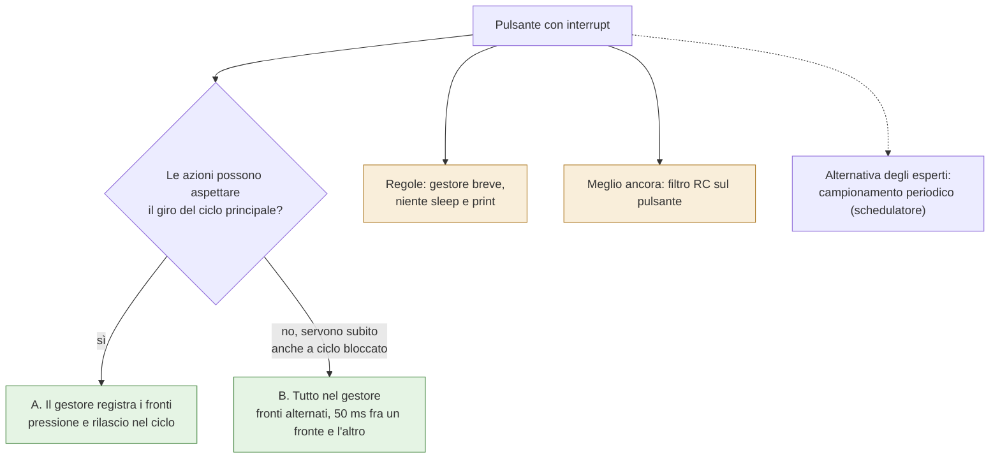

# Pulsanti con interrupt in MicroPython: versione semplificata

Versione MicroPython di [pulsanti-interrupt-semplice.md](pulsanti-interrupt-semplice.md): solo le
due tecniche più affidabili. La pressione viene riconosciuta subito, l'azione principale parte
al **rilascio**, `doOnRise()` e `doOnFall()` sono le callback dei due fronti.

> Versione completa: [pulsanti-interrupt-mpy.md](pulsanti-interrupt-mpy.md)
> Versioni senza interrupt (polling): [pulsanti-rilascio-mpy.md](pulsanti-rilascio-mpy.md)

| Collegamento | Premuto | Gestore della pressione | Callback pressione | Callback rilascio |
| --- | --- | --- | --- | --- |
| Pull-down | 1 | `Pin.IRQ_RISING` | `doOnRise()` | `doOnFall()` |
| Pull-up (`Pin.PULL_UP`) | 0 | `Pin.IRQ_FALLING` | `doOnFall()` | `doOnRise()` |

Pin di esempio per ESP32: pulsante su GPIO 12, LED su GPIO 13. Nessuna delle due tecniche usa
librerie esterne.

## Mappa concettuale



## Cosa consigliano le fonti

- **Il gestore deve fare il meno possibile.** La documentazione di MicroPython chiede gestori
  brevi, che tornino subito: niente `print()`, niente cicli, niente attese. È la tecnica A, dove
  il gestore salva solo un tempo e alza un flag.
- **Lo schema più diffuso ha un difetto.** Molti esempi ignorano gli interrupt per 50 ms dopo
  ogni pressione accettata: i rimbalzi del rilascio, che arrivano più tardi, vengono presi per
  nuove pressioni. Le tecniche A e B qui sotto non hanno questo problema.
- **Gli esperti preferiscono non collegare il pulsante direttamente a un interrupt** e campionarlo
  a intervalli regolari: è la versione con schedulatore di
  [pulsanti-rilascio-mpy.md](pulsanti-rilascio-mpy.md). Con gli interrupt conviene comunque un
  filtro hardware, per esempio un condensatore e una resistenza.

## A. Il gestore registra i fronti, il ciclo decide (consigliata)

Il gestore è attivo su entrambi i fronti e fa solo due cose: salva l'istante del fronte in
`tFronte` e, se il pulsante risulta premuto, alza il flag `segnale`. Il ciclo principale vede il
flag e chiama la callback della pressione; poi chiama quella del rilascio solo quando il pin è
rilasciato e da più di 50 ms non c'è stato nessun fronte. Entrambe le callback vengono eseguite
nel ciclo, quindi possono contenere qualunque codice; un ciclo lento le ritarda soltanto.

<table>
<tr>
<th>Pull-down: azione sul fronte di discesa</th>
<th>Pull-up: azione sul fronte di salita</th>
</tr>
<tr>
<td>

```python
from machine import Pin
import time

P1  = Pin(12, Pin.IN)  # pull-down
LED = Pin(13, Pin.OUT)
stato = False
segnale = False  # dal gestore
tFronte = 0      # ultimo fronte
attivo = False   # pressione in corso

def doOnRise():
    # PRESSIONE (fronte di salita):
    # qui vanno le azioni immediate
    # alla pressione.
    # Eseguita nel ciclo principale.
    pass

def doOnFall():
    # RILASCIO (fronte di discesa):
    # qui vanno le azioni al rilascio.
    # Eseguita nel ciclo principale.
    # Esempio: toggle del LED.
    global stato
    stato = not stato
    LED.value(stato)

def isrChange(pin):
    global segnale, tFronte
    tFronte = time.ticks_ms()
    if pin.value():
        segnale = True  # pressione

P1.irq(trigger=Pin.IRQ_RISING |
       Pin.IRQ_FALLING,
       handler=isrChange)

while True:
    if segnale and not attivo:
        attivo = True     # pressione
        doOnRise()
    if attivo and not P1.value() and \
       time.ticks_diff(time.ticks_ms(),
                       tFronte) > 50:
        attivo = False    # rilascio
        segnale = False
        doOnFall()
    # qui altri compiti, anche lenti
```

</td>
<td>

```python
from machine import Pin
import time

P1  = Pin(12, Pin.IN, Pin.PULL_UP)
LED = Pin(13, Pin.OUT)
stato = False
segnale = False  # dal gestore
tFronte = 0      # ultimo fronte
attivo = False   # pressione in corso

def doOnFall():
    # PRESSIONE (fronte di discesa):
    # qui vanno le azioni immediate
    # alla pressione.
    # Eseguita nel ciclo principale.
    pass

def doOnRise():
    # RILASCIO (fronte di salita):
    # qui vanno le azioni al rilascio.
    # Eseguita nel ciclo principale.
    # Esempio: toggle del LED.
    global stato
    stato = not stato
    LED.value(stato)

def isrChange(pin):
    global segnale, tFronte
    tFronte = time.ticks_ms()
    if not pin.value():
        segnale = True  # pressione

P1.irq(trigger=Pin.IRQ_RISING |
       Pin.IRQ_FALLING,
       handler=isrChange)

while True:
    if segnale and not attivo:
        attivo = True     # pressione
        doOnFall()
    if attivo and P1.value() and \
       time.ticks_diff(time.ticks_ms(),
                       tFronte) > 50:
        attivo = False    # rilascio
        segnale = False
        doOnRise()
    # qui altri compiti, anche lenti
```

</td>
</tr>
</table>

## B. Tutto nel gestore, con fronti alternati

L'interrupt è attivo su un fronte alla volta: prima la pressione, poi il rilascio. Un fronte
viene accettato solo se sono passati più di 50 ms dall'ultimo accettato, quindi i rimbalzi
vengono scartati. Il ciclo principale resta del tutto libero, anche se è lento o bloccato. Le
callback vengono eseguite nel gestore e devono restare brevi. Una pressione più breve di 50 ms
fa saltare un giro alla sequenza, che poi si rimette in passo da sola.

<table>
<tr>
<th>Pull-down: azione sul fronte di discesa</th>
<th>Pull-up: azione sul fronte di salita</th>
</tr>
<tr>
<td>

```python
from machine import Pin
import time

P1  = Pin(12, Pin.IN)  # pull-down
LED = Pin(13, Pin.OUT)
stato = False
tUltimo = time.ticks_ms() - 100
# il primo fronte passa

def doOnRise():
    # PRESSIONE (fronte di salita):
    # qui vanno le azioni immediate
    # alla pressione.
    # Eseguita nel gestore: breve!
    pass

def doOnFall():
    # RILASCIO (fronte di discesa):
    # qui vanno le azioni al rilascio.
    # Eseguita nel gestore: breve!
    # Esempio: toggle del LED.
    global stato
    stato = not stato
    LED.value(stato)

def isrPress(pin):  # armata sulla pressione
    global tUltimo
    if time.ticks_diff(
            time.ticks_ms(), tUltimo) > 50:
        tUltimo = time.ticks_ms()
        doOnRise()
        P1.irq(trigger=Pin.IRQ_FALLING,
               handler=isrRel)

def isrRel(pin):    # armata sul rilascio
    global tUltimo
    if time.ticks_diff(
            time.ticks_ms(), tUltimo) > 50:
        tUltimo = time.ticks_ms()
        doOnFall()
        P1.irq(trigger=Pin.IRQ_RISING,
               handler=isrPress)

P1.irq(trigger=Pin.IRQ_RISING,
       handler=isrPress)

while True:
    pass  # libero per altri compiti
```

</td>
<td>

```python
from machine import Pin
import time

P1  = Pin(12, Pin.IN, Pin.PULL_UP)
LED = Pin(13, Pin.OUT)
stato = False
tUltimo = time.ticks_ms() - 100
# il primo fronte passa

def doOnFall():
    # PRESSIONE (fronte di discesa):
    # qui vanno le azioni immediate
    # alla pressione.
    # Eseguita nel gestore: breve!
    pass

def doOnRise():
    # RILASCIO (fronte di salita):
    # qui vanno le azioni al rilascio.
    # Eseguita nel gestore: breve!
    # Esempio: toggle del LED.
    global stato
    stato = not stato
    LED.value(stato)

def isrPress(pin):  # armata sulla pressione
    global tUltimo
    if time.ticks_diff(
            time.ticks_ms(), tUltimo) > 50:
        tUltimo = time.ticks_ms()
        doOnFall()
        P1.irq(trigger=Pin.IRQ_RISING,
               handler=isrRel)

def isrRel(pin):    # armata sul rilascio
    global tUltimo
    if time.ticks_diff(
            time.ticks_ms(), tUltimo) > 50:
        tUltimo = time.ticks_ms()
        doOnRise()
        P1.irq(trigger=Pin.IRQ_FALLING,
               handler=isrPress)

P1.irq(trigger=Pin.IRQ_FALLING,
       handler=isrPress)

while True:
    pass  # libero per altri compiti
```

</td>
</tr>
</table>

## Riferimenti

- [MicroPython, machine.Pin](https://docs.micropython.org/en/latest/library/machine.Pin.html): `Pin.irq()` e fronti
- [MicroPython, scrivere gestori di interrupt](https://docs.micropython.org/en/latest/reference/isr_rules.html): regole per i gestori
- [Jack Ganssle, A Guide to Debouncing](https://www.ganssle.com/debouncing.htm): misure dei rimbalzi e tecniche di debounce
- [pulsanti-interrupt-mpy.md](pulsanti-interrupt-mpy.md): versione completa
- [pulsanti-interrupt-semplice.md](pulsanti-interrupt-semplice.md): versione Arduino
