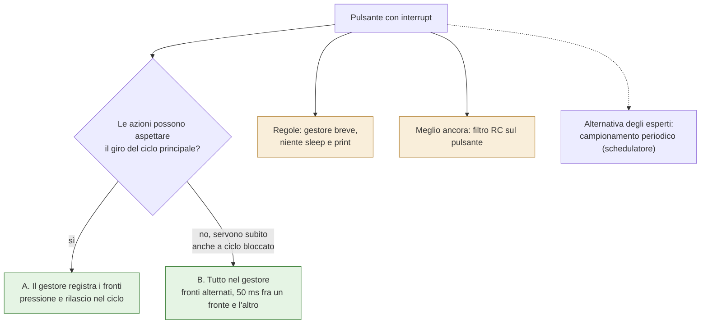

>[Torna all'indice](indexpulsanti.md)   >[versione in C++](pulsanti-interrupt-semplice.md)

# Pulsanti con interrupt in MicroPython: versione semplificata

Versione MicroPython di [pulsanti-interrupt-semplice.md](pulsanti-interrupt-semplice.md): solo le
due tecniche più affidabili. La pressione viene riconosciuta subito, l'azione principale parte
al **rilascio**, `doOnRise()` e `doOnFall()` sono le callback dei due fronti.

> Versione completa: [pulsanti-interrupt-mpy.md](pulsanti-interrupt-mpy.md)
> Versioni senza interrupt (polling): [pulsanti-rilascio-mpy.md](pulsanti-rilascio-mpy.md)

| Collegamento | Premuto | Gestore della pressione | Callback pressione | Callback rilascio |
| --- | --- | --- | --- | --- |
| Pull-down | 1 | `Pin.IRQ_RISING` | `doOnRise()` | `doOnFall()` |
| Pull-up (`Pin.PULL_UP`) | 0 | `Pin.IRQ_FALLING` | `doOnFall()` | `doOnRise()` |

Pin di esempio per ESP32: pulsante su GPIO 12, LED su GPIO 13. Nessuna delle due tecniche usa
librerie esterne.

## Mappa concettuale



## Cosa consigliano le fonti

- **Il gestore deve fare il meno possibile.** La documentazione di MicroPython chiede gestori
  brevi, che tornino subito: niente `print()`, niente cicli, niente attese. È la tecnica A, dove
  il gestore salva solo un tempo e alza un flag.
- **Lo schema più diffuso ha un difetto.** Molti esempi ignorano gli interrupt per 50 ms dopo
  ogni pressione accettata: i rimbalzi del rilascio, che arrivano più tardi, vengono presi per
  nuove pressioni. Le tecniche A e B qui sotto non hanno questo problema.
- **Gli esperti preferiscono non collegare il pulsante direttamente a un interrupt** e campionarlo
  a intervalli regolari: è la versione con schedulatore di
  [pulsanti-rilascio-mpy.md](pulsanti-rilascio-mpy.md). Con gli interrupt conviene comunque un
  filtro hardware, per esempio un condensatore e una resistenza.

## A. Il gestore registra i fronti, il ciclo decide (consigliata)

Il gestore è attivo su entrambi i fronti e fa solo due cose: salva l'istante del fronte in
`tFronte` e, se il pulsante risulta premuto, alza il flag `segnale`. Il ciclo principale vede il
flag e chiama la callback della pressione; poi chiama quella del rilascio solo quando il pin è
rilasciato e da più di 50 ms non c'è stato nessun fronte. Entrambe le callback vengono eseguite
nel ciclo, quindi possono contenere qualunque codice; un ciclo lento le ritarda soltanto.

<table>
<tr>
<th>Pull-down: azione sul fronte di discesa</th>
<th>Pull-up: azione sul fronte di salita</th>
</tr>
<tr>
<td>

```python
from machine import Pin
import time

P1  = Pin(12, Pin.IN)  # pull-down
LED = Pin(13, Pin.OUT)
stato = False
segnale = False  # dal gestore
tFronte = 0      # ultimo fronte
attivo = False   # pressione in corso

def doOnRise():
    # PRESSIONE (fronte di salita):
    # qui vanno le azioni immediate
    # alla pressione.
    # Eseguita nel ciclo principale.
    pass

def doOnFall():
    # RILASCIO (fronte di discesa):
    # qui vanno le azioni al rilascio.
    # Eseguita nel ciclo principale.
    # Esempio: toggle del LED.
    global stato
    stato = not stato
    LED.value(stato)

def isrChange(pin):
    global segnale, tFronte
    tFronte = time.ticks_ms()
    if pin.value():
        segnale = True  # pressione

P1.irq(trigger=Pin.IRQ_RISING |
       Pin.IRQ_FALLING,
       handler=isrChange)

while True:
    if segnale and not attivo:
        attivo = True     # pressione
        doOnRise()
    if attivo and not P1.value() and \
       time.ticks_diff(time.ticks_ms(),
                       tFronte) > 50:
        attivo = False    # rilascio
        segnale = False
        doOnFall()
    # qui altri compiti, anche lenti
```

</td>
<td>

```python
from machine import Pin
import time

P1  = Pin(12, Pin.IN, Pin.PULL_UP)
LED = Pin(13, Pin.OUT)
stato = False
segnale = False  # dal gestore
tFronte = 0      # ultimo fronte
attivo = False   # pressione in corso

def doOnFall():
    # PRESSIONE (fronte di discesa):
    # qui vanno le azioni immediate
    # alla pressione.
    # Eseguita nel ciclo principale.
    pass

def doOnRise():
    # RILASCIO (fronte di salita):
    # qui vanno le azioni al rilascio.
    # Eseguita nel ciclo principale.
    # Esempio: toggle del LED.
    global stato
    stato = not stato
    LED.value(stato)

def isrChange(pin):
    global segnale, tFronte
    tFronte = time.ticks_ms()
    if not pin.value():
        segnale = True  # pressione

P1.irq(trigger=Pin.IRQ_RISING |
       Pin.IRQ_FALLING,
       handler=isrChange)

while True:
    if segnale and not attivo:
        attivo = True     # pressione
        doOnFall()
    if attivo and P1.value() and \
       time.ticks_diff(time.ticks_ms(),
                       tFronte) > 50:
        attivo = False    # rilascio
        segnale = False
        doOnRise()
    # qui altri compiti, anche lenti
```

</td>
</tr>
</table>

## B. Tutto nel gestore, con fronti alternati

L'interrupt è attivo su un fronte alla volta: prima la pressione, poi il rilascio. Un fronte
viene accettato solo se sono passati più di 50 ms dall'ultimo accettato, quindi i rimbalzi
vengono scartati. Il ciclo principale resta del tutto libero, anche se è lento o bloccato. Le
callback vengono eseguite nel gestore e devono restare brevi. Una pressione più breve di 50 ms
fa saltare un giro alla sequenza, che poi si rimette in passo da sola.

**Riarmo a ogni fronte.** Il fronte opposto viene armato a **ogni** fronte, anche a quelli scartati come rimbalzi: così il gestore resta sempre armato sul fronte che il livello attuale del pin può produrre. Se si riarmasse solo sui fronti accettati, un fronte scartato (una pressione più breve di 50 ms, un disturbo) lascerebbe il gestore armato sul verso sbagliato e da lì in poi le due callback resterebbero scambiate per sempre.

**Limiti.** Gli errori restano **locali**: la sequenza si rimette in passo da sola al fronte successivo.
- Una pressione più breve di 50 ms esegue la callback della pressione ma non quella del rilascio (con il toggle al rilascio: nessun toggle).
- Un rilascio più breve di 50 ms (si ripreme subito) perde la callback della pressione successiva.
- Un'interruzione breve del contatto a pulsante premuto (contatto usurato, filo che si muove, disturbo) fa scattare una callback del rilascio in più (con il toggle: un toggle in più).
- Un fronte perso dall'hardware (rimbalzi più vicini di pochi microsecondi, arrivati mentre il gestore girava) può far sbagliare un evento.

Con un pulsante in buone condizioni questi casi sono rari; se serve robustezza anche a questi, conviene la tecnica A, che considera il pulsante rilasciato solo dopo 50 ms senza fronti.

<table>
<tr>
<th>Pull-down: azione sul fronte di discesa</th>
<th>Pull-up: azione sul fronte di salita</th>
</tr>
<tr>
<td>

```python
from machine import Pin
import time

P1  = Pin(12, Pin.IN)  # pull-down
LED = Pin(13, Pin.OUT)
stato = False
tUltimo = time.ticks_ms() - 100
# il primo fronte passa

def doOnRise():
    # PRESSIONE (fronte di salita):
    # qui vanno le azioni immediate
    # alla pressione.
    # Eseguita nel gestore: breve!
    pass

def doOnFall():
    # RILASCIO (fronte di discesa):
    # qui vanno le azioni al rilascio.
    # Eseguita nel gestore: breve!
    # Esempio: toggle del LED.
    global stato
    stato = not stato
    LED.value(stato)

def isrPress(pin):  # armata sulla pressione
    global tUltimo
    if time.ticks_diff(
            time.ticks_ms(), tUltimo) > 50:
        tUltimo = time.ticks_ms()
        doOnRise()
    # sempre, anche per un fronte scartato:
    # si arma il fronte opposto
    P1.irq(trigger=Pin.IRQ_FALLING,
           handler=isrRel)

def isrRel(pin):    # armata sul rilascio
    global tUltimo
    if time.ticks_diff(
            time.ticks_ms(), tUltimo) > 50:
        tUltimo = time.ticks_ms()
        doOnFall()
    # sempre, anche per un fronte scartato:
    # si arma il fronte opposto
    P1.irq(trigger=Pin.IRQ_RISING,
           handler=isrPress)

P1.irq(trigger=Pin.IRQ_RISING,
       handler=isrPress)

while True:
    pass  # libero per altri compiti
```

</td>
<td>

```python
from machine import Pin
import time

P1  = Pin(12, Pin.IN, Pin.PULL_UP)
LED = Pin(13, Pin.OUT)
stato = False
tUltimo = time.ticks_ms() - 100
# il primo fronte passa

def doOnFall():
    # PRESSIONE (fronte di discesa):
    # qui vanno le azioni immediate
    # alla pressione.
    # Eseguita nel gestore: breve!
    pass

def doOnRise():
    # RILASCIO (fronte di salita):
    # qui vanno le azioni al rilascio.
    # Eseguita nel gestore: breve!
    # Esempio: toggle del LED.
    global stato
    stato = not stato
    LED.value(stato)

def isrPress(pin):  # armata sulla pressione
    global tUltimo
    if time.ticks_diff(
            time.ticks_ms(), tUltimo) > 50:
        tUltimo = time.ticks_ms()
        doOnFall()
    # sempre, anche per un fronte scartato:
    # si arma il fronte opposto
    P1.irq(trigger=Pin.IRQ_RISING,
           handler=isrRel)

def isrRel(pin):    # armata sul rilascio
    global tUltimo
    if time.ticks_diff(
            time.ticks_ms(), tUltimo) > 50:
        tUltimo = time.ticks_ms()
        doOnRise()
    # sempre, anche per un fronte scartato:
    # si arma il fronte opposto
    P1.irq(trigger=Pin.IRQ_FALLING,
           handler=isrPress)

P1.irq(trigger=Pin.IRQ_FALLING,
       handler=isrPress)

while True:
    pass  # libero per altri compiti
```

</td>
</tr>
</table>

## Considerazioni finali: quale tecnica scegliere

**Il limite di fondo, comune a tutte le tecniche.** Ogni antirimbalzo stabilisce un tempo minimo, ad esempio 50 msec, oltre il quale un'apertura del contatto viene considerata un rilascio vero. Un disturbo che apre il contatto per più di quel tempo non si distingue da un rilascio breve: vale per il polling, per lo schedulatore e per gli interrupt. Nel seguito si dà per scontato che questo limite sia superato scegliendo un tempo adatto alla qualità del pulsante: abbastanza lungo da coprire i suoi rimbalzi e i suoi disturbi, abbastanza corto da non perdere le pressioni rapide.

**Il polling veloce con il timer che riparte è la tecnica più robusta e più pronta.** È la versione in cui il ciclo principale legge il pulsante a ogni giro e il timer riparte a ogni lettura "premuto" (l'istante di riferimento aggiornato con ```time.ticks_ms()``` fuori dall'```if```):
- guarda il pulsante in continuazione: un disturbo breve a pulsante premuto viene visto di sicuro, ma fa solo ripartire il conteggio;
- il rilascio è accettato solo se il pin è rimasto basso per **tutto** il tempo di antirimbalzo: la decisione non dipende da dove cade il disturbo;
- la pressione è riconosciuta alla prima lettura alta, il rilascio dopo il tempo di antirimbalzo.

La condizione è che il ciclo principale resti veloce: con ```time.sleep_ms()``` lunghi o funzioni lente le letture si diradano e il polling si comporta come uno schedulatore.

**Lo schedulatore (time tick)** legge il pulsante solo ogni ```tbase```. È immune ai rimbalzi perché tra una lettura e l'altra non li vede, e per lo stesso motivo di solito non vede nemmeno i disturbi brevi a pulsante premuto; se però una lettura cade proprio dentro un disturbo, il toggle scatta due volte (la probabilità è circa la durata del disturbo divisa per ```tbase```). Si può ridurre il rischio accettando un nuovo livello solo dopo N letture uguali consecutive: il tempo minimo di un rilascio vero diventa N × ```tbase```. È un'approssimazione, con il campionamento rado, di ciò che il polling veloce fa con il campionamento continuo.

**Gli interrupt su entrambi i fronti** fanno la stessa cosa del polling veloce: vedono ogni fronte, rimbalzi e disturbi compresi, e fanno ripartire il conteggio del tempo di antirimbalzo. In più funzionano anche quando il ciclo principale è lento: sono la scelta giusta quando il ciclo principale ha altro di pesante da fare.

## Riferimenti

- [MicroPython, machine.Pin](https://docs.micropython.org/en/latest/library/machine.Pin.html): `Pin.irq()` e fronti
- [MicroPython, scrivere gestori di interrupt](https://docs.micropython.org/en/latest/reference/isr_rules.html): regole per i gestori
- [Jack Ganssle, A Guide to Debouncing](https://www.ganssle.com/debouncing.htm): misure dei rimbalzi e tecniche di debounce
- [pulsanti-interrupt-mpy.md](pulsanti-interrupt-mpy.md): versione completa
- [pulsanti-interrupt-semplice.md](pulsanti-interrupt-semplice.md): versione Arduino
