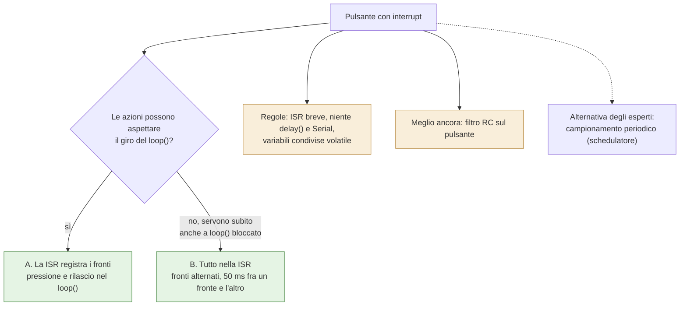

# Pulsanti con interrupt: versione semplificata

Fra le tante tecniche a interrupt, qui ci sono solo le due più affidabili, con le convenzioni
delle altre dispense: la pressione viene riconosciuta subito, l'azione principale parte al
**rilascio**, `doOnRise()` e `doOnFall()` sono le callback dei due fronti.

> Versione completa, con tutte le tecniche di toggle.md: [pulsanti-interrupt.md](pulsanti-interrupt.md)
> Versioni senza interrupt (polling): [pulsanti-rilascio.md](pulsanti-rilascio.md)

| Collegamento | Premuto | Interrupt sulla pressione | Callback pressione | Callback rilascio |
| --- | --- | --- | --- | --- |
| Pull-down | HIGH | `RISING` | `doOnRise()` | `doOnFall()` |
| Pull-up | LOW | `FALLING` | `doOnFall()` | `doOnRise()` |

Il pulsante va su un pin con interrupt: su Arduino Uno i pin 2 e 3, su ESP32 quasi tutti i GPIO.
Su ESP32 le ISR vanno dichiarate `void IRAM_ATTR isrPress()`.

## Mappa concettuale



## Cosa consigliano le fonti

- **La ISR deve fare il meno possibile.** La regola più condivisa è che la ISR registri solo
  che l'evento è avvenuto, e che il `loop()` faccia il resto. Niente `delay()` e niente
  `Serial` nella ISR. È la tecnica A, dove la ISR salva solo un tempo e alza un flag.
- **Lo schema più diffuso ha un difetto.** Molti esempi in rete ignorano gli interrupt per
  50 ms dopo ogni pressione accettata. Così però i rimbalzi del rilascio, che arrivano più di
  50 ms dopo la pressione, vengono presi per nuove pressioni, e il toggle scatta due volte.
  Le tecniche A e B qui sotto non hanno questo problema.
- **Gli esperti preferiscono non collegare il pulsante direttamente a un interrupt.** Jack
  Ganssle, autore della guida più citata sui rimbalzi, consiglia di campionare il pulsante a
  intervalli regolari: è la versione con schedulatore di
  [pulsanti-rilascio.md](pulsanti-rilascio.md). Se si usano gli interrupt, è sempre
  consigliabile aggiungere un filtro hardware, per esempio un condensatore e una resistenza.

## A. La ISR registra i fronti, il loop() decide (consigliata)

La ISR è armata su entrambi i fronti (`CHANGE`) e fa solo due cose: salva l'istante del fronte
in `tFronte` e, se il pulsante risulta premuto, alza il flag `segnale`. Il `loop()` vede il flag
e chiama la callback della pressione; poi chiama quella del rilascio solo quando il pin è
rilasciato e da più di 50 ms non c'è stato nessun fronte, rimbalzi compresi.

Entrambe le callback vengono eseguite nel `loop()`, quindi possono contenere qualunque codice.
Siccome i tempi li registra la ISR, la tecnica resta corretta anche con un `loop()` lento, che
ritarda solo le callback. `tFronte` è da 32 bit: su AVR la sua lettura non è atomica, quindi il
`loop()` ne fa una copia fra `noInterrupts()` e `interrupts()`.

<table>
<tr>
<th>Pull-down: azione sul fronte di discesa</th>
<th>Pull-up: azione sul fronte di salita</th>
</tr>
<tr>
<td>

```cpp
const byte P1  = 2;  // pin con interrupt
const byte LED = 13;
bool stato = LOW;
volatile bool segnale = false; // dalla ISR
volatile unsigned long tFronte; // ultimo fronte
bool attivo = false;  // pressione in corso


void doOnRise() {
  // PRESSIONE (fronte di salita):
  // qui vanno le azioni immediate
  // alla pressione.
  // Eseguita nel loop().
}

void doOnFall() {
  // RILASCIO (fronte di discesa):
  // qui vanno le azioni al rilascio.
  // Eseguita nel loop().
  // Esempio: toggle del LED.
  stato = !stato;
  digitalWrite(LED, stato);
}

void isrChange() {
  tFronte = millis();     // ogni fronte
  if (digitalRead(P1) == HIGH) {
    segnale = true;       // pressione
  }
}

void setup() {
  pinMode(P1, INPUT);
  pinMode(LED, OUTPUT);
  attachInterrupt(
    digitalPinToInterrupt(P1),
    isrChange, CHANGE);
}

void loop() {
  if (segnale && !attivo) {
    attivo = true;        // pressione
    doOnRise();
  }
  if (attivo) {
    noInterrupts();       // copia
    unsigned long t = tFronte;
    interrupts();         // protetta
    if (digitalRead(P1) == LOW &&
        millis() - t > 50) {
      attivo = false;     // rilascio
      segnale = false;
      doOnFall();
    }
  }
  // qui altri compiti, anche lenti
}
```

</td>
<td>

```cpp
const byte P1  = 2;  // pin con interrupt
const byte LED = 13;
bool stato = LOW;
volatile bool segnale = false; // dalla ISR
volatile unsigned long tFronte; // ultimo fronte
bool attivo = false;  // pressione in corso


void doOnFall() {
  // PRESSIONE (fronte di discesa):
  // qui vanno le azioni immediate
  // alla pressione.
  // Eseguita nel loop().
}

void doOnRise() {
  // RILASCIO (fronte di salita):
  // qui vanno le azioni al rilascio.
  // Eseguita nel loop().
  // Esempio: toggle del LED.
  stato = !stato;
  digitalWrite(LED, stato);
}

void isrChange() {
  tFronte = millis();     // ogni fronte
  if (digitalRead(P1) == LOW) {
    segnale = true;       // pressione
  }
}

void setup() {
  pinMode(P1, INPUT_PULLUP);
  pinMode(LED, OUTPUT);
  attachInterrupt(
    digitalPinToInterrupt(P1),
    isrChange, CHANGE);
}

void loop() {
  if (segnale && !attivo) {
    attivo = true;        // pressione
    doOnFall();
  }
  if (attivo) {
    noInterrupts();       // copia
    unsigned long t = tFronte;
    interrupts();         // protetta
    if (digitalRead(P1) == HIGH &&
        millis() - t > 50) {
      attivo = false;     // rilascio
      segnale = false;
      doOnRise();
    }
  }
  // qui altri compiti, anche lenti
}
```

</td>
</tr>
</table>

## B. Tutto nella ISR, con fronti alternati

L'interrupt è armato su un fronte alla volta: prima la pressione, poi il rilascio. Un fronte
viene accettato solo se sono passati più di 50 ms dall'ultimo accettato, quindi i rimbalzi
vengono scartati. Il `loop()` resta del tutto libero, anche se è lento o bloccato. Le callback
vengono eseguite nella ISR e devono restare brevi. Una pressione più breve di 50 ms viene presa
per un rimbalzo: la sequenza si rimette in passo da sola alla pressione successiva.

<table>
<tr>
<th>Pull-down: azione sul fronte di discesa</th>
<th>Pull-up: azione sul fronte di salita</th>
</tr>
<tr>
<td>

```cpp
const byte P1  = 2;  // pin con interrupt
const byte LED = 13;
volatile bool stato = LOW;
unsigned long tUltimo = 0;  // solo nelle ISR


void doOnRise() {
  // PRESSIONE (fronte di salita):
  // qui vanno le azioni immediate
  // alla pressione.
  // Eseguita nella ISR: breve!
}

void doOnFall() {
  // RILASCIO (fronte di discesa):
  // qui vanno le azioni al rilascio.
  // Eseguita nella ISR: breve!
  // Esempio: toggle del LED.
  stato = !stato;
  digitalWrite(LED, stato);
}

void isrRel();

void isrPress() {  // armata sulla pressione
  if (millis() - tUltimo > 50) {
    tUltimo = millis();
    doOnRise();
    attachInterrupt(
      digitalPinToInterrupt(P1),
      isrRel, FALLING);
  }
}

void isrRel() {    // armata sul rilascio
  if (millis() - tUltimo > 50) {
    tUltimo = millis();
    doOnFall();
    attachInterrupt(
      digitalPinToInterrupt(P1),
      isrPress, RISING);
  }
}

void setup() {
  pinMode(P1, INPUT);
  pinMode(LED, OUTPUT);
  attachInterrupt(
    digitalPinToInterrupt(P1),
    isrPress, RISING);
}

void loop() {
  // libero per altri compiti
}
```

</td>
<td>

```cpp
const byte P1  = 2;  // pin con interrupt
const byte LED = 13;
volatile bool stato = LOW;
unsigned long tUltimo = 0;  // solo nelle ISR


void doOnFall() {
  // PRESSIONE (fronte di discesa):
  // qui vanno le azioni immediate
  // alla pressione.
  // Eseguita nella ISR: breve!
}

void doOnRise() {
  // RILASCIO (fronte di salita):
  // qui vanno le azioni al rilascio.
  // Eseguita nella ISR: breve!
  // Esempio: toggle del LED.
  stato = !stato;
  digitalWrite(LED, stato);
}

void isrRel();

void isrPress() {  // armata sulla pressione
  if (millis() - tUltimo > 50) {
    tUltimo = millis();
    doOnFall();
    attachInterrupt(
      digitalPinToInterrupt(P1),
      isrRel, RISING);
  }
}

void isrRel() {    // armata sul rilascio
  if (millis() - tUltimo > 50) {
    tUltimo = millis();
    doOnRise();
    attachInterrupt(
      digitalPinToInterrupt(P1),
      isrPress, FALLING);
  }
}

void setup() {
  pinMode(P1, INPUT_PULLUP);
  pinMode(LED, OUTPUT);
  attachInterrupt(
    digitalPinToInterrupt(P1),
    isrPress, FALLING);
}

void loop() {
  // libero per altri compiti
}
```

</td>
</tr>
</table>

## Riferimenti

- [Nick Gammon, Interrupts](http://www.gammon.com.au/interrupts): regole per le ISR, flag e debounce
- [Jack Ganssle, A Guide to Debouncing](https://www.ganssle.com/debouncing.htm): misure dei rimbalzi e tecniche di debounce
- [Ganssle sugli interrupt (EE Journal)](https://eejournal.com/article/ultimate-guide-to-switch-debounce-part-7): perché non collegare un pulsante direttamente a un interrupt
- [Luis Llamas, debounce con interrupt](https://luisllamas.es/en/debouncing-arduino-interrupts): filtro hardware consigliato con gli interrupt
- [pulsanti-interrupt.md](pulsanti-interrupt.md): versione completa
- [pulsanti-rilascio.md](pulsanti-rilascio.md): versioni senza interrupt
