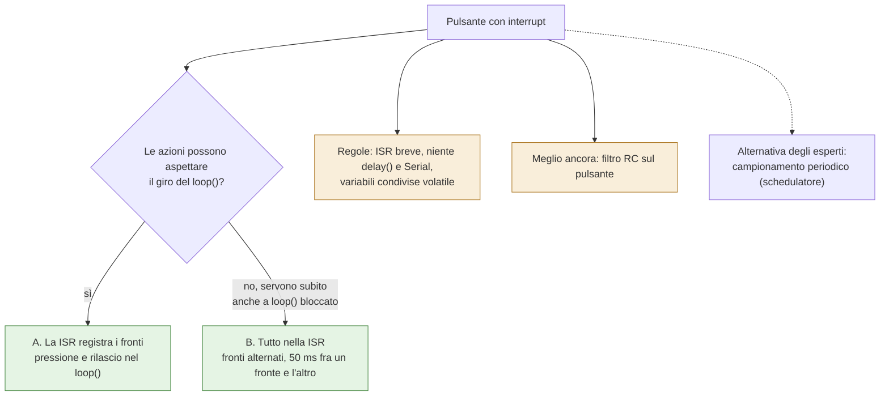
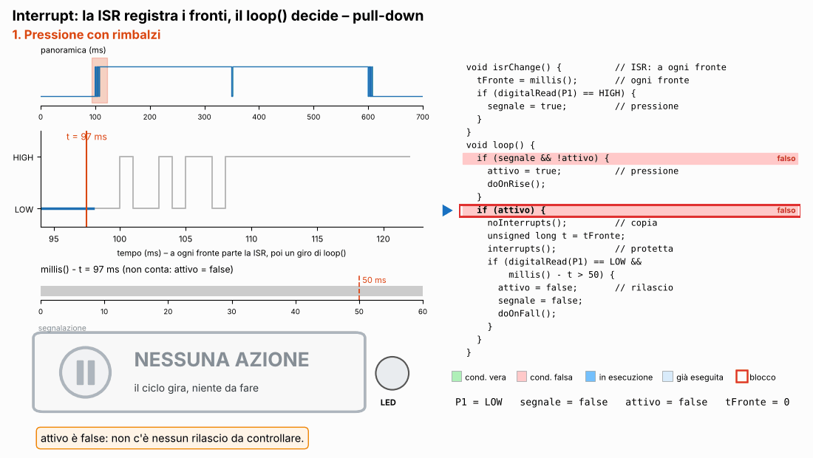

>[Torna all'indice](indexpulsanti.md)   >[versione in Python](pulsanti-interrupt-semplice-mpy.md)

# Pulsanti con interrupt: versione semplificata

Fra le tante tecniche a interrupt, qui ci sono solo le due più affidabili, con le convenzioni
delle altre dispense: la pressione viene riconosciuta subito, l'azione principale parte al
**rilascio**, `doOnRise()` e `doOnFall()` sono le callback dei due fronti.

> Versione completa, con tutte le tecniche di toggle.md: [pulsanti-interrupt.md](pulsanti-interrupt.md)
> Versioni senza interrupt (polling): [pulsanti-rilascio.md](pulsanti-rilascio.md)

| Collegamento | Premuto | Interrupt sulla pressione | Callback pressione | Callback rilascio |
| --- | --- | --- | --- | --- |
| Pull-down | HIGH | `RISING` | `doOnRise()` | `doOnFall()` |
| Pull-up | LOW | `FALLING` | `doOnFall()` | `doOnRise()` |

Il pulsante va su un pin con interrupt: su Arduino Uno i pin 2 e 3, su ESP32 quasi tutti i GPIO.
Su ESP32 le ISR vanno dichiarate `void IRAM_ATTR isrPress()`.

## Mappa concettuale



## Cosa consigliano le fonti

- **La ISR deve fare il meno possibile.** La regola più condivisa è che la ISR registri solo
  che l'evento è avvenuto, e che il `loop()` faccia il resto. Niente `delay()` e niente
  `Serial` nella ISR. È la tecnica A, dove la ISR salva solo un tempo e alza un flag.
- **Lo schema più diffuso ha un difetto.** Molti esempi in rete ignorano gli interrupt per
  50 ms dopo ogni pressione accettata. Così però i rimbalzi del rilascio, che arrivano più di
  50 ms dopo la pressione, vengono presi per nuove pressioni, e il toggle scatta due volte.
  Le tecniche A e B qui sotto non hanno questo problema.
- **Gli esperti preferiscono non collegare il pulsante direttamente a un interrupt.** Jack
  Ganssle, autore della guida più citata sui rimbalzi, consiglia di campionare il pulsante a
  intervalli regolari: è la versione con schedulatore di
  [pulsanti-rilascio.md](pulsanti-rilascio.md). Se si usano gli interrupt, è sempre
  consigliabile aggiungere un filtro hardware, per esempio un condensatore e una resistenza.

## A. La ISR registra i fronti, il loop() decide (consigliata)

La ISR è armata su entrambi i fronti (`CHANGE`) e fa solo due cose: salva l'istante del fronte
in `tFronte` e, se il pulsante risulta premuto, alza il flag `segnale`. Il `loop()` vede il flag
e chiama la callback della pressione; poi chiama quella del rilascio solo quando il pin è
rilasciato e da più di 50 ms non c'è stato nessun fronte, rimbalzi compresi.

Entrambe le callback vengono eseguite nel `loop()`, quindi possono contenere qualunque codice.
Siccome i tempi li registra la ISR, la tecnica resta corretta anche con un `loop()` lento, che
ritarda solo le callback. `tFronte` è da 32 bit: su AVR la sua lettura non è atomica, quindi il
`loop()` ne fa una copia fra `noInterrupts()` e `interrupts()`.

<p align="center">
  
</p>

Con il pull-up il comportamento è identico con i livelli invertiti: il pulsante premuto legge LOW, la pressione è un fronte di discesa e il rilascio un fronte di salita.

<table>
<tr>
<th>Pull-down: azione sul fronte di discesa</th>
<th>Pull-up: azione sul fronte di salita</th>
</tr>
<tr>
<td>

```cpp
const byte P1  = 2;  // pin con interrupt
const byte LED = 13;
bool stato = LOW;
volatile bool segnale = false; // dalla ISR
volatile unsigned long tFronte; // ultimo fronte
bool attivo = false;  // pressione in corso


void doOnRise() {
  // PRESSIONE (fronte di salita):
  // qui vanno le azioni immediate
  // alla pressione.
  // Eseguita nel loop().
}

void doOnFall() {
  // RILASCIO (fronte di discesa):
  // qui vanno le azioni al rilascio.
  // Eseguita nel loop().
  // Esempio: toggle del LED.
  stato = !stato;
  digitalWrite(LED, stato);
}

void isrChange() {
  tFronte = millis();     // ogni fronte
  if (digitalRead(P1) == HIGH) {
    segnale = true;       // pressione
  }
}

void setup() {
  pinMode(P1, INPUT);
  pinMode(LED, OUTPUT);
  attachInterrupt(
    digitalPinToInterrupt(P1),
    isrChange, CHANGE);
}

void loop() {
  if (segnale && !attivo) {
    attivo = true;        // pressione
    doOnRise();
  }
  if (attivo) {
    noInterrupts();       // copia
    unsigned long t = tFronte;
    interrupts();         // protetta
    if (digitalRead(P1) == LOW &&
        millis() - t > 50) {
      attivo = false;     // rilascio
      segnale = false;
      doOnFall();
    }
  }
  // qui altri compiti, anche lenti
}
```

</td>
<td>

```cpp
const byte P1  = 2;  // pin con interrupt
const byte LED = 13;
bool stato = LOW;
volatile bool segnale = false; // dalla ISR
volatile unsigned long tFronte; // ultimo fronte
bool attivo = false;  // pressione in corso


void doOnFall() {
  // PRESSIONE (fronte di discesa):
  // qui vanno le azioni immediate
  // alla pressione.
  // Eseguita nel loop().
}

void doOnRise() {
  // RILASCIO (fronte di salita):
  // qui vanno le azioni al rilascio.
  // Eseguita nel loop().
  // Esempio: toggle del LED.
  stato = !stato;
  digitalWrite(LED, stato);
}

void isrChange() {
  tFronte = millis();     // ogni fronte
  if (digitalRead(P1) == LOW) {
    segnale = true;       // pressione
  }
}

void setup() {
  pinMode(P1, INPUT_PULLUP);
  pinMode(LED, OUTPUT);
  attachInterrupt(
    digitalPinToInterrupt(P1),
    isrChange, CHANGE);
}

void loop() {
  if (segnale && !attivo) {
    attivo = true;        // pressione
    doOnFall();
  }
  if (attivo) {
    noInterrupts();       // copia
    unsigned long t = tFronte;
    interrupts();         // protetta
    if (digitalRead(P1) == HIGH &&
        millis() - t > 50) {
      attivo = false;     // rilascio
      segnale = false;
      doOnRise();
    }
  }
  // qui altri compiti, anche lenti
}
```

</td>
</tr>
</table>

## B. Tutto nella ISR, con fronti alternati

L'interrupt è armato su un fronte alla volta: prima la pressione, poi il rilascio. Un fronte
viene accettato solo se sono passati più di 50 ms dall'ultimo accettato, quindi i rimbalzi
vengono scartati. Il `loop()` resta del tutto libero, anche se è lento o bloccato. Le callback
vengono eseguite nella ISR e devono restare brevi.

**Riarmo a ogni fronte.** Il fronte opposto viene armato a **ogni** fronte, anche a quelli scartati come rimbalzi: così l'interrupt resta sempre armato sul fronte che il livello attuale del pin può produrre. Se si riarmasse solo sui fronti accettati, un fronte scartato (una pressione più breve di 50 ms, un disturbo) lascerebbe l'interrupt armato sul verso sbagliato e da lì in poi le due callback resterebbero scambiate per sempre. Sugli AVR (Arduino Uno, Nano), dopo il cambio di fronte si cancella anche il flag in sospeso (`EIFR`): un fronte del verso vecchio arrivato mentre la ISR girava la farebbe scattare di nuovo subito.

**Limiti.** Gli errori restano **locali**: la sequenza si rimette in passo da sola al fronte successivo.
- Una pressione più breve di 50 ms esegue la callback della pressione ma non quella del rilascio (con il toggle al rilascio: nessun toggle).
- Un rilascio più breve di 50 ms (si ripreme subito) perde la callback della pressione successiva.
- Un'interruzione breve del contatto a pulsante premuto (contatto usurato, filo che si muove, disturbo) fa scattare una callback del rilascio in più (con il toggle: un toggle in più).
- Un fronte perso dall'hardware (rimbalzi più vicini di pochi microsecondi, arrivati mentre la ISR girava) può far sbagliare un evento.

Con un pulsante in buone condizioni questi casi sono rari; se serve robustezza anche a questi, conviene la tecnica A, che considera il pulsante rilasciato solo dopo 50 ms senza fronti.

<table>
<tr>
<th>Pull-down: azione sul fronte di discesa</th>
<th>Pull-up: azione sul fronte di salita</th>
</tr>
<tr>
<td>

```cpp
const byte P1  = 2;  // pin con interrupt
const byte LED = 13;
volatile bool stato = LOW;
unsigned long tUltimo = 0;  // solo nelle ISR


void doOnRise() {
  // PRESSIONE (fronte di salita):
  // qui vanno le azioni immediate
  // alla pressione.
  // Eseguita nella ISR: breve!
}

void doOnFall() {
  // RILASCIO (fronte di discesa):
  // qui vanno le azioni al rilascio.
  // Eseguita nella ISR: breve!
  // Esempio: toggle del LED.
  stato = !stato;
  digitalWrite(LED, stato);
}

void isrRel();

void isrPress() {  // armata sulla pressione
  if (millis() - tUltimo > 50) {
    tUltimo = millis();
    doOnRise();
  }
  // sempre, anche per un fronte scartato:
  // si arma il fronte opposto
  attachInterrupt(
    digitalPinToInterrupt(P1),
    isrRel, FALLING);
#ifdef EIFR
  // AVR: cancella il fronte in sospeso
  EIFR = bit(digitalPinToInterrupt(P1));
#endif
}

void isrRel() {    // armata sul rilascio
  if (millis() - tUltimo > 50) {
    tUltimo = millis();
    doOnFall();
  }
  // sempre, anche per un fronte scartato:
  // si arma il fronte opposto
  attachInterrupt(
    digitalPinToInterrupt(P1),
    isrPress, RISING);
#ifdef EIFR
  // AVR: cancella il fronte in sospeso
  EIFR = bit(digitalPinToInterrupt(P1));
#endif
}

void setup() {
  pinMode(P1, INPUT);
  pinMode(LED, OUTPUT);
  attachInterrupt(
    digitalPinToInterrupt(P1),
    isrPress, RISING);
}

void loop() {
  // libero per altri compiti
}
```

</td>
<td>

```cpp
const byte P1  = 2;  // pin con interrupt
const byte LED = 13;
volatile bool stato = LOW;
unsigned long tUltimo = 0;  // solo nelle ISR


void doOnFall() {
  // PRESSIONE (fronte di discesa):
  // qui vanno le azioni immediate
  // alla pressione.
  // Eseguita nella ISR: breve!
}

void doOnRise() {
  // RILASCIO (fronte di salita):
  // qui vanno le azioni al rilascio.
  // Eseguita nella ISR: breve!
  // Esempio: toggle del LED.
  stato = !stato;
  digitalWrite(LED, stato);
}

void isrRel();

void isrPress() {  // armata sulla pressione
  if (millis() - tUltimo > 50) {
    tUltimo = millis();
    doOnFall();
  }
  // sempre, anche per un fronte scartato:
  // si arma il fronte opposto
  attachInterrupt(
    digitalPinToInterrupt(P1),
    isrRel, RISING);
#ifdef EIFR
  // AVR: cancella il fronte in sospeso
  EIFR = bit(digitalPinToInterrupt(P1));
#endif
}

void isrRel() {    // armata sul rilascio
  if (millis() - tUltimo > 50) {
    tUltimo = millis();
    doOnRise();
  }
  // sempre, anche per un fronte scartato:
  // si arma il fronte opposto
  attachInterrupt(
    digitalPinToInterrupt(P1),
    isrPress, FALLING);
#ifdef EIFR
  // AVR: cancella il fronte in sospeso
  EIFR = bit(digitalPinToInterrupt(P1));
#endif
}

void setup() {
  pinMode(P1, INPUT_PULLUP);
  pinMode(LED, OUTPUT);
  attachInterrupt(
    digitalPinToInterrupt(P1),
    isrPress, FALLING);
}

void loop() {
  // libero per altri compiti
}
```

</td>
</tr>
</table>

## Considerazioni finali: quale tecnica scegliere

**Il limite di fondo, comune a tutte le tecniche.** Ogni antirimbalzo stabilisce un tempo minimo, ad esempio 50 msec, oltre il quale un'apertura del contatto viene considerata un rilascio vero. Un disturbo che apre il contatto per più di quel tempo non si distingue da un rilascio breve: vale per il polling, per lo schedulatore e per gli interrupt. Nel seguito si dà per scontato che questo limite sia superato scegliendo un tempo adatto alla qualità del pulsante: abbastanza lungo da coprire i suoi rimbalzi e i suoi disturbi, abbastanza corto da non perdere le pressioni rapide.

**Il polling veloce con il timer che riparte è la tecnica più robusta e più pronta.** È la versione in cui il ```loop()``` legge il pulsante a ogni giro e il timer riparte a ogni lettura "premuto" (```t0 = millis()``` fuori dall'```if```):
- guarda il pulsante in continuazione: un disturbo breve a pulsante premuto viene visto di sicuro, ma fa solo ripartire il conteggio;
- il rilascio è accettato solo se il pin è rimasto basso per **tutto** il tempo di antirimbalzo: la decisione non dipende da dove cade il disturbo;
- la pressione è riconosciuta alla prima lettura alta, il rilascio dopo il tempo di antirimbalzo.

La condizione è che il ```loop()``` resti veloce: con ```delay()``` o funzioni lente le letture si diradano e il polling si comporta come uno schedulatore.

**Lo schedulatore (time tick)** legge il pulsante solo ogni ```TBASE```. È immune ai rimbalzi perché tra una lettura e l'altra non li vede, e per lo stesso motivo di solito non vede nemmeno i disturbi brevi a pulsante premuto; se però una lettura cade proprio dentro un disturbo, il toggle scatta due volte (la probabilità è circa la durata del disturbo divisa per ```TBASE```). Si può ridurre il rischio accettando un nuovo livello solo dopo N letture uguali consecutive: il tempo minimo di un rilascio vero diventa N × ```TBASE```. È un'approssimazione, con il campionamento rado, di ciò che il polling veloce fa con il campionamento continuo.

**Gli interrupt su entrambi i fronti** fanno la stessa cosa del polling veloce: vedono ogni fronte, rimbalzi e disturbi compresi, e fanno ripartire il conteggio del tempo di antirimbalzo. In più funzionano anche quando il ```loop()``` è lento: sono la scelta giusta quando il ciclo principale ha altro di pesante da fare.

## Riferimenti

- [Nick Gammon, Interrupts](http://www.gammon.com.au/interrupts): regole per le ISR, flag e debounce
- [Jack Ganssle, A Guide to Debouncing](https://www.ganssle.com/debouncing.htm): misure dei rimbalzi e tecniche di debounce
- [Ganssle sugli interrupt (EE Journal)](https://eejournal.com/article/ultimate-guide-to-switch-debounce-part-7): perché non collegare un pulsante direttamente a un interrupt
- [Luis Llamas, debounce con interrupt](https://luisllamas.es/en/debouncing-arduino-interrupts): filtro hardware consigliato con gli interrupt
- [pulsanti-interrupt.md](pulsanti-interrupt.md): versione completa
- [pulsanti-rilascio.md](pulsanti-rilascio.md): versioni senza interrupt
