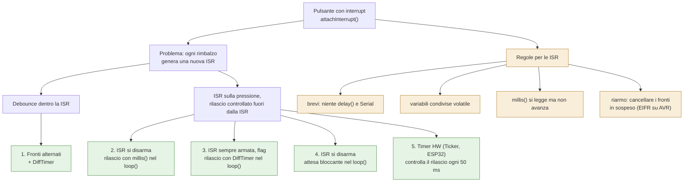

# Pulsanti con interrupt: attivazione sul rilascio (pull-down e pull-up)

Le tecniche sono quelle della parte sugli interrupt di
[toggle.md](https://github.com/sebastianomelita/ArduinoBareMetal/blob/master/toggle.md),
riscritte con le convenzioni delle altre dispense.

> Versione semplificata, con le sole tecniche consigliate: [pulsanti-interrupt-semplice.md](pulsanti-interrupt-semplice.md)
> Versioni senza interrupt (polling): [pulsanti-rilascio.md](pulsanti-rilascio.md)

In tutte le versioni la pressione viene riconosciuta **subito**, dall'interrupt, e l'azione
principale parte al **rilascio**, dopo il debounce. Le convenzioni sono le stesse di
[pulsanti-rilascio.md](pulsanti-rilascio.md): `doOnRise()` e `doOnFall()` sono le callback dei
due fronti, e la callback del rilascio contiene come esempio un toggle del LED.

| Collegamento | Premuto | Interrupt sulla pressione | Callback pressione | Callback rilascio |
| --- | --- | --- | --- | --- |
| Pull-down | HIGH | `RISING` | `doOnRise()` | `doOnFall()` |
| Pull-up | LOW | `FALLING` | `doOnFall()` | `doOnRise()` |

Il pulsante va su un pin che supporta gli interrupt: su Arduino Uno solo i pin 2 e 3, su ESP32
quasi tutti i GPIO. Con `attachInterrupt()` si usa sempre `digitalPinToInterrupt(pin)`.

## Mappa concettuale



## Confronto delle tecniche

| Tecnica | Dove si fa il debounce | Callback pressione | Callback rilascio | Il loop() è libero? |
| --- | --- | --- | --- | --- |
| 1. Debounce nella ISR | nella ISR, con DiffTimer | nella ISR | nella ISR | sì, del tutto |
| 2. ISR che si disarma + millis() | nel `loop()` | nella ISR | nel `loop()` | sì, ma deve girare spesso |
| 3. ISR sempre armata + DiffTimer | nel `loop()` | nella ISR | nel `loop()` | sì, ma deve girare spesso |
| 4. ISR che si disarma + attesa bloccante | nel `loop()` | nella ISR | nel `loop()` | no, fermo finché il pulsante è premuto |
| 5. Timer HW (Ticker, ESP32) | nel Ticker | nella ISR | nel Ticker | sì, del tutto |

## 1. Debounce nella ISR con fronti alternati

L'interrupt è armato su un solo fronte alla volta: prima quello di pressione, poi, appena la
pressione è accettata, quello di rilascio, e così via. Ogni fronte viene accettato solo se
dall'ultimo fronte accettato sono passati più di 50 ms: i rimbalzi, che arrivano subito dopo,
vengono scartati. Tutto avviene nella ISR, quindi il `loop()` è libero.

Limite: una pressione più breve di 50 ms viene presa per un rimbalzo. Il rilascio non viene
accettato e la ISR resta in attesa del rilascio: la pressione successiva fa scattare solo la
callback del rilascio. Dopo di che la sequenza si rimette in passo da sola.

<table>
<tr>
<th>Pull-down: azione sul fronte di discesa</th>
<th>Pull-up: azione sul fronte di salita</th>
</tr>
<tr>
<td>

```cpp
#include "urutils.h"

const byte P1  = 2;  // pin con interrupt
const byte LED = 13;
volatile bool stato = LOW;
DiffTimer debt;


void doOnRise() {
  // PRESSIONE (fronte di salita):
  // qui vanno le azioni immediate
  // alla pressione.
  // Eseguita nella ISR: breve!
}

void doOnFall() {
  // RILASCIO (fronte di discesa):
  // qui vanno le azioni al rilascio.
  // Eseguita nella ISR: breve!
  // Esempio: toggle del LED.
  stato = !stato;
  digitalWrite(LED, stato);
}

void isrRel();

void isrPress() {   // armata sulla pressione
  if (debt.get() > 50) {
    doOnRise();
    attachInterrupt(
      digitalPinToInterrupt(P1),
      isrRel, FALLING);
    debt.reset();
  }
}

void isrRel() {     // armata sul rilascio
  if (debt.get() > 50) {
    doOnFall();
    attachInterrupt(
      digitalPinToInterrupt(P1),
      isrPress, RISING);
    debt.reset();
  }
}

void setup() {
  pinMode(P1, INPUT);
  pinMode(LED, OUTPUT);
  debt.start();  // il primo fronte passa
  attachInterrupt(
    digitalPinToInterrupt(P1),
    isrPress, RISING);
}

void loop() {
  // libero per altri compiti
}
```

</td>
<td>

```cpp
#include "urutils.h"

const byte P1  = 2;  // pin con interrupt
const byte LED = 13;
volatile bool stato = LOW;
DiffTimer debt;


void doOnFall() {
  // PRESSIONE (fronte di discesa):
  // qui vanno le azioni immediate
  // alla pressione.
  // Eseguita nella ISR: breve!
}

void doOnRise() {
  // RILASCIO (fronte di salita):
  // qui vanno le azioni al rilascio.
  // Eseguita nella ISR: breve!
  // Esempio: toggle del LED.
  stato = !stato;
  digitalWrite(LED, stato);
}

void isrRel();

void isrPress() {   // armata sulla pressione
  if (debt.get() > 50) {
    doOnFall();
    attachInterrupt(
      digitalPinToInterrupt(P1),
      isrRel, RISING);
    debt.reset();
  }
}

void isrRel() {     // armata sul rilascio
  if (debt.get() > 50) {
    doOnRise();
    attachInterrupt(
      digitalPinToInterrupt(P1),
      isrPress, FALLING);
    debt.reset();
  }
}

void setup() {
  pinMode(P1, INPUT_PULLUP);
  pinMode(LED, OUTPUT);
  debt.start();  // il primo fronte passa
  attachInterrupt(
    digitalPinToInterrupt(P1),
    isrPress, FALLING);
}

void loop() {
  // libero per altri compiti
}
```

</td>
</tr>
</table>

## 2. ISR che si disarma, rilascio con millis() nel loop()

La ISR riconosce la pressione, chiama la callback e si disarma, così i rimbalzi non generano
altre ISR. Il `loop()` controlla il pin: quando è rilasciato da più di 50 ms chiama la callback
del rilascio e riarma l'interrupt, cancellando prima i fronti rimasti in sospeso.

<table>
<tr>
<th>Pull-down: azione sul fronte di discesa</th>
<th>Pull-up: azione sul fronte di salita</th>
</tr>
<tr>
<td>

```cpp
const byte P1  = 2;  // pin con interrupt
const byte LED = 13;
bool stato = LOW;
volatile bool premuto = false;
volatile unsigned long t0;


void doOnRise() {
  // PRESSIONE (fronte di salita):
  // qui vanno le azioni immediate
  // alla pressione.
  // Eseguita nella ISR: breve!
}

void doOnFall() {
  // RILASCIO (fronte di discesa):
  // qui vanno le azioni al rilascio.
  // Eseguita nel loop().
  // Esempio: toggle del LED.
  stato = !stato;
  digitalWrite(LED, stato);
}

void isrPress() {
  // disarmo: i rimbalzi
  // non generano altre ISR
  detachInterrupt(
    digitalPinToInterrupt(P1));
  premuto = true;
  t0 = millis();
  doOnRise();
}

void riarma() {
#ifdef EIFR
  // AVR: cancella i fronti
  // rimasti in sospeso
  EIFR = bit(digitalPinToInterrupt(P1));
#endif
  attachInterrupt(
    digitalPinToInterrupt(P1),
    isrPress, RISING);
}

void setup() {
  pinMode(P1, INPUT);
  pinMode(LED, OUTPUT);
  riarma();
}

void loop() {
  if (premuto) {
    if (digitalRead(P1) == HIGH) {
      t0 = millis();  // ancora premuto
    } else if (millis() - t0 > 50) {
      premuto = false;
      doOnFall();
      riarma();
    }
  }
  // qui altri compiti
}
```

</td>
<td>

```cpp
const byte P1  = 2;  // pin con interrupt
const byte LED = 13;
bool stato = LOW;
volatile bool premuto = false;
volatile unsigned long t0;


void doOnFall() {
  // PRESSIONE (fronte di discesa):
  // qui vanno le azioni immediate
  // alla pressione.
  // Eseguita nella ISR: breve!
}

void doOnRise() {
  // RILASCIO (fronte di salita):
  // qui vanno le azioni al rilascio.
  // Eseguita nel loop().
  // Esempio: toggle del LED.
  stato = !stato;
  digitalWrite(LED, stato);
}

void isrPress() {
  // disarmo: i rimbalzi
  // non generano altre ISR
  detachInterrupt(
    digitalPinToInterrupt(P1));
  premuto = true;
  t0 = millis();
  doOnFall();
}

void riarma() {
#ifdef EIFR
  // AVR: cancella i fronti
  // rimasti in sospeso
  EIFR = bit(digitalPinToInterrupt(P1));
#endif
  attachInterrupt(
    digitalPinToInterrupt(P1),
    isrPress, FALLING);
}

void setup() {
  pinMode(P1, INPUT_PULLUP);
  pinMode(LED, OUTPUT);
  riarma();
}

void loop() {
  if (premuto) {
    if (digitalRead(P1) == LOW) {
      t0 = millis();  // ancora premuto
    } else if (millis() - t0 > 50) {
      premuto = false;
      doOnRise();
      riarma();
    }
  }
  // qui altri compiti
}
```

</td>
</tr>
</table>

## 3. ISR sempre armata, rilascio con DiffTimer nel loop()

La ISR resta sempre armata: i rimbalzi la fanno scattare di nuovo, ma il flag `premuto` la
fa uscire subito. Il `loop()` gestisce il rilascio come nella versione con DiffTimer di
[pulsanti-rilascio.md](pulsanti-rilascio.md). Non serve riarmare l'interrupt, quindi non c'è
il problema dei fronti in sospeso.

<table>
<tr>
<th>Pull-down: azione sul fronte di discesa</th>
<th>Pull-up: azione sul fronte di salita</th>
</tr>
<tr>
<td>

```cpp
#include "urutils.h"

const byte P1  = 2;  // pin con interrupt
const byte LED = 13;
bool stato = LOW;
volatile bool premuto = false;
DiffTimer debt;


void doOnRise() {
  // PRESSIONE (fronte di salita):
  // qui vanno le azioni immediate
  // alla pressione.
  // Eseguita nella ISR: breve!
}

void doOnFall() {
  // RILASCIO (fronte di discesa):
  // qui vanno le azioni al rilascio.
  // Eseguita nel loop().
  // Esempio: toggle del LED.
  stato = !stato;
  digitalWrite(LED, stato);
}

void isrPress() {
  // resta armata: i rimbalzi
  // vengono filtrati dal flag
  if (!premuto) {
    premuto = true;
    doOnRise();
  }
}

void setup() {
  pinMode(P1, INPUT);
  pinMode(LED, OUTPUT);
  attachInterrupt(
    digitalPinToInterrupt(P1),
    isrPress, RISING);
}

void loop() {
  if (premuto) {
    debt.start();  // niente se armato
    if (digitalRead(P1) == HIGH) {
      debt.reset();  // ancora premuto
    } else if (debt.get() > 50) {
      debt.stop();
      debt.reset();
      premuto = false;
      doOnFall();
    }
  }
  // qui altri compiti
}
```

</td>
<td>

```cpp
#include "urutils.h"

const byte P1  = 2;  // pin con interrupt
const byte LED = 13;
bool stato = LOW;
volatile bool premuto = false;
DiffTimer debt;


void doOnFall() {
  // PRESSIONE (fronte di discesa):
  // qui vanno le azioni immediate
  // alla pressione.
  // Eseguita nella ISR: breve!
}

void doOnRise() {
  // RILASCIO (fronte di salita):
  // qui vanno le azioni al rilascio.
  // Eseguita nel loop().
  // Esempio: toggle del LED.
  stato = !stato;
  digitalWrite(LED, stato);
}

void isrPress() {
  // resta armata: i rimbalzi
  // vengono filtrati dal flag
  if (!premuto) {
    premuto = true;
    doOnFall();
  }
}

void setup() {
  pinMode(P1, INPUT_PULLUP);
  pinMode(LED, OUTPUT);
  attachInterrupt(
    digitalPinToInterrupt(P1),
    isrPress, FALLING);
}

void loop() {
  if (premuto) {
    debt.start();  // niente se armato
    if (digitalRead(P1) == LOW) {
      debt.reset();  // ancora premuto
    } else if (debt.get() > 50) {
      debt.stop();
      debt.reset();
      premuto = false;
      doOnRise();
    }
  }
  // qui altri compiti
}
```

</td>
</tr>
</table>

## 4. ISR che si disarma, attesa bloccante nel loop()

Come la tecnica 2, ma il rilascio si aspetta con `waitUntilInputLow()` (pull-down) o
`waitUntilInputHigh()` (pull-up), che bloccano il `loop()` finché il pulsante resta premuto.
Dopo il rilascio un `delay(50)` lascia finire i rimbalzi prima di riarmare l'interrupt: senza,
un rimbalzo del rilascio verrebbe preso per una nuova pressione.

<table>
<tr>
<th>Pull-down: azione sul fronte di discesa</th>
<th>Pull-up: azione sul fronte di salita</th>
</tr>
<tr>
<td>

```cpp
const byte P1  = 2;  // pin con interrupt
const byte LED = 13;
bool stato = LOW;
volatile bool premuto = false;


void doOnRise() {
  // PRESSIONE (fronte di salita):
  // qui vanno le azioni immediate
  // alla pressione.
  // Eseguita nella ISR: breve!
}

void doOnFall() {
  // RILASCIO (fronte di discesa):
  // qui vanno le azioni al rilascio.
  // Eseguita nel loop().
  // Esempio: toggle del LED.
  stato = !stato;
  digitalWrite(LED, stato);
}

void waitUntilInputLow(int btn, unsigned t) {
  // come in urutils.h
  do {
    delay(t);
  } while (digitalRead(btn) != LOW);
}

void isrPress() {
  detachInterrupt(
    digitalPinToInterrupt(P1));
  premuto = true;
  doOnRise();
}

void riarma() {
#ifdef EIFR
  // AVR: cancella i fronti
  // rimasti in sospeso
  EIFR = bit(digitalPinToInterrupt(P1));
#endif
  attachInterrupt(
    digitalPinToInterrupt(P1),
    isrPress, RISING);
}

void setup() {
  pinMode(P1, INPUT);
  pinMode(LED, OUTPUT);
  riarma();
}

void loop() {
  if (premuto) {
    waitUntilInputLow(P1, 50);
    doOnFall();
    delay(50);  // fine rimbalzi
    premuto = false;
    riarma();
  }
}
```

</td>
<td>

```cpp
const byte P1  = 2;  // pin con interrupt
const byte LED = 13;
bool stato = LOW;
volatile bool premuto = false;


void doOnFall() {
  // PRESSIONE (fronte di discesa):
  // qui vanno le azioni immediate
  // alla pressione.
  // Eseguita nella ISR: breve!
}

void doOnRise() {
  // RILASCIO (fronte di salita):
  // qui vanno le azioni al rilascio.
  // Eseguita nel loop().
  // Esempio: toggle del LED.
  stato = !stato;
  digitalWrite(LED, stato);
}

void waitUntilInputHigh(int btn, unsigned t) {
  // come in urutils.h
  do {
    delay(t);
  } while (digitalRead(btn) != HIGH);
}

void isrPress() {
  detachInterrupt(
    digitalPinToInterrupt(P1));
  premuto = true;
  doOnFall();
}

void riarma() {
#ifdef EIFR
  // AVR: cancella i fronti
  // rimasti in sospeso
  EIFR = bit(digitalPinToInterrupt(P1));
#endif
  attachInterrupt(
    digitalPinToInterrupt(P1),
    isrPress, FALLING);
}

void setup() {
  pinMode(P1, INPUT_PULLUP);
  pinMode(LED, OUTPUT);
  riarma();
}

void loop() {
  if (premuto) {
    waitUntilInputHigh(P1, 50);
    doOnRise();
    delay(50);  // fine rimbalzi
    premuto = false;
    riarma();
  }
}
```

</td>
</tr>
</table>

## 5. Timer hardware con Ticker (solo ESP32)

La ISR riconosce la pressione e programma un timer hardware, il `Ticker` di ESP32, che dopo
50 ms controlla il pin. Finché il pulsante è premuto il controllo si ripete ogni 50 ms; al
rilascio chiama la callback e, dopo altri 50 ms, riarma il riconoscimento della pressione,
così i rimbalzi del rilascio vengono ignorati. Il `loop()` è del tutto libero.

<table>
<tr>
<th>Pull-down: azione sul fronte di discesa</th>
<th>Pull-up: azione sul fronte di salita</th>
</tr>
<tr>
<td>

```cpp
#include <Ticker.h>  // solo ESP32

const byte P1  = 12;  // pin con interrupt
const byte LED = 13;
volatile bool stato = LOW;
volatile bool premuto = false;
Ticker debTicker;


void doOnRise() {
  // PRESSIONE (fronte di salita):
  // qui vanno le azioni immediate
  // alla pressione.
  // Eseguita nella ISR: breve!
}

void doOnFall() {
  // RILASCIO (fronte di discesa):
  // qui vanno le azioni al rilascio.
  // Eseguita dal Ticker.
  // Esempio: toggle del LED.
  stato = !stato;
  digitalWrite(LED, stato);
}

void riarma() {
  premuto = false;
}

void controllaRilascio() {
  if (digitalRead(P1) == HIGH) {
    // ancora premuto: ricontrollo
    debTicker.once_ms(50,
      controllaRilascio);
  } else {
    doOnFall();
    // riarmo dopo i rimbalzi
    debTicker.once_ms(50, riarma);
  }
}

void IRAM_ATTR isrPress() {
  if (!premuto) {
    premuto = true;
    doOnRise();
    debTicker.once_ms(50,
      controllaRilascio);
  }
}

void setup() {
  pinMode(P1, INPUT);
  pinMode(LED, OUTPUT);
  attachInterrupt(
    digitalPinToInterrupt(P1),
    isrPress, RISING);
}

void loop() {
  // libero per altri compiti
}
```

</td>
<td>

```cpp
#include <Ticker.h>  // solo ESP32

const byte P1  = 12;  // pin con interrupt
const byte LED = 13;
volatile bool stato = LOW;
volatile bool premuto = false;
Ticker debTicker;


void doOnFall() {
  // PRESSIONE (fronte di discesa):
  // qui vanno le azioni immediate
  // alla pressione.
  // Eseguita nella ISR: breve!
}

void doOnRise() {
  // RILASCIO (fronte di salita):
  // qui vanno le azioni al rilascio.
  // Eseguita dal Ticker.
  // Esempio: toggle del LED.
  stato = !stato;
  digitalWrite(LED, stato);
}

void riarma() {
  premuto = false;
}

void controllaRilascio() {
  if (digitalRead(P1) == LOW) {
    // ancora premuto: ricontrollo
    debTicker.once_ms(50,
      controllaRilascio);
  } else {
    doOnRise();
    // riarmo dopo i rimbalzi
    debTicker.once_ms(50, riarma);
  }
}

void IRAM_ATTR isrPress() {
  if (!premuto) {
    premuto = true;
    doOnFall();
    debTicker.once_ms(50,
      controllaRilascio);
  }
}

void setup() {
  pinMode(P1, INPUT_PULLUP);
  pinMode(LED, OUTPUT);
  attachInterrupt(
    digitalPinToInterrupt(P1),
    isrPress, FALLING);
}

void loop() {
  // libero per altri compiti
}
```

</td>
</tr>
</table>

## Regole per le ISR

Valgono per tutte le tecniche:

- **La ISR deve essere breve.** Niente `delay()` e niente `Serial.print()`: mentre una ISR
  gira, le altre aspettano. Per questo ogni callback ha un commento che dice dove viene
  eseguita: quelle eseguite nella ISR devono contenere solo operazioni rapide.
- **Le variabili condivise fra ISR e `loop()` vanno dichiarate `volatile`**, altrimenti il
  compilatore può tenerne una copia in un registro e non vedere le modifiche.
- **Dentro la ISR `millis()` si può leggere ma non avanza**, perché gli interrupt sono
  disabilitati. Confrontare due tempi letti in momenti diversi va bene; aspettare che il
  tempo passi dentro la ISR no.
- **Variabili da 2 o 4 byte** lette nel `loop()` mentre la ISR può scriverle rischiano di
  essere lette a metà. Nelle tecniche 2 e 4 il problema non c'è, perché la ISR scrive `t0` e
  poi si disarma; altrimenti la lettura va fatta fra `noInterrupts()` e `interrupts()`.
- **Quando si riarma un interrupt disarmato** il microcontrollore può avere già memorizzato
  un fronte avvenuto nel frattempo, e la ISR scatterebbe subito. Su AVR (Arduino Uno) si
  cancella il flag in sospeso con `EIFR = bit(digitalPinToInterrupt(P1));` prima di
  `attachInterrupt()`: è quello che fa la funzione `riarma()` delle tecniche 2 e 4.
- **Su ESP32** la ISR va dichiarata `IRAM_ATTR`, come nella tecnica 5, così resta in RAM e
  viene eseguita anche quando la memoria flash è occupata.

## Riferimenti

- [toggle.md](https://github.com/sebastianomelita/ArduinoBareMetal/blob/master/toggle.md): tecniche originali a interrupt
- [urutils.h](https://github.com/sebastianomelita/ArduinoBareMetal/blob/master/urutils.h): libreria con `DiffTimer`
- [pulsanti-interrupt-semplice.md](pulsanti-interrupt-semplice.md): versione semplificata
- [pulsanti-rilascio.md](pulsanti-rilascio.md): versioni senza interrupt
- [Nick Gammon, Interrupts](http://www.gammon.com.au/interrupts): regole per le ISR e flag in sospeso
