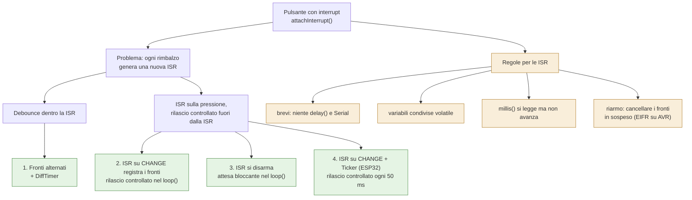

>[Torna all'indice](indexpulsanti.md)   >[versione in Python](pulsanti-interrupt-mpy.md)

# Pulsanti con interrupt: attivazione sul rilascio (pull-down e pull-up)

Le tecniche sono quelle della parte sugli interrupt di
[toggle.md](https://github.com/sebastianomelita/ArduinoBareMetal/blob/master/toggle.md),
riscritte con le convenzioni delle altre dispense.

> Versione semplificata, con le sole tecniche consigliate: [pulsanti-interrupt-semplice.md](pulsanti-interrupt-semplice.md)
> Versioni senza interrupt (polling): [pulsanti-rilascio.md](pulsanti-rilascio.md)

In tutte le versioni la pressione viene riconosciuta **subito**, dall'interrupt, e l'azione
principale parte al **rilascio**, dopo il debounce. Le convenzioni sono le stesse di
[pulsanti-rilascio.md](pulsanti-rilascio.md): `doOnRise()` e `doOnFall()` sono le callback dei
due fronti, e la callback del rilascio contiene come esempio un toggle del LED.

| Collegamento | Premuto | Interrupt sulla pressione | Callback pressione | Callback rilascio |
| --- | --- | --- | --- | --- |
| Pull-down | HIGH | `RISING` | `doOnRise()` | `doOnFall()` |
| Pull-up | LOW | `FALLING` | `doOnFall()` | `doOnRise()` |

Il pulsante va su un pin che supporta gli interrupt: su Arduino Uno solo i pin 2 e 3, su ESP32
quasi tutti i GPIO. Con `attachInterrupt()` si usa sempre `digitalPinToInterrupt(pin)`.

## Mappa concettuale



## Confronto delle tecniche

| Tecnica | Dove si fa il debounce | Callback pressione | Callback rilascio | Il loop() è libero? |
| --- | --- | --- | --- | --- |
| 1. Debounce nella ISR | nella ISR, con DiffTimer | nella ISR | nella ISR | sì, del tutto |
| 2. ISR su CHANGE + rilascio nel loop() | ISR (tempi) e `loop()` (decisione) | nella ISR | nel `loop()` | sì, anche lento |
| 3. ISR che si disarma + attesa bloccante | nel `loop()` | nella ISR | nel `loop()` | no, fermo finché il pulsante è premuto |
| 4. ISR su CHANGE + Ticker (ESP32) | ISR (tempi) e Ticker (decisione) | nella ISR | nel Ticker | sì, del tutto |

Nelle tecniche 1, 2 e 4 l'interrupt non viene mai disarmato: i rimbalzi fanno scattare la ISR
più volte, ma ogni volta essa esegue solo poche istruzioni. Su ESP32 sono pochi microsecondi
a chiamata: anche un centinaio di fronti per clic occupano meno di un millisecondo di CPU.

## 1. Debounce nella ISR con fronti alternati

L'interrupt è armato su un solo fronte alla volta: prima quello di pressione, poi, appena la
pressione è accettata, quello di rilascio, e così via. Ogni fronte viene accettato solo se
dall'ultimo fronte accettato sono passati più di 50 ms: i rimbalzi, che arrivano subito dopo,
vengono scartati. Tutto avviene nella ISR, quindi il `loop()` è libero.

**Riarmo a ogni fronte.** Il fronte opposto viene armato a **ogni** fronte, anche a quelli scartati come rimbalzi: così l'interrupt resta sempre armato sul fronte che il livello attuale del pin può produrre. Se si riarmasse solo sui fronti accettati, un fronte scartato (una pressione più breve di 50 ms, un disturbo) lascerebbe l'interrupt armato sul verso sbagliato e da lì in poi le due callback resterebbero scambiate per sempre. Sugli AVR (Arduino Uno, Nano), dopo il cambio di fronte si cancella anche il flag in sospeso (`EIFR`): un fronte del verso vecchio arrivato mentre la ISR girava la farebbe scattare di nuovo subito.

**Limiti.** Gli errori restano **locali**: la sequenza si rimette in passo da sola al fronte successivo.
- Una pressione più breve di 50 ms esegue la callback della pressione ma non quella del rilascio (con il toggle al rilascio: nessun toggle).
- Un rilascio più breve di 50 ms (si ripreme subito) perde la callback della pressione successiva.
- Un'interruzione breve del contatto a pulsante premuto (contatto usurato, filo che si muove, disturbo) fa scattare una callback del rilascio in più (con il toggle: un toggle in più).
- Un fronte perso dall'hardware (rimbalzi più vicini di pochi microsecondi, arrivati mentre la ISR girava) può far sbagliare un evento.

Con un pulsante in buone condizioni questi casi sono rari; se serve robustezza anche a questi, conviene la tecnica 2, che considera il pulsante rilasciato solo dopo 50 ms senza fronti.

<table>
<tr>
<th>Pull-down: azione sul fronte di discesa</th>
<th>Pull-up: azione sul fronte di salita</th>
</tr>
<tr>
<td>

```cpp
#include "urutils.h"

const byte P1  = 2;  // pin con interrupt
const byte LED = 13;
volatile bool stato = LOW;
DiffTimer debt;


void doOnRise() {
  // PRESSIONE (fronte di salita):
  // qui vanno le azioni immediate
  // alla pressione.
  // Eseguita nella ISR: breve!
}

void doOnFall() {
  // RILASCIO (fronte di discesa):
  // qui vanno le azioni al rilascio.
  // Eseguita nella ISR: breve!
  // Esempio: toggle del LED.
  stato = !stato;
  digitalWrite(LED, stato);
}

void isrRel();

void isrPress() {   // armata sulla pressione
  if (debt.get() > 50) {
    doOnRise();
    debt.reset();
  }
  // sempre, anche per un fronte scartato:
  // si arma il fronte opposto
  attachInterrupt(
    digitalPinToInterrupt(P1),
    isrRel, FALLING);
#ifdef EIFR
  // AVR: cancella il fronte in sospeso
  EIFR = bit(digitalPinToInterrupt(P1));
#endif
}

void isrRel() {     // armata sul rilascio
  if (debt.get() > 50) {
    doOnFall();
    debt.reset();
  }
  // sempre, anche per un fronte scartato:
  // si arma il fronte opposto
  attachInterrupt(
    digitalPinToInterrupt(P1),
    isrPress, RISING);
#ifdef EIFR
  // AVR: cancella il fronte in sospeso
  EIFR = bit(digitalPinToInterrupt(P1));
#endif
}

void setup() {
  pinMode(P1, INPUT);
  pinMode(LED, OUTPUT);
  debt.start();  // il primo fronte passa
  attachInterrupt(
    digitalPinToInterrupt(P1),
    isrPress, RISING);
}

void loop() {
  // libero per altri compiti
}
```

</td>
<td>

```cpp
#include "urutils.h"

const byte P1  = 2;  // pin con interrupt
const byte LED = 13;
volatile bool stato = LOW;
DiffTimer debt;


void doOnFall() {
  // PRESSIONE (fronte di discesa):
  // qui vanno le azioni immediate
  // alla pressione.
  // Eseguita nella ISR: breve!
}

void doOnRise() {
  // RILASCIO (fronte di salita):
  // qui vanno le azioni al rilascio.
  // Eseguita nella ISR: breve!
  // Esempio: toggle del LED.
  stato = !stato;
  digitalWrite(LED, stato);
}

void isrRel();

void isrPress() {   // armata sulla pressione
  if (debt.get() > 50) {
    doOnFall();
    debt.reset();
  }
  // sempre, anche per un fronte scartato:
  // si arma il fronte opposto
  attachInterrupt(
    digitalPinToInterrupt(P1),
    isrRel, RISING);
#ifdef EIFR
  // AVR: cancella il fronte in sospeso
  EIFR = bit(digitalPinToInterrupt(P1));
#endif
}

void isrRel() {     // armata sul rilascio
  if (debt.get() > 50) {
    doOnRise();
    debt.reset();
  }
  // sempre, anche per un fronte scartato:
  // si arma il fronte opposto
  attachInterrupt(
    digitalPinToInterrupt(P1),
    isrPress, FALLING);
#ifdef EIFR
  // AVR: cancella il fronte in sospeso
  EIFR = bit(digitalPinToInterrupt(P1));
#endif
}

void setup() {
  pinMode(P1, INPUT_PULLUP);
  pinMode(LED, OUTPUT);
  debt.start();  // il primo fronte passa
  attachInterrupt(
    digitalPinToInterrupt(P1),
    isrPress, FALLING);
}

void loop() {
  // libero per altri compiti
}
```

</td>
</tr>
</table>

## 2. ISR su CHANGE, rilascio controllato nel loop()

La ISR è armata su entrambi i fronti e non viene mai disarmata. A ogni fronte, rimbalzi
compresi, salva l'istante in `tFronte`; se il pulsante risulta premuto e la pressione non è
ancora stata segnalata, chiama la callback della pressione. Il `loop()` chiama la callback del
rilascio solo quando il pin è rilasciato e da più di 50 ms non c'è stato nessun fronte.

Siccome i tempi li registra la ISR, la tecnica funziona anche se il `loop()` è lento: un
`loop()` lento ritarda solo la callback del rilascio. `tFronte` è una variabile da 32 bit
scritta dalla ISR: su AVR la sua lettura non è atomica, quindi il `loop()` ne fa una copia fra
`noInterrupts()` e `interrupts()`.

<table>
<tr>
<th>Pull-down: azione sul fronte di discesa</th>
<th>Pull-up: azione sul fronte di salita</th>
</tr>
<tr>
<td>

```cpp
const byte P1  = 2;  // pin con interrupt
const byte LED = 13;
bool stato = LOW;
volatile bool premuto = false;
volatile unsigned long tFronte;
// istante dell'ultimo fronte,
// rimbalzi compresi


void doOnRise() {
  // PRESSIONE (fronte di salita):
  // qui vanno le azioni immediate
  // alla pressione.
  // Eseguita nella ISR: breve!
}

void doOnFall() {
  // RILASCIO (fronte di discesa):
  // qui vanno le azioni al rilascio.
  // Eseguita nel loop().
  // Esempio: toggle del LED.
  stato = !stato;
  digitalWrite(LED, stato);
}

void isrChange() {
  // resta sempre armata:
  // registra ogni fronte
  tFronte = millis();
  if (!premuto &&
      digitalRead(P1) == HIGH) {
    premuto = true;
    doOnRise();
  }
}

void setup() {
  pinMode(P1, INPUT);
  pinMode(LED, OUTPUT);
  attachInterrupt(
    digitalPinToInterrupt(P1),
    isrChange, CHANGE);
}

void loop() {
  if (premuto) {
    noInterrupts();   // copia
    unsigned long t = tFronte;
    interrupts();     // protetta
    if (digitalRead(P1) == LOW &&
        millis() - t > 50) {
      premuto = false;
      doOnFall();
    }
  }
  // qui altri compiti,
  // anche lenti
}
```

</td>
<td>

```cpp
const byte P1  = 2;  // pin con interrupt
const byte LED = 13;
bool stato = LOW;
volatile bool premuto = false;
volatile unsigned long tFronte;
// istante dell'ultimo fronte,
// rimbalzi compresi


void doOnFall() {
  // PRESSIONE (fronte di discesa):
  // qui vanno le azioni immediate
  // alla pressione.
  // Eseguita nella ISR: breve!
}

void doOnRise() {
  // RILASCIO (fronte di salita):
  // qui vanno le azioni al rilascio.
  // Eseguita nel loop().
  // Esempio: toggle del LED.
  stato = !stato;
  digitalWrite(LED, stato);
}

void isrChange() {
  // resta sempre armata:
  // registra ogni fronte
  tFronte = millis();
  if (!premuto &&
      digitalRead(P1) == LOW) {
    premuto = true;
    doOnFall();
  }
}

void setup() {
  pinMode(P1, INPUT_PULLUP);
  pinMode(LED, OUTPUT);
  attachInterrupt(
    digitalPinToInterrupt(P1),
    isrChange, CHANGE);
}

void loop() {
  if (premuto) {
    noInterrupts();   // copia
    unsigned long t = tFronte;
    interrupts();     // protetta
    if (digitalRead(P1) == HIGH &&
        millis() - t > 50) {
      premuto = false;
      doOnRise();
    }
  }
  // qui altri compiti,
  // anche lenti
}
```

</td>
</tr>
</table>

## 3. ISR che si disarma, attesa bloccante nel loop()

La ISR riconosce la pressione, chiama la callback e si disarma. Il `loop()` aspetta il rilascio
con `waitUntilInputLow()` (pull-down) o `waitUntilInputHigh()` (pull-up), che lo bloccano
finché il pulsante resta premuto. Le due funzioni, definite nello sketch come nella versione 5 di
[pulsanti-bloccanti.md](pulsanti-bloccanti.md), escono solo dopo 50 ms di livello di riposo continuo: ogni lettura del livello di pressione fa ripartire il conteggio; poi `riarma()` cancella i fronti rimasti in sospeso e riarma
l'interrupt. Senza queste due precauzioni un rimbalzo del rilascio verrebbe preso per una nuova
pressione.

<table>
<tr>
<th>Pull-down: azione sul fronte di discesa</th>
<th>Pull-up: azione sul fronte di salita</th>
</tr>
<tr>
<td>

```cpp
const byte P1  = 2;  // pin con interrupt
const byte LED = 13;
bool stato = LOW;
volatile bool premuto = false;


void doOnRise() {
  // PRESSIONE (fronte di salita):
  // qui vanno le azioni immediate
  // alla pressione.
  // Eseguita nella ISR: breve!
}

void doOnFall() {
  // RILASCIO (fronte di discesa):
  // qui vanno le azioni al rilascio.
  // Eseguita nel loop().
  // Esempio: toggle del LED.
  stato = !stato;
  digitalWrite(LED, stato);
}

void waitUntilInputLow(int btn, unsigned t) {
  // attende t ms di LOW continuo: ogni
  // lettura HIGH (rimbalzo, disturbo o
  // pulsante ancora premuto) fa
  // ripartire il conteggio
  unsigned long tl = millis();
  while (millis() - tl <= t) {
    if (digitalRead(btn) == HIGH) {
      tl = millis();
    }
    delay(1);
  }
}

void isrPress() {
  detachInterrupt(
    digitalPinToInterrupt(P1));
  premuto = true;
  doOnRise();
}

void riarma() {
#ifdef EIFR
  // AVR: cancella i fronti
  // rimasti in sospeso
  EIFR = bit(digitalPinToInterrupt(P1));
#endif
  attachInterrupt(
    digitalPinToInterrupt(P1),
    isrPress, RISING);
}

void setup() {
  pinMode(P1, INPUT);
  pinMode(LED, OUTPUT);
  riarma();
}

void loop() {
  if (premuto) {
    waitUntilInputLow(P1, 50);
    doOnFall();
    premuto = false;
    riarma();
  }
}
```

</td>
<td>

```cpp
const byte P1  = 2;  // pin con interrupt
const byte LED = 13;
bool stato = LOW;
volatile bool premuto = false;


void doOnFall() {
  // PRESSIONE (fronte di discesa):
  // qui vanno le azioni immediate
  // alla pressione.
  // Eseguita nella ISR: breve!
}

void doOnRise() {
  // RILASCIO (fronte di salita):
  // qui vanno le azioni al rilascio.
  // Eseguita nel loop().
  // Esempio: toggle del LED.
  stato = !stato;
  digitalWrite(LED, stato);
}

void waitUntilInputHigh(int btn, unsigned t) {
  // attende t ms di HIGH continuo: ogni
  // lettura LOW (rimbalzo, disturbo o
  // pulsante ancora premuto) fa
  // ripartire il conteggio
  unsigned long tl = millis();
  while (millis() - tl <= t) {
    if (digitalRead(btn) == LOW) {
      tl = millis();
    }
    delay(1);
  }
}

void isrPress() {
  detachInterrupt(
    digitalPinToInterrupt(P1));
  premuto = true;
  doOnFall();
}

void riarma() {
#ifdef EIFR
  // AVR: cancella i fronti
  // rimasti in sospeso
  EIFR = bit(digitalPinToInterrupt(P1));
#endif
  attachInterrupt(
    digitalPinToInterrupt(P1),
    isrPress, FALLING);
}

void setup() {
  pinMode(P1, INPUT_PULLUP);
  pinMode(LED, OUTPUT);
  riarma();
}

void loop() {
  if (premuto) {
    waitUntilInputHigh(P1, 50);
    doOnRise();
    premuto = false;
    riarma();
  }
}
```

</td>
</tr>
</table>

## 4. ISR su CHANGE e Ticker (solo ESP32)

Come la tecnica 2, ma il controllo del rilascio non lo fa il `loop()`: lo fa un timer
hardware, il `Ticker` di ESP32, ogni 50 ms. Quando trova il pin rilasciato e nessun fronte
negli ultimi 50 ms chiama la callback del rilascio; altrimenti si riprogramma. Il `loop()` è
del tutto libero. La callback del rilascio arriva fra 50 e 100 ms dopo l'ultimo rimbalzo.

<table>
<tr>
<th>Pull-down: azione sul fronte di discesa</th>
<th>Pull-up: azione sul fronte di salita</th>
</tr>
<tr>
<td>

```cpp
#include <Ticker.h>  // solo ESP32

const byte P1  = 12;  // pin con interrupt
const byte LED = 13;
volatile bool stato = LOW;
volatile bool premuto = false;
volatile unsigned long tFronte;
Ticker debTicker;


void doOnRise() {
  // PRESSIONE (fronte di salita):
  // qui vanno le azioni immediate
  // alla pressione.
  // Eseguita nella ISR: breve!
}

void doOnFall() {
  // RILASCIO (fronte di discesa):
  // qui vanno le azioni al rilascio.
  // Eseguita dal Ticker.
  // Esempio: toggle del LED.
  stato = !stato;
  digitalWrite(LED, stato);
}

void controllaRilascio() {
  if (digitalRead(P1) == HIGH ||
      millis() - tFronte <= 50) {
    // premuto o fronte recente:
    // ricontrollo fra 50 ms
    debTicker.once_ms(50,
      controllaRilascio);
  } else {
    premuto = false;  // stabile
    doOnFall();
  }
}

void IRAM_ATTR isrChange() {
  tFronte = millis();
  if (!premuto &&
      digitalRead(P1) == HIGH) {
    premuto = true;
    doOnRise();
    debTicker.once_ms(50,
      controllaRilascio);
  }
}

void setup() {
  pinMode(P1, INPUT);
  pinMode(LED, OUTPUT);
  attachInterrupt(
    digitalPinToInterrupt(P1),
    isrChange, CHANGE);
}

void loop() {
  // libero per altri compiti
}
```

</td>
<td>

```cpp
#include <Ticker.h>  // solo ESP32

const byte P1  = 12;  // pin con interrupt
const byte LED = 13;
volatile bool stato = LOW;
volatile bool premuto = false;
volatile unsigned long tFronte;
Ticker debTicker;


void doOnFall() {
  // PRESSIONE (fronte di discesa):
  // qui vanno le azioni immediate
  // alla pressione.
  // Eseguita nella ISR: breve!
}

void doOnRise() {
  // RILASCIO (fronte di salita):
  // qui vanno le azioni al rilascio.
  // Eseguita dal Ticker.
  // Esempio: toggle del LED.
  stato = !stato;
  digitalWrite(LED, stato);
}

void controllaRilascio() {
  if (digitalRead(P1) == LOW ||
      millis() - tFronte <= 50) {
    // premuto o fronte recente:
    // ricontrollo fra 50 ms
    debTicker.once_ms(50,
      controllaRilascio);
  } else {
    premuto = false;  // stabile
    doOnRise();
  }
}

void IRAM_ATTR isrChange() {
  tFronte = millis();
  if (!premuto &&
      digitalRead(P1) == LOW) {
    premuto = true;
    doOnFall();
    debTicker.once_ms(50,
      controllaRilascio);
  }
}

void setup() {
  pinMode(P1, INPUT_PULLUP);
  pinMode(LED, OUTPUT);
  attachInterrupt(
    digitalPinToInterrupt(P1),
    isrChange, CHANGE);
}

void loop() {
  // libero per altri compiti
}
```

</td>
</tr>
</table>

## Regole per le ISR

Valgono per tutte le tecniche:

- **La ISR deve essere breve.** Niente `delay()` e niente `Serial.print()`: mentre una ISR
  gira, le altre aspettano. Per questo ogni callback ha un commento che dice dove viene
  eseguita: quelle eseguite nella ISR devono contenere solo operazioni rapide.
- **Le variabili condivise fra ISR e `loop()` vanno dichiarate `volatile`**, altrimenti il
  compilatore può tenerne una copia in un registro e non vedere le modifiche.
- **Dentro la ISR `millis()` si può leggere ma non avanza**, perché gli interrupt sono
  disabilitati. Confrontare due tempi letti in momenti diversi va bene; aspettare che il
  tempo passi dentro la ISR no.
- **Variabili da 2 o 4 byte** lette nel `loop()` mentre la ISR può scriverle rischiano di
  essere lette a metà. Per questo nella tecnica 2 la lettura di `tFronte` è fatta fra `noInterrupts()` e
  `interrupts()`; su ESP32 le variabili da 32 bit si leggono in un'operazione sola.
- **Quando si riarma un interrupt disarmato** il microcontrollore può avere già memorizzato
  un fronte avvenuto nel frattempo, e la ISR scatterebbe subito. Su AVR (Arduino Uno) si
  cancella il flag in sospeso con `EIFR = bit(digitalPinToInterrupt(P1));` prima di
  `attachInterrupt()`: è quello che fa la funzione `riarma()` della tecnica 3, l'unica che
  disarma l'interrupt.
- **Su ESP32** la ISR va dichiarata `IRAM_ATTR`, come nella tecnica 4, così resta in RAM e
  viene eseguita anche quando la memoria flash è occupata.

## Considerazioni finali: quale tecnica scegliere

**Il limite di fondo, comune a tutte le tecniche.** Ogni antirimbalzo stabilisce un tempo minimo, ad esempio 50 msec, oltre il quale un'apertura del contatto viene considerata un rilascio vero. Un disturbo che apre il contatto per più di quel tempo non si distingue da un rilascio breve: vale per il polling, per lo schedulatore e per gli interrupt. Nel seguito si dà per scontato che questo limite sia superato scegliendo un tempo adatto alla qualità del pulsante: abbastanza lungo da coprire i suoi rimbalzi e i suoi disturbi, abbastanza corto da non perdere le pressioni rapide.

**Il polling veloce con il timer che riparte è la tecnica più robusta e più pronta.** È la versione in cui il ```loop()``` legge il pulsante a ogni giro e il timer riparte a ogni lettura "premuto" (```t0 = millis()``` fuori dall'```if```):
- guarda il pulsante in continuazione: un disturbo breve a pulsante premuto viene visto di sicuro, ma fa solo ripartire il conteggio;
- il rilascio è accettato solo se il pin è rimasto basso per **tutto** il tempo di antirimbalzo: la decisione non dipende da dove cade il disturbo;
- la pressione è riconosciuta alla prima lettura alta, il rilascio dopo il tempo di antirimbalzo.

La condizione è che il ```loop()``` resti veloce: con ```delay()``` o funzioni lente le letture si diradano e il polling si comporta come uno schedulatore.

**Lo schedulatore (time tick)** legge il pulsante solo ogni ```TBASE```. È immune ai rimbalzi perché tra una lettura e l'altra non li vede, e per lo stesso motivo di solito non vede nemmeno i disturbi brevi a pulsante premuto; se però una lettura cade proprio dentro un disturbo, il toggle scatta due volte (la probabilità è circa la durata del disturbo divisa per ```TBASE```). Si può ridurre il rischio accettando un nuovo livello solo dopo N letture uguali consecutive: il tempo minimo di un rilascio vero diventa N × ```TBASE```. È un'approssimazione, con il campionamento rado, di ciò che il polling veloce fa con il campionamento continuo.

**Gli interrupt su entrambi i fronti** fanno la stessa cosa del polling veloce: vedono ogni fronte, rimbalzi e disturbi compresi, e fanno ripartire il conteggio del tempo di antirimbalzo. In più funzionano anche quando il ```loop()``` è lento: sono la scelta giusta quando il ciclo principale ha altro di pesante da fare.

## Riferimenti

- [toggle.md](https://github.com/sebastianomelita/ArduinoBareMetal/blob/master/toggle.md): tecniche originali a interrupt
- [urutils.h](https://github.com/sebastianomelita/ArduinoBareMetal/blob/master/urutils.h): libreria con `DiffTimer`
- [pulsanti-interrupt-semplice.md](pulsanti-interrupt-semplice.md): versione semplificata
- [pulsanti-rilascio.md](pulsanti-rilascio.md): versioni senza interrupt
- [Nick Gammon, Interrupts](http://www.gammon.com.au/interrupts): regole per le ISR e flag in sospeso
