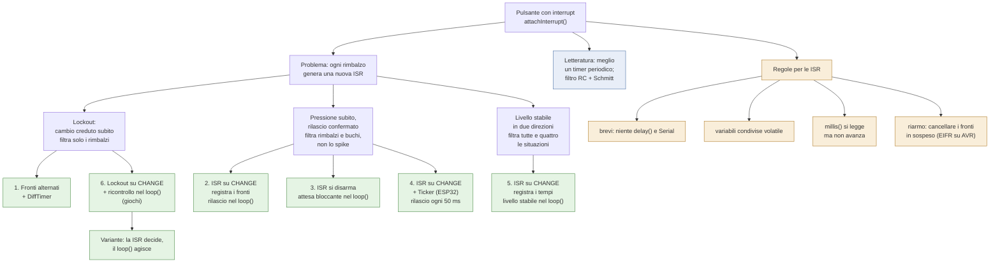

>[Torna all'indice](indexpulsanti.md)   >[versione in Python](pulsanti-interrupt-mpy.md)

# Pulsanti con interrupt: attivazione sul rilascio (pull-down e pull-up)

Le tecniche sono quelle della parte sugli interrupt di
[toggle.md](https://github.com/sebastianomelita/ArduinoBareMetal/blob/master/toggle.md),
riscritte con le convenzioni delle altre dispense.

> Versione semplificata, con le sole tecniche consigliate: [pulsanti-interrupt-semplice.md](pulsanti-interrupt-semplice.md)
> Versioni senza interrupt (polling): [pulsanti-rilascio.md](pulsanti-rilascio.md)

In tutte le versioni la pressione viene riconosciuta **subito**, dall'interrupt, e l'azione
principale parte al **rilascio**, dopo il debounce. Le convenzioni sono le stesse di
[pulsanti-rilascio.md](pulsanti-rilascio.md): `doOnRise()` e `doOnFall()` sono le callback dei
due fronti, e la callback del rilascio contiene come esempio un toggle del LED.

| Collegamento | Premuto | Interrupt sulla pressione | Callback pressione | Callback rilascio |
| --- | --- | --- | --- | --- |
| Pull-down | HIGH | `RISING` | `doOnRise()` | `doOnFall()` |
| Pull-up | LOW | `FALLING` | `doOnFall()` | `doOnRise()` |

Il pulsante va su un pin che supporta gli interrupt: su Arduino Uno solo i pin 2 e 3, su ESP32
quasi tutti i GPIO. Con `attachInterrupt()` si usa sempre `digitalPinToInterrupt(pin)`.

## Mappa concettuale



## Confronto delle tecniche

| Tecnica | Dove si fa il debounce | Callback pressione | Callback rilascio | Il loop() è libero? |
| --- | --- | --- | --- | --- |
| 1. Debounce nella ISR | nella ISR, con DiffTimer | nella ISR | nella ISR | sì, del tutto |
| 2. ISR su CHANGE + rilascio nel loop() | ISR (tempi) e `loop()` (decisione) | nella ISR | nel `loop()` | sì, anche lento |
| 3. ISR che si disarma + attesa bloccante | nel `loop()` | nella ISR | nel `loop()` | no, fermo finché il pulsante è premuto |
| 4. ISR su CHANGE + Ticker (ESP32) | ISR (tempi) e Ticker (decisione) | nella ISR | nel Ticker | sì, del tutto |
| 5. ISR su CHANGE + livello stabile nel loop() | ISR (tempi) e `loop()` (decisione) | nel `loop()`, 50 ms dopo | nel `loop()` | sì, anche lento |
| 6. Lockout su CHANGE + ricontrollo | nella ISR (blocco di 50 ms) e ricontrollo nel `loop()` | nella ISR, subito | nella ISR, subito | sì, anche lento |

### Le quattro situazioni critiche

Le stesse prove delle altre dispense (simulazione in pull-down, 5000 prove per caso, passo di
1 ms), con le quattro situazioni critiche di [debounce-fenomeni.md](debounce-fenomeni.md):

| Tecnica | Rimbalzi alla pressione | Rimbalzi al rilascio | Buco a pulsante premuto | Spike a riposo | Errore prodotto |
| --- | --- | --- | --- | --- | --- |
| 1. Fronti alternati nella ISR | ✔ 0 | ✔ 0 | ✘ 4046 su 5000 | ✘ 5000 su 5000 | buco: due rilasci; spike: due pressioni |
| 2. ISR su CHANGE + rilascio nel `loop()` | ✔ 0 | ✔ 0 | ✔ 0 | ✘ 5000 su 5000 | spike: pressione e rilascio falsi |
| 3. ISR che si disarma + attesa bloccante | ✔ 0 | ✔ 0 | ✔ 0 | ✘ 5000 su 5000 | spike: pressione e rilascio falsi |
| 4. ISR su CHANGE + Ticker | ✔ 0 | ✔ 0 | ✔ 0 | ✘ 5000 su 5000 | spike: pressione e rilascio falsi |
| 5. ISR su CHANGE + livello stabile | ✔ 0 | ✔ 0 | ✔ 0 | ✔ 0 | nessuno |
| 6. Lockout su CHANGE + ricontrollo | ✔ 0 | ✔ 0 | ✘ 4017 su 5000 | ✘ 5000 su 5000 | buco: rilascio e pressione falsi; spike: pressione e rilascio falsi |

Ogni situazione è simulata da sola, su 5000 prove. Le tecniche 1-4 e la 6 riconoscono la
pressione **subito**, al primo fronte: per questo uno spike a riposo vale sempre come pressione.
Le tecniche 1 e 6 sono lockout e sbagliano anche sul buco, quando cade più di 50 ms dopo la
pressione. In testa a ogni tecnica un richiamo dice che cosa rileva e che cosa no.

La tecnica 5 conferma anche la pressione e filtra tutte e quattro le situazioni, anche con un `loop()` che gira solo ogni 30 ms; il prezzo è che la pressione
arriva 50 ms dopo l'ultimo rimbalzo.

Nelle tecniche 1, 2 e 4 l'interrupt non viene mai disarmato: i rimbalzi fanno scattare la ISR
più volte, ma ogni volta essa esegue solo poche istruzioni. Su ESP32 sono pochi microsecondi
a chiamata: anche un centinaio di fronti per clic occupano meno di un millisecondo di CPU.

## 1. Debounce nella ISR con fronti alternati

> **Rileva:** rimbalzi alla pressione e al rilascio. **Non rileva:** buco a pulsante premuto (due rilasci) e spike a riposo (due pressioni).
>
> **Prontezza** su pressione e rilascio: la ISR li crede al primo fronte, senza ritardo e senza aspettare il `loop()`. Nessuna sicurezza: non c'è conferma.
>
> **Applicazioni tipiche:** didattica: mostra il lockout dentro la ISR; per un uso reale è meglio la tecnica 6.


L'interrupt è armato su un solo fronte alla volta: prima quello di pressione, poi, appena la
pressione è accettata, quello di rilascio, e così via. Ogni fronte viene accettato solo se
dall'ultimo fronte accettato sono passati più di 50 ms: i rimbalzi, che arrivano subito dopo,
vengono scartati. Tutto avviene nella ISR, quindi il `loop()` è libero.

**Riarmo a ogni fronte.** Il fronte opposto viene armato a **ogni** fronte, anche a quelli scartati come rimbalzi: così l'interrupt resta sempre armato sul fronte che il livello attuale del pin può produrre. Se si riarmasse solo sui fronti accettati, un fronte scartato (una pressione più breve di 50 ms, un disturbo) lascerebbe l'interrupt armato sul verso sbagliato e da lì in poi le due callback resterebbero scambiate per sempre. Sugli AVR (Arduino Uno, Nano), dopo il cambio di fronte si cancella anche il flag in sospeso (`EIFR`): un fronte del verso vecchio arrivato mentre la ISR girava la farebbe scattare di nuovo subito.

**Limiti.** Gli errori restano **locali**: la sequenza si rimette in passo da sola al fronte successivo.
- Una pressione più breve di 50 ms esegue la callback della pressione ma non quella del rilascio (con il toggle al rilascio: nessun toggle).
- Un rilascio più breve di 50 ms (si ripreme subito) perde la callback della pressione successiva.
- Un'interruzione breve del contatto a pulsante premuto (contatto usurato, filo che si muove, disturbo) fa scattare una callback del rilascio in più (con il toggle: un toggle in più).
- Un fronte perso dall'hardware (rimbalzi più vicini di pochi microsecondi, arrivati mentre la ISR girava) può far sbagliare un evento.

Con un pulsante in buone condizioni questi casi sono rari; se serve robustezza anche a questi, conviene la tecnica 2, che considera il pulsante rilasciato solo dopo 50 ms senza fronti.

<table>
<tr>
<th>Pull-down: azione sul fronte di discesa</th>
<th>Pull-up: azione sul fronte di salita</th>
</tr>
<tr>
<td>

```cpp
#include "urutils.h"

const byte P1  = 2;  // pin con interrupt
const byte LED = 13;
volatile bool stato = LOW;
DiffTimer debt;


void doOnRise() {
  // PRESSIONE (fronte di salita):
  // qui vanno le azioni immediate
  // alla pressione.
  // Eseguita nella ISR: breve!
}

void doOnFall() {
  // RILASCIO (fronte di discesa):
  // qui vanno le azioni al rilascio.
  // Eseguita nella ISR: breve!
  // Esempio: toggle del LED.
  stato = !stato;
  digitalWrite(LED, stato);
}

void isrRel();

void isrPress() {   // armata sulla pressione
  if (debt.get() > 50) {
    debt.reset();  // prima l'istante
    doOnRise();        // poi l'azione
  }
  // sempre, anche per un fronte scartato:
  // si arma il fronte opposto
  attachInterrupt(
    digitalPinToInterrupt(P1),
    isrRel, FALLING);
#ifdef EIFR
  // AVR: cancella il fronte in sospeso
  EIFR = bit(digitalPinToInterrupt(P1));
#endif
}

void isrRel() {     // armata sul rilascio
  if (debt.get() > 50) {
    debt.reset();  // prima l'istante
    doOnFall();        // poi l'azione
  }
  // sempre, anche per un fronte scartato:
  // si arma il fronte opposto
  attachInterrupt(
    digitalPinToInterrupt(P1),
    isrPress, RISING);
#ifdef EIFR
  // AVR: cancella il fronte in sospeso
  EIFR = bit(digitalPinToInterrupt(P1));
#endif
}

void setup() {
  pinMode(P1, INPUT);
  pinMode(LED, OUTPUT);
  debt.start();  // il primo fronte passa
  attachInterrupt(
    digitalPinToInterrupt(P1),
    isrPress, RISING);
}

void loop() {
  // libero per altri compiti
}
```

</td>
<td>

```cpp
#include "urutils.h"

const byte P1  = 2;  // pin con interrupt
const byte LED = 13;
volatile bool stato = LOW;
DiffTimer debt;


void doOnFall() {
  // PRESSIONE (fronte di discesa):
  // qui vanno le azioni immediate
  // alla pressione.
  // Eseguita nella ISR: breve!
}

void doOnRise() {
  // RILASCIO (fronte di salita):
  // qui vanno le azioni al rilascio.
  // Eseguita nella ISR: breve!
  // Esempio: toggle del LED.
  stato = !stato;
  digitalWrite(LED, stato);
}

void isrRel();

void isrPress() {   // armata sulla pressione
  if (debt.get() > 50) {
    debt.reset();  // prima l'istante
    doOnFall();        // poi l'azione
  }
  // sempre, anche per un fronte scartato:
  // si arma il fronte opposto
  attachInterrupt(
    digitalPinToInterrupt(P1),
    isrRel, RISING);
#ifdef EIFR
  // AVR: cancella il fronte in sospeso
  EIFR = bit(digitalPinToInterrupt(P1));
#endif
}

void isrRel() {     // armata sul rilascio
  if (debt.get() > 50) {
    debt.reset();  // prima l'istante
    doOnRise();        // poi l'azione
  }
  // sempre, anche per un fronte scartato:
  // si arma il fronte opposto
  attachInterrupt(
    digitalPinToInterrupt(P1),
    isrPress, FALLING);
#ifdef EIFR
  // AVR: cancella il fronte in sospeso
  EIFR = bit(digitalPinToInterrupt(P1));
#endif
}

void setup() {
  pinMode(P1, INPUT_PULLUP);
  pinMode(LED, OUTPUT);
  debt.start();  // il primo fronte passa
  attachInterrupt(
    digitalPinToInterrupt(P1),
    isrPress, FALLING);
}

void loop() {
  // libero per altri compiti
}
```

</td>
</tr>
</table>

## 2. ISR su CHANGE, rilascio controllato nel loop()

> **Rileva:** rimbalzi alla pressione e al rilascio, buco a pulsante premuto. **Non rileva:** spike a riposo (pressione e rilascio falsi).
>
> **Prontezza** sulla pressione: la ISR la riconosce al primo fronte, anche se il `loop()` è lento. **Sicurezza** sul rilascio, confermato da 50 ms senza fronti.
>
> **Applicazioni tipiche:** il `loop()` lento o con compiti pesanti, quando basta filtrare il rilascio.


La ISR è armata su entrambi i fronti e non viene mai disarmata. A ogni fronte, rimbalzi
compresi, salva l'istante in `tFronte`; se il pulsante risulta premuto e la pressione non è
ancora stata segnalata, chiama la callback della pressione. Il `loop()` chiama la callback del
rilascio solo quando il pin è rilasciato e da più di 50 ms non c'è stato nessun fronte.

Siccome i tempi li registra la ISR, la tecnica funziona anche se il `loop()` è lento: un
`loop()` lento ritarda solo la callback del rilascio. `tFronte` è una variabile da 32 bit
scritta dalla ISR: su AVR la sua lettura non è atomica, quindi il `loop()` ne fa una copia fra
`noInterrupts()` e `interrupts()`.

<table>
<tr>
<th>Pull-down: azione sul fronte di discesa</th>
<th>Pull-up: azione sul fronte di salita</th>
</tr>
<tr>
<td>

```cpp
const byte P1  = 2;  // pin con interrupt
const byte LED = 13;
bool stato = LOW;
volatile bool premuto = false;
volatile unsigned long tFronte;
// istante dell'ultimo fronte,
// rimbalzi compresi


void doOnRise() {
  // PRESSIONE (fronte di salita):
  // qui vanno le azioni immediate
  // alla pressione.
  // Eseguita nella ISR: breve!
}

void doOnFall() {
  // RILASCIO (fronte di discesa):
  // qui vanno le azioni al rilascio.
  // Eseguita nel loop().
  // Esempio: toggle del LED.
  stato = !stato;
  digitalWrite(LED, stato);
}

void isrChange() {
  // resta sempre armata:
  // registra ogni fronte
  tFronte = millis();
  if (!premuto &&
      digitalRead(P1) == HIGH) {
    premuto = true;
    doOnRise();
  }
}

void setup() {
  pinMode(P1, INPUT);
  pinMode(LED, OUTPUT);
  attachInterrupt(
    digitalPinToInterrupt(P1),
    isrChange, CHANGE);
}

void loop() {
  if (premuto) {
    noInterrupts();   // copia
    unsigned long t = tFronte;
    interrupts();     // protetta
    if (digitalRead(P1) == LOW &&
        millis() - t > 50) {
      premuto = false;
      doOnFall();
    }
  }
  // qui altri compiti,
  // anche lenti
}
```

</td>
<td>

```cpp
const byte P1  = 2;  // pin con interrupt
const byte LED = 13;
bool stato = LOW;
volatile bool premuto = false;
volatile unsigned long tFronte;
// istante dell'ultimo fronte,
// rimbalzi compresi


void doOnFall() {
  // PRESSIONE (fronte di discesa):
  // qui vanno le azioni immediate
  // alla pressione.
  // Eseguita nella ISR: breve!
}

void doOnRise() {
  // RILASCIO (fronte di salita):
  // qui vanno le azioni al rilascio.
  // Eseguita nel loop().
  // Esempio: toggle del LED.
  stato = !stato;
  digitalWrite(LED, stato);
}

void isrChange() {
  // resta sempre armata:
  // registra ogni fronte
  tFronte = millis();
  if (!premuto &&
      digitalRead(P1) == LOW) {
    premuto = true;
    doOnFall();
  }
}

void setup() {
  pinMode(P1, INPUT_PULLUP);
  pinMode(LED, OUTPUT);
  attachInterrupt(
    digitalPinToInterrupt(P1),
    isrChange, CHANGE);
}

void loop() {
  if (premuto) {
    noInterrupts();   // copia
    unsigned long t = tFronte;
    interrupts();     // protetta
    if (digitalRead(P1) == HIGH &&
        millis() - t > 50) {
      premuto = false;
      doOnRise();
    }
  }
  // qui altri compiti,
  // anche lenti
}
```

</td>
</tr>
</table>

## 3. ISR che si disarma, attesa bloccante nel loop()

> **Rileva:** rimbalzi alla pressione e al rilascio, buco a pulsante premuto. **Non rileva:** spike a riposo (pressione e rilascio falsi).
>
> **Prontezza** sulla pressione: la ISR la riconosce al primo fronte. **Sicurezza** sul rilascio, confermato da 50 ms continui di livello basso, con il programma fermo nell'attesa.
>
> **Applicazioni tipiche:** programmi dedicati al pulsante che devono reagire subito alla pressione.


La ISR riconosce la pressione, chiama la callback e si disarma. Il `loop()` aspetta il rilascio
con `waitUntilInputLow()` (pull-down) o `waitUntilInputHigh()` (pull-up), che lo bloccano
finché il pulsante resta premuto. Le due funzioni, definite nello sketch come nella versione 5 di
[pulsanti-bloccanti.md](pulsanti-bloccanti.md), escono solo dopo 50 ms di livello di riposo continuo: ogni lettura del livello di pressione fa ripartire il conteggio; poi `riarma()` cancella i fronti rimasti in sospeso e riarma
l'interrupt. Senza queste due precauzioni un rimbalzo del rilascio verrebbe preso per una nuova
pressione.

<table>
<tr>
<th>Pull-down: azione sul fronte di discesa</th>
<th>Pull-up: azione sul fronte di salita</th>
</tr>
<tr>
<td>

```cpp
const byte P1  = 2;  // pin con interrupt
const byte LED = 13;
bool stato = LOW;
volatile bool premuto = false;


void doOnRise() {
  // PRESSIONE (fronte di salita):
  // qui vanno le azioni immediate
  // alla pressione.
  // Eseguita nella ISR: breve!
}

void doOnFall() {
  // RILASCIO (fronte di discesa):
  // qui vanno le azioni al rilascio.
  // Eseguita nel loop().
  // Esempio: toggle del LED.
  stato = !stato;
  digitalWrite(LED, stato);
}

void waitUntilInputLow(int btn, unsigned t) {
  // attende t ms di LOW continuo: ogni
  // lettura HIGH (rimbalzo, disturbo o
  // pulsante ancora premuto) fa
  // ripartire il conteggio
  unsigned long tl = millis();
  while (millis() - tl <= t) {
    if (digitalRead(btn) == HIGH) {
      tl = millis();
    }
    delay(1);
  }
}

void isrPress() {
  detachInterrupt(
    digitalPinToInterrupt(P1));
  premuto = true;
  doOnRise();
}

void riarma() {
#ifdef EIFR
  // AVR: cancella i fronti
  // rimasti in sospeso
  EIFR = bit(digitalPinToInterrupt(P1));
#endif
  attachInterrupt(
    digitalPinToInterrupt(P1),
    isrPress, RISING);
}

void setup() {
  pinMode(P1, INPUT);
  pinMode(LED, OUTPUT);
  riarma();
}

void loop() {
  if (premuto) {
    waitUntilInputLow(P1, 50);
    doOnFall();
    premuto = false;
    riarma();
  }
}
```

</td>
<td>

```cpp
const byte P1  = 2;  // pin con interrupt
const byte LED = 13;
bool stato = LOW;
volatile bool premuto = false;


void doOnFall() {
  // PRESSIONE (fronte di discesa):
  // qui vanno le azioni immediate
  // alla pressione.
  // Eseguita nella ISR: breve!
}

void doOnRise() {
  // RILASCIO (fronte di salita):
  // qui vanno le azioni al rilascio.
  // Eseguita nel loop().
  // Esempio: toggle del LED.
  stato = !stato;
  digitalWrite(LED, stato);
}

void waitUntilInputHigh(int btn, unsigned t) {
  // attende t ms di HIGH continuo: ogni
  // lettura LOW (rimbalzo, disturbo o
  // pulsante ancora premuto) fa
  // ripartire il conteggio
  unsigned long tl = millis();
  while (millis() - tl <= t) {
    if (digitalRead(btn) == LOW) {
      tl = millis();
    }
    delay(1);
  }
}

void isrPress() {
  detachInterrupt(
    digitalPinToInterrupt(P1));
  premuto = true;
  doOnFall();
}

void riarma() {
#ifdef EIFR
  // AVR: cancella i fronti
  // rimasti in sospeso
  EIFR = bit(digitalPinToInterrupt(P1));
#endif
  attachInterrupt(
    digitalPinToInterrupt(P1),
    isrPress, FALLING);
}

void setup() {
  pinMode(P1, INPUT_PULLUP);
  pinMode(LED, OUTPUT);
  riarma();
}

void loop() {
  if (premuto) {
    waitUntilInputHigh(P1, 50);
    doOnRise();
    premuto = false;
    riarma();
  }
}
```

</td>
</tr>
</table>

## 4. ISR su CHANGE e Ticker (solo ESP32)

> **Rileva:** rimbalzi alla pressione e al rilascio, buco a pulsante premuto. **Non rileva:** spike a riposo (pressione e rilascio falsi).
>
> **Prontezza** sulla pressione: la ISR la riconosce al primo fronte, anche se il `loop()` è lento. **Sicurezza** sul rilascio, confermato da 50 ms senza fronti.
>
> **Applicazioni tipiche:** ESP32 con il `loop()` occupato: tutto il debounce è fuori dal ciclo principale.


Come la tecnica 2, ma il controllo del rilascio non lo fa il `loop()`: lo fa un timer
hardware, il `Ticker` di ESP32, ogni 50 ms. Quando trova il pin rilasciato e nessun fronte
negli ultimi 50 ms chiama la callback del rilascio; altrimenti si riprogramma. Il `loop()` è
del tutto libero. La callback del rilascio arriva fra 50 e 100 ms dopo l'ultimo rimbalzo.

<table>
<tr>
<th>Pull-down: azione sul fronte di discesa</th>
<th>Pull-up: azione sul fronte di salita</th>
</tr>
<tr>
<td>

```cpp
#include <Ticker.h>  // solo ESP32

const byte P1  = 12;  // pin con interrupt
const byte LED = 13;
volatile bool stato = LOW;
volatile bool premuto = false;
volatile unsigned long tFronte;
Ticker debTicker;


void doOnRise() {
  // PRESSIONE (fronte di salita):
  // qui vanno le azioni immediate
  // alla pressione.
  // Eseguita nella ISR: breve!
}

void doOnFall() {
  // RILASCIO (fronte di discesa):
  // qui vanno le azioni al rilascio.
  // Eseguita dal Ticker.
  // Esempio: toggle del LED.
  stato = !stato;
  digitalWrite(LED, stato);
}

void controllaRilascio() {
  if (digitalRead(P1) == HIGH ||
      millis() - tFronte <= 50) {
    // premuto o fronte recente:
    // ricontrollo fra 50 ms
    debTicker.once_ms(50,
      controllaRilascio);
  } else {
    premuto = false;  // stabile
    doOnFall();
  }
}

void IRAM_ATTR isrChange() {
  tFronte = millis();
  if (!premuto &&
      digitalRead(P1) == HIGH) {
    premuto = true;
    doOnRise();
    debTicker.once_ms(50,
      controllaRilascio);
  }
}

void setup() {
  pinMode(P1, INPUT);
  pinMode(LED, OUTPUT);
  attachInterrupt(
    digitalPinToInterrupt(P1),
    isrChange, CHANGE);
}

void loop() {
  // libero per altri compiti
}
```

</td>
<td>

```cpp
#include <Ticker.h>  // solo ESP32

const byte P1  = 12;  // pin con interrupt
const byte LED = 13;
volatile bool stato = LOW;
volatile bool premuto = false;
volatile unsigned long tFronte;
Ticker debTicker;


void doOnFall() {
  // PRESSIONE (fronte di discesa):
  // qui vanno le azioni immediate
  // alla pressione.
  // Eseguita nella ISR: breve!
}

void doOnRise() {
  // RILASCIO (fronte di salita):
  // qui vanno le azioni al rilascio.
  // Eseguita dal Ticker.
  // Esempio: toggle del LED.
  stato = !stato;
  digitalWrite(LED, stato);
}

void controllaRilascio() {
  if (digitalRead(P1) == LOW ||
      millis() - tFronte <= 50) {
    // premuto o fronte recente:
    // ricontrollo fra 50 ms
    debTicker.once_ms(50,
      controllaRilascio);
  } else {
    premuto = false;  // stabile
    doOnRise();
  }
}

void IRAM_ATTR isrChange() {
  tFronte = millis();
  if (!premuto &&
      digitalRead(P1) == LOW) {
    premuto = true;
    doOnFall();
    debTicker.once_ms(50,
      controllaRilascio);
  }
}

void setup() {
  pinMode(P1, INPUT_PULLUP);
  pinMode(LED, OUTPUT);
  attachInterrupt(
    digitalPinToInterrupt(P1),
    isrChange, CHANGE);
}

void loop() {
  // libero per altri compiti
}
```

</td>
</tr>
</table>

## 5. ISR su CHANGE, livello stabile nel loop() (conferma in due direzioni)

> **Rileva:** tutte e quattro le situazioni: rimbalzi alla pressione e al rilascio, buco a pulsante premuto, spike a riposo.
>
> **Sicurezza** su pressione e rilascio, tutti e due confermati da 50 ms senza fronti, anche se il `loop()` è lento. Nessuna prontezza: ogni evento arriva 50 ms dopo l'ultimo rimbalzo.
>
> **Applicazioni tipiche:** il `loop()` lento con ingressi disturbati; toggle e contatori.


È la tecnica `changed()` di [pulsanti-rilascio.md](pulsanti-rilascio.md) (sezione 3), con
l'interrupt al posto delle letture continue. La ISR fa **una cosa sola**: salva in `tFronte`
l'istante di ogni fronte, rimbalzi e disturbi compresi. Il `loop()` accetta un nuovo livello
solo se è diverso da quello accettato (`stabile`) e da più di 50 ms non c'è stato nessun fronte.
Una sola regola, per pressione e rilascio: un rimbalzo, un buco o uno spike producono fronti
ravvicinati, il livello non resta fermo 50 ms e non viene accettato.

- **La ISR non legge il pin e non guarda il verso del fronte.** Se un fronte si perde o arriva
  dal verso sbagliato (succede su ESP32 con fronti lenti, vedi più sotto), conta solo che
  `tFronte` venga aggiornato: il livello lo legge il `loop()` quando il pin è fermo.
- **Prima la lettura, poi il controllo del tempo.** Se un fronte arriva fra le due istruzioni,
  `tFronte` è già aggiornato e il livello letto non viene accettato; se arriva dopo, il livello
  letto è quello di prima, fermo da 50 ms. Nell'ordine inverso un fronte caduto in mezzo
  farebbe accettare un livello appena cambiato.
- **Il limite.** Una pressione **intera** (pressione e rilascio) più breve di un giro del
  `loop()` non viene vista, come in ogni tecnica che decide nel `loop()`. La tecnica 2 invece
  la ricorda, perché la pressione la segnala la ISR.

<table>
<tr>
<th>Pull-down: azione sul fronte di discesa</th>
<th>Pull-up: azione sul fronte di salita</th>
</tr>
<tr>
<td>

```cpp
const byte P1  = 2;  // pin con interrupt
const byte LED = 13;
bool stato = LOW;
byte stabile = LOW;  // livello accettato
volatile unsigned long tFronte = 0;
// istante dell'ultimo fronte,
// rimbalzi e disturbi compresi


void doOnRise() {
  // PRESSIONE (fronte di salita):
  // qui vanno le azioni alla
  // pressione confermata.
  // Eseguita nel loop().
}

void doOnFall() {
  // RILASCIO (fronte di discesa):
  // qui vanno le azioni al rilascio.
  // Eseguita nel loop().
  // Esempio: toggle del LED.
  stato = !stato;
  digitalWrite(LED, stato);
}

void isrChange() {
  // resta sempre armata:
  // registra solo l'istante
  tFronte = millis();
}

void setup() {
  pinMode(P1, INPUT);
  pinMode(LED, OUTPUT);
  attachInterrupt(
    digitalPinToInterrupt(P1),
    isrChange, CHANGE);
}

void loop() {
  byte val = digitalRead(P1); // prima
  noInterrupts();   // copia
  unsigned long t = tFronte;
  interrupts();     // protetta
  if (millis() - t > 50 &&    // poi
      val != stabile) {
    // nessun fronte da 50 ms:
    // nuovo livello accettato
    stabile = val;
    if (stabile == HIGH) {
      doOnRise();
    } else {
      doOnFall();
    }
  }
  // qui altri compiti,
  // anche lenti
}
```

</td>
<td>

```cpp
const byte P1  = 2;  // pin con interrupt
const byte LED = 13;
bool stato = LOW;
byte stabile = HIGH; // livello accettato
volatile unsigned long tFronte = 0;
// istante dell'ultimo fronte,
// rimbalzi e disturbi compresi


void doOnFall() {
  // PRESSIONE (fronte di discesa):
  // qui vanno le azioni alla
  // pressione confermata.
  // Eseguita nel loop().
}

void doOnRise() {
  // RILASCIO (fronte di salita):
  // qui vanno le azioni al rilascio.
  // Eseguita nel loop().
  // Esempio: toggle del LED.
  stato = !stato;
  digitalWrite(LED, stato);
}

void isrChange() {
  // resta sempre armata:
  // registra solo l'istante
  tFronte = millis();
}

void setup() {
  pinMode(P1, INPUT_PULLUP);
  pinMode(LED, OUTPUT);
  attachInterrupt(
    digitalPinToInterrupt(P1),
    isrChange, CHANGE);
}

void loop() {
  byte val = digitalRead(P1); // prima
  noInterrupts();   // copia
  unsigned long t = tFronte;
  interrupts();     // protetta
  if (millis() - t > 50 &&    // poi
      val != stabile) {
    // nessun fronte da 50 ms:
    // nuovo livello accettato
    stabile = val;
    if (stabile == LOW) {
      doOnFall();
    } else {
      doOnRise();
    }
  }
  // qui altri compiti,
  // anche lenti
}
```

</td>
</tr>
</table>

Su ESP32 la ISR va dichiarata `void IRAM_ATTR isrChange()`.

## 6. Lockout su entrambi i fronti: la versione pronta, per i giochi

> **Rileva:** rimbalzi alla pressione e al rilascio. **Non rileva:** buco a pulsante premuto (rilascio e pressione falsi) e spike a riposo (pressione e rilascio falsi).
>
> **Prontezza** su pressione e rilascio: la ISR li crede al primo fronte, senza ritardo e senza aspettare il `loop()`. Nessuna sicurezza: non c'è conferma.
>
> **Applicazioni tipiche:** giochi su microcontrollore e altri comandi dove conta la prontezza, anche con il `loop()` lento.


È il lockout di [pulsanti-rilascio.md](pulsanti-rilascio.md) (sezione 4) con l'interrupt: il
primo cambio di livello è creduto **subito**, nella ISR, e per i 50 ms successivi ogni altro
fronte è ignorato. Pressione e rilascio arrivano senza ritardo e senza aspettare il `loop()`:
è la scelta per i **giochi**, dove conta la prontezza e un errore raro è tollerato. Non filtra
buchi e spike (vedi la tabella delle quattro situazioni).

**Perché serve il ricontrollo nel `loop()`.** Con la sola ISR, se l'ultimo fronte di un rimbalzo
o di un disturbo cade dentro i 50 ms di blocco, viene ignorato e **nessun altro fronte arriverà**:
il livello creduto resta sbagliato finché non si tocca di nuovo il pulsante. Nel gioco, il
personaggio continuerebbe a correre a pulsante rilasciato. In simulazione, senza ricontrollo il
livello creduto è rimasto sbagliato fino a circa un secondo (cioè fino alla pressione successiva);
con il ricontrollo, al massimo circa 50 ms. Il `loop()` chiama la stessa funzione `prova()`
della ISR, con gli interrupt disabilitati perché non si sovrappongano: se il blocco è scaduto e
il pin non corrisponde al livello creduto, lo corregge. È il "ritardo al fronte successivo" del
lockout: un cambio caduto nel blocco viene recuperato appena il blocco finisce.

<table>
<tr>
<th>Pull-down</th>
<th>Pull-up</th>
</tr>
<tr>
<td>

```cpp
const byte P1  = 2;  // pin con interrupt
const byte LED = 13;
volatile byte stabile = LOW; // creduto
volatile unsigned long t0 = 0;
// istante dell'ultimo evento


void doOnRise() {
  // PRESSIONE (fronte di salita):
  // azioni immediate, per esempio
  // il salto del personaggio.
  // Eseguita nella ISR: breve!
  digitalWrite(LED, HIGH);
}

void doOnFall() {
  // RILASCIO (fronte di discesa):
  // azioni al rilascio.
  // Eseguita nella ISR: breve!
  digitalWrite(LED, LOW);
}

void prova() {
  // cambio creduto subito, ma non
  // nei 50 ms dopo l'ultimo evento
  byte val = digitalRead(P1);
  if (val != stabile &&
      millis() - t0 > 50) {
    stabile = val;
    t0 = millis();
    if (stabile == HIGH) {
      doOnRise();
    } else {
      doOnFall();
    }
  }
}

void isrChange() {
  prova();   // reazione al fronte
}

void setup() {
  pinMode(P1, INPUT);
  pinMode(LED, OUTPUT);
  attachInterrupt(
    digitalPinToInterrupt(P1),
    isrChange, CHANGE);
}

void loop() {
  // ricontrollo: recupera un cambio
  // caduto nei 50 ms di blocco
  noInterrupts();
  prova();
  interrupts();
  // qui altri compiti,
  // anche lenti
}
```

</td>
<td>

```cpp
const byte P1  = 2;  // pin con interrupt
const byte LED = 13;
volatile byte stabile = HIGH; // creduto
volatile unsigned long t0 = 0;
// istante dell'ultimo evento


void doOnFall() {
  // PRESSIONE (fronte di discesa):
  // azioni immediate, per esempio
  // il salto del personaggio.
  // Eseguita nella ISR: breve!
  digitalWrite(LED, HIGH);
}

void doOnRise() {
  // RILASCIO (fronte di salita):
  // azioni al rilascio.
  // Eseguita nella ISR: breve!
  digitalWrite(LED, LOW);
}

void prova() {
  // cambio creduto subito, ma non
  // nei 50 ms dopo l'ultimo evento
  byte val = digitalRead(P1);
  if (val != stabile &&
      millis() - t0 > 50) {
    stabile = val;
    t0 = millis();
    if (stabile == LOW) {
      doOnFall();
    } else {
      doOnRise();
    }
  }
}

void isrChange() {
  prova();   // reazione al fronte
}

void setup() {
  pinMode(P1, INPUT_PULLUP);
  pinMode(LED, OUTPUT);
  attachInterrupt(
    digitalPinToInterrupt(P1),
    isrChange, CHANGE);
}

void loop() {
  // ricontrollo: recupera un cambio
  // caduto nei 50 ms di blocco
  noInterrupts();
  prova();
  interrupts();
  // qui altri compiti,
  // anche lenti
}
```

</td>
</tr>
</table>

Le callback vengono eseguite nella ISR o nel `loop()` a interrupt disabilitati: in entrambi i
casi devono essere brevi. Su ESP32 vanno dichiarate `IRAM_ATTR` sia `isrChange()` sia `prova()`.

### Variante: la ISR decide, il loop() agisce

Nella tecnica 6 le callback girano nella ISR: la risposta è immediata, ma possono fare solo
operazioni minime (accendere un LED, alzare un flag). In un gioco vero le azioni sono più lunghe:
conviene allora **separare la decisione dall'azione**. La ISR decide subito, con il lockout, e
segna soltanto l'evento in `evPress` o `evRel`; il `loop()` copia e azzera gli eventi a
interrupt disabilitati, poi chiama le callback, che possono contenere qualunque codice (qui
`Serial.println()`, vietato nella ISR).

- La **decisione** resta pronta: i rimbalzi sono scartati al momento giusto anche se il `loop()`
  è occupato.
- L'**azione** parte al giro successivo del `loop()`: nei giochi il `loop()` è il ciclo dei
  fotogrammi, che gira ogni 10-20 ms, e il ritardo non si nota.
- Se in un solo giro arrivano sia una pressione sia un rilascio (`loop()` molto lento), il codice
  li esegue in quest'ordine, che è quello giusto nei casi normali.

<table>
<tr>
<th>Pull-down</th>
<th>Pull-up</th>
</tr>
<tr>
<td>

```cpp
const byte P1  = 2;  // pin con interrupt
volatile byte stabile = LOW; // creduto
volatile unsigned long t0 = 0;
volatile bool evPress = false; // eventi
volatile bool evRel = false;   // per loop()


void doOnRise() {
  // PRESSIONE (fronte di salita):
  // eseguita nel loop(): può
  // contenere qualunque codice.
  Serial.println("salto");
}

void doOnFall() {
  // RILASCIO (fronte di discesa):
  // eseguita nel loop().
  Serial.println("fine salto");
}

void prova() {
  // decide subito, ma non agisce:
  // segna solo l'evento
  byte val = digitalRead(P1);
  if (val != stabile &&
      millis() - t0 > 50) {
    stabile = val;
    t0 = millis();
    if (stabile == HIGH) {
      evPress = true;
    } else {
      evRel = true;
    }
  }
}

void isrChange() {
  prova();   // decisione al fronte
}

void setup() {
  Serial.begin(115200);
  pinMode(P1, INPUT);
  attachInterrupt(
    digitalPinToInterrupt(P1),
    isrChange, CHANGE);
}

void loop() {
  noInterrupts();
  prova();          // ricontrollo
  bool p = evPress; // copia e
  bool r = evRel;   // azzera gli
  evPress = false;  // eventi
  evRel = false;
  interrupts();
  if (p) {
    doOnRise();     // azioni, anche
  }
  if (r) {
    doOnFall();     // lunghe
  }
  // qui altri compiti
}
```

</td>
<td>

```cpp
const byte P1  = 2;  // pin con interrupt
volatile byte stabile = HIGH; // creduto
volatile unsigned long t0 = 0;
volatile bool evPress = false; // eventi
volatile bool evRel = false;   // per loop()


void doOnFall() {
  // PRESSIONE (fronte di discesa):
  // eseguita nel loop(): può
  // contenere qualunque codice.
  Serial.println("salto");
}

void doOnRise() {
  // RILASCIO (fronte di salita):
  // eseguita nel loop().
  Serial.println("fine salto");
}

void prova() {
  // decide subito, ma non agisce:
  // segna solo l'evento
  byte val = digitalRead(P1);
  if (val != stabile &&
      millis() - t0 > 50) {
    stabile = val;
    t0 = millis();
    if (stabile == LOW) {
      evPress = true;
    } else {
      evRel = true;
    }
  }
}

void isrChange() {
  prova();   // decisione al fronte
}

void setup() {
  Serial.begin(115200);
  pinMode(P1, INPUT_PULLUP);
  attachInterrupt(
    digitalPinToInterrupt(P1),
    isrChange, CHANGE);
}

void loop() {
  noInterrupts();
  prova();          // ricontrollo
  bool p = evPress; // copia e
  bool r = evRel;   // azzera gli
  evPress = false;  // eventi
  evRel = false;
  interrupts();
  if (p) {
    doOnFall();     // azioni, anche
  }
  if (r) {
    doOnRise();     // lunghe
  }
  // qui altri compiti
}
```

</td>
</tr>
</table>

**Differenza con la tecnica 1.** Anche la 1 è un lockout, ma arma un fronte alla volta e non
ricontrolla il livello: dopo un buco o uno spike produce eventi in più. La 6 reagisce a tutti e
due i fronti e, grazie al ricontrollo, il livello creduto torna sempre giusto entro 50 ms.

## Regole per le ISR

Valgono per tutte le tecniche:

- **La ISR deve essere breve.** Niente `delay()` e niente `Serial.print()`: mentre una ISR
  gira, le altre aspettano. Per questo ogni callback ha un commento che dice dove viene
  eseguita: quelle eseguite nella ISR devono contenere solo operazioni rapide.
- **Le variabili condivise fra ISR e `loop()` vanno dichiarate `volatile`**, altrimenti il
  compilatore può tenerne una copia in un registro e non vedere le modifiche.
- **Dentro la ISR `millis()` si può leggere ma non avanza**, perché gli interrupt sono
  disabilitati. Confrontare due tempi letti in momenti diversi va bene; aspettare che il
  tempo passi dentro la ISR no.
- **Variabili da 2 o 4 byte** lette nel `loop()` mentre la ISR può scriverle rischiano di
  essere lette a metà. Per questo nella tecnica 2 la lettura di `tFronte` è fatta fra `noInterrupts()` e
  `interrupts()`; su ESP32 le variabili da 32 bit si leggono in un'operazione sola.
- **Quando si riarma un interrupt disarmato** il microcontrollore può avere già memorizzato
  un fronte avvenuto nel frattempo, e la ISR scatterebbe subito. Su AVR (Arduino Uno) si
  cancella il flag in sospeso con `EIFR = bit(digitalPinToInterrupt(P1));` prima di
  `attachInterrupt()`: è quello che fa la funzione `riarma()` della tecnica 3, l'unica che
  disarma l'interrupt.
- **Su ESP32** la ISR va dichiarata `IRAM_ATTR`, come nella tecnica 4, così resta in RAM e
  viene eseguita anche quando la memoria flash è occupata.

## Cosa dice la letteratura

- **Non collegare il pulsante direttamente a un interrupt.** È il consiglio di Jack Ganssle,
  autore della guida più citata sui rimbalzi. Gli ingressi di interrupt sono sincronizzati
  dentro il microcontrollore in modi diversi da modello a modello e poco documentati; un
  rimbalzo di pochi nanosecondi può disturbare la logica interna; scartare i rimbalzi nella ISR
  rende il codice disordinato e, se il micro dorme, ogni rimbalzo lo risveglia. La sua
  alternativa è un **interrupt periodico di un timer** (per esempio ogni millisecondo) che legge
  il pin, con un algoritmo di debounce semplice: è lo schedulatore di
  [pulsanti-rilascio.md](pulsanti-rilascio.md) spostato in una ISR.
- **Su ESP32 i fronti lenti generano molti interrupt.** Chi mette un condensatore sul pulsante
  per "ammorbidire" il fronte segnala che, più il fronte è lento, più interrupt arrivano; e sono
  segnalati gestori configurati su un solo fronte che scattano anche su quello opposto. Le
  soluzioni proposte sono il polling o un trigger di Schmitt. Per questo, su ESP32, le tecniche
  che non dipendono dal verso del fronte (2, 4 e 5) sono più robuste della tecnica 1, che conta
  sull'alternanza esatta dei fronti.
- **Sugli AVR il flag in sospeso resta.** `attachInterrupt()` non cancella il flag dell'interrupt,
  che si imposta anche a interrupt staccato: riarmando, la ISR può scattare subito per un fronte
  vecchio. È il motivo di `EIFR` nelle tecniche 1 e 3.
- **Lo schema più diffuso nei corsi è il lockout:** ignorare gli interrupt per 50-100 ms dopo
  averne accettato uno. È la tecnica 1, con i suoi limiti su buchi e spike.
- **Quando gli interrupt sul pin servono davvero:** per risvegliare il micro dal sonno, e quando
  il `loop()` è troppo lento per leggere il pulsante abbastanza spesso. In questi casi la scelta
  più robusta è la tecnica 5 (o la 2, se basta filtrare il rilascio; la 6 se serve la massima prontezza, come nei giochi), meglio ancora con un
  filtro RC seguito da un trigger di Schmitt.

## Considerazioni finali: quale tecnica scegliere

**Il limite di fondo, comune a tutte le tecniche.** Ogni antirimbalzo stabilisce un tempo minimo, ad esempio 50 msec, oltre il quale un'apertura del contatto viene considerata un rilascio vero. Un disturbo che apre il contatto per più di quel tempo non si distingue da un rilascio breve: vale per il polling, per lo schedulatore e per gli interrupt. Nel seguito si dà per scontato che questo limite sia superato scegliendo un tempo adatto alla qualità del pulsante: abbastanza lungo da coprire i suoi rimbalzi e i suoi disturbi, abbastanza corto da non perdere le pressioni rapide.

**Il polling veloce con il timer che riparte è la tecnica più pronta fra quelle robuste ai rimbalzi.** (Contro uno spike a pulsante rilasciato serve invece il livello stabile, `changed()` o `Debouncer` di `urutils`.) È la versione in cui il ```loop()``` legge il pulsante a ogni giro e il timer riparte a ogni lettura "premuto" (```t0 = millis()``` fuori dall'```if```):
- guarda il pulsante in continuazione: un disturbo breve a pulsante premuto viene visto di sicuro, ma fa solo ripartire il conteggio;
- il rilascio è accettato solo se il pin è rimasto basso per **tutto** il tempo di antirimbalzo: la decisione non dipende da dove cade il disturbo;
- la pressione è riconosciuta alla prima lettura alta, il rilascio dopo il tempo di antirimbalzo.

La condizione è che il ```loop()``` resti veloce: con ```delay()``` o funzioni lente le letture si diradano e il polling si comporta come uno schedulatore.

**Lo schedulatore (time tick)** legge il pulsante solo ogni ```TBASE```. È immune ai rimbalzi perché tra una lettura e l'altra non li vede, e per lo stesso motivo di solito non vede nemmeno i disturbi brevi a pulsante premuto; se però una lettura cade proprio dentro un disturbo, il toggle scatta due volte (la probabilità è circa la durata del disturbo divisa per ```TBASE```). Si può ridurre il rischio accettando un nuovo livello solo dopo N letture uguali consecutive: il tempo minimo di un rilascio vero diventa N × ```TBASE```. È un'approssimazione, con il campionamento rado, di ciò che il polling veloce fa con il campionamento continuo.

**Gli interrupt su entrambi i fronti** fanno la stessa cosa del polling veloce: vedono ogni fronte, rimbalzi e disturbi compresi, e fanno ripartire il conteggio del tempo di antirimbalzo. In più funzionano anche quando il ```loop()``` è lento: sono la scelta giusta quando il ciclo principale ha altro di pesante da fare. Come il polling
veloce, filtrano solo il rilascio: contro lo spike a riposo serve la tecnica 5, che conferma il
livello in entrambe le direzioni.

## Riferimenti

- [toggle.md](https://github.com/sebastianomelita/ArduinoBareMetal/blob/master/toggle.md): tecniche originali a interrupt
- [urutils.h](https://github.com/sebastianomelita/ArduinoBareMetal/blob/master/urutils.h): libreria con `DiffTimer`
- [pulsanti-interrupt-semplice.md](pulsanti-interrupt-semplice.md): versione semplificata
- [pulsanti-rilascio.md](pulsanti-rilascio.md): versioni senza interrupt
- [Nick Gammon, Interrupts](http://www.gammon.com.au/interrupts): regole per le ISR e flag in sospeso
- [Ganssle sugli interrupt (EE Journal)](https://eejournal.com/article/ultimate-guide-to-switch-debounce-part-7): perché non collegare un pulsante direttamente a un interrupt
- [esp32.com, Interrupt triggering](https://esp32.com/viewtopic.php?p=21825): interrupt multipli con fronti lenti su ESP32
- [arduino-esp32, issue 955](https://github.com/espressif/arduino-esp32/issues/955): interrupt che scatta sul fronte sbagliato
- [Arduino, issue 510](https://github.com/arduino/Arduino/issues/510): `attachInterrupt()` non cancella il flag in sospeso
- [debounce-fenomeni.md](debounce-fenomeni.md): le quattro situazioni critiche
