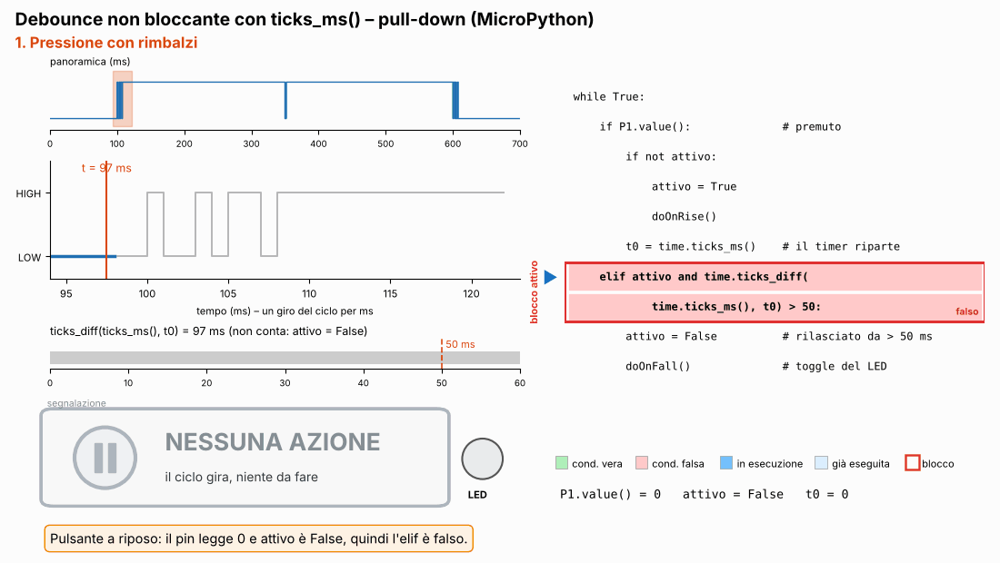
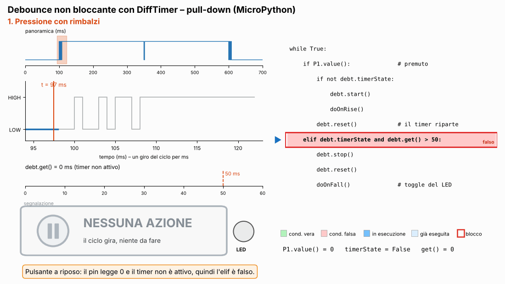
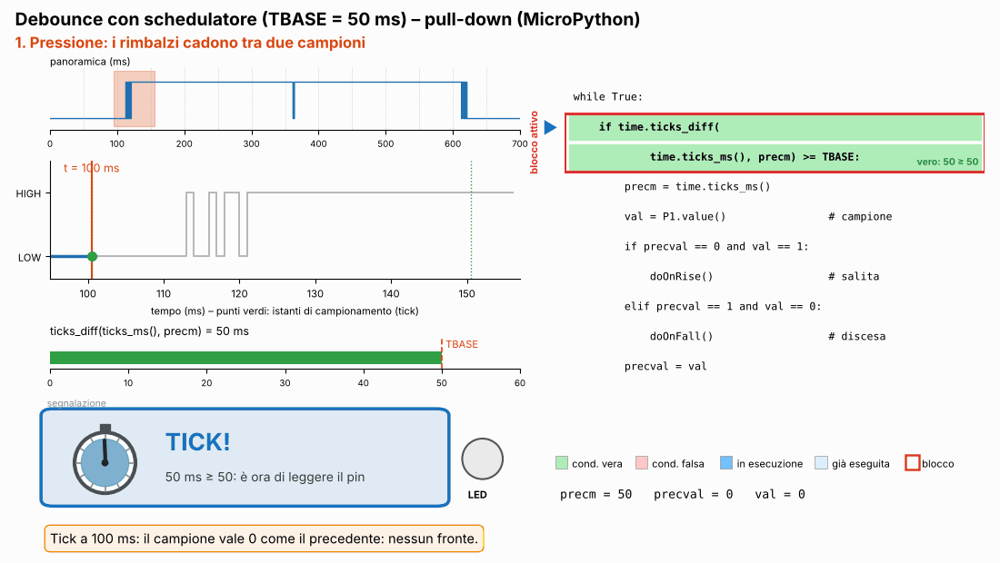

>[Torna all'indice](indexpulsanti.md)   >[versione in C++](pulsanti-rilascio-corte.md)

# Pulsanti in MicroPython: versioni corte, solo azione al rilascio

Queste versioni hanno solo la callback del **rilascio**: `doOnFall()` nel pull-down,
`doOnRise()` nel pull-up. Senza azione alla pressione il codice si accorcia.

> Versioni complete, con azione alla pressione e al rilascio: [pulsanti-rilascio-mpy.md](pulsanti-rilascio-mpy.md)
> Esempi con due task concorrenti, toggle e blink (pull-down): [toggle-blink-pulldown-mpy.md](toggle-blink-pulldown-mpy.md)
> Versione Arduino: [pulsanti-rilascio-corte.md](pulsanti-rilascio-corte.md)

Per riconoscere il rilascio bisogna comunque ricordare che prima il pulsante era premuto.
Nella maggior parte delle tecniche questa memoria c'è già, senza variabili booleane in più:

| Tecnica | Dove sta la memoria "era premuto" | Bool in più |
| --- | --- | --- |
| Bloccante | nel punto del programma: si è dentro l'`if` | no |
| ticks_ms() | variabile `attivo` | sì |
| DiffTimer | `timerState`, dentro la classe | no |
| waitUntilNB() | `timerState`, dentro la classe (serve `premuto` per il reset) | no |
| Schedulatore | `precval`, il campione precedente | no |

Pin di esempio per ESP32: pulsante su GPIO 12, LED su GPIO 13. Su ESP32 si può usare anche
il pull-down interno, `Pin(12, Pin.IN, Pin.PULL_DOWN)`, al posto della resistenza esterna.
Al posto di `millis()` si usa `time.ticks_ms()`, e le differenze di tempo si calcolano con
`time.ticks_diff()`, che resta corretta anche quando il contatore ricomincia da capo.

## 1. Versione bloccante

<table>
<tr>
<th>Pull-down: azione sul fronte di discesa</th>
<th>Pull-up: azione sul fronte di salita</th>
</tr>
<tr>
<td>

```python
from machine import Pin
import time
from urutils import waitUntilInputLow

P1  = Pin(12, Pin.IN)   # pull-down esterno
LED = Pin(13, Pin.OUT)
stato = False

def doOnFall():
    # RILASCIO (fronte di discesa):
    # qui vanno le azioni al rilascio.
    # Esempio: toggle, inverte lo
    # stato del LED a ogni rilascio.
    global stato
    stato = not stato
    LED.value(stato)

while True:
    if P1.value():              # premuto
        waitUntilInputLow(P1, 50)
        doOnFall()
```

</td>
<td>

```python
from machine import Pin
import time
from urutils import waitUntilInputHigh

P1  = Pin(12, Pin.IN, Pin.PULL_UP)  # pull-up interno
LED = Pin(13, Pin.OUT)
stato = False

def doOnRise():
    # RILASCIO (fronte di salita):
    # qui vanno le azioni al rilascio.
    # Esempio: toggle, inverte lo
    # stato del LED a ogni rilascio.
    global stato
    stato = not stato
    LED.value(stato)

while True:
    if not P1.value():          # premuto
        waitUntilInputHigh(P1, 50)
        doOnRise()
```

</td>
</tr>
</table>

## 2. Versione non bloccante con ticks_ms()

Qui la variabile `attivo` serve: senza, a pulsante rilasciato la differenza di tempo
resterebbe maggiore di 50 per sempre e l'azione scatterebbe a ogni giro.

<p align="center">
  
</p>

Con il pull-up il comportamento è identico con i livelli invertiti: il pulsante premuto legge 0, la pressione è un fronte di discesa e il rilascio un fronte di salita.

L'animazione mostra la versione completa della dispensa principale, con `doOnRise()` e il controllo su `attivo` alla pressione; qui quella parte manca, ma rimbalzi, disturbo e conferma del rilascio si comportano allo stesso modo.

<table>
<tr>
<th>Pull-down: azione sul fronte di discesa</th>
<th>Pull-up: azione sul fronte di salita</th>
</tr>
<tr>
<td>

```python
from machine import Pin
import time

P1  = Pin(12, Pin.IN)   # pull-down esterno
LED = Pin(13, Pin.OUT)
stato = False
t0 = 0
attivo = False

def doOnFall():
    # RILASCIO (fronte di discesa):
    # qui vanno le azioni al rilascio.
    # Esempio: toggle, inverte lo
    # stato del LED a ogni rilascio.
    global stato
    stato = not stato
    LED.value(stato)

while True:
    if P1.value():              # premuto
        attivo = True
        t0 = time.ticks_ms()
    elif attivo and time.ticks_diff(
            time.ticks_ms(), t0) > 50:
        attivo = False
        doOnFall()
```

</td>
<td>

```python
from machine import Pin
import time

P1  = Pin(12, Pin.IN, Pin.PULL_UP)  # pull-up interno
LED = Pin(13, Pin.OUT)
stato = False
t0 = 0
attivo = False

def doOnRise():
    # RILASCIO (fronte di salita):
    # qui vanno le azioni al rilascio.
    # Esempio: toggle, inverte lo
    # stato del LED a ogni rilascio.
    global stato
    stato = not stato
    LED.value(stato)

while True:
    if not P1.value():          # premuto
        attivo = True
        t0 = time.ticks_ms()
    elif attivo and time.ticks_diff(
            time.ticks_ms(), t0) > 50:
        attivo = False
        doOnRise()
```

</td>
</tr>
</table>

## 3. Versione non bloccante con DiffTimer

`start()` non fa nulla se il timer è già attivo, quindi si può chiamare a ogni giro. A timer
fermo e azzerato `get()` restituisce 0: non serve controllare `timerState`.
Serve la versione corretta di `urutils.py` (vedi la sezione 3 di
[pulsanti-rilascio-mpy.md](pulsanti-rilascio-mpy.md)).

<p align="center">
  
</p>

Con il pull-up il comportamento è identico con i livelli invertiti: il pulsante premuto legge 0, la pressione è un fronte di discesa e il rilascio un fronte di salita.

L'animazione mostra la versione completa della dispensa principale, con `doOnRise()` e il controllo su `timerState` alla pressione; qui quella parte manca, ma rimbalzi, disturbo e conferma del rilascio si comportano allo stesso modo.

<table>
<tr>
<th>Pull-down: azione sul fronte di discesa</th>
<th>Pull-up: azione sul fronte di salita</th>
</tr>
<tr>
<td>

```python
from machine import Pin
import time
from urutils import DiffTimer

P1  = Pin(12, Pin.IN)   # pull-down esterno
LED = Pin(13, Pin.OUT)
stato = False
debt = DiffTimer()

def doOnFall():
    # RILASCIO (fronte di discesa):
    # qui vanno le azioni al rilascio.
    # Esempio: toggle, inverte lo
    # stato del LED a ogni rilascio.
    global stato
    stato = not stato
    LED.value(stato)

while True:
    if P1.value():              # premuto
        debt.start()            # niente se attivo
        debt.reset()
    elif debt.get() > 50:
        debt.stop()
        debt.reset()
        doOnFall()
```

</td>
<td>

```python
from machine import Pin
import time
from urutils import DiffTimer

P1  = Pin(12, Pin.IN, Pin.PULL_UP)  # pull-up interno
LED = Pin(13, Pin.OUT)
stato = False
debt = DiffTimer()

def doOnRise():
    # RILASCIO (fronte di salita):
    # qui vanno le azioni al rilascio.
    # Esempio: toggle, inverte lo
    # stato del LED a ogni rilascio.
    global stato
    stato = not stato
    LED.value(stato)

while True:
    if not P1.value():          # premuto
        debt.start()            # niente se attivo
        debt.reset()
    elif debt.get() > 50:
        debt.stop()
        debt.reset()
        doOnRise()
```

</td>
</tr>
</table>

## 4. Versione non bloccante con waitUntilNB()

`waitUntilNB()` della versione corretta di `urutils.py` fa ripartire il timer a ogni chiamata
con la condizione falsa, cioè a ogni lettura "premuto": scatta solo dopo 50 ms di pulsante
rilasciato senza interruzioni, quindi i rimbalzi del rilascio vengono ignorati.

<table>
<tr>
<th>Pull-down: azione sul fronte di discesa</th>
<th>Pull-up: azione sul fronte di salita</th>
</tr>
<tr>
<td>

```python
from machine import Pin
import time
from urutils import DiffTimer, waitUntilNB

P1  = Pin(12, Pin.IN)   # pull-down esterno
LED = Pin(13, Pin.OUT)
stato = False
debt = DiffTimer()

def doOnFall():
    # RILASCIO (fronte di discesa):
    # qui vanno le azioni al rilascio.
    # Esempio: toggle, inverte lo
    # stato del LED a ogni rilascio.
    global stato
    stato = not stato
    LED.value(stato)

while True:
    premuto = P1.value()
    if waitUntilNB(debt, not premuto, 50):
        doOnFall()
```

</td>
<td>

```python
from machine import Pin
import time
from urutils import DiffTimer, waitUntilNB

P1  = Pin(12, Pin.IN, Pin.PULL_UP)  # pull-up interno
LED = Pin(13, Pin.OUT)
stato = False
debt = DiffTimer()

def doOnRise():
    # RILASCIO (fronte di salita):
    # qui vanno le azioni al rilascio.
    # Esempio: toggle, inverte lo
    # stato del LED a ogni rilascio.
    global stato
    stato = not stato
    LED.value(stato)

while True:
    premuto = not P1.value()
    if waitUntilNB(debt, not premuto, 50):
        doOnRise()
```

</td>
</tr>
</table>

## 5. Versione con schedulatore non bloccante

Il rilascio viene riconosciuto con un ritardo fino a `TBASE` ms.

<p align="center">
  
</p>

Con il pull-up il comportamento è identico con i livelli invertiti: il pulsante premuto legge 0, la pressione è un fronte di discesa e il rilascio un fronte di salita.

L'animazione mostra la versione completa della dispensa principale, che riconosce anche il fronte di salita con `doOnRise()`; qui si controlla solo quello di discesa, il campionamento è lo stesso.

<table>
<tr>
<th>Pull-down: azione sul fronte di discesa</th>
<th>Pull-up: azione sul fronte di salita</th>
</tr>
<tr>
<td>

```python
from machine import Pin
import time

TBASE = 50
P1  = Pin(12, Pin.IN)   # pull-down esterno
LED = Pin(13, Pin.OUT)
stato = False
precm = 0
precval = 0

def doOnFall():
    # RILASCIO (fronte di discesa):
    # qui vanno le azioni al rilascio.
    # Esempio: toggle, inverte lo
    # stato del LED a ogni rilascio.
    global stato
    stato = not stato
    LED.value(stato)

while True:
    if time.ticks_diff(
            time.ticks_ms(), precm) >= TBASE:
        precm = time.ticks_ms()
        val = P1.value()
        if precval == 1 and val == 0:
            doOnFall()
        precval = val
```

</td>
<td>

```python
from machine import Pin
import time

TBASE = 50
P1  = Pin(12, Pin.IN, Pin.PULL_UP)  # pull-up interno
LED = Pin(13, Pin.OUT)
stato = False
precm = 0
precval = 1

def doOnRise():
    # RILASCIO (fronte di salita):
    # qui vanno le azioni al rilascio.
    # Esempio: toggle, inverte lo
    # stato del LED a ogni rilascio.
    global stato
    stato = not stato
    LED.value(stato)

while True:
    if time.ticks_diff(
            time.ticks_ms(), precm) >= TBASE:
        precm = time.ticks_ms()
        val = P1.value()
        if precval == 0 and val == 1:
            doOnRise()
        precval = val
```

</td>
</tr>
</table>

## Considerazioni finali: quale tecnica scegliere

**Il limite di fondo, comune a tutte le tecniche.** Ogni antirimbalzo stabilisce un tempo minimo, ad esempio 50 msec, oltre il quale un'apertura del contatto viene considerata un rilascio vero. Un disturbo che apre il contatto per più di quel tempo non si distingue da un rilascio breve: vale per il polling, per lo schedulatore e per gli interrupt. Nel seguito si dà per scontato che questo limite sia superato scegliendo un tempo adatto alla qualità del pulsante: abbastanza lungo da coprire i suoi rimbalzi e i suoi disturbi, abbastanza corto da non perdere le pressioni rapide.

**Il polling veloce con il timer che riparte è la tecnica più robusta e più pronta.** È la versione in cui il ciclo principale legge il pulsante a ogni giro e il timer riparte a ogni lettura "premuto" (l'istante di riferimento aggiornato con ```time.ticks_ms()``` fuori dall'```if```):
- guarda il pulsante in continuazione: un disturbo breve a pulsante premuto viene visto di sicuro, ma fa solo ripartire il conteggio;
- il rilascio è accettato solo se il pin è rimasto basso per **tutto** il tempo di antirimbalzo: la decisione non dipende da dove cade il disturbo;
- la pressione è riconosciuta alla prima lettura alta, il rilascio dopo il tempo di antirimbalzo.

La condizione è che il ciclo principale resti veloce: con ```time.sleep_ms()``` lunghi o funzioni lente le letture si diradano e il polling si comporta come uno schedulatore.

**Lo schedulatore (time tick)** legge il pulsante solo ogni ```tbase```. È immune ai rimbalzi perché tra una lettura e l'altra non li vede, e per lo stesso motivo di solito non vede nemmeno i disturbi brevi a pulsante premuto; se però una lettura cade proprio dentro un disturbo, il toggle scatta due volte (la probabilità è circa la durata del disturbo divisa per ```tbase```). Si può ridurre il rischio accettando un nuovo livello solo dopo N letture uguali consecutive: il tempo minimo di un rilascio vero diventa N × ```tbase```. È un'approssimazione, con il campionamento rado, di ciò che il polling veloce fa con il campionamento continuo.

**Gli interrupt su entrambi i fronti** fanno la stessa cosa del polling veloce: vedono ogni fronte, rimbalzi e disturbi compresi, e fanno ripartire il conteggio del tempo di antirimbalzo. In più funzionano anche quando il ciclo principale è lento: sono la scelta giusta quando il ciclo principale ha altro di pesante da fare.

## Riferimenti

- [urutils.h](https://github.com/sebastianomelita/ArduinoBareMetal/blob/master/urutils.h): versione Arduino della libreria
- [pulsanti-rilascio-mpy.md](pulsanti-rilascio-mpy.md): versioni complete, con azione alla pressione e al rilascio
- [toggle-blink-pulldown-mpy.md](toggle-blink-pulldown-mpy.md): toggle e blink come due task concorrenti
