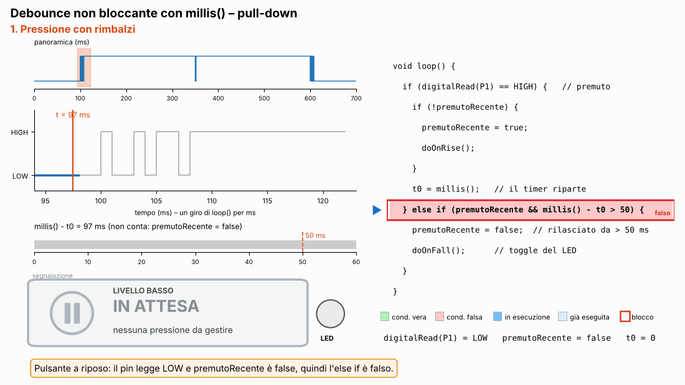
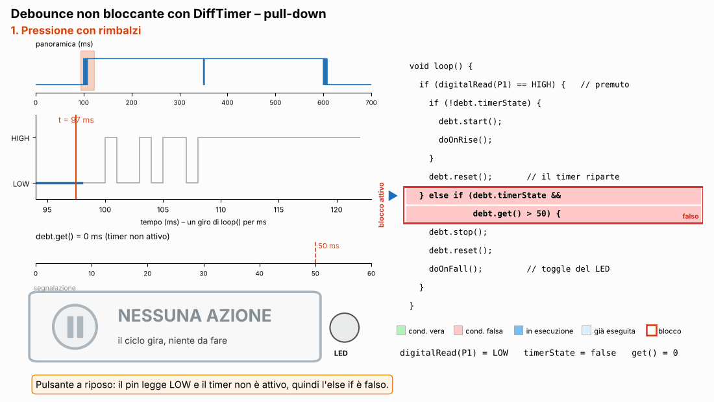
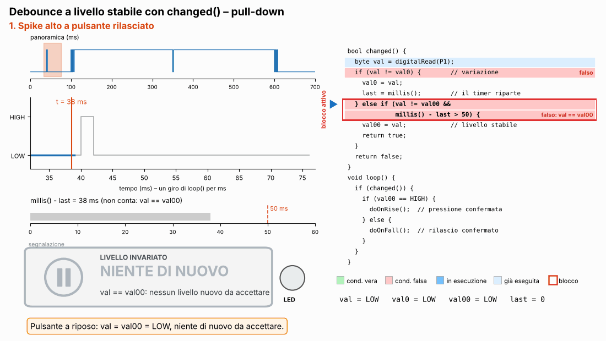
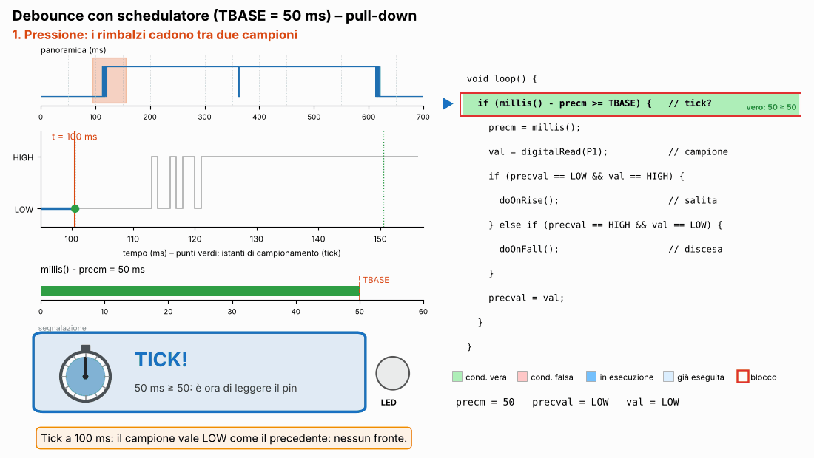
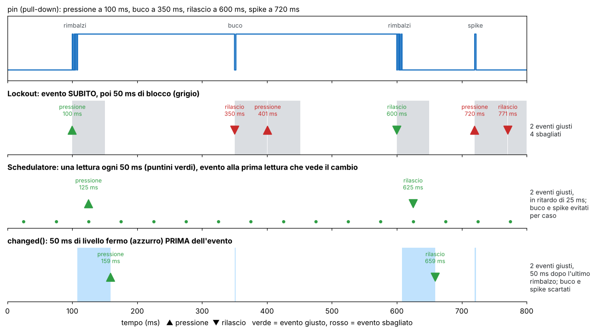
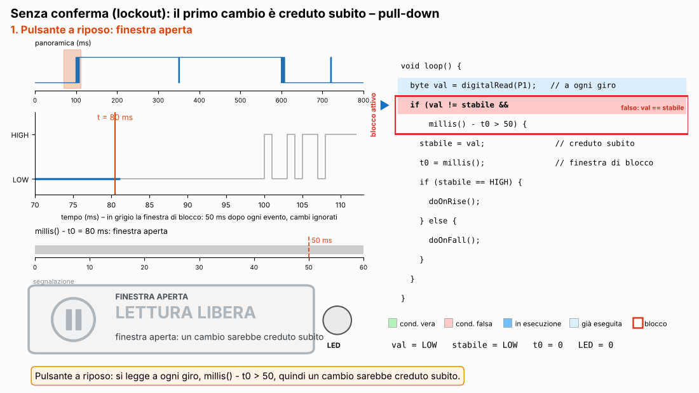

>[Torna all'indice](indexpulsanti.md)   >[versione in Python](pulsanti-rilascio-corte-mpy.md)

# Pulsanti: versioni corte non bloccanti, solo azione al rilascio

Queste versioni hanno solo la callback del **rilascio**: `doOnFall()` nel pull-down,
`doOnRise()` nel pull-up. Senza azione alla pressione il codice si accorcia.

> Le quattro situazioni critiche di un debouncer (rimbalzi alla pressione e al rilascio, buchi, spike) e come si sceglie il tempo di antirimbalzo: [debounce-fenomeni.md](debounce-fenomeni.md)
> Versioni complete, con azione alla pressione e al rilascio: [pulsanti-rilascio.md](pulsanti-rilascio.md)
> Esempi con due task concorrenti, toggle e blink (pull-down): [toggle-blink-pulldown.md](toggle-blink-pulldown.md)
> Tecniche bloccanti (waitUntilInputLow / waitUntilInputHigh), dalla più semplice alla più robusta: [pulsanti-bloccanti.md](pulsanti-bloccanti.md)

Per riconoscere il rilascio bisogna comunque ricordare che prima il pulsante era premuto.
Nella maggior parte delle tecniche questa memoria c'è già, senza variabili booleane in più:

| Tecnica | Dove sta la memoria "era premuto" | Bool in più |
| --- | --- | --- |
| millis() | variabile `attivo` | sì |
| DiffTimer | `timerState`, dentro la libreria | no |
| changed() | `val00`, il livello accettato | no |
| Schedulatore | `precval`, il campione precedente | no |

## 1. Versione non bloccante con millis()

Qui la variabile `attivo` serve: senza, a pulsante rilasciato `millis() - t0 > 50` resterebbe
vera per sempre e l'azione scatterebbe a ogni giro di `loop()`.

<p align="center">
  
</p>

Con il pull-up il comportamento è identico con i livelli invertiti: il pulsante premuto legge LOW, la pressione è un fronte di discesa e il rilascio un fronte di salita.

L'animazione mostra la versione completa della dispensa principale, con `doOnRise()` e il controllo su `attivo` alla pressione; qui quella parte manca, ma rimbalzi, disturbo e conferma del rilascio si comportano allo stesso modo.

<table>
<tr>
<th>Pull-down: azione sul fronte di discesa</th>
<th>Pull-up: azione sul fronte di salita</th>
</tr>
<tr>
<td>

```cpp
const byte P1  = 2;
const byte LED = 13;
bool stato = LOW;
unsigned long t0 = 0;
bool attivo = false;

void doOnFall() {
  // RILASCIO (fronte di discesa):
  // qui vanno le azioni al rilascio.
  // Esempio: toggle, inverte lo
  // stato del LED a ogni rilascio.
  stato = !stato;
  digitalWrite(LED, stato);
}

void setup() {
  pinMode(P1, INPUT);
  pinMode(LED, OUTPUT);
}

void loop() {
  if (digitalRead(P1) == HIGH) {
    attivo = true;
    t0 = millis();
  } else if (attivo &&
             millis() - t0 > 50) {
    attivo = false;
    doOnFall();
  }
}
```

</td>
<td>

```cpp
const byte P1  = 2;
const byte LED = 13;
bool stato = LOW;
unsigned long t0 = 0;
bool attivo = false;

void doOnRise() {
  // RILASCIO (fronte di salita):
  // qui vanno le azioni al rilascio.
  // Esempio: toggle, inverte lo
  // stato del LED a ogni rilascio.
  stato = !stato;
  digitalWrite(LED, stato);
}

void setup() {
  pinMode(P1, INPUT_PULLUP);
  pinMode(LED, OUTPUT);
}

void loop() {
  if (digitalRead(P1) == LOW) {
    attivo = true;
    t0 = millis();
  } else if (attivo &&
             millis() - t0 > 50) {
    attivo = false;
    doOnRise();
  }
}
```

</td>
</tr>
</table>

## 2. Versione non bloccante con DiffTimer

`start()` non fa nulla se il timer è già attivo, quindi si può chiamare a ogni giro. A timer
fermo e azzerato `get()` restituisce 0: non serve controllare `timerState`.

<p align="center">
  
</p>

Con il pull-up il comportamento è identico con i livelli invertiti: il pulsante premuto legge LOW, la pressione è un fronte di discesa e il rilascio un fronte di salita.

L'animazione mostra la versione completa della dispensa principale, con `doOnRise()` e il controllo su `timerState` alla pressione; qui quella parte manca, ma rimbalzi, disturbo e conferma del rilascio si comportano allo stesso modo.

<table>
<tr>
<th>Pull-down: azione sul fronte di discesa</th>
<th>Pull-up: azione sul fronte di salita</th>
</tr>
<tr>
<td>

```cpp
#include "urutils.h"

const byte P1  = 2;
const byte LED = 13;
bool stato = LOW;
DiffTimer debt;

void doOnFall() {
  // RILASCIO (fronte di discesa):
  // qui vanno le azioni al rilascio.
  // Esempio: toggle, inverte lo
  // stato del LED a ogni rilascio.
  stato = !stato;
  digitalWrite(LED, stato);
}

void setup() {
  pinMode(P1, INPUT);
  pinMode(LED, OUTPUT);
}

void loop() {
  if (digitalRead(P1) == HIGH) {
    debt.start();  // no-op se attivo
    debt.reset();
  } else if (debt.get() > 50) {
    debt.stop();
    debt.reset();
    doOnFall();
  }
}
```

</td>
<td>

```cpp
#include "urutils.h"

const byte P1  = 2;
const byte LED = 13;
bool stato = LOW;
DiffTimer debt;

void doOnRise() {
  // RILASCIO (fronte di salita):
  // qui vanno le azioni al rilascio.
  // Esempio: toggle, inverte lo
  // stato del LED a ogni rilascio.
  stato = !stato;
  digitalWrite(LED, stato);
}

void setup() {
  pinMode(P1, INPUT_PULLUP);
  pinMode(LED, OUTPUT);
}

void loop() {
  if (digitalRead(P1) == LOW) {
    debt.start();  // no-op se attivo
    debt.reset();
  } else if (debt.get() > 50) {
    debt.stop();
    debt.reset();
    doOnRise();
  }
}
```

</td>
</tr>
</table>

## 3. Versione non bloccante a livello stabile con changed()

Le versioni precedenti accettano la **pressione** alla prima lettura "premuto" e filtrano solo il
**rilascio**. Questa invece accetta un nuovo livello, in **tutte e due** le direzioni, solo quando è
rimasto fermo per più di 50 ms (la macchina a stati di [debouncerFSM.md](debouncerFSM.md)): `val0` è
l'ultima lettura e ogni sua variazione fa ripartire il conteggio, `val00` è il livello accettato.
Il rilascio è il giro in cui `changed()` è vera e `val00` è tornato al livello di riposo.

Così viene filtrato anche uno **spike alto a pulsante rilasciato** (disturbo sui cavi), che le altre
versioni prenderebbero per una pressione. Il prezzo: una pressione più breve di 50 ms viene scartata.

<p align="center">
  
</p>

L'animazione mostra la versione completa della dispensa principale, che chiama anche `doOnRise()` quando la pressione viene accettata; qui si usa solo il rilascio, il filtro è lo stesso.

Con il pull-up il comportamento è identico con i livelli invertiti: riposo HIGH, premuto LOW.

<table>
<tr>
<th>Pull-down: azione sul fronte di discesa</th>
<th>Pull-up: azione sul fronte di salita</th>
</tr>
<tr>
<td>

```cpp
const byte P1  = 2;
const byte LED = 13;
bool stato = LOW;
byte val0  = LOW;  // ultima lettura
byte val00 = LOW;  // livello accettato
unsigned long last = 0; // ultima variazione

bool changed() {
  // vero solo quando il pin ha un
  // nuovo livello fermo da più di 50 ms
  byte val = digitalRead(P1);
  if (val != val0) {
    // variazione: rimbalzo, disturbo
    // o fronte vero, si riparte
    val0 = val;
    last = millis();
  } else if (val != val00 &&
             millis() - last > 50) {
    val00 = val;  // livello stabile
    return true;
  }
  return false;
}

void doOnFall() {
  // RILASCIO (fronte di discesa):
  // qui vanno le azioni al rilascio.
  // Esempio: toggle, inverte lo
  // stato del LED a ogni rilascio.
  stato = !stato;
  digitalWrite(LED, stato);
}

void setup() {
  pinMode(P1, INPUT);
  pinMode(LED, OUTPUT);
}

void loop() {
  if (changed() && val00 == LOW) {
    doOnFall();   // rilascio confermato
  }
}
```

</td>
<td>

```cpp
const byte P1  = 2;
const byte LED = 13;
bool stato = LOW;
byte val0  = HIGH;  // ultima lettura
byte val00 = HIGH;  // livello accettato
unsigned long last = 0; // ultima variazione

bool changed() {
  // vero solo quando il pin ha un
  // nuovo livello fermo da più di 50 ms
  byte val = digitalRead(P1);
  if (val != val0) {
    // variazione: rimbalzo, disturbo
    // o fronte vero, si riparte
    val0 = val;
    last = millis();
  } else if (val != val00 &&
             millis() - last > 50) {
    val00 = val;  // livello stabile
    return true;
  }
  return false;
}

void doOnRise() {
  // RILASCIO (fronte di salita):
  // qui vanno le azioni al rilascio.
  // Esempio: toggle, inverte lo
  // stato del LED a ogni rilascio.
  stato = !stato;
  digitalWrite(LED, stato);
}

void setup() {
  pinMode(P1, INPUT_PULLUP);
  pinMode(LED, OUTPUT);
}

void loop() {
  if (changed() && val00 == HIGH) {
    doOnRise();   // rilascio confermato
  }
}
```

</td>
</tr>
</table>

**La stessa logica è nella libreria.** In `urutils.h` c'è la struct `Debouncer`, con le stesse
variabili `val0`, `val00` e `last` e lo stesso metodo `changed()`: un oggetto per pulsante, creato con
il livello di riposo.

```cpp
#include "urutils.h"
Debouncer deb(LOW);              // pull-down: riposo LOW (con il pull-up: Debouncer deb(HIGH);)

void loop() {
  if (deb.changed(P1, 50)) {     // nuovo livello fermo da più di 50 ms
    if (deb.val00 == LOW) {
      doOnFall();                // rilascio confermato
    }
  }
}
```

## 4. Versione con schedulatore non bloccante

Il rilascio viene riconosciuto con un ritardo fino a `TBASE` ms.

<p align="center">
  
</p>

Con il pull-up il comportamento è identico con i livelli invertiti: il pulsante premuto legge LOW, la pressione è un fronte di discesa e il rilascio un fronte di salita.

L'animazione mostra la versione completa della dispensa principale, che riconosce anche il fronte di salita con `doOnRise()`; qui si controlla solo quello di discesa, il campionamento è lo stesso.

<table>
<tr>
<th>Pull-down: azione sul fronte di discesa</th>
<th>Pull-up: azione sul fronte di salita</th>
</tr>
<tr>
<td>

```cpp
const byte P1  = 2;
const byte LED = 13;
bool stato = LOW;
#define TBASE 50
unsigned long precm = 0;
byte precval = LOW, val;

void doOnFall() {
  // RILASCIO (fronte di discesa):
  // qui vanno le azioni al rilascio.
  // Esempio: toggle, inverte lo
  // stato del LED a ogni rilascio.
  stato = !stato;
  digitalWrite(LED, stato);
}

void setup() {
  pinMode(P1, INPUT);
  pinMode(LED, OUTPUT);
}

void loop() {
  if (millis() - precm >= TBASE) {
    precm = millis();
    val = digitalRead(P1);
    if (precval == HIGH &&
        val == LOW) {
      doOnFall();
    }
    precval = val;
  }
}
```

</td>
<td>

```cpp
const byte P1  = 2;
const byte LED = 13;
bool stato = LOW;
#define TBASE 50
unsigned long precm = 0;
byte precval = HIGH, val;

void doOnRise() {
  // RILASCIO (fronte di salita):
  // qui vanno le azioni al rilascio.
  // Esempio: toggle, inverte lo
  // stato del LED a ogni rilascio.
  stato = !stato;
  digitalWrite(LED, stato);
}

void setup() {
  pinMode(P1, INPUT_PULLUP);
  pinMode(LED, OUTPUT);
}

void loop() {
  if (millis() - precm >= TBASE) {
    precm = millis();
    val = digitalRead(P1);
    if (precval == LOW &&
        val == HIGH) {
      doOnRise();
    }
    precval = val;
  }
}
```

</td>
</tr>
</table>

## 5. Senza conferma: il primo cambio è creduto subito

Tutte le versioni precedenti confermano il rilascio. Questa non conferma **nulla**: è la tecnica
*lockout*. Il pin è letto a ogni giro di `loop()`; un cambio rispetto a `stabile`, il livello accettato,
è creduto **nello stesso giro in cui viene letto**, e per i 50 ms successivi i cambi sono **ignorati**:
i rimbalzi cadono in questa finestra e non vengono visti. Il rilascio è il cambio verso il livello di
riposo.

Non è uno schedulatore: `t0` non si aggiorna a ogni lettura ma **solo quando si accetta un cambio**,
quindi a pulsante fermo la condizione `millis() - t0 > 50` è sempre vera e il pin è letto a ogni giro.

<p align="center">
  
</p>

La figura mette a confronto le tre tecniche sullo stesso segnale. Il lockout crede subito a ogni cambio e poi si blocca per 50 ms (in grigio): è il più pronto, ma sbaglia sul buco e sullo spike. Lo schedulatore legge una volta ogni 50 ms: riconosce gli eventi veri con un ritardo di 25 ms, e qui evita buco e spike solo perché nessuna lettura ci cade sopra. `changed()` aspetta 50 ms di livello fermo (in azzurro) **prima** di ogni evento: è in ritardo di 50 ms sull'ultimo rimbalzo, ma scarta buco e spike.

<p align="center">
  
</p>

L'animazione mostra la versione completa della dispensa principale, che chiama anche `doOnRise()`; qui si usa solo il rilascio.

<table>
<tr>
<th>Pull-down: azione sul fronte di discesa</th>
<th>Pull-up: azione sul fronte di salita</th>
</tr>
<tr>
<td>

```cpp
const byte P1  = 2;
const byte LED = 13;
bool stato = LOW;
byte stabile = LOW;      // livello accettato
unsigned long t0 = 0;    // ultimo cambio accettato

void doOnFall() {
  // RILASCIO (fronte di discesa):
  // creduto alla prima lettura LOW.
  // Esempio: toggle, inverte lo
  // stato del LED a ogni rilascio.
  stato = !stato;
  digitalWrite(LED, stato);
}

void setup() {
  pinMode(P1, INPUT);
  pinMode(LED, OUTPUT);
}

void loop() {
  byte val = digitalRead(P1);  // letto
                               // a ogni giro
  // un cambio fuori dalla finestra
  // di blocco è creduto SUBITO
  if (val != stabile &&
      millis() - t0 > 50) {
    stabile = val;
    t0 = millis();  // per 50 ms i
                    // cambi sono ignorati
    if (stabile == LOW) {
      doOnFall();      // rilascio
    }
  }
}
```

</td>
<td>

```cpp
const byte P1  = 2;
const byte LED = 13;
bool stato = LOW;
byte stabile = HIGH;      // livello accettato
unsigned long t0 = 0;    // ultimo cambio accettato

void doOnRise() {
  // RILASCIO (fronte di salita):
  // creduto alla prima lettura HIGH.
  // Esempio: toggle, inverte lo
  // stato del LED a ogni rilascio.
  stato = !stato;
  digitalWrite(LED, stato);
}

void setup() {
  pinMode(P1, INPUT_PULLUP);
  pinMode(LED, OUTPUT);
}

void loop() {
  byte val = digitalRead(P1);  // letto
                               // a ogni giro
  // un cambio fuori dalla finestra
  // di blocco è creduto SUBITO
  if (val != stabile &&
      millis() - t0 > 50) {
    stabile = val;
    t0 = millis();  // per 50 ms i
                    // cambi sono ignorati
    if (stabile == HIGH) {
      doOnRise();      // rilascio
    }
  }
}
```

</td>
</tr>
</table>

**Cosa garantisce.** I rimbalzi, se durano meno di 50 ms (0 errori in simulazione), e la risposta più
pronta possibile: il rilascio è riconosciuto al primo fronte, senza ritardo.

**Cosa non garantisce.** Un **buco** a pulsante premuto è creduto come un rilascio, e uno **spike** a
riposo, seguito 50 ms dopo dal ritorno a riposo, produce un rilascio falso: in simulazione circa 8 e
7 errori su 10.

**Dove va bene.** Dove conta la prontezza e un errore raro è accettabile, come nei **videogiochi**. La
spiegazione completa, con il confronto con lo schedulatore e con `changed()`, è nella sezione 6 di
[pulsanti-rilascio.md](pulsanti-rilascio.md); la variante con `delay()` è nella sezione 0 di [pulsanti-bloccanti.md](pulsanti-bloccanti.md).

## Considerazioni finali: quale tecnica scegliere

**Il limite di fondo, comune a tutte le tecniche.** Ogni antirimbalzo stabilisce un tempo minimo, ad esempio 50 msec, oltre il quale un'apertura del contatto viene considerata un rilascio vero. Un disturbo che apre il contatto per più di quel tempo non si distingue da un rilascio breve: vale per il polling, per lo schedulatore e per gli interrupt. Nel seguito si dà per scontato che questo limite sia superato scegliendo un tempo adatto alla qualità del pulsante: abbastanza lungo da coprire i suoi rimbalzi e i suoi disturbi, abbastanza corto da non perdere le pressioni rapide.

**Il polling veloce con il timer che riparte è la tecnica più pronta fra quelle robuste ai rimbalzi.** (Contro uno spike a pulsante rilasciato serve invece il livello stabile, `changed()` o `Debouncer` di `urutils`.) È la versione in cui il ```loop()``` legge il pulsante a ogni giro e il timer riparte a ogni lettura "premuto" (```t0 = millis()``` fuori dall'```if```):
- guarda il pulsante in continuazione: un disturbo breve a pulsante premuto viene visto di sicuro, ma fa solo ripartire il conteggio;
- il rilascio è accettato solo se il pin è rimasto basso per **tutto** il tempo di antirimbalzo: la decisione non dipende da dove cade il disturbo;
- la pressione è riconosciuta alla prima lettura alta, il rilascio dopo il tempo di antirimbalzo.

La condizione è che il ```loop()``` resti veloce: con ```delay()``` o funzioni lente le letture si diradano e il polling si comporta come uno schedulatore.

**Lo schedulatore (time tick)** legge il pulsante solo ogni ```TBASE```. È immune ai rimbalzi perché tra una lettura e l'altra non li vede, e per lo stesso motivo di solito non vede nemmeno i disturbi brevi a pulsante premuto; se però una lettura cade proprio dentro un disturbo, il toggle scatta due volte (la probabilità è circa la durata del disturbo divisa per ```TBASE```). Si può ridurre il rischio accettando un nuovo livello solo dopo N letture uguali consecutive: il tempo minimo di un rilascio vero diventa N × ```TBASE```. È un'approssimazione, con il campionamento rado, di ciò che il polling veloce fa con il campionamento continuo.

**Il livello stabile (`changed()`)** fa la stessa cosa del polling veloce, ma in **tutte e due** le direzioni: anche la pressione viene accettata solo dopo il tempo di antirimbalzo di livello fermo. Il polling veloce, gli interrupt e le tecniche bloccanti accettano la pressione alla prima lettura alta, quindi uno spike alto a pulsante rilasciato (tipico del pull-down con cavi lunghi, perché a riposo il pin è tenuto basso solo dalla resistenza) diventa una pressione e un rilascio falsi; il livello stabile lo scarta. Il prezzo è un ritardo pari al tempo di antirimbalzo anche sulla pressione, e la perdita delle pressioni più brevi di quel tempo. È la scelta giusta quando l'ingresso arriva da lontano o in un ambiente disturbato, ad esempio i sensori di un nastro trasportatore.

| Tecnica | Rimbalzi | Disturbo breve a pulsante premuto | Spike alto a pulsante rilasciato |
| --- | --- | --- | --- |
| millis(), DiffTimer, interrupt, tecniche bloccanti | filtrati | filtrato | **non filtrato** |
| Schedulatore | filtrati | filtrato solo se nessuna lettura ci cade dentro | filtrato solo se nessuna lettura ci cade dentro |
| Livello stabile (`changed()`) | filtrati | filtrato | filtrato |
| Senza conferma (lockout, sezione 5) | filtrati | **non filtrato** | **non filtrato** |

**Gli interrupt su entrambi i fronti** fanno la stessa cosa del polling veloce: vedono ogni fronte, rimbalzi e disturbi compresi, e fanno ripartire il conteggio del tempo di antirimbalzo. In più funzionano anche quando il ```loop()``` è lento: sono la scelta giusta quando il ciclo principale ha altro di pesante da fare.

## Riferimenti

- [urutils.h](https://github.com/sebastianomelita/ArduinoBareMetal/blob/master/urutils.h): sorgente della libreria
- [pulsanti-rilascio.md](pulsanti-rilascio.md): versioni complete, con azione alla pressione e al rilascio
- [toggle-blink-pulldown.md](toggle-blink-pulldown.md): toggle e blink come due task concorrenti
- [pulsanti-bloccanti.md](pulsanti-bloccanti.md): tecniche bloccanti
