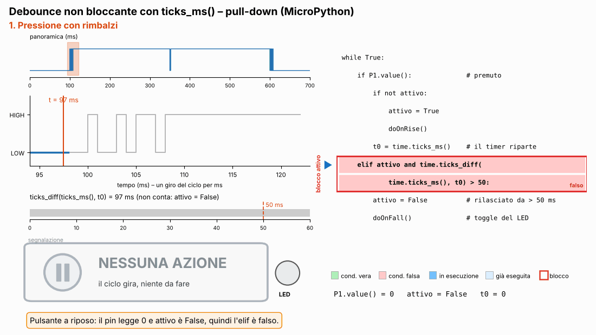
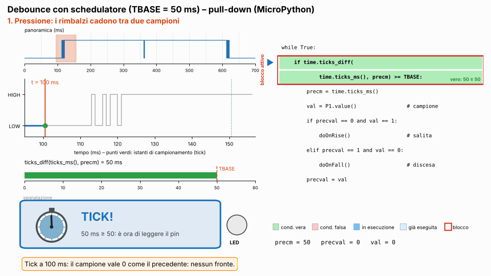
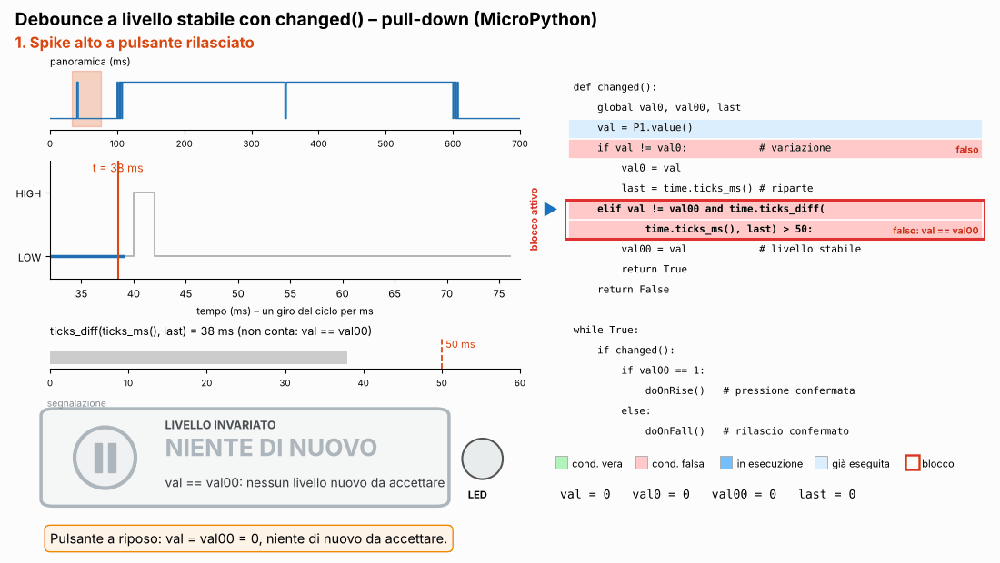
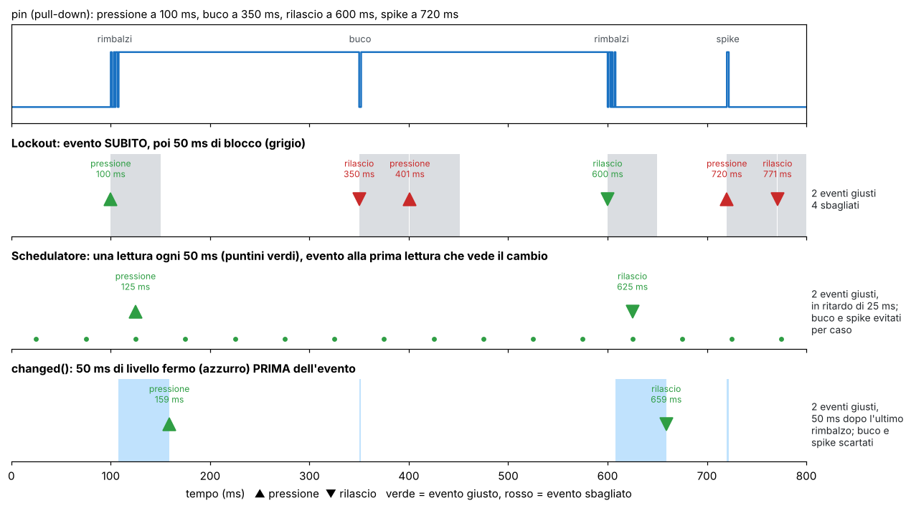
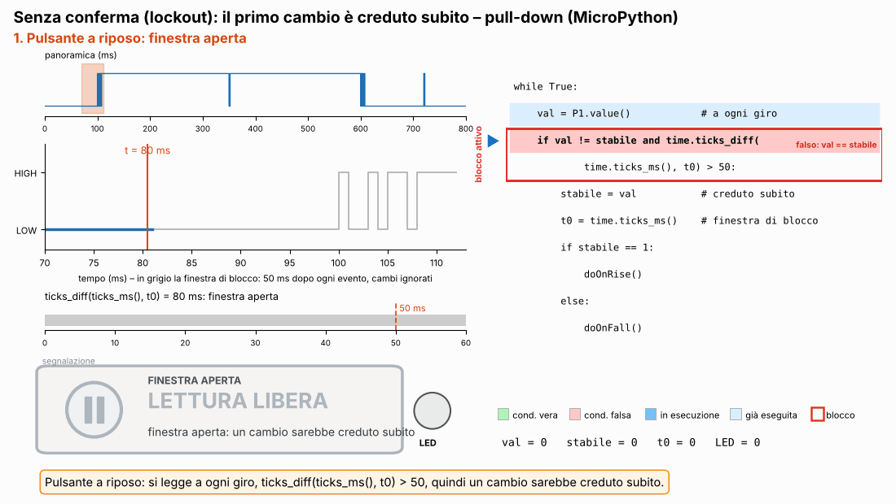

>[Torna all'indice](indexpulsanti.md)   >[versione in C++](pulsanti-rilascio.md)

# Pulsanti in MicroPython: attivazione sul rilascio, tecniche non bloccanti (pull-down e pull-up)

In entrambe le versioni l'azione principale parte quando il pulsante viene **rilasciato**.
Cambia solo il livello letto dal pin, che dipende dal collegamento della resistenza.

| Collegamento | Riposo | Premuto | Pressione | Rilascio |
| --- | --- | --- | --- | --- |
| Pull-down (resistenza verso GND o `Pin.PULL_DOWN`) | 0 | 1 | fronte di salita | fronte di discesa |
| Pull-up (resistenza verso Vcc o `Pin.PULL_UP`) | 1 | 0 | fronte di discesa | fronte di salita |

In ogni esempio ci sono due callback: in quella della **pressione** vanno le azioni immediate
alla pressione (facoltative, qui lasciata vuota); in quella del **rilascio** vanno le azioni
al rilascio (qui, come esempio, un toggle del LED). Le callback modificano `stato`, quindi
lo dichiarano `global`.

Pin di esempio per ESP32: pulsante su GPIO 12, LED su GPIO 13. Su ESP32 si può usare anche
il pull-down interno, `Pin(12, Pin.IN, Pin.PULL_DOWN)`, al posto della resistenza esterna.
Al posto di `millis()` si usa `time.ticks_ms()`, e le differenze di tempo si calcolano con
`time.ticks_diff()`, che resta corretta anche quando il contatore ricomincia da capo.

> Perché si agisce al rilascio, le eccezioni e quale metodo usare nelle situazioni reali: [debounce-fenomeni.md, sezioni 5 e 6](debounce-fenomeni.md#5-pressione-o-rilascio-quando-agire)
> Le quattro situazioni critiche di un debouncer (rimbalzi alla pressione e al rilascio, buchi, spike) e come si sceglie il tempo di antirimbalzo: [debounce-fenomeni.md](debounce-fenomeni.md)
> Versioni corte, con la sola azione al rilascio: [pulsanti-rilascio-corte-mpy.md](pulsanti-rilascio-corte-mpy.md)
> Esempi con due task concorrenti, toggle e blink (pull-down): [toggle-blink-pulldown-mpy.md](toggle-blink-pulldown-mpy.md)
> Tecniche bloccanti (waitUntilInputLow / waitUntilInputHigh), dalla più semplice alla più robusta: [pulsanti-bloccanti-mpy.md](pulsanti-bloccanti-mpy.md)
> Versione Arduino: [pulsanti-rilascio.md](pulsanti-rilascio.md)

## 1. Versione non bloccante con ticks_ms()

> **Rileva:** rimbalzi alla pressione e al rilascio, buco a pulsante premuto. **Non rileva:** spike a riposo (pressione e rilascio falsi).
>
> **Prontezza** sulla pressione, riconosciuta alla prima lettura alta. **Sicurezza** sul rilascio, confermato da 50 ms di livello basso: l'azione arriva 50 ms dopo l'ultimo rimbalzo.
>
> **Applicazioni tipiche:** pulsanti di pannelli e menu dove serve una risposta pronta alla pressione, toggle con pulsanti in buono stato e cavi corti: è la scelta di base delle esercitazioni. Nelle tastiere con firmware QMK esiste come modalità asimmetrica: pressione subito, rilascio confermato.

<p align="center">
  
</p>

Con il pull-up il comportamento è identico con i livelli invertiti: il pulsante premuto legge 0, la pressione è un fronte di discesa e il rilascio un fronte di salita.

<table>
<tr>
<th>Pull-down: azione sul fronte di discesa</th>
<th>Pull-up: azione sul fronte di salita</th>
</tr>
<tr>
<td>

```python
from machine import Pin
import time

P1  = Pin(12, Pin.IN)   # pull-down esterno
LED = Pin(13, Pin.OUT)
stato = False
t0 = 0
attivo = False

def doOnRise():
    # PRESSIONE (fronte di salita):
    # qui vanno le azioni immediate
    # alla pressione.
    # Lasciatela vuota se non serve.
    pass

def doOnFall():
    # RILASCIO (fronte di discesa):
    # qui vanno le azioni al rilascio.
    # Esempio: toggle, inverte lo
    # stato del LED a ogni rilascio.
    global stato
    stato = not stato
    LED.value(stato)

while True:
    if P1.value():              # premuto
        if not attivo:
            attivo = True
            doOnRise()
        t0 = time.ticks_ms()
    elif attivo and time.ticks_diff(
            time.ticks_ms(), t0) > 50:
        attivo = False
        doOnFall()
```

</td>
<td>

```python
from machine import Pin
import time

P1  = Pin(12, Pin.IN, Pin.PULL_UP)  # pull-up interno
LED = Pin(13, Pin.OUT)
stato = False
t0 = 0
attivo = False

def doOnFall():
    # PRESSIONE (fronte di discesa):
    # qui vanno le azioni immediate
    # alla pressione.
    # Lasciatela vuota se non serve.
    pass

def doOnRise():
    # RILASCIO (fronte di salita):
    # qui vanno le azioni al rilascio.
    # Esempio: toggle, inverte lo
    # stato del LED a ogni rilascio.
    global stato
    stato = not stato
    LED.value(stato)

while True:
    if not P1.value():          # premuto
        if not attivo:
            attivo = True
            doOnFall()
        t0 = time.ticks_ms()
    elif attivo and time.ticks_diff(
            time.ticks_ms(), t0) > 50:
        attivo = False
        doOnRise()
```

</td>
</tr>
</table>

`t0` si aggiorna a ogni lettura "premuto": un rimbalzo al rilascio azzera il conteggio
e non produce un falso fronte.

## 2. Versione non bloccante con DiffTimer

> **Rileva:** rimbalzi alla pressione e al rilascio, buco a pulsante premuto. **Non rileva:** spike a riposo (pressione e rilascio falsi).
>
> **Prontezza** sulla pressione, riconosciuta alla prima lettura alta. **Sicurezza** sul rilascio, confermato da 50 ms di livello basso: l'azione arriva 50 ms dopo l'ultimo rimbalzo.
>
> **Applicazioni tipiche:** pulsanti di pannelli e menu dove serve una risposta pronta alla pressione, toggle con pulsanti in buono stato e cavi corti: è la scelta di base delle esercitazioni. Nelle tastiere con firmware QMK esiste come modalità asimmetrica: pressione subito, rilascio confermato.

> Gli script usano la versione corretta di `urutils.py`: un solo `__init__` per classe,
> `self.reset()` in `set()`, `time.ticks_diff()` per i tempi, il timer che riparte in
> `waitUntilNB()` e le attese non bloccanti `waitUntilInputLowNB()` / `waitUntilInputHighNB()`.

<p align="center">
  
</p>

Con il pull-up il comportamento è identico con i livelli invertiti: il pulsante premuto legge 0, la pressione è un fronte di discesa e il rilascio un fronte di salita.

<table>
<tr>
<th>Pull-down: azione sul fronte di discesa</th>
<th>Pull-up: azione sul fronte di salita</th>
</tr>
<tr>
<td>

```python
from machine import Pin
import time
from urutils import DiffTimer

P1  = Pin(12, Pin.IN)   # pull-down esterno
LED = Pin(13, Pin.OUT)
stato = False
debt = DiffTimer()

def doOnRise():
    # PRESSIONE (fronte di salita):
    # qui vanno le azioni immediate
    # alla pressione.
    # Lasciatela vuota se non serve.
    pass

def doOnFall():
    # RILASCIO (fronte di discesa):
    # qui vanno le azioni al rilascio.
    # Esempio: toggle, inverte lo
    # stato del LED a ogni rilascio.
    global stato
    stato = not stato
    LED.value(stato)

while True:
    if P1.value():              # premuto
        if not debt.timerState:
            debt.start()
            doOnRise()
        debt.reset()
    elif debt.timerState and debt.get() > 50:
        debt.stop()
        debt.reset()
        doOnFall()
```

</td>
<td>

```python
from machine import Pin
import time
from urutils import DiffTimer

P1  = Pin(12, Pin.IN, Pin.PULL_UP)  # pull-up interno
LED = Pin(13, Pin.OUT)
stato = False
debt = DiffTimer()

def doOnFall():
    # PRESSIONE (fronte di discesa):
    # qui vanno le azioni immediate
    # alla pressione.
    # Lasciatela vuota se non serve.
    pass

def doOnRise():
    # RILASCIO (fronte di salita):
    # qui vanno le azioni al rilascio.
    # Esempio: toggle, inverte lo
    # stato del LED a ogni rilascio.
    global stato
    stato = not stato
    LED.value(stato)

while True:
    if not P1.value():          # premuto
        if not debt.timerState:
            debt.start()
            doOnFall()
        debt.reset()
    elif debt.timerState and debt.get() > 50:
        debt.stop()
        debt.reset()
        doOnRise()
```

</td>
</tr>
</table>

## 3. Versione non bloccante con waitUntilNB()

> **Rileva:** rimbalzi alla pressione e al rilascio, buco a pulsante premuto. **Non rileva:** spike a riposo (pressione e rilascio falsi).
>
> **Prontezza** sulla pressione, riconosciuta alla prima lettura alta. **Sicurezza** sul rilascio, confermato da 50 ms di livello basso: l'azione arriva 50 ms dopo l'ultimo rimbalzo.
>
> **Applicazioni tipiche:** pulsanti di pannelli e menu dove serve una risposta pronta alla pressione, toggle con pulsanti in buono stato e cavi corti: è la scelta di base delle esercitazioni. Nelle tastiere con firmware QMK esiste come modalità asimmetrica: pressione subito, rilascio confermato.

Il secondo argomento è la condizione "pulsante rilasciato", cioè `not premuto`.
`waitUntilNB()` della versione corretta di `urutils.py` fa ripartire il timer a ogni chiamata
con la condizione falsa, cioè a ogni lettura "premuto": scatta solo dopo 50 ms di pulsante
rilasciato senza interruzioni, quindi i rimbalzi del rilascio vengono ignorati.
La callback della pressione si chiama controllando
`debt.timerState` prima della chiamata: il timer non è attivo solo al primo giro di pressione.

<table>
<tr>
<th>Pull-down: azione sul fronte di discesa</th>
<th>Pull-up: azione sul fronte di salita</th>
</tr>
<tr>
<td>

```python
from machine import Pin
import time
from urutils import DiffTimer, waitUntilNB

P1  = Pin(12, Pin.IN)   # pull-down esterno
LED = Pin(13, Pin.OUT)
stato = False
debt = DiffTimer()

def doOnRise():
    # PRESSIONE (fronte di salita):
    # qui vanno le azioni immediate
    # alla pressione.
    # Lasciatela vuota se non serve.
    pass

def doOnFall():
    # RILASCIO (fronte di discesa):
    # qui vanno le azioni al rilascio.
    # Esempio: toggle, inverte lo
    # stato del LED a ogni rilascio.
    global stato
    stato = not stato
    LED.value(stato)

while True:
    premuto = P1.value()        # pull-down
    if premuto and not debt.timerState:
        doOnRise()
    # c = "rilasciato"
    if waitUntilNB(debt, not premuto, 50):
        doOnFall()
```

</td>
<td>

```python
from machine import Pin
import time
from urutils import DiffTimer, waitUntilNB

P1  = Pin(12, Pin.IN, Pin.PULL_UP)  # pull-up interno
LED = Pin(13, Pin.OUT)
stato = False
debt = DiffTimer()

def doOnFall():
    # PRESSIONE (fronte di discesa):
    # qui vanno le azioni immediate
    # alla pressione.
    # Lasciatela vuota se non serve.
    pass

def doOnRise():
    # RILASCIO (fronte di salita):
    # qui vanno le azioni al rilascio.
    # Esempio: toggle, inverte lo
    # stato del LED a ogni rilascio.
    global stato
    stato = not stato
    LED.value(stato)

while True:
    premuto = not P1.value()    # pull-up
    if premuto and not debt.timerState:
        doOnFall()
    # c = "rilasciato"
    if waitUntilNB(debt, not premuto, 50):
        doOnRise()
```

</td>
</tr>
</table>

## 4. Versione con schedulatore non bloccante

> **Rileva:** rimbalzi alla pressione e al rilascio. **Solo in parte:** buco e spike, filtrati solo se nessuna lettura ci cade dentro.
>
> Né prontezza né conferma: pressione e rilascio arrivano alla prima lettura che li vede, in media 25 ms dopo. **Sicurezza** statistica, che migliora chiedendo N letture uguali.
>
> **Applicazioni tipiche:** molti pulsanti o ingressi letti insieme a intervalli fissi, programmi già organizzati a tempo base; i videogiochi su PC e console leggono i tasti allo stesso modo, una volta per fotogramma, ma su segnali già filtrati dal firmware del controller: il confronto con il fotogramma precedente serve solo a trovare i fronti.

Il codice di gestione del pulsante gira una volta ogni `TBASE` ms. Leggere il pin a
intervalli regolari fa già da debounce: se `TBASE` è più lungo dei rimbalzi, tra due
letture il segnale si è stabilizzato. I fronti si riconoscono confrontando la lettura
attuale `val` con quella precedente `precval`.

<p align="center">
  
</p>

Con il pull-up il comportamento è identico con i livelli invertiti: il pulsante premuto legge 0, la pressione è un fronte di discesa e il rilascio un fronte di salita.

<table>
<tr>
<th>Pull-down: azione sul fronte di discesa</th>
<th>Pull-up: azione sul fronte di salita</th>
</tr>
<tr>
<td>

```python
from machine import Pin
import time

TBASE = 50   # ms, > rimbalzi
P1  = Pin(12, Pin.IN)   # pull-down esterno
LED = Pin(13, Pin.OUT)
stato = False
precm = 0
precval = 0  # riposo: basso

def doOnRise():
    # PRESSIONE (fronte di salita):
    # qui vanno le azioni immediate
    # alla pressione.
    # Lasciatela vuota se non serve.
    pass

def doOnFall():
    # RILASCIO (fronte di discesa):
    # qui vanno le azioni al rilascio.
    # Esempio: toggle, inverte lo
    # stato del LED a ogni rilascio.
    global stato
    stato = not stato
    LED.value(stato)

while True:
    if time.ticks_diff(
            time.ticks_ms(), precm) >= TBASE:
        precm = time.ticks_ms()
        val = P1.value()
        if precval == 0 and val == 1:
            doOnRise()           # salita
        elif precval == 1 and val == 0:
            doOnFall()           # discesa
        precval = val
```

</td>
<td>

```python
from machine import Pin
import time

TBASE = 50   # ms, > rimbalzi
P1  = Pin(12, Pin.IN, Pin.PULL_UP)  # pull-up interno
LED = Pin(13, Pin.OUT)
stato = False
precm = 0
precval = 1  # riposo: alto

def doOnFall():
    # PRESSIONE (fronte di discesa):
    # qui vanno le azioni immediate
    # alla pressione.
    # Lasciatela vuota se non serve.
    pass

def doOnRise():
    # RILASCIO (fronte di salita):
    # qui vanno le azioni al rilascio.
    # Esempio: toggle, inverte lo
    # stato del LED a ogni rilascio.
    global stato
    stato = not stato
    LED.value(stato)

while True:
    if time.ticks_diff(
            time.ticks_ms(), precm) >= TBASE:
        precm = time.ticks_ms()
        val = P1.value()
        if precval == 1 and val == 0:
            doOnFall()           # discesa
        elif precval == 0 and val == 1:
            doOnRise()           # salita
        precval = val
```

</td>
</tr>
</table>

Nelle versioni da 1 a 3 la callback della pressione scatta subito, al primo giro del
ciclo in cui il pin risulta premuto. Con lo schedulatore invece il pin viene letto solo
ogni `TBASE` ms: la pressione viene riconosciuta con un ritardo fino a `TBASE`, e una
pressione più breve di `TBASE` può cadere tra due campioni e non essere vista.

## 5. Versione non bloccante a livello stabile con changed()

> **Rileva:** tutte e quattro le situazioni: rimbalzi alla pressione e al rilascio, buco a pulsante premuto, spike a riposo.
>
> **Sicurezza** su pressione e rilascio, tutti e due confermati da 50 ms di livello fermo. Nessuna prontezza: ogni evento arriva 50 ms dopo l'ultimo rimbalzo.
>
> **Applicazioni tipiche:** toggle e contatori, start di una macchina, pulsanti su cavi lunghi o vicino a motori, sensori a 24 V che contano pezzi (nei PLC il doppio conteggio si evita con due timer, uno all'attivazione e uno alla disattivazione: è lo stesso principio). Funzionano così anche il filtro dei moduli di ingresso dei PLC e del debounce predefinito (*defer*) delle tastiere con firmware QMK.

Le versioni precedenti accettano la **pressione** alla prima lettura "premuto" e filtrano solo il
**rilascio**. Questa invece accetta un nuovo livello, in **tutte e due** le direzioni, solo quando è
rimasto fermo per più di 50 ms. È la macchina a stati di [debouncerFSM_py.md](debouncerFSM_py.md)
(forma "prima gli ingressi"):
- `val0` è l'ultima lettura: ogni variazione (rimbalzo, disturbo o fronte vero) la aggiorna e fa
  ripartire il conteggio da `last`;
- `val00` è il livello accettato: cambia solo se la lettura è diversa da lui e ferma da più di 50 ms;
- `changed()` restituisce `True` una sola volta, nel giro in cui il nuovo livello viene accettato:
  guardando `val00` si sa se è una pressione o un rilascio.

Le tre variabili sono globali e `changed()` le modifica, quindi le dichiara `global`.

Così viene filtrato anche uno **spike alto a pulsante rilasciato**, ad esempio un disturbo sui cavi
con il pull-down, che le versioni precedenti prenderebbero per una pressione seguita da un rilascio.
Il prezzo è che anche la pressione viene riconosciuta con 50 ms di ritardo, e una pressione più
breve di 50 ms viene scartata come se fosse un disturbo.

<p align="center">
  
</p>

Con il pull-up il comportamento è identico con i livelli invertiti: riposo 1, premuto 0.

<table>
<tr>
<th>Pull-down: azione sul fronte di discesa</th>
<th>Pull-up: azione sul fronte di salita</th>
</tr>
<tr>
<td>

```python
from machine import Pin
import time

P1  = Pin(12, Pin.IN)   # pull-down esterno
LED = Pin(13, Pin.OUT)
stato = False
val0  = 0   # ultima lettura
val00 = 0   # livello accettato
last  = 0   # ultima variazione

def changed():
    # vero solo quando il pin ha un
    # nuovo livello fermo da più di 50 ms
    global val0, val00, last
    val = P1.value()
    if val != val0:
        # variazione: rimbalzo, disturbo
        # o fronte vero, si riparte
        val0 = val
        last = time.ticks_ms()
    elif val != val00 and time.ticks_diff(
            time.ticks_ms(), last) > 50:
        val00 = val   # livello stabile
        return True
    return False

def doOnRise():
    # PRESSIONE (fronte di salita):
    # qui vanno le azioni immediate
    # alla pressione.
    # Lasciatela vuota se non serve.
    pass

def doOnFall():
    # RILASCIO (fronte di discesa):
    # qui vanno le azioni al rilascio.
    # Esempio: toggle, inverte lo
    # stato del LED a ogni rilascio.
    global stato
    stato = not stato
    LED.value(stato)

while True:
    if changed():
        if val00 == 1:
            doOnRise()   # pressione confermata
        else:
            doOnFall()   # rilascio confermato
```

</td>
<td>

```python
from machine import Pin
import time

P1  = Pin(12, Pin.IN, Pin.PULL_UP)  # pull-up interno
LED = Pin(13, Pin.OUT)
stato = False
val0  = 1   # ultima lettura
val00 = 1   # livello accettato
last  = 0   # ultima variazione

def changed():
    # vero solo quando il pin ha un
    # nuovo livello fermo da più di 50 ms
    global val0, val00, last
    val = P1.value()
    if val != val0:
        # variazione: rimbalzo, disturbo
        # o fronte vero, si riparte
        val0 = val
        last = time.ticks_ms()
    elif val != val00 and time.ticks_diff(
            time.ticks_ms(), last) > 50:
        val00 = val   # livello stabile
        return True
    return False

def doOnFall():
    # PRESSIONE (fronte di discesa):
    # qui vanno le azioni immediate
    # alla pressione.
    # Lasciatela vuota se non serve.
    pass

def doOnRise():
    # RILASCIO (fronte di salita):
    # qui vanno le azioni al rilascio.
    # Esempio: toggle, inverte lo
    # stato del LED a ogni rilascio.
    global stato
    stato = not stato
    LED.value(stato)

while True:
    if changed():
        if val00 == 0:
            doOnFall()   # pressione confermata
        else:
            doOnRise()   # rilascio confermato
```

</td>
</tr>
</table>

**La stessa logica è nella libreria.** In `urutils.py` c'è la classe `Debouncer`, con gli stessi
attributi `val0`, `val00` e `last` e lo stesso metodo `changed()`: un oggetto per pulsante, creato con
il livello di riposo.

```python
from urutils import Debouncer
deb = Debouncer(0)               # pull-down: riposo 0 (con il pull-up: Debouncer(1))

while True:
    if deb.changed(P1, 50):      # nuovo livello fermo da più di 50 ms
        if deb.val00 == 1:
            doOnRise()           # pressione confermata
        else:
            doOnFall()           # rilascio confermato
```

## 6. Senza conferma: il primo cambio è creduto subito

> **Rileva:** rimbalzi alla pressione e al rilascio. **Non rileva:** buco a pulsante premuto (rilascio e pressione falsi) e spike a riposo (pressione e rilascio falsi).
>
> **Prontezza** su pressione e rilascio, tutti e due creduti al primo cambio, senza ritardo. Nessuna sicurezza: non c'è conferma.
>
> **Applicazioni tipiche:** giochi su microcontrollore e altri comandi dove conta la prontezza e un errore raro è tollerato. Nelle tastiere con firmware QMK è la modalità *eager*: bassa latenza, ma nessuna resistenza ai disturbi.

Tutte le versioni precedenti confermano almeno il rilascio. Questa non conferma **nessuna** delle due
transizioni: è la tecnica *lockout*, o "trust the first change" del
[Makeability Lab](https://makeabilitylab.github.io/physcomp/arduino/debouncing.html). Ogni cambio di
livello è creduto **alla prima lettura**, l'evento parte subito, e per i 50 ms successivi l'ingresso
viene **ignorato**: i rimbalzi cadono in questa finestra e non vengono visti.

- `stabile` è il livello accettato, come `val00` in `changed()`;
- `t0` è l'istante dell'ultimo cambio accettato;
- il pin è letto **a ogni giro** di il ciclo principale; un cambio rispetto a `stabile` è creduto **nello stesso
  giro in cui viene letto**, purché siano passati più di 50 ms dall'ultimo cambio accettato.

**Non è uno schedulatore e non è `changed()`.** La condizione `ticks_diff(ticks_ms(), t0) > 50` sembra quella di uno
schedulatore, ma `t0` non viene aggiornato a ogni lettura: viene aggiornato **solo quando si accetta un
cambio**. A riposo, o a pulsante premuto da tempo, la condizione è sempre vera e il pin è letto a ogni
giro: il primo cambio è visto e creduto **subito**. La finestra di 50 ms si apre solo **dopo** l'evento,
per non vedere i rimbalzi che lo seguono.

| | Quando si legge il pin | Quando un cambio diventa un evento | Ruolo dei 50 ms |
| --- | --- | --- | --- |
| Schedulatore | una volta ogni 50 ms, sempre | alla prima lettura che lo vede (in media 25 ms dopo) | intervallo fra due letture |
| `changed()` (livello stabile) | a ogni giro | dopo 50 ms di livello fermo, cioè 50 ms dopo l'ultimo rimbalzo | **prima** dell'evento: conferma |
| Lockout (questa sezione) | a ogni giro, tranne nei 50 ms dopo un evento | **subito**, alla prima lettura | **dopo** l'evento: finestra in cui i cambi sono ignorati |

<p align="center">
  
</p>

La figura mette a confronto le tre tecniche sullo stesso segnale. Il lockout crede subito a ogni cambio e poi si blocca per 50 ms (in grigio): è il più pronto, ma sbaglia sul buco e sullo spike. Lo schedulatore legge una volta ogni 50 ms: riconosce gli eventi veri con un ritardo di 25 ms, e qui evita buco e spike solo perché nessuna lettura ci cade sopra. `changed()` aspetta 50 ms di livello fermo (in azzurro) **prima** di ogni evento: è in ritardo di 50 ms sull'ultimo rimbalzo, ma scarta buco e spike.

<p align="center">
  
</p>

<table>
<tr>
<th>Pull-down: azione sul fronte di discesa</th>
<th>Pull-up: azione sul fronte di salita</th>
</tr>
<tr>
<td>

```python
from machine import Pin
import time

P1  = Pin(12, Pin.IN)   # pull-down esterno
LED = Pin(13, Pin.OUT)
stato = False
stabile = 0   # livello accettato
t0 = 0        # ultimo cambio accettato

def doOnRise():
    # PRESSIONE (fronte di salita):
    # creduta alla prima lettura a 1.
    # Lasciatela vuota se non serve.
    pass

def doOnFall():
    # RILASCIO (fronte di discesa):
    # creduto alla prima lettura a 0.
    # Esempio: toggle, inverte lo
    # stato del LED a ogni rilascio.
    global stato
    stato = not stato
    LED.value(stato)

while True:
    val = P1.value()           # letto a ogni giro
    # un cambio fuori dalla finestra
    # di blocco è creduto SUBITO
    if val != stabile and time.ticks_diff(
            time.ticks_ms(), t0) > 50:
        stabile = val
        t0 = time.ticks_ms()   # per 50 ms i
                               # cambi sono ignorati
        if stabile == 1:
            doOnRise()
        else:
            doOnFall()
```

</td>
<td>

```python
from machine import Pin
import time

P1  = Pin(12, Pin.IN, Pin.PULL_UP)  # pull-up interno
LED = Pin(13, Pin.OUT)
stato = False
stabile = 1   # livello accettato
t0 = 0        # ultimo cambio accettato

def doOnFall():
    # PRESSIONE (fronte di discesa):
    # creduta alla prima lettura a 0.
    # Lasciatela vuota se non serve.
    pass

def doOnRise():
    # RILASCIO (fronte di salita):
    # creduto alla prima lettura a 1.
    # Esempio: toggle, inverte lo
    # stato del LED a ogni rilascio.
    global stato
    stato = not stato
    LED.value(stato)

while True:
    val = P1.value()           # letto a ogni giro
    # un cambio fuori dalla finestra
    # di blocco è creduto SUBITO
    if val != stabile and time.ticks_diff(
            time.ticks_ms(), t0) > 50:
        stabile = val
        t0 = time.ticks_ms()   # per 50 ms i
                               # cambi sono ignorati
        if stabile == 0:
            doOnFall()
        else:
            doOnRise()
```

</td>
</tr>
</table>

**Cosa garantisce.** I rimbalzi, alla pressione e al rilascio, sono filtrati se durano meno di 50 ms:
in simulazione 0 errori. Ed è la tecnica **più pronta**: pressione e rilascio sono riconosciuti al
primo fronte, senza alcun ritardo (in simulazione il rilascio è arrivato in media 0 ms dopo il primo
fronte).

**Cosa non garantisce.** Non c'è nessuna conferma, quindi:
- un **buco** a pulsante premuto, se cade fuori dalla finestra di blocco, è creduto come un rilascio, e
  50 ms dopo la lettura 1 è creduta come una nuova pressione: circa 4 errori su 5 in simulazione;
- uno **spike** a riposo è creduto come una pressione, e 50 ms dopo la lettura 0 come un rilascio:
  in simulazione succede sempre (5000 errori su 5000).

**Dove va bene.** Dove conta soprattutto la **prontezza**, in entrambe le direzioni, e un errore raro è
accettabile: i **videogiochi** sono l'esempio tipico, perché non c'è nessun ritardo fra il gesto del
giocatore e la risposta, e se un tasto scatta due volte il giocatore ripete il gesto. Non va bene per
contare pezzi, comandare macchine o dove un pulsante è vecchio o i cavi sono disturbati.

**La stessa logica è nella libreria.** In `urutils.py` c'è la classe `Lockout`, con gli stessi
attributi `stato` e `t0` e il metodo `changed()`: un oggetto per pulsante, creato con il livello di
riposo.

```python
from urutils import Lockout
lk = Lockout(0)                  # pull-down: riposo 0 (con il pull-up: Lockout(1))

while True:
    if lk.changed(P1, 50):       # cambio creduto subito, poi 50 ms di blocco
        if lk.stato == 1:
            doOnRise()           # pressione
        else:
            doOnFall()           # rilascio
```

Un uso tipico è il **tasto di un gioco**, dove l'azione deve partire alla pressione senza ritardo:

```python
lk = Lockout(0)                  # un oggetto per pulsante; pull-up: Lockout(1)

while True:
    if lk.changed(P1, 50):       # cambio creduto subito, poi 50 ms di blocco
        if lk.stato == 1:
            salta()              # pressione: nessun ritardo
```

Per un toggle o un contatore, invece, conviene `Debouncer` (sezione 5): lì un buco o uno spike
lascerebbero un errore permanente.

La variante con `time.sleep_ms(50)` al posto di `t0`, proposta dal Makeability Lab, è **bloccante**: si trova
nella sezione 0 di [pulsanti-bloccanti-mpy.md](pulsanti-bloccanti-mpy.md).

## Considerazioni finali: quale tecnica scegliere

**Il limite di fondo, comune a tutte le tecniche.** Ogni antirimbalzo stabilisce un tempo minimo, ad esempio 50 msec, oltre il quale un'apertura del contatto viene considerata un rilascio vero. Un disturbo che apre il contatto per più di quel tempo non si distingue da un rilascio breve: vale per il polling, per lo schedulatore e per gli interrupt. Nel seguito si dà per scontato che questo limite sia superato scegliendo un tempo adatto alla qualità del pulsante: abbastanza lungo da coprire i suoi rimbalzi e i suoi disturbi, abbastanza corto da non perdere le pressioni rapide.

**Il polling veloce con il timer che riparte è la tecnica più pronta fra quelle robuste ai rimbalzi.** (Contro uno spike a pulsante rilasciato serve invece il livello stabile, `changed()` o `Debouncer` di `urutils`.) È la versione in cui il ciclo principale legge il pulsante a ogni giro e il timer riparte a ogni lettura "premuto" (l'istante di riferimento aggiornato con ```time.ticks_ms()``` fuori dall'```if```):
- guarda il pulsante in continuazione: un disturbo breve a pulsante premuto viene visto di sicuro, ma fa solo ripartire il conteggio;
- il rilascio è accettato solo se il pin è rimasto basso per **tutto** il tempo di antirimbalzo: la decisione non dipende da dove cade il disturbo;
- la pressione è riconosciuta alla prima lettura alta, il rilascio dopo il tempo di antirimbalzo.

La condizione è che il ciclo principale resti veloce: con ```time.sleep_ms()``` lunghi o funzioni lente le letture si diradano e il polling si comporta come uno schedulatore.

**Lo schedulatore (time tick)** legge il pulsante solo ogni ```tbase```. È immune ai rimbalzi perché tra una lettura e l'altra non li vede, e per lo stesso motivo di solito non vede nemmeno i disturbi brevi a pulsante premuto; se però una lettura cade proprio dentro un disturbo, il toggle scatta due volte (la probabilità è circa la durata del disturbo divisa per ```tbase```). Si può ridurre il rischio accettando un nuovo livello solo dopo N letture uguali consecutive: il tempo minimo di un rilascio vero diventa N × ```tbase```. È un'approssimazione, con il campionamento rado, di ciò che il polling veloce fa con il campionamento continuo.

**Il livello stabile (`changed()`)** fa la stessa cosa del polling veloce, ma in **tutte e due** le direzioni: anche la pressione viene accettata solo dopo il tempo di antirimbalzo di livello fermo. Il polling veloce, gli interrupt e le tecniche bloccanti accettano la pressione alla prima lettura alta, quindi uno spike alto a pulsante rilasciato (tipico del pull-down con cavi lunghi, perché a riposo il pin è tenuto basso solo dalla resistenza) diventa una pressione e un rilascio falsi; il livello stabile lo scarta. Il prezzo è un ritardo pari al tempo di antirimbalzo anche sulla pressione, e la perdita delle pressioni più brevi di quel tempo. È la scelta giusta quando l'ingresso arriva da lontano o in un ambiente disturbato, ad esempio i sensori di un nastro trasportatore.

| Tecnica | Rimbalzi | Disturbo breve a pulsante premuto | Spike alto a pulsante rilasciato |
| --- | --- | --- | --- |
| ticks_ms(), DiffTimer, waitUntilNB(), interrupt, tecniche bloccanti | filtrati | filtrato | **non filtrato** |
| Schedulatore | filtrati | filtrato solo se nessuna lettura ci cade dentro | filtrato solo se nessuna lettura ci cade dentro |
| Livello stabile (`changed()`) | filtrati | filtrato | filtrato |
| Senza conferma (lockout, sezione 6) | filtrati | **non filtrato** | **non filtrato** |

**Gli interrupt su entrambi i fronti** fanno la stessa cosa del polling veloce: vedono ogni fronte, rimbalzi e disturbi compresi, e fanno ripartire il conteggio del tempo di antirimbalzo. In più funzionano anche quando il ciclo principale è lento: sono la scelta giusta quando il ciclo principale ha altro di pesante da fare.

## Riferimenti

- [urutils.h](https://github.com/sebastianomelita/ArduinoBareMetal/blob/master/urutils.h): versione Arduino della libreria
- [pulsanti-rilascio-corte-mpy.md](pulsanti-rilascio-corte-mpy.md): versioni corte, solo azione al rilascio
- [pulsanti-bloccanti-mpy.md](pulsanti-bloccanti-mpy.md): tecniche bloccanti
- [toggle-blink-pulldown-mpy.md](toggle-blink-pulldown-mpy.md): toggle e blink come due task concorrenti
