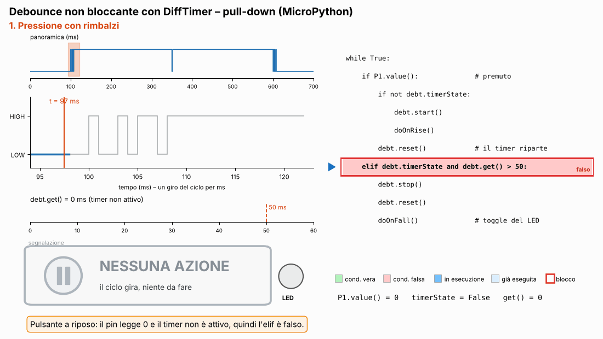

>[Torna all'indice](indexpulsanti.md)   >[versione in C++](pulsanti-rilascio.md)

# Pulsanti in MicroPython: attivazione sul rilascio (pull-down e pull-up)

In entrambe le versioni l'azione principale parte quando il pulsante viene **rilasciato**.
Cambia solo il livello letto dal pin, che dipende dal collegamento della resistenza.

| Collegamento | Riposo | Premuto | Pressione | Rilascio |
| --- | --- | --- | --- | --- |
| Pull-down (resistenza verso GND o `Pin.PULL_DOWN`) | 0 | 1 | fronte di salita | fronte di discesa |
| Pull-up (resistenza verso Vcc o `Pin.PULL_UP`) | 1 | 0 | fronte di discesa | fronte di salita |

In ogni esempio ci sono due callback: in quella della **pressione** vanno le azioni immediate
alla pressione (facoltative, qui lasciata vuota); in quella del **rilascio** vanno le azioni
al rilascio (qui, come esempio, un toggle del LED). Le callback modificano `stato`, quindi
lo dichiarano `global`.

Pin di esempio per ESP32: pulsante su GPIO 12, LED su GPIO 13. Su ESP32 si può usare anche
il pull-down interno, `Pin(12, Pin.IN, Pin.PULL_DOWN)`, al posto della resistenza esterna.
Al posto di `millis()` si usa `time.ticks_ms()`, e le differenze di tempo si calcolano con
`time.ticks_diff()`, che resta corretta anche quando il contatore ricomincia da capo.

> Versioni corte, con la sola azione al rilascio: [pulsanti-rilascio-corte-mpy.md](pulsanti-rilascio-corte-mpy.md)
> Esempi con due task concorrenti, toggle e blink (pull-down): [toggle-blink-pulldown-mpy.md](toggle-blink-pulldown-mpy.md)
> Versione Arduino: [pulsanti-rilascio.md](pulsanti-rilascio.md)

## 1. Versione bloccante con waitUntilInputLow / waitUntilInputHigh

Le funzioni di attesa vengono da `urutils.py`: dopo il rilascio attendono altri `t` ms perché
finiscano i rimbalzi. Finché il pulsante resta premuto il ciclo principale è fermo.

<table>
<tr>
<th>Pull-down: azione sul fronte di discesa</th>
<th>Pull-up: azione sul fronte di salita</th>
</tr>
<tr>
<td>

```python
from machine import Pin
import time
from urutils import waitUntilInputLow

P1  = Pin(12, Pin.IN)   # pull-down esterno
LED = Pin(13, Pin.OUT)
stato = False

def doOnRise():
    # PRESSIONE (fronte di salita):
    # qui vanno le azioni immediate
    # alla pressione.
    # Lasciatela vuota se non serve.
    pass

def doOnFall():
    # RILASCIO (fronte di discesa):
    # qui vanno le azioni al rilascio.
    # Esempio: toggle, inverte lo
    # stato del LED a ogni rilascio.
    global stato
    stato = not stato
    LED.value(stato)

while True:
    if P1.value():              # premuto
        doOnRise()
        waitUntilInputLow(P1, 50)
        doOnFall()
```

</td>
<td>

```python
from machine import Pin
import time
from urutils import waitUntilInputHigh

P1  = Pin(12, Pin.IN, Pin.PULL_UP)  # pull-up interno
LED = Pin(13, Pin.OUT)
stato = False

def doOnFall():
    # PRESSIONE (fronte di discesa):
    # qui vanno le azioni immediate
    # alla pressione.
    # Lasciatela vuota se non serve.
    pass

def doOnRise():
    # RILASCIO (fronte di salita):
    # qui vanno le azioni al rilascio.
    # Esempio: toggle, inverte lo
    # stato del LED a ogni rilascio.
    global stato
    stato = not stato
    LED.value(stato)

while True:
    if not P1.value():          # premuto
        doOnFall()
        waitUntilInputHigh(P1, 50)
        doOnRise()
```

</td>
</tr>
</table>

## 2. Versione non bloccante con ticks_ms()

<p align="center">
  
</p>

Con il pull-up il comportamento è identico con i livelli invertiti: il pulsante premuto legge 0, la pressione è un fronte di discesa e il rilascio un fronte di salita.

<table>
<tr>
<th>Pull-down: azione sul fronte di discesa</th>
<th>Pull-up: azione sul fronte di salita</th>
</tr>
<tr>
<td>

```python
from machine import Pin
import time

P1  = Pin(12, Pin.IN)   # pull-down esterno
LED = Pin(13, Pin.OUT)
stato = False
t0 = 0
attivo = False

def doOnRise():
    # PRESSIONE (fronte di salita):
    # qui vanno le azioni immediate
    # alla pressione.
    # Lasciatela vuota se non serve.
    pass

def doOnFall():
    # RILASCIO (fronte di discesa):
    # qui vanno le azioni al rilascio.
    # Esempio: toggle, inverte lo
    # stato del LED a ogni rilascio.
    global stato
    stato = not stato
    LED.value(stato)

while True:
    if P1.value():              # premuto
        if not attivo:
            attivo = True
            doOnRise()
        t0 = time.ticks_ms()
    elif attivo and time.ticks_diff(
            time.ticks_ms(), t0) > 50:
        attivo = False
        doOnFall()
```

</td>
<td>

```python
from machine import Pin
import time

P1  = Pin(12, Pin.IN, Pin.PULL_UP)  # pull-up interno
LED = Pin(13, Pin.OUT)
stato = False
t0 = 0
attivo = False

def doOnFall():
    # PRESSIONE (fronte di discesa):
    # qui vanno le azioni immediate
    # alla pressione.
    # Lasciatela vuota se non serve.
    pass

def doOnRise():
    # RILASCIO (fronte di salita):
    # qui vanno le azioni al rilascio.
    # Esempio: toggle, inverte lo
    # stato del LED a ogni rilascio.
    global stato
    stato = not stato
    LED.value(stato)

while True:
    if not P1.value():          # premuto
        if not attivo:
            attivo = True
            doOnFall()
        t0 = time.ticks_ms()
    elif attivo and time.ticks_diff(
            time.ticks_ms(), t0) > 50:
        attivo = False
        doOnRise()
```

</td>
</tr>
</table>

`t0` si aggiorna a ogni lettura "premuto": un rimbalzo al rilascio azzera il conteggio
e non produce un falso fronte.

## 3. Versione non bloccante con DiffTimer

> Gli script usano la versione corretta di `urutils.py`: un solo `__init__` per classe,
> `self.reset()` in `set()`, `time.ticks_diff()` per i tempi, l'attesa di fine rimbalzi in
> `waitUntilInputLow()` / `waitUntilInputHigh()` e il timer che riparte in `waitUntilNB()`.

<p align="center">
  
</p>

Con il pull-up il comportamento è identico con i livelli invertiti: il pulsante premuto legge 0, la pressione è un fronte di discesa e il rilascio un fronte di salita.

<table>
<tr>
<th>Pull-down: azione sul fronte di discesa</th>
<th>Pull-up: azione sul fronte di salita</th>
</tr>
<tr>
<td>

```python
from machine import Pin
import time
from urutils import DiffTimer

P1  = Pin(12, Pin.IN)   # pull-down esterno
LED = Pin(13, Pin.OUT)
stato = False
debt = DiffTimer()

def doOnRise():
    # PRESSIONE (fronte di salita):
    # qui vanno le azioni immediate
    # alla pressione.
    # Lasciatela vuota se non serve.
    pass

def doOnFall():
    # RILASCIO (fronte di discesa):
    # qui vanno le azioni al rilascio.
    # Esempio: toggle, inverte lo
    # stato del LED a ogni rilascio.
    global stato
    stato = not stato
    LED.value(stato)

while True:
    if P1.value():              # premuto
        if not debt.timerState:
            debt.start()
            doOnRise()
        debt.reset()
    elif debt.timerState and debt.get() > 50:
        debt.stop()
        debt.reset()
        doOnFall()
```

</td>
<td>

```python
from machine import Pin
import time
from urutils import DiffTimer

P1  = Pin(12, Pin.IN, Pin.PULL_UP)  # pull-up interno
LED = Pin(13, Pin.OUT)
stato = False
debt = DiffTimer()

def doOnFall():
    # PRESSIONE (fronte di discesa):
    # qui vanno le azioni immediate
    # alla pressione.
    # Lasciatela vuota se non serve.
    pass

def doOnRise():
    # RILASCIO (fronte di salita):
    # qui vanno le azioni al rilascio.
    # Esempio: toggle, inverte lo
    # stato del LED a ogni rilascio.
    global stato
    stato = not stato
    LED.value(stato)

while True:
    if not P1.value():          # premuto
        if not debt.timerState:
            debt.start()
            doOnFall()
        debt.reset()
    elif debt.timerState and debt.get() > 50:
        debt.stop()
        debt.reset()
        doOnRise()
```

</td>
</tr>
</table>

## 4. Versione non bloccante con waitUntilNB()

Il secondo argomento è la condizione "pulsante rilasciato", cioè `not premuto`.
`waitUntilNB()` della versione corretta di `urutils.py` fa ripartire il timer a ogni chiamata
con la condizione falsa, cioè a ogni lettura "premuto": scatta solo dopo 50 ms di pulsante
rilasciato senza interruzioni, quindi i rimbalzi del rilascio vengono ignorati.
La callback della pressione si chiama controllando
`debt.timerState` prima della chiamata: il timer non è attivo solo al primo giro di pressione.

<table>
<tr>
<th>Pull-down: azione sul fronte di discesa</th>
<th>Pull-up: azione sul fronte di salita</th>
</tr>
<tr>
<td>

```python
from machine import Pin
import time
from urutils import DiffTimer, waitUntilNB

P1  = Pin(12, Pin.IN)   # pull-down esterno
LED = Pin(13, Pin.OUT)
stato = False
debt = DiffTimer()

def doOnRise():
    # PRESSIONE (fronte di salita):
    # qui vanno le azioni immediate
    # alla pressione.
    # Lasciatela vuota se non serve.
    pass

def doOnFall():
    # RILASCIO (fronte di discesa):
    # qui vanno le azioni al rilascio.
    # Esempio: toggle, inverte lo
    # stato del LED a ogni rilascio.
    global stato
    stato = not stato
    LED.value(stato)

while True:
    premuto = P1.value()        # pull-down
    if premuto and not debt.timerState:
        doOnRise()
    # c = "rilasciato"
    if waitUntilNB(debt, not premuto, 50):
        doOnFall()
```

</td>
<td>

```python
from machine import Pin
import time
from urutils import DiffTimer, waitUntilNB

P1  = Pin(12, Pin.IN, Pin.PULL_UP)  # pull-up interno
LED = Pin(13, Pin.OUT)
stato = False
debt = DiffTimer()

def doOnFall():
    # PRESSIONE (fronte di discesa):
    # qui vanno le azioni immediate
    # alla pressione.
    # Lasciatela vuota se non serve.
    pass

def doOnRise():
    # RILASCIO (fronte di salita):
    # qui vanno le azioni al rilascio.
    # Esempio: toggle, inverte lo
    # stato del LED a ogni rilascio.
    global stato
    stato = not stato
    LED.value(stato)

while True:
    premuto = not P1.value()    # pull-up
    if premuto and not debt.timerState:
        doOnFall()
    # c = "rilasciato"
    if waitUntilNB(debt, not premuto, 50):
        doOnRise()
```

</td>
</tr>
</table>

## 5. Versione con schedulatore non bloccante

Il codice di gestione del pulsante gira una volta ogni `TBASE` ms. Leggere il pin a
intervalli regolari fa già da debounce: se `TBASE` è più lungo dei rimbalzi, tra due
letture il segnale si è stabilizzato. I fronti si riconoscono confrontando la lettura
attuale `val` con quella precedente `precval`.

<p align="center">
  
</p>

Con il pull-up il comportamento è identico con i livelli invertiti: il pulsante premuto legge 0, la pressione è un fronte di discesa e il rilascio un fronte di salita.

<table>
<tr>
<th>Pull-down: azione sul fronte di discesa</th>
<th>Pull-up: azione sul fronte di salita</th>
</tr>
<tr>
<td>

```python
from machine import Pin
import time

TBASE = 50   # ms, > rimbalzi
P1  = Pin(12, Pin.IN)   # pull-down esterno
LED = Pin(13, Pin.OUT)
stato = False
precm = 0
precval = 0  # riposo: basso

def doOnRise():
    # PRESSIONE (fronte di salita):
    # qui vanno le azioni immediate
    # alla pressione.
    # Lasciatela vuota se non serve.
    pass

def doOnFall():
    # RILASCIO (fronte di discesa):
    # qui vanno le azioni al rilascio.
    # Esempio: toggle, inverte lo
    # stato del LED a ogni rilascio.
    global stato
    stato = not stato
    LED.value(stato)

while True:
    if time.ticks_diff(
            time.ticks_ms(), precm) >= TBASE:
        precm = time.ticks_ms()
        val = P1.value()
        if precval == 0 and val == 1:
            doOnRise()           # salita
        elif precval == 1 and val == 0:
            doOnFall()           # discesa
        precval = val
```

</td>
<td>

```python
from machine import Pin
import time

TBASE = 50   # ms, > rimbalzi
P1  = Pin(12, Pin.IN, Pin.PULL_UP)  # pull-up interno
LED = Pin(13, Pin.OUT)
stato = False
precm = 0
precval = 1  # riposo: alto

def doOnFall():
    # PRESSIONE (fronte di discesa):
    # qui vanno le azioni immediate
    # alla pressione.
    # Lasciatela vuota se non serve.
    pass

def doOnRise():
    # RILASCIO (fronte di salita):
    # qui vanno le azioni al rilascio.
    # Esempio: toggle, inverte lo
    # stato del LED a ogni rilascio.
    global stato
    stato = not stato
    LED.value(stato)

while True:
    if time.ticks_diff(
            time.ticks_ms(), precm) >= TBASE:
        precm = time.ticks_ms()
        val = P1.value()
        if precval == 1 and val == 0:
            doOnFall()           # discesa
        elif precval == 0 and val == 1:
            doOnRise()           # salita
        precval = val
```

</td>
</tr>
</table>

In tutte le altre versioni la callback della pressione scatta subito, al primo giro del
ciclo in cui il pin risulta premuto. Con lo schedulatore invece il pin viene letto solo
ogni `TBASE` ms: la pressione viene riconosciuta con un ritardo fino a `TBASE`, e una
pressione più breve di `TBASE` può cadere tra due campioni e non essere vista.

## Considerazioni finali: quale tecnica scegliere

**Il limite di fondo, comune a tutte le tecniche.** Ogni antirimbalzo stabilisce un tempo minimo, ad esempio 50 msec, oltre il quale un'apertura del contatto viene considerata un rilascio vero. Un disturbo che apre il contatto per più di quel tempo non si distingue da un rilascio breve: vale per il polling, per lo schedulatore e per gli interrupt. Nel seguito si dà per scontato che questo limite sia superato scegliendo un tempo adatto alla qualità del pulsante: abbastanza lungo da coprire i suoi rimbalzi e i suoi disturbi, abbastanza corto da non perdere le pressioni rapide.

**Il polling veloce con il timer che riparte è la tecnica più robusta e più pronta.** È la versione in cui il ciclo principale legge il pulsante a ogni giro e il timer riparte a ogni lettura "premuto" (l'istante di riferimento aggiornato con ```time.ticks_ms()``` fuori dall'```if```):
- guarda il pulsante in continuazione: un disturbo breve a pulsante premuto viene visto di sicuro, ma fa solo ripartire il conteggio;
- il rilascio è accettato solo se il pin è rimasto basso per **tutto** il tempo di antirimbalzo: la decisione non dipende da dove cade il disturbo;
- la pressione è riconosciuta alla prima lettura alta, il rilascio dopo il tempo di antirimbalzo.

La condizione è che il ciclo principale resti veloce: con ```time.sleep_ms()``` lunghi o funzioni lente le letture si diradano e il polling si comporta come uno schedulatore.

**Lo schedulatore (time tick)** legge il pulsante solo ogni ```tbase```. È immune ai rimbalzi perché tra una lettura e l'altra non li vede, e per lo stesso motivo di solito non vede nemmeno i disturbi brevi a pulsante premuto; se però una lettura cade proprio dentro un disturbo, il toggle scatta due volte (la probabilità è circa la durata del disturbo divisa per ```tbase```). Si può ridurre il rischio accettando un nuovo livello solo dopo N letture uguali consecutive: il tempo minimo di un rilascio vero diventa N × ```tbase```. È un'approssimazione, con il campionamento rado, di ciò che il polling veloce fa con il campionamento continuo.

**Gli interrupt su entrambi i fronti** fanno la stessa cosa del polling veloce: vedono ogni fronte, rimbalzi e disturbi compresi, e fanno ripartire il conteggio del tempo di antirimbalzo. In più funzionano anche quando il ciclo principale è lento: sono la scelta giusta quando il ciclo principale ha altro di pesante da fare.

## Riferimenti

- [urutils.h](https://github.com/sebastianomelita/ArduinoBareMetal/blob/master/urutils.h): versione Arduino della libreria
- [pulsanti-rilascio-corte-mpy.md](pulsanti-rilascio-corte-mpy.md): versioni corte, solo azione al rilascio
- [toggle-blink-pulldown-mpy.md](toggle-blink-pulldown-mpy.md): toggle e blink come due task concorrenti
