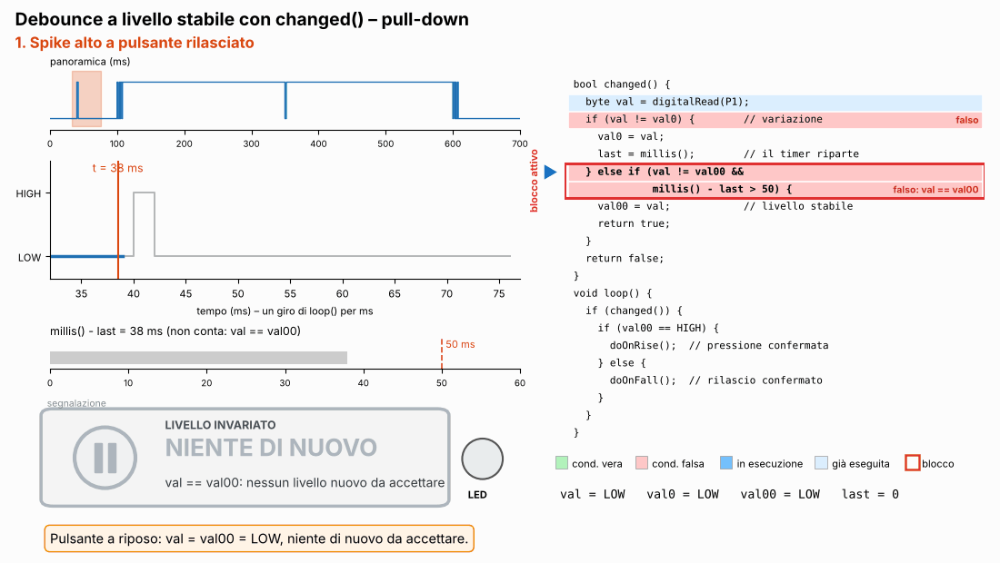

>[Torna all'indice](indexpulsanti.md)   >[versione in Python](pulsanti-rilascio-mpy.md)

# Pulsanti: attivazione sul rilascio, tecniche non bloccanti (pull-down e pull-up)

In entrambe le versioni l'azione principale parte quando il pulsante viene **rilasciato**.
Cambia solo il livello letto dal pin, che dipende dal collegamento della resistenza.

| Collegamento | Riposo | Premuto | Pressione | Rilascio |
| --- | --- | --- | --- | --- |
| Pull-down (resistenza verso GND) | LOW | HIGH | fronte di salita | fronte di discesa |
| Pull-up (resistenza verso Vcc o `INPUT_PULLUP`) | HIGH | LOW | fronte di discesa | fronte di salita |

In ogni esempio ci sono due callback: in quella della **pressione** vanno le azioni immediate
alla pressione (facoltative, qui lasciata vuota); in quella del **rilascio** vanno le azioni
al rilascio (qui, come esempio, un toggle del LED).

> Versioni corte, con la sola azione al rilascio: [pulsanti-rilascio-corte.md](pulsanti-rilascio-corte.md)
> Esempi con due task concorrenti, toggle e blink (pull-down): [toggle-blink-pulldown.md](toggle-blink-pulldown.md)
> Tecniche bloccanti (waitUntilInputLow / waitUntilInputHigh), dalla più semplice alla più robusta: [pulsanti-bloccanti.md](pulsanti-bloccanti.md)

## 1. Versione non bloccante con millis()

<p align="center">
  
</p>

Con il pull-up il comportamento è identico con i livelli invertiti: il pulsante premuto legge LOW, la pressione è un fronte di discesa e il rilascio un fronte di salita.

<table>
<tr>
<th>Pull-down: azione sul fronte di discesa</th>
<th>Pull-up: azione sul fronte di salita</th>
</tr>
<tr>
<td>

```cpp
const byte P1  = 2;
const byte LED = 13;
bool stato = LOW;
unsigned long t0 = 0;
bool attivo = false;

void doOnRise() {
  // PRESSIONE (fronte di salita):
  // qui vanno le azioni immediate
  // alla pressione.
  // Lasciatela vuota se non serve.
}

void doOnFall() {
  // RILASCIO (fronte di discesa):
  // qui vanno le azioni al rilascio.
  // Esempio: toggle, inverte lo
  // stato del LED a ogni rilascio.
  stato = !stato;
  digitalWrite(LED, stato);
}

void setup() {
  pinMode(P1, INPUT);
  pinMode(LED, OUTPUT);
}

void loop() {
  if (digitalRead(P1) == HIGH) {
    if (!attivo) {
      attivo = true;
      doOnRise();
    }
    t0 = millis();
  } else if (attivo &&
             millis() - t0 > 50) {
    attivo = false;
    doOnFall();
  }
}
```

</td>
<td>

```cpp
const byte P1  = 2;
const byte LED = 13;
bool stato = LOW;
unsigned long t0 = 0;
bool attivo = false;

void doOnFall() {
  // PRESSIONE (fronte di discesa):
  // qui vanno le azioni immediate
  // alla pressione.
  // Lasciatela vuota se non serve.
}

void doOnRise() {
  // RILASCIO (fronte di salita):
  // qui vanno le azioni al rilascio.
  // Esempio: toggle, inverte lo
  // stato del LED a ogni rilascio.
  stato = !stato;
  digitalWrite(LED, stato);
}

void setup() {
  pinMode(P1, INPUT_PULLUP);
  pinMode(LED, OUTPUT);
}

void loop() {
  if (digitalRead(P1) == LOW) {
    if (!attivo) {
      attivo = true;
      doOnFall();
    }
    t0 = millis();
  } else if (attivo &&
             millis() - t0 > 50) {
    attivo = false;
    doOnRise();
  }
}
```

</td>
</tr>
</table>

`t0` si aggiorna a ogni lettura "premuto": un rimbalzo al rilascio azzera il conteggio
e non produce un falso fronte.

## 2. Versione non bloccante con DiffTimer

<p align="center">
  
</p>

Con il pull-up il comportamento è identico con i livelli invertiti: il pulsante premuto legge LOW, la pressione è un fronte di discesa e il rilascio un fronte di salita.

<table>
<tr>
<th>Pull-down: azione sul fronte di discesa</th>
<th>Pull-up: azione sul fronte di salita</th>
</tr>
<tr>
<td>

```cpp
#include "urutils.h"

const byte P1  = 2;
const byte LED = 13;
bool stato = LOW;
DiffTimer debt;

void doOnRise() {
  // PRESSIONE (fronte di salita):
  // qui vanno le azioni immediate
  // alla pressione.
  // Lasciatela vuota se non serve.
}

void doOnFall() {
  // RILASCIO (fronte di discesa):
  // qui vanno le azioni al rilascio.
  // Esempio: toggle, inverte lo
  // stato del LED a ogni rilascio.
  stato = !stato;
  digitalWrite(LED, stato);
}

void setup() {
  pinMode(P1, INPUT);
  pinMode(LED, OUTPUT);
}

void loop() {
  if (digitalRead(P1) == HIGH) {
    if (!debt.timerState) {
      debt.start();
      doOnRise();
    }
    debt.reset();
  } else if (debt.timerState &&
             debt.get() > 50) {
    debt.stop();
    debt.reset();
    doOnFall();
  }
}
```

</td>
<td>

```cpp
#include "urutils.h"

const byte P1  = 2;
const byte LED = 13;
bool stato = LOW;
DiffTimer debt;

void doOnFall() {
  // PRESSIONE (fronte di discesa):
  // qui vanno le azioni immediate
  // alla pressione.
  // Lasciatela vuota se non serve.
}

void doOnRise() {
  // RILASCIO (fronte di salita):
  // qui vanno le azioni al rilascio.
  // Esempio: toggle, inverte lo
  // stato del LED a ogni rilascio.
  stato = !stato;
  digitalWrite(LED, stato);
}

void setup() {
  pinMode(P1, INPUT_PULLUP);
  pinMode(LED, OUTPUT);
}

void loop() {
  if (digitalRead(P1) == LOW) {
    if (!debt.timerState) {
      debt.start();
      doOnFall();
    }
    debt.reset();
  } else if (debt.timerState &&
             debt.get() > 50) {
    debt.stop();
    debt.reset();
    doOnRise();
  }
}
```

</td>
</tr>
</table>

## 3. Versione non bloccante con waitUntilNB()

Il secondo argomento è la condizione "pulsante rilasciato", cioè `!premuto`.
Da sola `waitUntilNB()` conta dalla prima lettura "premuto": al rilascio scatterebbe subito,
senza debounce, e un rimbalzo del contatto la farebbe scattare una seconda volta. Per questo,
a ogni lettura "premuto", si chiama `debt.reset()`: i 50 ms si contano dall'ultima lettura
"premuto", come nella versione con DiffTimer.
`waitUntilNB()` segnala solo il rilascio: la callback della pressione si chiama controllando
`debt.timerState` prima della chiamata. Il timer non è attivo solo al primo giro di pressione,
perché subito dopo lo attiva `waitUntilNB()`.

<table>
<tr>
<th>Pull-down: azione sul fronte di discesa</th>
<th>Pull-up: azione sul fronte di salita</th>
</tr>
<tr>
<td>

```cpp
#include "urutils.h"

const byte P1  = 2;
const byte LED = 13;
bool stato = LOW;
DiffTimer debt;

void doOnRise() {
  // PRESSIONE (fronte di salita):
  // qui vanno le azioni immediate
  // alla pressione.
  // Lasciatela vuota se non serve.
}

void doOnFall() {
  // RILASCIO (fronte di discesa):
  // qui vanno le azioni al rilascio.
  // Esempio: toggle, inverte lo
  // stato del LED a ogni rilascio.
  stato = !stato;
  digitalWrite(LED, stato);
}

void setup() {
  pinMode(P1, INPUT);
  pinMode(LED, OUTPUT);
}

void loop() {
  // pull-down: premuto = HIGH
  bool premuto = digitalRead(P1);
  if (premuto &&
      !debt.timerState) {
    doOnRise();
  }
  // c = "rilasciato"
  if (waitUntilNB(debt,
        !premuto, 50)) {
    doOnFall();
  }
  if (premuto) {
    debt.reset();
  }
}
```

</td>
<td>

```cpp
#include "urutils.h"

const byte P1  = 2;
const byte LED = 13;
bool stato = LOW;
DiffTimer debt;

void doOnFall() {
  // PRESSIONE (fronte di discesa):
  // qui vanno le azioni immediate
  // alla pressione.
  // Lasciatela vuota se non serve.
}

void doOnRise() {
  // RILASCIO (fronte di salita):
  // qui vanno le azioni al rilascio.
  // Esempio: toggle, inverte lo
  // stato del LED a ogni rilascio.
  stato = !stato;
  digitalWrite(LED, stato);
}

void setup() {
  pinMode(P1, INPUT_PULLUP);
  pinMode(LED, OUTPUT);
}

void loop() {
  // pull-up: premuto = LOW
  bool premuto = !digitalRead(P1);
  if (premuto &&
      !debt.timerState) {
    doOnFall();
  }
  // c = "rilasciato"
  if (waitUntilNB(debt,
        !premuto, 50)) {
    doOnRise();
  }
  if (premuto) {
    debt.reset();
  }
}
```

</td>
</tr>
</table>

## 4. Versione con schedulatore non bloccante

Il codice di gestione del pulsante gira una volta ogni `TBASE` ms. Leggere il pin a
intervalli regolari fa già da debounce: se `TBASE` è più lungo dei rimbalzi, tra due
letture il segnale si è stabilizzato. I fronti si riconoscono confrontando la lettura
attuale `val` con quella precedente `precval`.

<p align="center">
  
</p>

Con il pull-up il comportamento è identico con i livelli invertiti: il pulsante premuto legge LOW, la pressione è un fronte di discesa e il rilascio un fronte di salita.

<table>
<tr>
<th>Pull-down: azione sul fronte di discesa</th>
<th>Pull-up: azione sul fronte di salita</th>
</tr>
<tr>
<td>

```cpp
#define TBASE 50  // ms, > rimbalzi

const byte P1  = 2;
const byte LED = 13;
bool stato = LOW;
unsigned long precm = 0;
byte precval = LOW;  // riposo
byte val;

void doOnRise() {
  // PRESSIONE (fronte di salita):
  // qui vanno le azioni immediate
  // alla pressione.
  // Lasciatela vuota se non serve.
}

void doOnFall() {
  // RILASCIO (fronte di discesa):
  // qui vanno le azioni al rilascio.
  // Esempio: toggle, inverte lo
  // stato del LED a ogni rilascio.
  stato = !stato;
  digitalWrite(LED, stato);
}

void setup() {
  pinMode(P1, INPUT);
  pinMode(LED, OUTPUT);
}

void loop() {
  if (millis() - precm >= TBASE) {
    precm = millis();
    val = digitalRead(P1);
    if (precval == LOW &&
        val == HIGH) {   // salita
      doOnRise();
    } else if (precval == HIGH &&
               val == LOW) { // discesa
      doOnFall();
    }
    precval = val;
  }
}
```

</td>
<td>

```cpp
#define TBASE 50  // ms, > rimbalzi

const byte P1  = 2;
const byte LED = 13;
bool stato = LOW;
unsigned long precm = 0;
byte precval = HIGH; // riposo
byte val;

void doOnFall() {
  // PRESSIONE (fronte di discesa):
  // qui vanno le azioni immediate
  // alla pressione.
  // Lasciatela vuota se non serve.
}

void doOnRise() {
  // RILASCIO (fronte di salita):
  // qui vanno le azioni al rilascio.
  // Esempio: toggle, inverte lo
  // stato del LED a ogni rilascio.
  stato = !stato;
  digitalWrite(LED, stato);
}

void setup() {
  pinMode(P1, INPUT_PULLUP);
  pinMode(LED, OUTPUT);
}

void loop() {
  if (millis() - precm >= TBASE) {
    precm = millis();
    val = digitalRead(P1);
    if (precval == HIGH &&
        val == LOW) {    // discesa
      doOnFall();
    } else if (precval == LOW &&
               val == HIGH) { // salita
      doOnRise();
    }
    precval = val;
  }
}
```

</td>
</tr>
</table>

Nelle versioni da 1 a 3 la callback della pressione scatta subito, al primo giro di
`loop()` in cui il pin risulta premuto. Con lo schedulatore invece il pin viene letto solo
ogni `TBASE` ms: la pressione viene riconosciuta con un ritardo fino a `TBASE`, e una
pressione più breve di `TBASE` può cadere tra due campioni e non essere vista.

## 5. Versione non bloccante a livello stabile con changed()

Le versioni precedenti accettano la **pressione** alla prima lettura "premuto" e filtrano solo il
**rilascio**. Questa invece accetta un nuovo livello, in **tutte e due** le direzioni, solo quando è
rimasto fermo per più di 50 ms. È la macchina a stati di [debouncerFSM.md](debouncerFSM.md) (forma
"prima gli ingressi"):
- `val0` è l'ultima lettura: ogni variazione (rimbalzo, disturbo o fronte vero) la aggiorna e fa
  ripartire il conteggio da `last`;
- `val00` è il livello accettato: cambia solo se la lettura è diversa da lui e ferma da più di 50 ms;
- `changed()` restituisce `true` una sola volta, nel giro in cui il nuovo livello viene accettato:
  guardando `val00` si sa se è una pressione o un rilascio.

Così viene filtrato anche uno **spike alto a pulsante rilasciato**, ad esempio un disturbo sui cavi
con il pull-down, che le versioni precedenti prenderebbero per una pressione seguita da un rilascio.
Il prezzo è che anche la pressione viene riconosciuta con 50 ms di ritardo, e una pressione più
breve di 50 ms viene scartata come se fosse un disturbo.

<p align="center">
  
</p>

Con il pull-up il comportamento è identico con i livelli invertiti: riposo HIGH, premuto LOW.

<table>
<tr>
<th>Pull-down: azione sul fronte di discesa</th>
<th>Pull-up: azione sul fronte di salita</th>
</tr>
<tr>
<td>

```cpp
const byte P1  = 2;
const byte LED = 13;
bool stato = LOW;
byte val0  = LOW;  // ultima lettura
byte val00 = LOW;  // livello accettato
unsigned long last = 0; // ultima variazione

bool changed() {
  // vero solo quando il pin ha un
  // nuovo livello fermo da più di 50 ms
  byte val = digitalRead(P1);
  if (val != val0) {
    // variazione: rimbalzo, disturbo
    // o fronte vero, si riparte
    val0 = val;
    last = millis();
  } else if (val != val00 &&
             millis() - last > 50) {
    val00 = val;  // livello stabile
    return true;
  }
  return false;
}

void doOnRise() {
  // PRESSIONE (fronte di salita):
  // qui vanno le azioni immediate
  // alla pressione.
  // Lasciatela vuota se non serve.
}

void doOnFall() {
  // RILASCIO (fronte di discesa):
  // qui vanno le azioni al rilascio.
  // Esempio: toggle, inverte lo
  // stato del LED a ogni rilascio.
  stato = !stato;
  digitalWrite(LED, stato);
}

void setup() {
  pinMode(P1, INPUT);
  pinMode(LED, OUTPUT);
}

void loop() {
  if (changed()) {
    if (val00 == HIGH) {
      doOnRise();  // pressione confermata
    } else {
      doOnFall();  // rilascio confermato
    }
  }
}
```

</td>
<td>

```cpp
const byte P1  = 2;
const byte LED = 13;
bool stato = LOW;
byte val0  = HIGH;  // ultima lettura
byte val00 = HIGH;  // livello accettato
unsigned long last = 0; // ultima variazione

bool changed() {
  // vero solo quando il pin ha un
  // nuovo livello fermo da più di 50 ms
  byte val = digitalRead(P1);
  if (val != val0) {
    // variazione: rimbalzo, disturbo
    // o fronte vero, si riparte
    val0 = val;
    last = millis();
  } else if (val != val00 &&
             millis() - last > 50) {
    val00 = val;  // livello stabile
    return true;
  }
  return false;
}

void doOnFall() {
  // PRESSIONE (fronte di discesa):
  // qui vanno le azioni immediate
  // alla pressione.
  // Lasciatela vuota se non serve.
}

void doOnRise() {
  // RILASCIO (fronte di salita):
  // qui vanno le azioni al rilascio.
  // Esempio: toggle, inverte lo
  // stato del LED a ogni rilascio.
  stato = !stato;
  digitalWrite(LED, stato);
}

void setup() {
  pinMode(P1, INPUT_PULLUP);
  pinMode(LED, OUTPUT);
}

void loop() {
  if (changed()) {
    if (val00 == LOW) {
      doOnFall();  // pressione confermata
    } else {
      doOnRise();  // rilascio confermato
    }
  }
}
```

</td>
</tr>
</table>

## Considerazioni finali: quale tecnica scegliere

**Il limite di fondo, comune a tutte le tecniche.** Ogni antirimbalzo stabilisce un tempo minimo, ad esempio 50 msec, oltre il quale un'apertura del contatto viene considerata un rilascio vero. Un disturbo che apre il contatto per più di quel tempo non si distingue da un rilascio breve: vale per il polling, per lo schedulatore e per gli interrupt. Nel seguito si dà per scontato che questo limite sia superato scegliendo un tempo adatto alla qualità del pulsante: abbastanza lungo da coprire i suoi rimbalzi e i suoi disturbi, abbastanza corto da non perdere le pressioni rapide.

**Il polling veloce con il timer che riparte è la tecnica più robusta e più pronta.** È la versione in cui il ```loop()``` legge il pulsante a ogni giro e il timer riparte a ogni lettura "premuto" (```t0 = millis()``` fuori dall'```if```):
- guarda il pulsante in continuazione: un disturbo breve a pulsante premuto viene visto di sicuro, ma fa solo ripartire il conteggio;
- il rilascio è accettato solo se il pin è rimasto basso per **tutto** il tempo di antirimbalzo: la decisione non dipende da dove cade il disturbo;
- la pressione è riconosciuta alla prima lettura alta, il rilascio dopo il tempo di antirimbalzo.

La condizione è che il ```loop()``` resti veloce: con ```delay()``` o funzioni lente le letture si diradano e il polling si comporta come uno schedulatore.

**Lo schedulatore (time tick)** legge il pulsante solo ogni ```TBASE```. È immune ai rimbalzi perché tra una lettura e l'altra non li vede, e per lo stesso motivo di solito non vede nemmeno i disturbi brevi a pulsante premuto; se però una lettura cade proprio dentro un disturbo, il toggle scatta due volte (la probabilità è circa la durata del disturbo divisa per ```TBASE```). Si può ridurre il rischio accettando un nuovo livello solo dopo N letture uguali consecutive: il tempo minimo di un rilascio vero diventa N × ```TBASE```. È un'approssimazione, con il campionamento rado, di ciò che il polling veloce fa con il campionamento continuo.

**Il livello stabile (`changed()`)** fa la stessa cosa del polling veloce, ma in **tutte e due** le direzioni: anche la pressione viene accettata solo dopo il tempo di antirimbalzo di livello fermo. Il polling veloce, gli interrupt e le tecniche bloccanti accettano la pressione alla prima lettura alta, quindi uno spike alto a pulsante rilasciato (tipico del pull-down con cavi lunghi, perché a riposo il pin è tenuto basso solo dalla resistenza) diventa una pressione e un rilascio falsi; il livello stabile lo scarta. Il prezzo è un ritardo pari al tempo di antirimbalzo anche sulla pressione, e la perdita delle pressioni più brevi di quel tempo. È la scelta giusta quando l'ingresso arriva da lontano o in un ambiente disturbato, ad esempio i sensori di un nastro trasportatore.

| Tecnica | Rimbalzi | Disturbo breve a pulsante premuto | Spike alto a pulsante rilasciato |
| --- | --- | --- | --- |
| millis(), DiffTimer, waitUntilNB(), interrupt, tecniche bloccanti | filtrati | filtrato | **non filtrato** |
| Schedulatore | filtrati | filtrato solo se nessuna lettura ci cade dentro | filtrato solo se nessuna lettura ci cade dentro |
| Livello stabile (`changed()`) | filtrati | filtrato | filtrato |

**Gli interrupt su entrambi i fronti** fanno la stessa cosa del polling veloce: vedono ogni fronte, rimbalzi e disturbi compresi, e fanno ripartire il conteggio del tempo di antirimbalzo. In più funzionano anche quando il ```loop()``` è lento: sono la scelta giusta quando il ciclo principale ha altro di pesante da fare.

## Riferimenti

- [urutils.h](https://github.com/sebastianomelita/ArduinoBareMetal/blob/master/urutils.h): sorgente della libreria
- [toggle.md](https://github.com/sebastianomelita/ArduinoBareMetal/blob/master/toggle.md): esempi di pulsante toggle
- [pulsanti-rilascio-corte.md](pulsanti-rilascio-corte.md): versioni corte, solo azione al rilascio
- [pulsanti-bloccanti.md](pulsanti-bloccanti.md): tecniche bloccanti
- [toggle-blink-pulldown.md](toggle-blink-pulldown.md): toggle e blink come due task concorrenti
