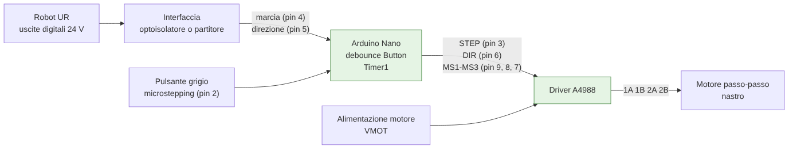
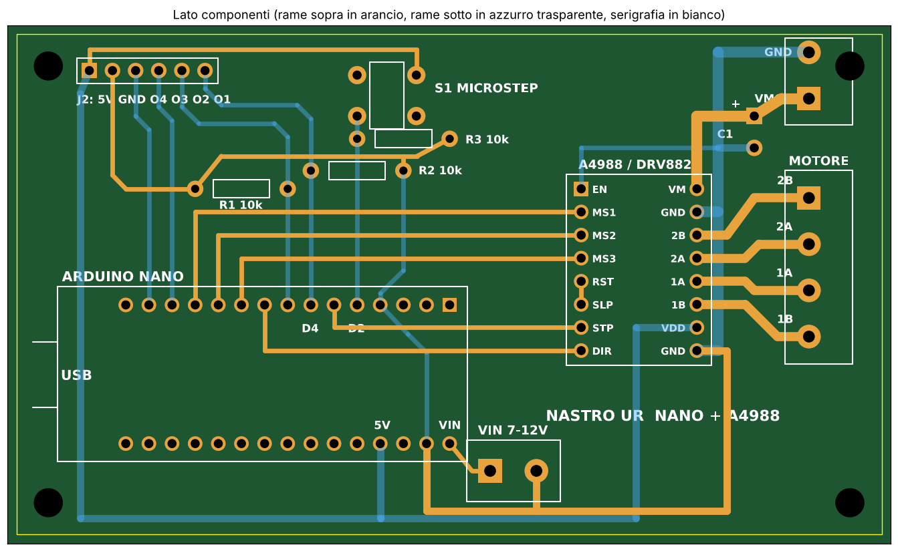
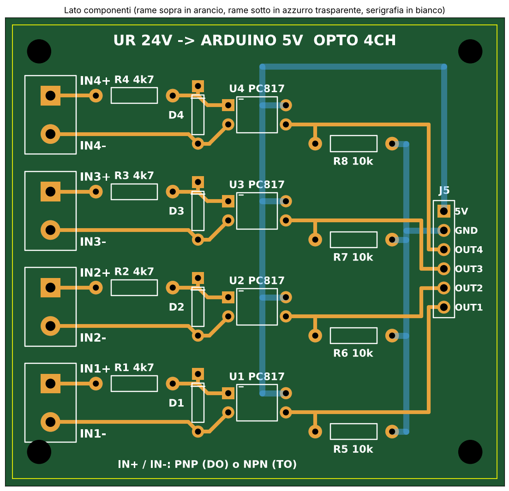

>[Torna all'indice](indexpulsanti.md) >[Controllo del motore del nastro](nastro-stepper.md)

# Le schede del nastro: componenti, circuiti stampati e montaggio

Questa dispensa spiega come realizzare l'elettronica del nastro trasportatore descritto in
[nastro-stepper.md](nastro-stepper.md): che cosa comprare, come ordinare i circuiti stampati, come
montarli e come collaudarli. Le schede sono due:

- la **scheda base** (95 × 55 mm) porta l'Arduino Nano e il driver del motore A4988 o DRV8825;
- la **scheda optoisolata** (64 × 60 mm) adatta le uscite a 24 V del robot UR agli ingressi a 5 V
  dell'Arduino e tiene separati i due circuiti.

Le due schede si collegano con un cavo a 6 fili fra J5 della scheda optoisolata e J2 della scheda
base. I due connettori hanno lo stesso ordine dei pin (5V, GND, O4, O3, O2, O1), quindi il cavo va
dritto.

## 1. I circuiti stampati

| Scheda | File Gerber | Anteprima |
| --- | --- | --- |
| Scheda base (Nano + driver) | [pcb/nastro-nano-gerber.zip](pcb/nastro-nano-gerber.zip) | [pcb/nastro-nano-anteprima.png](pcb/nastro-nano-anteprima.png) |
| Scheda optoisolata a 4 canali | [pcb/opto4ch-gerber.zip](pcb/opto4ch-gerber.zip) | [pcb/opto4ch-anteprima.png](pcb/opto4ch-anteprima.png) |

Ogni zip contiene tutti i file per il produttore e un `LEGGIMI.txt` con distinta e collegamenti:

| File | Contenuto |
| --- | --- |
| `.GTL`, `.GBL` | rame lato sopra e lato sotto |
| `.GTS`, `.GBS` | solder mask sopra e sotto |
| `.GTO` | serigrafia (scritte e contorni dei componenti) |
| `.GKO` | contorno della scheda |
| `-PTH.DRL` | fori metallizzati (piedini dei componenti) |
| `-NPTH.DRL` | fori di fissaggio da 3,2 mm, non metallizzati |

### Come ordinarli

Su un produttore online (per esempio JLCPCB o PCBWay) si carica lo zip così com'è: il sito
riconosce i file e mostra un'anteprima, da confrontare con le immagini qui sotto **prima di
ordinare**. Le impostazioni sono quelle standard:

| Parametro | Valore |
| --- | --- |
| Strati | 2 |
| Materiale e spessore | FR-4, 1,6 mm |
| Rame | 1 oz (35 µm) |
| Finitura | HASL (con o senza piombo) |
| Piste e isolamento minimi | 0,3 mm (le piste più sottili della scheda) |
| Foro minimo | 0,8 mm |

I file sono stati scritti e controllati con script propri, non con un programma CAD come KiCad:
l'anteprima del produttore è il controllo finale.

## 2. I componenti da comprare

### Scheda base

| Sigla | Componente | Q.tà | Note |
| --- | --- | --- | --- |
| U1 | Arduino Nano (ATmega328P) | 1 | i cloni con il convertitore USB CH340 possono richiedere il driver sul PC |
| — | strip femmina 1×15, passo 2,54 mm | 2 | zoccolo del Nano |
| U2 | driver A4988 o DRV8825 (Pololu o compatibile) | 1 | con il DRV8825 attivare `DRIVER_DRV8825` nel programma |
| — | strip femmina 1×8, passo 2,54 mm | 2 | zoccolo del driver |
| — | dissipatore adesivo per il driver | 1 | di solito fornito con il driver |
| C1 | condensatore elettrolitico 100 µF, almeno 35 V (50 V con alimentazione a 24 V), passo 3,5 mm, diametro 8 mm | 1 | Pololu raccomanda almeno 47 µF vicino al driver |
| R1, R2, R3 | resistenza 10 kΩ, 1/4 W | 3 | |
| S1 | pulsante 6 × 6 mm a 4 piedini | 1 | microstepping |
| J2 | strip maschio 1×6, passo 2,54 mm | 1 | cavo verso la scheda optoisolata |
| J3 | morsettiera a vite 4 poli, passo 5,08 mm | 1 | motore (oppure due da 2 poli affiancate) |
| J4, J6 | morsettiera a vite 2 poli, passo 5,08 mm | 2 | alimentazione del motore e del Nano |

### Scheda optoisolata

| Sigla | Componente | Q.tà | Note |
| --- | --- | --- | --- |
| U1 – U4 | optoisolatore PC817 (DIP-4) | 4 | eventualmente con zoccolo DIP-4 |
| R1 – R4 | resistenza 4,7 kΩ, 1/4 W | 4 | 2,2 kΩ se la flangia del robot lavora a 12 V |
| D1 – D4 | diodo 1N4148 | 4 | protegge il LED se si invertono IN+ e IN− |
| R5 – R8 | resistenza 10 kΩ, 1/4 W | 4 | |
| J1 – J4 | morsettiera a vite 2 poli, passo 5,08 mm | 4 | ingressi dal robot |
| J5 | strip maschio 1×6, passo 2,54 mm | 1 | cavo verso la scheda base |

### Il resto

| Componente | Q.tà | Note |
| --- | --- | --- |
| motore passo-passo bipolare NEMA 17, 200 passi al giro | 1 | corrente di fase intorno a 1 A o meno, se il driver lavora senza ventola |
| alimentatore 12 V o 24 V per il motore | 1 | 2 A bastano per un motore da 1 A per fase |
| alimentatore 7 – 12 V per il Nano, oppure cavo USB | 1 | |
| cavo Dupont femmina-femmina a 6 fili, circa 20 cm | 1 | fra J5 e J2 |
| distanziali M3 da 10 mm, viti M3 | 8 + 8 | quattro per scheda |
| cavo a 2 fili per ogni comando del robot | 2 | marcia e direzione |

## 3. Montaggio

Si salda dal componente più basso al più alto, così la scheda appoggiata sul banco tiene fermi i
componenti mentre si salda dal lato sotto.

### Scheda base

1. **Resistenze R1 – R3.** Non hanno verso.
2. **Pulsante S1.** Entra solo in due orientamenti, entrambi corretti: la scheda usa i due piedini in
   diagonale, che sono sempre su contatti diversi.
3. **Strip femmina del Nano e del driver.** Per saldarle allineate conviene infilarle sul Nano e sul
   driver, appoggiare il tutto sulla scheda e saldare prima due piedini agli estremi, controllare
   che siano diritte, poi saldare gli altri. Togliere poi Nano e driver prima di continuare.
4. **Strip maschio J2.**
5. **Morsettiere J3, J4, J6**, con l'apertura per i fili verso il bordo della scheda.
6. **Condensatore C1**, per ultimo perché è il più alto. **Attenzione alla polarità:** il piedino
   lungo (+) va nella piazzola quadrata, segnata con `+`; la striscia sul corpo indica il −.

**Orientamento dei moduli.** Il Nano va con la presa USB verso il bordo sinistro, come disegnato in
serigrafia: il piedino TX è sulla piazzola quadrata. Il driver va con ENABLE sulla piazzola quadrata
in alto a sinistra e VMOT in alto a destra: le scritte in serigrafia accanto ai piedini (EN, MS1 …
VM, GND) devono corrispondere a quelle del modulo. **Un driver montato al contrario si distrugge
all'accensione.**

### Scheda optoisolata

1. **Resistenze** R1 – R4 da 4,7 kΩ e R5 – R8 da 10 kΩ: attenzione a non scambiare i valori
   (giallo-viola-rosso per 4,7 kΩ, marrone-nero-arancio per 10 kΩ).
2. **Diodi D1 – D4.** La fascia nera (catodo) va dalla parte della piazzola quadrata, segnata anche
   da una barra in serigrafia.
3. **Optoisolatori U1 – U4.** Il pallino sul corpo (piedino 1) va sulla piazzola quadrata.
4. **Morsettiere J1 – J4** e **strip J5**.

## 4. Controlli prima di accendere

Con il multimetro in modalità continuità, **senza Nano, driver e alimentazioni**:

| Fra | Deve essere |
| --- | --- |
| 5V e GND (scheda base) | aperto |
| VMOT e GND (morsetto J4) | aperto (all'inizio si sente un bip breve: è C1 che si carica) |
| VIN e GND (morsetto J6) | aperto |
| un morsetto IN e i pin di J5 (scheda optoisolata) | aperto: è l'isolamento |
| GND di J2 e il GND del Nano (zoccolo) | chiuso |

Poi un controllo a vista: nessun ponte di stagno fra piazzole vicine, soprattutto sugli zoccoli.

## 5. Taratura della corrente del driver

Il potenziometro del driver limita la corrente nelle bobine del motore. Va regolato **prima** di far
girare il motore, misurando la tensione VREF fra il potenziometro (o la piazzola VREF) e GND, con il
driver alimentato:

| Driver | Formula | Esempio: 1 A per fase |
| --- | --- | --- |
| A4988 Pololu (resistenze di sense da 0,068 Ω, dal 2017) | VREF = 8 × I × 0,068 ≈ 0,54 × I | 0,54 V |
| A4988 con resistenze da 0,050 Ω | VREF = 8 × I × 0,05 = 0,4 × I | 0,40 V |
| A4988 compatibili con resistenze da 0,100 Ω (sigla R100) | VREF = 8 × I × 0,1 = 0,8 × I | 0,80 V |
| DRV8825 Pololu (0,100 Ω) | VREF = I / 2 | 0,50 V |

Le resistenze di sense sono le due resistenze piccole vicino al chip: la loro sigla (R050, R068,
R100) dice quale riga usare. Come corrente si prende quella di fase del motore, senza superare
circa 1 A per l'A4988 e 1,5 A per il DRV8825 se il driver lavora senza ventola.

**Non collegare né scollegare il motore con il driver alimentato:** il driver si può danneggiare in
modo irreparabile. Ogni modifica ai collegamenti va fatta a schede spente.

## 6. Collaudo passo per passo

1. **Solo il Nano.** Inserire il Nano, collegare la USB, caricare `nastro-stepper-v4.3.ino` e aprire
   il monitor seriale a 115200 baud. Premendo S1 deve comparire una riga `Res:` con il nuovo
   livello di microstepping.
2. **Il driver.** A schede spente inserire il driver, senza motore. Alimentare J4 e regolare VREF
   come nella sezione 5.
3. **Il motore.** Spegnere, collegare il motore a J3 (2B, 2A sulla prima bobina, 1A, 1B sulla
   seconda), riaccendere.
4. **La scheda optoisolata**, collegata con il cavo a 6 fili. Per la prova, al posto del robot si
   può usare un alimentatore a 24 V:
   - 24 V su IN1+ e 0 V su IN1−: il monitor scrive `Timer started` e il motore gira;
   - togliendo i 24 V: `Timer stopped`;
   - con IN1 di nuovo attivo, 24 V su IN2: `Direction: 1`, il motore si ferma per 1 s e riparte nel
     verso opposto.
5. **Il robot.** Collegare le uscite del robot come nella tabella seguente e provare i comandi da
   PolyScope.

## 7. Collegamenti finali

| Dal robot UR | Alla scheda optoisolata | Alla scheda base (via J5 → J2) | Funzione |
| --- | --- | --- | --- |
| DO di marcia (PNP) | IN1+ (GND del robot su IN1−) | O1 → D4 | il nastro gira finché l'uscita è attiva |
| DO di direzione (PNP) | IN2+ (GND del robot su IN2−) | O2 → D5 | verso di rotazione |
| uscita utensile TOx in NPN | POWER su INn+, TOx su INn− | | in alternativa alle uscite del control box |
| — | IN3, IN4 | O3 → D10, O4 → D11 | di riserva |

| Morsetto della scheda base | Collegamento |
| --- | --- |
| J3 | motore: 2B e 2A a una bobina, 1A e 1B all'altra |
| J4 | alimentazione del motore: 8 – 35 V con A4988, 8,2 – 45 V con DRV8825 |
| J6 | alimentazione del Nano 7 – 12 V, se non si usa la USB |

**La massa del robot non va collegata alla massa dell'Arduino:** l'isolamento fra i due circuiti è
proprio il compito della scheda optoisolata.

## 8. Sicurezza

- Il nastro comandato da Arduino **non** ha una funzione di sicurezza: l'arresto di emergenza va
  realizzato in hardware, con un pulsante di emergenza e componenti di sicurezza che tolgono
  l'alimentazione al motore (vedi la sezione 6 di [debounce-fenomeni.md](debounce-fenomeni.md)).
- Le resistenze verso massa su D4 e D5 tengono fermo il nastro se il cavo fra le schede si stacca.
- Le uscite del robot si possono configurare in modo che si spengano quando il programma del robot
  si ferma: con i comandi a livello, il nastro si ferma insieme al robot.

## Riferimenti

- [nastro-stepper.md](nastro-stepper.md): il programma e il funzionamento del controllo
- [interfacce-digitali.md](interfacce-digitali.md): collegare il mondo a 24 V e quello a 5 V
- [Pololu, A4988 Stepper Motor Driver Carrier](https://www.pololu.com/product/1182): limite di corrente, condensatore, avvertenze
- [Pololu, DRV8825 Stepper Motor Driver Carrier](https://www.pololu.com/product/2133): limite di corrente e differenze rispetto all'A4988

>[Torna all'indice](indexpulsanti.md) >[Controllo del motore del nastro](nastro-stepper.md)
