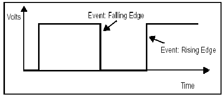
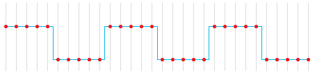

###  **PULSANTE TOGGLE**

Si vuole realizzare un pulsante con una memoria dello stato che possa essere modificata ad ogni pressione. Pressioni successive in sequenza accendono e spengono un led. Quindi, a seconda da quando si comincia, pressioni in numero pari accendono mentre quelle in numero dispari spengono, oppure al contrario, pressioni in numero pari spengono mentre quelle in numero dispari accendono.

Inizialmente si potrebbe essere tentati di provare seguente soluzione, adattando la strategia del pulsante precedente introducendo una variabile che conservi lo stato del pulsante che chiameremo **closed**.

```python
from machine import Pin

pulsante = Pin(12, Pin.IN)
led = Pin(13, Pin.OUT)
closed = False  # stato pulsante

while True:
    if pulsante.value():  # selezione del livello alto (logica di comando)
        closed = not closed
        led.value(closed)  # scrittura uscita
```
Purtroppo questa soluzione ha un paio di **problemi** che ne pregiudicano il **funzionamento corretto**.

**Il primo** è relativo alla **selezione del tipo di evento in ingresso**. In questa soluzione viene rilevata la pressione del pulsante **sul livello** dell’ingresso. Il problema è che il livello viene rilevato per tutto il tempo che il tasto è premuto mediante una lettura per ogni loop(). Il numero di queste letture è imprevedibile sia perché sono moltissime al secondo e sia perché la durata della pressione dipende dall’utente. In più, ad ogni lettura viene modificato lo stato del pulsante con l’istruzione closed=!closed, ne consegue che lo stato finale del pulsante è il risultato di una catena di commutazioni che termina dopo un tempo casuale: abbiamo realizzato una slot machine!.

###  **RILEVATORE DI TRANSITO**

Si vuole realizzare un rilevatore del transito di un oggetto su una fotocellula. Poichè la fotocellula legge l'assenza del fascio luminoso di ritorno, la sua uscita è ripetutamente vera fino a che l'oggetto non ha completato il suo passaggio. Un passaggio temporalmente lungo genera letture ripetute del transito segnalando più oggetti in corrispondenza di uno solo.

## **SOLUZIONE**

La **soluzione** è **modificare il tipo di selezione** **dell’evento** in ingresso, che deve stavolta avvenire sui **fronti** piuttosto che sui livelli. I fronti sono due, **salita** o **discesa**. Se si rileva il fronte di **salita** si cattura l’evento di **pressione** del pulsante, se si rileva il fronte di **discesa** si cattura l’evento di **rilascio** del pulsante. Ma come facciamo a capire quando siamo in presenza di un **evento di fronte**? Di salita o di discesa?



Una **evento di fronte** si può rilevare in due modi:

- **Polling degli ingressi.** Lo scopo è rilevare una **transizione di livello**. Si tratta di campionare periodicamente il livello di un ingresso con l’obiettivo di rilevare un fronte. Un fronte può essere **rilevato** sostanzialmente in **due maniere**:

     - analisi su **due loop consecutivi**, memorizzando sempre l’ultimo campione misurato (il **valore corrente**) su una **variabile globale**. Al **loop successivo** questo valore sarà diventato il **valore precedente** da **confrontare** col nuovo valore corrente, alla ricerca di eventuali variazioni (**fronti**). Il polling, cioè il campionamento, può essere effettuato ad ogni loop, o può essere **decimato**, cioè eseguito periodicamente **ogni tot loop scartati** (decimati). La **misura** in questo metodo **non è mai bloccante,** non essendo necessarie attese per rilevare un fronte.

     - analisi su un **unico loop**, sfruttando le **attese bloccanti** di un **thread** fino al valore **opposto** a quello che ha attivato la misura, ciò garantisce che la prima lettura di un ingresso è sempre il **primo fronte** (ad es., di salita al valore HIGH). Appena l’attesa sul valore opposto (WaitUntil LOW) termina, allora accade la **rilevazione** certa del secondo **fronte** (discesa). La **misura** in questo metodo **è sempre bloccante,** essendo necessaria almeno una attesa per rilevare un fronte.

- **Interrupt o eventi.** Su alcune porte di un microcontrollore può essere abilitato il riconoscimento di un evento di interrupt, segnalabile, a scelta, su fronte di salita, fronte di discesa, entrambi i fronti. L’interrupt determina la **chiamata asincrona** di una funzione di servizio che esegue il codice con la logica di comando in risposta all’evento. La funzione è definita esternamente al loop() principale e la sua esecuzione è del tutto indipendente da questo. 

In figura sono evidenziati i **campionamenti** eseguibili, ad esempio, ad ogni loop(), oppure ad intervalli di tempo preordinati stabiliti da uno schedulatore.



Si nota chiaramente che in corrispondenza di ogni fronte, prima e dopo, si misurano differenze di livello. In particolare si può avere:

- Un **fronte di salita** se la **transizione** avviene dal livello basso a quello alto

- Un **fronte di discesa** se la **transizione** avviene dal livello alto a quello basso

Se un rilevatore si limita a segnalare un **generico fronte**, allora per stabilire in quale ci troviamo, basta determinare, al momento della segnalazione, in **quale livello** si trova **l’ingresso**: se è al livello alto è un fronte di salita, se è a quello basso è un fronte di discesa.

Il **secondo problema** è costituito dal fenomeno dei **rimbalzi**. Si palesano come una sequenza di rapide oscillazioni che hanno sia fronti di salita che di discesa. Se l’accensione di un led è associata ad un fronte e il suo spegnimento a quello successivo, allora la pressione di un pulsante realizza, di fatto, la solita slot machine…è necessario un algoritmo di debouncing.

Gli esempi successivi sono stati esposti relativamente al problema del **pulsante toggle** premendo il quale, ad ogni lettura di un fornte, si genera la modifica di una opportuna **variabile di stato** (```stato``` negli esempi).

A ben vedere, le soluzioni proposte di seguito possono essere tutte facilmente adattate alla realizzazione di un **sensore di transito** sostituendo la pressione del pulsante con la lettura del sensore e interpretando la variabile ```stato``` con la **variabile di stato** che deve tenere traccia del passaggio rilevato.

# Pulsante toggle e blink in MicroPython: due task concorrenti (pull-down)

Ogni script gestisce due task insieme:

1. **Pulsante toggle:** a ogni rilascio il LED `LED` cambia stato.
2. **Blink:** il LED `LEDBLINK` lampeggia con periodo di 2 s (1000 ms acceso, 1000 ms spento).

Il pulsante è gestito a eventi: la callback `doOnRise()` scatta alla pressione,
`doOnFall()` al rilascio. Il blink è un evento periodico. Tutti gli esempi sono per
il collegamento **pull-down** (pulsante premuto = 1). Pin di esempio per ESP32: pulsante
su GPIO 12, LED su GPIO 13 e 27.

> **Per il pull-up** basta usare `Pin(12, Pin.IN, Pin.PULL_UP)` e mettere un `not` davanti a
> ogni `P1.value()`; dove c'è già un `not`, si toglie. Così "premuto" torna a valere 1
> e il resto non cambia: `doOnRise()` resta la pressione e `doOnFall()` il rilascio.
> Unica eccezione la versione bloccante: `waitUntilInputLow()` legge il pin direttamente,
> quindi nel pull-up va sostituita con `waitUntilInputHigh()`.

> Versioni con un solo pulsante, pull-down e pull-up affiancati: [pulsanti-rilascio-mpy.md](pulsanti-rilascio-mpy.md) (complete) e [pulsanti-rilascio-corte-mpy.md](pulsanti-rilascio-corte-mpy.md) (solo azione al rilascio)
> Versione Arduino: [toggle-blink-pulldown.md](toggle-blink-pulldown.md)

## 1. Versione bloccante (waitUntilInputLow)

Mentre il pulsante è premuto il ciclo resta dentro `waitUntilInputLow()`, quindi il blink
si ferma. Questo esempio mostra il limite del codice bloccante con più task.

```python
from machine import Pin
import time
from urutils import waitUntilInputLow

P1       = Pin(12, Pin.IN)    # pulsante (pull-down esterno)
LED      = Pin(13, Pin.OUT)   # task 1: LED comandato dal pulsante (toggle)
LEDBLINK = Pin(27, Pin.OUT)   # task 2: LED lampeggiante
stato = False
precBlink = 0

def doOnRise():
    # PRESSIONE (fronte di salita): qui vanno le azioni immediate alla pressione.
    # Lasciatela vuota se non serve.
    pass

def doOnFall():
    # RILASCIO (fronte di discesa): qui vanno le azioni al rilascio.
    # Esempio: toggle, inverte lo stato del LED a ogni rilascio.
    global stato
    stato = not stato
    LED.value(stato)

def blink(pin):
    pin.value(not pin.value())   # inverte il LED lampeggiante

while True:
    # task 1: pulsante (bloccante)
    if P1.value():
        doOnRise()
        waitUntilInputLow(P1, 50)   # ciclo fermo finché il pulsante è premuto
        doOnFall()

    # task 2: blink ogni 1000 ms
    if time.ticks_diff(time.ticks_ms(), precBlink) >= 1000:
        precBlink = time.ticks_ms()
        blink(LEDBLINK)
```

## 2. Versione non bloccante con ticks_ms()

```python
from machine import Pin
import time

P1       = Pin(12, Pin.IN)    # pulsante (pull-down esterno)
LED      = Pin(13, Pin.OUT)   # task 1: LED comandato dal pulsante (toggle)
LEDBLINK = Pin(27, Pin.OUT)   # task 2: LED lampeggiante
stato = False
t0 = 0                        # ultima lettura "premuto"
armato = False
precBlink = 0

def doOnRise():
    # PRESSIONE (fronte di salita): qui vanno le azioni immediate alla pressione.
    # Lasciatela vuota se non serve.
    pass

def doOnFall():
    # RILASCIO (fronte di discesa): qui vanno le azioni al rilascio.
    # Esempio: toggle, inverte lo stato del LED a ogni rilascio.
    global stato
    stato = not stato
    LED.value(stato)

def blink(pin):
    pin.value(not pin.value())   # inverte il LED lampeggiante

while True:
    # task 1: pulsante
    if P1.value():
        if not armato:
            armato = True
            doOnRise()
        t0 = time.ticks_ms()
    elif armato and time.ticks_diff(time.ticks_ms(), t0) > 50:
        armato = False
        doOnFall()

    # task 2: blink ogni 1000 ms
    if time.ticks_diff(time.ticks_ms(), precBlink) >= 1000:
        precBlink = time.ticks_ms()
        blink(LEDBLINK)
```

## 3. Versione non bloccante con DiffTimer

Serve la versione corretta di `urutils.py` (vedi la sezione 3 di
[pulsanti-rilascio-mpy.md](pulsanti-rilascio-mpy.md)).

```python
from machine import Pin
import time
from urutils import DiffTimer

P1       = Pin(12, Pin.IN)    # pulsante (pull-down esterno)
LED      = Pin(13, Pin.OUT)   # task 1: LED comandato dal pulsante (toggle)
LEDBLINK = Pin(27, Pin.OUT)   # task 2: LED lampeggiante
stato = False
debt = DiffTimer()            # debounce
t1 = DiffTimer()              # blink
t1.start()

def doOnRise():
    # PRESSIONE (fronte di salita): qui vanno le azioni immediate alla pressione.
    # Lasciatela vuota se non serve.
    pass

def doOnFall():
    # RILASCIO (fronte di discesa): qui vanno le azioni al rilascio.
    # Esempio: toggle, inverte lo stato del LED a ogni rilascio.
    global stato
    stato = not stato
    LED.value(stato)

def blink(pin):
    pin.value(not pin.value())   # inverte il LED lampeggiante

while True:
    # task 1: pulsante
    if P1.value():
        if not debt.timerState:
            debt.start()
            doOnRise()
        debt.reset()
    elif debt.timerState and debt.get() > 50:
        debt.stop()
        debt.reset()
        doOnFall()

    # task 2: blink ogni 1000 ms
    if t1.get() > 1000:
        t1.reset()
        blink(LEDBLINK)
```

## 4. Versione non bloccante con waitUntilNB()

La callback della pressione viene chiamata controllando `debt.timerState` prima di
`waitUntilNB()`, che da sola segnala solo il rilascio.
`waitUntilNB()` della versione corretta di `urutils.py` fa ripartire il timer a ogni chiamata
con la condizione falsa, cioè a ogni lettura "premuto": scatta solo dopo 50 ms di pulsante
rilasciato senza interruzioni, quindi i rimbalzi del rilascio vengono ignorati.

```python
from machine import Pin
import time
from urutils import DiffTimer, waitUntilNB

P1       = Pin(12, Pin.IN)    # pulsante (pull-down esterno)
LED      = Pin(13, Pin.OUT)   # task 1: LED comandato dal pulsante (toggle)
LEDBLINK = Pin(27, Pin.OUT)   # task 2: LED lampeggiante
stato = False
debt = DiffTimer()
t1 = DiffTimer()
t1.start()

def doOnRise():
    # PRESSIONE (fronte di salita): qui vanno le azioni immediate alla pressione.
    # Lasciatela vuota se non serve.
    pass

def doOnFall():
    # RILASCIO (fronte di discesa): qui vanno le azioni al rilascio.
    # Esempio: toggle, inverte lo stato del LED a ogni rilascio.
    global stato
    stato = not stato
    LED.value(stato)

def blink(pin):
    pin.value(not pin.value())   # inverte il LED lampeggiante

while True:
    # task 1: pulsante
    premuto = P1.value()
    if premuto and not debt.timerState:
        doOnRise()                       # azione immediata alla pressione
    if waitUntilNB(debt, not premuto, 50):
        doOnFall()                       # azione al rilascio

    # task 2: blink ogni 1000 ms
    if t1.get() > 1000:
        t1.reset()
        blink(LEDBLINK)
```

## 5. Versione con schedulatore non bloccante

Un solo tempo base `TBASE` scandisce entrambi i task: il pulsante viene campionato a ogni
tick, il blink scatta ogni `NBLINK` tick. Il contatore `step` è circolare: va da 0 a `NSTEP - 1`
e poi riparte.

```python
from machine import Pin
import time

TBASE  = 50              # periodo base in ms (> durata dei rimbalzi)
NBLINK = 1000 // TBASE   # periodo del blink in tick (semiperiodo 1000 ms)
NSTEP  = NBLINK          # lunghezza del ciclo: mcm dei periodi dei task
P1       = Pin(12, Pin.IN)    # pulsante (pull-down esterno)
LED      = Pin(13, Pin.OUT)   # task 1: LED comandato dal pulsante (toggle)
LEDBLINK = Pin(27, Pin.OUT)   # task 2: LED lampeggiante
stato = False
precm = 0
precval = 0
step = 0                 # contatore circolare dei tick: 0 .. NSTEP-1

def doOnRise():
    # PRESSIONE (fronte di salita): qui vanno le azioni immediate alla pressione.
    # Lasciatela vuota se non serve.
    pass

def doOnFall():
    # RILASCIO (fronte di discesa): qui vanno le azioni al rilascio.
    # Esempio: toggle, inverte lo stato del LED a ogni rilascio.
    global stato
    stato = not stato
    LED.value(stato)

def blink(pin):
    pin.value(not pin.value())   # inverte il LED lampeggiante

while True:
    if time.ticks_diff(time.ticks_ms(), precm) >= TBASE:   # un tick ogni TBASE ms
        precm = time.ticks_ms()
        step = (step + 1) % NSTEP    # conteggio circolare, al massimo NSTEP-1

        # task 1: pulsante, campionato a ogni tick
        val = P1.value()
        if precval == 0 and val == 1:
            doOnRise()
        elif precval == 1 and val == 0:
            doOnFall()
        precval = val

        # task 2: blink ogni NBLINK tick (1000 ms)
        if step % NBLINK == 0:
            blink(LEDBLINK)
```

**Più task periodici.** Se lo schedulatore deve gestire più task periodici, `NSTEP` va
scelto come minimo comune multiplo dei loro periodi in tick. Ogni task poi controlla
`step % N_task == 0`, dove `N_task` è il suo periodo in tick. Così il ciclo si chiude
senza sfasare nessun task. Per esempio, con un blink ogni 20 tick e un secondo task
ogni 30 tick:

```python
NBLINK = 20    # 1000 ms con TBASE = 50
NTASK2 = 30    # 1500 ms con TBASE = 50
NSTEP  = 60    # mcm(20, 30)

        step = (step + 1) % NSTEP
        if step % NBLINK == 0:    # a step 0, 20, 40
            blink(LEDBLINK)
        if step % NTASK2 == 0:    # a step 0, 30
            task2()
```

Con un `NSTEP` che non fosse multiplo di 30, per esempio 40, il secondo task scatterebbe a
step 0 e 30 e poi di nuovo a 0, cioè dopo soli 10 tick: il ciclo si chiuderebbe sfasando il task.

## Riferimenti

- [urutils.h](https://github.com/sebastianomelita/ArduinoBareMetal/blob/master/urutils.h): versione Arduino della libreria
- [toggle.md](https://github.com/sebastianomelita/ArduinoBareMetal/blob/master/toggle.md): esempi di pulsante toggle
- [pulsanti-rilascio-mpy.md](pulsanti-rilascio-mpy.md): versioni complete, pull-down e pull-up
- [pulsanti-rilascio-corte-mpy.md](pulsanti-rilascio-corte-mpy.md): versioni corte, solo azione al rilascio
