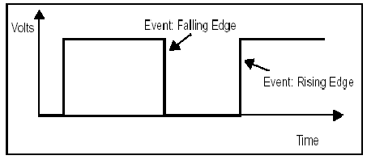
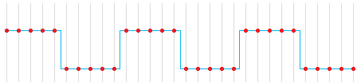

>[Torna all'indice generale](index.md) >[versione in C++](toggle.md)


## **PULSANTI ATTIVI SU UN FRONTE**

###  **PULSANTE TOGGLE**

Si vuole realizzare un pulsante con una memoria dello stato che possa essere modificata ad ogni pressione. Pressioni successive in sequenza accendono e spengono un led. Quindi, a seconda da quando si comincia, pressioni in numero pari accendono mentre quelle in numero dispari spengono, oppure al contrario, pressioni in numero pari spengono mentre quelle in numero dispari accendono.

Inizialmente si potrebbe essere tentati di provare seguente soluzione, adattando la strategia del pulsante precedente introducendo una variabile che conservi lo stato del pulsante che chiameremo **closed**.

```python
import time
from machine import Pin
  
btn1 = Pin(12,Pin.IN)
led1 = Pin(13,Pin.OUT)
closed = False

while True:
    if btn1.value(): # selezione del livello alto (logica di comando)
        closed = not closed
        led1.value(closed) # scrittura uscita
```

Purtroppo questa soluzione ha un paio di **problemi** che ne pregiudicano il **funzionamento corretto**.

**Il primo** è relativo alla **selezione del tipo di evento in ingresso**. In questa soluzione viene rilevata la pressione del pulsante **sul livello** dell’ingresso. Il problema è che il livello viene rilevato per tutto il tempo che il tasto è premuto mediante una lettura per ogni loop(). Il numero di queste letture è imprevedibile sia perché sono moltissime al secondo e sia perché la durata della pressione dipende dall’utente. In più, ad ogni lettura viene modificato lo stato del pulsante con l’istruzione closed=!closed, ne consegue che lo stato finale del pulsante è il risultato di una catena di commutazioni che termina dopo un tempo casuale: abbiamo realizzato una slot machine!.

###  **RILEVATORE DI TRANSITO**

Si vuole realizzare un rilevatore del transito di un oggetto su una fotocellula. Poichè la fotocellula legge l'assenza del fascio luminoso di ritorno, la sua uscita è ripetutamente vera fino a che l'oggetto non ha completato il suo passaggio. Un passaggio temporalmente lungo genera letture ripetute del transito segnalando più oggetti in corrispondenza di uno solo.

## **SOLUZIONE**

La **soluzione** è **modificare il tipo di selezione** **dell’evento** in ingresso, che deve stavolta avvenire sui **fronti** piuttosto che sui livelli. I fronti sono due, **salita** o **discesa**. Se si rileva il fronte di **salita** si cattura l’evento di **pressione** del pulsante, se si rileva il fronte di **discesa** si cattura l’evento di **rilascio** del pulsante. Ma come facciamo a capire quando siamo in presenza di un **evento di fronte**? Di salita o di discesa?



In **entrambi i casi**, un evento di fronte si ha quando si è in presenza di una **transizione di livello** di un ingresso, quindi per **rilevare un fronte** è sufficiente **rilevare una transizione**.

Un **evento di fronte** si può rilevare in due modi:

- **Polling degli ingressi.** Lo scopo è rilevare una **transizione di livello**. Si tratta di campionare periodicamente il livello di un ingresso avendo cura di memorizzare sempre l’ultimo campione misurato su una variabile globale. Al loop successivo questo valore verrà confrontato col nuovo alla ricerca di eventuali variazioni. Il polling, cioè il campionamento, può essere effettuato ad ogni loop, o può essere **decimato**, cioè eseguito periodicamente **ogni tot loop scartati** (decimati).

- **Interrupt.** Su alcune porte di un microcontrollore può essere abilitato il riconoscimento di un evento di interrupt, segnalabile, a scelta, su fronte di salita, fronte di discesa, entrambi i fronti. L’interrupt determina la chiamata asincrona di una funzione di servizio dell’interrupt detta ISR (Interrupt Service Routine) che esegue il codice con la logica di comando in risposta all’evento. La funzione è definita esternamente al loop() e la sua esecuzione è del tutto indipendente da questo.

In figura sono evidenziati i **campionamenti** eseguibili, ad esempio, ad ogni loop(), oppure ad intervalli di tempo preordinati stabiliti da uno schedulatore.



Si nota chiaramente che in corrispondenza di ogni fronte, prima e dopo, si misurano differenze di livello. In particolare si può avere:

- Un **fronte di salita** se la **transizione** avviene dal livello basso a quello alto

- Un **fronte di discesa** se la **transizione** avviene dal livello alto a quello basso

Se un rilevatore si limita a segnalare un **generico fronte**, allora per stabilire in quale ci troviamo, basta determinare, al momento della segnalazione, in **quale livello** si trova **l’ingresso**: se è al livello alto è un fronte di salita, se è a quello basso è un fronte di discesa.

Il **secondo problema** è costituito dal fenomeno dei **rimbalzi**. Si palesano come una sequenza di rapide oscillazioni che hanno sia fronti di salita che di discesa. Se l’accensione di un led è associata ad un fronte e il suo spegnimento a quello successivo, allora la pressione di un pulsante realizza, di fatto, la solita slot machine…è necessario un algoritmo di debouncing.

Gli esempi successivi sono stati esposti relativamente al problema del **pulsante toggle** premendo il quale, ad ogni lettura di un fronte, si genera la modifica di una opportuna **variabile di stato** (```stato``` negli esempi).

A ben vedere, le soluzioni proposte di seguito possono essere tutte facilmente adattate alla realizzazione di un **sensore di transito** sostituendo la pressione del pulsante con la lettura del sensore e interpretando la variabile ```stato``` con la **variabile di stato** che deve tenere traccia del passaggio rilevato.

Pulsante toggle con rilevazione del fronte di salita (pressione) e con antirimbalzo realizzato con una **schedulazione ad eventi (time tick)**  (per una spiegazione dettagliata dei time tick si rimanda a [schedulatore di compiti basato sui time tick](tasksched.md)):
```Python
import time
from machine import Pin

pulsante = Pin(12, Pin.IN)
led = Pin(13, Pin.OUT)
precm = 0
precval = 0
stato = 0
tbase = 100                       # periodo base in millisecondi

while True:
    if time.ticks_diff(time.ticks_ms(), precm) >= tbase:  # schedulatore (e anche antirimbalzo)
        precm = time.ticks_ms()             # preparo il tic successivo
        val = pulsante.value()              # lettura ingressi
        if precval == 0 and val == 1:       # rivelatore di fronte di salita
            stato = (stato + 1) % 2         # impostazione dello stato del toggle
            led.value(stato)                # scrittura uscite
            print(stato)
        precval = val                       # memorizzazione livello loop precedente
```

### **Pulsante toggle + blink basato sui delay**

In questo caso, il **rilevatore dei fronti** è realizzato **campionando** il valore del livello al loop di CPU **attuale** e **confrontandolo** con il valore del livello campionato **nello stesso loop** ma in un momento diverso stabilito mediante un istruzione ```waitUntilInputLow()``. La funzione, di fatto, esegue un **blocco** del **loop** corrente in **"attesa"**  della verità di una certa **condizione**, bloccando l'esecuzione degli altri **task** dello stesso loop. L'**attesa** è spesa campionando continuamente un **ingresso** fino a che questo non **diventa LOW**. Quando ciò accade allora vuol dire che si è rilevato un **fronte di discesa** per cui, qualora **in futuro**, in un loop successivo, si determinasse sullo stesso ingresso un valore HIGH, allora si può essere certi di essere in presenza di un **fronte di salita**.  

Questa tecnica ha lo svantaggio presentare un certa dose di **interferenza temporale** nell'esecuzione dei vari task separarti per mezzo del ritardo ```delay()```. I task devono essere eseguiti **in sequenza** e inoltre sono concatenati, per cui l'esecuzione del task successivo non può cominciare se prima non termina quella del task corrente. Di fatto un task può rimanere **bloccato** e quindi non essere **responsivo** per un input da parte dell'utente, oppure può **non elaborare prontamente** l'uscita richiesta in un dato momento.

```python
#Alla pressione del pulsante si attiva o disattiva il lampeggo di un led
import time
from machine import Pin

#attesa del rilascio con antirimbalzo: esce solo con un rilascio confermato
def waitUntilInLow(btn,t):
    while True:
        while btn.value():
            time.sleep_ms(t)
        time.sleep_ms(t)            # attesa fine rimbalzi del rilascio
        if not btn.value():         # rilascio confermato
            return

def blink(led,t):
    led.value(not led.value())
    time.sleep_ms(t)
   
btn1 = Pin(12,Pin.IN)
led1 = Pin(13,Pin.OUT)
stato = False

while True:
    if btn1.value():                 # se è alto c'è stato un fronte di salita
        stato = not stato            # impostazione dello stato del toggle
        waitUntilInLow(btn1,50)      # attendi il rilascio confermato
    if stato:
        blink(led1,500)
    else:
        led1.off()
```
Simulazione online su Esp32 con Wowki del codice precedente: https://wokwi.com/projects/370421058897117185

### **Pulsante toggle + blink basato su eventi**

In questo caso, il **rilevatore dei fronti** è realizzato **campionando** il valore del livello al loop di CPU **attuale** e **confrontandolo** con il valore del livello campionato al **loop precedente** (o a uno dei loop precedenti). Se il valore attuale è HIGH e quello precedente è LOW si è rilevato un **fronte di salita**, mentre se il valore attuale è LOW e quello precedente è HIGH si è rilevato un **fronte di discesa**.  

Pulsante toggle che realizza blink e  antirimbalzo realizzato con una **schedulazione ad eventi senza ritardi (time tick)**:
```python
#Alla pressione del pulsante si attiva o disattiva il lampeggo di un led
import time
from machine import Pin

class Toggle(object):
    def __init__(self, btn, state = False):
        self.btn = btn
        self.state = state
        self.precval = 0
    def toggle(self):
        val = self.btn.value()
        if self.precval == 0 and val == 1: 
            self.state = not self.state
            print(self.state)
        self.precval = val 
    def getState(self):
        return self.state
    def setState(self,state):
        self.state = state

def blink(led):
    led.value(not led.value())

   
btn1 = Pin(12,Pin.IN)
led1 = Pin(13,Pin.OUT)
led2 = Pin(2,Pin.OUT)
pulsante = Toggle(btn1)
precm = 0
tbase = 50
step = 0
nstep = 100

while True:
    # il codice eseguito al tempo massimo della CPU va qui	
    # .........
    if time.ticks_diff(time.ticks_ms(), precm) >= tbase:  	   # schedulatore (e anche antirimbalzo)
        precm = time.ticks_ms()  			   # preparo il tic successivo	
        step = (step + 1) % nstep      # conteggio circolare arriva al massimo a nstep-1
        # il codice eseguito al tempo base va quì	
        # ..........
        pulsante.toggle()
        
        # task 1
        if not (step % 20):      # schedulo eventi al multiplo del tempo stabilito (1 sec)
            if pulsante.getState():
                blink(led1)
            else:
                led1.off()
                            
        # task 2
        if not (step % 10):      # schedulo eventi al multiplo del tempo stabilito (0.5 sec)
            if pulsante.getState():
                blink(led2)
            else:
                led2.off()
                            
        # il codice eseguito al tempo base va quì	
        # ..........
            
    # il codice eseguito al tempo massimo della CPU va qui	
    # ........
```
Simulazione online su Esp32 con Wowki del codice precedente: https://wokwi.com/projects/370407560534851585

### **Pulsante toggle + blink basato sui thread**

In questo caso, il **rilevatore dei fronti** è realizzato **campionando** il valore del livello al loop di CPU **attuale** e **confrontandolo** con il valore del livello campionato **nello stesso loop** ma in un momento diverso stabilito mediante un istruzione ```waitUntilInputLow()```. La funzione, di fatto, esegue un **blocco** del **thread** corrente in **"attesa"**  della soddisfazione di una certa **condizione**, senza bloccare l'esecuzione degli altri threads. L'**attesa** è spesa campionando continuamente un **ingresso** fino a che questo non **diventa LOW**. Quando ciò accade allora vuol dire che si è rilevato un **fronte di discesa** per cui, qualora **in futuro**, in un loop successivo, si determinasse sullo stesso ingresso un valore HIGH, allora si può essere certi di essere in presenza di un **fronte di salita**. 

La funzione 
```python
#attesa del rilascio con antirimbalzo: esce solo con un rilascio confermato
def waitUntilInLow(btn,t):
    while True:
        while btn.value():
            time.sleep_ms(t)
        time.sleep_ms(t)            # attesa fine rimbalzi del rilascio
        if not btn.value():         # rilascio confermato
            return
```
realizza una funzione di **wait su condizione** che ritarda il thread corrente di un ritardo prefissato al termine del quale ricalcola l'ingresso. L'operazione viene ripetuta fin tanto che la condizione attesa non è asserita; quando il pin diventa basso la funzione attende altri ```t``` msec e lo ricontrolla, quindi esce solo con un **rilascio confermato** (un rimbalzo del rilascio o un'interruzione breve del contatto non vengono presi per un rilascio). Si tratta di una funzione utile per due **scopi**:
- **debouncing** software dell'ingresso digitale
- determinazione del **fronte di discesa** di un ingresso digitale

Pulsante toggle che realizza blink e  antirimbalzo realizzato con una **schedulazione sequenziale con i ritardi** emulati all'interno di **thread** diversi  La libreria usata è quella nativa dello ESP32 _thread:

```python
#Alla pressione del pulsante si attiva o disattiva il lampeggo di un led
import time
import _thread as th
from machine import Pin

#attesa del rilascio con antirimbalzo: esce solo con un rilascio confermato
def waitUntilInLow(btn,t):
    while True:
        while btn.value():
            time.sleep_ms(t)
        time.sleep_ms(t)            # attesa fine rimbalzi del rilascio
        if not btn.value():         # rilascio confermato
            return

def toggle(index, btn, states):
    while True:
        if btn.value():
            states[index] = not states[index]
            print(states[index])
            waitUntilInLow(btn,50)
        else:
            time.sleep_ms(10)

def blink(led, period_ms):
    while True:
        if stati[0]:
            #print("on")
            led.on()
            time.sleep_ms(period_ms)
            #print("off")
            led.off()
            time.sleep_ms(period_ms)
        else:
            led.off()
            time.sleep_ms(10)
   
btn1 = Pin(12,Pin.IN)
led1 = Pin(13,Pin.OUT)
stati = [False]  # variabile globale che memorizza lo stato del pulsante
th.start_new_thread(toggle, (0, btn1, stati))
th.start_new_thread(blink, (led1, 1000))

while True:
    time.sleep_ms(50)
```
Link simulazione online: https://wokwi.com/projects/370403155318077441

### **Pulsante toggle + blink basato su async/await**

In questo caso, il **rilevatore dei fronti** è realizzato **campionando** il valore del livello al loop di CPU **attuale** e **confrontandolo** con il valore del livello campionato **nello stesso loop** ma in un momento diverso stabilito mediante un istruzione ```waitUntilInputLow()```. La funzione, di fatto, esegue un **blocco** del **task** corrente in **"attesa"**  della soddisfazione di una certa **condizione**, senza bloccare l'esecuzione degli altri task. L'**attesa** è spesa campionando continuamente un **ingresso** fino a che questo non **diventa LOW**. Quando ciò accade allora vuol dire che si è rilevato un **fronte di discesa** per cui, qualora **in futuro**, in un loop successivo, si determinasse sullo stesso ingresso un valore HIGH, allora si può essere certi di essere in presenza di un **fronte di salita**. 

La funzione 
```python
#attesa del rilascio con antirimbalzo: esce solo con un rilascio confermato
async def waitUntilInLow(btn,t):
    while True:
        while btn.value():
            await uasyncio.sleep_ms(t)
        await uasyncio.sleep_ms(t)  # attesa fine rimbalzi del rilascio
        if not btn.value():         # rilascio confermato
            return
```
realizza una funzione di **wait su condizione** che ritarda il thread corrente di un delay() prefissato al  termine del quale ricalcola l'ingresso. L'operazione viene ripetuta fin tanto che la condizione attesa non è asserita. Si tratta di una funzione utile per due **scopi**:
- **debouncing** software dell'ingresso digitale
- determinazione del **fronte di discesa** di un ingresso digitale

Pulsante toggle che realizza blink e  antirimbalzo realizzato con una **schedulazione sequenziale con i ritardi** emulati all'interno di **task** diversi su **uno stesso thread**. La libreria usata è quella nativa dello ESP32 uasync.io:

```python
#Alla pressione del pulsante si attiva o disattiva il lampeggo di un led 
import uasyncio
from machine import Pin

#attesa del rilascio con antirimbalzo: esce solo con un rilascio confermato
async def waitUntilInLow(btn,t):
    while True:
        while btn.value():
            await uasyncio.sleep_ms(t)
        await uasyncio.sleep_ms(t)  # attesa fine rimbalzi del rilascio
        if not btn.value():         # rilascio confermato
            return

async def toggle(index, btn, states):
    while True:
        if btn.value():
            states[index] = not states[index]
            print(states[index])
            await waitUntilInLow(btn,50)
        else:
            await uasyncio.sleep_ms(10)

async def blink(led, period_ms):
    while True:
        if stati[0]:
            #print("on")
            led.on()
            await uasyncio.sleep_ms(period_ms)
            #print("off")
            led.off()
            await uasyncio.sleep_ms(period_ms)
        else:
            led.off()
            await uasyncio.sleep_ms(10)

async def main(btn, led, states):
    uasyncio.create_task(toggle(0, btn, states))
    uasyncio.create_task(blink(led, 1000))
    
    while True:       
        await uasyncio.sleep_ms(50)

btn1 = Pin(12,Pin.IN)
led1 = Pin(13,Pin.OUT)
stati = [False]  # variabile globale che memorizza lo stato del pulsante

uasyncio.run(main(btn1, led1, stati))
```
Link simulazione online: https://wokwi.com/projects/370370343319005185

### **Schedulatore basato su interrupts e timer SW**

Per una discussione generale sugli interrupt si rimanda a [interrupt](indexinterrupts.md).

All'**ingresso** di una **porta digitale**, per ottenere la rilevazione **sicura** (senza rimbalzi) del solo **fronte di salita** è stata usata la **combinazione** di due tecniche di schedulazione:
- una **asincrona** (una ISR), non governata dal sistema, ma da un segnale di **interrupt** in ingresso proveniente dall'**esterno**, per la determinazione istantanea (o quasi) del suo fronte di salita per poter elaborare la risposta il più vicino possibile all'evento che la ha causata.
- una **sincrona** (un polling), gestita dal sistema tramite un il polling della funzione millis(), per la realizzazione della funzione di debouncing (antirimbalzo) del segnale in ingresso.

Il **rilevatore dei fronti** è realizzato **campionando** il valore del livello al momento dell'arrivo del segnale di interrupt e **confrontandolo** con il valore del livello letto periodicamente nel ciclo principale dalla funzione ```waitUntilInputChange()```. La ISR, attiva su entrambi i fronti, esegue il toggle al primo fronte di salita e registra in ```previousMillis``` l'istante di **ogni** fronte, rimbalzi compresi; la funzione riarma il pulsante solo quando è basso e da più di ```debtime``` msec non ci sono fronti. La funzione di **debouncing** è garantita da questo **tempo minimo** senza fronti.

Pur utilizzando gli interrupt, l'efficacia del codice precedente in termini di velocità e responsività è limitata dalla **componente nel loop()** del meccanismo che purtroppo è sensibile ai ritardi di esecuzione. I **ritardi** possono essere introdotti da istruzioni delay() o da blocchi di istruzioni troppo lente. E'probabilmente una realizzazione **poco pratica**, soprattutto per **dispositivi di sicurezza**, perchè **la velocità** degli interrupts potrebbe essere vanificata dalla potenziale **lentezza** del polling del flag. 

Una realizzazione di interrupt con debouncing SW che garantisce un intervento immediato è riportata in: [interruttore di sicurezza SW](intpulsante.md#**PULSANTE-DI-SICUREZZA-CON-DEBOUNCER-BASATO-SU-TIMER-SW-(POLLING)**)

```python
#Alla pressione del pulsante si attiva o disattiva il lampeggo di un led
import time
from machine import Pin
import machine

def blink(led,t):
    led.value(not led.value())
    time.sleep_ms(t)
   
# Interrupt Service Routine (ISR)
def btn1_pressed(pin):
    global previousMillis
    global numberOfButtonInterrupts
    global interrupt_pin
    global stato
    if numberOfButtonInterrupts == 0 and pin.value() == 1:
         stato = not stato             # intervento immediato sul fronte di salita
    interrupt_pin = pin 
    numberOfButtonInterrupts += 1      # contatore rimbalzi
    previousMillis = time.ticks_ms()   # tempo dell'ultimo fronte (anche rimbalzi)

def waitUntilInputChange():
    global previousMillis
    global numberOfButtonInterrupts
    # sezione critica
    # protegge la lettura di previousMillis da una modifica della ISR a metà lettura
    irq_state = machine.disable_irq() # Start of critical section
    lastintTime = previousMillis
    machine.enable_irq(irq_state) # End of critical section

    c = (numberOfButtonInterrupts != 0 and time.ticks_diff(time.ticks_ms(), lastintTime) > debtime and btn1.value() == 0)
    if c:
        print("HIT: ")
        print(numberOfButtonInterrupts)
        numberOfButtonInterrupts = 0   # reset del flag (riarmo differito sul fronte di discesa)
        print(" in DISCESA debounced")

btn1 = Pin(12,Pin.IN)
led1 = Pin(13,Pin.OUT)
stato = False
previousMillis = 0
numberOfButtonInterrupts = 0
debtime = 50 
interrupt_pin = 0
btn1.irq(handler=btn1_pressed, trigger=Pin.IRQ_RISING | Pin.IRQ_FALLING)

while True:
    waitUntilInputChange()
    if stato:
        blink(led1,1000)
    else:
        led1.off()
        time.sleep_ms(10)
```

Le variabili **condivise** tra una ISR e il loop() andrebbero protette da accessi **paralleli** da parte di quellew due funzioni tramite delle **corse critiche** che rendano l'accesso **strettamente sequenziale**. Inoltre le variabili condivise devono sempre essere dichiarate con il qualificatore ```volatile``` per forzarne la modifica istantanea anche sui registri della CPU. 

Gli **accessi paralleli** non sono un problema quando le **istruzioni** sono **atomiche**, cioè non interrompibili. Le istruzioni atomiche o sono eseguite per intero o non sono eseguite affatto. In questo caso gli **accessi**, sia in lettura che in scrittura, sono in realtà, a basso livello, **intrinsecamente sequenziali**.

Nei microcontrollori attuali, in genere **nessuna istruzione** gode della proprietà di essere **atomica** con una sola eccezione per la lettura e scrittura delle **variabili ad 8 bit**. Per le variabili codificate con **8 bit** l'accesso a basso livello (linguaggio macchina) è intrinsecamente garantito essere **atomico**. Per queste variabili rimane comunque la necessita dell'uso del qualificatore ```volatile```.

Le **modifiche** a valori con codifiche **maggiori di 8 bit** sono in genere **non atomiche**, pertanto le variabili a 16 o 32 bit andrebbero gestite con gli interrupt disabilitati (sezione critica). Tuttavia, gli interrupt vengono disabilitati di default durante una routine di servizio di interrupt, quindi, non potendo verificarsi il danneggiamento di una variabile multibyte in una ISR, le **sezioni critiche** vanno inserite soltanto nel ```loop()```.

In MicroPython non esiste il qualificatore ```volatile```: le variabili condivise sono **globali** e vanno dichiarate ```global``` nella ISR che le modifica. Le variabili condivise tra ISR e ciclo principale sono ```stato```, ```numberOfButtonInterrupts``` e ```previousMillis```; la lettura di ```previousMillis``` nel ciclo è fatta con gli interrupt disabilitati (```machine.disable_irq()```), così la ISR non può modificarla nel mezzo della lettura.

L'interrupt è attivo su **entrambi i fronti**: ogni fronte, compresi i rimbalzi e un'eventuale interruzione breve del contatto a pulsante premuto, aggiorna ```previousMillis```. Il pulsante viene riarmato solo quando è basso e da più di ```debtime``` msec non ci sono fronti.

Simulazione online su ESP32 del codice precedente con Wowki: https://wokwi.com/projects/370450749905971201


### **Schedulatore basato su interrupts e timer HW**

Per una discussione generale sugli interrupt si rimanda a [interrupt](indexinterrupts.md).

All'**ingresso** di una **porta digitale**, per ottenere la rilevazione **sicura** (senza rimbalzi) ma anche **tempestiva** (più rapida possibile) del solo **fronte di salita** è stata usata la **combinazione** di due tecniche di schedulazione:
- una **asincrona** (una ISR), non governata dal sistema, ma da un segnale di **interrupt** in ingresso proveniente dall'**esterno**, per la determinazione istantanea (o quasi) del suo fronte di salita per poter elaborare la risposta il più vicino possibile all'evento che la ha causata.
- una **sincrona** (una callback), gestita dal sistema tramite un **timer HW**, per la realizzazione della funzione di debouncing (antirimbalzo) del segnale in ingresso.

Il **rilevatore dei fronti** è realizzato **campionando** il valore del livello al momento dell'arrivo del segnale di interrupt e **confrontandolo** con il valore del livello campionato in istanti successivi, pianificati (schedulati) tramite un timer HW, allo scadere del quale viene chiamata la funzione ```waitUntilInputChange()```. L'interrupt è attivo su entrambi i fronti e **ogni fronte**, rimbalzi compresi, fa ripartire il timer: la funzione viene quindi chiamata 50 msec dopo l'**ultimo** fronte. Se il pulsante è ancora premuto il timer viene riprogrammato; se è rilasciato, il pulsante viene **riabilitato** per la rilevazione del prossimo fronte di salita. Il toggle avviene solo al primo fronte di salita dopo il riarmo.

Le attese sono tutte **non bloccanti** e realizzate tramite un timer HW che adopera esso stesso gli **interrupt** per richiamare la funzione di servizio (callback) da eseguire allo scadere del **timeout**. Il timer, utilizzando gli interrupt, è in grado di intervenire in tempo in **tutte le situazioni**, eventualmente anche interrompendo l'esecuzione di eventuale codice che impegnasse intensamente il loop(). Si tratta sicuramente di una realizzazione che, avendo la massima efficacia possibile in tutte le situazioni, si presta alla realizzazione di **dispositivi di sicurezza**.

```python
#Alla pressione del pulsante si attiva o disattiva il lampeggo di un led
import time
from machine import Pin, Timer
import machine

def blink(led,t):
    led.value(not led.value())
    time.sleep_ms(t)
   
# Interrupt Service Routine (ISR): chiamata su entrambi i fronti
def btn1_pressed(pin):
    global numberOfButtonInterrupts
    global interrupt_pin
    global stato
    if numberOfButtonInterrupts == 0 and pin.value() == 1:
         stato = not stato             # intervento immediato sul fronte di salita
    interrupt_pin = pin 
    numberOfButtonInterrupts += 1      # contatore rimbalzi
    # ogni fronte (rimbalzi compresi) fa ripartire il timer:
    # la callback scatta 50 ms dopo l'ultimo fronte
    tim.init(mode=Timer.ONE_SHOT, period=debtime, callback=waitUntilInputChange)

def waitUntilInputChange(t):
    global numberOfButtonInterrupts

    if btn1.value() == 1:
        print("Salita aspetto. ")
        print("HIT: ")
        print(numberOfButtonInterrupts)
        tim.init(mode=Timer.ONE_SHOT, period=debtime, callback=waitUntilInputChange)   # one shot firing after 50ms
    else:
        # basso e nessun fronte negli ultimi 50 ms: rilascio stabile
        print("DISCESA riarmo pulsante\n")
        print("HIT: ")
        print(numberOfButtonInterrupts)
        numberOfButtonInterrupts = 0   # reset del flag (riarmo differito sul fronte di discesa)
        
btn1 = Pin(12,Pin.IN)
led1 = Pin(13,Pin.OUT)
stato = False
numberOfButtonInterrupts = 0
debtime = 50 
interrupt_pin = 0
tim = Timer(1)                         # creato prima di attivare l'interrupt che lo usa
btn1.irq(handler=btn1_pressed, trigger=Pin.IRQ_RISING | Pin.IRQ_FALLING)

while True:
    if stato:
        blink(led1,1000)
    else:
        led1.off()
        time.sleep_ms(10)
```

Le variabili **condivise** tra una ISR e il loop() andrebbero protette da accessi **paralleli** da parte di entrambe le funzioni tramite delle **corse critiche** che rendano l'accesso **strettamente sequenziale**. Inoltre le variabili condivise devono sempre essere dichiarate con il qualificatore ```volatile``` per forzarne la modifica istantanea anche sui registri della CPU. 

Gli **accessi paralleli** non sono un problema quando le **istruzioni** sono **atomiche**, cioè non interrompibili. Le istruzioni atomiche o sono eseguite per intero o non sono eseguite affatto. Nei microcontrollori attuali, in genere **nessuna istruzione** gode della proprietà di essere **atomica** con una sola eccezione per la lettura e scrittura delle **variabili ad 8 bit**.

Per le variabili codificate con **8 bit** l'accesso a basso livello (linguaggio macchina) è intrinsecamente garantito essere **atomico**. Per queste variabili rimane comunque la necessita dell'uso del qualificatore ```volatile```.

In MicroPython non esiste il qualificatore ```volatile```: le variabili condivise sono **globali** e vanno dichiarate ```global``` nelle funzioni che le modificano. Qui ```stato``` e ```numberOfButtonInterrupts``` sono scritte solo dalla ISR e dalla callback del timer, che non si interrompono a vicenda, e lette nel ciclo principale.

L'interrupt è attivo su **entrambi i fronti** (```Pin.IRQ_RISING | Pin.IRQ_FALLING```): ogni fronte, compresi i rimbalzi e un'eventuale interruzione breve del contatto a pulsante premuto, fa ripartire il timer. La callback considera il pulsante rilasciato solo quando lo trova basso e sono passati 50 msec dall'ultimo fronte; il toggle avviene solo sui fronti di salita (```pin.value() == 1```).

Simulazione online su ESP32 del codice precedente con Wowki: https://wokwi.com/projects/370458164426802177

## Considerazioni finali: quale tecnica scegliere

**Il limite di fondo, comune a tutte le tecniche.** Ogni antirimbalzo stabilisce un tempo minimo, ad esempio 50 msec, oltre il quale un'apertura del contatto viene considerata un rilascio vero. Un disturbo che apre il contatto per più di quel tempo non si distingue da un rilascio breve: vale per il polling, per lo schedulatore e per gli interrupt. Nel seguito si dà per scontato che questo limite sia superato scegliendo un tempo adatto alla qualità del pulsante: abbastanza lungo da coprire i suoi rimbalzi e i suoi disturbi, abbastanza corto da non perdere le pressioni rapide.

**Il polling veloce con il timer che riparte è la tecnica più robusta e più pronta.** È la versione in cui il ciclo principale legge il pulsante a ogni giro e il timer riparte a ogni lettura "premuto" (l'istante di riferimento aggiornato con ```time.ticks_ms()``` fuori dall'```if```):
- guarda il pulsante in continuazione: un disturbo breve a pulsante premuto viene visto di sicuro, ma fa solo ripartire il conteggio;
- il rilascio è accettato solo se il pin è rimasto basso per **tutto** il tempo di antirimbalzo: la decisione non dipende da dove cade il disturbo;
- la pressione è riconosciuta alla prima lettura alta, il rilascio dopo il tempo di antirimbalzo.

La condizione è che il ciclo principale resti veloce: con ```time.sleep_ms()``` lunghi o funzioni lente le letture si diradano e il polling si comporta come uno schedulatore.

**Lo schedulatore (time tick)** legge il pulsante solo ogni ```tbase```. È immune ai rimbalzi perché tra una lettura e l'altra non li vede, e per lo stesso motivo di solito non vede nemmeno i disturbi brevi a pulsante premuto; se però una lettura cade proprio dentro un disturbo, il toggle scatta due volte (la probabilità è circa la durata del disturbo divisa per ```tbase```). Si può ridurre il rischio accettando un nuovo livello solo dopo N letture uguali consecutive: il tempo minimo di un rilascio vero diventa N × ```tbase```. È un'approssimazione, con il campionamento rado, di ciò che il polling veloce fa con il campionamento continuo.

**Gli interrupt su entrambi i fronti** fanno la stessa cosa del polling veloce: vedono ogni fronte, rimbalzi e disturbi compresi, e fanno ripartire il conteggio del tempo di antirimbalzo. In più funzionano anche quando il ciclo principale è lento: sono la scelta giusta quando il ciclo principale ha altro di pesante da fare.

>[Torna all'indice](indexpulsanti.md) >[versione in C++](toggle.md)
<!--stackedit_data:
eyJoaXN0b3J5IjpbLTE1NTkxOTA3OTIsLTk1MzQ1NDY2NV19
